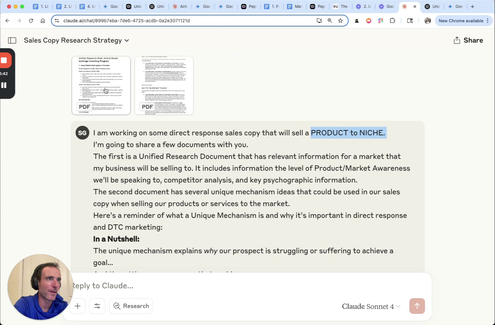
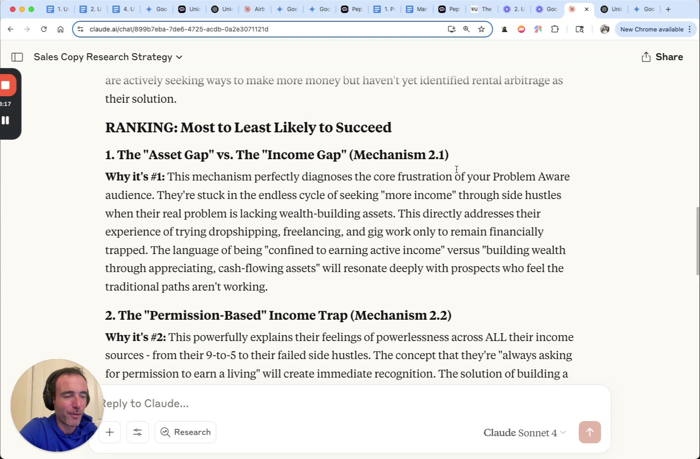
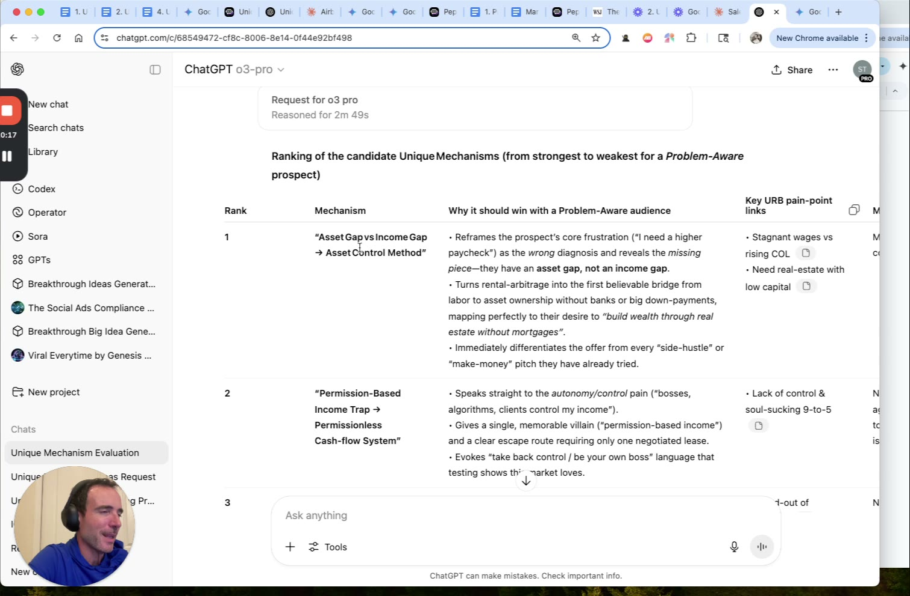
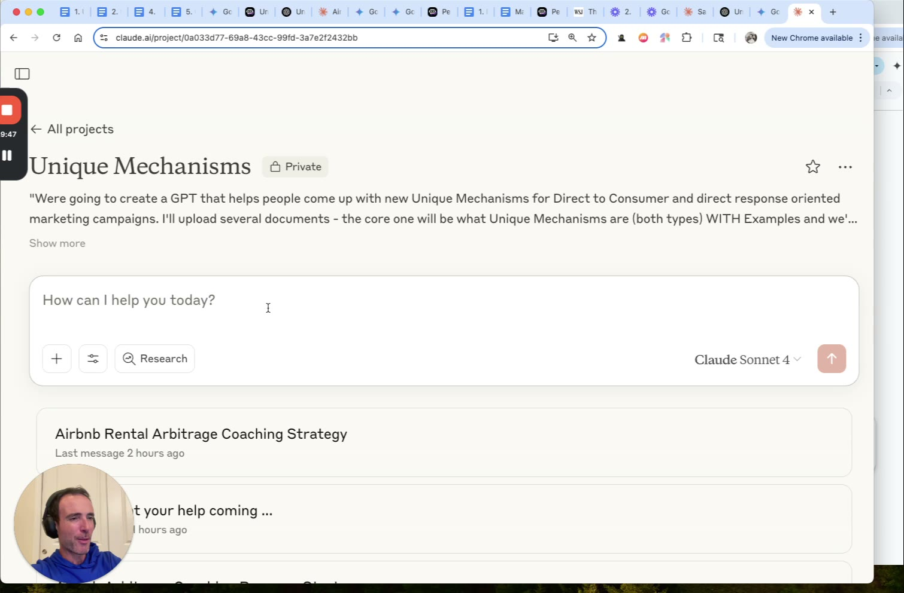
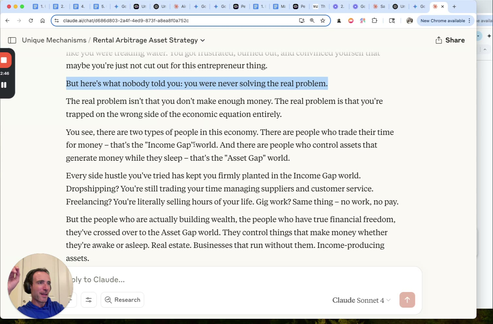
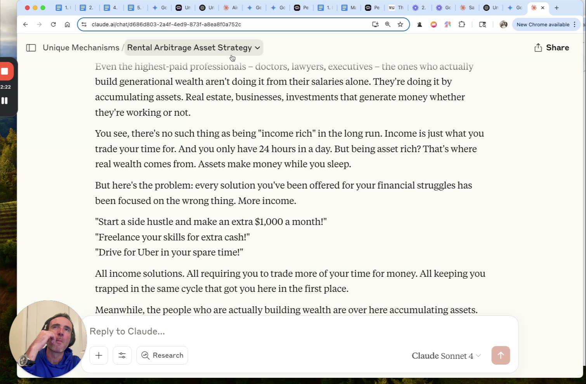
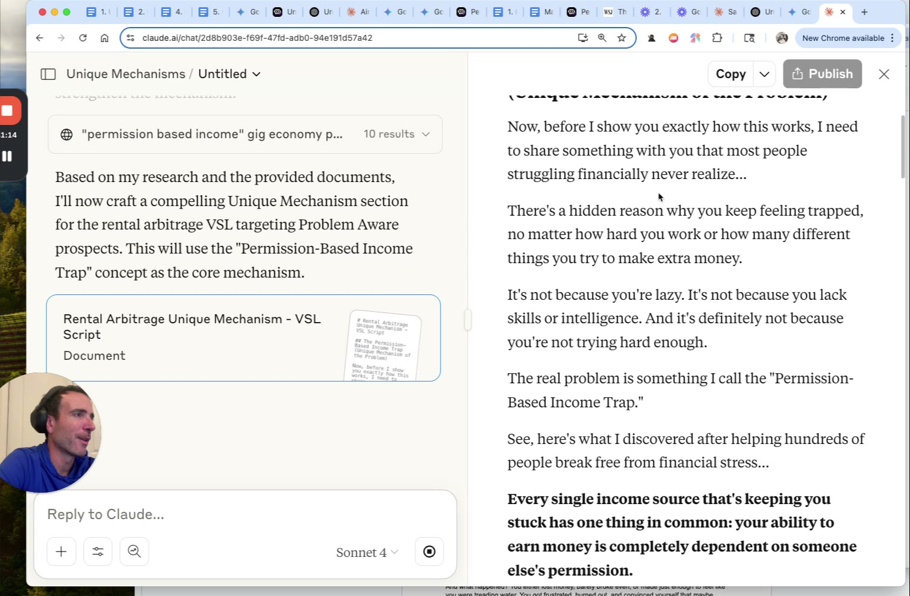
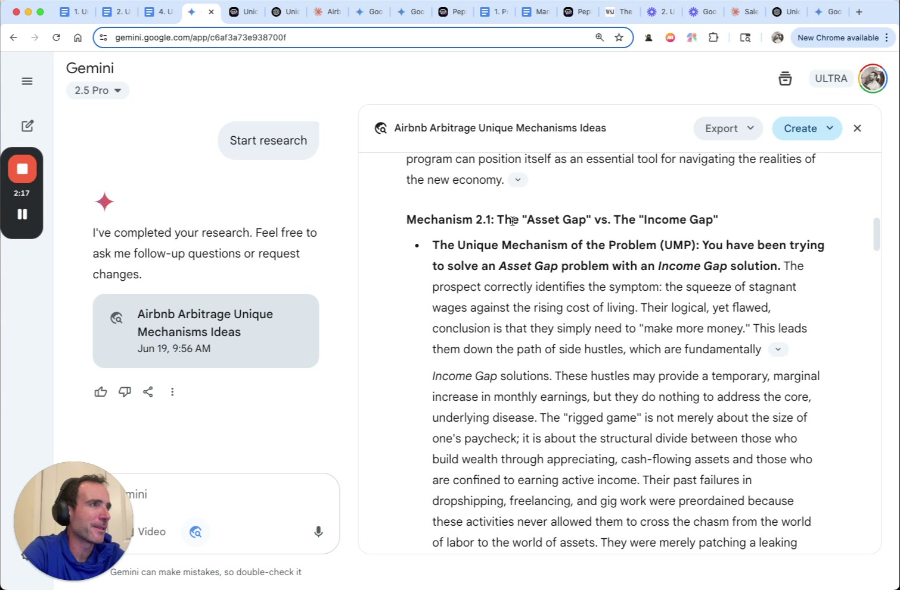
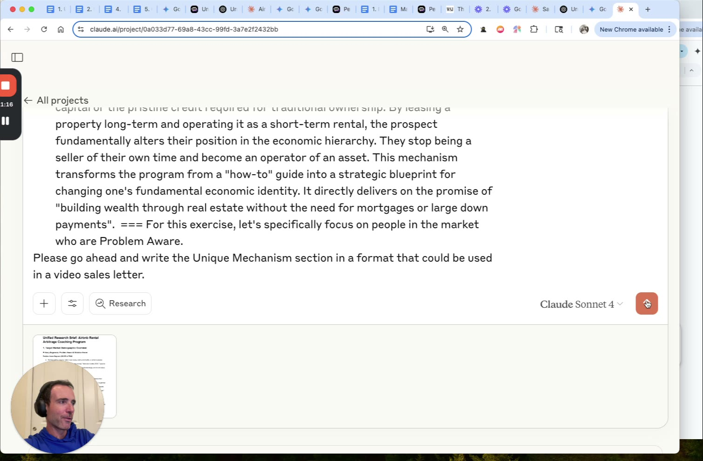

# 3.3 UMP Evaluation Prompt and Process (Airbnb Arbitrage)
> Once an LLM has generated a pile of unique-mechanism ideas, rank them with one fixed evaluation prompt run on several LLMs, then write the top two out as VSL-style copy to judge them in context; this is how the course turns "which mechanism?" from a gut call into a repeatable process.

## 🤖 Agent use
- **Use when:** there is a shortlist of unique mechanism (UMP/UMS) ideas and a unified research document, and a decision is needed on which mechanism the VSL, advertorial, PDP or ad should lead with.
- **Inputs → outputs:**
  - Inputs: (1) the unified research document (PDF); (2) a document with the candidate UMP/UMS ideas (PDF); (3) the awareness level to target (Problem Aware or Solution Aware); (4) the product and niche.
  - Outputs: a ranked list per LLM with reasons; a consensus top 2; a VSL-format "unique mechanism section" draft for each finalist; a pick, or a decision to test both.
- **Rules:**
  - **DO** run the identical evaluation prompt (below) on at least three LLMs and compare. Course run: Claude, ChatGPT o3-pro (2m49s of reasoning) and Gemini 2.5 Pro. [05:09–13:56]
  - **DO** upload the research document and the mechanism document as files rather than pasting. [06:37]
  - **DO** set the last paragraph of the prompt to the awareness level you are writing for; the course version has a Problem Aware and a Solution Aware variant. [05:41; doc Example #2]
  - **DO** treat agreement across LLMs as a signal: Claude and ChatGPT both put "Asset Gap vs Income Gap" first and "Permission-Based Income Trap" second; Gemini reversed the order. [13:56–17:45]
  - **DON'T** treat the ranking as the decision. The instructor's point is that LLMs produce outputs, but judgment (which one will actually land) is the scarce skill; use the ranking as a stand-in for experience, not a replacement for it. [00:00–05:09]
  - **DO** expand the top 2 into VSL-style copy with the expansion prompt in the Unique Mechanisms Claude Project to "see what our mechanism could look like in real copy". This is a test of feel, not final copy. [19:34–21:06]
  - **DO** read the expansion draft as a critic. In the example the first draft pushed the prospect from an "income gap world" into an "asset gap world"; the instructor rewrote the logic to "you think you have an income problem, but what you really have is an asset problem". [25:25–30:13]
  - **IF** you have an existing offer **THEN** test both mechanisms in ads/advertorials first and build the VSL on the winner. [19:34; 48:22]
  - **IF** it is a brand-new offer and you are unsure **THEN** sleep on it, explain both to a few people, then go with gut; if you still lack confidence, take the mechanism that two of three LLMs ranked first. [48:22–49:54]
  - **DON'T** agonize: "maybe a bunch of those mechanisms will work". [49:54]
  - **DON'T** copy numbers, legal claims or "I helped hundreds of people" lines from LLM-written mechanism drafts. They are unverified model output (see Compliance flags). (derived)
- **See also:** [3.2 UMP ideation with LLMs](03-02-ump-ideation-with-llms.md) · [3.4 Eye-serum walkthrough](03-04-ideation-validation-and-expansion-walkthrough-eye-serum-exam.md) · [3.5 Claude Project for unique mechanisms](03-05-creating-a-claude-project-for-unique-mechanisms.md) · [Unique mechanism (Evolve)](../../../evolve/copywriting/concepts/unique-mechanism.md) · [2.4 Unified research process](02-04-unified-research-process.md)

## Key ideas

### 1. LLMs give outputs; judgment is the gap [00:00–05:09]
- The instructor cites an AI book he read early on ("I think it was called *Power and Prediction*", per the `.srt` captions; he says it is by University of Toronto AI scientists). Its argument as he relays it: there is a difference between getting great outputs and having judgment, and AI will take longer to replace humans on judgment. He immediately qualifies it: "AI is actually getting pretty good at judgment but they don't have the total overall edge here." [00:00–01:05]
- His own picks from the earlier ideation videos: "asset gap vs income gap" (he got "the most excited" by it), "digital serfdom" and the "permission-based income trap". He admits he is probably "pre-framing" from the outputs. His excitement was "based on experience and knowledge", not pure intuition. [02:16–03:36]
- If you lack that experience, "asking AI to evaluate for you at this point with good models is not a bad idea", and it "is typically going to actually make pretty good decisions". [04:35–05:09]
- (Instructor claim, not demonstrated: that experience lets him beat a less experienced person head to head on copy or marketing. [03:36])

### 2. The evaluation prompt [05:09–06:37]
- One prompt, five parts: the job (direct response copy selling PRODUCT to NICHE); two attached documents (unified research document, mechanism ideas); a reminder of what a unique mechanism is; the task (rank from most to least likely to succeed, considering beliefs, attitudes, awareness levels and competitive environment); the awareness level. Full text in "Prompts / templates".
- The "reminder" block is the same UM definition used elsewhere in the module: the mechanism explains why the prospect is struggling and how they can overcome it, in two parts (UMP and UMS), and works by giving the prospect "ONE CRUCIAL PIECE OF INFORMATION" they have been missing. [doc: 03-3 UMP Evaluation Prompt.docx]
- Setup in the video: PRODUCT/NICHE are placeholders; he says you can substitute them "or you cannot". In Claude he ran it in a plain chat (Claude Sonnet 4 shown on screen), uploading the Airbnb rental-arbitrage coaching unified research brief and the mechanism ideas, both saved as PDFs. [05:41–06:37]


*The evaluation prompt in a fresh Claude chat (Claude Sonnet 4) with the research brief and mechanism list attached as two PDFs. [06:42]*

### 3. What the three LLMs said [06:37–17:45]
- **Claude:** #1 Asset Gap vs Income Gap ("perfectly diagnoses the core frustration of your Problem Aware audience"); #2 Permission-Based Income Trap; #3 Digital Serfdom (rationale: strong tenant-farmer metaphor but "slightly less universal" because it targets digital failures only). Lower: active-to-passive decay rate, capital efficiency threshold (#5), competitive saturation paradox, franchise-in-a-box (called "more tactical than transformational"), automated hospitality engine (#8), capital multiplier (#9). [06:37–09:16; 12:17]
- **ChatGPT (o3-pro, "thought for two minutes and 49 seconds"):** #1 Asset Gap vs Income Gap → Asset Control Method; #2 Permission-Based Income Trap → Permissionless Cash-flow System; #3 Capital Multiplier Framework (Claude had it at #9); automated hospitality engine at #6. Its table adds columns for pain-point links and watch-outs, e.g. the permission trap "needs strong proof that landlord agreements truly are a one and done to overcome fear of eviction and legal issues". [09:16–12:49]
- **Gemini 2.5 Pro:** #1 Permission-Based Income Trap ("focuses on the psychological root... a lack of control"); #2 a hybrid of asset gap + digital serfdom; #3 capital efficiency threshold; #4 competitive saturation paradox ("likely aimed at the wrong awareness level for a primary hook"); #5 franchise in a box. [13:56–17:45]
- Instructor read-outs worth keeping:
  - Digital serfdom was marked down because the "medieval metaphor may polarize or feel melodramatic in shorter ad formats". He still likes it. [12:17–12:49]
  - Competitive saturation paradox suits solution-aware readers, so "keep for deeper funnel retargeting". [13:21]
  - Automated hospitality engine "can sound like a software demo" for a problem-aware reader. [12:49]
  - "We're already seeing Claude and ChatGPT both agree on the top two." His own view: he agrees, and is "pretty torn on which one" to use. [13:56; 17:45]


*Claude's output: "RANKING: Most to Least Likely to Succeed", #1 Asset Gap vs Income Gap (Mechanism 2.1), #2 Permission-Based Income Trap (Mechanism 2.2), each with a "Why it's #N" paragraph. [08:18]*


*ChatGPT o3-pro's table: Rank, Mechanism, "Why it should win with a Problem-Aware audience", "Key URB pain-point links" and a watch-outs column (cut off). [10:18]*

### 4. If still unsure: aggregate the rankings, or write the mechanism out [17:45–21:06]
- Option A: download the three rankings and give them to an LLM with "here's the rankings for a unique mechanism... which would you pick?" [18:23]
- Option B (the one he demos): put each finalist through the **Unique Mechanisms Claude Project** to see how it reads as copy. The project is described as "a bonus in a bundle I did a while ago"; the mechanisms it generated on its own "weren't actually that good", but it is useful for fleshing out. Setup is covered separately in [3.5](03-05-creating-a-claude-project-for-unique-mechanisms.md). [18:23–19:34]
- Purpose of Option B: "what we want to really do here is... see what our mechanism could look like in real copy". Video ads and other formats often carry a long mechanism section anyway. It "might help push you over the edge on which one to choose". [19:34–20:35]
- "The answer would be test both" if you already have a business. For a brand-new product, course or coaching program, choosing is "kind of tough". [19:34]


*The "Unique Mechanisms" Claude Project: a project description beginning "We're going to create a GPT that helps people come up with new Unique Mechanisms...", with earlier Airbnb chats listed below. [19:48]*

### 5. Expansion run 1: Asset Gap vs Income Gap, Problem Aware [20:35–31:56]
- Prompt (full in 3.4's doc extraction; short form in "Prompts / templates"): attach the unified research document, paste the UMP/UMS summary, state the awareness level, ask for the mechanism section "in a format that could be used in a video sales letter". [20:35–21:06]
- Draft headline: "The hidden truth about why every side hustle you've tried has failed." [21:06]
- Structure of the draft (derived from [21:06–25:25]): (1) promise of an aha plus anger at the wrong solutions; (2) name the mechanism: "you've been trying to solve what I call an asset gap problem with an income gap solution"; (3) mirror the felt squeeze (flat paycheck, rising gas/groceries/rent); (4) list the failed side hustles (dropshipping, freelancing, gig work) and what happened; (5) "here's what nobody told you" and the reframe; (6) two kinds of people (time-for-money vs asset owners); (7) the system keeps you stuck (mortgage, credit, private equity); (8) rental arbitrage as the bridge; (9) how it works (lease long-term, operate as short-term rental); (10) capital required, owner benefits, close.
- Instructor critique: he does not like going "from the income gap to the asset gap" ("moving to an asset gap world"). His fix: it is not that they live in an income world; they think they have an income gap, what they really have is an asset gap, "no one is really income rich. People get rich from assets". He asked for "another version of the UMP that takes this into consideration". [25:25–28:19]
- V2 (Claude, same project) came back with the pivot line "you think you have an income problem. But what you really have is an asset problem" and a new proof frame: "How many of them got rich from a paycheck?"; "there's no such thing as being 'income rich' in the long run"; "You can't earn your way to wealth. You have to own your way to wealth." He calls the last line "good copy right there" and says "I actually really like the mechanism now with this V2." [30:13–31:56]
- His commentary: this is "a perfect example... of judgment based on experience that is really hard to teach", and he attributes it to his "100,000 hours". [31:56]


*Claude V1: "two types of people in this economy... Income Gap world... Asset Gap world", the framing the instructor later rewrote. [22:48]*


*Claude V2 after the logic correction: "Even the highest-paid professionals... aren't doing it from their salaries alone". The title bar shows the "Unique Mechanisms" project. [32:24]*

### 6. Same prompt in Gemini (no project); why he uses Claude for copy [28:57–36:02]
- Gemini was given the unified brief without a project and without extra context. His observation: modern LLMs do not need VSL explained. [28:57–29:37]
- Gemini draft: opens "You feel it, don't you?", uses "band-aid on a bullet wound", "patching a leaking boat", "Formula One races on a bicycle", names the solution "the asset control method" and ends "we don't teach you another side hustle". [32:28–34:36]
- Verdict: better than Claude's first output but "I don't think the copy was as good as Claude... this is why I tend to use Claude for copy, especially once we did V2". [35:29]
- Caveat on format: this section is not the final VSL format. "A lot of what I do is sort of just modeling and structuring off other swipes." The module is for deciding and seeing a mechanism in context, plus pulling parts into ads and advertorials. [36:02]

### 7. Expansion run 2: Permission-Based Income Trap [38:34–47:45]
- Same prompt, the other finalist, run in Claude and Gemini with the research doc re-uploaded in a new conversation ("I like to keep it clean"). [38:34–40:36]
- Claude decided to search first: "I need to search for some current information about rental arbitrage"; the instructor notes it did not do "deep research". [40:36]
- Claude draft structure (derived, [41:18–45:54]): "There's a hidden reason why you keep feeling trapped" → "It's not because you're lazy" → names "the permission-based income trap" → walks every income source (day job/boss, Uber/DoorDash/algorithm, freelancing/client, dropshipping/ad platform, second job/manager) → "You see the pattern here?" → "brutal truth" (instability, one decision from disaster) → critiques mainstream advice ("diversify your income streams") → UMS: a "permissionless cash flow system" → objection handling ("every business needs customers... customers have to choose you") → the single permission point (lease agreement as a "master key") → close on "take back control".
- Instructor's own verdict on the Claude draft: "it's pretty damn good." Gemini's was "a lot shorter... Claude, I think, did a really good job." [45:54; 47:45]


*Claude ran a web search ("permission based income" gig economy...) and then produced an artifact titled "Rental Arbitrage Unique Mechanism - VSL Script". [41:18]*

### 8. The decision [47:45–50:25]
- "Which one do you choose?... the answer is I honestly don't know." [48:22]
- His decision logic, in order: (1) existing offer → test both hooks/ideas in ads and advertorials; (2) brand-new → sleep on it and ask a few people (he names his wife) which resonates, then go with gut; (3) not confident → "just go with number one"; two of the three LLMs ranked the asset/income gap first. [48:22–49:23]
- Gun-to-head pick: asset gap vs income gap. Reason: the permission-based mechanism "had potentially more objections": "You're not asking for permission, but you kind of are. You're still serving at the leisure of Airbnb." He may still work some of it into the VSL "but maybe not as in-depth". [49:23–49:54]
- "Maybe both will work. So maybe you don't have to agonize over the decision." After this step "we basically have copy ready UMP, UMS stuff". [49:54–50:25]
- Roadmap: more examples in the module (skincare "at least one more", maybe golf), shorter videos, plus a how-to video for the Claude Project. [50:25]

## Steps / framework
1. **Assemble inputs.** Unified research document (PDF) and a single document of candidate UMP/UMS ideas (PDF). Keep every candidate you like from the ideation step ([3.2](03-02-ump-ideation-with-llms.md)). [06:37]
2. **Fill the evaluation prompt.** Product, niche, awareness level (Problem Aware vs Solution Aware). [05:41]
3. **Run it fresh on three LLMs** (new chat each; attach both files). Record each ranking and its reasons. [06:37–13:56]
4. **Compare.** Mark consensus top 2, outliers, and each model's objection (wrong awareness level, too tactical, too melodramatic for short formats, needs proof). [12:17–17:45]
5. **Optionally aggregate:** give the three rankings to an LLM and ask which it would pick. [18:23]
6. **Expand the top 2** with the expansion prompt inside the Unique Mechanisms Claude Project; also run Gemini/ChatGPT without a project for comparison. [19:34–35:29]
7. **Critique the drafts as a human.** Check the logic of the problem frame (does it say what the prospect "really" has?), the metaphor, the objections it creates. Feed corrections back in the same chat. [25:25–31:56]
8. **Save everything** in one document: Claude combo, Claude V2, Gemini versions, per mechanism. [36:54–38:34]
9. **Decide**: test both (existing offer), or choose on consensus + objection count + gut. [48:22–49:54]

## Examples

### Mechanisms evaluated (Airbnb rental-arbitrage coaching, Problem Aware)
| Mechanism (UMP → UMS) | Claude | ChatGPT o3-pro | Gemini 2.5 Pro | Instructor note | Source |
|---|---|---|---|---|---|
| Asset Gap vs Income Gap → Asset Control Method (Mechanism 2.1) | 1 | 1 | 2 (merged with digital serfdom) | His favorite from the first run; final gun-to-head pick | [06:37; 10:17; 15:26; 49:23] |
| Permission-Based Income Trap → Permissionless Cash Flow System (2.2) | 2 | 2 | 1 | Strong emotion; more objections because it still depends on Airbnb | [07:21; 10:17; 13:56; 49:23] |
| Digital Serfdom → Asset Control Arbitrage (2.1 alternative) | 3 | lower (not stated) | merged into #2 | "Medieval metaphor" may be melodramatic in short ads | [08:18; 12:17] |
| Capital Multiplier Framework | 9 | 3 | not stated | Models disagreed strongly | [11:16; 12:17] |
| Capital Efficiency Threshold | 5 | 4 (as heard) | 3 | n/a | [11:16; 16:46] |
| Automated Hospitality Engine | 8 | 6 | not stated | Instructor liked it; reads as "solution delivery", "software demo" | [09:16; 12:49] |
| Competitive Saturation Paradox | lower | lower | 4 | Solution-aware / retargeting angle | [13:21; 16:46] |
| Franchise-in-a-Box Operating System | lower | not stated | 5 | "More tactical than transformational" | [09:16; 16:46] |

The transcript is machine-generated and the ChatGPT rank for capital efficiency threshold is read from a garbled sentence ([11:16]); verify against the share links listed in the doc before relying on it.

### Rewrites (before → after)
| Before | After | What changed | Source |
|---|---|---|---|
| "You're trying to solve an asset gap problem with an income gap solution"; "jump from the income gap world into the asset gap world" (V1) | "You think you have an income problem. But what you really have is an asset problem." "You can't earn your way to wealth. You have to own your way to wealth." (V2) | Replaced a two-worlds metaphor with a diagnosis the prospect can accept ("what you really have"), plus a plain-language proof line | [22:44; 25:25–31:56] |

### Hooks / templates visible in the drafts
| Item | Structure | Why it works (derived) | Source |
|---|---|---|---|
| "The hidden truth about why every side hustle you've tried has failed" | "The hidden truth about why [everything you've tried] has failed" | Promises an explanation for past failure; the UMP is the answer | [21:06] |
| "You've been trying to solve a(n) [X] problem with a(n) [Y] solution" | Mismatch formula for a UMP | Compresses the knowledge gap into one sentence | [21:46] |
| "Your ability to earn money is completely dependent on someone else's permission" | Single label that unifies every past failure | One named villain across all prior solutions | [41:18; doc Example 2] |

## Prompts / templates (verbatim)

### Evaluation prompt (from the course doc `03-3 UMP Evaluation Prompt.docx`; PRODUCT, NICHE and the awareness level are highlighted placeholders in the source)
```text
I am working on some direct response sales copy that will sell a PRODUCT to NICHE.

I'm going to share a few documents with you.

The first is a Unified Research Document that has relevant information for a market that my business will be selling to. It includes information, the level of Product/Market Awareness we'll be speaking to, competitor analysis, and key psychographic information.

The second document has several unique mechanism ideas that could be used in our sales copy when selling our products or services to the market.

Here's a reminder of what a Unique Mechanism is and why it's important in direct response and DTC marketing:

**In a Nutshell:**

The unique mechanism explains *why* our prospect is struggling or suffering to achieve a goal…

And *how* they can overcome that problem.

At its core, the unique mechanism is always a two-part logical connection.

**The Reason It's Important:**

Typically by the time our prospect comes to us, they've tried numerous solutions to their problem already. In the past, these other solutions may have not worked at all, worked partially, or worked fully for a period of time (before they stopped working).

Our job as a copywriter is to educate our prospect about the REAL reason why past solutions didn't bring them permanent results. We do this by explaining that their knowledge about the problem is incomplete. They've been missing ONE CRUCIAL PIECE OF INFORMATION, and this "knowledge gap" is what's been holding them back.

**There are two parts to the unique mechanism:**

1. Unique Mechanism Behind the Problem (UMP) our Prospect Faces.

2. Unique Mechanism Behind the Solution (UMS) to that Problem.

It's important to identify the unique mechanism behind both the problem AND the solution.

*By showing the unique mechanism behind the problem, you get the prospect to understand why they've failed in the past.*

*By showing the unique mechanism behind the solution, you get the prospect to believe that our product will bring them success where other alternatives have failed.*

=======

**Here's what I want you to do:**

Evaluate each unique mechanism idea based on their potential for connecting to our target market and persuading them to buy the product we are selling, and rank them from most likely to succeed to least likely to succeed.

In order to make this evaluation, consider the Unified Research Brief and the beliefs, attitudes, awareness levels, and competitive environment within which our target customer finds themselves.

When making your rankings, keep in mind that our core market is people who are Problem Aware.

Please go ahead and do this now.
```
- The doc's "Example #2" is the identical prompt with the last paragraph changed to "...our core market is people who are **Solution Aware**." [doc]
- The doc also lists share links to the three LLM rankings (Claude, ChatGPT, Gemini 2.5 Pro Google Doc) for the Airbnb run; their contents are not in the course files.

### Expansion prompt, short form (used at [20:35]; the full four-example doc is reproduced in [3.4](03-04-ideation-validation-and-expansion-walkthrough-eye-serum-exam.md))
```text
We're going to do an in-depth unique mechanism for a product. I've attached a unified research document that should give you a strong overview of the target market.

Here is a summary of the UMP and UMS:

[PASTE THE MECHANISM SUMMARY: the UMP (problem) and UMS (solution) text for ONE chosen mechanism]

===
For this exercise, let's specifically focus on people in the market who are [Problem Aware].

Please go ahead and write the Unique Mechanism section in a format that could be used in a video sales letter.
```
- Instructor's spoken version differs slightly ("Go ahead and write this section in a format that could be used in a video sales letter") [20:35]; the doc wording above is the canonical text. Run inside the Unique Mechanisms Claude Project and attach the unified research document. [doc: 04-4 Claude_UMP Expansion Prompt.docx]

### Correction prompt used after V1 (reconstructed; the instructor ad-libs it and Whisper garbles it, so treat as a pattern, not a quote) [26:40–28:19]
```text
I think this is great, but I wonder if it's really an "income gap world" vs "asset gap world". It's more that they think they have an income gap, but what they really have is an asset gap. We show you how to bridge that gap. People don't get rich from income; they get rich from assets. Write another version of the UMP that takes this into consideration.
```

## Screenshots
Screenshots are embedded above; frames cover the prompt in Claude, Claude and ChatGPT rankings, the Claude Project, the V1/V2 drafts, and the permission-trap draft. Gemini Deep Research source list:


*The ideation source for this lesson: a Gemini 2.5 Pro Deep Research report "Airbnb Arbitrage Unique Mechanisms Ideas", showing "Mechanism 2.1: The 'Asset Gap' vs. The 'Income Gap'" with the UMP/UMS split. [02:18]*


*The expansion prompt ready to send in the Unique Mechanisms project: pasted UMP/UMS summary, "specifically focus on people in the market who are Problem Aware", "write the Unique Mechanism section in a format that could be used in a video sales letter", unified research brief attached. [21:18]*

## How to apply
- [ ] Save the shortlist of mechanisms as one PDF and the unified research document as a PDF.
- [ ] Fill PRODUCT, NICHE and awareness level; run the evaluation prompt in three LLMs; log each rank and reason.
- [ ] Mark consensus top 2 and any "wrong awareness level" objections; shelve those for retargeting or deeper funnel.
- [ ] Run the expansion prompt for each finalist; read the draft aloud and rewrite any line where the problem frame is illogical or melodramatic.
- [ ] Strip every statistic, legal claim and "I helped hundreds" line from the drafts until a source is attached.
- [ ] Existing offer: test both mechanisms as ad/advertorial hooks, then write the VSL on the winner. New offer: get two or three human reactions before committing.
- [ ] Record why the winner won so the next brief starts from evidence, not the LLM rank. (derived)

## Related
- Previous: [3.2 UMP ideation with LLMs](03-02-ump-ideation-with-llms.md) · Next: [3.4 Ideation, validation and expansion walkthrough (eye serum)](03-04-ideation-validation-and-expansion-walkthrough-eye-serum-exam.md)
- Brief using the same Airbnb example: [5.3 Airbnb arbitrage example](05-03-airbnb-arbitrage-example.md)
- Evolve: [Unique mechanism (new, unspoken, renamed)](../../../evolve/copywriting/concepts/unique-mechanism.md) is the closest page; Evolve's framing is "inspire hope" and new/unspoken/renamed, while this module's framing is a UMP + UMS knowledge gap. They do not contradict each other but they are different lenses. [Market awareness](../../../evolve/copywriting/concepts/market-awareness.md) · [AI in copywriting](../../../evolve/copywriting/concepts/ai-in-copywriting.md) · [Market awareness levels (Evolve Start Here)](../../../evolve/start-here/concepts/market-awareness-levels.md)

## Sources and limitations
- Transcript: [03-[3] UMP Evaluation Prompt and Process (Airbnb Arbitrage).txt](<../../../../../raw/stefan-georgi/rmbc-ii/_transcripts/Stefan Georgi - RMBC II (1)/03-UNIQUE MECHANISMS/03-[3] UMP Evaluation Prompt and Process (Airbnb Arbitrage).txt>) (last segment at 50:51, whole video covered).
- Documents: [03-3 UMP Evaluation Prompt](<../../../../../raw/stefan-georgi/rmbc-ii/_extracted/Stefan Georgi - RMBC II (1)/03-UNIQUE MECHANISMS/03-3 UMP Evaluation Prompt.docx.md>); [04-4 Claude_UMP Expansion Prompt](<../../../../../raw/stefan-georgi/rmbc-ii/_extracted/Stefan Georgi - RMBC II (1)/03-UNIQUE MECHANISMS/04-4 Claude_UMP Expansion Prompt.docx.md>) (Examples 1 and 2 are the Airbnb inputs used here; the file is the "[4]" lesson's document but it is the source of the verbatim expansion template).
- Whisper mishearings fixed against the `.srt`: "claw/cloud/quad" = Claude; "chatty BT" = ChatGPT; "Digital circum" = digital serfdom (Gemini section); "wicker" in [22:44] is unclear (likely "whether they're awake or asleep", matching the screenshot of the draft). Several quoted ranks in [11:16–12:17] are read from garbled sentences.
- **Compliance flags (biz-opp / earnings content).** The example is a make-money coaching offer. Copy the structure, never the claims. Specific items in the LLM drafts that are unverified model output and would need substantiation or removal before use on Meta or in a funnel:
  - "$5,000 to $15,000 to get started", "15 to 35% profit margins", "over 7 million listings", "$180 billion in 2024", "over a third of Americans believe they'll always need a side hustle" ([25:25]; [43:09–45:54]). The instructor does not verify any of these.
  - "After helping hundreds of people break free from financial stress" in the Claude draft ([41:18]) is a fabricated proof line from the model; never use invented client counts.
  - "Completely legal. Airbnb actually allows it" ([44:04]) is a legal assertion that depends on the landlord agreement and platform terms.
  - Earnings and income-claim rules (FTC, Meta) apply to this category. (derived)
- The "permissionless" claim is itself shaky: the instructor concedes the income is still subject to Airbnb ("the income is not really true for Airbnb, right?" [43:09]; "still serving at the leisure of Airbnb" [49:23]).
- "Validation" in this lesson means LLM ranking plus the instructor's judgment. No market test is shown; the instructor says testing in ads is the better method when an offer exists. [19:34]
- Screenshots come from the screen recording; the instructor's webcam overlay appears in each frame and is not otherwise used.
