# 3.4 Ideation, Validation and Expansion Walkthrough (Eye Serum Example)
> A full run of the mechanism process on a physical product (a peptide eye serum for solution-aware women): generate many mechanisms on several LLMs, cut them by hand, rank the shortlist on three LLMs, expand the top two into VSL copy, then fix the names and metaphors by talking to the model.

## 🤖 Agent use
- **Use when:** choosing and polishing a unique mechanism for a physical DTC product (skincare, supplements, beauty, health) targeting a solution-aware market.
- **Inputs → outputs:**
  - Inputs: unified research document (PDF); product ingredient list; target awareness level; the ideation prompt from [3.2](03-02-ump-ideation-with-llms.md); the evaluation prompt from [3.3](03-03-ump-evaluation-prompt-and-process-airbnb-arbitrage.md); the expansion prompt below; a Claude Project for unique mechanisms ([3.5](03-05-creating-a-claude-project-for-unique-mechanisms.md)).
  - Outputs: a saved shortlist document (UMP + UMS per idea), a cross-LLM ranking, two VSL-format mechanism sections, and renamed, simplified mechanism terms.
- **Rules:**
  - **DO** run ideation on several LLMs. In the course: Gemini Deep Research, Perplexity Deep Research, ChatGPT o3-pro (with and without deep research), Gemini 2.5 Pro, Claude. "You really need to be LLM agnostic." [02:35; 27:33–28:40]
  - **DO** give the ideation prompt the ingredient list for a supplement or skincare product, so mechanisms map to ingredients you actually have. [02:01]
  - **DON'T** dismiss a mechanism for a bad name: "we could always change the name". Judge the idea underneath, then rename. [03:39]
  - **DO** save promising mechanisms into one running document as you read; skip those with no matching ingredient ("do we have this ingredient? I don't think we actually have this ingredient. So I'm going to skip this one"). [07:38; 32:50]
  - **DO** prefer simple mechanisms in health and beauty: "for health beauty things... you typically see simpler mechanisms win more often." [20:19–20:50]
  - **DO** minimise cognitive leaps: "I want as few cognitive leaps as possible. I want stuff they kind of know is true, and here's the one thing you were missing." [30:44]
  - **DON'T** pick a mechanism whose hero ingredients are already well known (vitamin C and E were skipped: "not exciting enough"). [15:03]
  - **IF** the LLMs rank a mechanism high for a reason that is not the market's top pain (here: product sensitivity), **THEN** go back to the research document and ask the LLM to justify the ranking before accepting it. [46:25–52:00]
  - **IF** you already have a live mechanism that sells, **THEN** put its real website copy into the shortlist for a fair comparison. [38:37–39:36]
  - **DO** define the awareness level inside the expansion prompt (paste the Solution Aware profile block). Without it the model assumed the reader knew peptides. [57:43–1:02:08]
  - **DO** correct the draft in the same chat: audience assumptions, names, metaphors. Ask for 5+ alternatives, pick, then tell the model your pick and have it rewrite. [1:07:06–1:17:47]
  - **DON'T** use unverified numbers or ingredient-effect claims from LLM mechanism text (see Compliance flags).
- **See also:** [3.3 Evaluation prompt (Airbnb)](03-03-ump-evaluation-prompt-and-process-airbnb-arbitrage.md) · [3.2 UMP ideation with LLMs](03-02-ump-ideation-with-llms.md) · [2.5 Ingredient deep research for claims](02-05-ingredient-deep-research.md) · [Unique mechanism (Evolve)](../../../evolve/copywriting/concepts/unique-mechanism.md) · [Compression and plain language (Evolve)](../../../evolve/copywriting/concepts/compression-and-plain-language.md)

## Key ideas

### 1. Setup: same process as Airbnb, applied to a peptide eye serum [00:00–02:35]
- Ideation prompt (opening, per the transcript and the Perplexity screenshot): "Today I want your help coming up with as many unique mechanism ideas as possible for a product in the skincare space... A specific product is a peptide eye serum. I have attached a research brief..." plus a short overview of how to understand unique mechanisms in direct-response and D2C copy. Full ideation prompt: [3.2](03-02-ump-ideation-with-llms.md). [00:00–00:59]
- Awareness choice: "let's specifically focus on people in the market who are solution-aware." His reasoning: everyone problem-aware is also solution-aware; in this market "solution aware was looking for eye creams, all that kind of stuff, not specifically looking for peptide stuff", and that is probably the biggest segment, so it is the one to target. [00:59–02:01]
- For supplements and skincare he adds: "additionally, I've included a list of product ingredients for your consideration. Here is the list. Go ahead and get started now." The ingredients visible in the Perplexity prompt include dipalmitoyl hydroxyproline, Pistacia lentiscus extract, saccharide isomerate, sodium hyaluronate and vitamins; the amino acids proline, glycine and alanine appear in the worked examples. [02:01; frame 17:48; doc Examples 3 and 4]
- First run: Gemini Deep Research ("my favorite", shown in several LLMs for comparison). [02:01–02:35]

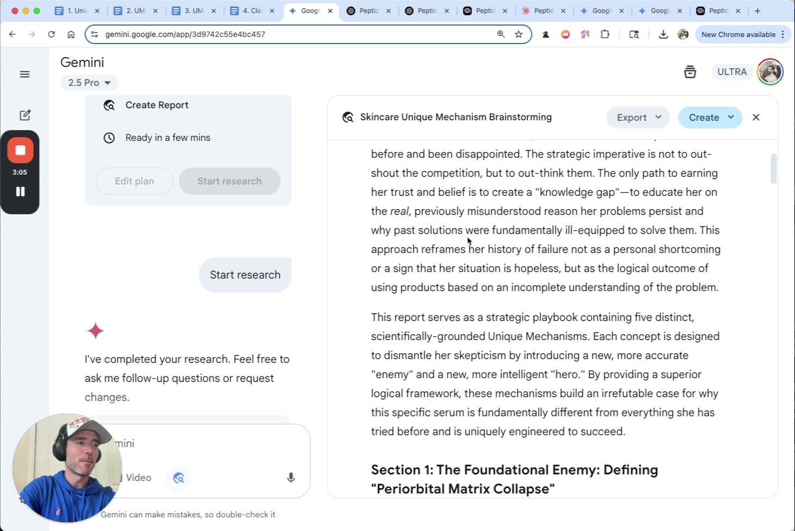
*Gemini 2.5 Pro Deep Research report: the report frames the task as creating a "knowledge gap" and promises "five distinct, scientifically-grounded Unique Mechanisms"; Section 1 defines the "Foundational Enemy: Periorbital Matrix Collapse". [03:06]*

### 2. Gemini Deep Research: five concepts and his verdicts [02:35–16:59]
| Concept (UMP → UMS) | Instructor verdict | Saved? | Source |
|---|---|---|---|
| **Dermal Disarray** (tangled, chaotic collagen, not just loss; tent-pole analogy) → "Bio-Tensegrity" signal (dipalmitoyl hydroxyproline) + amino-acid "smart materials" + protective shield | "Eh. It's okay. It's not bad." Too technical; ask the LLM for simpler explanations and "three different ways we could explain this using different metaphors and analogies" | Yes | [03:39–07:38] |
| **Chronic Dehydration Debt** → "Hydro-Magnetic Lock" (saccharide isomerate surface lock + sodium hyaluronate deep fill) | Likes the "moisture anchors" concept ("I think that's an interesting concept. So note that right now"); worry: it addresses hydration and glow more than fine lines and wrinkles | Yes | [07:38–11:23] |
| **Elastase Cascade** → "Elastase Cascade Neutralizer" / elastin-guardian complex | "Not mind-blowing, but okay"; names are "not good for actual copy... you'd be like, what the f*** are you talking about" to a 30-to-80-year-old woman; fine for internal use | Yes (later doubted: "I don't know that elastase is enough") | [11:23–13:33; 38:02] |
| **Oxidative Depletion Loop** → "Antioxidant Regeneration Engine" (vitamins C and E) | Best-sounding and most believable name, but vitamin C/E are not exciting enough to be the hero | Skipped | [13:33–15:03] |
| **Lipid Barrier Breach and Inflamm-Aging** (brick-and-mortar skin wall; "Inflamm-Aging" as the named consequence) → "Biomimetic Barrier Seal" | "I like the idea of a biomimetic barrier seal"; saves it | Yes | [15:03–16:59] |
- Meta-point about names: "it came out more cynical sounding than I meant... It just is a pet peeve of mine, where someone [says] I don't like that name. Now I'm dismissive about it." [03:39]

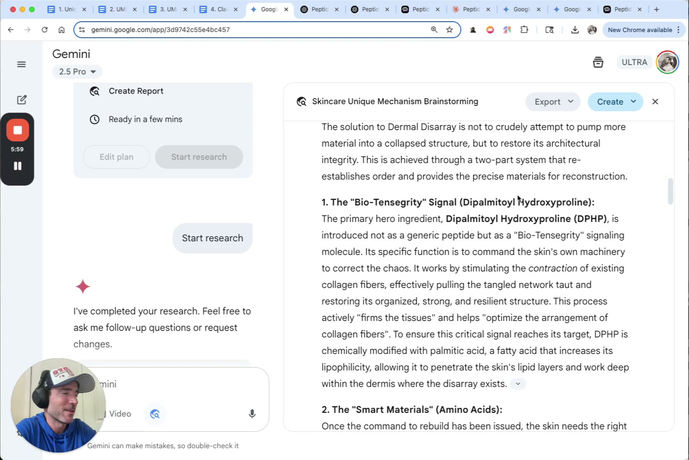
*The UMS side of "Dermal Disarray": "The solution... is not to crudely attempt to pump more material into a collapsed structure, but to restore its architectural integrity", then the "Bio-Tensegrity" signal (DPHP) and "Smart Materials". [06:00]*

### 3. Perplexity Deep Research: simple mechanisms, better for this market [16:59–35:30]
- Same prompt, uploaded brief as a PDF, run in Perplexity Deep Research while he reads other outputs (46 sources). [16:59–17:49]
- He likes it despite being "not as eloquently written as Gemini's deep research" because it is **simpler**. His diagnosis: Gemini's concepts may be "a little bit overcomplicated". Overcomplicating "worked well for Airbnb arbitrage", but for skincare "women just kind of want to know what's going on because they're already... solution aware at a high level"; the psychographic research showed they have researched and "don't want complicated things". [18:44–19:19]
- Awareness-dependent complexity (instructor claim): the Airbnb audience is problem-aware or even unaware; "bizop mechanisms are usually pretty simple, but... the part of the trick is making them seem more complex and sophisticated", while in health and wellness "simpler things... you should too". "I see this very often where... people really overcomplicate the mechanisms, and I used to do that." [19:19–20:50]

| # | Perplexity mechanism | Verdict and reason | Saved? | Source |
|---|---|---|---|---|
| 1 | **Periorbital Collagen Depletion** ("collagen desert"; area loses collagen at "3x the rate"; dipalmitoyl hydroxyproline as "Collagen Preservation Shield" that also inhibits collagen-degrading elastase enzymes) | "Even though it's really simple, probably my favorite so far"; easy to understand | Yes | [17:49–18:44; 29:11–31:41] |
| 2 | **Cellular Communication Breakdown** (cells lose the ability to signal; conductor/orchestra) | "Mediocre"; "inherently becomes more complicated... more of a leap" | No | [20:50–23:08] |
| 3 | **Dermal-Epidermal Junction (DEJ) Collapse** | Same as his current live mechanism ("I wonder if it's citing us"); biased in favour; physiological and "on the nose". Plans to swap in the live product-page version for fairness | Yes (own version) | [23:08–24:07; 29:43; 38:37–39:36] |
| 4 | **Circadian Rhythm Disruption** ("chronobiology regulators") | OK for a night serum, but "kind of bullshit. We don't have a chronobiology regulator"; another cognitive leap | No | [24:07–25:44] |
| 5 | **Glycation Damage** (sugar attaches to collagen; anti-glycation) | "A decent mechanism"; sugar-in-blood is a known bad; uncertain on the science | Yes | [25:44–26:16] |
| 6 | **Periorbital Microbiome** | "A big swing"; probiotics skincare is a category but "we don't have a probiotic heavy formula" | Yes ("we're saving") | [26:16–27:33] |
| 7 | **Stress Hormone / Cortisol Accumulation** | "I don't think this is true. This is actually very interesting." Women know cortisol; but less physiological, "I want as few cognitive leaps as possible" | Unclear; later ranked by all LLMs | [28:40–30:44] |
| 8 | **Cellular Water Channel Dysfunction** (aquaporins; saccharide isomerate) | "I actually like it a lot"; echoes moisture anchors; needs tying to wrinkles and dark circles | Yes | [30:44–31:41] |
| 9 | **Mitochondrial Energy Crisis** | "I've never loved mitochondria mechanisms, but they do work sometimes" | Yes | [31:41–32:50] |
| 10 | **Lymphatic Congestion** | Skipped because the product has no lymphatic ingredient: "So I'm making that up." | No | [32:50–33:30] |
| 11 | **Penetration Paradox / Peptide Delivery Barrier** (skin gets thinner yet harder to penetrate after 40; amino acids mimic skin structure to carry peptides) | "I kind of like it... It's almost like a paradox." Validity questions; he would change "peptides" wording because the target is not necessarily product-aware | Yes | [33:30–35:30] |
| 12 | **Collagen Fiber Disorganization** | Skipped: duplicate of Gemini's Dermal Disarray | No | [35:30] |

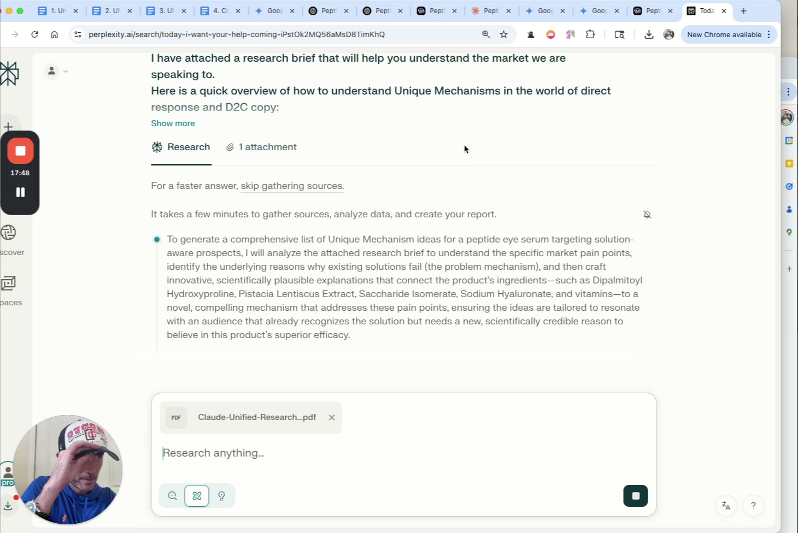
*Perplexity Deep Research with a PDF of the unified research document attached; the plan lists the ingredients it will tie mechanisms to. [17:48]*

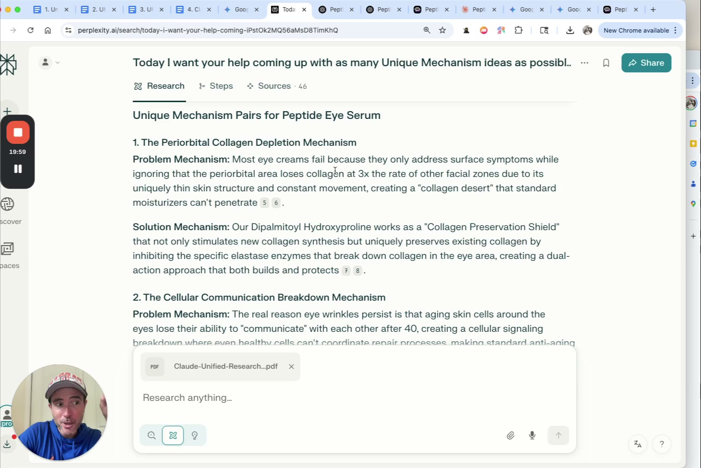
*Perplexity's format: numbered mechanisms, each with "Problem Mechanism" and "Solution Mechanism" paragraphs and citation chips. #1 is the Periorbital Collagen Depletion Mechanism. [20:00]*

### 4. The other LLMs, and why to stay LLM-agnostic [27:33–28:40; 35:30–38:02]
- On social-media "Claude is better now, I'm canceling ChatGPT": he does not get it; he would "cancel Netflix before I'd cancel one of my LLM subscriptions". "You need to use several." [27:33–28:40]
- ChatGPT o3-pro without deep research: "mechanisms, but... whatever. I didn't think it was great", though he would still read it for ideas. [35:30]
- ChatGPT deep research: same issue as Airbnb: "nicknames to explain really basic physiological processes... not actually going deep into the real reasons". A few interesting ideas. [35:30–36:36]
- Gemini 2.5 Pro (no deep research): hormonal cliff and scaffolding damage, zombie cells, glycation stiffening, a barrier-breach idea. [36:36–37:21]
- Claude: "did okay but... they weren't that good either". Net: the best came from Gemini Deep Research and, more, Perplexity. [37:21–38:02]

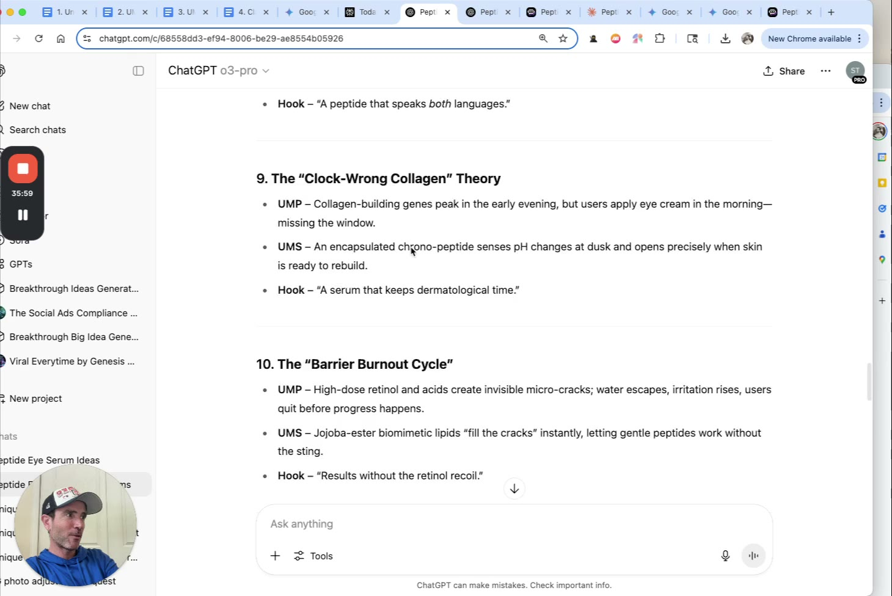
*ChatGPT o3-pro (no deep research) lists each idea as UMP, UMS and a one-line "Hook", e.g. "9. The 'Clock-Wrong Collagen' Theory" and "10. The 'Barrier Burnout Cycle'" (hook: "Results without the retinol recoil"). The instructor was not impressed by this batch. [36:00]*

### 5. Save the shortlist in one document [38:02–41:20]
- Running Google Doc "Example_Potential Mechanisms_Peptide Eye Serum", with a heading per UMP/UMS pair (tabs per mechanism). Candidates he flags to keep: "moisture anchors" (Gemini), "periorbital collagen" (Perplexity, simple), DEJ ("I would probably rather take it from the copy format we have" on the live product page), plus the barrier-seal and dermal disarray ideas. [38:02–39:36]
- The live page's mechanism is "working for us", so the live version is used "to give that a fair shake". [39:36]

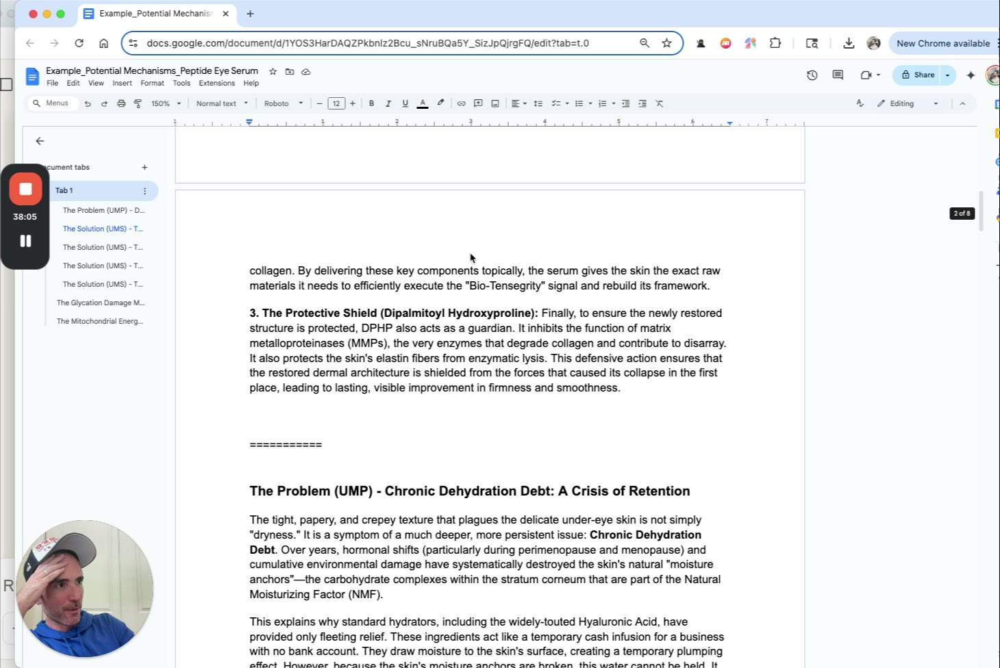
*The saved shortlist (8 tabs): each entry carries "The Problem (UMP)" then "The Solution (UMS)"; here the end of Dermal Disarray's protective shield and the start of Chronic Dehydration Debt. [38:06]*

### 6. Cross-LLM evaluation (Solution Aware) [41:20–55:50]
- He reuses the [3.3 evaluation prompt](03-03-ump-evaluation-prompt-and-process-airbnb-arbitrage.md) with "Solution Aware". Claude (inside the Unique Mechanisms project), Gemini (new shot, no deep research) and ChatGPT o3-pro each got the shortlist document plus the unified research brief. Twelve mechanisms were ranked. [41:20–43:18]
- Because "they say totally different, dramatically different things" he expects to "use our judgment". Reminder from the Airbnb video: talk to people in the market. [43:18–43:52]

| Rank | Claude | Gemini | ChatGPT o3-pro (2m39s) |
|---|---|---|---|
| 1 | Lipid Barrier Breach and Inflammation | Lipid Barrier Breach | Dermal Disarray (Bio-Tensegrity signal + smart materials) |
| 2 | Chronic Dehydration Debt | Dermal Disarray | Lipid-Barrier Breach and Inflamm-Aging (Biomimetic Barrier Seal) |
| 3 | Dermal Disarray | Chronic Dehydration Debt (Tier 1) | Chronic Dehydration Debt (Hydro-Magnetic Lock) |
| Mid | Elastase Cascade, DEJ at 5, stress hormone, glycation... | Tier 2 strong contenders: Elastase Cascade, DEJ | DEJ at 5; Periorbital Collagen at 6 |
| Last | Mitochondrial 10, Peptide Delivery Barrier 11, Periorbital Collagen 12 ("too similar to existing collagen messaging they've already heard") | Peptide Delivery Barrier ("not unique"; "doesn't create a new knowledge gap") | not stated |
(Positions 4 and 6–9 for Claude are read in the order the instructor spoke them; ranks 10–12 are from the on-screen output. [43:52–44:56; 47:22–48:15; 52:56–54:42; 56:00])

- Instructor reactions:
  - Claude's #1 "perfectly explains your core frustration, product sensitivity and reactions, burning irritation". He objects: "it does solve that frustration but that is not, I don't think, the market's number one frustration. I think the pain points are the eye wrinkles." [43:52–44:23]
  - Claude put his favorite (periorbital collagen, the simple one) last at #12 ("too similar to existing collagen messaging they've already heard"); ChatGPT had it at #6. He does not rebut it on camera. [44:56; 54:42]
  - Gemini put the Peptide Delivery Barrier last ("not unique and doesn't create a new knowledge gap"); his reaction: "I still feel like I can make this one work, but it's very interesting." [48:15]
  - He asked Gemini why product sensitivity matters so much. Gemini's answer: the desire to look better is the primary problem, but fear of irritation is a "meta problem" that blocks belief; a barrier-breach mechanism "establishes how [peptides] can work without causing irritation". "Interesting." He admits it may "influence me to some level". [49:00–52:00; 48:15]
  - ChatGPT's #1 "speaks directly to skin losing its snap, the number one structural pain that brief flags"; "balances science with accessibility"; its #3 "gives a concrete testable promise" (72-hour lock; this is a model statement). [53:02]
  - His own live DEJ mechanism landed around #5 in all three. He did not use that to reject it. [44:23; 53:57]
- Summary he reads out: Claude 1 lipid, 2 dehydration, 3 disarray; Gemini 1 lipid, 2 disarray, 3 dehydration; ChatGPT 1 disarray, 2 lipid, 3 dehydration. The same three concepts occupy the top three in every list. [54:42]

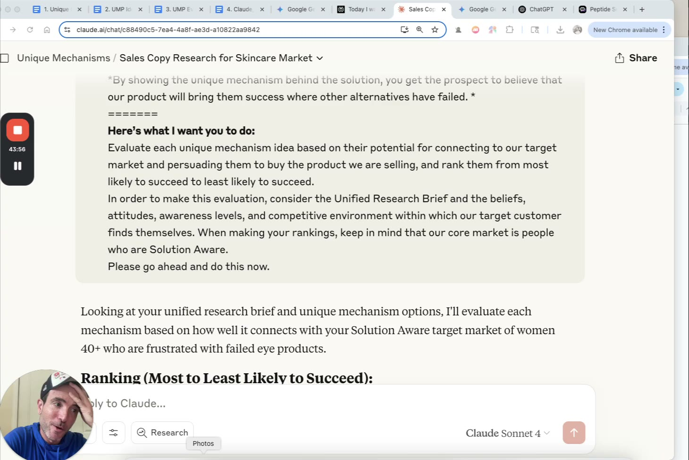
*The evaluation prompt (ends "our core market is people who are Solution Aware") run in a Claude chat inside the Unique Mechanisms project; the answer begins "...I'll evaluate each mechanism based on how well it connects with your Solution Aware target market of women 40+ who are frustrated with failed eye products." [44:00]*

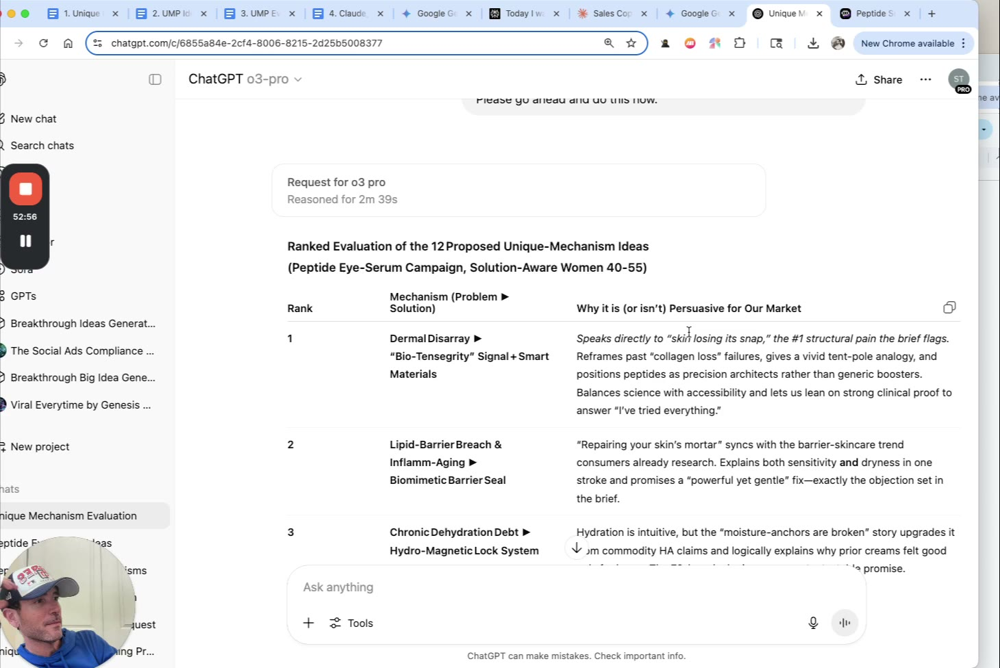
*ChatGPT o3-pro: "Ranked Evaluation of the 12 Proposed Unique-Mechanism Ideas (Peptide Eye-Serum Campaign, Solution-Aware Women 40-55)". #1 Dermal Disarray, #2 Lipid-Barrier Breach, #3 Chronic Dehydration Debt. [53:00]*

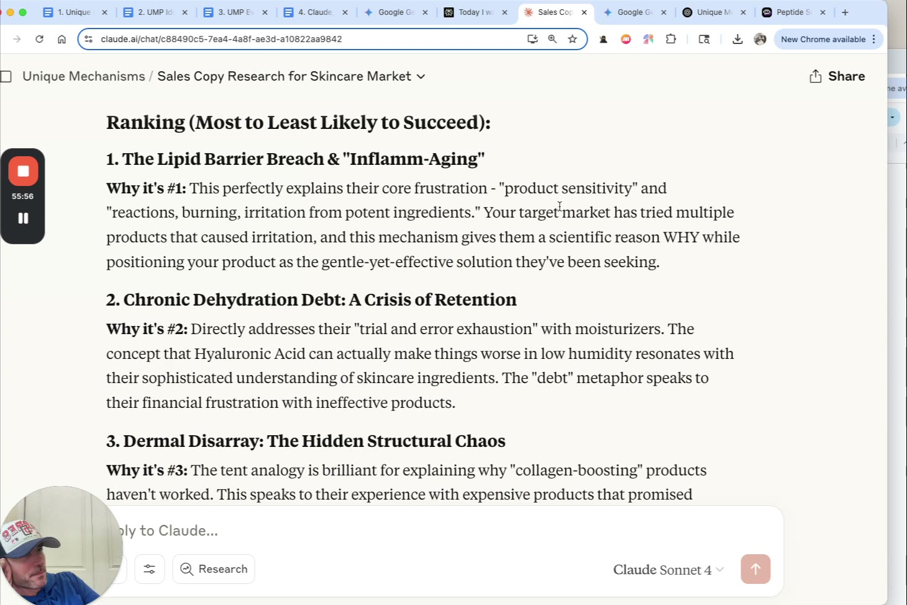
*Claude's top three with "Why it's #N" paragraphs; #2 notes that hyaluronic acid "can actually make things worse in low humidity", which "resonates with their sophisticated understanding of skincare ingredients". [56:00]*

### 7. "Combine them" experiment [45:35–46:25; 50:00–53:57]
- Follow-up prompt after the ranking (verbatim from the screen): "If you were going to take these different mechanism options, and combine them into a new mechanism that you thought was the strongest and that speaks to their pain points (which are primarily appearance driven, followed by what they don't like about products), what would you do?" He also pasted the main ingredients for context. [45:35–46:25]
- Claude's combo: **"The Triple Collapse Cascade"** (structural collapse + barrier collapse + hydration collapse) with a **"Synchronized Repair System"** as the UMS ("a coordinated construction crew"). Instructor: "I hate these construction crew analogies"; "I don't know that I need all of these steps"; the market "kind of don't like these multi-step systems"; "simplicity is better". [50:00–53:57]

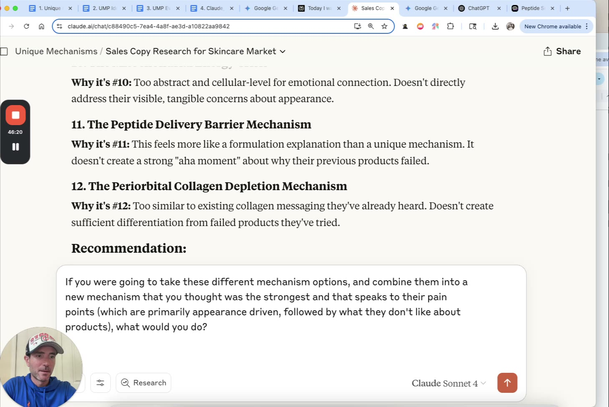
*Ranking tail (#10 mitochondrial, #11 Peptide Delivery Barrier, #12 Periorbital Collagen Depletion) and the typed "combine them" follow-up. [46:24]*

### 8. Expansion: write the top two as VSL copy [55:50–1:19:14]
- Decision: Lipid Barrier Breach is #1 for Gemini and Claude, so expand it first and see how it feels "written out in more depth". Then Dermal Disarray (#2 overall). [55:50; 1:05:10]
- **Prompt fix #1: define the awareness level.** The first run opened with "the audience already knows peptide serums exist". "Do they? Our solution aware didn't have that." He copied the Solution Aware profile block from the unified research document into the expansion prompt ("Here's how you can understand Solution Aware in this context") and reran. [57:43–1:00:58]
- The rerun's title: "The Hidden Reason Your Eye Cream Isn't Working (And What Actually Does)". Beats: "you've tried eye creams before, some expensive ones, some highly rated" → "9 out of 10 eye creams... are essentially expensive moisturizers" → "The Real Problem: Your Skin's 'Security System' Has Been Breached" → brick-and-mortar wall → "after 40, the mortar breaks down" → consequence 1: moisture loss → consequence 2: "Inflamaging" and sensitivity → "Why traditional eye creams can't fix this" (heating a house with broken windows) → "The Solution: The Biomimetic Barrier Seal". His verdict: "I don't love these metaphors" but "I can see how it looks in person". [1:02:08–1:05:10]
- **Dermal Disarray run.** First draft failed the awareness check: "The reason your peptide eye creams haven't worked isn't because peptides don't work. It's because they've been targeting the wrong problem entirely", yet the audience is not necessarily peptide-aware. The model also leaned on the tent metaphor. [1:05:10–1:08:25]
- **Prompt fix #2: rename and re-metaphor.** He asked for more believable names and other metaphors (see prompt below). Model's names: collagen fragmentation syndrome, structural collagen breakdown, collagen network collapse, structural protein disintegration, dermal framework deterioration, collagen architecture breakdown. He chose **Collagen Architecture Breakdown** ("I like simplicity") and the **fabric weave** analogy ("more sentimental, thinking about grandma"). [1:08:25–1:10:45]
- Rewritten UMP (model draft): "Think of healthy young skin like a piece of high-quality fabric with a perfectly tight, organized weave... those collagen threads don't just disappear, they become loose, tangled... trying to add more collagen to your skin is like trying to add more threads to fabric that's already lost its weave." He likes the "you had it half right" structure: "collagen loss is only half the story, and it's not even the most important half... here's the part you were missing". [1:10:45–1:12:04; 1:11:32]
- **Prompt fix #3: rename the UMS parts.** He disliked "Bio-Tensegrity" ("easy to understand?") and "protective shield" ("kind of generic") and asked for alternatives. Offered: structural reset protocol, architecture restoration method, weave repair system, foundational rebuild technology, collagen reorganization complex, structural renewal system; also alternatives for the protective shield (Strength Lock Technology, Structure Guardian Complex, Integrity Defense System, Preservation Protocol, Collagen Armor Technology, Structural Security Network). [1:13:18–1:17:04]
- Picks: **Structural Renewal System** (not the "architecture restoration method", which is "not as understandable"); **Targeted Repair Complex** (from "Targeted Repair Kit": "I like complex"); **Integrity Locking Compounds**. He did not tie every part to the weave metaphor ("You don't have to tie it all to the metaphor"). [1:14:21–1:17:47]
- Final structure the model produced: Step 1 Structural Renewal Signal (pulls loose collagen threads and reorganizes them into a tight weave); Step 2 Targeted Repair Complex (proline, glycine, alanine); Step 3 Integrity Locking Compounds (inhibit matrix metalloproteinases that break down collagen). His read: "I think it's pretty good... I would play with things more." [1:17:47–1:18:19]
- He frames the lesson: take an idea that is "pretty good" but where the name or metaphor is not great, and "work with AI to get things that you like more". The eye-serum VSL itself will be written later in the course. [1:18:19–1:19:14]

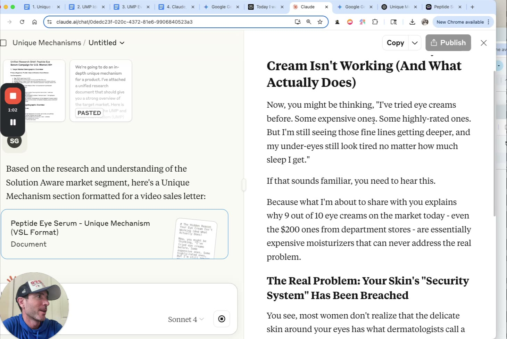
*After adding the Solution Aware block: the artifact "Peptide Eye Serum - Unique Mechanism (VSL Format)". The pasted attachments are the unified research brief and the expansion prompt. [1:02:24]*

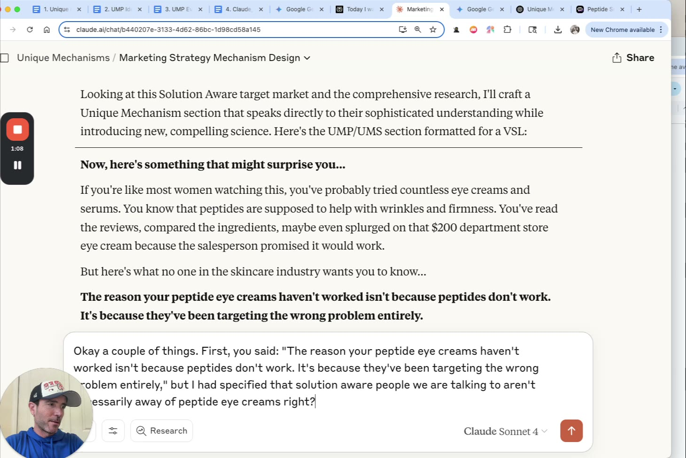
*The Dermal Disarray draft, and the instructor's correction typed beneath: "...but I had specified that solution aware people we are talking to aren't necessarily aware of peptide eye creams right?" [1:08:24]*

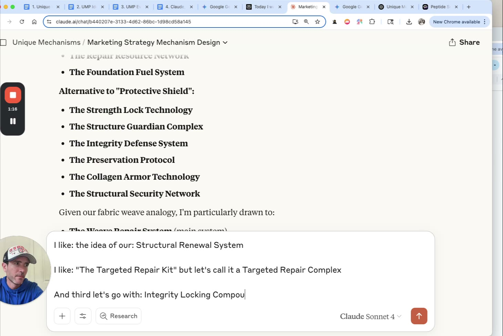
*Alternatives for the protective shield on screen, with the typed selection: "I like: the idea of our: Structural Renewal System", "Targeted Repair Complex", "Integrity Locking Compou[nds]". [1:17:00]*

## Steps / framework
1. **Generate** mechanisms with the ideation prompt on 4+ models (Gemini Deep Research, Perplexity Deep Research, ChatGPT o3-pro, Claude). Attach the research brief; add the ingredient list; fix the awareness level. [00:00–02:35]
2. **Cut by hand while reading.** For each concept ask: Is the idea (not the name) believable? Does our formula contain the ingredient? How many cognitive leaps? Is the hero ingredient already commonplace? Save yes/maybe into one running doc. [03:39–35:30]
3. **Add your live mechanism** (if any) in its real page copy. [39:36]
4. **Rank** the shortlist on three LLMs with the evaluation prompt (awareness = Solution Aware). [41:20–43:18]
5. **Reconcile** with the research doc: why do models weight a concern (sensitivity) above the stated top pain (wrinkles)? Ask the model. [46:25–52:00]
6. **Optional:** ask for a combined mechanism; reject if it adds steps or analogy clutter. [45:35; 53:57]
7. **Expand** the top two with the expansion prompt in the Unique Mechanisms project; include the awareness-level definition block. [55:50–1:02:08]
8. **Revise in-thread**: fix audience assumptions; request alternative names and metaphors; pick; have the model rewrite with your picks. [1:07:06–1:17:47]
9. **Test** (not shown in this lesson): [3.3](03-03-ump-evaluation-prompt-and-process-airbnb-arbitrage.md) says to test both finalists in ads when an offer exists; see Sources and limitations.

## Examples

### Rewrites (before → after)
| Before | After | What changed | Source |
|---|---|---|---|
| "Dermal Disarray" (tent poles collapse) | "Collagen Architecture Breakdown" (fabric weave loses its tight weave) | Technical-sounding name to a plainer one; metaphor chosen for the target woman ("grandma knitting") | [1:08:25–1:10:45] |
| "Bio-Tensegrity" signal (UMS 1) | "Structural Renewal System" (Structural Renewal Signal) | Jargon to a plain "system" term | [1:14:21–1:17:47] |
| "Smart Materials" (amino acids) | "Targeted Repair Complex" | Metaphor-free, ingredient-led label | [1:14:53] |
| "Protective Shield" | "Integrity Locking Compounds" | Replaced a generic term | [1:14:21–1:17:47] |
| "The reason your peptide eye creams haven't worked..." | Rewritten for solution-aware readers who know "eye creams", not "peptide eye creams" | Removed an awareness assumption | [1:07:06–1:08:25] |

### Structure of the worked mechanisms (derived from the course doc)
| Mechanism | UMP (named problem) | UMS (named solution) | Analogy used | Source |
|---|---|---|---|---|
| Lipid Barrier Breach | Cracks in skin's lipid "mortar" cause moisture loss and "Inflamm-Aging" (low-grade inflammation) | "Biomimetic Barrier Seal": cupuacu seed butter + jojoba esters | Brick and mortar wall; spackle; house with broken windows | doc Example 3; [1:03:02–1:04:00] |
| Dermal Disarray / Collagen Architecture Breakdown | Existing collagen fibers tangled and chaotic ("not just loss, but disorganization") | Contraction signal (DPHP) + proline/glycine/alanine + MMP inhibition | Tent poles, then fabric weave | doc Example 4; [04:20; 1:10:45] |
| Periorbital Collagen Depletion | Eye area loses collagen "at 3x the rate" ("collagen desert") | "Collagen Preservation Shield" | Desert | [17:49] |
| Chronic Dehydration Debt | Lost "moisture anchors" make water evaporate; hyaluronic acid is a "temporary cash infusion for a business with no bank account" | Hydro-Magnetic Lock (saccharide isomerate + sodium hyaluronate) | Debt/bank account | [08:08–10:23] |

## Prompts / templates (verbatim)

### 1. Expansion prompt: the course doc `04-4 Claude_UMP Expansion Prompt.docx`
The doc opens with: "Reminder: Use this Prompt in the Unique Mechanism Claude Project (See Separate Training For How to Set This Project Up)". It contains four filled examples; the template is identical in each. Examples 1 and 2 are the Airbnb mechanisms (Problem Aware); Examples 3 and 4 are the eye-serum mechanisms (Solution Aware, with the awareness block).

```text
We're going to do an in-depth unique mechanism for a product. I've attached a unified research document that should give you a strong overview of the target market.

Here is a summary of the UMP and UMS:

[PASTE ONE MECHANISM: "The Problem (UMP) - <name>" with its explanation, then "The Solution (UMS) - <name>" with its explanation]

===
For this exercise, let's specifically focus on people in the market who are [Problem Aware | Solution Aware].

[ONLY FOR SOLUTION AWARE: paste the awareness profile block below]

Please go ahead and write the Unique Mechanism section in a format that could be used in a video sales letter.
```

Awareness block used in Examples 3 and 4 (copied from the unified research doc; the market percentages and the persona are specific to the eye-serum research):
```text
Here's how you can understand Solution Aware in this context:

### The Solution Aware (Estimated 40-45% of TAM)

Profile: Representing the largest segment of the market, the Solution Aware consumer has made a significant leap. She knows her problem (e.g., wrinkles, dark circles) and now knows that a category of products—generically referred to as "eye cream" or "eye serum"—exists to address it. Her primary goal is to find the "best" one for her specific issue. However, at this stage, her understanding is typically not rooted in ingredient science. She evaluates products based on brand reputation, price, packaging, key benefit claims (e.g., "brightening," "firming," "hydrating"), and, most importantly, social proof in the form of reviews and recommendations.
```
- (derived) Replace the profile with the Solution Aware / Problem Aware description from your own unified research document. The "Estimated 40-45% of TAM" and the persona are this product's data, not defaults.
- The doc ends with a link to the full Claude conversation (external; not reproduced).

### 2. Examples 1 and 2 (Airbnb) inputs, structure only
- Example 1 UMP/UMS summary: "Mechanism 2.1: The 'Asset Gap' vs. The 'Income Gap'". UMP: "You have been trying to solve an *Asset Gap* problem with an *Income Gap* solution." UMS: "The program teaches the 'Asset Control' method, the first system that allows you to leapfrog the 'Income Gap' and directly address the 'Asset Gap.'" Problem Aware.
- Example 2: "Unique Mechanism: The 'Permission-Based' Income Trap" → "Permissionless Cashflow System", with a bullet per income source (9-to-5, gig platforms, freelancing, online businesses) and "a single, critical point of permission: negotiating the lease and arbitrage addendum with a property owner". Problem Aware.
- The Airbnb run is analysed in [3.3](03-03-ump-evaluation-prompt-and-process-airbnb-arbitrage.md).

### 3. Follow-up prompts used in the video
Verbatim (typed on screen):
```text
If you were going to take these different mechanism options, and combine them into a new mechanism that you thought was the strongest and that speaks to their pain points (which are primarily appearance driven, followed by what they don't like about products), what would you do?
```
```text
Okay a couple of things. First, you said: "The reason your peptide eye creams haven't worked isn't because peptides don't work. It's because they've been targeting the wrong problem entirely," but I had specified that solution aware people we are talking to aren't necessarily aware of peptide eye creams right?
```
```text
I like: the idea of our: Structural Renewal System

I like: "The Targeted Repair Kit" but let's call it a Targeted Repair Complex

And third let's go with: Integrity Locking Compou[nds]
```
Reconstructed from the transcript (spoken, partly garbled; a pattern, not a quote) [1:08:25; 1:13:18]:
```text
Second, I don't love the name "Dermal Disarray", and I'm not sure about the tent analogy. What other more believable, legit-sounding names can we use instead of Dermal Disarray? And what are some other analogies or metaphors we could use instead of a tent, keeping in mind our target market?
```
```text
For the UMS, I don't love "biotensegrity system" as a name; I want something easy to understand. "Protective shield" is okay but kind of generic. What are alternative names for each of these?
```
After the picks: "Address number one: now that you agree, let's use collagen architecture breakdown... Let's use the fabric weave analogy." [1:10:11–1:10:45]

### 4. Evaluation prompt
Same text as in [3.3](03-03-ump-evaluation-prompt-and-process-airbnb-arbitrage.md); the only change is the last paragraph: "...keep in mind that our core market is people who are Solution Aware." (screenshot [44:00]).

## Screenshots
Embedded above in context; 13 frames covering ideation outputs (Gemini, Perplexity, ChatGPT), the saved shortlist doc, the three rankings, the combine prompt and the expansion and renaming prompts. No frames were captured for [1:17:47–1:19:14].

## How to apply
- [ ] Run ideation on at least four models; put the ingredient list and awareness level in the prompt.
- [ ] Keep a running document: one UMP/UMS pair per tab; note the idea, then the name.
- [ ] Skip any mechanism that depends on an ingredient or process the product does not have.
- [ ] Prefer one-sentence mechanisms the reader already half-believes; drop ones that need two or more leaps.
- [ ] Evaluate the shortlist on three LLMs with the evaluation prompt; compare with the research doc's top pain before accepting the consensus.
- [ ] Expand the top two, include the awareness block, and rewrite names and metaphors for the actual target persona (not for the model).
- [ ] Remove numbers and health/skin-effect claims you cannot substantiate; check each against the ingredient research ([2.5](02-05-ingredient-deep-research.md)).
- [ ] Test the finalists as hooks in ads when an offer exists. (derived)

## Related
- Previous: [3.3 UMP evaluation prompt and process (Airbnb)](03-03-ump-evaluation-prompt-and-process-airbnb-arbitrage.md) · Next: [3.5 Creating a Claude Project for unique mechanisms](03-05-creating-a-claude-project-for-unique-mechanisms.md)
- Same product's brief: [5.2 Brief generator with Claude Project (eye serum example)](05-02-the-brief-generator-with-claude-project-unity-eye-serum-exam.md)
- Evolve overlap: [Unique mechanism (new, unspoken, renamed)](../../../evolve/copywriting/concepts/unique-mechanism.md) · [Write at a 6th-grade level](../../../evolve/copywriting/lessons/13-why-you-need-to-write-at-a-6th-grade-level.md) (consistent with this lesson's "simple mechanisms win in health and beauty") · [Market awareness](../../../evolve/copywriting/concepts/market-awareness.md)
- Contrast: the Evolve concept treats mechanisms as new/unspoken/renamed ideas that "inspire hope"; this lesson's UMP/UMS framing demands a named knowledge gap, and judges it by cognitive leaps. Not a contradiction; different tests.

## Sources and limitations
- Transcript: [04-4 Ideation Validation and Expansion Walkthrough Eye Serum Example.txt](<../../../../../raw/stefan-georgi/rmbc-ii/_transcripts/Stefan Georgi - RMBC II (1)/03-UNIQUE MECHANISMS/04-4 Ideation Validation and Expansion Walkthrough Eye Serum Example.txt>) (whole video, last segment 1:19:56). Captions: `.srt` beside the original video.
- Documents: [04-4 Claude_UMP Expansion Prompt](<../../../../../raw/stefan-georgi/rmbc-ii/_extracted/Stefan Georgi - RMBC II (1)/03-UNIQUE MECHANISMS/04-4 Claude_UMP Expansion Prompt.docx.md>); [03-3 UMP Evaluation Prompt](<../../../../../raw/stefan-georgi/rmbc-ii/_extracted/Stefan Georgi - RMBC II (1)/03-UNIQUE MECHANISMS/03-3 UMP Evaluation Prompt.docx.md>). The expansion doc has no embedded images (fonts only).
- Mishearings fixed using the `.srt`: "ICERM", "ice serum" = eye serum; "quad/cloud" = Claude; "Durham will disarray" = dermal disarray; "tingle" = tangle; "biotensegrity" is correct per the captions; "DAJ" = DEJ; the captions give "OPAL" for the instructor's own current eye-serum product, whose live DEJ mechanism he compares against, and "Marlander" for the source of the live page copy (he does not explain either name); the reference to "CA Pro" at [21:37] is unexplained.
- Some ranking positions are inferred from reading order (flagged in the ranking table). Gemini's #1 to #3 and ChatGPT's #1 to #3 are confirmed on screen or in the summary [54:42].
- The lesson's title says "validation", but the validation is LLM ranking plus the instructor's judgment. No ad or sales data is shown, and the instructor's own proven live mechanism (DEJ) ranked about #5 across the models. (derived: LLM rank is not market proof, so a mechanism with real conversion data should outrank an LLM ranking.)
- **Compliance flags (skincare).** Treat all of these as course examples to copy structurally, never as claims:
  - Efficacy and biology claims in LLM outputs: collagen loss "at 3x the rate" near the eyes, "9 out of 10 eye creams... are essentially expensive moisturizers" ([1:02:08]), "72 hours" hydration, cupuacu butter holding "up to 440% of its own weight" (doc Example 3), hyaluronic acid "can even accelerate" water loss in low humidity, "inhibits MMPs", "contraction of existing collagen fibers", "new collagen synthesis". None is sourced in the lesson; he notes only "some questions there around the validity" of the penetration claim ([33:30]) and "is there actually some science to back that up? Possibly" for glycation ([26:16]).
  - "Dermatologists call a lipid barrier" and "scientists have recently discovered and named Inflamaging" are authority statements the model generated.
  - (derived) Cosmetic claims that a product rebuilds collagen, inhibits enzymes or changes skin structure can be read as drug claims; get them cleared before use in ads, and use the ingredient-claims research step ([2.5](02-05-ingredient-deep-research.md)).
  - "$200 department store" comparisons and "women 40+" targeting should be checked against platform ad policy. (derived)
- Instructor addressed as "Stephen" by an imagined viewer question ([39:35]); this is not an on-screen self-introduction, so the instructor line stays as "course author".
