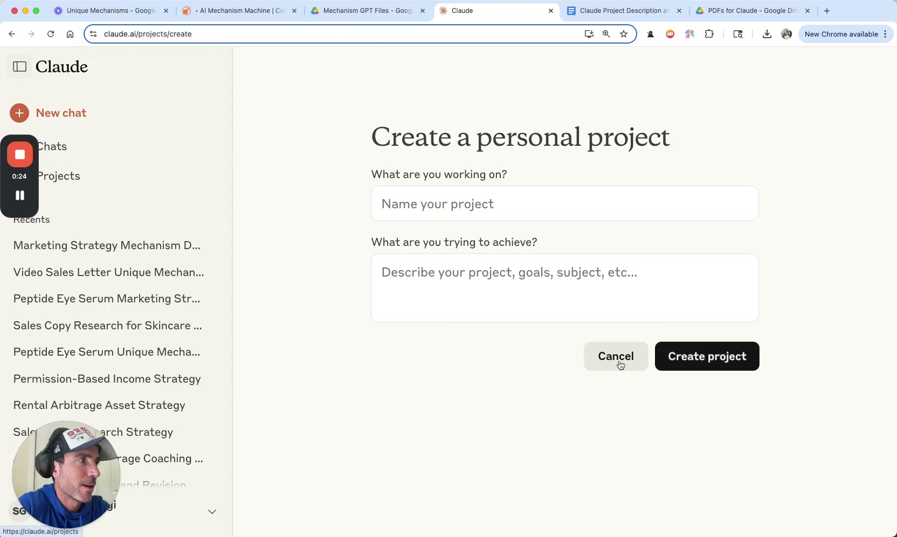
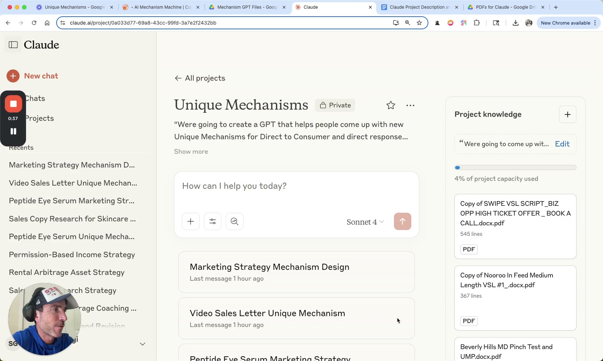

# 3.5 Creating a Claude Project for Unique Mechanisms
> A two-minute setup lesson: create a Claude Project whose instructions say "help generate Unique Mechanisms" and whose knowledge base is nine reference PDFs (mechanism definitions, worked UMP/UMS examples, a mechanism-ideation prompt, VSL structure and swipe scripts). The real value is the nine-file zip and the prompt text inside it.

## 🤖 Agent use
- **Use when:** you need to set up a repeatable "mechanism machine" (a Claude Project or equivalent agent context) before running the UMP ideation, evaluation and expansion processes from [03.02](03-02-ump-ideation-with-llms.md), [03.03](03-03-ump-evaluation-prompt-and-process-airbnb-arbitrage.md) and [03.04](03-04-ideation-validation-and-expansion-walkthrough-eye-serum-exam.md); or when you need the exact mechanism definitions, the 3-step "SPG" logic-flow template or the "weird" UMP-brainstorm prompt.
- **Inputs → outputs:** project name + one-paragraph description/instructions + nine PDFs → a project that is "ready to go" for mechanism ideation. Output of the later runs: UMP/UMS candidates, each with a logic flow and proof elements.
- **Rules:**
  - **DO** set the description and the project instructions to the same text. "I just basically took the same thing from the description, put it here." [00:28]
  - **DO** make the instruction state the two-part nature of a mechanism (problem and solution) and that "the core one" knowledge doc is "what Unique Mechanisms are (both types) WITH Examples". [docx, Claude Project Description and Instructions]
  - **DO** load examples plus process documents, not just definitions: the PDFs are "mechanism examples and some transcripts from calls about unique mechanisms, things with the VSL structure". [00:58]
  - **DO** treat this project as an experiment: "It's worth experimenting with." The instructor says it is "not what I do all the time", but it is useful. [00:28; 01:28]
  - **DON'T** assume the upload alone does the research. The project only generates mechanism ideas; claims, studies and numbers inside any idea still need real sources (see the evidence rule in [AGENTS.md](../../../../../../AGENTS.md)). (derived)
  - **IF** the mechanism includes a health claim (e.g. "DHT blocks collagen", "colon transit time", "inner body temperature") **THEN** record it as a course example and substantiate it with real citations before reuse; never copy the claim from the PDFs. (derived)
- **See also:** [03.01 Unique mechanisms overview](03-01-unique-mechanisms-overview.md) · [03.02 UMP ideation with LLMs](03-02-ump-ideation-with-llms.md) · [04.01 VSL section overview](04-01-vsls-section-overview.md) · [Evolve Copywriting: unique mechanism](../../../evolve/copywriting/concepts/unique-mechanism.md) · [Evolve Start Here: product overview and mechanism](../../../evolve/start-here/concepts/product-overview-and-mechanism.md)

## Key ideas

### 1. Creating the project in Claude [00:00–00:58]
- Claude → **Projects** → **Create new project** → name it, write a description ("what are you trying to achieve"), **Create project**. [00:00–00:28]
- After creation you can add **instructions** and upload a **project knowledge base**. He pasted the description into instructions and saved. [00:28]
- He calls the project old ("I made this one a while ago") and promises to share improved versions "with RMBC2 people if it's within the first year or so when the course gets launched". (Instructor promise; no update is included in the course files.) [00:28]
- The description is "super simple". [00:58] Its full text is in the prompt section below.


*The create-project form [00:25]: name field plus a goal/description field. The recents list on the left shows the instructor's other mechanism chats (e.g. "Video Sales Letter Unique Mechanism", "Rental Arbitrage Asset Strategy").*

### 2. What goes in the knowledge base [00:58–01:28]
- "These PDFs are basically just mechanism examples and some transcripts from calls about unique mechanisms, things with the VSL structure, things of that nature." He does not walk through them: "You can. You'll have access to them." [00:58]
- Upload them, "and you're ready to go". Then use the project "in the way you saw in this whole training and all the examples" (the transcript says "the Airbnb and ice cream examples"; the platform caption says "ice rink". Both look like mishearings of the Airbnb arbitrage and eye serum examples from [03.03](03-03-ump-evaluation-prompt-and-process-airbnb-arbitrage.md) and [03.04](03-04-ideation-validation-and-expansion-walkthrough-eye-serum-exam.md). Derived.) [01:28]
- The visible project page lists copies of the swipe VSL (545 lines), the Nooro medium VSL #1 (367 lines) and the Beverly Hills MD pinch test + UMP file; "4% of project capacity used"; model selector shows Sonnet 4. [00:38 frame]


*The finished project [00:38]: description at the top, the "Project knowledge" panel on the right with the uploaded PDFs, and 4% of capacity used. Nine short-to-medium PDFs fit easily.*

### 3. What is actually in the nine PDFs (zip: "PDFs for Claude")
Not covered in the video, but they are the core asset of this lesson. Page numbers are the PDF page.

| File | What it contains | Use it for |
|---|---|---|
| `Copy-Accelerator_-Unique-Mechanism_template.pdf` (1 p.) | One-page definition: UM "explains why our prospect is struggling… and how they can overcome that problem"; "always a two-part logical connection"; "ONE CRUCIAL PIECE OF INFORMATION" / "knowledge gap" | The definition block to paste into any mechanism prompt |
| `Genesis Unique Mechanisms_11-14-22.pdf` (5 pp.) | Same definition plus the **SPG process** (3 steps) with two worked fills: Katy Joy Wells "Email Clutter Crusher" and Odyssey Elixir (fruiting-body mushrooms) | The step-by-step finder + logic flow template |
| `5-7-24.pdf` (12 pp.) | Newer, longer version of the definition plus 2 health examples (colon transit time; baby-skin Type III collagen), pointers to golf videos and a lead-gen (Automated Marketing Filtration Method) UMP/UMS | Worked UMP and UMS drafts in 4 niches |
| `Alternate _Weird_ AgentGPT UMP Process.pdf` (3 pp.) | A full UMP-ideation prompt (blood-sugar niche, manifestation examples) | The brainstorm prompt (verbatim below) |
| `Beverly Hills MD Pinch Test and UMP.docx.pdf` (5 pp.) | The credibility story and the DHT-collagen UMP/UMS section of the Beverly Hills MD VSL | A finished UMP+UMS inside a VSL; see [04.01](04-01-vsls-section-overview.md) for the full teardown |
| `Nooroo In Feed Medium Length VSL #1_.docx.pdf` | The 16-17 minute in-feed Nooro VSL (edema, "calves are the second heart") | A finished mechanism of the problem and of the solution in a medium VSL; see [04.02](04-02-vsl-fundamentals-classic-structure.md) |
| `SWIPE VSL SCRIPT_BIZ OPP HIGH TICKET OFFER _ BOOK A CALL.docx.pdf` (22 pp.) | An Amazon-seller biz-opp VSL that ends in "book a call" (opens with a spatula and a $7 profit; three "unfair advantage" methods; a free "roadmap to freedom" bonus) | Structure only. The income claims are unverifiable (see compliance flags) |
| `VSL Overview and Structure.docx.pdf` (4 pp.) | The full VSL outline (hook → FAQ) | The structure the mechanism must slot into; reproduced in [04.01](04-01-vsls-section-overview.md) |
| `Mechanism Training Transcript PDF.pdf` (78 pp.) | Auto-captioned transcript of a live coaching call (participants speak) on background stories and unique mechanisms, using the Nooro, Beverly Hills MD and biz-opp scripts | Raw teaching material; ends up covering the same ground as [04.04](04-04-vsl-background-stories-and-unique-mechanisms.md) |

## Steps / framework

### A. Project setup (derived from [00:00–01:28])
1. Claude → Projects → Create new project.
2. Name: "Unique Mechanisms". Description/goal: the text in the prompt section below.
3. Open project instructions; paste the same text; save.
4. Upload the nine PDFs to the knowledge base.
5. Start chats inside the project and run the mechanism processes from module 3.

### B. The SPG logic-flow process (Genesis doc, pp. 2–5)
A 3-step mechanism finder used in the doc on two sample products. Quoted structure:

1. **What do we know about the product?** (Katy example: a 14-day program, one simple task a day; "One Simple Task".)
2. **What do the experts say?** Turn the product feature into Google search terms (e.g. "tidiness ncbi", "hoarding ncbi", "Psychology of Hoarders", "Neuroscience of Tidiness", "Science Daily"; for mushrooms: "When is a mushroom fruiting?", "Do fruiting mushrooms have more health benefits?", "Mycellium vs. Fruiting Body Mushrooms").
3. **Create the logic flow/argument:**
   - i. The real reason other solutions don't work is because of Y
   - ii. When in reality, you need X
   - iii. Here's the proof (your research and scientific backing)
   - iv. Here's how our product enables you to do X (the doc numbers this "ix"; likely a typo)

Worked fill from the doc (Katy Joy Wells "Email Clutter Crusher Challenge" is shown first as an example where "There's no Unique Mechanism here really"): *"The real reason other decluttering programs aren't effective is because they give you too many tasks… When in reality, you need to focus on one simple task per day. It's a principle called Task Clarification… In one major study from scientists in Hong Kong and Minnesota, they found that task clarification led to significant increases in tidiness in medical training centers."* (Genesis p. 3. The "study" text is a placeholder in the course doc; do not reuse it without checking the real study.)

### C. Mechanism shape (all definition docs)
- Two parts: **UMP** (unique mechanism behind the problem; why the prospect failed in the past) and **UMS** (unique mechanism behind the solution; why the product will succeed where others failed). [Copy Accelerator template; 5-7-24 p. 1]
- Prospect arrives having tried several solutions; the copywriter shows the prospect their "knowledge about the problem is incomplete". [Genesis p. 1]
- Find "one major, throbbing pain point and try to fix it". [Copy Accelerator template, header notes]

## Examples

| Source doc | UMP (problem) | UMS (solution) | Course label |
|---|---|---|---|
| 5-7-24, Health ex. 1 | Slow **colon transit time**; "reservoir" of old waste; "hidden constipation… destroying your gut" (cites an IBS study with "46%… > 90 hours old"; instructor claim, uncited) | "Speed up the colon transit time so that you're flushing out the old, built up stuff FAST… 5lbs to 20lbs" (instructor claim) | Health; aggressive. Structure only |
| 5-7-24, Health ex. 2 | Skin ages because **Type III collagen** (baby skin) falls away, then Type I; dermis unravels; skin loses moisture | Replenish dermis (collagen), raise stem-cell vitality, add hydration; story hooks: egg shell membranes, "adult repair stem cells" | Health/beauty. Seven footnote links to PubMed-style sources |
| 5-7-24, Lead-gen | "Your biggest problem actually is NOT that you can't get consistent leads. It's that you're not getting a consistent flow of pre-qualified leads"; make Angie's List and Home Advisor "the enemy" | **Automated Marketing Filtration Method (AMFM)**: Facebook/Google targeting, then automated pre-qualification by SMS/questions | Non-health B2B. "200% to 400% higher" close rate is a placeholder claim |
| Beverly Hills MD doc | Rising **DHT** blocks collagen in women (research skewed to male baldness) | Saw palmetto + amino acids + dietary hyaluronic acid (then A and B vitamins in the final formula) | Beauty supplement; see [04.01](04-01-vsls-section-overview.md) |
| Nooro VSL #1 | Weak **calves** ("second heart") → weak vein valves → pooled blood → swelling | **NMES** electrical stimulation foot pad that contracts the calves | Device; see [04.02](04-02-vsl-fundamentals-classic-structure.md) |

## Structured units

### Templates
| Template | Use for | Example fill | Source |
|---|---|---|---|
| "The real reason other solutions don't work is because of Y. When in reality, you need X. Here's the proof. Here's how our product enables you to do X." | Writing the UMP+UMS logic flow in 4 sentences | Y = "too many tasks"; X = "one simple task per day (Task Clarification)" | Genesis p. 2–3 |
| Testable proof: "make an argument or statement that the reader can instantly check for themselves" | Adding believability to a mechanism | "That's why gyms are busy in January and empty in July" | Alternate "Weird" AgentGPT UMP Process p. 1 |
| "Specificity: Using the specificity of certain names (Harvard, Nobel Prize Winning Scientists), numbers (boosted by 110%, skyrocketed fourfold)…" | Proof layer of a UMP/UMS (only with real, citable names and numbers) | n/a | same, p. 1 |

### Rules of thumb
- **DO** produce mechanisms for both halves (problem and solution). A solution-only mechanism does not explain past failure. [Genesis p. 1]
- **DO** give the mechanism a macro explanation the average reader understands; proof comes after. [VSL Overview p. 3]
- **IF** a product page has no mechanism ("There's no Unique Mechanism here really") **THEN** build one via the 3-step process rather than adding feature bullets. [Genesis p. 1]

## Prompts / templates (verbatim)

### Claude Project description and instructions (docx; shown in video at [00:58])
```text
Were going to create a GPT that helps people come up with new Unique Mechanisms for Direct to Consumer and direct response oriented marketing campaigns. I'll upload several documents - the core one will be what Unique Mechanisms are (both types) WITH Examples and we'll have other documents uploaded as well that train you on the process.
```
(Typos "Were" and "GPT" are in the source; the text predates Claude Projects. Adapt "GPT" to "assistant" when reusing. Derived.)

### "Alternate 'Weird' AgentGPT UMP Process" prompt (full text from the PDF)
```text
You're a world-class direct response copywriter who specializes in writing ultra-compelling, attention-grabbing, high-converting video sales letter scripts (VSLs).

You're especially good at writing about Unique Mechanisms for health sales letters. As a world-class copywriter you know that the Unique Mechanism is divided into two parts: The Unique Mechanism of the Problem (UMP) and the Unique Mechanism of the Solution (UMS). The UMP reveals a real and surprising cause of the main pain point that a prospective customer is experiencing. It's something unique and differentiated from the market, yet it should intuitively make sense.

The UMP copy often also has specificity and sometimes things like "testable proof". The UMS is how you fix that unique problem. Both contain: Specificity: Using the specificity of certain names (Harvard, Nobel Prize Winning Scientists), numbers (boosted by 110%, skyrocketed fourfold) and other kinds of specifics to convey proof and believability. Think about names and numbers.

Testable Proof = Make an argument or statement that the reader can instantly check for themselves. (I.e. if you're explaining that people don't have great willpower, you could say "That's why gyms are busy in January and empty in July"). Since most readers can instantly verify that, it carries a lot of weight.

You are an absolute master at writing UMPs and UMSs and making sometimes complex topics very compelling and understandable to the average reader, even those who read at a 3rd grade level. And getting them to happily read your sales messages. Now we're working on coming up with new offer ideas for a health supplement in the blood sugar and Type 2 diabetes niche, and we want to generate some really interesting UMP ideas.

For example, one big health supplement product that recently had a lot of success argues that your pineal gland, a tiny organ in the middle of your brain, is actually a secret and powerful tool that allows you to attract wealth and abundance, but right now it's clogged. The UMS is to unclog the pineal gland using ingredients in the supplement. Below are some examples of what big outside the box ideas might look like for manifestation. But please note manifestation is just a random example - and not what the focus of this blood sugar supplement is. I just want to find really interesting and out of the box angles and UMP ideas for blood sugar.

[Example] Problem: Lack of alpha brain waves restricts effective manifestation. Alpha brain waves are associated with a state of "flow" and creativity, which is crucial for effective manifestation.
Solution: A special supplement that can help boost the production of alpha brain waves, thereby enabling effective manifestation. Reasoning: Most people are unaware of the role of brain waves in the manifestation process. Highlighting this little-known fact and offering a solution can make the offer stand out in the marketplace. [End Example]

[Example] Problem: An excess of negative ions in the body inhibits manifestation. Negative ions can disrupt cell function and impair mental clarity, making it challenging to focus on and manifest desires.
Solution: A pioneering supplement fashioned to neutralize negative ions, bolstering mental function and manifestation abilities. [End Example]

[Example] Problem: Lack of coherence between our heart and brain, also known as heart-brain incoherence, can obstruct the flow of energy and impede our manifestation power. Studies by the HeartMath Institute suggest that the heart and brain communicate with each other, and coherence between them can enhance overall wellness and manifestation abilities (McCraty et al., 2009).
Solution: Our supplement contains unique ingredients that promote heart-brain coherence, facilitating a smooth, unobstructed flow of energy, and enhancing our power to manifest our desires. [End Example]

[Example] Problem: Lack of neural pathways for success intentions, making manifestation more challenging. Research shows that the brain can create new neural pathways through visual or verbal repetition, which can increase one's ability to succeed with their intentions. Right now your neural pathways may be blocked and it's stopping you from manifesting
Solution: A revolutionary supplement that aids the brain in creating new neural pathways, thereby improving one's ability to manifest their intentions more effectively. [End Example]

[Example] Problem: A lack of serotonin, the happiness hormone, can make it difficult for individuals to manifest their desires. When our brain lacks enough serotonin, we tend to have negative thoughts and emotions, reducing our manifestation abilities. So basically it's not your fault - your brain can't manifest positive things in a negative state!
Solution: A unique supplement that naturally boosts serotonin levels, thereby improving your mood and enhancing your manifestation abilities. [End Example]

[Example] Problem: Research shows that our manifestation abilities are directly linked to our gut health. An unhealthy gut can lead to a foggy brain and low energy levels, which can hinder our manifesting potential. This is powerful because basically it applies to anyone who suffers from brain fog, feels groggy for hours in the morning, or has mental crashes later in the day. What you don't realize is that there's essentially this cloud or "energetic curtain" wrapped around your brain that is neutering your brain and making manifestation impossible.
Solution: A unique supplement packed with essential probiotics and other vital nutrients to restore gut health, leading to increased clarity and improved manifestation abilities. [End Example]

Your job is to come up with as many unique and compelling UMP ideas as you can. These should be DIFFERENT than the ones shared in the examples. They should be other ideas around law of attraction, manifestation, etc. They should be very unique, outside-the-box, etc. They should be new, interesting, and compelling ideas. You can search the web to add in proof elements or make compelling arguments for these UMP ideas too, just make sure to include citations. Go ahead and give it a try now.
```
(Course quirk: the prompt's final paragraph asks for manifestation ideas, not blood-sugar ideas; the blood-sugar sentence is the intended niche. Replace the last paragraph with your own niche. Compliance: ideas like "unclog the pineal gland" or "negative ions" are fictional health mechanisms. Use the prompt only to brainstorm, then validate every claim with real evidence.)

### Reusable mechanism-definition block (condensed from the Copy Accelerator template and Genesis doc; wording is the course's)
```text
A unique mechanism explains why the prospect is struggling or suffering to achieve a goal, and how they can overcome that problem. It is always a two-part logical connection:
1. The unique mechanism behind the PROBLEM (why they failed in the past; the "knowledge gap", ONE CRUCIAL PIECE OF INFORMATION they were missing)
2. The unique mechanism behind the SOLUTION (why our product succeeds where alternatives failed; logically connected to the problem)
Find one major, throbbing pain point and try to fix it.
```

## Screenshots
Two frames kept above (create form [00:25]; project knowledge panel [00:38]). Other sampled frames at [00:54] and [01:19] show the same project page with browser tab tooltips; not kept. The browser tabs visible in all frames ("Unique Mechanisms", "AI Mechanism Machine", "Mechanism GPT Files", "Claude Project Description and Instructions", "PDFs for Claude") suggest the project was rebuilt from an earlier GPT-based "mechanism machine" (derived; consistent with the "create a GPT" wording in the description).

## How to apply
- [ ] Create a "Unique Mechanisms" project (or agent context) and paste the verbatim description into both description and instructions.
- [ ] Upload (or give the agent access to) the nine PDFs listed above.
- [ ] Replace "GPT" with the correct tool name and add the product, niche and market-awareness inputs.
- [ ] Run the "weird UMP" prompt with your niche; keep it brainstorm-only.
- [ ] For each shortlisted UMP, write the 4-sentence logic flow (Y, X, proof, product) and look for real studies via the "what do the experts say" search-term step.
- [ ] Flag any health, finance or biz-opp claim for substantiation before it reaches a draft.

## Related
- Previous: [03.04 Ideation, validation and expansion walkthrough (eye serum)](03-04-ideation-validation-and-expansion-walkthrough-eye-serum-exam.md) · Next: [04.01 VSLs section overview](04-01-vsls-section-overview.md)
- [Evolve Copywriting: unique mechanism](../../../evolve/copywriting/concepts/unique-mechanism.md) (new / unspoken / renamed decision table) · [Evolve Copywriting: hooks](../../../evolve/copywriting/concepts/hooks.md) · [Evolve Start Here: market awareness levels](../../../evolve/start-here/concepts/market-awareness-levels.md)
- Difference to note: RMBC II frames the mechanism as a **problem + solution pair** to be placed inside a VSL (UMP then UMS); Evolve Copywriting's "new / unspoken / renamed" test classifies how novel the mechanism is. They answer different questions and can be combined. (derived)

## Sources and limitations
- Transcript: [05-5 Creating a Claude Project for Unique Mechanisms.txt](<../../../../../raw/stefan-georgi/rmbc-ii/_transcripts/Stefan Georgi - RMBC II (1)/03-UNIQUE MECHANISMS/05-5 Creating a Claude Project for Unique Mechanisms.txt>) · Platform captions confirm wording (they spell "Clod project", "RBC2", "ice rink"). Docx: [Claude Project Description and Instructions](<../../../../../raw/stefan-georgi/rmbc-ii/_extracted/Stefan Georgi - RMBC II (1)/03-UNIQUE MECHANISMS/05-5 Claude Project Description and Instructions.docx.md>).
- Zip documents: [Genesis Unique Mechanisms](<../../../../../raw/stefan-georgi/rmbc-ii/_extracted/_unzipped/03-UNIQUE MECHANISMS/05-PDFs for Claude-20250708T084934Z-1-001/PDFs for Claude/Genesis Unique Mechanisms_11-14-22.pdf.md>) · [5-7-24](<../../../../../raw/stefan-georgi/rmbc-ii/_extracted/_unzipped/03-UNIQUE MECHANISMS/05-PDFs for Claude-20250708T084934Z-1-001/PDFs for Claude/5-7-24.pdf.md>) · [Alternate "Weird" UMP prompt](<../../../../../raw/stefan-georgi/rmbc-ii/_extracted/_unzipped/03-UNIQUE MECHANISMS/05-PDFs for Claude-20250708T084934Z-1-001/PDFs for Claude/Alternate _Weird_ AgentGPT UMP Process.pdf.md>) · [Copy Accelerator template](<../../../../../raw/stefan-georgi/rmbc-ii/_extracted/_unzipped/03-UNIQUE MECHANISMS/05-PDFs for Claude-20250708T084934Z-1-001/PDFs for Claude/Copy-Accelerator_-Unique-Mechanism_template.pdf.md>).
- The video is a 1:53 silent-screen walkthrough; the whole recording is covered (last segment 01:28). Machine transcription (Whisper large-v3-turbo); the platform caption file was used to check wording.
- The nine PDFs were read in full except `Mechanism Training Transcript PDF.pdf` (78 pages, about 97,000 characters of live-call captions), `SWIPE VSL SCRIPT_BIZ OPP…` (22 pages; opening, structure markers and closing read) and the Nooro medium VSL (read in the lesson 04.01 copy). Their teaching is summarised in [04.01](04-01-vsls-section-overview.md), [04.02](04-02-vsl-fundamentals-classic-structure.md) and [04.04](04-04-vsl-background-stories-and-unique-mechanisms.md).
- Compliance: the example UMPs (colon transit time, collagen, DHT, "inner body temperature", biz-opp income) contain disease, weight and income claims. They are structural examples only. The swipe VSL's spatula/"$7 x 30 sales a day = $75,600 a year" arithmetic and "top 1% of Amazon sellers" are unproven income claims (instructor-provided swipe; not verified). Do not copy them.
- The course ships no screenshot of the PDFs' contents; the visible part of the knowledge panel shows only 3 of the 9 files.
