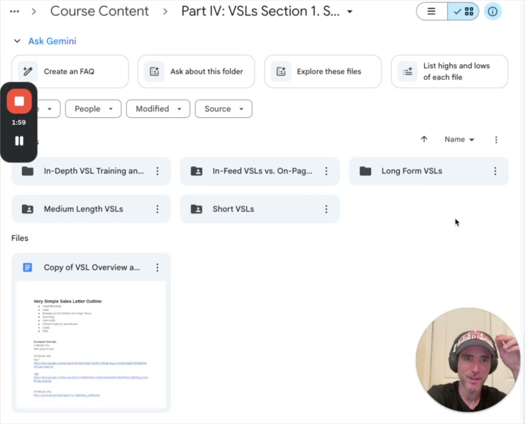
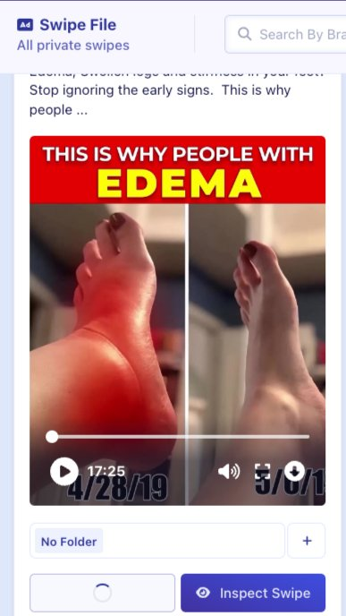
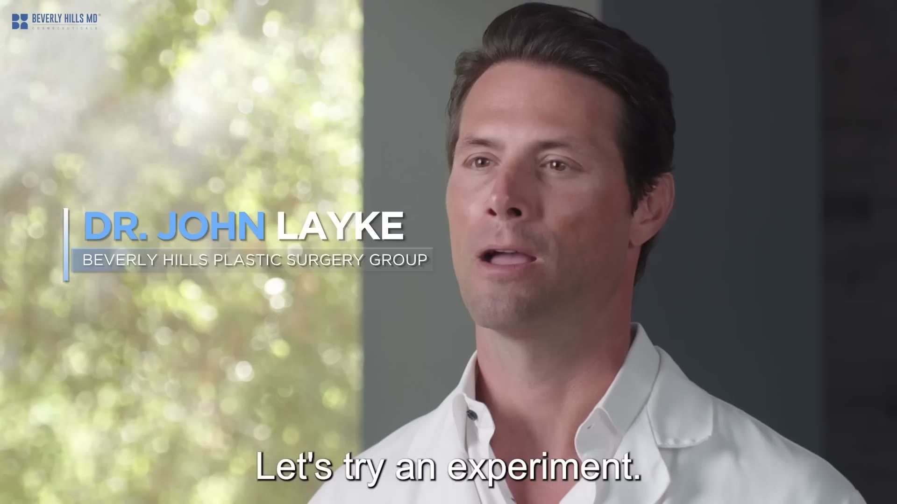
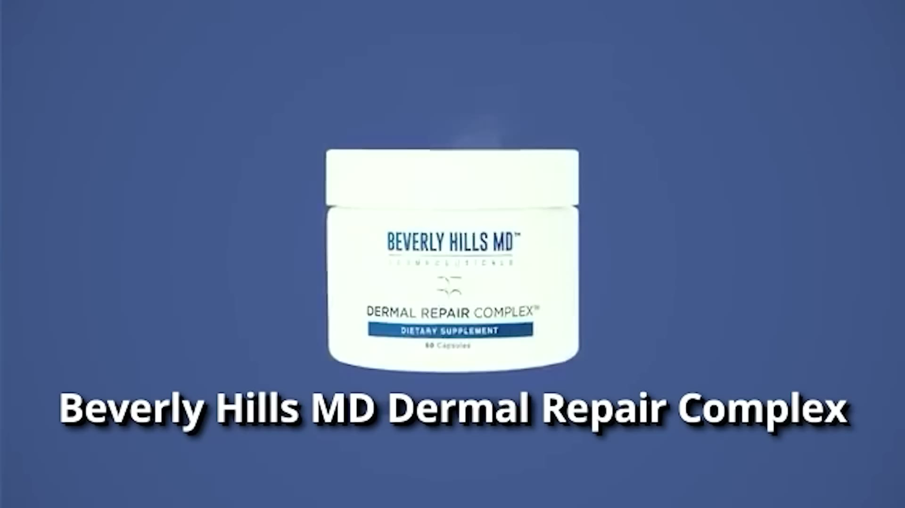
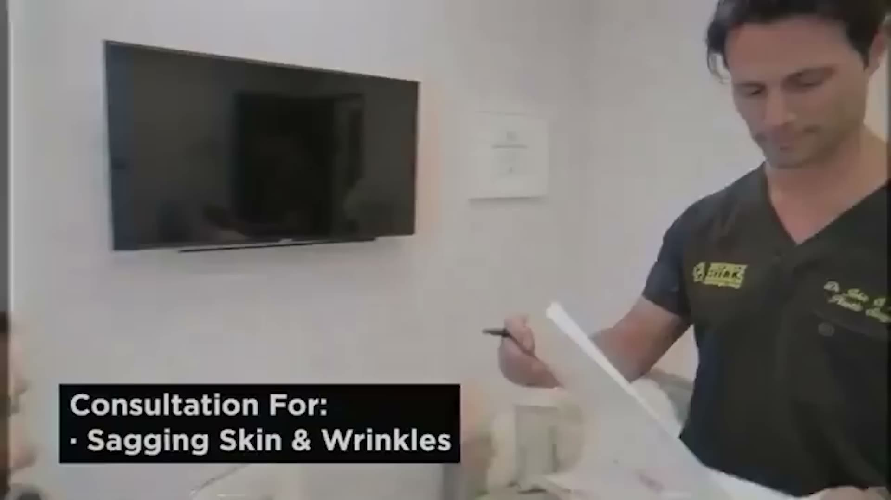
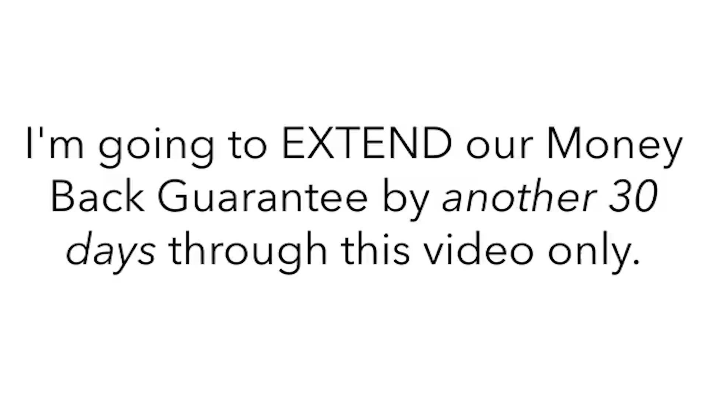
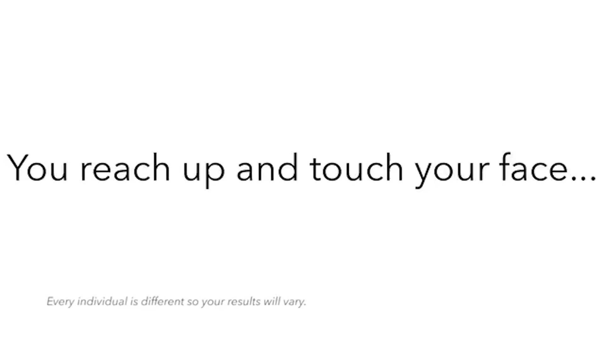

# 4.1 VSLs Section Overview
> A 3.5-minute roadmap for the VSL modules plus the course's reference outline of a video sales letter (hook to FAQ) and a full 36-minute example VSL (Beverly Hills MD "pinch test") to read as a structural teardown.

## 🤖 Agent use
- **Use when:** you are about to write or audit a VSL, an in-feed video ad that runs a VSL, or a brief that must feed a VSL generator; or you need a worked example of the 8-part VSL spine in a long (36 min) supplement VSL.
- **Inputs → outputs:** product facts, mechanism (UMP + UMS), spokesperson and offer → a script that follows the outline (hook/micro-lead, lead, background, UMP, UMS, product build-up and reveal, close, FAQ). For audits: a beat-by-beat map of an existing VSL against the outline with timestamps.
- **Rules:**
  - **DO** learn the structure before writing the brief: "as you go to create these new briefs… I think it's helpful to have the end in mind, to understand the structure of long, short, medium form VSL, some stuff about hooks." [v1 01:29]
  - **DO** follow the 8-part spine in order: Hook/Microlead, Lead, Background, Discovery, UMP/UMS, Product Build-Up and Reveal, Close, FAQ. [docx; v1 02:53]
  - **DO** put a hook-heavy micro-lead first and make it relate quickly to the pain point and to the promise of a solution. [docx §1]
  - **DO** open "a bunch of loops" in the lead (problem call-out, promise, teased discovery story, teased mechanism, contrarian angle, fascinations, qualifiers, skepticism) and say you'll get to them. [docx §2]
  - **DO** express the UMP as the "real cause": "You've had 99% of the answer but this is the missing 1%"; make it surprising, possibly counterintuitive, with credibility and proof. [docx §4]
  - **DO** make the UMS a "macro" solution logically tied to the UMP, then "dig deep" into the micro with citations. [docx §5]
  - **DO** explain why an out-of-the-box version of the solution fails before revealing your product (the "buildup"). [docx §6]
  - **DON'T** copy a competitor's claims, stats, doctor, device or brand names. Copy the sequence only. (AGENTS.md rule 3)
  - **DON'T** invent proof for scripts: no made-up studies, patient emails, counts, "live shoppers", stock levels or deadlines. The example VSLs below contain such lines; they are teardown material, not source material.
  - **IF** you are building a health/beauty VSL **THEN** substantiate every efficacy and "scientifically proven" claim and avoid disease-claims and "scam/big pharma" framing; Meta/FTC rules apply (derived).
- **See also:** [04.02 VSL fundamentals and classic structure](04-02-vsl-fundamentals-classic-structure.md) · [04.03 VSL leads](04-03-vsl-leads-after-the-opening-hook.md) · [04.04 background stories and unique mechanisms](04-04-vsl-background-stories-and-unique-mechanisms.md) · [04.05 product buildup and reveal](04-05-vsl-product-buildup-and-reveal.md) · [04.06 VSL closes](04-06-vsl-closes.md) · [Evolve Copywriting: unique mechanism](../../../evolve/copywriting/concepts/unique-mechanism.md)

## Key ideas

### 1. Where this section sits in RMBC II [v1 00:01–01:58]
- RMBC = Research, Mechanism, Brief, Copy. This section is part four, "kind of like an intermezzo". The brief section after it is "Phenomenal. Super, super, super powerful"; it shows how to build a brief you can put into LLMs and Claude Projects "and pump out endless copy". Part six takes the brief and "you're pumping out VSLs". [v1 00:01–00:58]
- Reason for ordering: write the structure lesson before the brief so you know the output you are writing toward. [v1 01:29]
- Who can skip: experienced VSL writers can treat the examples as optional ("it's not essential that you go through this"), but he may reference them later. Newer writers "should really watch this training". [v1 01:58]
- The content is "stuff I did in CA Pro" and "some VS bundle, some of the core trainings", plus specific breakdowns of medium, short and long VSLs. He recommends watching the medium ones, "maybe the Neuro one" and "Miami MD" (both). [v1 02:23] (The caption file says "MiamiMD"; the medium examples actually supplied are Nooro and, in the long folder, the Beverly Hills MD VSL. Treat "Miami MD" as a likely slip for Beverly Hills MD; derived.)
- Section order he describes: overview → structure → leads → each part → long-form, medium and short examples → hooks and "ADHD ads" ("basically generating tons of hooks"), which includes a Claude Project → brief and copy. [v1 02:53–03:21]


*The section's folder tree [v1 02:00]. The sub-folders map to later lessons (in-feed vs on-page = lesson 04.11; long = 04.07; medium = 04.08; short = 04.09); the doc preview at the bottom is the "Very Simple Sales Letter Outline" reproduced below.*

### 2. The reference outline (what each part must do) [docx]
The handout is a two-level outline: the simple outline has 8 parts (the detailed list splits the CTAs out) and "support points - you don't necessarily have to use everything", where order inside a point can "mix". Full verbatim text is in the prompts section. Distilled:

| # | Part | Job | Support points (abridged) |
|---|---|---|---|
| 1 | Pre-lead / micro-lead | Stop and hook | Hook-heavy first line; relate to pain; relate to solution promise |
| 2 | Lead | Open loops | Problem call-out; promise + save time/money; tease emotional discovery story, mechanism and its contrarian nature; fascinations; credibility; qualifiers; skepticism; a few broad testimonials |
| 3 | Background story | Rapport + credibility | Who I am; "me or someone close to me was just like you"; traditional solutions failing; trigger event; search for truth |
| 4 | UMP | Real cause | The missing 1%; surprising; credible proof |
| 5 | UMS | Real solution | Macro solution; logically connected; micro proof with citations |
| 6 | Product build-up and reveal | Why this product exists | Looks for out-of-the-box version; it's flawed; builds his own; setbacks; breakthrough; proof; others ask for it; product is born |
| 7 | Close | Sell | Details/USPs; dismiss alternatives; build value; testimonials; how to use; scarcity; mission; price justification and reveal; "Smart People Buy More" |
| 8 | CTAs | Convert | First CTA (what happens after click, bonuses, guarantee); second CTA (two choices, urgency 2); third CTA (thank you) |
| 9 | FAQ | Clean up objections | "Back to being their friend"; recap product, use, importance of acting, guarantee terms, how to buy |

- The handout's example lengths: "6 Minute VSL (will return to this)", "15 Minute VSL" (two Google-doc links, not included in the files), "35 Minute VSL" (a YouTube link, not included). The Nooro ads library and SimilarWeb links in the doc are there as swipe sources. [docx]

### 3. Example VSL 1: Nooro in-feed medium VSLs, two openings on one root script [docx]
- The two files are the same ~3,800-word script (about 16–17 minutes) with different openings. The second file's image is a swipe-file card for the ad ("This is why people with edema…", runtime 17:25, red "THIS IS WHY PEOPLE WITH EDEMA" headline over a swollen-vs-normal foot split screen).
- **VSL 1 opening (micro-lead = "tip + symptom checklist"):** "Say goodbye to edema in your legs. Try this trick tonight and see what happens. Here are three early signs of edema…" then the lead line "If that sounds like you, you need to hear this. This is the best way to relieve edema and swelling fast." [doc 1]
- **VSL 2 opening (micro-lead = "warning + mini-mechanism"):** "This is why people with edema are switching to this genius affordable device. Doing this can make your edema worse. Here's how to solve it. This is the truth many people don't know… What if I told you edema and leg swelling are actually caused by your calves? Sounds counterintuitive, but it's true." It then compresses the "calves are the second heart" mechanism into one paragraph before rejoining the root script at "If that sounds like you, you need to hear this." [doc 2]
- Both rejoin the same sequence: promise + "it doesn't matter" qualifiers → "breakthrough solution has already become a total social media sensation" → physical therapist introduction → venous insufficiency "only half the answer" → calves as "second heart" → vicious cycle of agony → NMES (neuromuscular electrical stimulation) discovery → prototype struggle → product reveal → features, future pacing, price anchor, scarcity, 90-day guarantee, repeated CTAs. A line-by-line walk-through by the instructor is in [04.02](04-02-vsl-fundamentals-classic-structure.md).


*The ad creative behind "VSL 2" (image embedded in the .docx). The opening text on the creative matches the script's opening line, so the creative and first spoken line are one hook. Note the brand: file names spell it "Nooroo", the swipe card shows "Nooro", the script text and transcripts render it "Neuro".*

### 4. Example VSL 2: Beverly Hills MD "pinch test" (36:37), teardown as an ad
Context: the file is `GH pinchtest220831Bvsl v03 m.mp4` (277 MB), "a full example VSL ad" in the Section 1 folder. In [04.02](04-02-vsl-fundamentals-classic-structure.md) the instructor plays its opening (the "Beverly Hills MD one") as an example of a ~16-minute+ white-hat beauty VSL and calls it "a pretty similar structure". [v2 00:00–36:20]. The doctor is named on screen as "Dr. John Layke" (the transcript spells it Lakey/Leakey); the Dermal Repair Complex is the product.


*Frame at [v2 00:04]. The hook is spoken by the credentialed spokesperson, with the name and practice on a lower third within the first 4 seconds. Captions burned in. The ad's branding sits top-left.*

#### Beat-by-beat map
| Part | Time | What happens | What it does |
|---|---|---|---|
| Micro-lead (self-test hook) | v2 00:00–00:29 | "Does your skin pass the pinch test? Let's try an experiment." Pinch skin below the knuckles for six seconds; if it "stays puckered… the sagging you see up here is likely caused by an internal issue. And believe it or not, this is actually good news because it also means you don't need a bunch of expensive creams." | Interactive test, reframes cause as internal (the mechanism hint), counterintuitive turn away from creams |
| Lead: identity and promise | v2 00:29–01:23 | Name; "reveal what's really making these so-called super agers look so young and the one anti-aging scam you should never fall for"; qualifier "a woman who's currently between the ages of 35 and 89"; one simple morning thing, "less than a minute", no creams, procedures or gadgets | Three promises + exact target audience + ease |
| Lead: contrarian/secret | v2 01:23–01:51 | Discovery "made many years ago"; unknown because "not exactly profitable for the commercial beauty industry" and "initially… believed to only work for men"; "I have concrete proof that women who do this daily tend to look years younger" | Hidden-truth framing and proof tease |
| Lead: benefit stack | v2 01:51–02:19 | "Skin looks significantly firmer, tighter, and less droopy… far fewer wrinkles… complexion practically glows" | Dimensionalised outcome before background |
| Background: credibility | v2 02:19–02:49 | Co-founder of "Beverly Hills Plastic Surgery Group", celebrity clientele, TV (The Doctors, Entertainment Tonight), published research; "never been revealed prior to this report" | Authority + exclusivity |
| Discovery story | v2 02:49–06:25 | Patient Linda (63) arrives with her "sister Joanne", who looks 20 years younger though only two years younger; doctor rules out smoking, alcohol, diet, tanning, kids, jobs, stress; asks for Joanne's daily routine and finds "three things" | Curiosity puzzle, rapport via patient pain ("What am I doing wrong?") |
| UMP | v2 06:25–08:44 | **DHT** hormone: studies focused on male baldness because "hair loss solutions are a huge moneymaker"; in women effects show on skin; "DHT inhibits your body's production of collagen"; collagen already declines around menopause "but if it weren't for DHT, the effects wouldn't be nearly as obvious" | Real cause, why it was missed, simple macro |
| UMS part 1 | v2 08:44–09:40 | Joanne takes **saw palmetto** for hair; it "helps naturally inhibit the effects of this hormone"; human-trial claim "after just six months" | Solution links back to DHT |
| UMS part 2 | v2 09:40–11:04 | Saw palmetto alone not enough; Joanne's joint supplements, **amino acids** (collagen building blocks) | Second mechanism step |
| UMS part 3 | v2 11:04–12:59 | **Dietary hyaluronic acid** as "moisture magnet" ("grape turns into a raisin"); 2017 study, 8 and 12 weeks | Third step; "moisturizing from the inside out" |
| Out-of-the-box flawed | v2 12:59–15:38 | Warns against store supplements: "New York State Attorney General's office ran DNA tests on 24 popular supplements… 19 of them didn't contain the advertised ingredient" (script claim); Joanne sourced from European labs at "over $150 per bottle", "$500 every month" | Why you cannot just buy it elsewhere; sets price anchor |
| Product build-up | v2 15:38–17:54 | Doctor and partner decide to "take matters into our own hands"; add vitamins A and B; all five ingredients must be taken together; "that's a lot of pills" → one multi-active formula; "several months of trial and error"; fused into "an entirely new and more powerful complex"; named **Dermal Repair Complex** | Invention story, simplicity, novelty |
| Proof | v2 17:54–21:05 | Free six-month supply sent to Linda and Joanne; Linda's timeline: a few weeks, two months, third month "couldn't even remember where her deepest wrinkles used to be"; emails read out | Case-study proof and emotion |
| Scale-up | v2 21:05–22:00 | "Forced to keep it confined to our clinic for a long time"; new lab; "we have enough Dermal Repair Complex in stock" | Scarcity then availability |
| Close: reveal and details | v2 22:00–23:51 | Two capsules daily with a meal; hydrolyzed collagen, premium saw palmetto, max-potency hyaluronic acid, A and B vitamins | Features tied to benefits |
| Close: price | v2 23:51–26:05 | $500/month individually vs normal $58; this video only $39.95 per jar ("$1.33 a day"); 180-day bundle discount; "prices will go up once word gets out" | Anchor, reduction, bulk, scarcity |
| Close: continuity offer | v2 26:05–27:02 | "Inner Circle": guaranteed monthly delivery, price lock, coupons, events; extra 10%; cancel anytime | Subscription AOV/LTV mechanic |
| Close: risk reversal | v2 27:02–28:54 | Third-party testing and cGMP; guarantee extended from 60 to 90 days "even if it's all used up"; support phone/email | Trust |
| CTA mechanics | v2 28:54–30:21 | Secure server, express shipping in plain box, phone ordering, "internet-only" offer, no office pickup; "one little catch": price may disappear | Friction removal and urgency |
| Final push and future pacing | v2 30:21–32:14 | "Skin that looks young, tight, and glowing"; the "youthful moment" (touching your face in the rear-view mirror); mission statement; "We guarantee you'll be satisfied or you don't pay." | Emotional close |
| FAQ | v2 32:14–36:20 | "Hey, I see you're still here." Q&A: what is it, how does it work, purity testing, body (not just face), what if it's not for me | Objection mop-up after the CTA |


*Frame at [v2 17:57]: the product reveal. Product name appears as burned-in text exactly when the voice-over names it ("So we gave it the name Beverly Hills MD Dermal Repair Complex"). Reveal sits after the UMS and the invention story, about halfway through the video.*


*Frame at [v2 03:22]: B-roll visualises the Linda consultation with a text label. The ad is edited as story-driven b-roll plus burned-in captions, not a pure talking head.*


*Frame at [v2 28:09]: guarantee extension shown as a plain-text card (60 to 90 days).*


*Frame at [v2 31:37]: the "youthful moment" future-pacing line with an on-screen results-vary disclaimer.*

## Steps / framework

**Using this lesson as an agent (derived):**
1. Open the outline (prompt below) and the [04.02](04-02-vsl-fundamentals-classic-structure.md) walk-through.
2. For a VSL you must write, define the UMP and UMS first ([03.02](03-02-ump-ideation-with-llms.md)); then fill each outline part with a one-line plan; then write.
3. For a VSL you must audit, build a beat table like the one above (part, timestamp, quote, job) and flag where parts are missing or out of order.
4. Test micro-leads: keep the root script, swap the first 30–60 seconds, as the Nooro pair does (see [04.10](04-10-using-ai-to-generate-endless-good-hooks.md)).

## Examples

### Hook variants in the section's example files
| Hook (verbatim or near) | Heuristic(s) | Emotion / zone | Self targeted | Why it works | Source |
|---|---|---|---|---|---|
| "Does your skin pass the pinch test? Let's try an experiment." | Self-diagnostic test; participation (derived) | Curiosity, mild worry (derived) | Woman 35–89 who sees sagging (derived) | Reader does something in the first 10 seconds; result "good news" removes the need for creams | v2 00:00 |
| "Say goodbye to edema in your legs. Try this trick tonight and see what happens. Here are three early signs of edema." | Symptom checklist; quick-win promise (derived) | Recognition | People noticing early swelling/heaviness | Self-qualifying list followed by "If that sounds like you, you need to hear this" | doc 1 |
| "This is why people with edema are switching to this genius affordable device. Doing this can make your edema worse. Here's how to solve it." | Warning/negative hook; social proof of switching (derived) | Fear of making it worse (derived) | People already managing edema | Three hooks stacked: switching, warning, how-to; mechanism hinted in the next lines | doc 2 |
| "What if I told you edema and leg swelling are actually caused by your calves? Sounds counterintuitive, but it's true." | Counterintuitive cause | Surprise | Same | States the UMP as a question inside the hook | doc 2 |

### Ad teardown
| Brand / product (niche) | Format | Hook / opening | What works | What fails | Fix suggested | Principle | Source |
|---|---|---|---|---|---|---|---|
| Beverly Hills MD, Dermal Repair Complex (anti-aging supplement) | 36:37 VSL ad, b-roll plus captions, doctor spokesperson | Pinch-test experiment | Interactive hook; clear UMP→UMS→invention story→proof→close order; price anchored at $500; guarantee extended; FAQ after CTA | The supplement-fraud statistic, "concrete proof" and results claims cannot be reproduced without real evidence; lead promises three things (scam, super agers, morning habit) | Keep one core promise; reserve "scam" angle for later or a tested alternate hook (the instructor says the scam line was "probably… tested as an initial hook") | One big idea in the lead, extra hooks at the end of the lead | v2 whole; [04.02 49:41–52:45](04-02-vsl-fundamentals-classic-structure.md) |
| Nooro, NMES foot massager (edema device) | ~16-17 min in-feed VSL on Facebook | VSL 1: tip + three early signs; VSL 2: warning + calves mechanism | Same root script, two micro-leads tested | Fake-feeling scarcity ("almost 1,000 people live shopping") which the instructor calls "obviously not compliant" ([04.02 30:12](04-02-vsl-fundamentals-classic-structure.md)) | Use only real stock and demand facts | Test openings, keep the root | docs 1, 2 |

## Structured units

### Rules of thumb
- **DO** read at least one medium VSL (Nooro) and the pinch test in full before drafting. [v1 02:23]
- **DON'T** put the VSL's hook on a different promise than its lead; both ads open with the same idea the lead repeats ("If that sounds like you, you need to hear this"). (derived from docs 1, 2)
- **IF** your product is a commodity form factor (anyone can buy the ingredient elsewhere) **THEN** write an explicit "why the out-of-the-box version fails" beat before the reveal (BHMD v2 12:59–15:38; Nooro doc 1).

### Compliance and substantiation flags (for agents)
- Beverly Hills MD: disease-adjacent and appearance claims ("DHT… inhibits collagen", "repair the appearance of aging skin", "scientifically proven"), "NY Attorney General DNA test" statistic, "2017 study… 8 weeks", celebrity clientele, testimonial emails, "No questions, no hassle" guarantee. Course example; verify and substantiate before any analogous use.
- Nooro: "over 100,000 Americans use it", "25 million individuals" with venous insufficiency, "1,000 people live shopping", "we would have taken the video down", doctor credentials and "my mom" testimonial. Instructor calls the live-shopper line "Obviously not compliant".
- Never fabricate a doctor, patient, credential or study. Use a real expert, real case and real proof or write without them.

## Prompts / templates (verbatim)

### Very Simple Sales Letter Outline (course handout `VSL Overview and Structure`)
```text
Very Simple Sales Letter Outline:
- Hook/Microlead
- Lead
- Background (Credibility and Origin Story)
- Discovery
- UMP/UMS
- Product Build-Up and Reveal
- Close
- FAQ

Example Formats:
6 Minute VSL (Will return to this.)
15 Minute VSL (Eg 1 / Eg 2: Google-doc links, not included in the files)
35 Minute VSL (YouTube link, not included in the files)

Sales Letter Outline:
* Support points - you don't necessarily have to use everything
** The order within a point is not necessarily in that order - they can also "mix" with each other

1) Pre-Lead/MicroLead
 1. Hook heavy or attention grabbing opening line.
 2. Quickly related to the pain-point prospect faces
 3. Quick related to the promise of a solution
 (Nooro Ads Library and Nooro SimilarWeb links)

2) Lead (These don't have to be in order) (Open a bunch of loops with fascinations, and say - I'm going to get to that in just a moment, or a few minutes, or "and you'll see that in this video")
 1) Call Out Problem
 2) Promise Solution to Pain Point + Promise to Save Time/Money
 3) Tease Emotional Discovery Story
 4) Tease Unique Mechanism Behind Solution
 5) Tease Contrarian Nature of Mechanism (This Flies in the Face of What You've Been Told Before)
 6) Working in "Fascinations" as Incentive For Continuing With Copy (I'll Answer This Riddle For You)
 7) Briefly Mention Credibility Builders
 8) Qualifiers - Who This Works For. Is It For Everyone? Is It For a Certain Subset? Speak to Your Market.
 9) Briefly Address Skepticism.
 10) Include a Few Broad Testimonials if Available (About Benefits But Don't Give Away Product)

3) II. Background Story
 1) Who I Am + Credibility Builders When Appropriate (ie. A Doctor or Expert)
 2) "Me or Someone Close to Me Was Just Like You (In Pain)" - Here's The Emotional Story About It
 3) Traditional Solutions & Advice Not Working
 4) Trigger Event - Problem or Pain Point Escalated to Where Avatar Realizes Something MUST Change
 5) Search for Truth/Answers

4) III. Unique Mechanism of the Problem
 1) Explaining the "Real Cause" of the Problem; You've Had 99% of the Answer But This is the Missing 1%
 2) Should Be Surprising, Possibly Even Counterintuitive
 3) Backed by Credibility and Proof Elements

5) Unique Mechanism of The Solution
 1) Now That You Know the Real Cause of the Problem, This is the "Real Solution" on a MACRO level.
 2) This Should Be Logically Connected to the Problem
 3) Once They Have the MACRO Solution (A Theory) - They Dig Deep To Prove The Theory (And Get Into The MICRO).
 4) Backed By Credibility and Proof Elements, Including Citations and Scientific Sources.

6) V. Product Buildup + Reveal
 1) Now That Avatar Knows The Solution, He Looks For An "Out-of-the-Box" Version; Something That Will Just End His Quest and Solve The Problem Right There
 2) But Discovers That Out-of-the-Box Is Flawed
 3) Has to Do It Himself And Create Novel New Solution
 4) Starts Testing It or Working On It. There Are Problems and Setbacks
 5) But Eventual Success/Breakthrough
 6) Proof Product Works
 7) Others Asking For It
 8) PRODUCT Is Born!

7) VI. Close
 1) Product Details (What's Included, What Makes it Special, Unique Selling Propositions)
 2) Discuss and Dismiss Other Alternatives (Expensive, Ineffective, Side-Effects, Poor Quality, Unproven)
 3) Keep Building Up Value of -PRODUCT-
 4) Additional Testimonials
 5) How to Use The Product
 6) Scarcity: Demand Is High, Supplies Are Limited, Out-of-Stocks Are Common
 7) Personal Mission of Avatar to Make Things Better - Tied to Emotion
 8) Price Justification & Reveal - Other "Solutions" Are More Expensive & Consequences of Inaction are Costly (Cost Can Be Either Material or Immaterial)
 9) This Solution is Better and Will Save You Money, It's Normally $X Which is Bargain, But Right Now You Can Get It For Just $Y!
 10) Smart People Buy More

8) First Call to Action
 1) What Happens After You Click The Button
 2) Optional: Valuable Free Bonuses Revealed
 3) Guarantee - You'll Most Likely Have a Great Experience, But If For Any Reason You Don't, No Risk and No Hassle

9) Second Call to Action
 1) Two Choices - You Can Go On Suffering, Or You Can Take Action Today and Change Your Life forever; The Choice Is Yours
 2) Urgency 2 - But You Really Must Hurry As This is The End of the Presentation And There's No Guarantee How Long Offer Will Be Available

10) Third Call to Action
 1) Thank You For Watching

11) VII. FAQs
 1) Back to Being Their Friend; Helping To Clear Up Any Confusion They May Have
 2) Reminding Them of What Product Is, What It's Used For, Importance of Taking Action Today, Terms of Guarantee, and How to Buy!
```
(The handout's Roman numerals skip IV and use uneven numbering; kept as in the source. The copy in the 03.05 zip adds check marks on some support points and says "Create or Find A Novel New Solution"; otherwise identical.)

### Agent audit prompt for any VSL (derived; not from the course)
```text
You are auditing a VSL script against the RMBC outline (Hook/Microlead, Lead, Background, Discovery, UMP, UMS, Product Build-Up and Reveal, Close, CTAs, FAQ).
For each part, return: (1) start-end timestamp or paragraph range, (2) a verbatim line that proves the part exists, (3) which support points from the outline are present/absent, (4) a one-line fix.
Then list: structural zig-zags (a part that appears, ends, then reappears), claims that need substantiation, and fabricated-looking proof (unverifiable counts, live-viewer numbers, deadlines).
```

## Screenshots
Seven frames above (folder tree, five from the Beverly Hills MD VSL, one swipe-file card). Frames sampled at [v2 06:35], [v2 22:26] and [v2 24:58] showed an abstract graphic, a stock clip of a woman taking capsules and a blurred shelf of supplements; they were not kept.

## How to apply
- [ ] Pick the VSL length (6, 15-17 or 35+ minutes) and keep the same 8-part order; shorter VSLs compress, they don't reorder.
- [ ] Write the micro-lead as 2–3 variants over the same root script (self-test, warning, symptom checklist).
- [ ] Draft UMP in one paragraph a stranger can repeat; then the UMS; then "why you can't just buy this elsewhere".
- [ ] Tie each close element (price anchor, guarantee, continuity) to real facts you can prove.
- [ ] Run the audit prompt on the first draft; fix zig-zags before polishing lines.
- [ ] Mark any health/finance claim for substantiation.

## Related
- Previous: [03.05 Creating a Claude Project for unique mechanisms](03-05-creating-a-claude-project-for-unique-mechanisms.md) · Next: [04.02 VSL fundamentals and classic structure](04-02-vsl-fundamentals-classic-structure.md)
- [Evolve Copywriting: hooks](../../../evolve/copywriting/concepts/hooks.md) · [Evolve Copywriting: market awareness](../../../evolve/copywriting/concepts/market-awareness.md) · [Story building blocks](../../../evolve/copywriting/concepts/story-building-blocks.md) · [Story frameworks for ads](../../../../frameworks/story-frameworks-for-ads.md)
- Difference to note: this outline puts the invention ("product buildup") story after the UMS; Evolve's story building blocks treat origin stories as a reusable story unit rather than a fixed slot. Compare before merging. (derived)

## Sources and limitations
- Transcripts: [Section Overview](<../../../../../raw/stefan-georgi/rmbc-ii/_transcripts/Stefan Georgi - RMBC II (1)/04-VSLS SECTION I-Structure Theory and Examples/01-[0] VSLs Section Overview.txt>) (v1, 3:34, last segment 03:21) · [GH pinch test VSL](<../../../../../raw/stefan-georgi/rmbc-ii/_transcripts/Stefan Georgi - RMBC II (1)/04-VSLS SECTION I-Structure Theory and Examples/01-GH pinchtest220831Bvsl v03 m.txt>) (v2, 36:37, whole video read) · `01-[0] VSLs Section Overview._converted.mp4` is a re-encode of the overview (marked `duplicate_of` in the lesson map; same 213.9 s; ignored).
- Documents: [VSL Section Overview and Structure](<../../../../../raw/stefan-georgi/rmbc-ii/_extracted/Stefan Georgi - RMBC II (1)/04-VSLS SECTION I-Structure Theory and Examples/01-0 VSL Section Overview and Structure.docx.md>) · [Nooro Medium VSL 1](<../../../../../raw/stefan-georgi/rmbc-ii/_extracted/Stefan Georgi - RMBC II (1)/04-VSLS SECTION I-Structure Theory and Examples/01-Nooroo In Feed Medium Length VSL 1.docx.md>) · [Nooro Medium VSL 2](<../../../../../raw/stefan-georgi/rmbc-ii/_extracted/Stefan Georgi - RMBC II (1)/04-VSLS SECTION I-Structure Theory and Examples/01-Nooroo In Feed Medium Length VSL 2.docx.md>). The platform caption file for the overview was used to check names ("Neuro", "MiamiMD", "CA Pro").
- v2 is an ad, not instruction: the instructor does not speak in it, and the file has no commentary. The teardown labels (hook, UMP, UMS) are our mapping using the instructor's outline; his own comments on this VSL are in [04.02](04-02-vsl-fundamentals-classic-structure.md) [04.02 47:28–55:13]. Whisper variants of names: "Lakey/Leakey" (on screen "Layke"), "Daniel Poir" (script doc: Dr. Payman Danielpour as business partner), "thermal repair complex" ("Dermal Repair Complex"). The Nooro docs render "NMES" as "NMAS/EMA/Mes" in places; "Neuro" is the script's spelling of the brand shown as "Nooro" on the swipe card.
- Nooro doc text shows "defibrillate your weak calf muscles", "enemy as technology" (likely "same NMES technology") and "EMA" (edema) as source typos; not corrected in quotes elsewhere.
- Not included in the course files: the 15-minute VSL examples and the 35-minute YouTube VSL linked from the outline; the "Long Form / Medium / Short" folder contents beyond the files named here.
