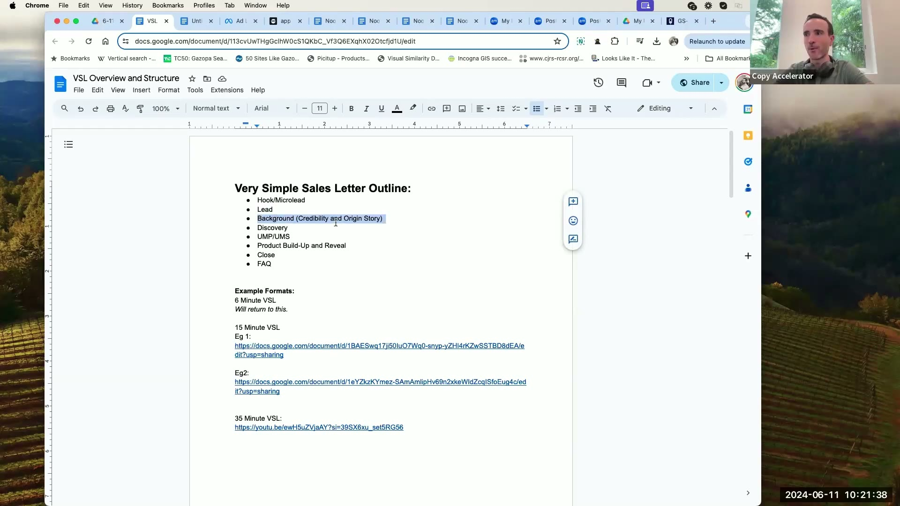
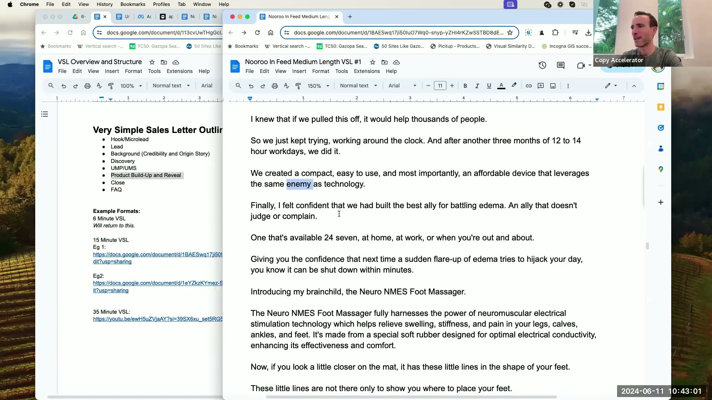
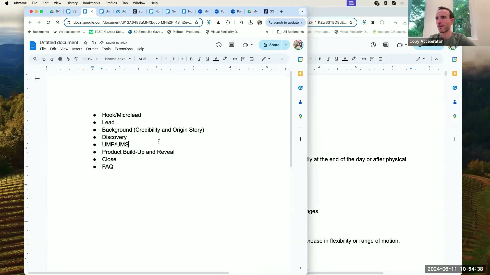
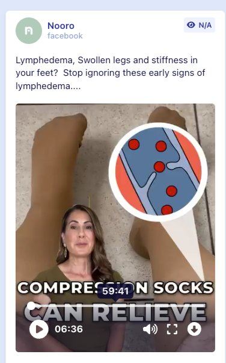
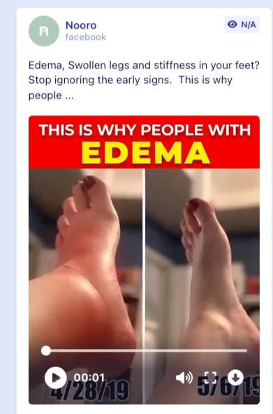

# 4.2 VSL Fundamentals & Classic Structure
> The first live VSL training call: the 8-part VSL spine, walked line by line through a 16-minute in-feed Nooro VSL, plus rules on straight-line structure, simple mechanisms, trial-and-error product stories and "dimensionalized" future pacing (with the Alpilean and Beverly Hills MD scripts as comparison).

## 🤖 Agent use
- **Use when:** drafting, outlining or auditing a VSL (long, medium, mini) or any in-feed video ad that runs a VSL; deciding where an objection, an ingredient list or a story belongs; keeping a script on a "straight line" from hook to close.
- **Inputs → outputs:** product, mechanism (UMP/UMS), spokesperson/credibility, offer and guarantee → a script that follows Hook/Microlead → Lead → Background → Discovery → UMP/UMS → Product Build-Up and Reveal → Close → FAQ, with test-ready alternate micro-leads. For audits: beat table + list of zig-zags.
- **Rules:**
  - **DO** "pay attention and have humility": "the only people I really see continuously struggle with VSLs are the ones who feel like they know everything and so they don't implement." [00:00–00:56]
  - **DO** follow one order: hook/micro-lead, lead, background story, discovery, UMP/UMS, product build and reveal, close, FAQ. "For any kind of consumer physical product, you're basically always following the structure." [00:56–01:50; 15:01]
  - **DO** keep the lead short in a mid-length VSL: "People sometimes think their leads have to be a thousand words long. They don't always." [09:55]
  - **DO** make the mechanism explainable in a sentence: "it's a pretty good mechanism because it's pretty easy to understand… if your calves are weak, blood can't pump up. Instead it pools." [13:04]
  - **DON'T** over-explain the mechanism (five muscles, a tendon, a hormone): "People start trying to do way too much shit in their unique mechanisms, which you don't need to do, right? Even for a longer VSL." [13:33–14:03]
  - **DO** say why an out-of-the-box version of the solution fails before you reveal your product: "if the solution was Ashwagandha, go buy it on Amazon, you won't have a product to sell." [16:57–17:55]
  - **DO** write the build-up as a trial-and-error invention story (prototypes, failures, setbacks, "I wanted to give up"): "when you really play this up, it just converts better." [19:50–22:40]
  - **DO** dimensionalize and future-pace in the lead and the close: show life "better with this product" in many areas. But "there's a limit to it". [25:29–26:48]
  - **DON'T** zig-zag. "The more closely you can generally follow this beat by beat structure, the better." [34:31–36:57]
  - **IF** a big objection comes naturally to the market (e.g. "water already has hydrogen") **THEN** answer it inside the UMP, and again in the close/FAQ. [36:57–39:48]
  - **IF** you sell a supplement **THEN** reveal ingredients in the UMS (as "found a solution in studies"), not first at the product reveal. [39:48–41:48]
  - **IF** a script claims live-viewer counts or fake scarcity **THEN** don't reproduce it. The instructor says of "almost 1,000 people live shopping": "Obviously not compliant." [30:12]
  - **DON'T** rely on "big pharma doesn't want you to know" lines: "they're not really compliant… I personally don't really use them." [1:00:42–1:01:15]
- **See also:** [04.01 VSLs section overview](04-01-vsls-section-overview.md) · [04.03 VSL leads](04-03-vsl-leads-after-the-opening-hook.md) · [04.04 background stories and unique mechanisms](04-04-vsl-background-stories-and-unique-mechanisms.md) · [04.05 product buildup and reveal](04-05-vsl-product-buildup-and-reveal.md) · [04.06 VSL closes](04-06-vsl-closes.md) · [Evolve Copywriting: unique mechanism](../../../evolve/copywriting/concepts/unique-mechanism.md)

## Key ideas

### 1. Humility and what "fundamentals" means [00:00–01:50]
- Recorded 2024-06-11 as one of a series of weekly calls (the screen clock reads 2024-06-11; derived from the frames). Part 1 of "several weeks" that will go deep on each section; today is only structure and examples: "I'm not going to go super deep into any one part." [00:56; 45:28]
- Credential and warning: he says he is "one of the best VSL writers on the planet… I've written a shit ton of really successful VSLs and tons that have bombed too." The pattern in struggling writers: "closed off to making adjustments and tweaks." [00:27–00:56] (self-description; instructor claim)
- The outline on screen is the one from [04.01](04-01-vsls-section-overview.md): Hook/Microlead, Lead, Background (Credibility and Origin Story), Discovery, UMP/UMS, Product Build-Up and Reveal, Close, FAQ. [01:25–01:50]


*The structure doc on screen [01:36] while he says "Background (Credibility and Origin Story)". The doc lists three example formats: 6, 15 and 35 minute VSLs.*

### 2. Formats: in-feed medium VSLs, minis and long [01:50–07:00]
- What many in his mastermind do now: "mid-length… VSLs in feed", i.e. Facebook ads that are the VSL. Nooro ("Neuro" in the transcript) is the example company; he links their ads library in the chat. [01:50–02:47]
- Their library shows "a really interesting mix… of 15, 16 minute long VSLs and six minute long ones". [02:20–02:47] The file swipe cards show 17:25 (medium #2) and 06:36 (mini #1) runtimes. [doc images]
- Two medium openings played back to back: opening A "Say goodbye to edema in your legs. Try this trick tonight…" (the transcript says "a demon"; the doc says edema) and opening B "This is why people with edema are switching to this genius affordable device. Doing this can make your edema worse. Here's how to solve it." [03:05–04:45]
- His read: same "root of the sales letter", different "hook or… micro lead that's going to bring you in a different way". He compares it to "Golden Hippos, like GundryMD ads". "They're kind of beasts about just testing tons and tons of different little hooks and openings". [04:45–06:36]
- "That's sort of the format that is working best for most people today." Media-buying format (YouTube, native) is for other calls. [06:36]
- Warning on swiping: "if you just swipe one… I really thought that video wasn't very good… so you want to see the different hooks and then go back to the root." [07:00]

### 3. Walk-through of the Nooro medium VSL against the outline [07:34–33:59]
Beat map. Script quotes come from the Nooro doc #1; times are from the lesson video.

| Outline part | Lesson time | Script beat | Instructor note |
|---|---|---|---|
| Micro-lead | 07:34 | "Say goodbye to edema… Here are three early signs of edema" (random swelling, heaviness, restricted range of motion) | "That's your micro lead." |
| Lead | 08:03–09:55 | "If that sounds like you, you need to hear this. This is the best way to relieve edema and swelling fast. It doesn't matter whether… thighs, calves, ankles or feet… three months or three years… Over 100,000 Americans use it…" | Call out pain, promise solution, create curiosity; "very short… quick lead" with a bit of social proof |
| Background / credibility | 09:55–10:23 | "Hi, my name is Dr. Jeremy Campbell… doctor of physical therapy from Chicago… over 10,000 hours… 1,100 patients" | Credibility; no long emotional story |
| Discovery | 10:23 | "It wasn't until earlier this year that I truly cracked the code" | "this little discovery" |
| UMP, part 1 | 10:23–11:13 | "You may have something called venous insufficiency… veins in your calves fail to send… blood back up… 25 million individuals" | "start of a unique mechanism of a problem" |
| UMP, part 2 | 11:13–14:31 | "Venous insufficiency is only half the answer… the edema… is actually caused by your calves… second heart… weak calves cause your vein valves to weaken… blood… pools" | "They've got a two-part unique mechanism." Summarised again at 14:31 |
| Why existing solutions fail | 15:31–16:30 | "wannabe solutions… focusing on the feet… compression socks, salt baths… pills… can't solve the problem" | Dismiss alternatives inside the mechanism |
| The "solution" tease | 16:00–17:55 | "You need to stimulate your calves… most experts will tell you to move… vicious cycle of agony… Luckily, there's now a better way." | "We just told them the problem… here's how you want to solve it." Then the out-of-the-box point (below) |
| UMS (discovery of NMES) | 18:25–19:50 | "Went down a rabbit hole… studies on neuromuscular electrical stimulation, or NMES… a pad… mimic the natural pumping" | "You could almost argue this is a two-part UMS mechanism" |
| Out-of-the-box fails (again) | 19:23–19:50 | Existing devices have wires, no manual; skin is a poor conductor | "They kind of do it twice in the sales letter" |
| Product build-up | 19:50–23:08 | Partners with a "US biotech startup"; three prototypes → three more → too expensive; "months passed"; "another three months of 12 to 14 hour workdays, we did it" | The spokesperson is "credible but they're not the founder"; "this is also a common format" |
| Close: reveal and features | 23:08–25:00 | "Introducing my brainchild, the… NMES Foot Massager"; soft rubber, silver and carbon threads | "features and benefits… tying them to benefits" |
| Close: future pacing | 24:32–25:29; 27:48–28:44 | "No more struggling to find shoes… No more shame…"; "Your work life. Your social life. Heck, even your marriage." | "Really taking time to continuously remind them of all the ways their life will be better" |
| Close: how to use / testimonial | 26:48–27:48 | "As easy as 1, 2, 3"; 6 modes, 19 intensity levels; "Like my mom… three times a day" | "Kind of like a testimonial" |
| Close: price anchor | 28:44–29:42 | "$500? $1000? $2000?… many specialists told me to charge at least $400, I refused" | "Price anchoring… another commonality… in almost every close" |
| Close: offer and scarcity | 29:42–31:04 | 50% discount "only available through this link"; "demand is simply growing too fast"; "almost 1,000 people live shopping"; "we would have taken the video down"; bundles of 1, 2, 3 (a "$20" shipping saving) | "Obviously not compliant" |
| Close: guarantee and support | 31:04–31:34 | 90-day trial, "89 minutes or 89 days"; customer service phone and email | "A nice touch, makes them seem more trustworthy" |
| CTAs | 31:04 | "Click the button below… click the link below this video… click the button now" | "So much urgency" |
| FAQ | 33:30 | not present in the video | "they didn't have one in their video" |

- He admits where this script deviates: "the UMS was a lot longer than some UMSs… I probably thought the product build and reveal was earlier than it was." The out-of-the-box failure shows up twice. "In general, most of these parts were really similar." [31:34–32:03]
- UMS defined: "Now that you know the real cause of the problem… this is the real solution on a macro level. It's logically connected to the problem. Once they have the macro solution (stimulate the calves), they have to dig deeper to prove the theory (find the NMES technology) and back it with credibility, studies and citations." [32:03–32:36]
- Structure is stable while formats change: "This is an outline from five, six, seven years ago… it's still basically the same outline that everyone's using." [32:36]


*Split view [23:00]: outline on the left with "Product Build-Up and Reveal" highlighted, Nooro script on the right at the end of the build-up. He highlights "enemy" (the doc's typo for "NMES") while saying the transcript is wrong at that point.*

### 4. The mechanism: simple, visual, logical [10:23–15:01]
- Test for a good mechanism: "somebody sees that and goes like, oh, wow. Okay. Yeah, I get it." Applied: "I've got blood pooling to my feet… my calf muscles aren't pumping blood back up. That's what's causing my edema. I didn't know that." [14:03]
- "It's actually a really great mechanism for these guys" because it uses a plain metaphor: heart sends blood down "like sliding down a slide"; calves bring it back up "like climbing back up the slide". [13:33]
- Both UMP and UMS get a recap sentence: "Weak calves cause your vein valves to weaken. Those weakened vein valves fail to send… blood back up… which ultimately causes the blood to pool…" [14:31]
- He wrote the structure "before I even looked at the script", which shows how stable it is, with a caveat: "especially any consumer product… if you're doing info, high ticket, other things, obviously there's nuance." [15:01]

### 5. The product build-up and why it converts [16:57–23:08]
- Placement: after the solution is known, explain why you cannot just go buy it ("Why can't I just go buy it at Amazon? Why can't I just go to the gym?… hire a coach?"). [17:26]
- Pattern: credible spokesperson partners with a company that "actually did it" ("a common format… who's credible, but they're not the founder"). [20:16]
- The struggle beats: "we meticulously analyze customer market data… built three prototypes… shared with existing customers… all worked but not good enough… three more… better but expensive… months pass… I wanted to give up… voice in my head… another three months of 12, 14-hour workdays." [21:17–22:40]
- His commentary, verbatim (profanity omitted): "This is all [made up], right? So take it with a grain of salt. Obviously, if you can try to make it as real as possible, I doubt they really made like nine prototypes. But that story is so powerful." [21:45] (Agent rule: never fabricate your own invention story. Use true development steps or skip it.)
- Claim: "we've tested this a lot with VSLs we've written… for anything mid-length or long-length, having that sort of 'we tested a bunch of things'… I've just found [skipping it] does not convert as well as when there's a sort of struggle of trial and error." And: "Every good VSL, not every, but the vast majority that I've seen… when you really play this up, it just converts better." [20:47–22:12] (instructor claim; no test data shown)
- Note for short VSLs: "on a really short VSL… you might not have a bunch of the struggle." [20:47]

### 6. Future pacing and "dimensionalization" [24:32–28:44; 55:43–1:01:15]
- Future pacing = "continuously remind them of all the ways their life will be better with this product", in both the lead and the close. Nooro: shoes that fit, no shame, work/social/marriage. [25:29]
- "The more dimensionalization, meaning the more you're painting a picture of how much better life will be… it's one of those kind of soft-seeming things in a VSL that just seems to almost always improve the conversion rate." [25:57–26:24]
- Limit: "If you have paragraphs and pages and pages and pages of dimensionalization and future pacing, you might be getting excessive, but you do want to check in your close and in the lead." [26:48] On the mid-length Alpilean-style example: "I don't think we all need to do that, especially not for a 16-minute or mid-length VSL." [57:16]
- Case: Alpilean, "a ClickBank aggressive weight loss offer… number one for quite a while" [25:57]. He reads the lead ("suddenly dissolved 62 pounds… waist so tiny… family and friends in awe") and the close ("Close your eyes and imagine… walking into your favorite retail store… Imagine hearing your friends gasp… Doesn't it take your breath away?"). [56:20–57:45; 59:13–1:00:08]
- Why he studies it despite the claims: "for every one weight loss black hat VSL that does like $20 million a month for a period of time, like this one did, there's a hundred or a thousand others that all made even more egregious or more aggressive claims that never did this. So what's the difference?… one of the biggest things to me is again all that dimensionalization and future pacing." [58:15] (instructor claim; revenue unverified). "I don't write aggressive shit anymore, but I'm morally agnostic." [57:45]
- Test it: "when you sometimes want to test that and be like, is it excessive or do I just feel like it's excessive because I'm not the market?" [1:00:42]
- Emotional logic: the audience "want[s] someone to tell them… a voice of hope. Right? We might feel cynical, but for them…" [28:16]

### 7. Straight line vs zig-zag [33:59–36:57]
- "The structure is pretty much always the same… especially for anything physical." [33:59]
- Failure pattern he sees in client/mastermind scripts, drawn in the doc as a list: hook/micro lead → lead → "UMP number one" → "random facts that are somewhat related to the pain point" → discovery/"more background story and unnecessary details" → "UMP… seven ideas/reasons why the pain point exists" → UMS → "another random idea or reason for pain point, like random quiz or assessment" → "more UMS, maybe more story". [34:31–36:06]
- Image: ideal = straight line from point A to B, "beat by beat"; typical = zig-zag: "they'll share some of their story, then explain the mechanism, then share more of their story, then go to more mechanism, then 'here are five signs of whatever'… you're not taking the person on a guided journey." [36:06–36:57]
- Even Nooro "does a little thing like this" but stays within the template. [36:06]
- Advice: "looking at your current VSLs, if you're deviating all over the place, you're not good." [54:44]


*The outline retyped into a scratch doc [34:36], used to annotate where a typical off-structure script repeats UMP and story. The scratch doc itself is not included in the files.*

### 8. Q&A decisions [36:57–1:07:42]

| Question from a member | Instructor answer | Time |
|---|---|---|
| Where to handle a big objection (e.g. a hydrogen-water device: "water already has hydrogen")? | "I would actually probably address it right in the UMP… it's a big enough objection… it kind of ties into the UMP anyway… You can always address it again in the close and FAQs." Example logic: the hydrogen in your water is not enough, here's why, so you need a different solution. | [37:26–39:48] |
| When to reveal supplement ingredients: product build-up or UMS? | "Typically, it would be in the UMS." Sequence he sketches (paraphrase): found a solution → studies on an unexpected herb/nutrient show it does exactly this → proof → it is one of several ingredients, each with studies → they work together → you can't just buy them on Amazon (low quality, wrong form, not combined) → so formulate or partner → build and reveal. "AI could just replace this with ingredient… it doesn't really matter what this is." | [39:48–42:17] |
| Go deeper on UMP/UMS in some markets? | "I really think most people probably make the mistake of trying to go too deep… People care. They want to know the real reason, but they don't need you to peel back the onion in three or four or five different layers." Finance is different (separate call). Mechanism of **delivery** can need depth when the delivery is the selling point (e.g. liposomal fish oil/turmeric). | [42:54–44:59] |
| Does the big idea come from the UMP? | "Usually, not always." Nooro's big idea is basically the mechanism: calves are the second heart. Counter-example: his stem-cell offer "time capsule in a bottle", a nostalgia/metaphor big idea. | [45:28–47:00] |
| Beverly Hills MD lead promises several things (pinch test, super agers, scam, one morning thing); too many ideas? | He would "generally prefer one big idea" right after the lead, then near the end of the lead add "other little hooks" (a fishing metaphor: one main hook, plus a few small ones in case the prospect swam past the first). A pair of opposites is still one idea ("what you should never do and the one thing you should do instead"). | [49:41–51:14] |
| Do you use "Big Pharma doesn't want you to know" in the lead? | Not really: overused, "people can smell the BS", non-compliant, "red flag" for Facebook; "you can test it". | [1:00:42–1:01:15] |
| Mid-length VSLs have little story vs 30–40 minute ones. Thoughts? | Depends on the spokesperson. A short patient story "five to seven lines" works ("a patient came in… was upset… I wanted to find a solution"). The "crazy emotional story… like, mommy, where's your hair" is "played out for the most part," especially on Facebook. "The hero's journey, especially for the mid-length ones, I don't think you really need." | [1:01:15–1:03:21] |
| How do you condense the mechanism in a 12–17 minute VSL? | "I don't know if I have like a specific formula." His test (paraphrase): does it explain the real cause in a novel but believable way, with enough proof that a friend would say "that makes sense"? Choose depth: mention a layer of the body once, don't sink into biology ("mitochondria… the powerhouse of the cell"). If the spokesperson is a doctor/dermatologist/expert, "Harvard says it here, here's an image" is enough; a DIY person ("I'm Bob the mechanic") has "a higher burden of proof". | [1:03:50–1:07:11] |

### 9. The Beverly Hills MD example in the call [47:28–55:13]
- He plays the first minutes of the pinch-test VSL and says the lead is the pinch test + "I'm going to show you this one thing you should do every morning." [47:28–48:39]
- "Super agers" and "scam" ideas: "you can tell they tested a new hook… no mention of super agers up here. But it didn't really matter." He would have kept the micro-lead congruent with the lead. [51:14–52:45]
- Origin pattern: "a woman who came to my clinic… like Linda." "We used to joke it was John for guys, like, 'John dies at the end'… I see Linda a lot." Purpose: "build rapport… the problem she had is the same problem as the prospect has." [53:45–54:44]
- Takeaway: "keeping in mind this basic structure when you go to write and not deviating." The 16-minute Nooro example shows the whole structure fits in a mid-length VSL. [54:44–55:43] Full teardown of the BHMD ad is in [04.01](04-01-vsls-section-overview.md).

### 10. Where the files in the zip fit
The zip "VSL structures, lengths, and objectives" holds seven scripts: Nooro medium #1 and #2, Nooro mini #1 and #2, Beverly Hills MD pinch test (transcript with timestamps), Alpilean VSL long (49:56) and Alpilean formatted close. Mini and medium material is analysed below. The lesson itself defines length only by examples (6-minute, 15–17 minute, 35-minute); no separate "objectives" document is included. [zip; 01:50; 55:13]

## Steps / framework

### A. VSL spine and what each part must do (consolidated from the call; derived where marked)
1. **Micro-lead** (first 10–30 seconds): hook; relate to pain and to the promise. Prepare 2–3 alternates over the same root script. [03:05–06:36]
2. **Lead**: promise + qualifiers ("doesn't matter whether…") + a bit of proof; end with 1–2 extra mini-hooks. Short for mid-length. [08:03–09:55; 49:41–51:14]
3. **Background**: credentials of the speaker; optionally a 5–7 line patient/prospect story. [09:55; 1:01:15]
4. **Discovery**: the "I cracked the code" beat. [10:23]
5. **UMP**: real cause; simple metaphor; recap sentence. [10:23–14:31]
6. **UMS (macro)**: "stimulate the calves"; dismiss existing remedies. [15:31–17:55]
7. **Out-of-the-box fails**: why you can't just buy/do it. [16:57; 19:23]
8. **UMS (micro) / discovery of the specific solution**: "studies on NMES"; ingredients if a supplement. [18:25; 39:48]
9. **Build-up and reveal**: prototypes, struggle, breakthrough, product named. [19:50–23:08]
10. **Close**: features→benefits, future pacing, how to use, testimonial, price anchor, offer, scarcity, guarantee, support contact. [23:08–31:34]
11. **CTAs** repeated; **FAQ** if used. [31:04; 33:30]

### B. Template: supplement UMS beat (the instructor's spoken example; derived into a fill-in)
```text
[After the UMP] Then I found a solution. I came across studies on [unexpected ingredient/class] showing it can [specific outcome tied to the UMP]. Here is the proof [real study, real number]. As I dug deeper I found it is one of several [ingredients] that [mechanism]. Each has its own evidence [one line each]. Together they [outcome]. The problem: you can't just buy these on Amazon, because most supplements [low quality / wrong form / not combined / unclear sourcing] ([real, verifiable reason]). So I [formulated it with / partnered with] [real partner] and [real development steps].
```
Use only claims the brand can prove. The wording is from his riff at [39:48–41:48] (e.g. "this unexpected herb… Himalayan herb or this unexpected nutrient found in deep-sea krill"), converted to a template.

## Examples

### Nooro mini VSLs (about 1,400 words, 6:36 runtime on the swipe card) [docs]
Two minis, same close, different mechanism and product:

| Item | Mini #1 | Mini #2 |
|---|---|---|
| Opening | "Compression socks can relieve lymphedema, right? Wrong. What? Here's the truth. Wearing compression socks or band-aids could actually be making your lymphedema worse." | "This is why people with edema are switching to this genius affordable device. Lifting your legs up is the best way to relieve edema, right? Nope. What about compression socks? Really?… These are not the best ways to relieve swelling and edema." |
| First argument | Compression socks only help if fitted; leg elevation must be above heart level; the **handstand analogy** ("if I perform a handstand and get more blood into my head, that extra blood will stay in my head and make me smarter") | Same elevation/gravity argument and handstand analogy; "There's an easier way." |
| Lead | "If that sounds like you, you need to hear this… doesn't matter whether… thighs, calves… three months or three years… 100,000 Americans… social media sensation" | Identical lead block |
| Mechanism | **Lymphatic system** clogged "much like a clogged sink"; "everyone is obsessed with blood circulation"; "the lymphatic system's the root cause" | **Calves = second heart**, weak calves, weak vein valves (same as the medium VSL) |
| Product | "Neuro 3-in-1 Leg Massager": sequential 360° massage + heat (vasodilation) + pneumatic compression | "Neuro NMES Foot Massager" |
| Close | 15 minutes a day; "ironclad 90-day results or refund guarantee… I'm just asking you to say maybe… for 30 days" (the source says 30 days after saying 90 days) ; 24-7 support; "The only risk is the possibility of pain and regret" | Same close |

Reading (derived): the minis drop credentials, the discovery story and the build-up. They run "debunk the common remedy → one-line gravity analogy → lead block → short mechanism → product → guarantee". The same lead block ("If that sounds like you…") is reused across medium and mini, which is what the instructor means by "root".


*Ad card for mini #1 (image from the .docx): host + animated vein inset, hook text "COMPRESSION SOCKS CAN RELIEVE", runtime 06:36. The card text reads "Lymphedema, Swollen legs and stiffness in your feet? Stop ignoring these early signs of lymphedema…".*


*Ad card for mini #2 (image from the .docx): same split-screen creative as the medium VSL #2, so one creative drives a 6-minute and a 17-minute cut.*

### Alpilean (long, 49:56 in the transcript doc; heavy compliance flags)
Structure of the doc by timestamp (doc timestamps, not lesson time):
- 00:05–01:00: staged couple dialogue (diet frustration) as the hook. 01:00–02:38: "five second ice hack… Sarah Miller, a 47 year old mom of three from Texas suddenly dissolved 62 pounds of thick, wobbly fat" (the lead's before/after and dimensionalized outcomes); husband "Zach… 26 pounds"; skepticism line ("as unbelievable as it sounds"). 02:38: "I'm Zach Miller, Sarah's husband" and the promise of a "whistle-blowing doctor". 04:13–05:12: five short testimonial clips. 05:12 onward: "Imagine no more worries about people laughing…" (future pacing) and the "greedy, corrupt, 78 billion weight loss industry" villain. 07:45: Zach's story (tornado, Sarah's weight, collapse at 10:57). 12:07: the newspaper headline about Dr. Pat. 14:28–16:13: UMP, dieting triggers "starvation mode". 16:13: exercise fails. 17:46: the "alpine" recipe, "ancient calorie burning switch" and low **inner body temperature** (18:39), 1850 vs today data (20:35). 25:03: second doctor adds nutrients. 29:50: "1,560 men and women" volunteer test. 31:52: product named; 36:39: two bonus books; 42:05: "Option one… Option two" double-CTA fork; 46:32: FAQ ("Hey, still there").
- Close (formatted version): product intro ("the world's first 100% natural solution to fix the newly discovered, scientifically proven root cause… low inner body temperature"); "feels like you're cheating at life"; "Close your eyes and imagine"; price anchor ("$700… $1,300 I personally paid… $199… just $59"); 3/6 bottle bundles; "96% of people order six bottles"; "clock is ticking"; "ironclad two month money back guarantee". These show the **same close skeleton** as the Nooro and BHMD closes (anchor → reduction → bundle → scarcity → guarantee).
- The instructor's point is only about dimensionalization and the structure of the lead/close [56:20–1:00:08]. Do not reuse the weight-loss claims ("62 pounds", "metabolism by 350%", "dopamine", "natural antidepressant").

## Structured units

### Hooks
| Hook (verbatim or near) | Heuristic(s) | Emotion / zone | Self targeted | Why it works | Source |
|---|---|---|---|---|---|
| "Say goodbye to edema in your legs. Try this trick tonight and see what happens. Here are three early signs of edema." | Tip + checklist (derived) | Recognition, relief | People with leg swelling | Self-qualifier then "If that sounds like you, you need to hear this" | [03:05] |
| "This is why people with edema are switching to this genius affordable device. Doing this can make your edema worse. Here's how to solve it." | Warning + social proof of switching (derived) | Fear of aggravating it | People already managing edema | Stacks three hooks; leads straight into the mechanism | [03:47] |
| "Compression socks can relieve lymphedema, right? Wrong." | Common-belief reversal | Surprise | Compression-sock users | Makes the prospect's current remedy the problem | mini #1 doc |
| "Lifting your legs up is the best way to relieve edema, right? Nope. What about compression socks? Really?" | Serial debunk | Surprise | Same | Eliminates the usual remedies before the lead | mini #2 doc |
| "Does your skin pass the pinch test?" | Self-test | Curiosity | Women 35–89 | Interactive hook (see [04.01](04-01-vsls-section-overview.md)) | [47:28] |

### Rewrites (before → after)
| Before | After | What changed | Source |
|---|---|---|---|
| Medium VSL opening A: "Say goodbye to edema in your legs…" | Opening B: "This is why people with edema are switching to this genius affordable device. Doing this can make your edema worse. Here's how to solve it." | Promise → warning + switching proof; mechanism moved into the first 30 seconds; root script unchanged | [03:05–06:06] |
| Medium VSL opening B (2 hooks + mechanism) | Mini opening: "Lifting your legs up is the best way… right? Nope." | Dropped credentials and discovery; opens on the remedy debunk | mini #2 doc |

### Rules of thumb
- **DO** reuse one lead block and one mechanism across several micro-leads; test the opening, not the whole script. [06:06–06:36]
- **DO** use a "pretty good mechanism": one metaphor, one cause, one recap sentence. [13:04; 14:31]
- **DON'T** add "random" ideas (quiz, extra reasons, extra story) between the sections. [34:31–36:57]
- **IF** the market has an obvious objection **THEN** put it in the UMP, not only in the FAQ. [37:26–39:48]
- **IF** the speaker is a doctor/expert **THEN** shallow proof ("Harvard says…") is enough; a DIY speaker needs more. [1:06:11–1:07:11]
- **DON'T** paste "live shopper" counts, fake stock claims or "would have taken the video down" lines. [30:12]

### Ad teardowns
| Brand / product (niche) | Format | Hook / opening | What works | What fails | Fix suggested | Principle | Source |
|---|---|---|---|---|---|---|---|
| Nooro NMES Foot Massager (edema) | 16–17 min in-feed Facebook VSL | Tip + early-signs list or warning + calves | Simple "second heart" mechanism; trial-and-error build-up; dense future pacing; price anchor; 90-day guarantee with phone number | UMS longer than usual; out-of-the-box failure appears twice; "1,000 live shoppers"; no FAQ | Trim the duplicate beat; delete invented scarcity | Straight line, simple mechanism | [07:34–33:59] |
| Nooro mini (lymphedema / edema) | ~6 min in-feed VSL | Debunk compression socks/leg elevation | Fast remedy debunk + handstand analogy; same proven lead and close | Mini 1's "90-day guarantee… say maybe for 30 days" is internally inconsistent | Align guarantee wording | Remove credentials/build-up in minis | mini docs |
| Beverly Hills MD Dermal Repair Complex (beauty supplement) | ~36 min VSL ad | Pinch test | See [04.01](04-01-vsls-section-overview.md) | Multiple promises in lead | One core promise; extras at end of lead | One big idea | [47:28–52:45] |
| Alpilean (weight-loss supplement) | ~50 min VSL; formatted close | Staged couple dialogue then "five second ice hack" | Extreme dimensionalization in lead and close | Aggressive/unsubstantiable claims, "the weight loss industry lied to you" | Do not copy claims; copy the idea of vivid before/after future pacing only if provable | Dimensionalize without overdoing | [55:43–1:00:08] |

## Prompts / templates (verbatim)
No prompts are shown in this lesson. Templates quoted verbatim from the course files:
- Outline: see [04.01](04-01-vsls-section-overview.md) (full "Very Simple Sales Letter Outline").
- Verbatim openers in the Nooro files (for teardown only): see Hooks table above.

Derived agent checklist (not a course asset):
```text
VSL straight-line check
1. List each paragraph/scene with its outline part (Hook, Lead, Background, Discovery, UMP, UMS, Out-of-the-box fails, Product build-up, Reveal, Close, CTA, FAQ).
2. Flag any paragraph that belongs to an earlier part than the one before it (zig-zag).
3. Flag any "random" device: unrelated quiz, extra reason, extra story after the UMS.
4. Check: Does the lead promise ONE core idea, with extra hooks only at the end of the lead?
5. Check: Is the mechanism one cause + one metaphor + one recap sentence?
6. Check: Is there an explicit "why you can't just buy/do this elsewhere" beat before the reveal?
7. Check: Does the build-up use only real development facts?
8. Check: Does the close include features->benefits, future pacing, how to use, price anchor, guarantee, support contact, CTA?
9. List every claim, number, credential, testimonial and scarcity statement that needs proof.
```

## Screenshots
Five frames above (outline doc, Nooro build-up, zig-zag scratch doc, two Nooro swipe cards). Other sampled frames [03:00], [13:30]... show the same Google Docs setup with a Zoom tile of the instructor; the Alpilean doc at [57:00] shows testimonial text only and was not kept.

## How to apply
- [ ] For each new VSL, write the outline with one line per part before drafting.
- [ ] Create 3 micro-leads for the same root script (promise, warning, mechanism-in-hook).
- [ ] Draft the mechanism as slide-and-climb style metaphor + a recap sentence.
- [ ] Add the "why not out-of-the-box" beat; then the build-up with true steps only.
- [ ] Future-pace in the lead and close across at least three life areas; check it doesn't run pages long.
- [ ] Put any big objection in the UMP and repeat in the close/FAQ.
- [ ] Remove "Big Pharma", live-shopper and invented-deadline lines; add real stock/guarantee facts.
- [ ] Run the straight-line check and fix zig-zags first.

## Related
- Previous: [04.01 VSLs section overview](04-01-vsls-section-overview.md) · Next: [04.03 VSL leads after the opening hook](04-03-vsl-leads-after-the-opening-hook.md)
- [Evolve Copywriting: unique mechanism](../../../evolve/copywriting/concepts/unique-mechanism.md) · [Evolve Copywriting: hooks](../../../evolve/copywriting/concepts/hooks.md) · [Evolve Start Here: market awareness levels](../../../evolve/start-here/concepts/market-awareness-levels.md) · [Iteration vs variation](../../../../concepts/iteration-vs-variation.md) · [Creative testing system](../../../../frameworks/creative-testing-system.md)
- Contradictions to note: (1) The section overview calls Nooro and "Miami MD" the medium examples, while the supplied "Beverly Hills MD" VSL is 36 minutes (he calls it a "35 minute one") [01:50; 44:59 vs 04.01 v1 02:23]. (2) Evolve Copywriting teaches iterating one ad concept through angles and formats; RMBC II tests micro-leads over a fixed root script. Both are variation strategies at different layers. (derived)

## Sources and limitations
- Transcript: [02-[1] VSL Fundamentals & Classic Structure.txt](<../../../../../raw/stefan-georgi/rmbc-ii/_transcripts/Stefan Georgi - RMBC II (1)/04-VSLS SECTION I-Structure Theory and Examples/02-[1] VSL Fundamentals & Classic Structure.txt>) (1:08:17; last segment 1:07:42; whole call read). Platform caption file used for names ("Lakey", "Neuro").
- Zip docs: [Nooro Medium #1](<../../../../../raw/stefan-georgi/rmbc-ii/_extracted/_unzipped/04-VSLS SECTION I-Structure Theory and Examples/02-1 VSL structures lengths and objectives-20250708T085326Z-1-001/1. VSL structures, lengths, and objectives/Nooroo In Feed Medium Length VSL %231_.docx.md>) · [Mini #1](<../../../../../raw/stefan-georgi/rmbc-ii/_extracted/_unzipped/04-VSLS SECTION I-Structure Theory and Examples/02-1 VSL structures lengths and objectives-20250708T085326Z-1-001/1. VSL structures, lengths, and objectives/Nooroo In Feed Mini VSL %231.docx.md>) · [Mini #2](<../../../../../raw/stefan-georgi/rmbc-ii/_extracted/_unzipped/04-VSLS SECTION I-Structure Theory and Examples/02-1 VSL structures lengths and objectives-20250708T085326Z-1-001/1. VSL structures, lengths, and objectives/Nooroo In Feed Mini VSL %232.docx.md>) · [Alpilean long](<../../../../../raw/stefan-georgi/rmbc-ii/_extracted/_unzipped/04-VSLS SECTION I-Structure Theory and Examples/02-1 VSL structures lengths and objectives-20250708T085326Z-1-001/1. VSL structures, lengths, and objectives/Alpilean VSL long.docx.md>) · [Alpilean formatted close](<../../../../../raw/stefan-georgi/rmbc-ii/_extracted/_unzipped/04-VSLS SECTION I-Structure Theory and Examples/02-1 VSL structures lengths and objectives-20250708T085326Z-1-001/1. VSL structures, lengths, and objectives/Alpilean formatted close.docx.md>) · [Beverly Hills MD Pinch Test VSL](<../../../../../raw/stefan-georgi/rmbc-ii/_extracted/_unzipped/04-VSLS SECTION I-Structure Theory and Examples/02-1 VSL structures lengths and objectives-20250708T085326Z-1-001/1. VSL structures, lengths, and objectives/Beverly Hills MD Pinch Test VSL.docx.md>).
- Machine transcription (Whisper large-v3-turbo). Fixes applied in quotes: "a demon" → edema; "Neuro" kept as the call/script spelling of the brand shown as "Nooro" on the swipe cards; "Apple Lean/Appaline/Abilene" → Alpilean (doc name); "Venus insufficiency" → venous insufficiency; "MES" → NMES; "50 minutes per day" → 15 minutes (doc 1: "all it takes is 15 minutes per day"); "UMP number one" kept as spoken; "Hong, you've had the problem" was left out as unintelligible. The transcript has a few garbled lines around 35:00–35:37 (zig-zag description); our reading is paraphrased there.
- Participant questions are summarised without names. The moderator and members' offers/products (hydrogen water, hair, supplements) are examples of their situations, not of course assets.
- Not included in the files: the 15-minute VSL example docs and the 35-minute YouTube VSL linked from the outline; the Nooro ad library itself; the weekly folder or replay mentioned at [1:07:42]; any "objectives per VSL length" document despite the zip title.
- Nooro/Beverly Hills MD/Alpilean revenue and performance claims in the call are the instructor's (e.g. Alpilean "$20 million a month for a period of time") and are unverified.
