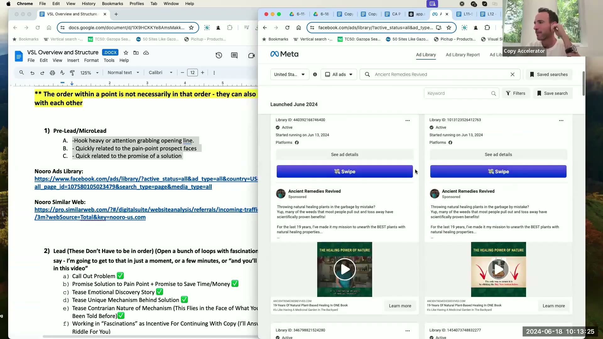
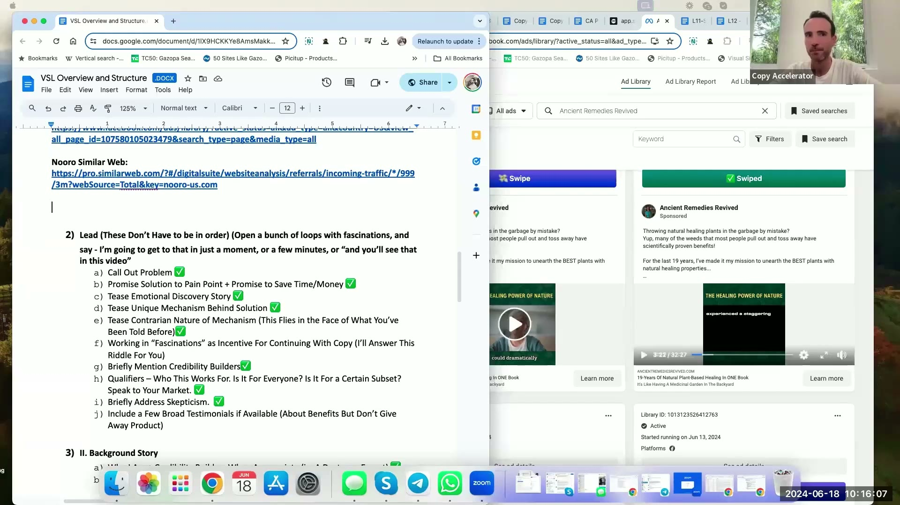
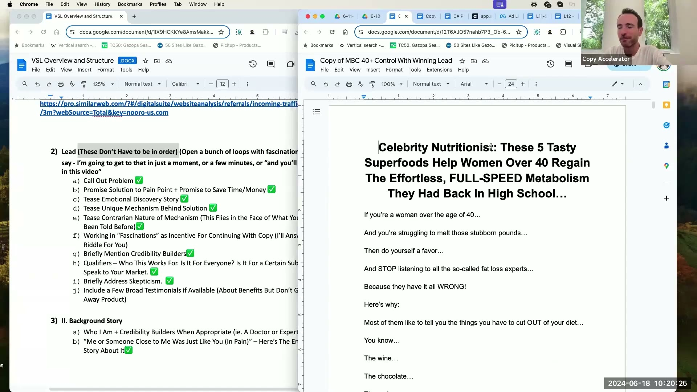
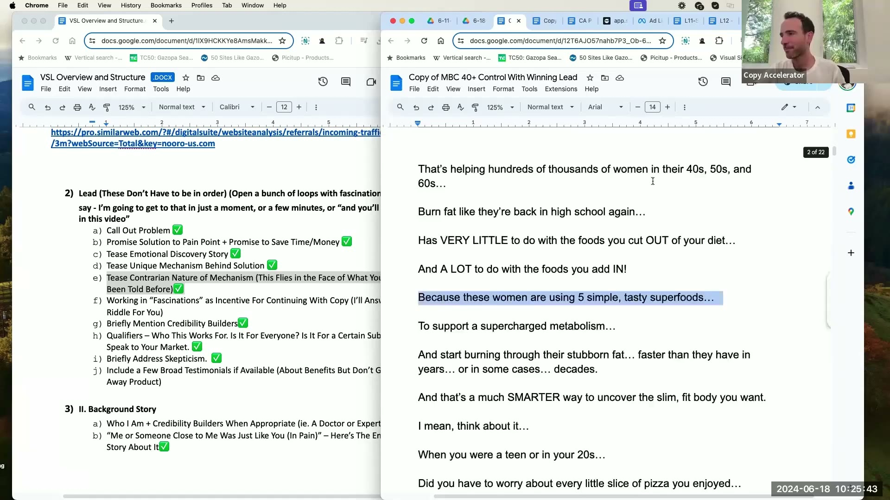
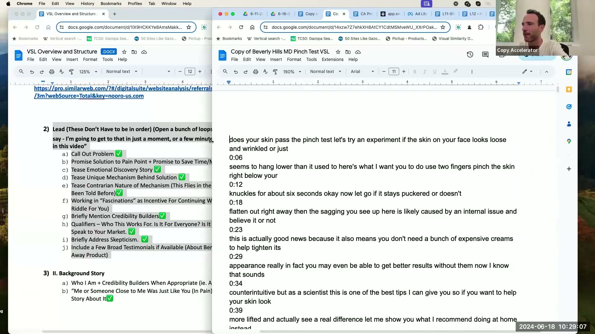

# 4.3 VSL Leads (After The Opening Hook)
> The lead is an advertisement for the rest of the video sales letter: it must call out the pain, promise the solution and tease the mechanism and story without teaching any of it, so the viewer commits to watching on. Most weak VSLs fail here because they start teaching too soon or have no interesting idea.

## 🤖 Agent use
- **Use when:** writing or auditing the first 300–700 words of a VSL or text sales letter (the lead that follows the opening hook or "micro-lead"), choosing which opening lines to split-test, or diagnosing a script whose copy "reads fine" but does not pull.
- **Inputs → outputs:** product facts, the target avatar and qualifier (who it is for), the big idea / unique mechanism teaser, the spokesperson's credibility, any proof or case study, and the emotional discovery story → a micro-lead (2 or more hook options) plus a lead that hits the 10-element checklist below, with a teaser for each later section instead of the content itself.
- **Rules:**
  - **DO** treat the lead as "an advertisement for the rest of the video sales letter". Its only job is to sell the viewer on the value of watching or reading on. The same logic applies to subject line, first email line, CTA, page headline and lead. [16:19–16:45]
  - **DO** open with an attention-grabbing hook or micro-lead that quickly relates to the prospect's pain point and quickly relates to the promise of a solution. It can be one or two sentences or a 30–60 second block. [10:58; 46:22]
  - **DO** hit most of these in the lead (order is flexible): call out the problem, promise the solution (plus save time or money), tease the emotional discovery story, tease the unique mechanism, tease its contrarian nature, work in fascinations, briefly mention credibility, qualify who it is for, briefly address skepticism, add a few broad testimonials if available. [14:20–15:20]
  - **DON'T** teach or explain the mechanism inside the lead ("that's a different part of our structure"). Teasing says a mechanism exists and is surprising. Giving it away names the hormone and what it does. [17:14; 26:19]
  - **DO** repeat one simple "one thing" phrase through the lead (the winning lead repeats "five tasty superfoods"). [23:48]
  - **DO** put a real big idea in the lead. "I'd rather have something that's like really fascinating interesting" than tick every box on a flat idea. [43:11–44:05]
  - **DON'T** use an abstract metaphor the reader cannot connect to their own problem. A "riot" on the skin was too abstract; a "silent war" on the skin was fixed. [44:55–45:52]
  - **DO** give the client or team two to a few opening-line options to test. Do not write 3–5 totally different 300–700 word leads. [35:22]
  - **IF** the VSL runs as an in-feed Meta ad **THEN** expect to test "dozens and dozens" of micro-leads or hooks before finding one that scales. [39:00–39:27]
  - **IF** the audience is not a "used to be skinny" audience **THEN** frame the promise as it getting harder since getting older (e.g. after childbirth) or use a different comparison (see Rewrites). Untested by the instructor. [40:53–42:14]
  - **IF** you are copying a health lead **THEN** copy the structure only. The examples contain weight-loss, anti-aging and joint claims that need substantiation and would break Meta/FTC rules (see Claims check).
- **See also:** [04.2 VSL fundamentals and classic structure](04-02-vsl-fundamentals-classic-structure.md) · [04.4 Background stories and unique mechanisms](04-04-vsl-background-stories-and-unique-mechanisms.md) · [04.10 Using AI to generate endless good hooks](04-10-using-ai-to-generate-endless-good-hooks.md) · [Evolve: Hooks](../../../evolve/copywriting/concepts/hooks.md) · [Evolve: Open loops](../../../evolve/copywriting/concepts/open-loops.md)

## Key ideas

### Where the lead sits and why people get it wrong [10:00–10:58; 16:19–17:40]
- Review of the outline: hook or micro-lead, lead, background story, discovery story, unique mechanism (problem and solution), product build-up and reveal, close, FAQ. This call covers the first two. [10:00–10:29]
- The instructor says one of the "biggest opportunities for improvement" in reviews and feedback is people's VSLs and text sales letters. [00:28–00:56]
- Chain of "advertisements": the email subject line advertises the email, the first line advertises the rest of the email, the CTA advertises the sales page, the headline advertises the video or page, and the lead advertises the rest of the VSL. "Advertisement doesn't mean... hypey". It should not feel like an ad. [16:19–16:45]
- The lead's function: "grab your prospect's attention and then build rapport", make them feel you are speaking to them, and qualify who it is for. [15:20]
- Common mistake: going into "education or teacher mode too fast". The lead tells the viewer you will show them the way and that it will be fascinating, not how. [15:50–17:40]
- The structure is the foundation, not law: there are always exceptions, order varies, and exceptions can be covered "in a future training call". [17:40–18:09]

### Pre-lead / micro-lead (the hook block) [10:58–13:51]
- Defined as: a strong hook or attention-grabbing opening line, a quick tie to the pain, a quick tie to the promise of a solution. "It could just be a sentence or two in your lead", or a longer block. [10:58]
- What is working "these days": VSLs run as in-feed Meta ads, with "a bunch of different little hooks for the first 30 seconds, a minute" and then the video flows into the "root" of the VSL. [11:28–11:54]
- Example shown on screen: an in-feed set from the brand Ancient Remedies Revived (mentioned by a participant). The Meta Ad Library page shows several ads from the same page launched June 2024 with identical primary text. The instructor says the cinnamon-and-honey ad is "32 minutes long. It's just the whole VSL". [11:28–13:22] The openers are educational teasers ("what happens if you drop rosemary leaves into your bottle of olive oil", "oops! I accidentally dropped some cinnamon sticks into my jar of honey... this could actually be a lucky mistake for helping to manage inflammation"). [11:54–13:22]
- The instructor's reading: "a little hook of curiosity", then "grabbing your attention right away". [13:22]
- The same educational-opener approach is used by Beverly Hills MD and Gundry MD (the instructor says Golden Hippo, Gundry MD and Beverly Hills MD are the same company), e.g. "which is better for you, carrots or turnips", then the host turns the answer into the root of the VSL. [29:13–30:07]
- More hooks and micro-leads get their own training later ("we're doing a whole other training on headlines" [18:38]; "we'll probably have a whole section or session on that", see [04.4](04-04-vsl-background-stories-and-unique-mechanisms.md) [07:03]).


*Left: the "Pre-Lead/MicroLead" outline doc (hook-heavy line, relate to pain, relate to the promise of a solution). Right: the Meta Ad Library showing in-feed ads that open with a micro-hook before the long VSL. Dated June 2024 on screen. [11:45]*

### The lead checklist, with the instructor's mapping [14:20–15:20; doc "VSL Overview and Structure", section 2]
- The doc's header: the elements "Don't Have to be in order"; "Open a bunch of loops with fascinations, and say - I'm going to get to that in just a moment, or a few minutes, or 'and you'll see that in this video'". [doc, section 2]
- The ten elements are listed in Steps / framework below. In the walk-through the instructor ticks each one against real leads. [18:09–34:02]
- Support points: "you don't necessarily have to use everything" and the order within a point can mix. [doc, header notes; 17:40]


*The doc the instructor marks up on screen: lead elements a to j (call out problem through broad testimonials), with background story starting below. [14:30]*

### Worked lead 1: Metaboost Connection "40+" control-beating lead [18:09–26:48]
- Context (instructor claims): an info product for women over 40 who want to lose weight; the instructor and Mario Castelli wrote this lead; it beat the control by about 15% and is "a nine-figure offer" and "one of their biggest split test wins ever", within the prior four or five months. [18:09–18:38] He also says "I don't even think this lead is actually that good, but it works", and calls it surprising because it has no "insanely crazy hooks". [18:38; 36:21–36:50] (Whisper writes "Metaboost Connect" and "stubborn nutritionists". The doc names it "MBC 40+ Control With Winning Lead" with "Metaboost connection" and headline word "Celebrity Nutritionist".)
- Headline: "Celebrity Nutritionist: These 5 Tasty Superfoods Help Women Over 40 Regain The Effortless, FULL-SPEED Metabolism They Had Back In High School…" [doc; 18:38]
- Mapping given: [23:18–25:47]
  - **Call out the problem + qualifier:** "If you're a woman over the age of 40... and you're struggling to melt those stubborn pounds".
  - **Tease the contrarian nature of the mechanism:** "stop listening to all the so-called fat loss experts... they have it all wrong". Most tell you what to cut out (wine, chocolate, carbs); the real secret is foods you add in.
  - **Credibility builder (brief):** "according to the latest nutritional research".
  - **Promise the solution:** five simple tasty superfoods supercharge metabolism and burn stubborn fat; "a much smarter way".
  - **Repetition of one thing:** "five tasty superfoods" appears in the headline and again and again.
  - **Pain re-agitation:** teen or 20s vs now, hormones change, weight creeps on, hiding from photos, oversized clothes; then "it doesn't have to be this way".
  - **Address skepticism:** "as hard as that may sound to believe... I know it's true".
  - **Tease the emotional discovery story:** "my own sister, Danielle" and what happened when she was introduced to the foods.
  - **A few broad testimonials without giving the product away:** short named transformations (e.g. a 53-year-old, a 56-year-old size 14 to size 2).
  - **Closing promise and "pay close attention to every word of this special free video"**, then it moves into the background story.
- What it lacks: fascinations (e.g. "why Harvard says the secret to weight loss could be hidden in the top shelf of your refrigerator", "the 30 second water trick"). [26:19] What it does not do: name the hormone (cortisol) or explain what it does. That is "the difference between teasing the mechanism and actually giving it away". [26:19–26:48]
- The 8-pounds claim: the instructor says it is a "detox flush" type result and that they have results to back it. [22:50] (instructor claim; not shown in the course files.)
- The doc shows the winning lead is only the opening section; the rest of the page is the control VSL with the sections marked BACKGROUND STORY, UM OF THE PROBLEM, UM OF THE SOLUTION, PRODUCT REVEAL, GUARANTEE, CLOSE, FAQs. Right after the lead comes a quick qualifier quiz and a short testimonial montage, then the spokesperson introduces herself. [doc]


*The winning lead opens on the headline and "If you're a woman over the age of 40..." with a one-line-per-beat rhythm. [18:45]*


*The highlighted line carries the idea: "5 simple, tasty superfoods" plus "very little to do with the foods you cut OUT... a lot to do with the foods you add IN". [24:00]*

### Worked lead 2: Beverly Hills MD "pinch test" [27:22–34:02]
- Hook: a do-it-now test, "Does your skin pass the pinch test? Let's try an experiment." The result is made "good news": if the skin stays puckered the cause is internal, so you "don't need a bunch of expensive creams". [27:22–27:52]
- The instructor's reading: [29:13–33:37]
  - **Hook:** the pinch test, "super attention grabbing"; same educational-opener style as above.
  - **Contrarian:** sagging means an internal issue ("good news"); you may get better results without creams; "as a scientist" is a small credibility builder. [30:07]
  - **Promise the solution:** "let me show you what I recommend doing at home instead"; "a scientifically proven way... just by doing one very simple thing every morning". [30:38–31:37]
  - **Fascinations:** "what's really making these so-called super agers look so young and the one anti-aging scam you should never fall for" (instructor says it is left over from a different lead and "they just didn't edit it out"). [30:38]
  - **Qualifier:** "a woman who's currently between the ages of 35 and 89". [31:08]
  - **Save time/money:** "right at home in less than a minute"; no creams, procedures or gadgets. [31:37]
  - **Tease the mechanism:** a decades-old discovery most women don't know, ignored because "it's not exactly profitable for the commercial beauty industry" and "initially believed to only work for men". [31:37–32:05]
  - **Credibility** ties in; more promises (firmer, tighter, fewer wrinkles).
- What is missing and the suggested fix: no skepticism line, no testimonials (the instructor guesses Gundry-style leads skip testimonials "probably... for compliance"), and no tease of the emotional story although the body has the patient story. Add "one sentence or two". [32:05–34:02] (Fix text is in Rewrites.)
- The lead is described as "a fast lead". The 5 million-plus YouTube views of this VSL are cited as evidence it "done decently well" (instructor claim). [29:13; 30:38]


*The pinch-test opener (YouTube transcript with timestamps) placed beside the checklist so each sentence can be tagged against it. [27:30]*

### Q&A: first lines, testing and "simple" leads [34:02–39:27]
- Question: how to choose an opening line when a plain "If you are a woman over 40..." feels too simple to deliver to a client? Answer: give "a couple options to test"; "you really do need to test leads". [34:54]
- Relayed by the instructor about "Dario" (spelling from the captions; described as part of "our mastermind") whose business does "a couple million bucks a month": he said they went through about 130 micro-leads before they found the one that enabled the scale (second-hand, instructor claim). [35:22]
- A lead is "300 to 700 words long". Testing means different opening lines or first few lines, not multiple fully different leads. [35:22–35:51]
- Opinion shift: he used to "hate" "if you're a woman over 40" openers ("feels like the radio announcer") but several operators at a mastermind said they work now; things are "cyclical". [35:51–36:21]
- Why the simple MBC lead works (his and Mario's view): "everyone's telling you to cut out foods but actually you should eat more foods and you'll lose weight. It's so simple." Test it against other hooks. [36:50–37:21]
- A younger-demo (TikTok-generation) project: the opening lines were UGC-style hooks (see Hooks table); the friction was the media agency not knowing what they wanted. [37:21–38:30]
- For Facebook feed specifically, prepare for "dozens and dozens" of micro-leads. [39:00–39:27]

### Q&A: "back to when you were skinny" [39:48–42:44]
- Question: top weight-loss letters assume the woman used to be skinny; many have never been. [39:48]
- Answer: not explicitly tested; MBC is explicit about getting back the metabolism you had; he would "probably try not to make that the point", and might say it has just gotten harder as you got older, after childbirth. [40:53–41:47] For a younger demo they used "the metabolism of your annoyingly skinny friend". [41:47–42:14]

### Q&A: fascinating idea vs ticking boxes [42:44–46:51]
- Participant: a fascinating topic beats ticking all boxes. Instructor: agrees; "you can tick all those boxes but if there's nothing interesting in there then I don't think it works". [43:11]
- He told a long-time member their copy was "flat": structurally and in writing fine, but "there was no big idea". Example of the generic version: "hey I'm a doctor and if you're tired and dragging ass it could be because of this one thing". Big-idea trainings exist in the weekly call archive. [43:40–44:33]
- An idea can be the hook alone ("I dropped the cinnamon in my honey"). It must be interesting and connect directly to the problem. [44:05–44:33]
- Concrete example: a draft about eczema used a riot-on-TV analogy ("riot going on in your skin"); too abstract, too disconnected. Switch to "a silent, quiet war happening in your skin" (bad bacteria like zombies eating at the flesh). "The idea has to be relevant enough and tangible enough that somebody immediately connects to it." The rest of that copy was good. [44:33–46:22]
- Resolution: first 15–60 seconds = pull-in hook (it "doesn't need to check all the boxes", curiosity-heavy is fine); the lead proper after it should hit as many boxes as possible. The pinch test "doesn't do any of this stuff really, but then this part after the pinch test does". [46:22–46:51]

## Steps / framework

**Lead build (derived from the doc and call)**

| # | Element | What it must do | Teaser, not teaching |
|---|---|---|---|
| 0 | Micro-lead / hook (first 15–60 s) | Grab attention, point at the pain and the promise; test many versions | Open the curiosity loop only |
| 1 | Call out the problem | Name the pain of the exact avatar | Pain, no cause |
| 2 | Promise the solution (+ save time or money) | State the outcome, ideally with "no X, no Y" | Outcome, not method |
| 3 | Tease emotional discovery story | One sentence naming the person (sister, patient) | Do not tell it |
| 4 | Tease unique mechanism | "A discovery most people don't know" | Do not name or explain it |
| 5 | Tease its contrarian nature | "Flies in the face of what you've been told" | Contradict the old advice |
| 6 | Fascinations / open loops | "I'll answer this riddle for you", "you'll see that in this video" | Each loop later gets closed |
| 7 | Brief credibility | One clause ("as a scientist", "latest research") | Full bio comes in Background |
| 8 | Qualifiers | Who it is for and not for | Name the demo |
| 9 | Briefly address skepticism | "As hard as that may sound to believe..." | One or two lines |
| 10 | A few broad testimonials, if available | Benefit-level, product not named | Keep it short |

Doc source: "VSL Overview and Structure.docx", section 2; the instructor's check marks in the doc are on elements 1, 2, 3, 4, 5, 7, 8, 9 (not 6 or 10).

**Lead audit procedure (derived)**
1. Mark which of the ten elements appear in the lead (use the doc as the checklist).
2. List any place where the mechanism is explained rather than teased and move it to the mechanism section. [17:14; 26:19]
3. Confirm one repeated "one thing" phrase and one concrete big idea. [23:48; 43:11]
4. Confirm each metaphor is tangible to the reader's own problem. [45:22–45:52]
5. Write at least two alternative opening lines or micro-leads for testing. [35:22]

## Examples

### Arthrozene lead (zip doc; not discussed in the video)
The zip includes a joint-health VSL ("Arthrozene V.1") with an alternate headline "5-Second 'Trick' Rejuvenates Stiff & Sore Joints (Seniors Swear By THIS)". The transcript does not mention it, so the mapping below is derived from the doc, using the instructor's checklist:
- **Hook / big idea:** a visual metaphor, "This is the Verzasca river in the Swiss Alps... clear, fresh water", versus joints that look like "a dry, cracked and hot 'wasteland'". [doc, first screens]
- **Contrarian mechanism teaser:** top scientists "now agree" the real culprit is not cartilage or "wear and tear" but a "joint drought". [doc]
- **Promise + outcome tease:** an "ultra-simple, science-backed 5-second 'joint remedy'". [doc]
- **Broad testimonials** (three short quotes from older customers) and "more than 200,000" users, before the doctor introduces himself. [doc]
- **Skepticism:** "let me address the 'elephant in the room'" and name the failed alternatives (glucosamine, chondroitin, turmeric, MSM). [doc]
- **Credibility tease:** patents, "more than 8 clinical trials" and Harvard and Cambridge studies. [doc] (claims in the doc, not verified here.)
- **Qualifier and vision:** knees, ankles, hips, shoulders, hands; the "1 week from now" morning scene. [doc]
- **Fascination bullets and countdown:** "I'll explain why this 'joint drought'...", the Harvard scientist who "PROVED" wear and tear is a "myth", "the #1 hidden 'cartilage destroyer'"; then "Silence any distractions... get comfortable and take notes... 5... 4... 3... 2... 1". [doc]
- Then the body begins: "Like I said, my name is Dr..." (background story), then a patient story, then the "breakthrough" paper. [doc]
- **Compliance flag:** "rejuvenate your joint's natural fluids by more than 1000% according to one 'in vitro' study", "PROVED", clinical-trial and patent claims, and relief in "just days" would need substantiation. Reuse the structure (visual metaphor, "drought" naming, fascination bullets), never the claims or the patient quotes.

### Claims check for the three course leads
| Lead | Claims that need substantiation or would draw platform/FTC scrutiny | What to copy instead |
|---|---|---|
| MBC 40+ | "flush away 8 pounds overnight", named weight-loss results, "show up... hundreds of thousands of women" | Contrarian "add in, don't cut out" framing, one repeated phrase, qualifier, sister story tease |
| Beverly Hills pinch test | "scientifically proven" appearance transformation, "super agers", DHT claim (body of VSL) | Do-it-now test, "good news" reframe, "as a scientist" credibility clause |
| Arthrozene | "1000%", "PROVED", clinical-trial and patent claims, "relief in days" | Visual contrast metaphor, named condition ("joint drought"), fascination bullets |

## Structured units

### Hooks
| Hook (verbatim or near) | Heuristic(s) | Emotion / zone | Self targeted | Why it works | Source |
|---|---|---|---|---|---|
| "What happens if you drop rosemary leaves into your bottle of olive oil?" (Ancient Remedies Revived in-feed opener; read from the screen share, Whisper-rendered) | Curiosity, simple at-home trick (derived) | Curiosity (derived) | — | A visual household experiment that signals an unexpected benefit (inflammation) | [11:54–12:54] |
| "Oops! I accidentally dropped some cinnamon sticks into my jar of honey... this could actually be a lucky mistake for helping to manage inflammation." (title card: "Cinnamon plus honey to beat inflammation") | Accidental discovery, curiosity (derived) | Curiosity (derived) | — | A small accident framed as a lucky find. Instructor: "a little hook of curiosity... grabbing your attention right away" | [13:22] |
| "Does your skin pass the pinch test? Let's try an experiment." | Participation, contrarian "good news" (instructor: contrarian) | Curiosity / hope (derived) | — | A 6-second test the viewer can do while watching, followed by a reframe that no creams are needed | [27:22–27:52]; doc "Beverly Hills MD Pinch Test VSL" |
| "Which is better for you, carrots or turnips?" (instructor's paraphrase of Gundry MD-style educational openers) | Educational question (derived) | Curiosity (derived) | — | Expert answers a simple comparison and flows into the VSL root | [29:38] |
| "Stop scrolling. If you're thinking about trying another one of those TikTok cleanses or detox challenges, do not try until you watch this." (UGC-style hook for a younger demo; near verbatim) | Stop-scroll call-out, qualifier | Fear of wasting effort (derived) | — | Calls out a trend the target is considering | [37:52–38:30] |
| "I've lost 23 pounds in the last two months and literally the only change I made was the way I'm eating, so here's breakfast." (UGC-style hook for a younger demo; near verbatim from a garbled passage) | First-person result + show (derived) | Hope (derived) | — | A simple "here is what I eat" demonstration; the instructor calls these hooks "really trying to do ... UGC style" and not the craziest | [38:30] |
| "If you're a woman over the age of 40 and you're struggling to melt those stubborn pounds, then do yourself a favor and stop listening to all the so-called fat loss experts because they have it all wrong." | Qualifier + contrarian | Frustration (derived) | — | Calls out the avatar and then contradicts the experts she has heard. Instructor hated "radio announcer" openers but says they currently work | [18:38; 35:51] |
| "This is the Verzasca river in the Swiss Alps." then "...THIS is how our joints are SUPPOSED to look" (Arthrozene, zip doc) | Visual contrast metaphor (derived) | Curiosity / hope (derived) | — | A picture, then a before-after comparison to the joint. | doc "Arthrozene Full" |

### Ad teardowns (leads)
| Brand / product (niche) | Format | Hook / opening | What works | What fails | Fix suggested | Principle | Source |
|---|---|---|---|---|---|---|---|
| Metaboost Connection 40+ (weight loss, info product) | Written lead on a VSL with a quick qualifier quiz and testimonial montage | "If you're a woman over the age of 40..." | Hits nearly every element; one repeated phrase; contrarian add-in vs cut-out; sister story tease; instructor says it beat the control by about 15% (instructor claim) | No fascinations; instructor does not rate it as clever, only simple | Add fascinations if needed; test vs other hooks | One simple idea + repetition | [18:09–26:48] |
| Beverly Hills MD pinch test (skincare supplement) | VSL, YouTube | Interactive pinch test | Do-it-now hook; contrarian; credibility; qualifier 35 to 89; save time/money; mechanism tease | No skepticism line, no testimonials, no emotional-story tease | See Rewrites | Pull-in hook, then box-ticking lead | [27:22–34:02] |
| Ancient Remedies Revived (natural remedies, in-feed ads) | Many short in-feed hooks into a 32-minute VSL | Rosemary in olive oil; cinnamon in honey | Educational micro-hooks, many versions on one video | Not critiqued in depth | — | Test many micro-leads | [11:28–13:51] |

### Rewrites (before → after)
| Before | After | What changed (verb / visual / promise / self / intensity) | Source |
|---|---|---|---|
| (Beverly Hills lead has no skepticism line or story tease) | "...you're going to be amazed when you see what happened when one of my patients, Linda, used this... I'll share Linda's whole story in just a moment" | Added a tease of the emotional story and a named patient | [33:05–33:37] |
| (same) | "I know it might sound hard to believe this has worked for thousands of women, including a patient of mine named Linda" (wording from the .srt; Whisper has "it's not hard to believe") | Added a skepticism line and a testimonial-style proof in one sentence | [33:37] |
| "a riot going on in your skin" (member's eczema draft) | "a silent, quiet war happening in your skin" / "the invisible war happening on the surface of your skin" | Abstract image to a tangible, intuitive one | [44:55–45:52] |
| "the metabolism you had when you were young" (older demo) | "the metabolism of your annoyingly skinny friend" (younger demo) | Self comparison to a relatable peer so it works when the viewer was never skinny | [41:47–42:14] |
| "get back to the metabolism you used to have" (assumes she used to be skinny; paraphrase of the MBC framing) | "it's gotten harder since you've gotten older, like after childbirth" (instructor's paraphrase) | Removes the assumption they were once skinny | [40:53–41:20] |

### Templates
| Template (derived from the example) | Use for | Example fill | Source |
|---|---|---|---|
| "If you're a [qualifier] and you're struggling with [pain], then do yourself a favor and stop listening to [experts], because they have it all wrong. Most tell you to cut [X]; the real secret is to add [Y]." | Contrarian lead for a health or weight offer | MBC lead | [18:38–19:09] |
| "Accidentally [did simple thing] to [common item]... this could actually be a lucky mistake for [benefit]." | Educational in-feed micro-hook | Cinnamon in honey | [13:22] |
| "Does your [body part] pass the [at-home test]? Let's try an experiment..." then "that's actually good news because [no expensive X needed]" | Interactive hook | Pinch test | [27:22] |
| "[A metaphor]: your [body part] has [a war / drought] happening on its surface" | Tangible problem metaphor | "Silent war on your skin", "joint drought" | [45:22]; Arthrozene doc |

### Rules of thumb
- **DO** write the lead to sell the watch-on, not the product. [16:45]
- **DON'T** reveal the hormone or mechanism name in the lead. [26:19]
- **DO** pair a curiosity-heavy first minute with a box-ticking lead. [46:22]
- **IF** two members' copy is structurally right but flat **THEN** the missing piece is the big idea, not the writing. [43:40–44:05]

## Prompts / templates (verbatim)
The lesson gives no LLM prompt. The verbatim template from the course doc ("VSL Overview and Structure.docx", sections 1 and 2) is the lead specification:

```text
1) Pre-Lead/MicroLead
   A. -Hook heavy or attention grabbing opening line.
   B. - Quickly related to the pain-point prospect faces
   C. - Quick related to the promise of a solution

2) Lead (These Don't Have to be in order) (Open a bunch of loops with fascinations, and say - I'm going to get to that in just a moment, or a few minutes, or "and you'll see that in this video"
   a) Call Out Problem
   b) Promise Solution to Pain Point + Promise to Save Time/Money
   c) Tease Emotional Discovery Story
   d) Tease Unique Mechanism Behind Solution
   e) Tease Contrarian Nature of Mechanism (This Flies in the Face of What You've Been Told Before)
   f) Working in "Fascinations" as Incentive For Continuing With Copy (I'll Answer This Riddle For You)
   g) Briefly Mention Credibility Builders
   h) Qualifiers – Who This Works For. Is It For Everyone? Is It For a Certain Subset? Speak to Your Market.
   i) Briefly Address Skepticism.
   j) Include a Few Broad Testimonials if Available (About Benefits But Don't Give Away Product)

* Support points - you don't necessarily have to use everything
** The order within a point is not necessarily in that order - they can also "mix" with each other
```

## Screenshots
Embedded above: Ancient Remedies Revived ad library [11:45]; lead checklist [14:30]; MBC headline [18:45]; MBC contrarian line [24:00]; pinch-test transcript [27:30]. Frames were grabbed from MEGA. A screenshot of the same Ancient Remedies video (shoulder-pain stock footage, 13:10) was skipped because it carries no teachable detail.

## How to apply
- [ ] Draft two to three micro-lead options (hook + pain + promise) before writing the lead.
- [ ] Tick the ten lead elements; list any missing and add a sentence for each missing one (skepticism and emotional-story tease are the easy adds).
- [ ] Remove any explanation of the mechanism from the lead; move it to the mechanism section (see [04.4](04-04-vsl-background-stories-and-unique-mechanisms.md)).
- [ ] Pick one repeatable "one thing" phrase and repeat it.
- [ ] Test each metaphor: can the reader tie it to their own symptom immediately?
- [ ] Plan a hook test queue for in-feed placements (dozens, not three).
- [ ] Run the claims check on any health or weight example before reusing structure.

## Related
- Previous: [04.2 VSL fundamentals and classic structure](04-02-vsl-fundamentals-classic-structure.md) · Next: [04.4 VSL background stories and unique mechanisms](04-04-vsl-background-stories-and-unique-mechanisms.md) · [04.5 Product buildup and reveal](04-05-vsl-product-buildup-and-reveal.md)
- Unique mechanisms: [03.1 Unique mechanisms overview](03-01-unique-mechanisms-overview.md) · [Evolve: Unique mechanism](../../../evolve/copywriting/concepts/unique-mechanism.md) · [Evolve: Authority in ads](../../../evolve/copywriting/concepts/authority-in-ads.md)
- Cross-course note: the Evolve course teaches hooks through the "open loop" tools (juxtaposition, ethical fear, do the opposite); here the equivalent is the "fascinations" and "tease, don't teach" rule. No direct contradiction found. The "test dozens of micro-leads" stance matches [creative testing system](../../../../frameworks/creative-testing-system.md).

## Sources and limitations
- Transcript: [03-[2] VSL Leads (After The Opening Hook).txt](<../../../../../raw/stefan-georgi/rmbc-ii/_transcripts/Stefan Georgi - RMBC II (1)/04-VSLS SECTION I-Structure Theory and Examples/03-[2] VSL Leads (After The Opening Hook).txt>); platform captions used for spelling. Machine transcription (Whisper large-v3-turbo); the last segment is 46:51 of a 47:20 recording, so the final seconds are not in the transcript (the captions end at 47:19 mid-question).
- Mishearings fixed: "stubborn nutritionists" is "Celebrity Nutritionist" (doc); "Metaboost Connect" is "Metaboost connection" (doc); "Dario" and "Mario Castelli" spellings are from the captions; the BHMD line "I know it's not hard to believe" is "I know it might sound hard to believe" (captions). Quotations from the YouTube-style transcript of the pinch-test VSL keep its lowercase run-on style only in the doc.
- The first ~10 minutes and several minutes elsewhere are community "wins" chatter (email abandonment sequences, hires, revenue figures for the instructor's other company). They are instructor and member claims unrelated to lead writing and are not reused here, except that "a natural spokesperson" is called "extremely important" [05:39].
- The Arthrozene doc is in the zip but is not discussed in the video; the mapping is derived. Revenue and win-rate figures (nine-figure offer, 15% beat, 130 micro-leads) are claims made on the call.
- The doc "VSL Overview and Structure" lists 6-minute, 15-minute and 35-minute example formats via Google Docs and YouTube links; those linked documents are not in the course files for this lesson.
