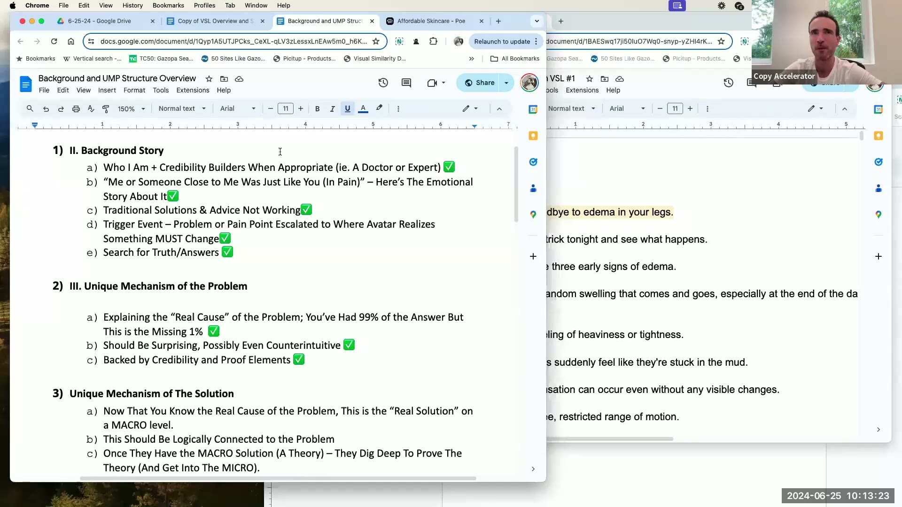
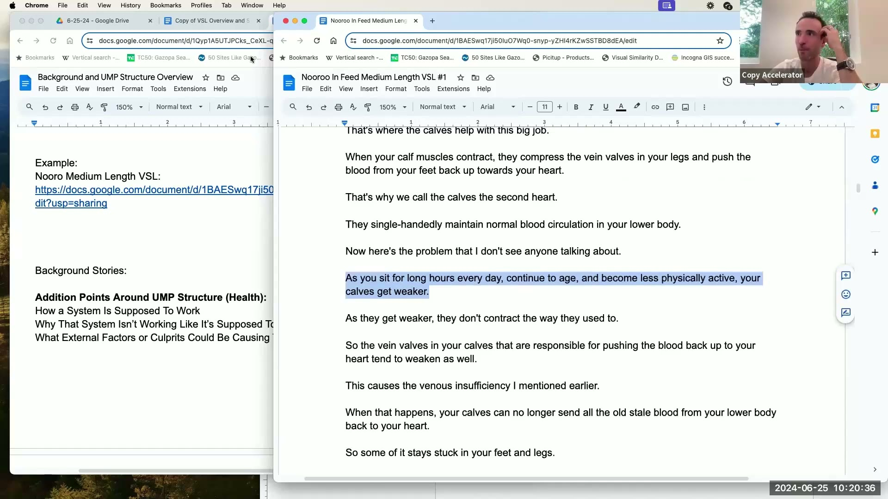
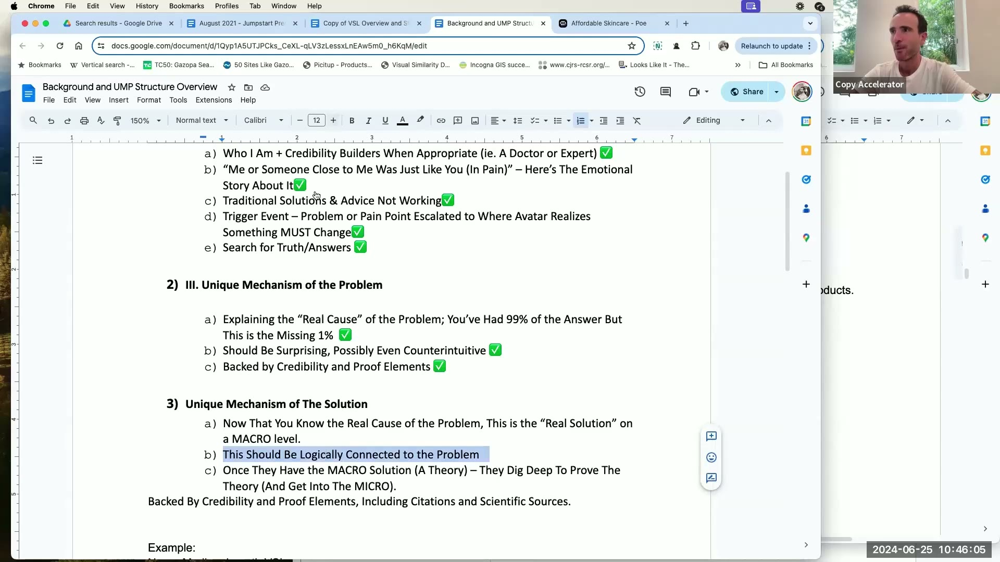
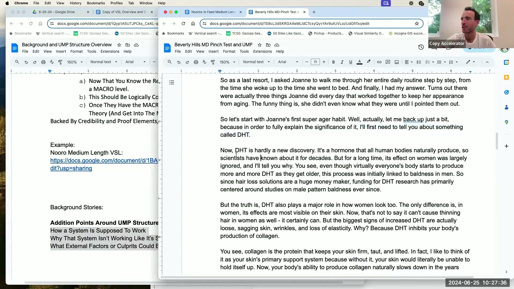
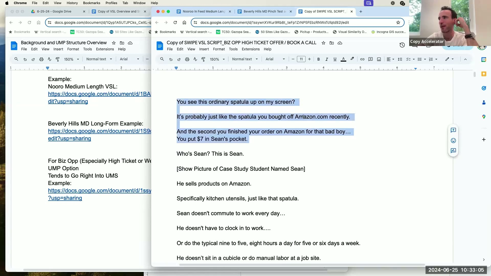
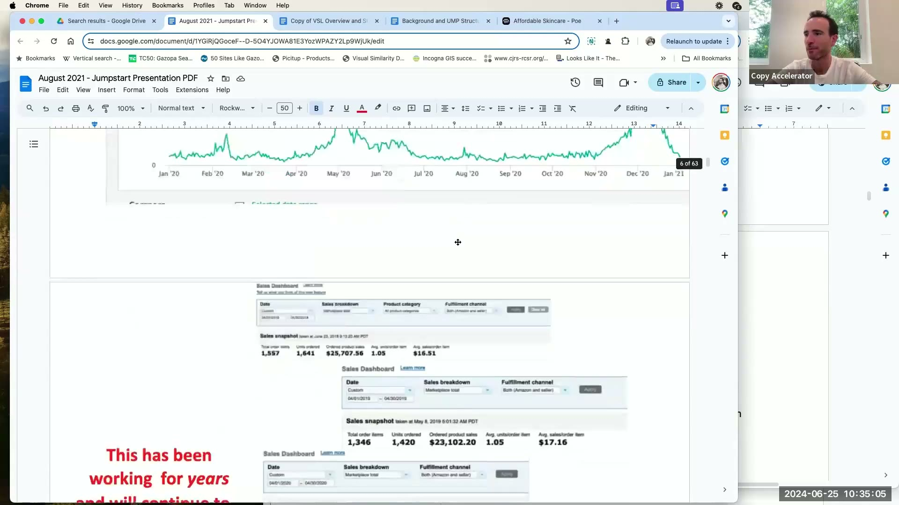

# 4.4 VSL Background Stories and Unique Mechanisms
> After the lead, a VSL introduces a credible spokesperson with a story the viewer shares, reveals a surprising real cause of the problem (the mechanism of the problem, UMP) and then a logically connected real solution (the mechanism of the solution, UMS); this lesson shows the pattern in a medium health VSL, a long health VSL and a biz-opp VSL, and how it changes by niche.

## 🤖 Agent use
- **Use when:** writing the middle of a VSL or sales letter (spokesperson intro, origin story, "real cause" and "real solution" sections), reviewing someone's background story or mechanism for length and clarity, or deciding whether a script needs a UMP at all.
- **Inputs → outputs:** the spokesperson (doctor, expert, or everyday person with results), their credibility facts, a real pain story or discovery story, the product's mechanism of problem and of solution, and genuine proof (studies, data) → a Background section (five beats), a UMP (how the system should work, why it is not working, what external culprit is to blame), and a UMS (macro solution then the micro that proves it).
- **Rules:**
  - **DO** write the Background in five beats: who I am (+ credibility), me or someone close to me was just like you and here is the emotional story, traditional solutions and advice did not work, a trigger event escalated the pain until something had to change, a search for truth and answers. [07:59–08:57; doc "Background and UMP Structure Overview"]
  - **DON'T** let the pain story run long: "it has to keep moving". [49:26]
  - **DO** check in with the viewer inside the spokesperson's story ("Have you ever been in a job like that?") so it does not become "I, I, I". [49:56–51:25]
  - **DO** frame the UMP as the "real cause" and surprising: "you've had 99% of the answer, but you're missing 1%". [09:26; 13:27]
  - **DO** (health) build the UMP as: how the system is supposed to work, why that system is not working as it should, and which external factor or culprit causes the malfunction ("why me"). [16:19–17:19; doc "Addition Points Around UMP Structure (Health)"]
  - **DO** make the UMS "logically connected" to the problem: macro solution first (stimulate the calves, stop DHT), then dig into the micro (the device, the ingredients) with citations. [09:26; 43:09–45:29]
  - **DO** use one or two studies in the UMP when the speaker is an expert; cite more studies, with specific numbers, when proving the ingredients or solution. [27:43–29:43]
  - **DON'T** make the mechanism so complicated you cannot repeat it after hearing it "one or two times" and tell someone. [51:54–53:44]
  - **IF** the spokesperson is a doctor **THEN** trust is built in. **IF** it is an everyday person in a gray-hat health VSL **THEN** compensate with a stranger story, repeated Harvard/Hopkins-type proof and heavy curiosity. **IF** it is biz-opp **THEN** the spokesperson is someone who has had success and the viewer is more skeptical, so front-load proof. [33:35–34:54]
  - **IF** biz-opp (especially webinar or high ticket) **THEN** you can often skip the UMP and go straight into the UMS, unless the market has already tried the model and failed, in which case use "here's the one thing they don't tell you about [model]". [38:15–40:29]
  - **IF** you swipe a script **THEN** copy the beats and logic, not the claims. All three scripts contain medical, income or anti-aging claims that need substantiation (see Claims check).
- **See also:** [04.3 VSL leads](04-03-vsl-leads-after-the-opening-hook.md) · [04.5 Product buildup and reveal](04-05-vsl-product-buildup-and-reveal.md) · [03.1 Unique mechanisms overview](03-01-unique-mechanisms-overview.md) · [Evolve: Unique mechanism](../../../evolve/copywriting/concepts/unique-mechanism.md) · [Evolve: Story building blocks](../../../evolve/copywriting/concepts/story-building-blocks.md)

## Key ideas

### Where this section sits [06:30–09:54]
- Refresher of the outline: hook, lead, background story, discovery story (part of the background), unique mechanism of the problem or solution, product build-up and reveal, close, FAQ. The prior two calls covered structure and leads. [06:30–07:30]
- The three worked examples: a medium-length health VSL (the Nooro foot-device VSL), a full-length health VSL (Beverly Hills MD pinch test) and a full-length biz-opp VSL (high-ticket book-a-call). [00:00–00:28]
- Background story = "who am I? Who's the spokesperson? Credibility builders", then a story of "me or someone close to me was just like you", traditional solutions failing, a trigger event, and a search for truth. [07:59–08:57]
- "By avatar I kind of mean spokesperson." A doctor with a patient in pain, or a person trying to make money where nothing works, both fit. [08:28–08:57]
- Then the UMP is the real cause, "usually surprising... backed by credibility and proof". The solution is a "real solution" presented at a macro level, connected to the problem, which the viewer then proves out at the micro level. [08:57–09:54]


*The working doc: Background Story (five beats), UMP (real cause, surprising, backed by proof) and UMS (macro solution, logically connected, then micro). The medium-length Nooro VSL sits beside it. [10:40]*

### Worked example 1: Nooro medium-length in-feed VSL (health device) [10:27–17:45; 43:09–45:29]
- Format note: the VSL runs about 16 minutes as a Meta in-feed ad. On "more branded" medium-length in-feed VSLs the credibility part "goes through this part very quickly and gets in the mechanism". [10:27–10:59] (The instructor says the lead was covered on the 6/11 call.)
- Lead (in the doc): "Say goodbye to edema in your legs. Try this trick tonight and see what happens. Here are three early signs of edema..." then "This is the best way to relieve edema and swelling fast", qualifiers ("doesn't matter whether three months or three years") and a "social media sensation" line. [10:59; doc]
- Background (very fast): doctor of physical therapy, over 10 years of clinical experience, 10,000 hours, 1,100 patients, lists of conditions seen, and "it wasn't until earlier this year that I truly cracked the code". No emotional story. "Lots of people are suffering from this pain point. There's no emotional story really about it." [11:29–13:27]
- Where the UMP starts: "venous insufficiency is only half the answer" (Whisper hears "vanus"). The instructor's note: "usually I say you've had 99% of the answer but you're missing 1%. This one is saying you had half the answer, but you're missing the other 50%. But the other 50% is really like one thing still." [13:02–13:57]
- UMP content: "What if I told you that the edema and swelling in your feet and legs are actually caused by your calves? That's right. Your feet might be perfectly fine. Your calves are the problem." Doctors call calves "the second heart"; blood going down is "like sliding down a slide", getting it back up is like climbing; calves contract and push the blood up; sitting, ageing and inactivity weaken calves, valves weaken, old blood pools. [13:57–15:20]
- The competing-solutions knock: remedies like compression socks, salt baths and pills fail because "they don't focus on stimulating your calves... and vein valves inside of them". [15:20–15:49]
- Instructor's pattern note: "how this system or process or thing is supposed to work... why that system isn't working like it's supposed to... what external factors or culprits could be causing the malfunction". In Nooro: the heart sends blood down, calves send it back up, and sitting or ageing are the external factors. [16:19–17:45]
- UMS (macro): "you need to stimulate your calves and the vein valves". Then dig deeper: most experts say to move or exercise; but when your legs are swollen you cannot move, so "you end up in this vicious cycle of agony". The solution: a "simple, affordable, doctor approved bedtime ritual" that needs no exercise, "completely new". [43:09–44:35]
- UMS (micro): neuromuscular electrical stimulation (NMES), supported by "a review published in the Journal of Rehabilitation Medicine" (per the doc). The instructor calls it "almost like a two-part solution": the macro (stimulate the calves) and "now I got to figure out how to actually do it" (NMES), and "this is actually where more of the proof and credibility comes in". [44:35–45:29]
- What follows (covered in [04.5](04-05-vsl-product-buildup-and-reveal.md)): the doctor's search for a usable device, partnering with a manufacturer, prototypes and setbacks, then the product reveal. [45:29; doc]
- Instructor's takeaway about proof: neither this UMP nor the long BHMD one is crowded with studies. "I used to do that a lot and I still think a study or two can be good", but a rattled-off study list is not needed "especially when it's coming from an expert". [27:43–28:14]


*The Nooro VSL's problem mechanism in the doc: calf muscles contract and push blood up; "As you sit for long hours every day... your calves get weaker." The instructor reads this as the "external culprit" step. [17:50]*


*"This should be logically connected to the problem" highlighted as the instructor moves from UMP to UMS. [43:25]*

### Worked example 2: Beverly Hills MD pinch test (long-form health) [17:45–28:14; 45:29–48:24]
- Prep tip: he cleans YouTube auto-transcripts (timestamps, awkward breaks) by pasting into an LLM chatbot (he used Poe) and asking it to clean up the text. Output cut off at the window limit; asking it to continue lost context, so he started a new chat for the remaining part. "It might be that if you use actual Claude, it would have the context." [18:16–19:11] (See Prompts.)
- Background beats (mapped live) [19:11–24:25]:
  - **Who I am / credibility:** a co-founder of "the world-renowned Beverly Hills Plastic Surgery Group", seen on TV shows (The Doctors, Entertainment Tonight), published research in the field of youth restoration without knives or needles. [19:41–20:32] The instructor stacks the credibility: "He's on Entertainment Tonight. He's on The Doctors. He's Beverly Hills plastic surgeon... published." [21:34–22:04]
  - **Someone close to me was just like you:** Linda (63) arrives with her "sister" Joanne, whom the doctor assumes is her daughter; "You thought she was my daughter, didn't you?" The emotional beat is the sister looking about 20 years younger. [20:32–22:04]
  - **Traditional solutions not working / no obvious cause:** neither smokes or drinks, similar diets, tanning, children, jobs; "the traditional advice about what causes skin issues wouldn't make sense for the one woman, but does for the other". [22:04–24:25]
  - **Trigger event:** the instructor calls it "really a simple... confusion" about why one sister has great skin and the other does not (not a crisis). [23:57]
  - **Search for truth:** he asks Joanne to walk through her entire routine from waking to bed; "three things Joanne did every day". [23:27]
- UMP: DHT is a hormone everyone makes; it increases with age; research concentrated on male pattern baldness because hair-loss solutions are "a huge moneymaker", so its effect on women was ignored; in women it shows in skin because DHT inhibits collagen; menopause slows collagen at the same time DHT rises, so the sag is more obvious. [24:48–26:14; doc]
  - Instructor's mapping: system (collagen holds the skin up) → malfunction (DHT blocks it) → external factor (menopause). [25:17–25:45]
  - The summary line "if you're seeing saggy skin on your cheeks, neck... DHT is likely to blame" parallels Nooro's "starting to see how it all fits together?" recap. [25:45–26:46]
- UMS: the pivot is a bridge question ("what does this have to do with Joanne's daily routine?"), then saw palmetto (Whisper hears "salt palmetto"), a hair-loss herb, which "helps naturally inhibit the effects" of DHT, with a human-trial claim. The doc then adds amino acids (collagen building blocks) and dietary hyaluronic acid (hydration). [26:46–27:22; 45:59–47:51; doc]
- Instructor's reading of the UMS: "a two-part thing": stop DHT, then restore firmness. Here "each of the unique mechanism things... the ingredients are each part of the mechanism", and this is where "you kind of layer in the studies" (e.g. a 2017 HA study cited in the doc). [47:22–47:51]
- Doc detail worth noticing: the VSL then warns against buying existing store supplements (citing a 2015 state attorney general DNA test of supplements) and says the lab-only formulas cost over $150 a bottle, setting up its own cheaper product. [doc, end] (claim as written; not verified here.) This is the build-up to the product reveal and ties the UMS to the product.


*The "Beverly Hills MD Pinch Test and UMP" doc at the point where the doctor says "I'll first need to tell you about something called DHT" and explains why it was ignored in women. [24:50]*

### Spokesperson types and niche differences [33:35–35:24; 38:15–40:29]
- **Doctor:** "I'm a doctor, I'm super credible", so "there's a built-in trust to that to some degree". [33:35]
- **Everyday person in a gray-hat health VSL** (the "ClickBank universe"): you need a crazier story and repeated authority proof ("backed by Harvard and Johns Hopkins and the Mayo Clinic"), plus heavy curiosity, e.g. an outrageous accident story that leads to the discovery. The instructor's joke example is not a template to copy. [34:04–34:34]
- **Biz-opp:** almost always the spokesperson is a person who had success; skepticism is higher because "the whole make money online thing is very scammy" and people "have tried more things". Health audiences have "more of an openness to alternative health". [34:34–35:24]
- Biz-opp UMP: usually skipped in webinar or high-ticket VSLs; it goes right to the UMS (the "newer business model"). A UMP could be added if the market already tried the model: "here's the one thing they don't tell you about private label", then "if we could just actually solve that one problem we could fix these issues and make private label actually work the way it's supposed to". [38:15–40:29]

### Worked example 3: biz-opp high-ticket "book a call" swipe [29:43–40:29; 48:24–51:25]
- Hook: "You see this ordinary spatula up on my screen? ... the second you finished your order on Amazon... you put $7 in Sean's pocket." The case-study person "doesn't commute... doesn't sit in a cubicle", works a few hours a day on a laptop. The hook also turns the $7 into daily, monthly and yearly income (per the doc). [30:13–30:43; doc]
- Lead: lots of proof early: seller account screenshots, bank deposits, then student successes and a free bonus ("roadmap"). [30:43–31:38; doc]
- A second biz-opp control (from a client doing "eight figures of this offer", instructor claim) is "literally the entire thing... just proof", income and store screenshots, with the disclaimer at the front. The instructor: "that's something that's just missing so often" and "I would probably move [the disclaimer] up". Mention of FTC: "as far as income things like you have to look at FTC, whatever". [31:38–33:35]
- Background (same structure): humble beginnings, less than one semester of college, jobs from age 15, a Costco job where hard work was not rewarded (promotions went to the longest-serving), trigger = writing up for "unprofessional appearance" after collecting carts in the rain, "I knew there had to be another way", tried real estate license, reselling and stocks, then "a newer business model, private label". [35:24–38:15; doc]
- UMS: private label with FBA: own brand, manufacturers with "no middleman", high margins ("more than a hundred percent return on investment" per the doc), using Amazon's warehouses, platform and shipping; then teaching mode: how to find a product, supplier, samples, inspection, shipping, listing. The instructor: it "goes more into teaching mode... He's teaching how this works right away." [38:15–39:34; 48:24]
- Later in the doc (not covered on the call): a named system "compound layering", a six-part FBA process executed at expert level, three paths: trial and error, a novice teacher, or booking a call), ending with an application and qualification call. [doc; the instructor says he will do the biz-opp script "as a whole separate dissection", 48:24]
- Review feedback: the story suffers from "I syndrome"; he suggests adding check-ins that tie the story back to the viewer ("Have you ever been in a job like that?... it's hard to stay motivated because it doesn't matter how much effort you put in"). [49:56–51:25]


*The swipe's opening "ordinary spatula" hook: a mundane object tied to a $7 profit for a named case-study seller. [30:20]*


*The client control the instructor scrolls through: page after page of seller dashboard and income screenshots ("This has been working for years"). [32:20] (Course example only; income claims need substantiation.)*

### Common issues from reviews and the "mechanism test" [49:26–54:15]
- Issues he sees in members' VSLs: background story too long ("the pain story... has to keep moving"), "I syndrome", and over-complicated mechanisms. [49:26–51:54]
- Rule: the mechanism "needs to be something you can instantly grasp and go share with somebody". Two examples in a sentence each: DHT "destroys collagen, makes it sag, worse during menopause, stop DHT and increase collagen"; Nooro "your heart sends blood down, calves pump it back up, if those muscles weaken it pools". [51:54–52:25]
- The counter-example: invent a made-up hormone ("BH51") that "targets the mitochondria... goes to your lymphatic... gut" and you can no longer explain it. [52:25–52:51] (the instructor's invented illustration, not a real claim)
- Test: believable, with proof elements, "you could hear it one or two times and just go tell somebody" ("my husband said he heard of [DHT], but I didn't know women had to worry about it"). [52:51–53:44]
- UMS check: it is "pretty self-explanatory": the solution is logically connected; for health it is ingredients; for biz-opp "a system or a way to sell on Amazon". [53:44–54:15]
- Mechanism as a general idea: after a break the instructor gives a dog-training aside: you must replace the behaviour you are removing, and not accidentally reward the dog for the bad behaviour ("mechanisms are everywhere"). [41:18–42:12] (illustrates the "problem has a hidden mechanism" thinking; not a course framework.)

### Aside: testimonial collection tip from a participant [04:04–05:59]
- A member says they collect video testimonials by posting a "share your progress" prompt with a best-testimonial prize, running challenges every one to two months that include a video testimonial, giving guidelines and never scripts ("when we did, they sounded very fake"), and no discount incentive: "if you share your story, you're going to help more women". About "a hundred" good ones. [04:35–05:59] (a participant's claim, not the instructor's method.)

## Steps / framework

### Background + mechanism beats (from the doc, with the three examples mapped)

| Beat | Nooro (medium, health) | Beverly Hills MD (long, health) | Biz-opp swipe (high ticket) |
|---|---|---|---|
| Who I am + credibility | Doctor of PT, 10+ years, 10,000 hours, 1,100 patients [11:29] | Co-founder of a plastic surgery group, TV appearances, published [19:41] | Success story with proof, top-seller claim (instructor flags need for proof) [30:43–31:38] |
| Someone like you in pain (emotional story) | None; the pain is described | Linda and her younger-looking sister [20:32–22:04] | His own: hard work not rewarded [35:24–37:18] |
| Traditional solutions not working | Compression socks, salt baths, pills do not target the cause [15:20] | Same lifestyle, so lifestyle advice does not explain the difference [22:30–24:25] | Real estate, reselling, stocks: too much competition [37:45] |
| Trigger event | Skipped | "Confusion" about the sisters | Written up for "unprofessional appearance" in the rain [37:18] |
| Search for truth | "Cracked the code", "one breakthrough discovery" | Asks Joanne for the daily routine | Stumbles on a newer model: private label [38:15] |
| UMP (real cause) | Weak calves, weak vein valves (the "second heart") [13:57–15:20] | DHT blocks collagen; menopause worsens it [24:48–25:45] | Optional; here skipped [39:34–40:29] |
| UMS macro | Stimulate the calves and vein valves [15:49; 43:09] | Block DHT and restore collagen and moisture [27:13] | Private label + FBA [38:44] |
| UMS micro / proof | NMES and a journal review [44:35–45:04] | Saw palmetto + amino acids + dietary HA, studies layered [45:59–47:51] | Teaching mode: how to find, source, ship, list [48:24] |

### How the UMP is built (health) [16:19–17:45]
1. State how the system works in the body (calves pump blood up; collagen holds the skin up).
2. State the malfunction (calves weaken so blood pools; DHT blocks collagen).
3. Name the external culprit that makes it happen to the viewer (sitting and ageing; menopause).
4. Add expert credibility plus one or two proof points.
5. Close with a recap line ("starting to see how it all fits together?").

### Mechanism clarity test (derived from [51:54–53:44])
- Can a viewer repeat the mechanism in two sentences after one hearing?
- Is every step connected to the next, with no invented intermediaries?
- Does each proof element carry a specific number (as in "a 17% decrease in wrinkles") rather than a list of citations? [29:43]

## Examples

### Nooro medium VSL doc: section map (from the extracted doc)
| Section | What the doc does | Source |
|---|---|---|
| Hook / micro-lead | "Say goodbye to edema in your legs. Try this trick tonight..."; three early signs | doc, top |
| Lead | "best way to relieve edema and swelling fast"; qualifiers; "over 100,000 Americans use it" (doc claim) | doc |
| Background | PT doctor, credentials, "cracked the code" | doc |
| UMP | Venous insufficiency is "only half the answer", weak calves | doc; [13:02–15:49] |
| UMS | Stimulate calves, exercise paradox, NMES with a cited review | doc; [43:09–45:29] |
| Product build-up | Wire-heavy devices, prototypes, partner company, setbacks, "my brainchild" | doc |
| Close | Easy 1-2-3 setup, price anchor, 50% discount link, scarcity, 90-day trial | doc |

### Claims check
| Script | Claims that need substantiation or break platform rules | What to copy instead |
|---|---|---|
| Nooro foot device | Medical-device efficacy ("relieve edema", "doctor approved", a journal review, "25 million" figure), "before-after" promise, unverifiable demand and scarcity lines ("almost 1,000 people live shopping on our website", "we may sell out today") | The "second heart" analogy structure; the recap line; macro → micro UMS; the exercise-paradox objection |
| Beverly Hills MD | DHT/collagen claims, "scientifically proven" anti-aging, a state attorney-general test cited as written | Sister-comparison story; "ignored because there is no money in it" bridge; two-part UMS |
| Biz-opp swipe | Income and student-earnings claims, top-seller claims, lifestyle imagery (FTC rules on earnings claims apply; the instructor flags disclaimers) | Opening hook (everyday object to person's profit), hardworking-employee origin beats, trigger event, "I tried X, Y, Z" search |

## Structured units

### Hooks
| Hook (verbatim or near) | Heuristic(s) | Emotion / zone | Self targeted | Why it works | Source |
|---|---|---|---|---|---|
| "Say goodbye to edema in your legs. Try this trick tonight and see what happens." | Specific promise + short time frame (derived) | Relief (derived) | — | Names the condition, promises a "trick", gives a when | doc "Nooroo In Feed Medium Length VSL #1_" |
| "You see this ordinary spatula up on my screen? ... you put $7 in Sean's pocket." | Mundane object to income (derived) | Curiosity / aspiration (derived) | — | The viewer's own purchase becomes someone's profit; leads to "who is Sean" | [30:13–30:43]; doc "SWIPE VSL SCRIPT" |
| "What if I told you that the edema and swelling in your feet and legs are actually caused by your calves?" (UMP reveal line) | Counterintuitive reversal | Surprise (derived) | — | "Your feet might be perfectly fine. Your calves are the problem." | [13:57] |

### Templates
| Template (derived from the examples) | Use for | Example fill | Source |
|---|---|---|---|
| "[Condition] is only half the answer. What if I told you [the symptom] is actually caused by [the hidden part]?" | UMP reveal | "Venous insufficiency is only half the answer... caused by your calves" | [13:02–13:57] |
| "We doctors call [part] the [analogy]. [Part A sends X down; Part B sends it back up]. As you [external factor], [Part B] gets weaker..." | Health UMP (system → malfunction → culprit) | "the second heart" | [14:25–14:51] |
| "[Condition] has been studied for decades, but [the group] was ignored because [funding went elsewhere]." | Explaining why the cause is little known | DHT/women | [24:48] |
| "Let me explain exactly how this unique business model works with [model]..." | Biz-opp UMS entering teaching mode | Private label | [38:44] |
| "Maybe you've heard of [model]... Well, here's the one thing they don't tell you about [model]... if we could just solve that one problem, [model] would work the way it's supposed to." | Optional biz-opp UMP | FBA / private label | [40:02–40:29] |
| "[Doctor] asks the 'sister' to walk through her entire daily routine, step by step" | Discovery story device | Joanne's routine | [23:27] |

### Rewrites (before → after)
| Before | After | What changed | Source |
|---|---|---|---|
| Spokesperson tells their own story with no reference to the viewer | Insert check-ins (instructor's suggestion, near verbatim): "So I don't know what you think about [the employer], but for a kid like me coming out of high school... Have you ever been in a job like that? Maybe you're in a job like that right now..." | Adds viewer reference to cure "I-syndrome" | [50:26–51:25] |
| A mechanism with many invented intermediaries ("BH51... mitochondria... lymphatic... gut") | "DHT is a hormone that destroys collagen in your skin, makes it sag, and gets worse in menopause" | Reduces to two sentences a viewer can repeat | [51:54–52:51] |

### Rules of thumb
- **DO** keep a short origin story if the spokesperson is already credible (Nooro). [10:59–11:29; 13:27]
- **DO** write the UMS as "now you know the problem, here is the solution" and then give "what does that actually look like". [53:44–54:15]
- **DON'T** stack study after study to prove the UMP; one or two from an expert is enough. Save detail for ingredient proof. [28:14–29:43]
- **IF** a health audience already knows the common diagnosis (e.g. venous insufficiency) **THEN** treat it as half the answer and reveal the missing part. [13:02–13:57]

## Prompts / templates (verbatim)
The lesson's only prompt (spoken near-verbatim in the transcript; Whisper rendering):

```text
Here's a transcript of a video sales letter for a skincare brand. Can you take it and clean it up so it's more readable? [There are] a lot of timestamps and awkward line breaks. ... If you need more to do multiple outputs, just ask me to continue when you're out of space, and I'll keep doing it.
```
Note from the instructor: in Poe the "continue" request lost context; start a new chat with the unprocessed remainder. [18:16–19:11]

Doc template (verbatim, "Background and UMP Structure Overview.docx"):

```text
II. Background Story
  a) Who I Am + Credibility Builders When Appropriate (ie. A Doctor or Expert)
  b) "Me or Someone Close to Me Was Just Like You (In Pain)" – Here's The Emotional Story About It
  c) Traditional Solutions & Advice Not Working
  d) Trigger Event – Problem or Pain Point Escalated to Where Avatar Realizes Something MUST Change
  e) Search for Truth/Answers

III. Unique Mechanism of the Problem
  a) Explaining the "Real Cause" of the Problem; You've Had 99% of the Answer But This is the Missing 1%
  b) Should Be Surprising, Possibly Even Counterintuitive
  c) Backed by Credibility and Proof Elements

Unique Mechanism of The Solution
  a) Now That You Know the Real Cause of the Problem, This is the "Real Solution" on a MACRO level.
  b) This Should Be Logically Connected to the Problem
  c) Once They Have the MACRO Solution (A Theory) – They Dig Deep To Prove The Theory (And Get Into The MICRO).
  Backed By Credibility and Proof Elements, Including Citations and Scientific Sources.

Addition Points Around UMP Structure (Health):
  How a System Is Supposed To Work
  Why That System Isn't Working Like It's Supposed To
  What External Factors or Culprits Could Be Causing This Malfunction (Why Me)?

For Biz Opp (Especially High Ticket or Webinar)
  UMP Option
  Tends to Go Right Into UMS
```

Differences between the two outline docs in the zip: "CVSL Overview and Structure.docx" repeats the full eight-part VSL outline already summarised in [04.3](04-03-vsl-leads-after-the-opening-hook.md); in its Product Buildup section, step 3 reads "Has to Do It Himself And Create or Find A Novel New Solution" (the earlier outline lacks "or Find"). [doc]

## Screenshots
Embedded above: structure doc [10:40]; Nooro UMP line [17:50]; Beverly Hills DHT passage [24:50]; spatula hook [30:20]; proof-heavy control [32:20]; UMS "logically connected" [43:25]. Frames at 07:00 (the simple outline with Background and Discovery highlighted) and 35:30 (a swipe-file page of income screenshots) were not used: they add nothing beyond the doc text above.

## How to apply
- [ ] Write the Background with the five beats; keep the pain story short and give the spokesperson a believable reason credibility holds.
- [ ] Add one viewer check-in line per paragraph of personal story.
- [ ] Build the UMP as system → malfunction → external culprit; find the "missing 1%".
- [ ] Write a recap line after the UMP the viewer can repeat.
- [ ] Make the UMS the macro solution, then the micro (ingredient, device or system) with 1–2 real proofs having real numbers; do not invent studies.
- [ ] Biz-opp: decide whether to skip the UMP; front-load real proof and move disclaimers up.
- [ ] Run the claims check; replace medical or income claims we cannot substantiate.
- [ ] Run the mechanism test: can someone repeat it after one hearing?

## Related
- Previous: [04.3 VSL leads](04-03-vsl-leads-after-the-opening-hook.md) · Next: [04.5 VSL product buildup and reveal](04-05-vsl-product-buildup-and-reveal.md)
- Mechanism work: [03.1 Unique mechanisms overview](03-01-unique-mechanisms-overview.md) · [03.2 UMP ideation with LLMs](03-02-ump-ideation-with-llms.md) · [Evolve: Unique mechanism](../../../evolve/copywriting/concepts/unique-mechanism.md) · [Evolve: Story building blocks](../../../evolve/copywriting/concepts/story-building-blocks.md) · [Evolve: Authority in ads](../../../evolve/copywriting/concepts/authority-in-ads.md)
- Cross-course note: Evolve frames a unique mechanism as "new, unspoken or renamed" (a positioning device across ads); RMBC II treats it as a two-part VSL section (real cause of the problem, real solution) that must be logically connected and easy to repeat. No explicit disagreement found, but the "problem mechanism first" emphasis is specific to this course.

## Sources and limitations
- Transcript: [04-[3] VSL Background Stories and Unique Mechanisms.txt](<../../../../../raw/stefan-georgi/rmbc-ii/_transcripts/Stefan Georgi - RMBC II (1)/04-VSLS SECTION I-Structure Theory and Examples/04-[3] VSL Background Stories and Unique Mechanisms.txt>). Machine transcription (Whisper large-v3-turbo); the last segment starts at 54:15 of a 54:31 video.
- Mishearings fixed using the captions and docs: "Nuru / neuro" is the brand "Nooro" (the doc file name spells it "Nooroo"; the doc body says "Neuro" for the company and device); "salt palmetto" and "soft metal" are "saw palmetto"; "vanus insufficiency" is "venous insufficiency".
- Biz-opp spokesperson and student names (and the phone number and support email in the Nooro doc's close) are not reproduced. Revenue claims (peptide company figures, eight-figure offers) are the instructor's own and are not reused.
- The first ~6 minutes are community "wins" chatter; the 40:29–43:09 stretch is a dog interruption and break. The testimonial-collection tip is from a participant.
- The "Nooro" Ad Library and Similarweb links in the doc are not included in the course files. The linked Google Docs (medium VSL, long BHMD, biz-opp swipe) are the same documents provided in the zip.
