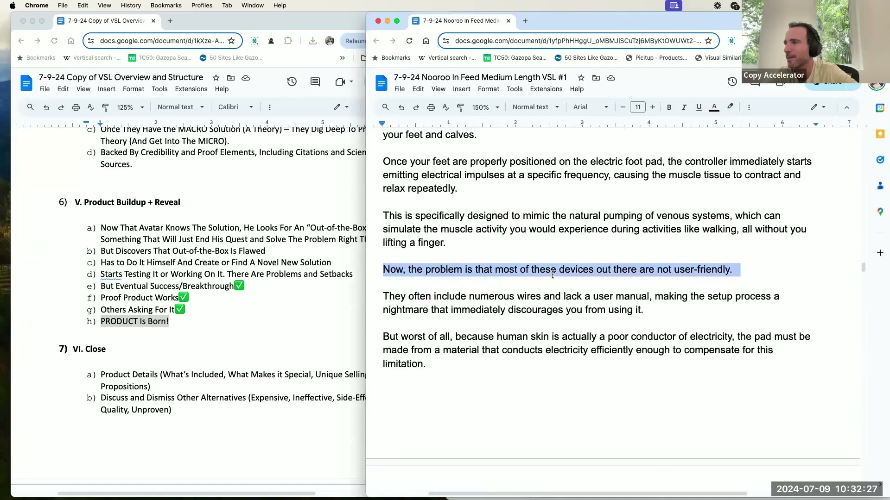
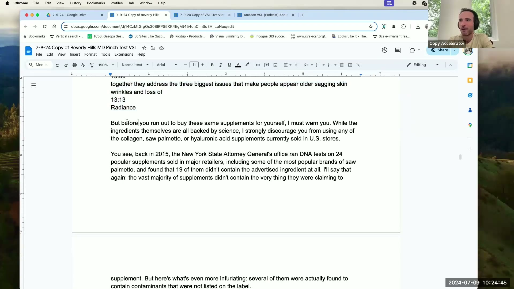
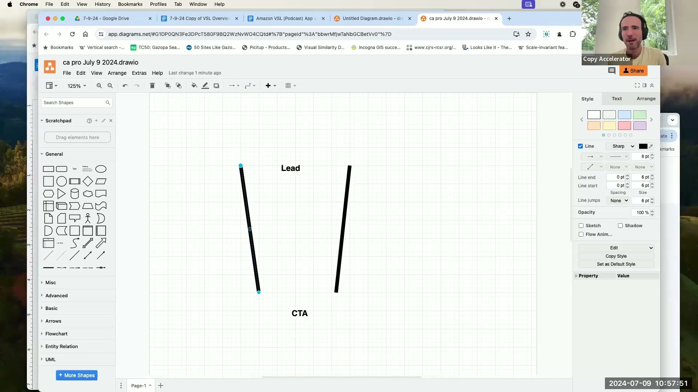

# 4.5 VSL Product Buildup and Reveal
> The product is not dropped in as an "out-of-the-box" answer: the spokesperson shows that the obvious off-the-shelf solution is flawed, then builds the real one through trial, setbacks and a breakthrough, which sets up the close and the first call to action; the call then covers section percentages, why the lead decides most of a VSL's result, and several funnel Q&As.

## 🤖 Agent use
- **Use when:** writing or auditing the section of a VSL, advertorial or long page that sits between the mechanism (UMS) and the close; deciding how long each VSL section should be; deciding what to fix first when a VSL gets clicks but does not convert; planning lead tests.
- **Inputs → outputs:** the solved problem (UMP and UMS from [4.4](04-04-vsl-background-stories-and-unique-mechanisms.md)), what the buyer will try first ("just buy the ingredients", "just buy a device", "just watch YouTube"), why that fails, and the TRUE development story of the product (real sourcing, testing, formulation or build steps) → a build-up section of about 10-15% of the script: flawed out-of-the-box answer, do-it-ourselves decision, real setbacks, breakthrough, proof, "others asked for it", product named.
- **Rules:**
  - **DO** put the buyer's next question on the page before the product: "can I just go buy this?" Answer "no, because the off-the-shelf version is flawed" (diluted or fake supplement, devices with wires and no manual, coaches who never scaled). [00:00–00:55; 03:53–04:47; 27:28–27:52]
  - **DO** include a stretch of "trial and tribulation" between the flaw and the product. Stefan says it "tends to like increase conversions" and that people skipping it is something he sees a lot. [00:55–01:24; 14:50]
  - **DO** test adding the section if your front-end VSL (physical or info) lacks it: "definitely a worthwhile test at the very least". [14:50]
  - **DO** hold the order. Subtraction from an outline section is fine; adding stuff is risky because it creates a "zigzag sales letter structure". [15:47–17:40]
  - **DON'T** add a new topic block (his example: "five myths about" the condition) after the product build-up has started. [16:44–17:12]
  - **DO** keep each section short and moving. Benchmark he gives: a "punch in the gut" section of about 550 words in two big publisher VSLs and about 750 in one of his own versus 1,600 words in a student draft. [18:40–20:08]
  - **DO** make the close the longest section of a full VSL (about 25-35%); everything before it exists to reach the first call to action ready to buy. [20:08–20:37; 22:12–26:24]
  - **DO** work on the lead first when a VSL underperforms: more people reaching the pitch means every later optimisation has a bigger pool. Test far more than 5-10 leads. [30:58–35:38]
  - **IF** the viewer-retention curve falls steeply at one point in the middle **THEN** fix that section, not the lead. [38:13–39:52]
  - **IF** the ad is feeding a VSL **THEN** do not reveal the product in the ad; lead with curiosity or a surprising reason and send them to the VSL for the education and the reveal. [55:23–56:52]
  - **DO** compare VSL and e-com page on revenue per visitor, not conversion rate: Stefan's rule of thumb is an e-com page converts about double but with about half the AOV. [58:47–59:14] (instructor claim, no data shown)
  - **DON'T** invent the struggle story. The examples in this lesson are course examples written by copywriters; for our brands use real sourcing, testing and formulation facts or shorten the section. (derived; Stefan himself calls the Nooro prototype story made up in [4.2](04-02-vsl-fundamentals-classic-structure.md) [21:45])
  - **DON'T** copy the unproven claims, the invented scarcity ("we would have taken the video down", "almost 1,000 people live shopping") or the supplement/device efficacy claims in the example scripts. Copy the beat order only.
- **See also:** [4.4 Background stories and unique mechanisms](04-04-vsl-background-stories-and-unique-mechanisms.md) · [4.6 VSL closes](04-06-vsl-closes.md) · [4.2 VSL fundamentals](04-02-vsl-fundamentals-classic-structure.md) · [3.1 Unique mechanisms overview](03-01-unique-mechanisms-overview.md) · [Evolve: Unique mechanism](../../../evolve/copywriting/concepts/unique-mechanism.md)

## Key ideas

### Where the section sits and what it does [00:00–02:38]
- It comes "after the unique mechanism": the viewer knows the real problem and the solution, and now "I have to bring that solution, package it up". [00:00]
- The viewer (and the consumer in general) looks for the "out-of-the-box version" of the solution: "I just can go buy xyz package". The build-up says that is flawed, so the spokesperson "has to do it themselves and create or find a better solution". [00:55]
- Stefan says he "sort of overlooked" this part on the first VSL call and has "realized that's a lot of the sort of best copy there, especially anything physical. I think it does also work for info". Having "some kind of section there tends to like increase conversions". [00:55–01:24] (instructor claim; no test data shown)
- His info-product illustration (improvised, not a real case): write the system down, share with a few friends, they find parts confusing, "I went back to my office, countless nights", "10 different versions", "the easiest thing ... they can give it to their 10 year old son or daughter", then "now I'm so excited to share it with you". [01:50–02:38]
- Plain description of the section: "step backs and trials and tribulations". [02:38]

### The outline for the section (doc "VSL Overview and Structure", item V) [doc; 02:38–11:45]
- Eight beats: (1) avatar looks for an out-of-the-box version; (2) it is flawed; (3) has to do it himself and create or find a novel solution; (4) starts testing, problems and setbacks; (5) eventual breakthrough; (6) proof the product works; (7) others asking for it; (8) PRODUCT is born. [doc]
- Stefan's own read of Nooro against beats 5-8: breakthrough yes, but "there's not a ton of proof. That might be a Facebook thing with testimonials before and after, I don't know. But product is born." [11:45] (The doc carries check-mark emojis on several beats; the course files do not explain them, so they are not interpreted here.)


*The outline's "V. Product Buildup + Reveal" beats on the left and the Nooro script on the right with "Now, the problem is that most of these devices out there are not user-friendly" highlighted: Stefan shows the section starting here, not at the product intro. [11:00]*

### Worked example 1: Beverly Hills MD pinch-test VSL (supplement) [02:38–07:30]
- Stefan had Claude "clean up" the product-reveal part of the transcript before the call. (The prompt used is not shown or included in the course files.) [02:38]
- Beat map as he reads it against the outline [03:08–07:30]:
  1. Solution right out of the box: "go buy these supplements" (the three ingredients covered in the UMS). [03:08–03:53]
  2. "But they're flawed": "the ingredients themselves are all backed by science" but the store products are not. The script cites a 2015 state attorney-general DNA test of 24 saw palmetto supplements "found that 19 of them didn't contain the advertised ingredient at all", then "diluted with fillers" and "extremely low permeability". [03:53–04:23] (claim inside the script; verify any such statistic before reuse)
  3. The sister's original regimen was ordered from European labs at over $150 per bottle, about $500 a month: "I can't in good conscience recommend this option to you". [04:47]
  4. "Taken matters into our own hands": the doctor and his partner source pure ingredients from labs at "a fraction of their standard costs". [05:12–05:40]
  5. More tinkering and setbacks: B and A vitamins added; "all five ingredients" must be taken daily and "that's a lot of pills to swallow"; combining them is "very difficult... has never been done"; "after several months of trial and error, something extraordinary happened". [05:40–06:33]
  6. Product born and named "Beverly Hills MD Dermal Repair Complex". [06:33]
- His verdict: "some of the best copywriters... literally follow pretty much every step of this outline". Missing: "maybe there's visual proof in the VSL. They don't have that. Others are asking for it". [07:01–07:30]
- The doc shows the testimonial emails and the "free six-month supply for Linda and Joanne" right after the reveal; see [4.6](04-06-vsl-closes.md) for where Stefan places those. [doc]


*The pivot sentence of the section: "But before you run out to buy these same supplements for yourself, I must warn you. While the ingredients themselves are all backed by science, I strongly discourage you from using any of the... supplements currently sold in U.S. stores." [03:18]*

### Worked example 2: Nooro in-feed medium VSL (device) [07:30–12:45]
- The doc is about 3,785 words (Stefan's count; my count of the extracted text is 3,776) and "they're running this a ton on Facebook" with different leads. [12:15]
- Flaw of the out-of-the-box: NMES devices "are not user-friendly": wires, no manual, skin is a poor conductor so you must go to a rehab center and book and drive. [11:17; doc]
- Do-it-yourself: "what if I could take the same groundbreaking technology that top doctors use... into a simpler, much more affordable device" and "this was a Herculean task... I partnered up with a U.S. biotech company" (doc spells it "Neuro"). [08:08–08:44]
- Struggle: first three prototypes shared with small customer cohorts, "they all worked, but not as well as I wanted", three more "much better, but incredibly expensive", "months passed", "a manufacturing nightmare", "voice in my head", then "another three months of 12 to 14-hour workdays, we did it". [09:17–10:12]
- Reveal line: "Introducing my brainchild, the Neuro NMES Foot Massager". [10:12]
- Stefan's note: the spokesperson "did dismiss it right before the section" and it blends with the UMS, which is why the section marker belongs a bit earlier at the "problem with these devices" paragraph. He says he will move the comment. [10:40–11:45]
- Weight of the section: "555" words, "basically one sixth of the entire letter... a really big and important part". [12:15–12:45]
- Missing from this example: proof of efficacy in this section (only a Facebook-ad context). [11:45]

### Worked example 3: podcast-format Amazon VSL (biz opp, imperfect) [13:18–14:50]
- A long script he wrote with a collaborator for another marketer, "in a podcast format". Stefan: "This one's not a perfect example." The beat: "Do you have anything to help shortcut the process? Of course... So I basically put everything I know down to a video series... paint-by-numbers business"; then a second beat "I realized a lot of people want community". [13:18–14:21]
- His note: "frankly this could have been written to have even more of that build up in it, more explicitly in this section", then it goes straight into book-a-call. [14:21–14:50] (The script itself is not in the course files; only its Google Doc tab is visible on screen.)

### Section length and the "close is longest" rule [20:08–26:24]
- Stefan's mental-math percentages for a full VSL: lead "3% to 5%", background "maybe 10%" (5-10%), UMP "15, let's say" (later "probably around 20%"; 1,600 words of an 8,000-word VSL "is probably okay"), UMS "another 15", build-up and reveal "maybe 10", close "35% on the outer range". He says "I might revise these numbers" and "no one section really should be insanely dominant". [20:37–22:41]
- The doc "Rough Percentages For Each Section of VSLs" gives: Lead 5-10%, Background 10-15%, UMP 20%, UMS 15%, Product Build-Up and Reveal 10%, Close 35%, then "1st Call to Action". These ranges sum to 95-105%. [doc]
- Why the close runs longest: after the first call to action, length stops mattering. "The goal is not to get somebody to finish your VSL. The goal is to get them to click the button as soon as you tell them to click the button." Everything after that is "free rolling": guarantee, bonuses, "how is your life going to look in three months", FAQ, social proof, repeated asks. [23:10–26:24]
- Three takeaways he lists: drive everything to the first call to action; you do not want people to finish the VSL ("a paradigm shift for some"); given that, close length matters little. [25:58–26:24]
- Readiness model: by the time the product is born the viewer is about "50 to 75% ready"; the close (details, dismissing alternatives, value, social proof, how to use) takes them to 100% so they buy at the first call to action. [29:24–30:28]
- Conflict to note: the percentages in the doc and in the spoken version differ (lead 5-10 vs 3-5; background 10-15 vs about 10). Treat them as bands, not rules.


*Stefan draws the viewer funnel in draw.io: a wide mouth at the lead narrowing to the call to action, to argue that a stronger lead widens everything below it. [36:24]*

### Most important parts of the build-up (Q&A) [26:24–28:19]
- Question: which part of the build-up is most important? Answer: "the out-of-the-box solutions don't work" and then "doing it yourself or finding a solution... the struggle and toil just seems to really land with people". [26:24–28:19]
- Three illustrations of "you can't just go buy it": supplements ("order a couple of these on Amazon... whoa, whoa, you can't do that"); an AR-15 ("most AR-15s aren't tested for accuracy... could misfire"); info ("there's a ton of coaching... most people don't give you the whole system or they've never done it at scale"). [26:58–27:52] (derived caution: the firearm line is an illustration only; do not make safety or performance claims you cannot document)

### Why the lead usually decides the result [30:58–40:21]
- Question from a member: how much does the lead affect conversion when you get clicks but few buys? Answer: "the lead is generally the biggest part". [30:58]
- Retention is a power law: people who pass the first seconds go on to 30 seconds, then about two minutes, "four to six minutes... 12 to 15... then like 30 minutes"; once they have stayed that long there is "that sunk cost". Source: "years of observation" of tools like Vitalytics and Wistia (no figures shown). [32:55–33:25] (instructor claim)
- Funnel logic: a better lead keeps more people moving through the funnel, so more reach the first call to action; a weak lead makes "the whole thing narrower", so work further down is applied to a much smaller pool. Therefore "I would always start off the lead versus start off stuff down here". [33:59–35:38]
- Worked arithmetic: if hook rate is 60%, 600 of 1,000 get through the lead; if only 20%, you optimise the rest of the VSL on 20% of the traffic. [39:52–40:21]
- Volume to test: a guest (Dario) reported "150 different micro leads" before one scaled to "a couple million dollars a month" (second-hand claim); Stefan's takeaway is not to hit 100 but that "testing five leads or even 10 leads might not be enough". [35:09–35:38]
- Diagnosis: a steady downward curve with a steep early drop points to the lead; a flat curve with a sudden cliff in one middle section points to that section. [38:13–39:52]
- Qualifying: for physical products the lead "will inherently qualify people" by calling out the pain point; explicit disqualifying is mainly for high-ticket book-a-call offers and can happen later, not in the lead. [36:13–37:41]
- He wants to do a CRO series later. [40:21]

### Lead fatigue and when to rewrite [40:52–45:14]
- No hard method for spotting lead fatigue: look at a long-running VSL whose conversion rate drifts down gradually (his example: 2% to 1%) with nothing else changed. [40:52–41:52]
- A good lead should last "at least six months", often "six months to a year"; the body of a VSL can last "even like several years" if you refresh the front. [44:44]
- Examples (second-hand, instructor claims): a vShred founder "laughs at people when they think their VSL is fatigued" because it is usually ads or small refreshes; a ClickBank supplement offer redone with a new lead became number one again "doing eight figures a month". [41:52–42:50]
- Advice to owners at half a million to a million a month: usually do not start five new offers; extract more from the working one via traffic sources and formats. And a VSL is "not always the problem"; CRO, economics or traffic often are. [42:50–44:44]

### Market size, international, and aggression [45:14–53:15]
- Market size: he thinks "there's generally more buyers than we think" and that small-market worry is often a limiting belief; international (UK, Canada) is "a later on thing", an optional boost when things are "chugging". [47:47–49:41]
- Nail-fungus story (his claim): "350 000 to 500 000 a day" and "between 70 and 120 million a year for the next five years" for a partner's offer. [46:46–47:47] (instructor claim, no proof)
- Aggressive claims: "I don't know" whether pain-agitation has fatigued. He suspects fatigue on "really outrageous claims" (his example is a 40-pounds-in-30-days miracle pill) and on the long-form format, but "I still would agitate the pain points and still promise solution". Newer in-feed video leans more educational or curiosity-driven; "pig stories kind of fatigued" ("John wake up, John..."). [50:11–52:43]
- Do not neglect baby boomers: "the most purchasing power in human history". [52:43]

### Ad-to-VSL, VSL vs e-com page, hook rate [53:15–1:02:21]
- For ads going to a VSL, do not show the product: Golden Hippo / Gundry MD ads are mostly hooks like "is gluten good for you or bad for you" with the doctor talking, "a whole... VSL before they go". Test product images, but he would focus on "the surprising reason why most skincare products don't work" curiosity hooks. [55:23–56:52]
- Trade-off rule: revealing the product in the ad gives a lower AOV than curiosity then an informed VSL viewer. A dialed e-com page converts roughly "double... but the AOV will probably be like half"; he frames the choice as a 4-5% conversion rate at a $100 AOV versus 2% at $220 AOV. [58:16–59:14] (instructor claim; no data)
- Pure e-com "margins suck" in his circle; there are exceptions. [59:44]
- Hook rate: asked about hook rates (50% vs 70%) that do not lower cost per 3-second view, Stefan agrees the platform feels "rigged" but "if it's the same cost, I'd still rather have a 70% than a 30% hook", and Facebook is still "probably the best platform" for fast ROAS-positive learning. [1:00:16–1:02:21]
- Upcoming (not in this lesson): closes, headlines/hooks, ads, CRO, 4-5 minute VSLs, a high-ticket info VSL. [1:02:56]

## Steps / framework

### Product build-up and reveal, beat by beat (course outline + examples; derived fills in italics)
| # | Beat | What the copy does | Evidence in this lesson |
|---|---|---|---|
| 1 | Out-of-the-box looked for | Viewer's own next thought: "so I just go buy X" | BHMD "go buy these supplements" [03:08]; Nooro devices at rehab center [11:17] |
| 2 | Out-of-the-box is flawed | Concrete, checkable flaws (dilution, fake product, wires and no manual, expensive, inaccessible) | BHMD attorney-general test, fillers, absorption [03:53]; Nooro user-friendliness [11:17] |
| 3 | Do it ourselves | State why the expert had to act; often partner with a credible maker | BHMD partner "took matters into our own hands" [05:12]; Nooro "partnered up with a U.S. biotech company" [08:44] |
| 4 | Testing, setbacks | Specific obstacles: cost, add-ins, pill burden, manufacturing | BHMD vitamins A/B and five ingredients [05:40]; Nooro six prototypes [09:17] |
| 5 | Breakthrough | What finally worked, in one line | BHMD fused complex [06:33]; Nooro "we did it" [09:44] |
| 6 | Proof it works | Visual or testimonial proof | Missing in both examples [07:30; 11:45] |
| 7 | Others asking | Early users demanding it | BHMD "others are asking for it" [07:30] |
| 8 | Product born | Name and one-sentence promise | "Dermal Repair Complex" [06:33]; "my brainchild" [10:12] |

*Derived fill:* keep beats 1-2 even if your brand did not invent the product: the flaw can be "what you would otherwise assemble yourself" (several single-ingredient products, a competitor design) as long as it is true and documented.

### VSL section lengths (derived from the course doc and the Nooro text)
| Section | Doc band | Spoken band | Nooro (my approximate word counts) |
|---|---|---|---|
| Lead | 5-10% | 3-5% | about 174 words, 5% |
| Background | 10-15% | 5-10% | about 251, 7% |
| UMP | 20% | 15-20% | about 545, 14% |
| UMS | 15% | 15% | about 561, 15% (to "devices not user-friendly") |
| Build-up and reveal | 10% | 10% | about 545, 14% (Stefan: 555, "one sixth") |
| Close | 35% | up to 35% | about 1,700, 45% |

My Nooro boundaries are judgment calls. The doc and call show close-heavy scripts; treat the close share as usually the largest.

### Lead-first optimisation loop (derived from [30:58–40:21])
1. Pull viewer-retention data for the VSL player.
2. If the curve drops steeply early, test new leads (many, not 5-10) with the rest of the VSL unchanged.
3. If one middle section shows a cliff, rewrite that section.
4. If retention is healthy but sales are weak, look at the close, price, offer, traffic quality and AOV.
5. Re-check after about six months for slow conversion decay.

## Examples
- **Beverly Hills MD pinch test (supplement, skin-aging):** flawed store supplements, European-lab regimen too expensive, doctor and partner formulate their own "Dermal Repair Complex". Use for beat order. Flag: anti-aging and collagen claims, an attorney-general statistic and testimonial emails all need substantiation. [02:38–07:30]
- **Nooro in-feed medium VSL (NMES foot device):** flawed existing devices, partner company, six prototypes, "my brainchild". Flag: health-device efficacy claims; "doctor" credentials; invented prototype narrative; scarcity lines. [07:30–12:45]
- **Podcast-format Amazon VSL (biz opp):** system to course to community; not in the course files, so no details beyond Stefan's comments. [13:18–14:50]

## Structured units

### Templates
| Template | Use for | Example fill | Source |
|---|---|---|---|
| "I found [solution]... But before you run out and buy [the same thing], I must warn you." | Pivot from solution to flawed off-the-shelf version | "...I strongly discourage you from using any of the... supplements currently sold in U.S. stores." (BHMD) | [03:08–03:53] |
| "So it got me thinking, what if I could take [the technology experts use] and put it into a simpler, more affordable [form] that everyday people can use at home?" | Do-it-yourself decision | NMES in a home device (Nooro) | [08:08] |
| "We built the first [N] prototypes... all worked, but not as well as I wanted. So we created [N] more. Much better, but [problem]." | Struggle beat (use only real iterations) | Nooro | [09:17] |
| "Now, the problem is that most of these [existing products] are not user-friendly... [specific frictions]." | Flaw of the alternative | Wires, no manual, rehab-center trips | [11:17] |
| "[N] versions later, everyone who used it said it was the easiest thing... and now I'm so excited to share it with you." | Info-product build-up (instructor's improvised pattern) | System rewritten 10 times | [01:50–02:38] |

### Ad teardowns
| Brand / product (niche) | Format | Hook / opening | What works | What fails | Fix suggested | Principle | Source |
|---|---|---|---|---|---|---|---|
| Beverly Hills MD Dermal Repair Complex (skin supplement) | Full VSL, product-build section | "Before you run out to buy these same supplements..." | Follows the outline step for step; flaw is concrete and reframes price | No visual proof of the product itself | Add visual proof | Out-of-the-box is flawed, then do-it-yourself | [03:08–07:30] |
| Nooro foot massager (NMES device) | In-feed medium VSL (about 3,785 words) | "Introducing my brainchild..." after prototype story | Compact section (555 words); partner and prototypes make it concrete | "Not a ton of proof"; flaw paragraph blends with UMS | Put the section marker earlier; test before/after proof | Struggle sells | [07:30–12:45] |
| Podcast-format Amazon VSL (biz opp) | Long audio-style script | "Do you have anything to help shortcut the process?" | System then community beats | Thin build-up | "even more build up... more explicitly" | Product comes from an iterated system | [13:18–14:50] |

### Rules of thumb
- **DO** rewrite from the lead first when retention is weak. [34:36–35:38]
- **DON'T** insert an unrelated block (myths, extra proof) mid-sequence. [16:44–17:40]
- **IF** a student draft section runs 3x longer than the benchmark (1,600 vs about 550 words for a "punch in the gut" section) **THEN** cut to what advances the narrative. [18:40–20:08]
- **IF** you are unsure whether the ad should reveal the product **THEN** test, but the default for a VSL is curiosity, not product. [55:51–56:52]

## Prompts / templates (verbatim)
No LLM prompts are given in this lesson. Stefan says he had Claude clean up and format the product-reveal passage of the Beverly Hills script before the call; that prompt is not shown and is not included in the course files. [02:38] The verbatim outline for the section (from the doc "VSL Overview and Structure", item V) is:

```text
V. Product Buildup + Reveal
a) Now That Avatar Knows The Solution, He Looks For An "Out-of-the-Box" Version; Something That Will Just End His Quest and Solve The Problem Right There
b) But Discovers That Out-of-the-Box Is Flawed
c) Has to Do It Himself And Create or Find A Novel New Solution
d) Starts Testing It or Working On It. There Are Problems and Setbacks
e) But Eventual Success/Breakthrough
f) Proof Product Works
g) Others Asking For It
h) PRODUCT Is Born!
```

Section percentage doc, verbatim: `Lead 5-10% · Background Story 10%-15% · UMP 20% · UMS 15% · Product Build-Up and Reveal 10% · Close 35% · 1st Call to Action`.

## Screenshots
Three kept frames are embedded above (BHMD flaw pivot, outline with Nooro flaw line, lead funnel sketch). The other sampled frames showed a talking head or an empty draw.io canvas and were not kept.

## How to apply
- [ ] List the "I'll just buy it" alternatives for our product and write one true, specific flaw for each.
- [ ] Draft the build-up from real facts: who built or sourced the product, what was tested, what failed, what changed. Bracket anything unverified.
- [ ] Check beat order against the eight-beat outline; delete any new topic block that interrupts it.
- [ ] Measure each section's word share against the bands; the close should be the largest share.
- [ ] Pull retention data and pick the repair target: lead (steep early drop) or one mid-VSL section (cliff).
- [ ] Plan more than 10 lead variants per VSL; Stefan says 5-10 "might not be enough". (derived from [35:09–35:38])
- [ ] If the ad goes to a VSL, write curiosity hooks that do not show the product.
- [ ] For any copied script structure, strip medical, income, scarcity and "doctor" claims we cannot substantiate.

## Related
- Previous: [4.4 VSL background stories and unique mechanisms](04-04-vsl-background-stories-and-unique-mechanisms.md) · Next: [4.6 VSL closes](04-06-vsl-closes.md)
- Same build-up commentary on Nooro in [4.2](04-02-vsl-fundamentals-classic-structure.md) [16:57–23:08]; mechanism pages: [3.1](03-01-unique-mechanisms-overview.md); Evolve: [Unique mechanism](../../../evolve/copywriting/concepts/unique-mechanism.md), [Product overview and mechanism](../../../evolve/start-here/concepts/product-overview-and-mechanism.md)
- Shared heuristics: [Social proof](../../../../concepts/heuristics/social-proof.md) · [Scarcity](../../../../concepts/heuristics/scarcity-heuristic.md) · [Curiosity gap](../../../../concepts/heuristics/curiosity-gap.md)

## Sources and limitations
- Transcript: [05-[4] VSL Product Buildup and Reveal.txt](<../../../../../raw/stefan-georgi/rmbc-ii/_transcripts/Stefan Georgi - RMBC II (1)/04-VSLS SECTION I-Structure Theory and Examples/05-[4] VSL Product Buildup and Reveal.txt>) (machine-generated, Whisper large-v3-turbo; full recording covered, 3,812 seconds).
- Docs: the zip holds four documents (VSL Overview and Structure, Rough Percentages, the Nooro medium VSL, the Beverly Hills MD pinch-test VSL). The last two are already analysed in [4.2](04-02-vsl-fundamentals-classic-structure.md) and [4.4](04-04-vsl-background-stories-and-unique-mechanisms.md); only the build-up and reveal portions are used here. No document images or comments survive in the extraction.
- Live call recorded on 9 July 2024 (the on-screen clock); the doc copies are dated "7-9-24".
- Mishearings and fixes: Whisper writes "Neuro" for the device brand (the doc also says "Neuro"; the file name and ads-library links say Nooro); "vanus" for venous; "pig" means "punch in the gut". Publisher offer names in the 18:40-19:08 passage are unclear in both the transcript ("Prodentum", "Prosodyne") and the captions; not relied on. The collaborator and marketer behind the podcast-format Amazon script are named only partially in audio ("Luke", "Rachel"); not verified.
- Several Q&A numbers (nail-fungus revenue, "eight figures a month", the 150 micro-leads, retention power law) are the instructor's or a guest's claims with no data shown; the nail-fungus and ClickBank anecdotes involve "aggressive" offers.
- Compliance: the example scripts make health, anti-aging and device claims, quote studies and statistics, and use scarcity statements that may be untrue. Copy structure only; check Meta and FTC rules and substantiate everything.
