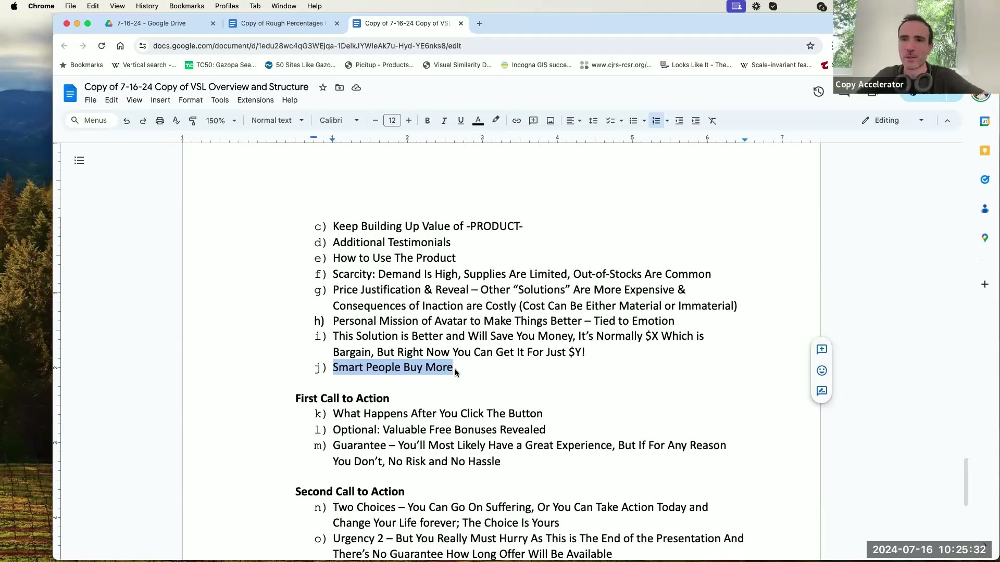
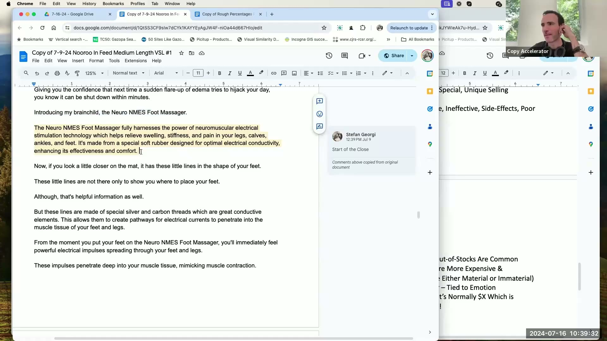
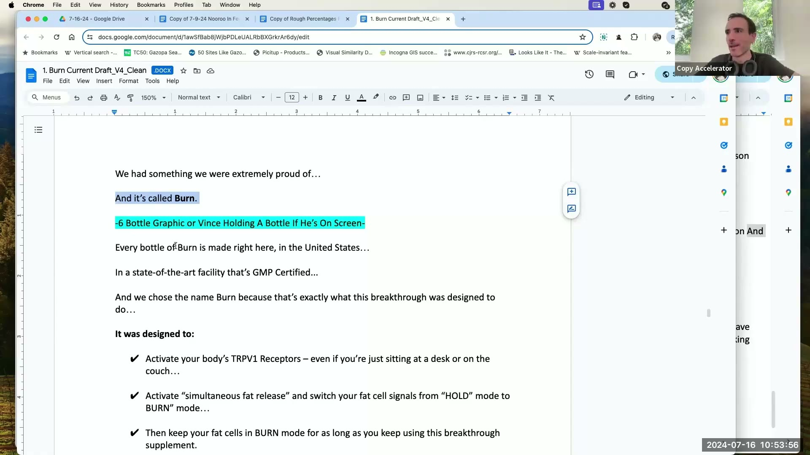
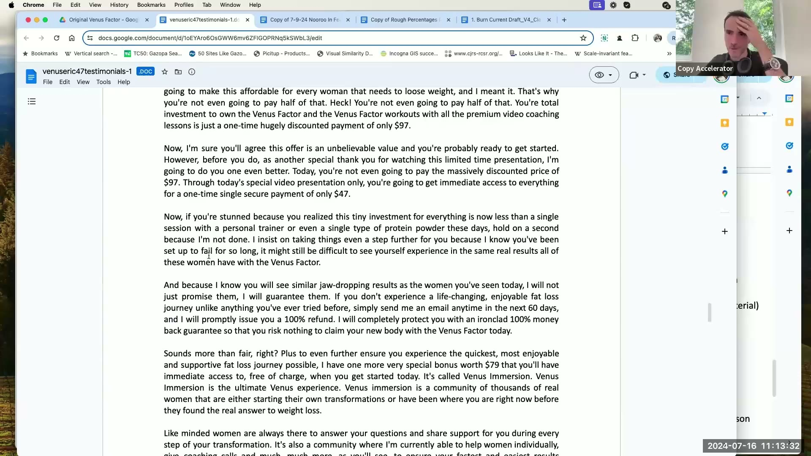
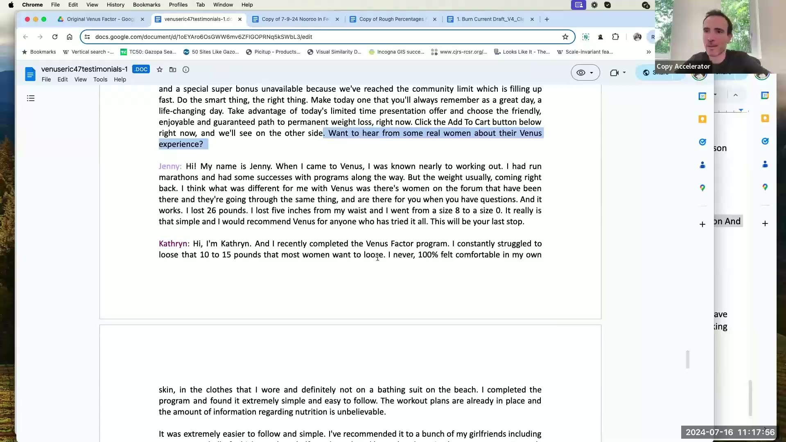

# 4.6 VSL Closes
> The close is the longest section of a VSL and is built so that the first call to action lands when the viewer is fully ready; everything after it is free-rolling extra attempts (guarantee, bonuses, crossroads, FAQ, more social proof), shown here on a device VSL, a skin supplement VSL, a weight-loss info VSL and a book-a-call script.

## 🤖 Agent use
- **Use when:** writing or auditing the offer section of a VSL, long-form page or in-feed VSL ad: product details, alternatives, value, price anchor, bundle push, guarantee, bonuses, closing CTAs and FAQ; deciding where the first button goes; deciding how hard to push the biggest bundle.
- **Inputs → outputs:** the product as built in [4.5](04-05-vsl-product-buildup-and-reveal.md), real ingredient/spec and manufacturing facts, real testimonials and endorsers, real price and bundle prices, the actual guarantee terms, genuine scarcity facts, a support contact → a close of about 30-45% of the script in the order: details, alternatives, value, extra proof, how to use, scarcity, price anchor, personal mission, price reveal, smart-people-buy-more, FIRST CTA, what happens after clicking, bonuses, guarantee, second CTA (crossroads), urgency, thanks, FAQ, final CTA.
- **Rules:**
  - **DO** treat the first call to action as the crescendo; everything before it builds readiness, everything after is "free rolling... taking more shots to get them to buy". [01:00–01:30]
  - **DON'T** worry about close length. "Pacing is much more important before the first call to action than after it." [01:59–02:28]
  - **DO** make the close the longest section. [01:30–01:59]
  - **DO** put the first CTA right after the price reveal and "smart people buy more", with only "a couple sentences" on the biggest package, not paragraphs that delay the button. [12:12–14:38]
  - **DON'T** over-push the largest package so that single-unit buyers feel bad: "I'd rather just get the customer." Stefan likes the Nooro line "even if you only get one, you'll still get a fantastic deal". [28:40–29:09; 38:42–39:12]
  - **IF** the buy button is withheld until after a long AOV pitch **THEN** conversion rate can fall enough to hurt: "your AOV is great... but the conversion rate sucks so much that affiliates won't promote it". [13:13–14:11]
  - **DO** add many calls to action once in the close: "you can't really go wrong with too many call to actions"; he thinks people more often have too few than too many. [08:47; 27:45–28:13]
  - **DO** repeat the ask even if it feels repetitive: after five or six prompts "just keep telling them to click the button". [31:02]
  - **DO** put a reason why behind every price, guarantee, bundle and urgency statement. "It's all reason why copy." [38:42]
  - **DO** give "how to use the product" in simple numbered steps, and future-pace the result while explaining use. [03:56–04:26; 23:10–23:38; 37:13–38:14]
  - **DO** put the guarantee contact details inside the guarantee: it "alleviates a lot of concern". [30:31]
  - **DO** shift to a friendlier "back to being their friend" tone in the FAQ, then end the FAQ with a final CTA. [10:11–11:38]
  - **DO** test: FAQ vs none, price in the in-feed ad vs "50% off" only, 90-day "trial" vs "guarantee" wording, a mystery gift. [34:05; 38:14–38:42; 30:04; 39:43–42:48]
  - **DON'T** invent price anchors, scarcity, capacity limits, "live shoppers", testimonials or endorsers. Stefan's examples contain them; we copy the beat, not the claim. (derived; repo rule 2)
  - **IF** you are unsure how hard to sell, **THEN** "add a zero to the price in your head" and write as if the product cost 10x. [17:30–18:30]
- **See also:** [4.5 Product buildup and reveal](04-05-vsl-product-buildup-and-reveal.md) · [4.4 Background stories and unique mechanisms](04-04-vsl-background-stories-and-unique-mechanisms.md) · [4.2 VSL fundamentals](04-02-vsl-fundamentals-classic-structure.md) · [Offer and bundle psychology](../../../../frameworks/offer-and-bundle-psychology.md) · [Anchoring effect](../../../../concepts/heuristics/anchoring-effect.md) · [Scarcity](../../../../concepts/heuristics/scarcity-heuristic.md)

## Key ideas

### Two refreshers from last week [00:00–02:28]
- Outline reminder: hook and micro lead, lead, background, discovery, UMP or UMS, product build-up and reveal, close, FAQ. FAQs are "pretty basic". [00:00]
- (1) "We actually don't really want somebody to finish our VSL." (2) After the first call to action "we're free rolling". So long VSLs should not scare you once you reach the close. [00:30–01:30]
- Stefan jokes about time dilation after the first CTA to say length stops mattering there. [01:59]


*The close outline as shown in the call: "Keep Building Up Value... Additional Testimonials... How to Use... Scarcity... Price Justification & Reveal... Personal Mission... This Solution Is Better... Smart People Buy More", then "First Call to Action" and what comes after. Note price justification now sits before personal mission. [08:00]*

### The close, element by element [02:28–11:38]
1. **Product details.** "What's included, what makes it special." Introduce the product plainly: "It's a system. It's this breakthrough supplement formula. It's this incredible device." [02:28–02:59]
2. **Other alternatives.** Dismiss them again: other supplements "full of sketchy generic ingredients from overseas", other training systems "created by people who have not scaled a business". Already dismissed earlier, "but we still want to do it again". [02:59–03:56]
3. **Keep building value** of the product. [03:56]
4. **Additional testimonials.** "Generally more testimonials is better"; sometimes they sit right before the product details. [03:56]
5. **How to use the product.** "Really important, especially if it's not obvious"; remove "any confusion or lack of clarity" (e.g. "take one scoop each day"). [03:56–04:26]
6. **Scarcity.** Demand is high, "ethically" whatever scarcity you can truthfully include. [04:26–04:57]
7. **Price justification and anchoring**, then **personal mission.** He swaps their order on the fly: first "everything's more expensive... I could have charged a lot more", then "but this isn't about money", usually "a personal mission to help people". He answers the "isn't that bullshit?" objection: "not if you do it the right way", e.g. admit you want to make money and also truly can't serve more people (his CA Pro membership example: "I can only enroll like five or ten more people"). "It doesn't have to be unbelievable." [04:57–06:56]
8. **Price reveal with anchor.** "We could easily charge 149 retail, but... just $69 for a bottle" (audio garbled; "$6, $9") and for info "some people are charging $50,000... $15,000... today it'll just be $997". [06:56–07:50]
9. **Smart people buy more.** "Choose your package, pick the gold package, pick the six bottle package". [07:50–08:17]
10. **FIRST CALL TO ACTION.** [08:17]
11. **What happens after you click**, then **bonuses** "right there... no matter what". [08:17–08:47]
12. **Guarantee**, then another CTA: "you're going to probably have a great experience. If you don't, no problem". [08:47–09:14]
13. **Crossroads close** (second CTA): choice one is inaction ("you go on suffering. Life doesn't change"), choice two is to act today; "the choice is yours". [09:14–09:42]
14. **Urgency 2** and **thank you for watching** (third CTA): "this is the end... no guarantee how long this video will be up". [09:42]
15. **FAQ**, ending with a fourth CTA. Tone change: "back to being their friend". [09:42–11:38]

### Where to place the first button and how hard to push AOV [12:12–17:03]
- Question (Tasso): where do most clicks happen; worry that people click before the AOV lines. Answer: he waits to reveal the button until the first CTA and says "you just have to test... there's a really big trade-off". [12:12–12:44]
- ClickBank-style publishers need large AOV and "go so hard on selling the six-bottle package... talking shit about any package that isn't"; he wonders whether that "fucks them", because a late first CTA can crush conversion rate and affiliates then will not promote it. [12:44–14:11]
- Classic approach: put the CTA after "smart people buy more" with a couple of sentences, e.g. "instead of $69 per bottle, when you get the six month package, which is the best deal, what our smartest customers buy, it's just $49 per package... go ahead and get started now by clicking the button... pick whatever package is best for you". [14:11–14:38]
- Case notes (instructor claims): a weight-loss offer (BioHarmony) with a copywriter's very short, direct-to-CTA close converted extremely well; his team then added AOV elements to take AOV from "like a 140 to like a 180"; and the same copywriter's "Lift Factor" instant wrinkle-remover letter "did multiple eight figures". He wonders whether to "just get it converting" first and add AOV afterwards as a second step. [15:06–17:03]
- Unknown price while drafting: "just pick a price... then just switch it out" but do not weaken the close to avoid a number. [17:03–17:30]
- **Add-a-zero trick**: imagine a $69 or $49 bottle at $490; "would you go harder?" Even for a $7-9 product, 10x it mentally. [17:30–18:30]

### Example A: Beverly Hills MD pinch test [18:30–21:12]
- He picked it unformatted and admits it: "maybe a bad example... I may have messed up by trying to choose this example", because testimonial emails arrive before the official close and the formatted section ended earlier. Takeaway he does draw: testimonials can come "before the kind of official close". [19:11–20:31]
- What the doc contains in its close (derived from the doc, not discussed in the call): normal price "$58" and then "$39.95 per jar" ("a buck 33 a day"), a 180-day supply with an additional discount, "Inner Circle" automatic-delivery membership with extra 10% off and priority stock, third-party testing and cGMP labs, a 60-day money-back guarantee "extended by another 30 days through this video only" (90 days) even if the jars are used up, phone and email support, secure order page and plain-box shipping, "one little catch" that the price may disappear when ingredient costs rise, a "youthful moment" future-pacing passage, a thank-you sign-off and then a five-question FAQ ending on the 90-day guarantee. [doc, BHMD "Pinch Test" close]

### Example B: Nooro in-feed medium VSL, close mapped to the outline [21:12–34:37]
- Why it is useful: "even though this is a pretty short script, a big chunk of what they have is the close". [21:12] By my count of the extracted text the close from "Introducing my brainchild" onward is about 1,700 of 3,776 words, roughly 45%. (derived)
- Element mapping, as Stefan reads it:
  - **Product details:** soft conductive rubber mat, "silver and carbon threads", pulses "mimicking muscle contraction". [21:46–22:41]
  - **Future pacing + how to use:** "No more struggling to find shoes that fit... heck, even your marriage"; "15 minutes per day"; setup "as easy as one, two, three... six modes and 19 intensity levels". [22:41–23:38]
  - **Mom as mini-testimonial:** "She barely leaves the house without it." [23:38–24:06]
  - **More value:** "super compact. Just fold it, put it in your purse". [24:06]
  - **Price anchoring** ("$500? $1000? $2000? ... nowhere near this price" and "many other industry specialists told me to charge at least $400") plus **personal mission** ("This isn't about money for me"). Stefan: "I should probably put the price anchor thing here specifically". [24:50–25:50]
  - **First CTA:** "special offer... 50% discount... only available through the link below the video". No price is named "because this is a Facebook ad"; he has seen both ways and suggests testing it. [25:50–26:19; 38:14–38:42]
  - **Scarcity and urgency:** "we are currently failing at that... demand is growing too fast", "almost 1,000 people live shopping", "if you are seeing this video, it means that we probably have some massagers left... otherwise we would have taken the video down". [26:49–27:45] (course example; do not copy the claims)
  - **Smart people buy more:** "the more you get, the bigger discount... we save around $20 when we ship multiple products in the same box". Stefan: he would add a bigger-discount line near the 50% CTA and likes "even if you only get one, you'll still get a fantastic deal". [26:19; 28:13–29:09]
  - **Guarantee:** "You have 90 days to test the product completely risk-free... It doesn't matter if it's 89 minutes or 89 days after the purchase." He likes that line, wonders whether "trial" has an auto-bill connotation, and likes that the contact route sits inside the guarantee ("We're available 24-7... message us on Facebook... within minutes. That's confidence."). [29:36–30:31]
  - **Closing CTAs:** "click the button below now" repeated: "who cares? They've told me to click the button like five or six times now". The line "the only risk is the possibility of pain and regret" works as "a miniature... crossroads" of two future states. [30:31–31:57]
  - **Missing, per Stefan:** alternatives dismissed earlier only; no additional testimonials (the mom counts); no bonuses; no thank-you or FAQ (worth testing); no explicit "what happens after you click"; his wish list includes a bigger multi-unit discount at the first CTA and an explicit price anchor. [32:27–34:37; 26:19]


*The Nooro script as annotated for the call: the margin comment "Start of the Close" sits on "The Neuro NMES Foot Massager fully harnesses the power of neuromuscular electrical stimulation technology...". [22:00]*

### Product details vs the UMS [34:37–37:13]
- Question (Tasso): does the product-details part feel like a UMS? Stefan: the close describes technical operation and quality; for supplements he usually covers "quality, the ingredients, where it's made" and "re-summarizes the mechanism". His Burn (vShred) close example: made in the USA, GMP-certified facility, product name rationale, "it was designed to..." bullets. [34:37–36:44]
- He notes he usually does the ingredients before the close because "doing it the other way historically has the highest success rate", while this Burn script mentions other ingredients later in the close. "There's a lot of nuance there." [36:44–37:13]


*Product details in a supplement close: "Every bottle of Burn is made right here in the United States... in a state-of-the-art facility that's GMP Certified... we chose the name Burn because that's exactly what this breakthrough was designed to do... It was designed to:" followed by mechanism bullets. [36:24]*

### Future pacing, reason-why, mystery gift, studies [37:13–44:17]
- Future pacing: "getting them in a state of feel like the transformation has occurred... makes them more likely to want to buy". A participant praises "as soon as you place your feet, no more struggling" as future pacing that also helps explain what happens after ordering. [37:13–38:14]
- Participant: price anchoring works best "if you have a real reason why", "all reason why copy": why different, why this guarantee, why I made this, why six bottles, why now. Stefan agrees. [38:42–39:12]
- A participant (Moni) argues that people who push the six-bottle package hard have weak supplements and want to maximise the only sale they will get. Stefan agrees that is the thinking, but: even a mediocre supplement benefits from a good customer experience, emails and relationship ("psychosomatic... placebo effect") and he does not want single-bottle buyers to "feel like shit". [39:12–39:43] (note the health-claims sensitivity)
- Mystery gift idea (participant Nick): tell people the gift's value and what it does, reveal it on the next page. Stefan likes it, would wait until they are "sold on stuff enough", and plans to try it on a skincare offer. Stefan says a financial-sector copywriter told him the idea traces to Claude Hopkins's "Scientific Advertising" (a gift shipped without revealing it, which Hopkins reportedly found "would always beat the test"; instructor claim, second-hand), and that a speaker named "Rich" (surname unclear in audio) built a whole upsell around a mystery box at an event. [39:43–42:48]
- Studies in the six-bottle pitch (a client's script he modelled): use study durations to justify continued use, "this ingredient showed this improvement in five weeks... another in 12 weeks, so it just makes sense to keep taking more". Only if you have real studies. [42:48–43:52]

### Example C: "The Venus Factor" (info product, weight loss) [44:17–1:02:25]
- Context: an older ClickBank weight-loss program for women, "the biggest offer on ClickBank for years back in the day" (instructor claim). The doc lists the spokesperson as "John Barban"; Stefan's audio attributes it to a creator he names as "Brad Howard" and the close is attributed to the original creator; not verified. The doc is titled "Original Venus Factor". [44:17; 55:36]
- Walk-through with Stefan's notes (the copy is in the doc; numbers are the doc's):
  1. **Product intro:** "the future of female fat loss, the Venus Factor... designed to dramatically increase female metabolism... even if you've tried everything". [44:41]
  2. **"What it is not"** (dismissing alternatives): not "another fat-restrictive diet... uncontrolled food cravings, frustrating plateaus". [45:08–45:36]
  3. **What it is / how to use:** "a super easy to follow 12-week nutrition plan that shows you exactly what to do step-by-step"; plus fascination bullets. [46:02–46:31]
  4. **Fascinations with a second layer ("dimensionalize")**: each bullet gets a "why it matters" addendum (e.g. foods that damage leptin sensitivity, then "watch how fast the weight falls off in the first two weeks"). "A mediocre or even a decent copywriter would write this and then stop there." [46:31–47:56]
  5. **Virtual nutritionist and results:** "make every 10 pounds you lose look like 20". [47:56–48:50]
  6. **Proof instead of only testimonials:** named professional endorsers (a physician and a fitness author per the doc). Stefan: "instead of just testimonials, if you had some additional endorsers, it'd be kind of cool to pop those in there". [48:50–49:44]
  7. **Honest disqualifier:** "If you're looking for that magic weight loss answer... the Venus Factor is not for you." [49:44–50:12]
  8. **Price anchor:** "my hourly consulting fee... is over $500... it must be unaffordable. However, it's not." Personal mission: "I only felt right by making it affordable for every woman". [50:12–50:37]
  9. **Bonus 1 before the price:** "just for watching this presentation" a "$297" workouts program with "143 premium video coaching lessons"; given "no matter what". [50:37–52:00]
  10. **Price stack:** not the $500 hourly rate; then "a one-time hugely discounted payment of only $97"; then "you're not even going to pay $97... only $47". Stefan: "you're talking yourself into paying $97" and, with the add-a-zero test, "if it was $470... when I find out it's $47, I'm buying it". [52:00–53:45; 56:35–57:06]
  11. **Guarantee as an extra gift:** "I will not just promise them, I will guarantee them... 60 days... 100% refund. I will completely protect you." [53:45–54:40]
  12. **Bonus 2 / continuity hook:** a community ("Venus Immersion"; the doc says a "$79" value, Stefan reads "$97"), "a sneaky little continuity thing they were running at the time". [54:40–55:36; doc]
  13. **FIRST CTA:** "click the add to cart button below". [55:36]
  14. **Crossroads close:** "everything you've been doing up until now has not worked and now you know why... There's another path for you... Imagine the moment you step onto this path". [57:35–58:56]
  15. **Urgency:** "extremely limited time Venus Immersion bonus... we're very close to our maximum membership capacity". [58:56–59:52] (course example; capacity claims must be true)
  16. **Instead of an FAQ, a testimonial video bombardment:** "Want to hear from some real women about their Venus experience?" Stefan: this was "really innovative at the time", and he suggests UGC-testimonial blocks after the close as "a really baller move" because the sale is already asked. [59:52–1:00:50]
- Info-product differences he lists: the "how to use" block is the program itself (modules, plan), "info products are typically going to have more fascinations", a stacked-bonus "infomercial style, wait, there's more" close, and no stock-up bundle. The failure mode for info is not making it "feel valuable" or letting the package feel "disconnected". [46:31; 56:04; 1:00:50–1:02:25]
- Stefan's checks: the offer has endorsements/testimonials, how to use, scarcity throughout, "what it is not", personal mission, price discounting; missing: "smart people buy more", a fuller "what happens after you click", and a closing CTA after the testimonials. [1:00:50–1:01:54]
- Re-use claim: the mechanism ("it's leptin") cannot be reused, "but that close probably works just as well today", and "people have gone away from it". He plans to swipe it for a peptide VSL with a Facebook community. [57:06; 1:02:25]
- Stefan's disclosure: the markups in the doc came from someone who shared it earlier, so he hid them. [1:01:54]


*The doc on screen at the price stack: "...a one-time hugely discounted payment of only $97... you're going to get immediate access to everything for... only $47"; then the ironclad guarantee and the second bonus. [56:00]*


*The pivot after the final CTA into a long run of testimonial videos in place of an FAQ. [1:00:24]*

### Example D: biz-opp book-a-call script (in the zip, not discussed on the call)
The zip includes "SWIPE VSL SCRIPT_BIZ OPP HIGH TICKET OFFER _ BOOK A CALL", the same script described in [4.4](04-04-vsl-background-stories-and-unique-mechanisms.md). Its ending, as structure (derived; Stefan never discusses it in this recording):
- After the mechanism, the close sets up **three paths**: trial and error ("took me over eight years"), buying from a novice seller, or booking a call with the team ("by far the fastest and easiest route"). [doc]
- **Qualification as scarcity:** "we don't accept just anyone"; applicants need capital and to be coachable; a "not for you" paragraph for people wanting a done-for-you business. [doc]
- **Bonus for acting:** a "roadmap to freedom" blueprint "regardless if we accept you into the program or not". [doc]
- **CTA mechanics:** button below the video to fill out an application survey and schedule a call; repeated; ends "Click the button below and book your call today". No price is stated. [doc]
- **Proof hooks to the page:** "over 50 testimonials" below the video, "over 1500 applications a month". [doc]
- Compliance: this script makes large income claims and uses real-person names and results. We copy only the path structure (three options, qualification, bonus for booking) and use our own verified claims.

## Steps / framework

### Close build order (course outline, 06 version of "VSL Overview and Structure", verbatim; with Stefan's on-call tweak noted)
```text
VI. Close
a) Product Details (What's Included, What Makes it Special, Unique Selling Propositions)
b) Discuss and Dismiss Other Alternatives (Expensive, Ineffective, Side-Effects, Poor Quality, Unproven)
c) Keep Building Up Value of -PRODUCT-
d) Additional Testimonials
e) How to Use The Product
f) Scarcity: Demand Is High, Supplies Are Limited, Out-of-Stocks Are Common
g) Price Justification & Anchoring - Other "Solutions" Are More Expensive & Consequences of Inaction are Costly (Cost Can Be Either Material or Immaterial)
h) Personal Mission of Avatar to Make Things Better - Tied to Emotion
i) This Solution is Better and Will Save You Money, It's Normally $X Which is Bargain, But Right Now You Can Get It For Just $Y!
j) Smart People Buy More
> First Call to Action
k) What Happens After You Click The Button
l) Optional: Valuable Free Bonuses Revealed
m) Guarantee - You'll Most Likely Have a Great Experience, But If For Any Reason You Don't, No Risk and No Hassle
> Second Call to Action
n) Two Choices - You Can Go On Suffering, Or You Can Take Action Today and Change Your Life forever; The Choice Is Yours
o) Urgency 2 - But You Really Must Hurry As This is The End of the Presentation And There's No Guarantee How Long Offer Will Be Available
> Third Call to Action
p) Thank You For Watching
VII. FAQs
a) Back to Being Their Friend; Helping To Clear Up Any Confusion They May Have
b) Reminding Them of What Product Is, What It's Used For, Importance of Taking Action Today, Terms of Guarantee, and How to Buy!
> Fourth Call to Action
c) Thank You For Watching
```
Note: letters follow the on-screen version of the doc; the extracted file numbers the same items 1-16. In the 05 (build-up) copy of the doc "Personal Mission" is item 7 and "Price Justification & Reveal" item 8; the 06 copy swaps them to "Price Justification & Anchoring" then "Personal Mission", matching his live change. The on-screen call version labels the step "Price Justification & Reveal". [04:57; 08:00]

### Element checklist per example (Stefan's own audit method, rebuilt)
| Element | Nooro (device, in-feed) | Venus Factor (info) | BHMD (supplement) |
|---|---|---|---|
| Product details | yes [21:46] | yes (what it is and is not) [44:41] | yes (doc) |
| Alternatives dismissed in close | earlier only [32:27] | "what it is not" [45:08] | via store-supplement flaw earlier |
| Extra testimonials | mom only [32:56] | endorsements + video bombard [48:50; 59:52] | emails in doc |
| How to use | 1-2-3 steps [23:10] | 12-week plan [46:02] | "two capsules daily" (doc) |
| Scarcity | yes [26:49] | capacity limit [58:56] | price may rise (doc) |
| Price anchor | weak, "$500/$1000/$2000" [24:50] | $500 hourly rate, $97 then $47 [50:12; 52:00] | $58 then $39.95 (doc) |
| Personal mission | yes [25:20] | yes [50:37] | partly (doc) |
| Smart people buy more | yes, late [28:13] | none [1:00:50] | 180-day supply, Inner Circle (doc) |
| Guarantee | 90-day [29:36] | 60-day [53:45] | 90-day (doc) |
| Bonuses | none [33:30] | two [50:37; 54:40] | none |
| Crossroads | one-line [31:57] | full [57:35] | not in the doc |
| Thank you / FAQ | no [34:05] | testimonial videos, no FAQ [1:00:17] | FAQ in doc |

## Examples
- **Nooro close (device, in-feed):** see mapping above. Steal the order and the guarantee wording pattern ("89 minutes or 89 days"); skip the scarcity claims.
- **Venus Factor close (info, ClickBank):** value-stack close with a bonus before the price, price reveal in two drops, guarantee framed as a gift and a continuity-community bonus. Weight-loss claims in the doc (e.g. dress sizes in a week) are out of bounds for Meta/FTC; copy only the structure.
- **Burn (vShred) close:** product-details block as manufacturing and name rationale. [36:14–36:44]
- **Stefan's Nooro revisions (spoken):** move "smart people buy more" up toward the first CTA, add an explicit price-anchor sentence, test an FAQ. [26:19; 27:16; 32:56; 34:05]

## Structured units

### Rewrites (before → after)
| Before | After | What changed | Source |
|---|---|---|---|
| Six-bottle pitch run as paragraphs of hard sell before the button | "Instead of $69 per bottle... the six month package... what our smartest customers buy, it's just $49 per package... pick whatever package is best for you" | Short AOV reason then immediate CTA, single-unit buyers still invited | [14:11–14:38] |
| Nooro "special offer... 50% discount" (price withheld) | Test showing the price vs. only the discount | Price clarity vs curiosity; he has "seen it both ways" | [25:50; 38:14–38:42] |
| Nooro: smart-people-buy-more appears late | Put a bigger-discount line near the first CTA | Raise AOV at the moment of the first ask | [26:19; 27:16] |
| "Trial" in the guarantee | Say "guarantee" or test wording | "Trial" can read as an auto-bill | [29:36] |
| "Thank you for watching" ending | Add a final CTA after the testimonials ("it's John again... click the button") | Last-chance ask after FAQ or social proof | [1:01:54] |

### Templates
| Template | Use for | Example fill | Source |
|---|---|---|---|
| "[Other products] are [flaw]. [Our product] is [differentiator]. Remember, it does [list of benefits]." | Dismiss alternatives in the close | "...unlike other supplements full of sketchy generic ingredients from overseas..." | [02:59–03:56] |
| "This isn't about money for me... I could have charged more, but I only care about getting it into as many hands as possible." | Personal mission after anchor | Nooro: "many other industry specialists told me to charge at least $400, I refused." | [24:50–25:50] |
| "Normally $X... today $Y" then a second drop "even better: $Z, today only" | Price stack | $97 then $47 (Venus) | [52:00–53:45] |
| "Smart people buy more... instead of $[A] per [unit], the [N]-month package is $[B]." | Bundle push | $69 vs $49 per package | [14:11–14:38] |
| "You have [N] days to test it risk-free... It doesn't matter if it's 89 minutes or 89 days." | Guarantee | Nooro 90-day | [29:36–30:04] |
| "Right now you've got two choices. Choice one: [keep suffering]. Choice two: take action today. The choice is yours." | Crossroads close | Venus Factor "which path will you go down" | [09:14–09:42; 57:35] |
| "Remember, everything you've been doing up until now has not worked, and now you know why." | Crossroads for info/weight loss | Venus | [57:35] |
| "If you only get one, you'll still get a fantastic deal." | Protect single-unit buyers | Nooro | [28:40] |
| "Want to hear from some real women about their [product] experience?" | Replace FAQ with testimonial run (use only real testimonials) | Venus | [59:52] |
| Mystery gift: "worth $[X], does [Y], click to discover" | Checkout or last-line add-on | Participant Nick's idea; Stefan: "I would test that" | [39:43–42:48] |

### Rules of thumb
- **DO** test where the first CTA goes; compare conversion rate and AOV together. [12:12–14:11]
- **DON'T** skip "how to use"; clarity beats cleverness. [04:26]
- **IF** the offer is info **THEN** stack modules, bonuses and proof, and make the whole package feel specific and valuable ("holy shit, I'm getting all this for $47"). [56:04–57:06]
- **IF** you have UGC video testimonials **THEN** test a testimonial run after the final CTA. [1:00:17]
- **IF** the offer is a physical product with no FAQ **THEN** test adding one with a final CTA. [34:05]

## Prompts / templates (verbatim)
No LLM prompts are given in this lesson. The spoken sample lines are in Templates above; the verbatim close outline is in Steps / framework. Stefan mentions asking an LLM to format the Beverly Hills script before the call; that prompt is not shown or included in the course files. [18:30]

## Screenshots
Five frames are embedded above: the close outline doc, the Nooro "Start of the Close" comment, the Burn product-details close, the Venus Factor price stack and the Venus testimonial pivot. Frames at 02:40, 44:50 and 50:30 duplicated the same docs and were dropped.

## How to apply
- [ ] Draft the close in outline order; mark which elements are missing and why.
- [ ] Place the first CTA directly after price + "smart people buy more"; keep the bundle reason to a few sentences.
- [ ] Write the price reason-why: anchor, then why the actual price is lower, then why a bigger package is smart.
- [ ] Add "how to use" in 3 steps and a one-line future-pacing of the first use.
- [ ] Put the guarantee terms and a real support contact inside the guarantee paragraph.
- [ ] Add a second CTA (crossroads) and a final CTA after the FAQ; switch the FAQ voice to a friendlier tone.
- [ ] Decide what to test: price in ad vs discount only; FAQ vs none; testimonial run; mystery gift; "guarantee" vs "trial".
- [ ] Replace every example claim (efficacy, income, scarcity, live shoppers, capacity) with verified facts or delete it.

## Related
- Previous: [4.5 VSL product buildup and reveal](04-05-vsl-product-buildup-and-reveal.md)
- [4.4 background and mechanism](04-04-vsl-background-stories-and-unique-mechanisms.md) · [4.2 fundamentals and the Nooro close](04-02-vsl-fundamentals-classic-structure.md) · [4.1 module overview](04-01-vsls-section-overview.md)
- Shared: [Offer and bundle psychology](../../../../frameworks/offer-and-bundle-psychology.md) · [Anchoring effect](../../../../concepts/heuristics/anchoring-effect.md) · [Scarcity](../../../../concepts/heuristics/scarcity-heuristic.md) · [Reciprocity](../../../../concepts/heuristics/reciprocity.md) · [Risk-reduction hooks](../../../../concepts/risk-reduction-hooks.md)

## Sources and limitations
- Transcript: [06-[5] VSL Closes.txt](<../../../../../raw/stefan-georgi/rmbc-ii/_transcripts/Stefan Georgi - RMBC II (1)/04-VSLS SECTION I-Structure Theory and Examples/06-[5] VSL Closes.txt>) (Whisper large-v3-turbo; full recording, 3,835 seconds; the call was recorded on 16 July 2024 per the on-screen clock). Captions: `06-5 VSL Closes.srt`.
- Docs used: VSL Overview and Structure (close outline), Rough Percentages (identical to the 05 copy), Nooro medium VSL, Beverly Hills MD pinch test VSL, Original Venus Factor, biz-opp book-a-call swipe. No document images or comments survive in the extraction.
- Mishearings and fixes: "Neuro" is the doc's spelling of the Nooro brand; "Copic Center Pro" is the instructor's "CA Pro" membership (Copy Accelerator); "Brad Howard" (audio) vs "John Barban" (doc) for the Venus Factor creator is unresolved; "$6, $9" is likely "$69"; the "716" heard in the Nooro passage is the doc date 7/16, not a word count; the Venus Immersion bonus is "$79" in the doc and "$97" in the audio.
- Revenue and growth claims in the Q&A (BioHarmony, Lift Factor, "biggest offer on ClickBank") are the instructor's, with no proof. The names of the writers and offer owners are heard in audio only and not verified.
- Compliance: example scripts contain health, weight-loss, anti-aging and income claims, invented-looking scarcity ("almost 1,000 people live shopping", "very close to our maximum membership capacity"), named testimonials and endorsers. They would fail substantiation under Meta and FTC rules without proof. Copy the beat order and mechanics, never the claims.
