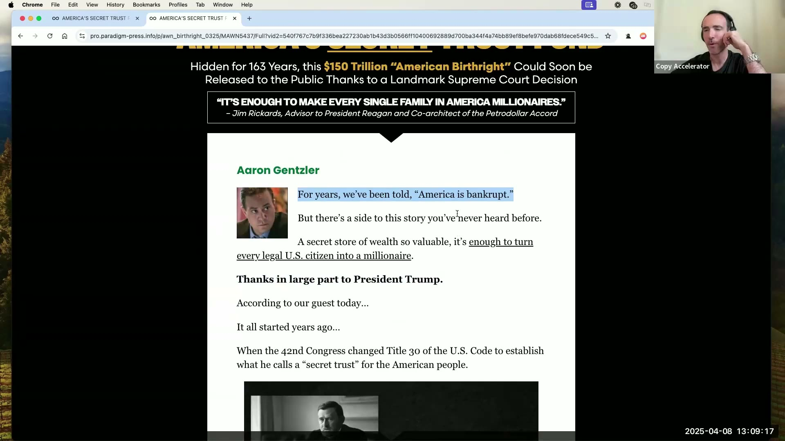
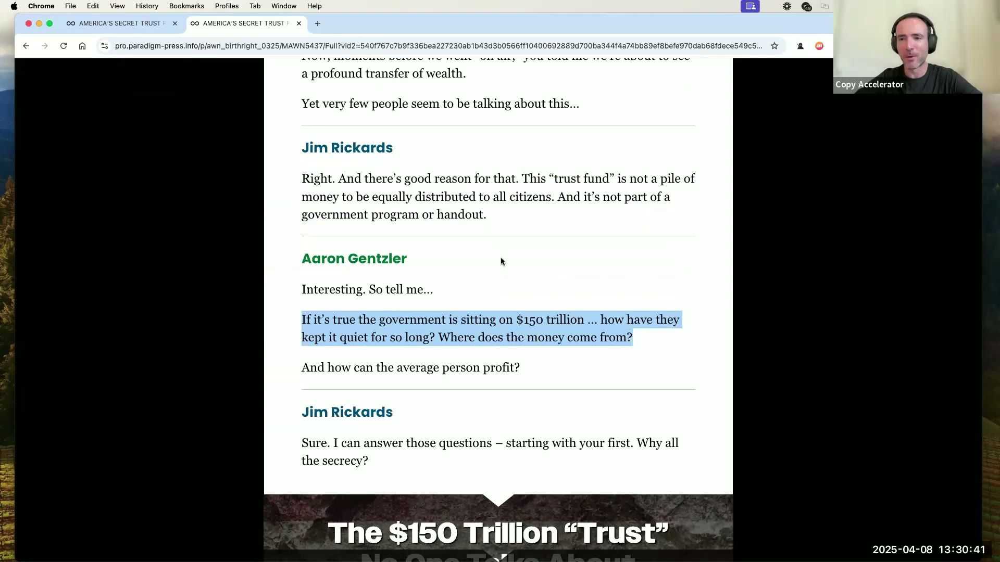
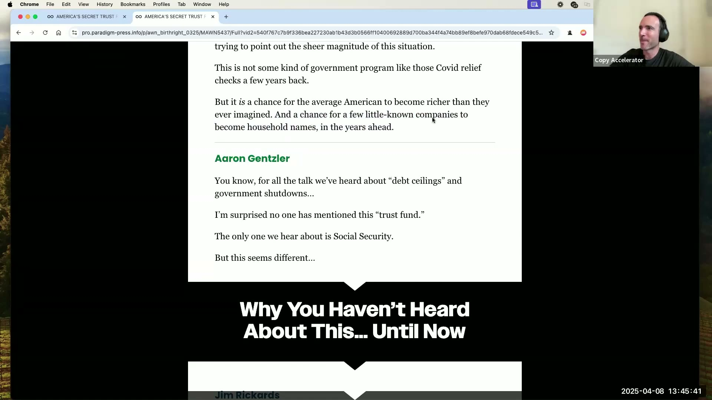
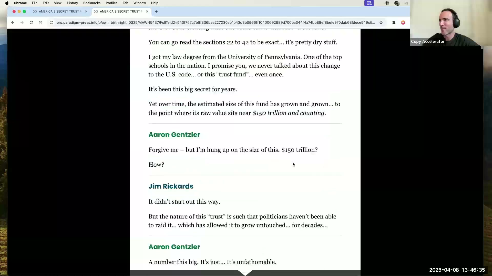
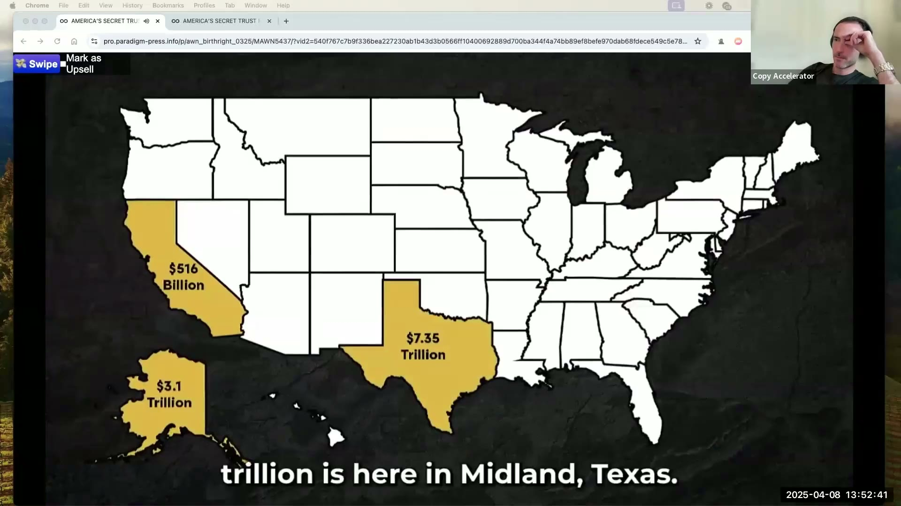
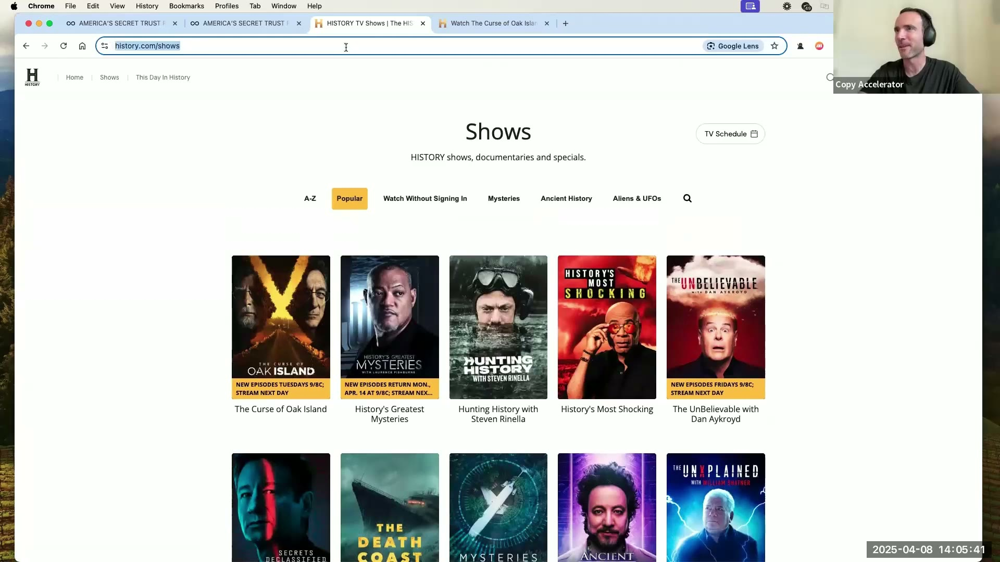
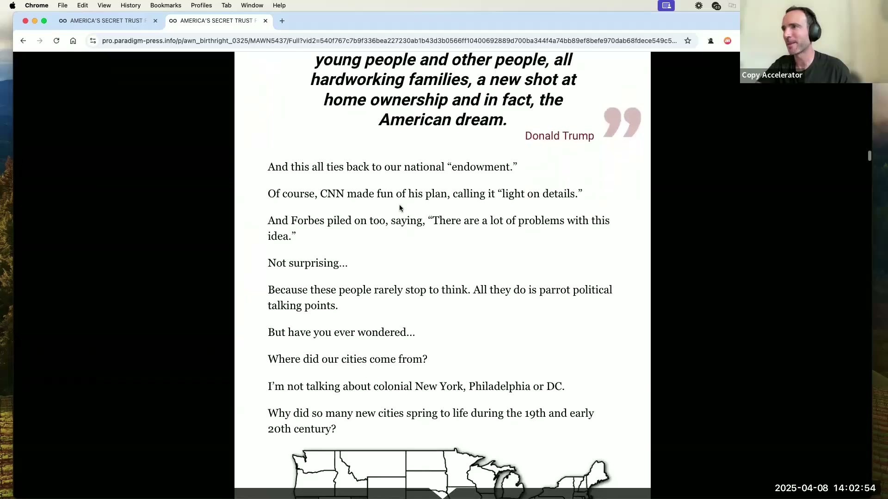

# 4.7 Long Form Financial VSL (Examples and Break Downs)
> A recorded live call in which the instructor and two guest practitioners (a financial-copy writer and a Facebook media buyer) play the first ~12 minutes of a record-breaking Agora Financial "America's secret trust fund" VSL, pause every few minutes, and dissect why a host-and-expert, objection-first, big-idea lead holds attention; the transferable value is the structure, the market-awareness logic and the compliance contrast, not the claims.

## 🤖 Agent use
- **Use when:** writing or reviewing a long-form VSL with a host and an expert (any niche, not just finance); designing the first 5 to 12 minutes of any story-led VSL; deciding how to spend objection handling right after a huge claim; judging whether a "big idea" lead is fresh for a market that has seen the same idea many times; briefing ad creative for a long-form VSL that is being scaled.
- **Inputs → outputs:** the big idea (the thing the viewer will be shown), the market and what they already believe and talk about, a credible spokesperson plus a skeptical host, and the real facts that back the claim → a lead built from contrarian opening, "what's in it for me", curiosity gaps and a named expert; an objection-answering interview; a dimensionalized number; a precedent story; a delayed credibility block; a reveal that unwinds any metaphor; and a plan for daily secondary creative.
- **Rules:**
  - **DO** write the opening as a contrarian line that picks up the story already in the viewer's head ("For years, we've been told America is bankrupt, but there's a side to this story you've never heard before."), then promise a secret, a hero and a payoff. [05:50–09:14; 21:30–22:54]
  - **DO** open the interview by answering the objections the big claim creates, voiced by the host: why was it secret, where does the money come from, how can the average person profit, is it a handout. [27:00–28:55]
  - **DO** let the host or spokesperson be the skeptic so the viewer can lower their guard: "The host is poking holes for me." [30:47–32:37]
  - **DO** make an abstract number concrete ("dimensionalization"): translate the big figure into things the viewer can picture and compare. [29:50–30:47]
  - **DO** repeat the core promise often. The call counted about 15 uses of the "$150 trillion" figure on the transcript page. [44:13–44:45]
  - **DO** set a precedent story that says "this has happened before" (the 1862 Homestead Act in this promo) and that quietly pre-sells the real mechanism. [33:34–34:31; 41:22]
  - **DO** match the topic to what the market already watches and says (conservatives and Trump, mining, treasure hunting, Fort Knox audit talk). [53:48–54:20; 1:02:28–1:04:08]
  - **DO** sit your lead in front of "what hope or validation does this audience want right now" before choosing the emotion. [1:07:00–1:09:57]
  - **DO** keep supplying new angles and creative once a long-form promo scales; the copywriter in this example produced new ads daily. [1:11:52–1:12:44]
  - **DON'T** assume a new "big idea" is fresh: the call argues the market's sophistication resets about every 10 years and this idea was a 10-year-old pattern returning. [1:17:02–1:18:51]
  - **DON'T** start from the literal mechanism (for example "the new gold rush") if you can find a bigger metaphor that gives the idea room to breathe. [1:00:54–1:01:54]
  - **IF** you use a metaphor to carry a dry idea **THEN** reveal what it actually is inside the piece and gradually unwind the metaphor; the call treats this as the compliance difference between this promo and earlier "check" promos. [38:28–40:24; 47:32–48:25]
  - **IF** you copy this structure **THEN** swap every figure, prediction and legal claim for facts about your own product that you can substantiate. The source promo contains finance, political and "predictions" claims that this knowledge base does not endorse. [see Claims check]
- **See also:** [04.2 VSL fundamentals and classic structure](04-02-vsl-fundamentals-classic-structure.md) · [04.3 VSL leads after the opening hook](04-03-vsl-leads-after-the-opening-hook.md) · [04.4 Background stories and unique mechanisms](04-04-vsl-background-stories-and-unique-mechanisms.md) · [02.1 Product-market awareness](02-01-product-market-awareness.md) · [Evolve: Objection handling](../../../evolve/copywriting/concepts/objection-handling.md)

## Key ideas

### Why this promo was picked and what the call does [00:00–02:29]
- The instructor says he heard "through the grapevine" that this Agora Financial promo is "the best promo they've had since End of America back in 2011" and that the numbers "haven't been seen since then". He cannot share exact figures publicly but says "way over a thousand new people a day". (instructor claim, unverified) [00:00–00:54]
- The format: play a couple of minutes, pause, dissect the copy against the written transcript, then play on. The VSL page also offers the full transcript as a text sales letter (the "TSL"): when the viewer tries to leave, a pop-up offers "keep reading" and shows the same copy. [00:54–01:56]
- A guest media buyer (named only as "Tom" for the day-to-day traffic) is said to run the Facebook traffic; two other guests, first names Matt and Nick, join to add practitioner insight. The instructor tells them to avoid confidential detail. [01:56–02:29]
- The lesson file lists two links only (the VSL and its TSL version on a Paradigm Press page); the course zip does not contain a copy of the page or script. See Sources.

### Reading the lead: the first ~2.5 minutes of the VSL [02:29–09:14]
The opening narration (host voice-over before the interview) does the work of a lead; the instructor reads it line by line. [03:00–05:50]

| Lead element | What the VSL says (verbatim or near) | The instructor's reading | Timestamp |
|---|---|---|---|
| Headline (on the TSL page) | "America's secret trust fund. Hidden for 163 years, this $150 trillion 'American Birthright' could soon be released to the public thanks to a landmark Supreme Court decision." | Reads as the intro of the copy; second subhead is a quote from the expert: "It's enough to make every single family in America millionaires." | [04:50]; screenshot below |
| Contrarian opening | "For years, we've been told America is bankrupt, but there's a side to this story you've never heard before." | "Instantly contrarian." Everyone hears the first half, so the second half opens a gap. | [05:50–06:50] |
| Secret + desirability | "A secret store of wealth so valuable it's enough to turn every legal U.S. citizen into a millionaire." | "Who doesn't want to tap into a secret store of wealth?": a "time-tested desire". The "trust" taps envy of a trust-fund kid. | [06:50] |
| Outrage + curiosity | "...it was sealed off from the public" for more than a century | A "lost treasure thing, a treasure hunt". | [07:49] |
| Recency | "...thanks to a Supreme Court decision, it will soon be unlocked." | Gives timing and a reason the viewer is hearing it now. | [07:49] |
| Hero (audience fit) | "Thanks in large part to President Trump." | He assumes the market is "conservative men, 50 plus" and says Trump as the hero is "an appealing idea" to them. | [05:50] |
| What's in it for me | "If you understand what's bound to happen next, you could watch your own net worth soar in the years ahead." | Plain self-interest line. | [07:49] |
| Layered motives | "Enough to pay off the national debt four times over"; "make every American family millionaires"; "silence Trump's most outspoken critics" | Different readers take different reasons: altruistic (national debt), self-interested (millionaire), tribal (the hero and the critics). | [08:19] |
| Curiosity questions | "Where did this endowment come from? Why was it kept secret for more than a century? And how can you claim your share?" | Three open loops. | [09:14] |
| Spokesperson | A credentialed guest introduced in the lead | "A strong spokesperson really does matter... a lot in financials." | [09:14] |

- The instructor's own test for finance: "am I getting FOMO or a little bit of greed or at least curiosity?" A good financial lead also gets the viewer thinking like an active investor, "ready to deploy money", which makes them more likely to pay for information. [12:44–14:10]
- He calls it "not the most over-the-top sensationalized lead ever", noting that financial leads typically are not. [09:14]

*TSL page: headline "Hidden for 163 Years, this $150 Trillion 'American Birthright'...", the boxed expert quote ("It's enough to make every single family in America millionaires."), and the first host line highlighted. [07:00] (Claims are the promo's, not endorsed here.)*

### Practitioner takes on why it works [10:03–22:54]
- **Mystery and investigation over claims (guest Matt).** The lead is "like an investigation, like a mystery"; for seven to ten minutes the story keeps developing, "not really leaning into claims and promise", but presenting something the viewer did not know. [10:03]
- **History Channel feel.** The instructor adds that the host-brings-an-expert format is standard in financial VSLs but "does almost have that feeling of like a History Channel show", with a treasure-hunt demo (older men watching treasure, mining and "gold rush" shows). [10:57]
- **Timing and hope (Matt).** Matt's account is that Trump voters felt "hung out to dry" as public narrative turned against him around weeks 7 to 9 of the presidency, and the promo "represents hope" and "comes to the exact conclusion they need". [10:57–11:49; 1:07:00–1:09:01]
- **Entitlement, "free money" (guest Nick).** "It's yours by birthright, and it's been being withheld from you this entire time." He ranks three promo types: **free-money entitlement** (already yours, "just press this button"), **loophole** (for example "Canadian Social Security") and **opportunity** ("something's happening and there's an opportunity"). "Most promos promise opportunity, but if you can promise them that this isn't an opportunity, it's already yours... that is going to get someone to watch." [17:09–19:40]
- **Mining and resource promos need very big ideas** and "when they do work, they hit" (Nick's example, as he recalls: an "Obama's third term" oil promo). [16:38]
- **The "bankrupt" opening surprised Nick** because the copy gives no proof for it; the instructor's answer is that it is a good example of market awareness: the line "just meets you right where you are. It just picks up the story that's in your head." For a writer outside the market, you "really have to know the market... to be bold enough" to open that way. [20:37–22:54] See [02.1 Product-market awareness](02-01-product-market-awareness.md) and [Evolve: Market awareness](../../../evolve/copywriting/concepts/market-awareness.md).

### The interview is objection handling, and the host is the skeptic [22:54–37:31]
After the lead, the interview opens with Jim Rickards (named on screen as the expert; the host is named on screen as Aaron Gentzler) answering the questions the lead raised. [23:43–27:00; 27:00–35:30]

1. "This 'trust fund' is not a pile of money to be equally distributed to all citizens. And it's not part of a government program or handout." The instructor reads this as "almost like an immediate objection addressing" and, for a conservative audience, "this isn't about some socialist bullshit, so you can feel okay about being excited about it". [28:01–28:55]
2. The three implied prospect questions: "If this is true... why have they been keeping it quiet? Where does the money come from? How can the average person profit?" The expert says "Sure, I can answer those questions, starting with your first. Why all the secrecy?" [28:01; screenshot below]
3. **Specificity and credibility cues:** "Title 30 of the U.S. Code... sections 22 to 42 to be exact... you can go read." The instructor: "I could go look it up. I'm not going to, but I could." [28:55]
4. **The number is itself a hook,** so the host voices disbelief ("I'm hung up on the size of this. $150 trillion? How?") and the expert says it "didn't start out that way" and that politicians "haven't been able to raid it". For this audience "politicians raid everything" makes the answer "even more believable". [28:55–29:50]
5. **Dimensionalization:** $150 trillion is "unfathomable", so the expert translates it: pay off the national debt four times over; a 100% stake in every Nasdaq-listed company; buy every private home in the US; divide by households for "a check for $1.1 million" per family, with an explicit disclaimer ("I don't expect any of this is going to happen"). The instructor: "Is it going deeper... there's an abstract and there's a specific." It works in any niche, health or biz-opp included. [29:50–31:47; 25:11]
6. **Skeptic host:** "letting the spokesperson be the skeptic for the viewer... If the host is being skeptical, then me as the prospect, I can let my guard down... he's asking the questions I was going to ask." He says this is "a really underrated component of good copy that nobody... talks about besides me". Health parallel: a presenter says "I was skeptical" and "apparently there are studies". [30:47–32:37]
7. **Permission to feel entitled:** "not a handout... not COVID relief checks", which the right "looks down on". [32:37]
8. **Villains and heroes:** Social Security "practically gone" (NPR, "even NPR admits"), earlier presidents named as would-be raiders, versus "Trump's Supreme Court". Instructor: "mentioning bad guys, and then comparing the bad guys from the right to the hero". [33:34]
9. **Precedent (Homestead Act, 1862):** 160 acres for $18, "$18 equates to around $562 today", land "worth about $900,000", "a chance to make 1,000 times their money", with the catch that you had to move and stay put; the government "retained the most valuable part... for 163 years". The instructor: "it sets precedent... it's happened before. Why couldn't it happen again"; homesteading is "an affinity topic" for 55 to 60-plus conservative men. [26:04–27:00; 33:34–34:31]
10. **Big-idea condition for early objection smashing (guest Matt).** The first stretch of the interview is "almost all just objection smashing", which is "not typical" for a financial promo. It works because the idea "actually intersects with the news cycle" and is truly unique among many competing Trump, DOGE and AI-stock promos; "the idea is so big that... people want the objection smashing right away. They don't want to be sold anymore." [35:30–37:31] The instructor says he might try this in VSLs in other niches and compares it to "caveman questions" in consumer text pages. [37:31]

*Highlighted in the TSL: the host's "If it's true the government is sitting on $150 trillion... how have they kept it quiet for so long? Where does the money come from? And how can the average person profit?" followed by "Sure. I can answer those questions." [28:24] (Promo claims, not verified.)*

### Unwinding the metaphor: the compliance and the reveal logic [38:28–48:25]
- **Nick's observation (his word is "transubstantiation", used to mean a metaphor-based big idea; the captions confirm the spelling):** the whole lead is a giant metaphor ("America's secret trust fund") built on what is actually mineral-rights companies on federal land opened up by a court decision. The copywriter "unwinds" the metaphor slowly: "fund" becomes "asset" ("the raw value of this fund... what funds have raw values?"), the host says "not a pile of cash", and the Homestead story pre-sells land-based investing. [38:28–41:22]
- The instructor searches the page: "fund" appears 28 times and "asset" five times (read from the on-screen search; the count is of the page as searched). [43:42] "$150 trillion" appears about 15 times, which he calls "good repetition... easy to get away from what the core promise was". [44:13–44:45]
- **Breadcrumbs:** early lines such as "a chance for a few little-known companies to become household names" quietly seed the real mechanism (investing in companies). [42:43; 45:39]
- **Nostalgia pattern (Nick):** this is a classic "Porter Stansberry-type" idea with nostalgia for an America "ripe with opportunity", like an older promo that sold a new "railroad" that was in fact fiber-optic cable. The instructor's name for the writer's type of origin: a long-time Stansberry-school copywriter (Whisper misspells the name as "Sandsbury"). [41:22–42:48]
- **The lead holds the viewer.** "If someone will stay for three minutes they're probably going to stay for 12 to 15 minutes, and if you get them to 12 to 15, they'll probably stay 20, 30 minutes... the opening is really just an advertisement for the rest of the sales letter." (instructor claim, a rule of thumb, not a measured stat) [46:34]
- **Compliance contrast (Nick):** earlier Agora "check promos" (which "stopped around 2018" and "got in trouble") kept the real thing blinded so people felt a government check was coming; this one "reveals what it is" and has the expert say he is "just putting it in terms so that typical Americans can understand" and "that's why I called it a fund". The guest's view: that makes the claims "very safe" because "you could basically say... it's a metaphor, I talk exactly about what it is". [47:32–48:25] (This is a participant's opinion, not legal advice; see Claims check.)
- **Ad-platform contrast (media-buyer side, Matt):** a previous big Rickards promo ahead of the election had "tons of ad disapproval issues, ad accounts going down"; with this one "we've had some of that... but it's been pretty tame", because "the idea is fairly compliant. It's not a super big promise. It detaches the claim from the promise pretty well." [48:25–49:22] (a participant's claim)

*The breadcrumb line "a chance for a few little-known companies to become household names in the years ahead", and the host's "The only one we hear about is Social Security." [43:24]*

*Specifics ("sections 22 to 42"), "raw value sits near $150 trillion and counting", and the explanation that politicians "haven't been able to raid it", then the host's "How?" [44:18] (Promo claims, not verified.)*

### Second playback: the "hole in the story", the map and the track record [49:22–59:53]
- After the objections, the investors-not-government line arrives ("It's not the government that will profit. It's the investors who act on this opportunity"). The instructor notes the framing moves from "free money you're getting" to "the investors who jump on this", exactly the unwinding Nick described. [45:39–46:34]
- A second playback shows the host introducing a new objection: "All that sounds incredible, but there's a hole in this story. What is this national endowment and where's the money coming from? ...the government isn't cutting million dollar checks." The instructor: "as a viewer, I don't have to be skeptical. He's being skeptical for me." [49:22; 52:50–53:48]
- **Visual proof device:** a US map says where the "endowment" sits (the screen shows $516 billion for California, $3.1 trillion for Alaska, $7.35 trillion for Texas). The instructor also notes the Fort Knox exchange ("is it still there? The government hasn't allowed an audit since 1953") is "very topical" for the right (Elon and DOGE talk about auditing Fort Knox). [50:17; 53:48]
- **Urgency:** "starting as early as this summer"; "if you're over age 50, what happens next could be your final chance to build generational wealth." [50:56; 54:20]
- **Direct-to-camera moment:** the expert turns from the host and speaks into the camera for that line. The instructor and Nick find it "cringe" but "a good pattern" that "all depends on the setup... right placement". [54:20–55:43]
- **Hero payoff and validation:** "Donald Trump could become a national hero... Mount Rushmore... the new $1,000 bill"; the instructor says viewers who voted for him get "you were right. Everything you believe is being validated", and the claims are things people on the right "have said on X", not "random claims the guy's making up". [51:51; 55:43–56:14]
- **Track-record cred as macro, not stock tips.** The host lists the expert's calls: the 2008 market crash ("stocks crashed 53%"), Trump's 2016 win ("polls gave him a 1% or 2% chance"), the 2020 pandemic, Trump's 2024 electoral landslide "including the exact number of electoral votes". Instructor's reading: financial promos usually cite stock calls, here they are "macro predictions and trends", and the "1 or 2% chance" implies "great payout" odds, "I don't know if that's intentional". "This guy could see the future... tell me I can make money from the future." [51:51–58:00] (All predictions are the promo's claims; see Claims check.)
- **Credibility placement is delayed on purpose (Nick).** Normally: lead, guru credibility, historical precedent. Here the lead and a little cred, then precedent, then most of the cred "right before he's about to drop the fact that it's mining... so it will kind of lessen the disappointment." (Nick's hypothesis) [58:00–59:53]

*In-video map graphic. The VSL says the "endowment" is "held on deposit across all 50 states" and shows $516 billion, $3.1 trillion and $7.35 trillion in three places. [50:24] (Numbers are the promo's; not verified by the instructor.)*

### The reveal: it is mining [1:00:24–1:04:08]
- The reveal builds on a "Where did our cities come from?" run: "Why did so many new cities spring to life during the 19th and early 20th century?" San Francisco, Denver, Houston, Salt Lake City, Birmingham, "a lot of people leave everyone they know"... and the line "I know why. Does it have to do with mining perhaps?" then gold rush, "rags to riches", and minerals powering "NVIDIA, ChatGPT, military weapons, Freedom Cities". [1:00:24–1:02:28]
- **A B-level approach would have started here.** The instructor's view: a less experienced financial writer would start with "the new gold rush that Trump just unlocked" and be "too close to the idea": it "wouldn't be big enough". The twenty-year-veteran gave the idea "room to breathe" by selling a secret trust fund first. [1:00:54–1:01:54]
- **Awareness check for the topic:** to show mining and treasure hunting are mass-affinity topics, he opens the History channel's popular shows (The Curse of Oak Island is first) and notes Gold Rush, Homesteaders, Outback Opal Hunters. "There's a level of market awareness... that's underrated in a way, but very interesting." [1:02:28–1:04:08]

*The instructor's check that the audience is already surrounded by treasure-hunt and mining entertainment, so the reveal lands on an existing affinity. [1:03:24]*

*The bridge into the mining reveal: "this all ties back to our national 'endowment'", critics "parrot political talking points", then "Where did our cities come from?... Why did so many new cities spring to life during the 19th and early 20th century?" [1:00:36]*

### Why people buy the front end and why it exploded [1:04:08–1:10:56]
- **Participant view (about the offer, not shown on screen):** the offer is a low-priced report (a guest recalls about $500; the course files do not show the price). It "lowers the barrier to entry"; the buyer is buying an emotional share ("investing in Trump... in America... a modern-day homesteader") and wants to be able to "tell their conservative friends". He guesses that 90 to 98% of front-end buyers will never invest in the companies and want the information "to close the loop", comparing it to buying coins and memorabilia. (participant's guess) [1:04:08–1:07:00]
- **Hope as a potent emotion.** Matt: fear is usually the strongest financial emotion; here "maybe hope in the right context is even more powerful" because the audience feels vulnerable. [1:07:00–1:08:00]
- **Reported results (guest claims, unverified):** "on the third day... just short of 500 sales on Facebook"; "from zero to 500 in less than 72 hours"; "CPAs insanely low"; later "2,000 plus orders a day". [1:08:00; 1:15:37]
- **Audience proof:** the same audience on Facebook had produced "10,000 comments on one of these ads" and heavy sharing for a previous election-themed offer, a "very bullish signal" before the election. [1:09:01–1:10:56]
- The instructor's spin-off idea: apply the same tribal-identity logic to a "Southern beauty" skincare brand ("American-made, American ingredients", with a trademark still pending). He says tribal politics applied to a broader context "can just do so well". (derived: apply only if the claims, trademarks and platform rules allow.) [1:10:56]

### After the idea: secondary creative is what scales it [1:11:52–1:17:02]
- Matt: he has "never worked with a copywriter in like 10 years of basically FinPub media buying" who was as involved in secondary copy. The writer produced "new angles every day", "full on new angles", used Grok-generated images (for example Trump and J.D. Vance styled as Roosevelt and Lincoln), and "you can tell this dude is putting in three, four hours a day". [1:11:52–1:12:44]
- Incentives: a participant says a copy chief typically earns "around a six to 7% royalty on the front end", paid on net revenue after refunds. The speaker presents it as his own guess ("I imagine"). The writer ran an internal agency writing for many publications. (participant claim) [1:12:44–1:14:41]
- Media-buying effect: "the first time I haven't felt a need to work angles and creative myself", so the buyer has a backlog "when everything's converting, you just keep firing it off". [1:14:41–1:15:37]
- Competitive environment: when a "banger" lands, others "get more hungry" and "the competition level ratchets itself". [1:16:08]

### Timing, sophistication and recycled ideas [1:17:02–1:19:23]
- Participants: other promos at the same time were "rehashing ideas that worked three or four years ago". This idea was "Porter's bread and butter type of ideas 10 years ago" (Canadian Social Security and others; one name is garbled in the transcript). It stopped when tech became hot. "Timing in financial is so important... sophistication level... tends to reset every 10 years or so... people forget they saw stuff like this 10 years ago." [1:17:02–1:18:51]
- Companion point: "our financial prospects have been blasted to death with NVIDIA, next AI" for six-plus months, which is why a non-AI idea felt fresh. [1:18:51]
- Closing: the instructor thanks the guests; he is about to be at the hospital for the birth of his child the next day. [1:19:23–1:19:53]

## Steps / framework

### A. The promo's skeleton (observed, in playing order)
| # | Beat | What it did | Where | Copy as (derived) |
|---|---|---|---|---|
| 1 | Contrarian opening lines (voice-over) | "We've been told X, but there's a side you've never heard"; secret, hero, recency, WIIFM | [02:29–05:50] | Open by challenging a belief the viewer already holds, then promise the unheard side |
| 2 | Spokesperson intro with credentials | 50-year career, major historical roles (per the VSL) | [03:56–05:50] | Introduce the expert with 3 to 4 specific, checkable career facts |
| 3 | Host and expert interview begins | Host asks the three questions the lead raised | [22:54–23:43] | Host voices objections |
| 4 | Immediate objection handling, "not a handout" | Pre-empts the worry that this is welfare/a scheme | [23:43; 28:01] | Pre-empt the identity-based objection ("this isn't X") |
| 5 | Specifics and credibility | Statute reference, "go read it" | [28:55] | Give a checkable specific the viewer could look up |
| 6 | Number plus dimensionalization | $150T translated to debt, Nasdaq, homes, $1.1M per household | [24:29–25:11; 29:50] | Turn the big figure into 3 relatable comparisons |
| 7 | Villain and hero setup | Social Security raided; earlier presidents vs "Trump's Supreme Court" | [25:11–26:04] | Name the culprit and the champion for your audience |
| 8 | Precedent story | Homestead Act, 1862 | [26:04–27:00] | A past event that did the same thing |
| 9 | Investors, not the government | "It's the investors who act on this opportunity" | [44:45–45:39] | Introduce the viewer's role |
| 10 | "Hole in the story" objection | Host: where is the money coming from? | [49:22] | Re-open skepticism before the reveal |
| 11 | Proof visual (map) and topical hooks (Fort Knox) | Visual of where the asset sits | [50:17] | Show, do not only tell |
| 12 | Urgency and "final chance if you're over 50" | Direct-to-camera line | [50:56–54:51] | A real time window (not invented scarcity) |
| 13 | Hero payoff (Mount Rushmore, $1,000 bill) | Validation of the audience's identity | [51:51; 55:43] | Validate the audience's belief with real, citable audience talk |
| 14 | Expert's track record | Macro calls the host lists | [51:51–52:50] | Put track record after the big idea if the reveal might disappoint |
| 15 | Bridge to the real mechanism: cities and mining | "Why did so many cities spring up?" | [1:00:24] | A historical "how did it happen before" bridge |
| 16 | Mining reveal | Minerals power AI, military, "freedom cities" | [1:02:28] | Tie the real mechanism to what the market already cares about |
| 17 | Offer | A report at a low front-end price; course files do not detail it | [1:04:08–1:07:00] | n/a |

### B. Lead construction checklist (derived from [05:50–09:14])
1. Identify the market and what it believes right now.
2. Write one line challenging a popular belief in that market.
3. State a secret, a desirable object, and why it was hidden.
4. Add a hero and a villain the audience already has.
5. Give timing ("it will soon be unlocked") and what's in it for me.
6. Layer multiple reasons to care (altruistic, self-interested, tribal).
7. End with 3 curiosity questions and the spokesperson.

## Examples

### Example 1: "America's secret trust fund" (Agora Financial / Paradigm Press, a Jim Rickards VSL) [source docx; 00:00–1:19]
- A long-form host-and-expert VSL with a text sales letter version. The host is named on screen as Aaron Gentzler and the expert as Jim Rickards.
- It was described as a mining-stock promo: "It's actually a mining stock promo... about the Chevron overturning of the Chevron doctrine in 2024. And now Trump can actually give these permits." [11:49]
- The instructor's summary of why it works: contrarian lead; secret and entitlement; hero; objection smashing; a big novel idea; a credible spokesperson; skeptical host; well-timed hope for a specific audience. [5:50–11:49; 22:54–37:31; 1:07:00–1:09:57]

### Example 2: Related earlier promos mentioned (names only, not shown)
- "End of America" (2011) as the previous benchmark; "Obama's third term" (oil); Canadian Social Security; the earlier "railroad" promo about fiber-optic cable. [00:00; 16:38; 18:10; 41:53]

## Structured units

### Hooks
| Hook (verbatim or near) | Heuristic(s) | Emotion / zone | Self targeted | Why it works | Source |
|---|---|---|---|---|---|
| "For years, we've been told America is bankrupt, but there's a side to this story you've never heard before." | Contrarian reversal; picks up the audience's existing belief (derived) | Curiosity / outrage (derived) | — | "Meets you right where you are", then opens a gap | [05:50; 21:30–22:54] |
| "A secret store of wealth so valuable, it's enough to turn every legal U.S. citizen into a millionaire." | Secret + payoff | Greed / curiosity (derived) | — | Time-tested desire to tap into a secret | [06:50] |
| "America's secret trust fund. Hidden for 163 years..." (headline) | Secret + precedent + recency | Curiosity (derived) | — | Treasure-hunt feel plus a reason it is now | [04:50; 07:49] |
| "It's enough to make every single family in America millionaires." (quote under headline) | Spokesperson quote as subhead | Greed (derived) | — | Credits a named expert with the big promise | [21:30] |

### Angles
| Angle | Core desire / pain | Heuristic(s) | Best format | Example line | Source |
|---|---|---|---|---|---|
| Birthright / entitlement ("it's already yours") | Get something you are owed; wealth without risk | Entitlement; free-money tier of promo | Long-form VSL / TSL | "A secret trust for the American people" | [17:09–19:40] |
| Validation of the audience's recent choice | Be proven right; hope in a bad news cycle | Identity validation | VSL lead and ad hooks | "Everything you believe is being validated" (instructor's reading) | [55:43; 1:07:00–1:09:57] |
| Tribal identity for a non-financial product (instructor idea) | Belonging, "American-made" | Tribal identity | Skincare ads | "The only thing the coastal elites love more than talking shit about us..." (the instructor's own voice, not an ad) | [1:10:56] |

### Ad teardowns
| Brand / product (niche) | Format | Hook / opening | What works | What fails | Fix suggested | Principle | Source |
|---|---|---|---|---|---|---|---|
| America's Secret Trust Fund, Agora / Paradigm Press (financial newsletter, mining stocks) | Long-form VSL plus TSL | Contrarian "bankrupt... side you've never heard" | Secret + hero + recency; host-skeptic objection handling; dimensionalization; precedent; delayed cred; unwound metaphor | Cringe direct-to-camera line (but a "good pattern"); credit-check claims and political predictions need substantiation | None from the instructor; participants say keep supplying new angles | Objection handling right after a huge claim; skeptic host; market-fit hope | [02:29–1:19:53] |

### Rewrites (before → after)
| Before | After | What changed | Source |
|---|---|---|---|
| "The new gold rush Trump just unlocked" (what the instructor says a lesser writer would lead with) | "America's secret trust fund... American birthright" (the actual lead) | Moved from the literal mechanism to a bigger metaphor that "can breathe" and later unwinds into the real mechanism | [1:00:54–1:01:54] |
| "$150 trillion" | "Enough to pay off the national debt four times over... a $1.1 million check per household" | Abstract number turned into relatable comparisons | [24:29–25:11; 29:50] |
| "Fund" | "Asset" (moving through the piece) | Language quietly changes as the metaphor unwinds | [39:54–40:24; 43:42] |

### Templates (derived)
| Template | Use for | Example fill | Source |
|---|---|---|---|
| "For years we've been told [belief your market already holds], but there's a side to this story you've never heard before." | Contrarian opening | The promo's own line | [05:50] |
| Host question: "If it's true that [big claim], why [haven't I heard / how has it stayed quiet] and how can [the average person] [benefit]?" | Objection-first interview opening | Screenshot at [28:24] | [28:01; 28:24] |
| "[Big number]. That's enough to [3 relatable comparisons]. If you divided it by [unit], each [unit] would get [figure]." | Dimensionalization | Debt x4, Nasdaq, homes, $1.1M per household | [25:11] |
| "This is not [the tainted category your audience dislikes]. It's [the real thing]." | Identity-based objection pre-emption | "Not a pile of money... not a handout" | [23:43; 28:01] |
| "[Precedent story]: it happened before, in [year], when [what people got], with one catch." | Precedent bridge | Homestead Act | [26:04–27:00] |

### Rules of thumb
- **DO** use objection handling immediately after the big claim and give those answers to the host to voice. [27:00–32:37]
- **DO** test whether your idea is a "truly unique idea" in a field full of rehashes before leaning on early objection smashing. [36:02–37:31]
- **DON'T** let a story-driven VSL drift away from the core promise; repeat it. [44:13–44:45]
- **IF** the viewer's emotion in the market is hope or validation right now **THEN** build the lead around it rather than defaulting to fear. [1:07:00–1:09:57]
- **IF** your hero or villain is political **THEN** be aware this narrows the audience and increases platform and brand risk (derived).

## Prompts / templates (verbatim)
No prompts, Claude Project instructions or brief templates are given in this lesson or its document. The course file lists two links only. A derived teardown checklist is under How to apply.

## Claims check (flag before reuse)
| Item in the example | Why it needs care | What to copy instead |
|---|---|---|
| "$150 trillion" trust fund, "enough to make every American family millionaires", "$1.1 million per family" | Unverified, extraordinary financial claim; the instructor does not verify it | The structure of dimensionalization with real, sourced figures from our product |
| "Title 30 ... sections 22 to 42", Supreme Court decision, "Chevron" and mining permits | Legal and regulatory claims; the instructor himself calls it "a mining stock promo" and does not confirm the legal story | The "checkable specific" pattern using our own verifiable facts |
| Expert's predictions and track record (2008 crash "53%", 2016 election "1 to 2%", 2020 pandemic, landslide "exact number of electoral votes") | Track-record claims need substantiation; these are the promo's and the participant's praise, not independently shown | Use only our spokesperson's verified, specific record |
| "Over 50: final chance to build generational wealth", "Trump on Mount Rushmore", "$1,000 bill" | Political and financial-promise claims; promising "wealth" breaks Meta and FTC expectations for earnings and investment claims | An honest time window and real expert opinion, labelled as opinion |
| Results quoted on the call ("500 sales in 72 hours", "2,000 plus orders a day", "way over a thousand new people a day") | Unverified instructor and guest claims | Do not quote as benchmarks |
| Participants' compliance view ("very safe", "detaches the claim from the promise") | Opinion from a copywriter and media buyer, not legal advice; Meta ad disapprovals still occurred | Treat as a prompt to check platform and legal rules ourselves |

Agents must not copy the claims, the political framing or the named expert. Use the structure only, and substitute our own substantiated facts. Financial, health or earnings claims go to review first.

## Screenshots
Embedded above: headline and first line [07:00]; host's objection questions [28:24]; the "little-known companies" breadcrumb [43:24]; "raw value... and counting" [44:18]; the map graphic [50:24]; the cities pivot [1:00:36]; the TV-channel shows check [1:03:24]. Frames at 03:10, 04:30, 05:30, 14:00 and 52:10 (the video player and talking heads) and at 38:45 (the Homestead passage, which showed a participant's name label) were not used.

## How to apply
- [ ] Teardown any competitor VSL with this lens: contrarian line, desire, hero/villain, objection list, numbers, precedent, cred placement, reveal.
- [ ] List the 3 to 5 objections the lead creates and write the host's interview questions from them.
- [ ] Rewrite any abstract number into 3 comparisons the viewer can picture, with sourced figures.
- [ ] Find a precedent story for your category that does not require inventing facts.
- [ ] Decide where to put the spokesperson's track record (up front, or just before the reveal if the reveal may disappoint).
- [ ] If a metaphor carries the lead, write where and how it is unwound and reveal what the offer is.
- [ ] Check the market's current emotion (hope, fear, validation) before choosing the lead.
- [ ] Plan secondary creative (new angles, images) from day one: copywriter owns the backlog.
- [ ] Run the claims check; replace any unsubstantiated financial, political or earnings claim.

## Related
- Previous: [04.4 VSL background stories and unique mechanisms](04-04-vsl-background-stories-and-unique-mechanisms.md) (the module's next lessons, 04.5 and 04.6, cover product build-up and closes)
- [04.1 VSLs section overview](04-01-vsls-section-overview.md) · [04.2 VSL fundamentals and classic structure](04-02-vsl-fundamentals-classic-structure.md) · [04.3 VSL leads](04-03-vsl-leads-after-the-opening-hook.md) · [02.1 Product-market awareness](02-01-product-market-awareness.md)
- Evolve: [Market awareness](../../../evolve/copywriting/concepts/market-awareness.md) · [Objection handling](../../../evolve/copywriting/concepts/objection-handling.md) · [Authority in ads](../../../evolve/copywriting/concepts/authority-in-ads.md)
- Cross-course note: Evolve and this lesson both treat the lead as a tool to earn attention before pitching; Evolve emphasises matching copy to awareness level, and this call shows an example where the lead intentionally picks up the story in the prospect's head. No explicit disagreement found. The "objection smashing first" approach is specific to this example and is not generalized by the instructor.

## Sources and limitations
- Transcript: [07-[6] Long Form Financial VSL (Examples and Break Downs).txt](<../../../../../raw/stefan-georgi/rmbc-ii/_transcripts/Stefan Georgi - RMBC II (1)/04-VSLS SECTION I-Structure Theory and Examples/07-[6] Long Form Financial VSL (Examples and Break Downs).txt>) (Whisper large-v3-turbo, last segment at 1:19:53 of a 1:20:12 video; read in full). Captions: `07-6 Agora Financial Homerun Breakdown.srt` (used for names and terms). Document: `07-1 Long Form Financial VSL Example.docx` (two links only; the extracted text has no other content).
- Fixes from captions: "Czech promos" means "check promos"; "Rickert/Ricketts/Records" is Jim Rickards; "Sandsbury" is Stansberry; "Tasos/Tasso" appears in the captions as a name for a participant (not resolved; speaker attributions are approximate); "Gilder / graphene" and "Walt Hireman" are garbled and not used. Speaker attribution is by context only, because the transcript has no speaker labels.
- The VSL and TSL pages themselves are not in the course files (only the two links). All VSL quotes come from the instructor's playback in the recording and from on-screen text in the frames.
- Only the audio was fetched; seven frames were taken from MEGA. The call was recorded on 8 April 2025 according to the on-screen clock. Several guest facts (price point, royalty percentage, conversion numbers) are guesses or claims by participants and are labelled as such.
- Participant names other than first names (and the real names of everyone but the on-screen host and expert) are omitted. Any contact details and tracking IDs in the document links are not reproduced.
- The instructor's closing remarks about his family are omitted.
