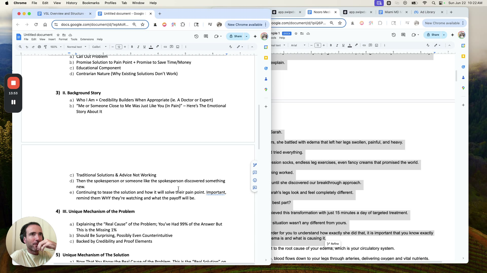
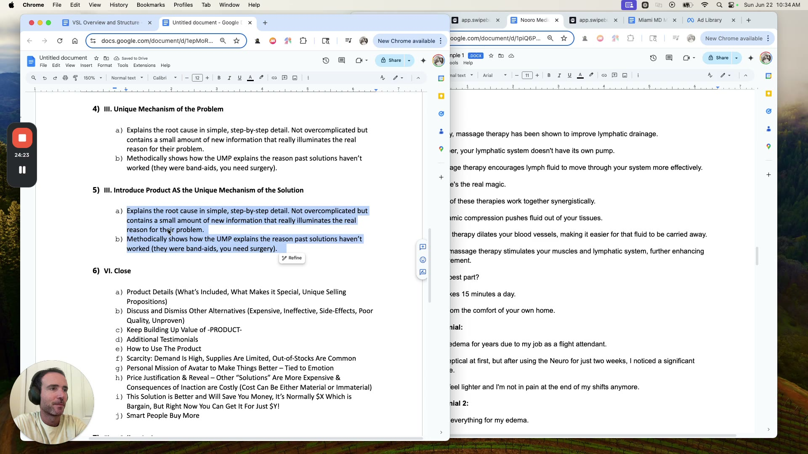
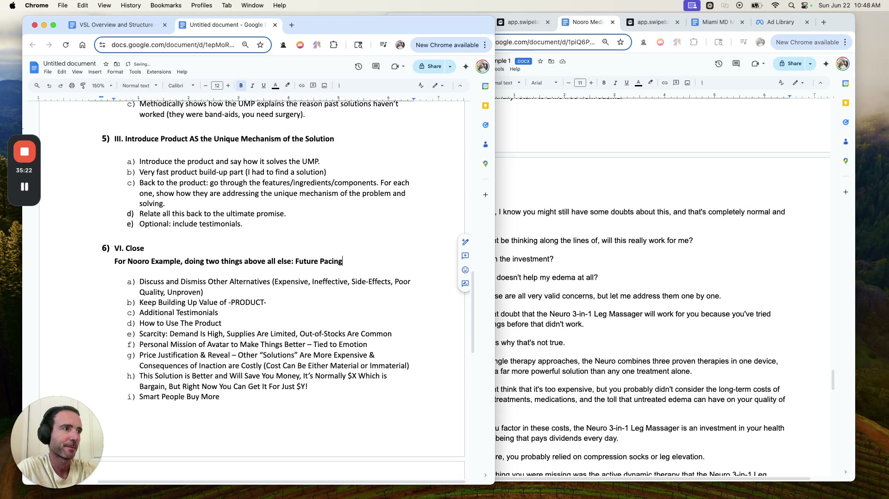
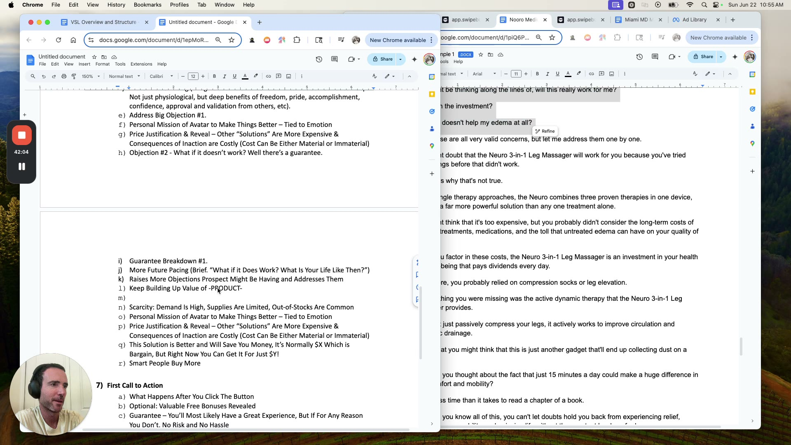
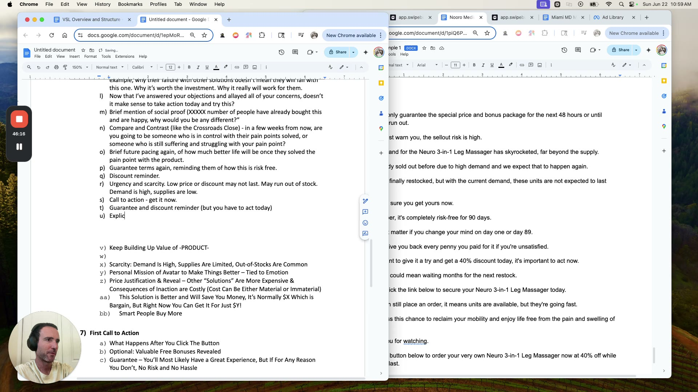
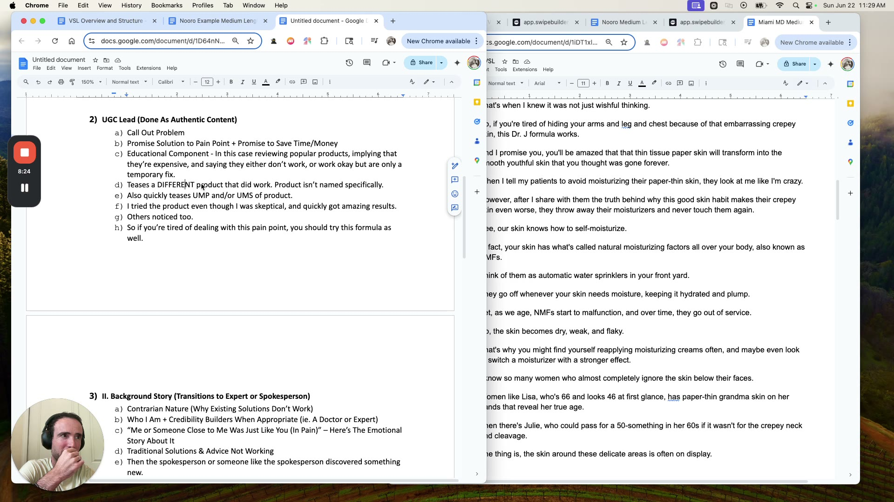
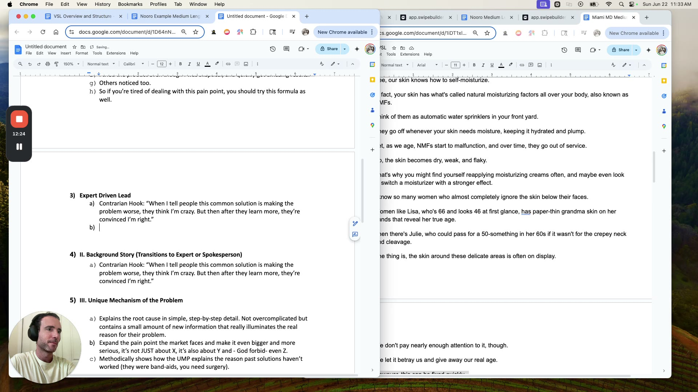
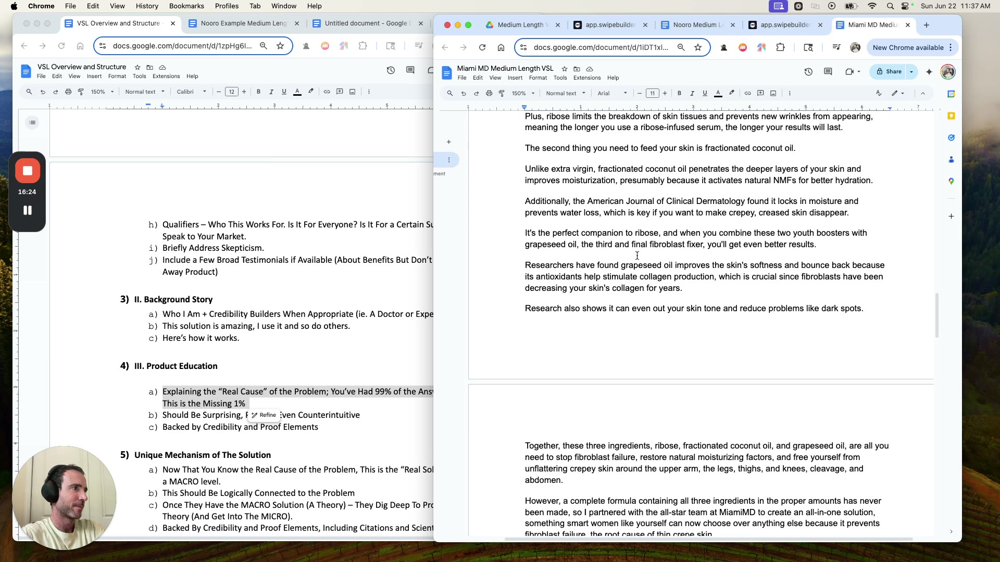
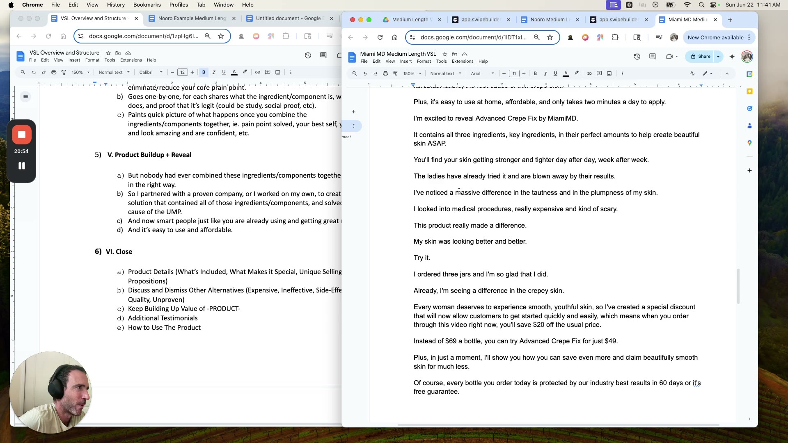
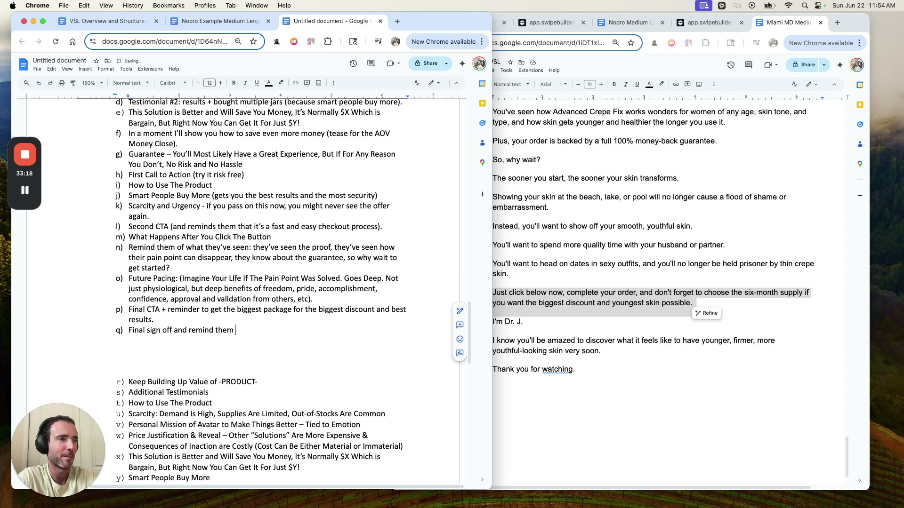

# 4.8 Medium VSLs (Structures and Examples)
> Two 10-15 minute in-feed VSLs (Nooro's edema leg massager and MiamiMD's crepey-skin serum) are broken down against the classic VSL outline, showing which beats a medium VSL keeps, shrinks, merges or drops, and which opening and close moves carry the conversion.

## 🤖 Agent use
- **Use when:** outlining or drafting an 8-20 minute VSL (the kind that runs as a Meta in-feed ad), auditing a medium script against the classic beats, or deciding what to cut from a long VSL structure without breaking the "straight line" to the sale.
- **Inputs → outputs:** product, pain point, root-cause mechanism (UMP) and solution mechanism (UMS), spokesperson or expert, offer, guarantee, real proof → a medium-VSL outline in the adapted shape below (compressed lead, short background, UMP, product introduced as the UMS, future-pacing-and-objection close), plus a list of beats deliberately dropped.
- **Rules:**
  - **DO** treat "medium" as 8-15 minutes, "maybe at most 20": "typically like eight to 15 maybe at most 20 minutes." [v2 02:03] Keep the classic structure and shrink it: "the big difference is it's just going to be shorter… maybe your background credibility section is just a single sentence long." [v1 01:33]
  - **DO** expect elements to be "missing… or they go really fast or… just a single line or a couple of lines." [v2 01:32] The outline is a menu, not a checklist: "Support points - you don't necessarily have to use everything." [on-screen text, v2 07:24 frame]
  - **DO** open with education or UGC-style content rather than a sales pitch. "A lot of the short and medium length VSLs… are sort of educational… you're kind of consuming content." [v2 06:27] Leads in 2025 "are just UGC style, testimonial, like things." [v3 03:15] The reason: the format is "native to the person's experience" on Meta. [v3 35:26]
  - **DO** write the hook so one line does three jobs: pain point, promise, attention. "15 minutes at home, edema relief… edema is the pain point, relief is the promise." [v2 04:49]
  - **DO** keep re-tying the story back to the payoff while you teach: "it's a big mistake and a really common mistake… they forget to stop and tie it back into… the reason you're watching this is because I'm going to be showing you a breakthrough solution." [v2 12:46]
  - **DO** make the mechanism simple and step by step, with "a small amount of new information that really illuminates the real reason for the problem", then show why past solutions were band-aids ("you need surgery"). [v2 18:08; 19:28; frame 24:24]
  - **DO** (Nooro pattern) introduce the product *as* the mechanism of the solution, with a very fast "I had to find a solution" build-up, then walk each feature back to the UMP. [v2 19:55; 24:21]
  - **DO** (MiamiMD pattern) teach the components first as "product education" (each with what it is, what it does and proof), then reveal that nobody had combined them, then name the product. [v3 15:49; 19:10]
  - **DO** make the close mostly future pacing plus objection handling: "they basically are doing two things above all else… future pacing… and addressing objections." [v2 35:26] Paint it deep: "freedom, pride, accomplishment, confidence, approval and validation from others." [v2 37:55]
  - **DO** end with the AOV close when you sell multiples: a bigger discount for more units, framed "smart people buy more". [v3 29:46; 30:22]
  - **DON'T** assume you need a new mechanism when results fatigue: "it's rarely the mechanism that needs to be changed. It's usually just more hooks, more video ads, new angles." [v2 17:41] (instructor claim, from "many brands I've worked with doing eight and nine figures")
  - **DON'T** run horror-story leads for compliant, brand-building consumer products: "you're typically not doing those crazy horror stories anymore… usually not a good idea." [v2 13:54]
  - **DON'T** swap an opening and forget the downstream terms. MiamiMD's expert section says "stop fibroblast failure" although "they didn't talk about fibroblast failure" earlier. [v3 14:08] Re-check term continuity after any hook test.
  - **IF** you run a long in-feed or on-page script **THEN** test an FAQ block. A CA Pro member added one to a 23-minute VSL and conversion "improve[d]… by about 10%" (instructor claim, second-hand). Most in-feed VSLs skip it. [v3 33:46]
  - **IF** a script contains health, anti-aging or "reverse" claims, scarcity timers, "sold out before" statements or doctor/press credentials **THEN** copy the beat, never the claim; substantiate or replace with our own verified facts (see Compliance flags below).
- **See also:** [04.02 VSL fundamentals and classic structure](04-02-vsl-fundamentals-classic-structure.md) (the shared outline and the Nooro in-feed scripts, not re-quoted here) · [04.03 VSL leads](04-03-vsl-leads-after-the-opening-hook.md) · [04.04 background stories and unique mechanisms](04-04-vsl-background-stories-and-unique-mechanisms.md) · [04.05 product build-up and reveal](04-05-vsl-product-buildup-and-reveal.md) · [04.06 VSL closes](04-06-vsl-closes.md) · [04.09 short VSLs](04-09-short-vsls-structures-and-examples.md) · [04.11 VSLs on landing pages vs in-feed](04-11-vsls-on-landing-pages-vs-vsls-as-in-feed-ads.md) · [07.02 medium length VSL (Claude project)](07-02-medium-length-vsl.md) · [Evolve: unique mechanism](../../../evolve/copywriting/concepts/unique-mechanism.md) · [Evolve: objection handling](../../../evolve/copywriting/concepts/objection-handling.md)

## Key ideas

### 1. Opening video: medium VSLs follow the classic structure, only shorter [v1 00:00–02:31]
- Scope of the section: two medium VSLs "between 10 to 15 minutes": a Nooro ad (not the one broken down in the previous VSL section) and one from MiamiMD. [v1 00:29]
- Why he can't show more: "most of them are in [CA Pro], my mastermind, so I can't… share their stuff." Many people "doing really well with medium length VSLs" are in that mastermind. [v1 00:29]. In v2 he repeats this: "I know a bunch of brands doing eight figures with a lot of this style, but the vast majority are then CA Pro, so I can't share their copy." [v2 03:08] (instructor claim)
- Warning not to be confused: "the outlines or structures may vary. There'll be some of the elements that are from this… classic overview… but they also will be different." In the Nooro script "the close is sort of different… the product gets introduced as the mechanism of the solution." [v1 01:03]
- Core rule: "with a medium length VSL, you can still mostly follow the structure." The difference is time: background credibility "a single sentence"; an emotional story "a couple sentences". [v1 01:33–01:59]
- He promises an additional example for the Unity eye serum (the transcript writes "UDI serum"; the caption file has "UDI" too, so this is our reading from other lessons: see [07.02](07-02-medium-length-vsl.md)). Short VSLs get their own section. [v1 01:59–02:28]
- The structure reference for this section is the "Classic VSL Overview and Structure" doc (same eight-part outline as in [04.01](04-01-vsls-section-overview.md) and [04.02](04-02-vsl-fundamentals-classic-structure.md); "Very Simple Sales Letter Outline: Hook/Microlead, Lead, Background, Discovery, UMP/UMS, Product Build-Up and Reveal, Close, FAQ") [08-71 REFERENCE doc]. The doc's detailed outline has 10 numbered blocks: Pre-Lead/MicroLead, Lead (ten support points a-j), Background Story, Unique Mechanism of the Problem, Unique Mechanism of the Solution, Product Buildup + Reveal, Close (ten support points a-j, ending "Smart People Buy More"), First/Second/Third Call to Action, FAQs. Use it as the menu he edits live in v2 and v3.

### 2. What counts as a medium VSL, and where it runs [v2 01:32–03:34; v3 34:18–35:57]
- Definition: "eight to 15 maybe at most 20 minutes" (he says he may have defined it before and there may be overlap). [v2 02:03]
- The Nooro ad is "an ad I just took from today, like in June of 2025" (the screen clock reads Sun Jun 22; derived). Parts "are actually honestly the same as what they had before", i.e. the same mechanism as the earlier Nooro scripts. [v2 01:32]
- Nooro "tests tons of different" hooks and video ads, much like Golden-Hippo-style testing in [04.02](04-02-vsl-fundamentals-classic-structure.md); the library shows long and short cuts. He is "surprised I don't have more ads coming out" and adds he doesn't know how they are doing now (they "did really well for a while"; "copy still tends to be good"). [v2 05:29–06:00]
- Where medium VSLs run: "most of the time… they're running on Meta." People "used to run them on YouTube more but nowadays it's hard to run long full VSLs on YouTube." [v3 34:18–34:50]
- Why education and UGC leads: people on Facebook "get news from social media now… watching influencers and content from people they like. And so the style and the leads… whether it's educational or UGC stuff… it's native to the person's experience." He calls burying this at the end of the video annoying and promises to repeat it in the platform-journey material. [v3 34:50–35:57] Related shared page: [Native advertising](../../../../concepts/native-advertising.md).


*Setup for the Nooro breakdown [v2 13:54 frame]: the classic outline (left) is edited live in a new doc, the Nooro script is in a second window. The lead block is already cut to four items: Call Out Problem, Promise Solution, Educational Component, Contrarian Nature (Why Existing Solutions Don't Work).*

### 3. Nooro, hook and "lead": three facts, compressed to four jobs [v2 03:34–09:38]
- Hook: "Just 15 minutes at-home edema relief." It is a one-line hook that "does all three" of the micro-lead jobs (attention, pain point, promise). [v2 04:49] The ad is 15:51 long on the ad-library screen (frame at [v1 00:42]).
- "Three facts about edema in under 30 seconds. Let's go." is "more part of like the hook, you know, educational." [v2 06:00]
- Mapping the three facts to the classic lead list (10 support points) [v2 07:00–09:01]:
  - Call out problem: yes, via the word "edema".
  - Promise solution + save time/money: yes. "There's now a way to relieve edema, pain, and swelling from the comfort of your couch" implies saving time and money because it is at home.
  - Tease emotional discovery story: no. "I think a lot of VSLs these days really don't use these emotional discovery stories that often… usually a lot more brief." [v2 08:28]
  - Tease the unique mechanism: not really. It teases "a solution more than… a mechanism behind the solution".
  - Tease the contrarian nature: yes, "kind of": "moving less actually makes edema worse"; compression socks "might only be delaying the pain" ("hitting snooze").
  - Fascinations, credibility builders, qualifiers, skepticism, testimonials: not in the lead.
- His summary of the compressed lead: "pretty fast of promising, and not even in this order… call out the problem, promising a solution. It's kind of education, it's contrarian." [v2 09:01–09:38] His rewritten four-item lead: Call Out Problem / Promise Solution + Promise to Save Time/Money / Educational Component / Contrarian Nature (Why Existing Solutions Don't Work) [frame 10:48 and 13:54].

### 4. Nooro, background story: shrunk to a story, an expert and a teased payoff [v2 10:39–14:25]
- Classic background list: who I am, "me or someone close to me was just like you", traditional solutions failing, trigger event, search for truth, find the mechanism. [v2 10:39]
- What Nooro does: "Hi, I'm Dr. Jeremy Campbell" (credibility builder, one line); "You may call me crazy, but your body actually has the ability to relieve edema" (contrarian); a short story of a patient called Sarah who tried "compression socks, endless leg exercises, even fancy creams… but nothing worked" until "our breakthrough approach"; "her situation wasn't any different from yours." [v2 10:39–11:09; Nooro doc]
- His read: it is a "story about it… not like super, super, super emotional"; existing solutions failed (kept); trigger event: no; search for truth: no, because "the spokesperson… discovered something new". [v2 11:39–12:09]
- **Added beat he inserts into the outline:** "Continuing to tease the solution and how it will solve their pain point. Important, remind them WHY they're watching and what the payoff will be." [v2 12:46; on-screen text, frame 13:54] He says missing this is "typically a mistake" in all VSLs.
- Education as a hook is the current default for "more branded white hat" consumer products; "people trying to do [horror stories] typically are stuck from a few years ago." [v2 13:54] (instructor opinion; "exceptions to everything in copy")

### 5. Nooro, mechanism of the problem: simple, step-by-step, "band-aids" [v2 14:25–19:55]
- Mechanism (from the Nooro doc): veins rely on the calf (muscle) pump; inactivity weakens it; fluid pools; the lymphatic system also lacks a pump, so fluid builds up; "it can even affect your heart and lungs." Then the "traditional solutions" are dismissed one by one: compression socks, leg elevation, diuretics, exercise. [Nooro doc; v2 14:25–16:42]
- He rewrites the outline lines for the UMP: "Explains the root cause in simple, step-by-step detail. Not overcomplicated but contains a small amount of new information that really illuminates the real reason for their problem." and "Methodically shows how the UMP explains the reason past solutions haven't worked (they were band-aids, you need surgery)." [v2 18:08–19:28; frame 24:24]
- His note on the classic rule "should be surprising, counterintuitive": "I don't know if it's surprising or not, but it's credible." [v2 18:08] Whisper rendered "band-aids" as "banned aids"; fixed from the on-screen doc text.
- Added after the fact (he forgot, then went back to add it): expand the problem so it is "not just about swollen ankles… here's a bunch of other scary stuff": "Expand the pain point the market faces and make it even bigger and more serious, it's not JUST about X, it's also about Y and - God forbid - even Z." [v2 26:37–27:48; frame 47:19] Nooro does this with "painful, achy legs, difficulty moving around, tight, shiny skin that may even leak fluid… even affect your heart and lungs." (flag for substantiation, see Compliance flags)
- **Mechanism longevity (insight):** "Nuro has basically used this same mechanism for quite a while now." When brands think the offer is "fatiguing," the fix is "more hooks, more video ads, new angles", not a new mechanism; "if you have a good mechanism, it can last you for a really long time." [v2 17:12–18:08] This is a stance from his client observation, not a tested rule. Compare the Evolve [unique mechanism concept](../../../evolve/copywriting/concepts/unique-mechanism.md), which advises leading with a new mechanism at higher sophistication/awareness stages (see the reconciliation note in [03.02](03-02-ump-ideation-with-llms.md)); the two are not a direct conflict because Stefan is talking about fatigue inside one market, not a new market stage.


*The new section title he writes when the product replaces the usual UMS [v2 24:24 frame]: "III. Introduce Product AS the Unique Mechanism of the Solution". The UMP block above it is the two-line "simple root cause" + "band-aids vs surgery" version.*

### 6. Nooro, product as mechanism of the solution [v2 19:55–26:37]
- The classic outline separates UMS from product build-up. Here "the UMS is sort of going to be the same as the product build-up and reveal… in this case, they're introducing Nooro first." [v2 19:55]
- Script beats: "Well, it's simple. Use the Nooro 3-in-1 Leg Massager for just 15 minutes a day… compression therapy, heat therapy, and vibration therapy"; "Remember how I said you need to move regularly" (calf-pump callback); a one-sentence discovery ("I had to find a breakthrough solution… After partnering up with a biotech startup called [Nooro], who have already helped over 300,000 people, together we created…"); then each of the three therapies explained, "work together synergistically", "only takes 15 minutes a day"; three short testimonials. [Nooro doc; v2 19:55–23:36]
- His adapted outline for this section [on-screen text, frame 24:24 / 47:19; verbal 24:21–25:45]:
  1. Introduce the product and say how it solves the UMP.
  2. Very fast product build-up part ("I had to find a solution").
  3. Back to the product: go through the features/ingredients/components. For each one, show how they are addressing the unique mechanism of the problem and solving.
  4. Relate all this back to the ultimate promise.
  5. Optional: include testimonials.
- "This whole structure does still work for a medium VSL… but it's not always used." [v2 23:36]
- Observed devices (derived): one concrete analogy per mechanism ("hitting snooze", "shaking up a bottle of salad dressing"); the contrast word "dynamic" vs static compression socks.

### 7. Nooro, close: future pacing + objections, then a "crossroads" [v2 27:48–46:48]
- Close ordering he derives from the script, in his words: "They basically are doing two things above all else… Future pacing, like imagine life if the pain point was solved and then… addressing objections." The future pacing is "pretty hardcore", and "a commonality in really high converting copy a lot of days is really painting a picture of life with it." [v2 35:26]
- Script examples of future pacing: "easily slipping on your favorite shoes", "a walk in the park", "a night out with friends or family", "looking down at your ankles and seeing definition, not puffiness", "looking your loved ones in the eyes, saying you finally did it. Your edema is gone." [Nooro doc; v2 36:13–37:19]
- Objection handling is woven in, not a separate FAQ: "what if I'm not tech savvy" (how to use: wrap sleeves, one button, three intensity levels), "what if it won't fit my calves" (four free Velcro straps). [v2 36:44–38:49]
- Price and personal mission: official price stated first ($249.95 per pair), then a 40% discount for viewers; "my office is based in Chicago… a very limited amount of patients… with this device I can bring this expertise to anyone's home." Stefan labels it personal mission. [v2 38:49; Nooro doc]
- Guarantee (90-day, "no questions asked") then a second pass of doubts, "Will this really work for me? Is it worth the investment? What if it doesn't help?", each answered ("combines three proven therapies", "long-term costs of ongoing treatments", "just 15 minutes… less time than it takes to read a chapter of a book"). He labels it "almost like an FAQ section" inside the close. [v2 30:10–31:47; 40:30–42:08]
- Then: "Now that I've cleared your objections… doesn't it make sense to take action today?", a brief social-proof line ("thousands… already bought this and are happy, why would you be any different?"), and a **crossroads/compare-and-contrast**: "Are you going to take control of your edema or are you going to let it control you?… wake up two weeks from now… closer to relief or… the same swollen painful legs?" [v2 43:32–44:58; Nooro doc]
- Final stack: brief future pacing, guarantee terms again, discount reminder, scarcity ("48 hours or until supplies run out"; "sold out before"), call to action, "guarantee and discount reminder (but you have to act today)", explicit command, last urgency reminder, thanks for watching. [v2 44:58–46:48; frames 46:19]
- No FAQ section and no additional testimonials in the close: "there's not an FAQ here… It could be optional." Testimonials sit in the product section, so he deletes that line from the close list. [v2 36:44; 46:48]


*The close rebuilt around future pacing [v2 35:25 frame]. The heading he types: "For Nooro Example, doing two things above all else: Future Pacing" (then "and addressing objections").*


*Guarantee, "what is your life like then" and the "now that I've cleared your objections" bridge [v2 42:07 frame].*


*The final stack of the Nooro close: crossroads, repeated guarantee and discount, urgency, CTA [v2 46:19 frame].*

### 8. MiamiMD, the ad format: UGC "get ready with me" lead, then an expert VSL [v3 00:00–04:14]
- About 11 minutes versus ~15 for Nooro. [v3 00:00] The first ~3 minutes of the video are the ad playing (not transcribed; it plays from the start of the video before he comments at 03:05).
- His read of the opening: "very good ad… she's relatable, that southern voice seems really authentic"; "a lot of leads these days, even in long form stuff, are just UGC style, testimonial… a get-ready-with-me type of style, with the girl doing her makeup… in front of the mirror and talking with B-roll edited in." He says this "shows the sophistication of where we're at with VSLs in general in 2025 and moving on into 2026." [v3 03:15–03:44]
- Hook: "Don't waste your money trying to fix crepey skin until you see this", "real fast, simple, direct". Then a question: "Does anything really work to reverse thin crepey skin?… I needed to find out for myself. So I tested all three products for 30 days straight, so you don't have to waste your time and money on things that don't deliver." [v3 03:44–04:14; MiamiMD doc]
- Mapping to the lead list: calls out the problem (yes), promises a solution ("sort of": "it kind of implies that something will deliver"), educational component ("a UGC lead done as authentic content… reviewing popular products"). Contrarian nature "is sort of more reserved for the background story." [v3 04:14–05:45]

### 9. MiamiMD, the UGC lead as a review ladder that teases the real product [v3 05:45–08:36]
- The story as written: January, a high-end retinol body lotion with "beauty editors buzzing", "almost no improvement"; February, a "$65" TikTok-viral serum, "temporarily moisturizing, but completely ineffective for actual crepey skin"; March, "Dr. J's formula", which "doesn't just hydrate the surface. It actually helps restore the skin density and elasticity from within"; skeptical but "by day seven" the chest looked smoother; by day 30 a best friend asks "what did you do to your skin?" [MiamiMD doc; v3 05:45–07:19]
- Stefan's labels: reviews popular, expensive products "saying they either don't work or work okay but are only a temporary fix" → "teases a different product that did work. Product isn't named" → "quickly teases UMP and/or UMS" → skeptical-but-tried → "others noticed too" → "so if you're tired of dealing with this pain point, you should try this formula as well." [v3 05:45–07:19; frame 08:24]
- Whisper fix: his line is "I tried the product even though I was skeptical" (the transcript says "my son tried"); confirmed by the on-screen text. [v3 06:32 vs frame 08:24]
- The lead ends by handing off to the expert, which is itself "product build and reveal" in miniature. [v3 07:19]


*The MiamiMD lead outline as he writes it [v3 08:24 frame]: call out problem, promise solution, review of popular products, tease a DIFFERENT product (unnamed), tease UMP/UMS, "I tried the product even though I was skeptical", others noticed, "you should try this formula as well".*

### 10. MiamiMD, expert-driven second lead + contrarian hook [v3 08:02–13:33]
- Transition: "When I tell my patients to avoid moisturizing their paper-thin skin, they look at me like I'm crazy. However, after I share… the truth behind why this good skin habit makes their crepey skin even worse, they throw away their moisturizers." He reads it as the product "[coming] from expert spokesperson who will be introduced later"; "we don't have a really direct credibility builder here because… she's a doctor, sort of implicit." [v3 08:02–08:36]
- His template for it: **Contrarian Hook: "When I tell people this common solution is making the problem worse, they think I'm crazy. But then after they learn more, they're convinced I'm right."** [on-screen text, frame 12:24; v3 08:36–09:22]
- He initially calls the section a UGC lead, then corrects himself: "I guess I'm actually totally wrong on this… I would sort of do like [an] expert driven lead." [v3 11:26] So the ad has two leads in sequence: UGC-style review, then expert-driven contrarian.
- The UMP flows straight out of the contrarian hook. "Our skin knows how to self-moisturize… natural moisturizing factors (NMFs)… automatic water sprinklers in your front yard… as we age, NMFs start to malfunction." Two named women ("Lisa, who's 66… Then there's Julie") dimensionalize the pain; "the skin around these delicate areas is often on display." [MiamiMD doc; v3 10:29–11:26] (Lisa and Julie appear in the script as illustrative people; treat as devices, not proof.)
- Stefan's note: "UMP in the lead… opens up pain points more": the lead lists several places/symptoms to broaden who recognizes themselves. [v3 12:19–13:33]
- Sacrifice rule: "you're kind of always needing to sacrifice something… you have all the elements, but they're like just one or two sentences, but sometimes you're sacrificing something." [v3 09:22]
- Swipe stance: "if your goal is to swipe something… so much of it is swiping or modeling off what already works to get a draft one or a version one." This is the bridge to the AI copy process in later modules. [v3 09:51]


*"3) Expert Driven Lead / a) Contrarian Hook" and the shortened UMP block [v3 12:24 frame].*

### 11. MiamiMD, mismatch after a hook test, "product education" before the product [v3 13:33–19:54]
- Expert intro: "Hi, I'm Dr. Manjula Jagasothi, better known as Dr. J to my patients. You may have seen my skincare tips online in magazines like Allure, Cosmopolitan, or Bazaar. I use this solution myself" (spelling from the script doc; press names are the ad's claims). [MiamiMD doc; v3 13:33]
- Observed seam: "here are the three things you need to feed your skin to stop fibroblast failure. Now, you might notice this is disconnected from everything above because they didn't talk about fibroblast failure." His explanation: "they're trying to test a new hook… but they're keeping the rest of the VSL before, which was when they talked about fibroblast failure." Better, he says, to tie the term back to the mechanism above ("repair your natural moisturizing factors… eliminate crepey skin"). Many viewers are "educated consumers" who may know what fibroblasts are, referencing awareness levels. [v3 14:08–15:13] (A concrete lesson for hook testing: swap openings but re-run the mechanism language. See [Market awareness](../../../evolve/copywriting/concepts/market-awareness.md).)
- Beat he labels "product education": three components ("a healthy dose of sugar… ribose", fractionated coconut oil, grapeseed oil), each with a cited study or finding, then "together, these three ingredients… are all you need to stop fibroblast failure." [v3 15:49–16:36; MiamiMD doc]
- Adapted outline (on-screen text): "Product Education: a) Here are the three ingredients/components you need to fix the UMP and eliminate/reduce your core pain point. b) Goes one-by-one, for each shares what the ingredient/component is, what it does, and proof that it's legit (could be study, social proof, etc). c) Paints quick picture of what happens once you combine the ingredients/components together, ie. pain point solved, your best self, you feel and look amazing and are confident, etc." [frame 16:24 / 18:48; v3 16:36–18:34] He adds: for biz-opp style offers "you wouldn't be sharing a study, but you could share social proof." [v3 17:56]
- Product build-up (very short): "But nobody had ever combined these ingredients/components together before in the right way. So I partnered with a proven company, or I worked on my own, to create a solution that contained all of those ingredients… and solved the root cause of the UMP. And now smart people just like you are already using it and getting great results. And it's easy to use and affordable." [on-screen text, frame 20:54; v3 19:06–19:54] Script: "a complete formula containing all three ingredients in the proper amounts has never been made, so I partnered with the all-star team at MiamiMD."


*MiamiMD "Product Education" block [v3 16:24 / 18:48 frames]. The script doc is open on the right at the three-ingredient section; in the outline he keeps the original UMS block below for reference.*

### 12. MiamiMD, close: testimonials with jobs, AOV close, two CTAs, scarcity as "you may never see this again" [v3 20:35–33:46]
- Product reveal line is "I'm really excited to reveal Advanced Crepe Fix by MiamiMD." Then "It contains all three… key ingredients… in their perfect amounts", "you'll find your skin getting stronger and tighter day after day, week after week" (future pacing), and two testimonials. [v3 20:35–21:05; MiamiMD doc]
- Each testimonial gets a function: "Testimonial #1: results + dismisses another alternative" (the "medical procedures… expensive and kind of scary" line); "Testimonial #2: results + bought multiple jars (because smart people buy more)." [v3 26:44–27:45; frame 29:24]
- Offer shape: "Instead of $69 a bottle, you can try Advanced Crepe Fix for just $49… Plus, in just a moment, I'll show you how you can save even more": the "instead of X, it's Y" line plus a tease for the AOV money close. [v3 28:35–29:19]
- Guarantee comes right before the first CTA: "protected by our industry best results in 60 days or it's free guarantee… if you don't love it, then simply let us know and you'll pay nothing." [v3 22:14; 29:19]
- AOV close: a regular $69 per bottle, $49 single, $43 per bottle for three months ("save over 38%"), $40 each for six months ("save $29 per bottle… the deepest discount we've ever offered"). "Smart people buy more… the best results and the most security." [v3 22:44–23:13; 30:22] (Derived arithmetic: $69 to $43 is a 37.7% saving, so the script's "over 38%" is slightly off; check discount math before reuse.)
- Urgency without a clock: "If you scroll past this video, you may never see this incredible offer again." Stefan: "Scroll by, you might miss this offer, say goodbye to good skin forever." [v3 23:13; 30:22–31:10]
- Second CTA reminds them it's "fast and easy checkout" and what happens after the click (supply "on your doorstep in two to five days"), then recap of proof/guarantee ("So why wait?"), future pacing ("Showing your skin at the beach, lake, or pool will no longer cause a flood of shame…", "head on dates in sexy outfits"), final CTA "don't forget to choose the six-month supply", sign-off. [v3 23:43–24:40; 31:10–33:06]
- "This one does have more of the classic close elements than what we had before": product details, dismissing alternatives, additional testimonials, how to use, urgency, price reveal, AOV close, three CTAs. [v3 24:40–25:11]


*Build-up and the start of the close, before he rewrites it [v3 20:54 frame].*


*The finished MiamiMD close outline [v3 33:18 frame]: two testimonial jobs, "instead of X it's Y", AOV tease, guarantee, CTA 1 (try it risk free), how to use, "smart people buy more", scarcity/urgency, CTA 2, "remind them of what they've seen", future pacing, final CTA, sign-off.*

### 13. FAQs, platform reality and the closing note [v3 33:06–35:57]
- Neither script has FAQs. Stefan: "Definitely can. I would probably be testing that." One CA Pro member "on a 23-minute VSL just add[ed] FAQs and they improve conversion rates by about 10%. So I really think they're worthwhile. Most people don't do them in infeed VSLs." [v3 33:46] (second-hand instructor claim)
- "A lot of the elements still remain, but it's different." Short VSLs, "tons of ads, hooks", and the AI copy-generation sections come later in the course. [v3 34:18; 35:57]

## Steps / framework

### Medium VSL = classic outline, compressed (derived from his two rewrites)
| Classic beat | Medium-VSL treatment | Nooro | MiamiMD |
|---|---|---|---|
| Hook / micro-lead | One line, pain + promise + attention. Education or UGC framing. | "Just 15 minutes at-home edema relief." + "Three facts about edema in under 30 seconds." | "Don't waste your money trying to fix crepey skin until you see this." |
| Lead (10 support points) | Keep 3-4: call out problem, promise solution, educational component, contrarian nature. Drop fascinations, qualifiers, testimonials. | Three facts: socks only delay; moving less makes it worse; couch solution | First-person 30-day test of three products (UGC "get ready with me" style) |
| Background | Credibility in one line, mini story, "traditional solutions failed", spokesperson "discovered something new", **tease the payoff again**. Skip trigger event / search for truth. | "Hi, I'm Dr. Jeremy Campbell… Sarah…" | Teased "Dr. J" in the lead; then expert contrarian hook + credentials ("I use this solution myself") |
| UMP | Root cause, simple, step by step, one small new fact; show past solutions are band-aids; expand the pain point. | Calf pump + lymphatic system, then socks/elevation/diuretics/exercise dismissed | NMFs "malfunction"; moisturizing makes it worse; fibroblast failure |
| UMS | Merged with product reveal, or turned into "product education". | Product introduced as the mechanism (compression + heat + vibration), each feature tied to UMP | Three components with proof, then "nobody had combined them" |
| Product build-up + reveal | A few sentences: "I had to find a solution" / "I partnered with…" | One-line partnership claim | "all-star team at MiamiMD" |
| Close | Product details, how to use, future pacing (deep), objection handling, price reveal, guarantee, scarcity, CTAs. | Future pacing x4, objections, crossroads, 48h + sellout | Testimonials with jobs, AOV close, two CTAs, "may never see this again" |
| FAQ | Optional; test it. | none | none |

### Adapted outline as on-screen text (Nooro, assembled from frames 10:48-47:19; "..." = text cut off or not captured)
```
1) Pre-Lead / MicroLead: hook-heavy opening line; quickly related to the pain point; quickly related to the promise.
2) Lead (don't have to be in order):
   a) Call Out Problem
   b) Promise Solution to Pain Point + Promise to Save Time/Money
   c) Educational Component
   d) Contrarian Nature (Why Existing Solutions Don't Work)
3) II. Background Story
   a) Who I Am + Credibility Builders When Appropriate (ie. A Doctor or Expert)
   b) "Me or Someone Close to Me Was Just Like You (In Pain)" - Here's The Emotional Story About It
   c) Traditional Solutions & Advice Not Working
   d) Then the spokesperson or someone like the spokesperson discovered something new.
   e) Continuing to tease the solution and how it will solve their pain point. Important, remind them WHY they're watching and what the payoff will be.
4) III. Unique Mechanism of the Problem
   a) Explains the root cause in simple, step-by-step detail. Not overcomplicated but contains a small amount of new information that really illuminates the real reason for their problem.
   b) Expand the pain point the market faces and make it even bigger and more serious, it's not JUST about X, it's also about Y and - God forbid - even Z.
   c) Methodically shows how the UMP explains the reason past solutions haven't worked (they were band-aids, you need surgery).
5) III. Introduce Product AS the Unique Mechanism of the Solution
   a) Introduce the product and say how it solves the UMP.
   b) Very fast product build-up part (I had to find a solution)
   c) Back to the product: go through the features/ingredients/components. For each one, show how they are addressing the unique mechanism of the problem and solving.
   d) Relate all this back to the ultimate promise.
   e) Optional: include testimonials.
6) VI. Close - For Nooro Example, doing two things above all else: Future Pacing [and addressing objections]
   a) Future Pacing (Imagine Your Life If The Pain Point Was Solved. Goes Deep. Not just physiological, but deep benefits of freedom, pride, accomplishment, confidence, approval and validation from others, etc).
   b) Address Big Objection #1.
   c) How to Use The Product
   d) More Future Pacing (same wording as a)
   e) Address Big Objection #1.   [as typed]
   f) Personal Mission of Avatar to Make Things Better - Tied to Emotion
   g) Price Justification & Reveal - Other "Solutions" Are More Expensive & Consequences of Inaction are Costly (Cost Can Be Either Material or Immaterial)
   h) Objection #2 - What if it doesn't work? Well there's a guarantee.
   i) Guarantee Breakdown #1.
   j) More Future Pacing (Brief. "What if it Does Work? What Is Your Life Like Then?")
   k) Raises More Objections Prospect Might Be Having and Addresses Them. For example, why their failure with other solutions doesn't mean they will fail with this one. Why it's worth the investment. Why it really will work for them.
   l) Now that I've answered your objections and allayed all of your concerns, doesn't it make sense to take action today and try this?
   m) Brief mention of social proof (XXXXX number of people have already bought this and are happy, why would you be any different?")
   n) Compare and Contrast (like the Crossroads Close) - in a few weeks from now, are you going to be someone who is in control with their pain points solved, or someone who is still suffering and struggling with your pain point?
   o) Brief future pacing again, of how much better life will be once they solved the pain point with the product.
   p) Guarantee terms again, reminding them of how this is risk free.
   q) Discount reminder.
   r) Urgency and scarcity. Low price or discount may not last. May run out of stock. Demand is high, supplies are low.
   s) Call to action - get it now.
   t) Guarantee and discount reminder (but you have to act today)
   u) Explic[it command / the button now; last urgency reminder; thanks for watching - per v2 45:46]
7) First Call to Action ... (classic items kept below the edit)
```
(Typed lines come from frames at 13:54, 24:24, 35:25, 42:07, 46:19 and 47:19; the "Final CTA" and "no FAQ" are spoken at v2 46:48.)

### Adapted outline as on-screen text (MiamiMD, assembled from frames 08:24-33:18)
```
1) Pre-Lead / MicroLead (same as classic)
2) UGC Lead (Done As Authentic Content)
   a) Call Out Problem
   b) Promise Solution to Pain Point + Promise to Save Time/Money
   c) Educational Component - In this case reviewing popular products, implying that they're expensive, and saying they either don't work, or work okay but are only a temporary fix.
   d) Teases a DIFFERENT product that did work. Product isn't named specifically.
   e) Also quickly teases UMP and/or UMS of product.
   f) I tried the product even though I was skeptical, and quickly got amazing results.
   g) Others noticed too.
   h) So if you're tired of dealing with this pain point, you should try this formula as well.
3) Expert Driven Lead
   a) Contrarian Hook: "When I tell people this common solution is making the problem worse, they think I'm crazy. But then after they learn more, they're convinced I'm right."
4) II. Background Story (Transitions to Expert or Spokesperson)
   a) Who I Am + Credibility Builders When Appropriate (ie. A Doctor or Expert)
   b) This solution is amazing, I use it and so do others.
   c) Here's how it works.
5) III. Unique Mechanism of the Problem (same three-line version as Nooro, incl. "Expand the pain point")
6) III. Product Education
   a) Here are the three ingredients/components you need to fix the UMP and eliminate/reduce your core pain point.
   b) Goes one-by-one, for each shares what the ingredient/component is, what it does, and proof that it's legit (could be study, social proof, etc).
   c) Paints quick picture of what happens once you combine the ingredients/components together, ie. pain point solved, your best self, you feel and look amazing and are confident, etc.
7) V. Product Buildup + Reveal
   a) But nobody had ever combined these ingredients/components together before in the right way.
   b) So I partnered with a proven company, or I worked on my own, to create a solution that contained all of those ingredients/components, and solved the cause of the UMP.
   c) And now smart people just like you are already using it and getting great results.
   d) And it's easy to use and affordable.
8) VI. Close
   a) Product Details (What's Included, What Makes it Special, Unique Selling Propositions)
   b) Future pacing: you'll see the pain point resolving and your life getting better day-after-day and week-after-week.
   c) Testimonial #1: results + dismisses another alternative.
   d) Testimonial #2: results + bought multiple jars (because smart people buy more).
   e) This Solution is Better and Will Save You Money, It's Normally $X Which is Bargain, But Right Now You Can Get It For Just $Y!
   f) In a moment I'll show you how to save even more money (tease for the AOV Money Close).
   g) Guarantee - You'll Most Likely Have a Great Experience, But If For Any Reason You Don't, No Risk and No Hassle
   h) First Call to Action (try it risk free)
   i) How to Use The Product
   j) Smart People Buy More (gets you the best results and the most security)
   k) Scarcity and Urgency - if you pass on this now, you might never see the offer again.
   l) Second CTA (and reminds them that it's a fast and easy checkout process).
   m) What Happens After You Click The Button
   n) Remind them of what they've seen: they've seen the proof, they've seen how their pain point can disappear, they know about the guarantee, so why wait to get started?
   o) Future Pacing (Imagine Your Life If The Pain Point Was Solved. Goes Deep...)
   p) Final CTA + reminder to get the biggest package for the biggest discount and best results.
   q) Final sign off and remind them [of how they're about to enjoy a future without the pain point; spoken v3 33:06]
```
The lines in item 8 are from the frame at 29:24/33:18 (that frame also shows the unedited classic items repeated below the edit, which he deletes; the order of b-g follows the screen).

## Examples

### Example A: Nooro in-feed medium VSL (edema leg massager), "Medium Length VSL Example 1"
- Source: Nooro Medium Length VSL Example 1 doc (~3,000 words, a Swipebuilder transcript; the doc links a public swipe on Swipebuilder that requires an account, not included in the files).
- Spoken-beat order (our read, with his labels): hook line; "Three facts about edema in under 30 seconds" (misconception stack); doctor intro + contrarian claim ("You might call me crazy, but your body actually has the ability to relieve edema"); patient story "Sarah"; "root cause… your circulatory system" (calf pump, veins, lymphatic); consequences list; traditional solutions dismissed; "use the [Nooro] 3-in-1 Leg Massager for just 15 minutes a day"; one-line partnership/discovery; three therapies; three testimonials; future pacing; how to use; price + 40% off; personal mission (Chicago office); 90-day guarantee; "doubts" section answering three objections; crossroads questions; offer restatement with 48-hour and sellout scarcity; final CTA. [Nooro doc; v2 03:34–46:48]
- Brand spelling: the script and transcripts say "Neuro"; the docx file name, caption file and ad-library screen show "Nooro" (the speaker spells it out "O-O-R-O"). [v2 20:26]
- Different from the Nooro scripts in [04.01](04-01-vsls-section-overview.md) and [04.02](04-02-vsl-fundamentals-classic-structure.md): those use the calves-as-"second heart", NMES discovery and prototype story; this ad uses a heat/compression/vibration "3-in-1" mechanism and nearly no build-up. Same brand, same market, different mechanism framing, which shows tested variants of one offer. (derived)

### Example B: MiamiMD "Advanced Crepe Fix" medium VSL (crepey skin serum)
- Source: Miami MD Medium Length VSL doc (~1,850 words; Swipebuilder link requires an account; not included).
- Spoken-beat order: hook; 30-day 3-product test (UGC); contrarian expert hook; NMF "sprinkler" mechanism; Lisa/Julie pain pictures; "Hi, I'm Dr. Manjula Jagasothi"; "three things you need to feed your skin" (ribose, fractionated coconut oil, grapeseed oil, each with a study line); "nobody had combined them"; reveal "Advanced Crepe Fix by MiamiMD"; two testimonials; $20 off + AOV tease; 60-day guarantee; how to use; package discounts; "scroll past… may never see"; second CTA; recap; future pacing; sign-off. [MiamiMD doc; v3 03:44–33:46]
- Note on the mechanism terms: script uses both "natural moisturizing factors (NMFs)" (UMP) and "fibroblast failure" (a separate mechanism, taught after the product intro). Stefan flags the mismatch as test residue (see Key idea 11).

## Structured units

### Hooks
| Hook (verbatim or near) | Heuristic(s) | Emotion / zone | Self targeted | Why it works | Source |
|---|---|---|---|---|---|
| "Just 15 minutes at-home edema relief." | Specific time + ease (derived) | Relief / hope (derived) | Actual self (derived) | One line carrying pain point ("edema"), promise ("relief") and low effort ("15 minutes at-home") | [v2 04:49] |
| "Three facts about edema in under 30 seconds. Let's go." | Numbered facts; low time cost (derived) | Curiosity (derived) | not stated | Educational framing; "more part of like the hook" | [v2 06:00] |
| "If you're wearing compression socks or elevating your legs… these methods might only be delaying the pain and swelling. Just like hitting snooze on your morning alarm." | Contrarian; "what you're doing is wrong" (derived) | Doubt / alarm (derived) | Actual self | Counter-intuitive claim that doubles as the contrarian beat of the lead | [v2 07:28] |
| "Don't waste your money trying to fix crepey skin until you see this." | Loss aversion on spend (derived) | Caution (derived) | Actual self (derived) | "Real fast, simple, direct" call-out + curiosity gap | [v3 03:44] |
| "Does anything really work to reverse thin crepe skin? Well, I needed to find out for myself. So I tested all three products for 30 days straight." | Self-experiment / "I did the testing" (derived) | Skeptical curiosity (derived) | Actual self | UGC-authentic review that sets up product-teasing | [v3 04:14] |
| "When I tell my patients to avoid moisturizing their paper-thin skin, they look at me like I'm crazy." | Expert contrarian claim | Surprise | Actual self | Moves from review to authority; the stated reason is revealed in the UMP | [v3 08:02] |

### Templates
| Template | Use for | Example fill | Source |
|---|---|---|---|
| "[Quick promise in N minutes]. [Number] facts about [problem] in under 30 seconds. Let's go." | Educational micro-lead for in-feed VSLs | "Just 15 minutes at-home edema relief. Three facts about edema in under 30 seconds." | [v2 06:00] |
| Contrarian Hook: "When I tell people [common solution] is making the problem worse, they think I'm crazy. But then after they learn more, they're convinced I'm right." | Expert/spokesperson transition into the UMP | "When I tell my patients to avoid moisturizing their paper-thin skin, they look at me like I'm crazy…" | [frame 12:24; v3 08:36] |
| UGC review lead: tried [popular product A] (expensive, little change) → [viral product B] (hydrates, temporary) → [named expert's formula] (different mechanism) | UGC-style lead that teases the real product | MiamiMD's January / February / March test | [frame 08:24; v3 05:45] |
| "Expand the pain point… it's not JUST about X, it's also about Y and - God forbid - even Z." | UMP escalation | Nooro: swelling, then painful legs, then skin leaks, then heart and lungs | [frame 47:19; v2 26:37] |
| "Introduce the product AS the unique mechanism of the solution" with "I had to find a solution" | Short build-up for devices | "After partnering up with a biotech startup called [Nooro]… we created…" | [frame 24:24; v2 19:55] |
| "Product education": [N components], each = what it is, what it does, proof | Ingredient or component products | ribose, fractionated coconut oil, grapeseed oil | [frame 16:24; v3 15:49] |
| "Now that I've answered your objections… doesn't it make sense to take action today and try this?" | Bridge from objection handling to the final push | Nooro close | [frame 42:07; v2 42:08] |
| Crossroads: "In a few weeks from now, are you going to be someone who [pain solved], or someone who is still suffering and struggling with [pain point]?" | Compare-and-contrast close | "Are you going to take control of your edema or let it control you?" | [frame 46:19; v2 44:09] |
| "Instead of $X, it's $Y. Plus, in just a moment, I'll show you how you can save even more." | Price reveal that teases the AOV close | "$69 → $49… save even more" | [v3 28:35] |
| "Smart people buy more" (bigger packs, bigger discount, "best results and the most security") | AOV close for repeat-use products | $43 (3-mo), $40 (6-mo) per bottle | [v3 30:22; MiamiMD doc] |
| "If you pass on this now, you might never see the offer again." | Non-timer urgency | "If you scroll past this video, you may never see this incredible offer again." | [frame 33:18; v3 31:10] |

### Ad teardowns
| Brand / product (niche) | Format | Hook / opening | What works | What fails | Fix suggested | Principle | Source |
|---|---|---|---|---|---|---|---|
| Nooro 3-in-1 Leg Massager (edema / leg swelling device) | ~15 min in-feed VSL, doctor spokesperson, Meta | "Just 15 minutes at-home edema relief. Three facts about edema in under 30 seconds." | Hook does three jobs; educational lead; calf-pump mechanism is "very simple to understand"; very hard future pacing; objections handled in the close; no horror story | He notes the lead lacks fascinations, qualifiers, skepticism handling and testimonials; he also adds "expand the pain point" and "keep teasing the solution" as missing beats | Insert beats: keep re-teasing the payoff after the story, add the "bigger and more serious" pain expansion | Medium VSL = classic outline compressed, close = future pacing + objections | [v2 04:49–46:48] |
| MiamiMD Advanced Crepe Fix (anti-aging / crepey skin serum) | ~11 min in-feed VSL; UGC "get ready with me" lead, then expert | "Don't waste your money trying to fix crepey skin until you see this." | Authentic, relatable UGC lead; clear 3-product review ladder; contrarian expert hook; ingredient-by-ingredient proof; two jobs for testimonials; AOV close with 3 packages; two CTAs | Mechanism language mismatch (NMFs vs "fibroblast failure") after the hook test; no FAQ | Tie the term back to the earlier mechanism, e.g. "repair your natural moisturizing factors"; test an FAQ | A hook swap must keep the mechanism language consistent | [v3 03:15–33:46] |

### Rewrites (before → after)
| Before | After | What changed (verb / visual / promise / self / intensity) | Source |
|---|---|---|---|
| Classic lead: ten support points (call out, promise, tease story, tease UMP, tease contrarian, fascinations, credibility, qualifiers, skepticism, testimonials) | Four: Call Out Problem / Promise Solution / Educational Component / Contrarian Nature | Cut to four jobs; "educational component" added | [frame 13:54; v2 07:00–09:38] |
| Classic UMP: "should be surprising, possibly even counterintuitive; backed by credibility and proof" | "Explains the root cause in simple, step-by-step detail… a small amount of new information… band-aids, you need surgery" + "Expand the pain point" | Simplified; added pain expansion | [frames 24:24, 47:19; v2 18:08] |
| Classic UMS then Product Build-Up and Reveal | "Introduce Product AS the Unique Mechanism of the Solution" (Nooro) or "Product Education" then a four-line build-up (MiamiMD) | Merged / reordered | [frames 24:24, 20:54; v2 19:55; v3 15:49] |
| Classic close, ten items | Nooro: future pacing x4 + objections + crossroads. MiamiMD: testimonials with jobs, AOV tease, two CTAs, "may never see again" | Close re-centered on imagination and objections | [frames 35:25–46:19, 29:24–33:18] |

### Rules of thumb
- **DO** keep the order (hook → lead → background → mechanism → product → close), shorten each beat; "you absolutely can still follow this format." [v1 01:59]
- **DO** keep a one-line payoff re-tease between the background story and the mechanism. [v2 12:46]
- **DO** put each feature next to the problem it solves, then restate the ultimate promise. [v2 24:21]
- **DON'T** rely on a spokesperson alone for credibility if the lead is UGC; hand over to the expert explicitly ("Dr. J's formula"). [v3 06:32–08:36]
- **IF** there is no room for an FAQ **THEN** answer the top objections inside the close: size/fit, ease of use, "will it work for me", cost. [v2 36:44–42:08]
- **IF** you test a new opening **THEN** re-read every downstream term for continuity. [v3 14:08]
- **IF** the product is a consumable **THEN** end with a pack-size discount ladder and frame it as better results/security, not just savings. [v3 30:22]

## Prompts / templates (verbatim)
No prompts are given in this lesson. The reusable assets are the two on-screen adapted outlines reproduced above ("Steps / framework"). He says later modules cover generating copy with AI from these structures: "You'll see how… so much of it is swiping or modeling off what already works to get a draft one or a version one." [v3 09:51]

## Screenshots
Ten frames are embedded inline in Key ideas 2, 5, 7 and 8-12: five from Nooro (adapted lead/background outline, product-as-UMS outline, three close blocks: future pacing, guarantee/objections, crossroads/urgency) and five from MiamiMD (UGC lead outline, expert lead, product education, build-up + close, close CTAs). They show the live-edited outline docs, which are not included as files in the course package. Files: `knowledge-base/wiki/assets/stefan-georgi/rmbc-ii/04-08-medium-vsls-structures-and-examples/`.

## How to apply
- [ ] Decide medium vs short vs long: if the target runtime is 8-15 minutes (max ~20) and the placement is Meta in-feed, use this structure.
- [ ] Write the hook as one line that names the pain, promises relief and implies a low-effort path.
- [ ] Build the lead from four items only: call out the problem, promise the solution, add an educational or UGC-style component, add the contrarian reason existing solutions fail.
- [ ] Give the background as a one-line credential, a 3-5 sentence story and a re-tease of the payoff. Skip trigger event / search-for-truth unless there is a real story.
- [ ] Write the UMP in simple steps with one new fact; add one paragraph that makes the pain "bigger and more serious" (substantiate each added consequence).
- [ ] Choose a product route: (A) introduce the product as the mechanism and tie every feature to the UMP; or (B) teach the components with proof, then reveal that nobody had combined them.
- [ ] Draft the close as future pacing (deep benefits, not only physical) + 2-4 named objections (use, fit, cost, "what if it doesn't work") + guarantee + price reveal.
- [ ] Add a crossroads question block and a packaged-offer ladder (AOV close) if relevant.
- [ ] Put the guarantee next to the first CTA; add a second CTA that restates the post-click steps.
- [ ] Use only real stock and real time-limited offers; otherwise write "you may never see this exact offer in your feed again" style urgency only if true.
- [ ] After any opening swap, run a term-continuity check on the mechanism language.
- [ ] Plan an FAQ-block test for the longer variants.
- [ ] Run hooks/micro-leads as variants on one root script (see [04.10](04-10-using-ai-to-generate-endless-good-hooks.md)).

## Compliance flags (course examples, do not copy claims)
- **Nooro (health device):** claims such as "your body actually has the ability to relieve edema", "relief in just 15 minutes", "it can even affect your heart and lungs", the testimonial about reducing diuretic medication, "helped over 300,000 people" and "thousands of people" are the ad's unsubstantiated-in-the-files claims. Scarcity lines ("48 hours or until supplies run out", "sold out before due to high demand… we finally restocked") would need real inventory/offer facts. A doctor persona and a patient ("Sarah") are script devices; do not invent equivalents. Stefan notes elsewhere in the section that fake-feeling scarcity is "obviously not compliant" ([04.02](04-02-vsl-fundamentals-classic-structure.md)).
- **MiamiMD (skincare):** "reverse", "immediately reverse fibroblast failure", "wrinkles shrink by up to 12% in just 14 days, which is like rolling the clock five to seven years", press-outlet credentials, a best-friend "what did you do to your skin?" anecdote, and testimonials are claims that need substantiation and could trigger Meta/FTC issues if copied without evidence. The 3-month price saving "over 38%" is slightly off arithmetic ($69 to $43 = 37.7%).
- Copy structure, sequencing and device types only; replace every claim, number, credential, testimonial and scarcity statement with verified facts for our own brand.

## Related
- Previous: [04.07 Long-form financial VSL examples and break-downs](04-07-long-form-financial-vsl-examples-and-break-downs.md) · Next: [04.09 Short VSLs: structures and examples](04-09-short-vsls-structures-and-examples.md)
- [04.01 VSLs section overview](04-01-vsls-section-overview.md) · [04.02 VSL fundamentals](04-02-vsl-fundamentals-classic-structure.md) · [04.03 leads](04-03-vsl-leads-after-the-opening-hook.md) · [04.04 background and UMP](04-04-vsl-background-stories-and-unique-mechanisms.md) · [04.05 product build-up](04-05-vsl-product-buildup-and-reveal.md) · [04.06 closes](04-06-vsl-closes.md)
- [03.01 unique mechanisms overview](03-01-unique-mechanisms-overview.md) (its live pages use the same Dr. J / fibroblast mechanism as MiamiMD's crepey-skin line) · [Evolve: unique mechanism](../../../evolve/copywriting/concepts/unique-mechanism.md) · [Evolve: open loops](../../../evolve/copywriting/concepts/open-loops.md) · [Evolve: objection handling](../../../evolve/copywriting/concepts/objection-handling.md) · [Evolve: market awareness](../../../evolve/copywriting/concepts/market-awareness.md) · [Native advertising](../../../../concepts/native-advertising.md) · [Offer and bundle psychology](../../../../frameworks/offer-and-bundle-psychology.md)

## Sources and limitations
- Transcripts: [v1 intro (2:32)](<../../../../../raw/stefan-georgi/rmbc-ii/_transcripts/Stefan Georgi - RMBC II (1)/04-VSLS SECTION I-Structure Theory and Examples/08-[7] Medium VSLs (Structures and Examples).txt>) · [video2 Nooro breakdown (47:36)](<../../../../../raw/stefan-georgi/rmbc-ii/_transcripts/Stefan Georgi - RMBC II (1)/04-VSLS SECTION I-Structure Theory and Examples/08-[7] Medium VSLs (Structures and Examples) video2.txt>) · [video3 MiamiMD breakdown (36:27)](<../../../../../raw/stefan-georgi/rmbc-ii/_transcripts/Stefan Georgi - RMBC II (1)/04-VSLS SECTION I-Structure Theory and Examples/08-[7] Medium VSLs (Structures and Examples) video3.txt>). The `._converted` file is a re-encode of v1 (duplicate, skipped). The lesson map counts four videos; three are distinct.
- Documents: [Classic VSL Overview and Structure](<../../../../../raw/stefan-georgi/rmbc-ii/_extracted/Stefan Georgi - RMBC II (1)/04-VSLS SECTION I-Structure Theory and Examples/08-71 REFERENCE_Classic VSL Overview and Structure.docx.md>) · [Nooro Medium Length VSL Example 1](<../../../../../raw/stefan-georgi/rmbc-ii/_extracted/_unzipped/04-VSLS SECTION I-Structure Theory and Examples/08-72 Nooro Example-20250708T090005Z-1-001/7.2. Nooro Example/Nooro Medium Length VSL Example 1.docx.md>) · [Miami MD Medium Length VSL](<../../../../../raw/stefan-georgi/rmbc-ii/_extracted/_unzipped/04-VSLS SECTION I-Structure Theory and Examples/08-73 Miami MD Example-20250708T090030Z-1-001/7.3. Miami MD Example/Miami MD Medium Length VSL.docx.md>). Both scripts are Swipebuilder transcripts; the Swipebuilder share links (account needed) are in the docs and the pages behind them are not in the course files. The docs contain no images.
- Whisper mishearings and fixes (checked against the platform captions `08-71`, `08-72` and `08-73` and on-screen text): "Neuro/Nuro" = Nooro; "Copicstarter Pro" = CA Pro (his mastermind; the expansion is not given in the files); "banned aids" = band-aids; "demon" = edema; "my son tried the product" = "I tried the product" (screen text); "UDI serum" is in the captions too and likely the Unity eye serum covered in the Claude-project lessons (our reading); "Gunji" = Gundry (he mentions a Gundry ad he won't break down and says it will be in the transcript; it is not in the files). Captions are not free of errors either (the 08-73 caption says "Ashley does have it" where the transcript has "actually does have it"). Dr. J's name is as spelled in the script doc.
- Transcript coverage: v1 and v2 cover the whole duration, but both ads play without being transcribed (v2 about 03:34–04:49; v3 00:17–03:01 for the MiamiMD ad, per the caption timeline) and some segments where he types are sparse, so on-screen outline text was read from about 20 sampled frames (screen clock Sun Jun 22, 2025; derived). One v1 frame (ad library, [v1 00:42]) was used for the ad's runtime; it was not kept as a screenshot.
- The edited outline docs ("Nooro Example Medium Length VSL Breakdown" and the untitled MiamiMD outline) are not in the course files; what is reproduced is only what was legible in the sampled frames. Some list letters on screen are the unedited classic items still below his edits; truncated lines are marked.
- Stefan says the Nooro breakdown is "almost an hour long" in v1; v2 is 47:36. He promises a Gundry example and a "UDI serum" medium VSL; the latter appears in module 7.
- The ad runtimes ("about 11 minutes", "about 15 minutes") and the "15:51" ad-library duration are the instructor's statements and what is visible on screen; we have not verified the ads' current run status.
- Cross-lesson correction: [04.01](04-01-vsls-section-overview.md) guessed that "Miami MD" was a slip for Beverly Hills MD. This lesson shows MiamiMD is a separate brand with its own medium VSL (Advanced Crepe Fix).
- Speaker identification: the instructor is not self-named in these videos (he voices a hypothetical viewer question "what about FAQs, Stefan" in v3 33:46).
