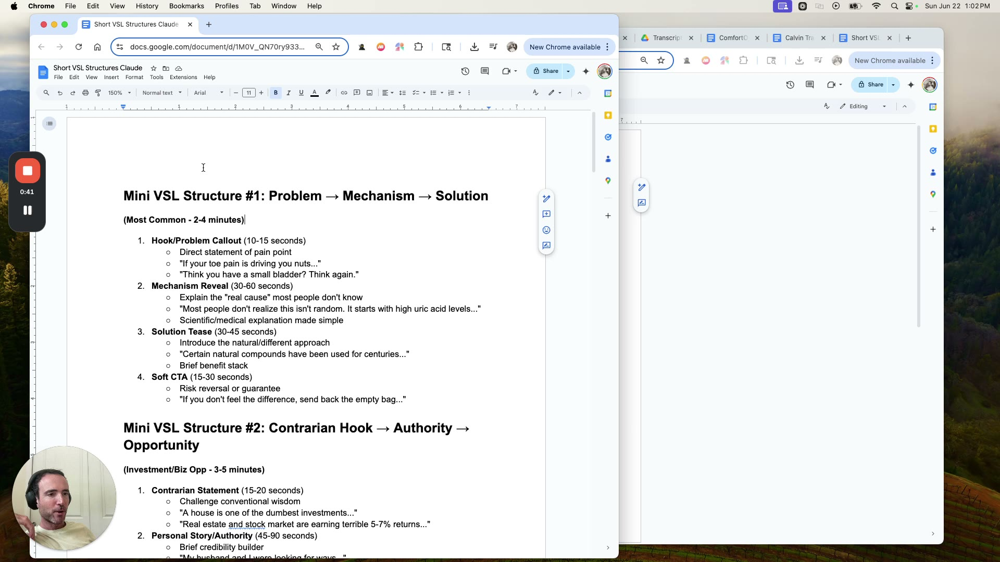
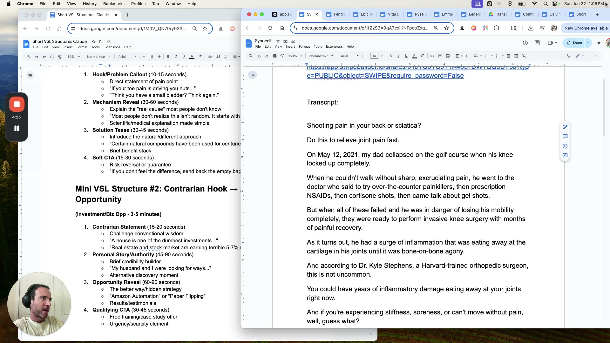
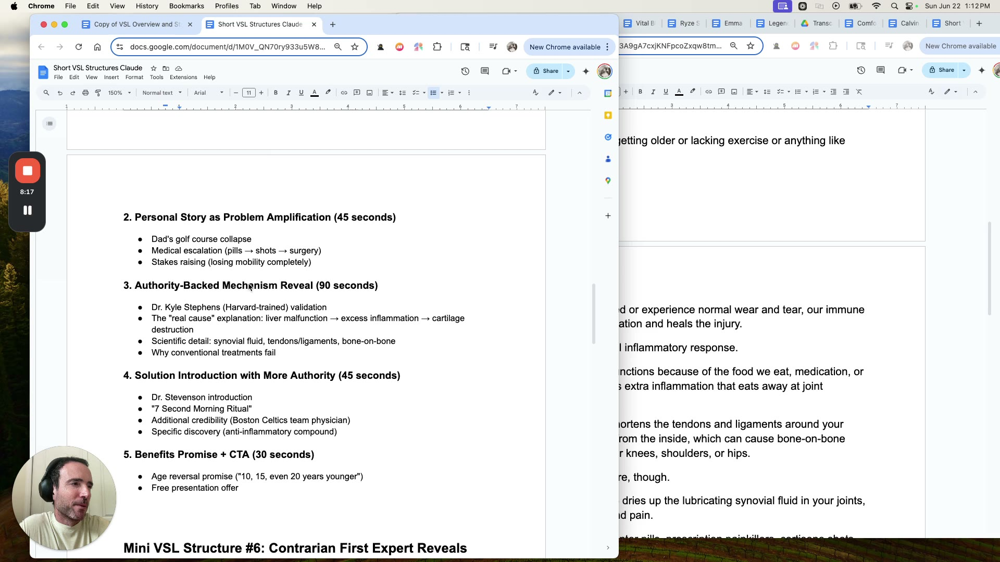
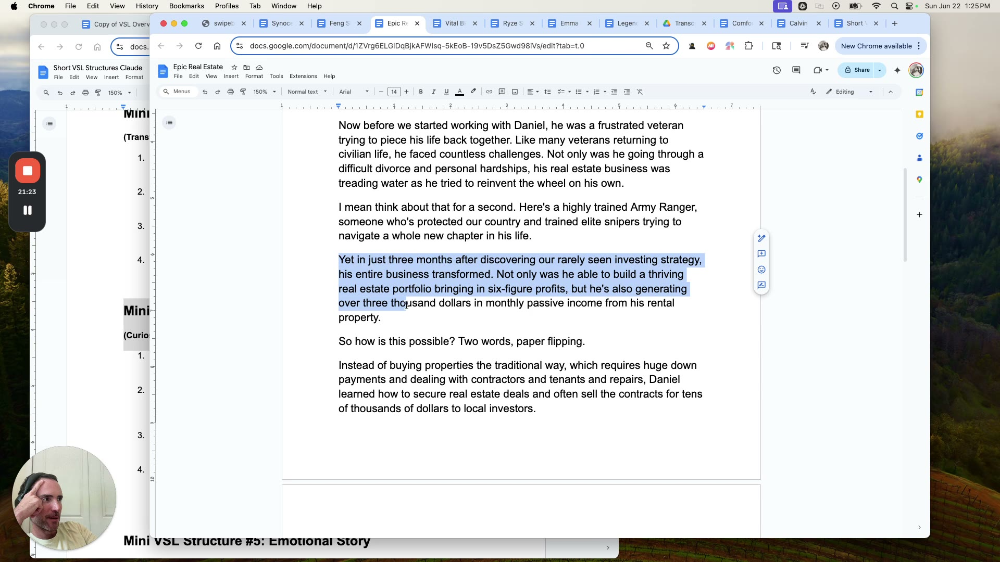
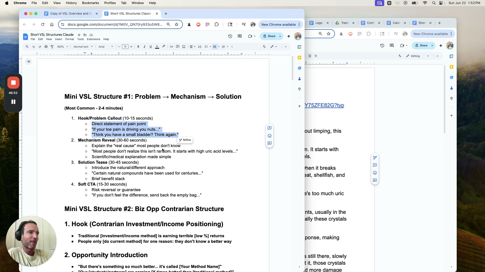
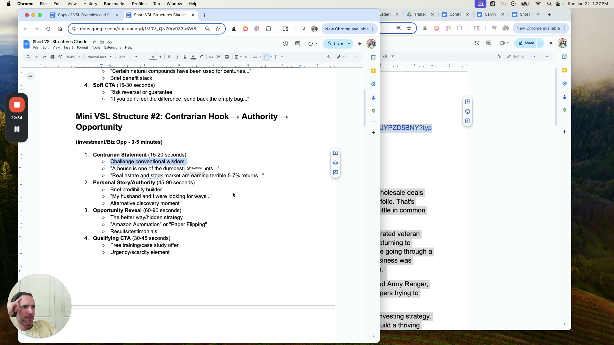

# 4.9 Short VSLs (Structures and Examples)
> Seven reusable mini-VSL (1-5 minute, Meta-style) structures, extracted by feeding real short ads to a Claude project and editing the outlines by hand, plus 17 example scripts (health, biz-opp, physical products) to map against them.

## 🤖 Agent use
- **Use when:** outlining or auditing a short video ad that sells the click to a VSL or product page (biz-opp training, supplement "ritual", gadget, apparel); deciding what a short script must contain when there is no room for a full lead, background story and product build-up; building your own structure library from competitor ads.
- **Inputs → outputs:** a competitor short ad (transcript from a swipe tool), your product or offer, the destination (VSL, quiz, product page, free training) → a beat-by-beat outline picked from the seven structures below, plus a "structure extraction" prompt chain you can run on any new winning ad.
- **Rules:**
  - **DO** open with a hook and go straight into the next beat: "there's not really a lead in the short VSLs." [v2 05:02–06:02]
  - **DO** decide the destination first: "are you trying to send them to a VSL or are we trying to send them to a product page on something like Shopify?" It decides whether the ad ends by revealing the product or by teasing a solution and the click. [v2 06:35–07:06]
  - **DO** put the mechanism early, right after the hook or the short story. Examples: arteries have a "Teflon coating" that gets scratched; uric-acid crystals "stabbing inside your joints"; a "wealth cortex". [v2 07:38; 41:41–42:58; 46:54]
  - **DO** end a "ritual/method" ad on a tease plus a click ("7-second morning ritual", "7-second artery flush") and end a physical-product ad on product name, features, future pacing and a limited offer. [v2 06:35; 54:15–54:46]
  - **DO** use Claude to extract and generalise structures, then edit them: give it the script, ask for an outline, ask it to make the outline broader "so it would apply to many" offers, then replace weaker outlines in your doc. [v2 33:58–36:53; 58:22]
  - **DO** check the AI outline for missing beats. His example: Claude's outline for Epic Real Estate was "missing... a brief explanation of how it works" (what "paper flipping" actually is). [v2 22:55]
  - **DON'T** over-analyse or force every ad into a template: "I wouldn't overanalyze and worry so much about these structures... it's not as cut and paste as a classic VSL." [v2 15:13] Short ads "have way more variance" than long ones. [v2 38:51]
  - **DON'T** copy the aggressive claims in the examples. The instructor himself says of the Feng Shui bracelet: "you want to take a shower after watching a video like this", and "you wouldn't have to be this aggressive and... sell a bullshit product" to use the structure. [v2 10:23]
  - **IF** you sell a biz-opp or training **THEN** use the contrarian structure: low returns of the old way, your method, a one-line credibility anchor, objections (why not do it yourself / is it a scam / what's the catch), a qualifier, "I can't explain everything here", a free case study or workshop, scarcity, risk reversal, future pace. [v2 23:36–25:10; 33:58–38:21; doc Structure #2]
  - **IF** a biz-opp ad is a single transformation story (Epic Real Estate) **THEN** use the shorter "SPG version": hook, expert-led transformation story, UMS, explain UMS, future pace, "can't teach it all here", urgent CTA, reminder, final CTA. [v2 26:07–27:09]
- **See also:** [04.02 VSL fundamentals and classic structure](04-02-vsl-fundamentals-classic-structure.md) · [04.03 VSL leads](04-03-vsl-leads-after-the-opening-hook.md) · [04.04 background stories and unique mechanisms](04-04-vsl-background-stories-and-unique-mechanisms.md) · [04.07 long-form financial VSL examples](04-07-long-form-financial-vsl-examples-and-break-downs.md) · [04.10 using AI to generate endless good hooks](04-10-using-ai-to-generate-endless-good-hooks.md) · [Evolve Copywriting: hooks](../../../evolve/copywriting/concepts/hooks.md)

## Key ideas

### 1. Why this section exists (video 1, 1:35) [v1 00:00–01:29]
- Short VSLs have "a ton of examples with different sort of short VSL scripts", and he breaks several down and goes through "some different structures". "You'll also see that I was using Claude [transcribed 'quad'] to create these structures", then "modifying them in real time". [v1 00:00–00:28]
- The skill to copy, not just the structures: "giving Claude these scripts, telling it to create outlines... I modify based on what I'm seeing... taking things you like, hey Claude, break it down to the specific structure, perfect, make it more universal, great... you can create sort of templates and outlines." [v1 00:28–01:01]
- Purpose: "we're going to then feed it into Claude as we're creating VSLs." He expects the course to "click together" once the copy-creation section starts. [v1 01:01–01:29]

### 2. How the lesson was built (the extraction setup) [v2 00:00–00:34]
- He gave a Claude project "a classic sales letter outline, a whole bunch of short VSLs combined in a document" and asked it to find "commonalities and structures". [v2 00:00–00:34]
- All examples "are coming from Meta", pulled into Swipe Builder (a swipe-file tool that provides the transcripts; links in the example docs need a Swipe Builder account). [v2 00:34]
- Teaching order he chose: watch examples first, match them to the structures, then "figure out some commonalities". [v2 00:34]
- Terminology: "I'm going to use mini VSLs and sometimes video ads kind of interchangeably... there's sort of direct response with like a structure. And that's what I'm referring to." [v2 05:02]


*The Claude-made structure doc at the start of the walkthrough [00:42]. This draft differs from the shipped DOCX (Structure #2 had four steps here and ten in the final).*

### 3. The short-VSL skeleton he keeps returning to [v2 04:23–09:43]
- Compared with the classic VSL (big hook, pain point, process of failures, problem, solution): short ones have "pretty much like no lead". "They're always going to be a hook." Then: hook, background story or "punch in the gut" emotional story, mechanism, then product build/reveal or a teased solution. [v2 04:23–06:35]
- Destination decides the ending: send to a VSL and you tease or sell the click; send to a product page and you name and sell the product. [v2 06:35–07:06]
- Walk-through of Synocell (see teardown table): hook = callout + curiosity ("Do this to relieve joint pain fast"), emotional story (dad collapsed), expert-backed mechanism ("surge of inflammation... eating away the cartilage"), solution as named ritual, benefit promise, future pacing, free presentation. He labels it "hook, personal story, authority-backed mechanism reveal... solution, seven-second morning ritual, and then promise benefits". [v2 04:23–09:43]


*Synocell transcript (right) next to the structure doc (left) while he maps hook, story and mechanism [04:24].*


*Claude's "Emotional Story" outline for Synocell, with per-beat second counts (10 / 45 / 90 / 45 / 30 seconds) [08:18].*

### 4. Story-driven examples: Feng Shui, Epic Real Estate [v2 09:43–27:09]
- **Feng Shui bracelet** (he calls it "affiliate-y, little black hat dirty"): mystery hook, immediate prop reveal ("this thing I'm wearing right now... is a key"), personal transformation, product reveal and "a little mechanism of why it's working", urgency. His summary: "mystery hook, personal transformation story, product method reveal, what it is and how it works... and an urgency." [v2 09:43–14:36] It "doesn't really pay off" the hook, but works as structure; he maps it to the Secret Reveal structure. [v2 14:36–15:13]
- **Epic Real Estate** (biz-op): "The guy behind me is no ordinary soldier" is "your curiosity and your dopamine". Then immediate success story, background story ("frustrated veteran"), results ("three thousand dollars in monthly passive income"), "How is it possible? Two words, paper flipping". [v2 20:40–21:45]
  - Claude's read: contrarian hook, authority, opportunity. He agrees on the contrarian angle ("you'd think a guy from the military wouldn't be able to build a whole real estate empire") but says the outline lacks the explanation of how paper flipping works. [v2 21:45–23:36]
  - Biz-op specifics: ends with "results aren't typical, but what if they were" (future pacing) and a free workshop, because "you can't teach all this here". "Often for biz-op, this part is... a free training case study." There is "less of a UMP" and they "focus more on the UMS". [v2 23:36–25:10; SRT 00:25:05–00:25:13 clarifies the wording]
  - His own outline (the "SPG version"): hook; transformation story "guided by expert spokesperson from rock bottom to killing it"; introduce UMS; explain UMS; results not typical but what if they were (future pace); can't teach the UMS fully here but there's a free presentation; CTA with urgency; remind them of the opportunity; final CTA. "Simpler than what Claude did." [v2 26:07–27:09]
  - He then told Claude his version was better ("Claude thinks I'm better than it, which is true. Probably") and asked when Claude's structure would work better. [v2 28:12]
  - He likes the closing re-engagement line "What? You still here?" as "a fun little move". [v2 16:26]


*Epic Real Estate transcript while he marks the transformation/results beat that precedes "paper flipping" [21:24].*

### 5. Contrarian biz-op: Kevin David / Amazon Automation [v2 28:12–38:21]
- Structure he reads from the script: contrarian hook (real estate and stock market earn "a terrible 5-7% annual return"), "they don't know a better way", opportunity (Amazon automation), UMS-style mechanism ("flip our inventory four or more times per year"), business-model reveal (partner with people holding "more than $10,000 liquid"), objection handling, qualification, "can't explain in this advertisement", urgency, risk reversal, future pace. [v2 32:28–34:50; Kevin David docx]
- Claude's first outline for this ad was a "modified version" of the SPG real-estate outline. Its "#2 challenging conventional wisdom / personal story authority" didn't convince him ("I'm not as in love with this number two"), so he asked Claude for a new outline from the ad and then for a broader version usable "for other business-opp type things". [v2 32:28–36:53; on-screen Claude reply at 35:46]
- Broader template (kept in the DOCX as Structure #2): hook (traditional method earns terrible returns), opportunity introduction, quick credibility anchor, explain method, business-model reveal, objection sequence, qualification, information-gap bridge, urgent CTA, risk reversal and future pacing, final CTA. [v2 36:53–38:21; doc Structure #2]
- His editing note: you don't have to claim you beat the traditional method; "quick credibility anchor... here's an example, here's an analogy, here's industry validation" is enough. [v2 37:50–38:21]


*Revised doc at 46:55: Structure #2 is now the ten-step "Biz Opp Contrarian Structure" (compare the draft frame at 22:36).*


*Draft Structure #2 before he rebuilt it from the Kevin David ad [22:36].*

### 6. Educational "mechanism hooks": Vital BP, Ryze, Emma [v2 38:51–50:55]
- **Vital BP** (hook, contrarian twist, education pays off the hook): "Eating too little salt can be just as dangerous as eating too much. Alarming, right?" Then "a top Miami heart doctor says that's like turning down the water pressure to fix a clogged pipe", the artery "Teflon coating" mechanism, escalation ("starts in your toes... creeps... chest pressure... by then the damage is already done"), the metaphor, the solution ("seven-second artery flush"), the "without sacrifice" line, a patient story, and a CTA with benefit stack. [v2 39:28–45:12]
  - His read: "It's the unique mechanism right here... there's an amplification of the problem." [v2 42:26–42:58] "This one's actually pretty solid." [v2 45:12] This became the Contrarian + Expert Reveals Mechanism structure (#6).
- **Ryze mushroom coffee**: "hook, mechanism, teasing solution" with "a brief benefit stack and then a soft CTA"; the product is not named in the video but the compounds and the guarantee are ("send back the empty bag for a full refund"). He calls it "more than a tease". [v2 45:46–48:50] This is Structure #1 (Problem to Mechanism to Solution).
- **Emma Relief**: educational mechanism then a teased method ("seven-second morning ritual"); he notes "the same idea": "hook, mechanism... other times teasing a method or solution without more detail". The doc marks "[Bunch of Testimonials Start Here]" after the CTA, so testimonials follow the script. [v2 49:43–50:55; Emma docx]
- He lists Legendary Men's Care next but moves on without analysis. [v2 50:55–51:41]

### 7. Direct-sale examples: Odorless Cat, ComfortOrtho Shoes [v2 51:41–1:03:13]
- **Odorless Cat** (UVC odour device): "Cat parents, pause the scroll for a moment because what I'm about to tell you can change your life." Beats: callout, "how I eliminated... without doing any of these", failed solution, lucky discovery ("I came across a video on Facebook"), product name and how it works, ease of use, personal transformation, special offer. [v2 53:41–54:46]
  - He asked Claude for a general structure for both "selling the product" and "selling a solution or a ritual". The result replaced his earlier "before/after" outline: callout and promise, problem agitation, discovery moment, 4A product reveal path / 4B method tease path, personal transformation, 6A direct sale CTA / 6B information CTA. [v2 54:46–58:22; Structure #3]
- **ComfortOrtho Shoes** (nurse in Barcelona): "pretty white hat and clean". Structure: contrarian hook plus professional credibility, important event, swap old solution for new, transformation, extreme test ("50,000 steps in two days"), recommendation, company authority and features, comparison, technical benefit, social proof, current-state transformation, limited-time 40% off. He says "I would modify it more" and "this structure is a little weird". [v2 59:09–1:03:13; Structure #4]
- He closes by saying he will clean up the doc, then go to hook training ("the specific hooks training and the one on generating endless hooks") before the VSL-creation sections. [v2 1:03:13–1:03:44]

## Steps / framework

### A. Structure-extraction loop (the lesson's real skill; derived from his on-screen workflow)
| Step | What he did | Timestamp |
|---|---|---|
| 1. Collect | Save a short Meta ad into a swipe tool; get its transcript (with on-screen text if available) | [v2 00:34] |
| 2. Seed Claude | Project with the classic sales letter outline plus a doc of short VSLs | [v2 00:00] |
| 3. Map | Ask which existing structure the new ad matches ("which one would tie in for...") | [v2 55:20; 22:24] |
| 4. Review | Read the outline against the script; list beats it misses (e.g. the "how it works" explanation) | [v2 22:55] |
| 5. Re-extract | "Given that structure I just shared, how would you outline this ad?" | [v2 33:58] |
| 6. Generalise | "Make it broader so it would apply as a template to other business opportunities" (replace the niche nouns with slots) | [v2 35:44] |
| 7. Replace or merge | Swap the weaker structure in the doc for the better one; clean formatting | [v2 34:50; 58:22; 1:03:13] |
| 8. Reuse | Feed the doc into the Claude VSL project when creating scripts | [v1 01:01] |

### B. Short-VSL spine (derived; the common core across the seven structures)
1. Hook or callout (10-25 s): pain point, contrarian twist, mystery, or "stop the scroll" audience callout.
2. Story, education or discovery (30-90 s): why this person/doctor/expert knows; what went wrong.
3. Mechanism (30-90 s): the "real cause" in plain words plus one metaphor.
4. Solution: named method, ritual or product; features if it's a direct sale; "without" line (no drugs, no surgery, no restrictions).
5. Proof (optional, 15-60 s): patient story, extreme test, credibility anchor, reviews.
6. CTA with one reason to click now: free presentation, quiz, free training, limited offer, guarantee.

## Examples

### Ad teardowns (17 scripts in the example doc folder)
Word counts are script words in the course file; the course gives no runtimes. "Discussed" = covered in the video.

| Ad (niche) | Format / destination | Structure it matches | Discussed? | What to copy | What to avoid or flag |
|---|---|---|---|---|---|
| Synocell (joint pain, "7 Second Morning Ritual") | ~509 words; free presentation | Emotional Story (#5b) | Yes [v2 04:23–09:43] | Callout hook, dad's story with medical escalation, expert-backed mechanism, named ritual, future pace | Disease and cure claims ("rebuild cartilage", "10, 15, even 20 years younger"), credentials and "Harvard-trained" attributions need substantiation; doc typo "Mourning" |
| Feng Shui Black Obsidian Wealth Bracelet | ~419 words; product, free-bracelet offer | Secret Reveal (#5a) | Yes [v2 09:43–15:13] | Mystery hook, prop in hand, "key" metaphor, short mechanism | Fabricated-sounding income claims ($10,000, $70,000 job), "wealth cortex" pseudo-science, fake scarcity. Do not reuse; the instructor calls it "dirty" |
| Epic Real Estate ("paper flipping") | ~577 words; free online workshop | SPG version (#7) | Yes [v2 16:26–27:09] | Curiosity hook, "results not typical, but what if they were", workshop CTA, "What? You still here?" re-engage | Income claims ("six-figure profits", "$3,000 monthly"), "99% of investors overlook"; keep the disclaimer |
| Kevin David (Amazon automation) | ~679 words; free 20-minute case study | Biz Opp Contrarian (#2) | Yes [v2 28:12–38:21] | Contrarian returns hook, objection sequence (do it yourself / scam / catch), qualifier, risk reversal line | "10 times better than traditional investments", media-logo credibility, "last time you'll see this ad" scarcity |
| Vital BP (blood pressure, "7-second artery flush") | ~552 words; tap-through | Contrarian + Expert (#6) | Yes [v2 39:28–45:12] | Benefit promise + contrarian twist + "Alarming, right?" pattern interrupt; plumbing metaphor; patient story | Disease claims; named patient/doctor persona; "normalize your blood pressure" |
| Ryze Superfoods (mushroom coffee, gout/uric acid) | ~399 words; branded, soft CTA | Problem-Mechanism-Solution (#1) | Yes [v2 45:46–48:50] | Callout hook, "real cause isn't random", compounds listed with one benefit each, empty-bag refund | Disease/treatment framing for gout; supplement claims need support |
| Emma Relief (constipation / gut) | ~786 words incl. testimonial block | #1 variant | Yes [v2 49:43–50:55] | Do-this hook, "Nope" serial debunks (fiber, water), traffic-jam metaphor, named method | Weight-loss claim ("10, 15 pounds lighter almost instantly"); explicit bodily-function copy may break ad policies |
| Legendary Men's Care (hair loss) | ~627 words; free presentation | Contrarian + Expert (#6) variant (derived) | Mentioned only [v2 50:55] | "Five hair-killing foods" listicle hook, villain framing, free presentation | Attacks on pharma, "greedy corporations", testosterone/finasteride claims, "taken off the internet" scarcity |
| The Odorless Cat (UVC odour device) | ~231 words; direct sale | Personal Discovery (#3) | Yes [v2 51:41–58:22] | Audience callout, "without doing any of these", failed-solution beat, discovery moment | Health claims (sinuses, headaches, sleep) |
| ComfortOrtho Shoes (nurse) | ~367 words; direct sale, 40% off | Authority/Affinity (#4) | Yes [v2 59:09–1:03:13] | Identity hook ("Why I'll never wear X again"), high-stakes event, extreme test, comparison, social proof | "USA's most comfortable shoes", comparison claims need proof |
| Calvin Tran (Airbnb rental arbitrage) | ~296 words; free live training | Contrarian biz-op (derived) | No | Question hook ("What's the point of owning a property if it doesn't pay you every single month?"), personal result, free training | Income and tax claims, "none of their own capital" |
| Dee Ludlow 5D (M&A toolkit) | ~339 words; retargeting; free download | Objection stack (derived) | No | Four-objection close (cost, will it work, is it for me, need cash) before a free CTA | Zero-money-down acquisition claims. Doc note: "more of a retargeting ad" |
| Dr. Brian Paris (joint health, fibrin) | ~689 words; "Watch Now" | Demo + testimonial stack (derived) | Not in this video; discussed in [04.10](04-10-using-ai-to-generate-endless-good-hooks.md) | Aisle demo hook, 10-second promise, stacked testimonials | Testimonials with named individuals and cures; claims need substantiation |
| Healthy Back Institute (same ad, older/looser transcript) | ~686 words | Same as above | Not in this video | Compare with the Brian Paris version to see transcription noise | The HBI transcript says "fiber"; the Brian Paris transcript says "fibrin" (the latter is the sensible reading) |
| Pee Leaks (apple cider vinegar / bladder) | ~246 words; click to learn more | #1 (derived) | No | "Think you have a small bladder? Think again." reframe; one-minute routine | Invented-looking "Dr. Lisa Carter" credential and "Journal of Urology" citation; medical claims |
| Retirement Strategies | ~365 words; free video | Contrarian biz-op / discovery (derived) | No | "A house is one of the dumbest, worst investments..." hook, spouse-and-I discovery, "no real-estate headaches" | "$5-9 grand a month", "recession-proof", "Yale and Harvard endowment" claims, 24-hour free window |
| VShred example (Ad Script Breakdown #3) | ~4,187 words incl. visuals; free body-type quiz | Not a short VSL; hook-stacked video ad | No (see [04.10](04-10-using-ai-to-generate-endless-good-hooks.md)) | Quiz as the click, split-screen visuals, repeated "stop scrolling" commands | Weight-loss and "visceral fat" claims; borrowed-authority edits ("Dr. Drew") |

(Word counts and "structure it matches" for the rows marked "(derived)" are mine; the instructor only matched the rows marked "Yes".)

### Rewrites (Claude's outline vs the instructor's edit)
| Before (Claude) | After (instructor) | What changed | Source |
|---|---|---|---|
| Epic Real Estate: contrarian hook, authority/opportunity, teased "how is it available: paper flipping" | Hook; expert-guided transformation story; introduce UMS; explain UMS; future pace; "can't teach it all"; urgent CTA; remind; final CTA | Added the "explain the mechanism" beat; dropped the contrarian frame | [v2 21:45–27:09] |
| Amazon Automation: contrarian #2 "challenging conventional wisdom / personal story authority" | Ten-step Biz Opp Contrarian Structure (hook, opportunity, method, business model, objections, qualification, bridge, urgency, risk reversal, final CTA) | Rebuilt from the ad itself, then generalised | [v2 32:28–38:21] |
| Cat product: older "before / after" outline | Structure #3 with 4A product path and 4B method path | One template handles product sales and info-product teasers | [v2 54:46–58:22] |

## Structured units

### Hooks (verbatim openers from the example scripts)
| Hook | Heuristic(s) | Emotion / zone | Self targeted | Why it works | Source |
|---|---|---|---|---|---|
| "Shooting pain in your back or sciatica? Do this to relieve joint pain fast." | Callout + curiosity ("do this") (derived) | Pain relief | Back/joint pain sufferers | Names the pain, withholds the method | Synocell; [v2 04:23] |
| "If your toe pain is driving you nuts and you can't walk without limping, this video is for you." | Direct callout | Frustration | Gout/toe pain | Pure qualifier then mechanism | Ryze; [v2 45:46] |
| "Think you have a small bladder? Think again." | Reframe / belief challenge | Surprise | Women 40+ with urgency | Re-labels a self-blame belief | Pee Leaks |
| "This 7-second artery flush can normalize your blood pressure." + "eating too little salt can be just as dangerous as eating too much. Alarming, right?" | Promise + contrarian twist + pattern interrupt | Fear, surprise | People managing blood pressure | Two-step: benefit, then a belief the viewer holds is wrong | Vital BP; [v2 39:28] |
| "Watch what magnesium does to your bowels. If you have to wipe more than four times after you poop, here's why." | Demonstration + self-test | Embarrassment, curiosity | People with gut issues | Specific, checkable symptom | Emma Relief |
| "Billionaires have a secret, and they've done a damn good job keeping it from the rest of us." | Secret / conspiracy | Envy, curiosity | Strivers | Mystery with a prop to follow | Feng Shui; [v2 10:23] |
| "The guy you see behind me is no ordinary soldier." | Curiosity about a person | Curiosity | Biz-op leads | Visual plus intrigue | Epic Real Estate; [v2 20:40] |
| "Real estate and the stock market are earning a terrible 5-7% annual return..." | Contrarian | Dissatisfaction | Savers/investors | Dismisses the incumbent option | Kevin David; [v2 32:28] |
| "A house is one of the dumbest, worst investments a human being could possibly make for one reason. You have to pay the house. The house doesn't pay you." | Contrarian + reason | Provocation | Retirement planners | Quotable reason | Retirement Strategies |
| "What's the point of owning a property if it doesn't pay you every single month?" | Rhetorical question | Dissatisfaction | Aspiring landlords | Reframes ownership as cash flow | Calvin Tran |
| "Cat parents, pause the scroll for a moment because what I'm about to tell you can change your life." | Audience callout + big promise | Hope | Cat owners | Names the audience and stakes | The Odorless Cat; [v2 53:41] |
| "Why I'll never wear running shoes on my trips to Europe again." | Identity + contrarian | Curiosity | Nurses/walkers | "Never again" implies a lesson | ComfortOrtho |
| "He's 60 but has the hair of a 25-year-old. What's his secret?" | Curiosity gap | Envy | Men with thinning hair | Specific before/after contrast | Legendary Men's Care |
| "Cracking joints can be helped by eliminating one specific protein." | Single-cause claim | Curiosity | Joint pain | "One specific" implies a simple fix | Dr. Brian Paris |
| "Businesses are for sale." | Blunt statement | Opportunity | Would-be buyers | Four words; sets the frame | Dee Ludlow |

(Heuristics, emotions and "why it works" are derived labels. Verbatim text is from the course files.)

### Templates
| Template | Use for | Example fill | Source |
|---|---|---|---|
| "[Audience], pause the scroll for a moment, because what I'm about to tell you can change your life." | Direct-sale product ads | "Cat parents, pause the scroll..." | Structure #3 |
| "Why I'll never [use common solution] for [activity] again" + "I'm a [profession]" | Lifestyle/affinity products | "Why I'll never wear running shoes on my trips to Europe again. I'm a nurse" | Structure #4 |
| "[Benefit] can [outcome]. Turns out, [common belief] can be just as dangerous as [opposite belief]. Alarming, right?" | Educational mechanism ads | "7-second artery flush can normalize your blood pressure..." | Structure #6 |
| "To fix [problem], you need to [actual approach]... without having to [give up favourite things]" | Solution reveal | "To fix the problem, you need to clean it out" | Structure #6 |
| "Traditional [method] is earning terrible [low %] returns. People only [do it] for one reason: they don't know a better way." | Biz-op contrarian hook | Kevin David opener | Structure #2 |
| "I can't explain everything in this [ad/video]... free [case study/workshop]" | Information-gap bridge | "Free 20-minute case study" | Structure #2 |

### Rules of thumb
- **DO** write the short script around one mechanism and one metaphor, not several. [v2 41:41–45:12]
- **DO** disclaim results in biz-op ads ("results aren't typical") and then future-pace ("but what if they were"). [v2 23:36]
- **IF** Claude's outline feels off **THEN** ask it to outline again from the ad, then generalise; don't hand-fix a bad outline line by line. [v2 33:58–35:44]
- **DON'T** mine the examples for claims. They contain unsubstantiated health, income and scarcity statements (see teardown table).

## Prompts / templates (verbatim)
No Claude prompts are included in this lesson's files. The instructor types short chat requests on screen (paraphrased in Steps A). Verbatim lines visible or spoken: "Given that structure I just shared, how would you outline this ad?" [v2 33:58]; "okay great and if we were going to take this outline, and make it broader so it would apply to many [other business opportunities]" (typed on screen at [35:46]; the transcript has "so it would apply to um use as a template guide other business top things"). The shipped structure document follows in full.

### Short VSL Structures (verbatim from `09-1 Short VSL Structures.docx`)
Course-file notes: it has two structures numbered "#5" (here labelled #5a Secret Reveal and #5b Emotional Story) and an unnumbered-style "7. SPG Version of Epic Real Estate Outline". Example names in structure #5b (Dr. Kyle Stephens, Dr. Stevenson, Boston Celtics) come from the Synocell ad; do not reuse.

```text
Mini VSL Structure #1: Problem → Mechanism → Solution

1. Hook/Problem Callout (10-15 seconds)
   - Direct statement of pain point
   - "If your toe pain is driving you nuts..."
   - "Think you have a small bladder? Think again."

2. Mechanism Reveal (30-60 seconds)
   - Explain the "real cause" most people don't know
   - "Most people don't realize this isn't random. It starts with high uric acid levels..."
   - Scientific/medical explanation made simple

3. Solution Reveal (Without Naming Product In Some Cases) (30-45 seconds)
   - Introduce the natural/different approach
   - Sometimes Mentioning each compound or component + why it's an important part of an overall solution + potentially other proof elements.
   - Other times, teasing a method or solution without more detail (ie. 7 Second Morning Poop Ritual).

4. CTA (15-30 seconds)
   - May include Quick Risk reversal or guarantee
   - "If you don't feel the difference, send back the empty bag..."


Mini VSL Structure #2: Biz Opp Contrarian Structure

1. Hook (Contrarian Investment/Income Positioning)
   - Traditional [investment/income method] is earning terrible [low %] returns
   - People only [do current method] for one reason: they don't know a better way

2. Opportunity Introduction
   - "But there's something so much better... it's called [Your Method Name]"
   - "Our [students/partners] are earning [X times better] than [traditional method]"
   - Quick credibility anchor (verifiable statistic/industry data)

3. Explain Method/System
   - Simple example ([physical product/transaction type])
   - Key differentiator (why returns are higher - [turnover rate/frequency/leverage])
   - Relatable analogy ("Think about it like [familiar concept]...")
   - Industry validation ([your industry] is the #1 trending [category])

4. Business Model Reveal
   - Partnership structure: "My [business partner] and I partner with [qualifier type] who have [minimum investment amount]"
   - What you do for them: "We leverage our [time period] of experience [doing specific thing] for you"
   - Done-for-you promise: Build/manage [business type] on your behalf

5. Objection Handling Sequence
   - "Why don't you just do it yourself?"
       - We do, but [business model comparison - hedge fund, etc.]
       - Pooling capital allows us to [specific advantage]
       - [OPM concept or similar leverage principle]
   - "Is this a scam?"
       - Media credibility ([publications] featured us)
       - [Number] of people we've helped
       - [Specific achievement/recognition]
   - "What's the catch?"
       - Limited capacity due to [manual work/personal attention]
       - Can only partner with [small number] of new [partners/students]

6. Qualification Requirements
   - Financial qualifier: $[amount]+ [liquid/available]
   - Availability scarcity: Extremely limited partnerships

7. Information Gap Bridge
   - "I can't explain everything in this [ad/video]"
   - Free [case study/workshop/presentation] offer
   - Promise more detail than current format allows

8. Primary CTA with Urgency
   - Scarcity: "Last time you'll see this [ad/offer]"
   - Motivational push: "If you want things you've never had, try things you've never done"

9. Risk Reversal + Future Pacing
   - "What's the worst that could happen?" (Learning about trending industry)
   - Timeline future pace: "6-12 months from now, you look back..."
   - Success story positioning: "You become our next biggest success story"

10. Final CTA
   - Simple action steps: Click → Sign up → Watch
   - Casual close: "I'll see you there"


Mini VSL Structure #3: Personal Discovery -> Solution
For Direct Product Sales & Information Products

1. Audience Hook + Life Change Promise
   - Audience callout: "[Target audience], pause the scroll for a moment"
   - Big promise: "because what I'm about to tell you can change your life"
   - Solution tease: "This is how I [solve specific problem] without doing any of these [common methods]"

2. Problem Agitation (Personal Struggle)
   - Failed attempt: "I tried [popular solution] before, but [specific negative consequences]"
   - Multiple pain points: [List 2-3 specific frustrations/costs/side effects]
   - Emotional impact: "[waste of money/time/health/etc.]"

3. Discovery Moment
   - Lucky break: "But luckily, I came across [discovery source - video/article/doctor/friend]"
   - What they found: "that was describing [solution type] that could [benefit] without [avoiding negatives]"

4A. Product Reveal Path (For Physical Products)
   - Product introduction: "It's called [Product Name]"
   - How it works: "and it works by using [technology/mechanism] to [specific function]"
   - Key features: "They have [feature 1], [feature 2], [feature 3]"
   - Ease of use: "and they [simple activation] as soon as [simple setup]"

4B. Method Tease Path (For Information Products)
   - Method name: "It's called the [X]-[Time] [Method Name]"
   - What it does: "a [description] way to [solve root cause] and [restore function]"
   - What you avoid: "without [conventional treatments/side effects/restrictions]"
   - Authority mention: "[Expert type] now call it [validation]"

5. Personal Transformation
   - Immediate results: "I can finally [primary benefit] throughout [timeframe]"
   - Specific improvements: List 3-4 concrete changes:
       - "And now I [specific improvement] than I have in [timeframe]"
       - "I don't [negative symptom] anymore"
       - "it feels like [positive change]"
       - "My [area of life] has improved"

6A. Direct Sale CTA (For Products)
   - Offer: "and right now they're running a special offer for a limited time"
   - Action: "Click the link below and get yours before it expires"

6B. Information CTA (For Methods/Rituals)
   - Urgency qualifier: "If you're over [age] and experiencing [symptoms]"
   - Free information offer: "click below to see [Expert's] [Method Name]"
   - Benefit promise: "You could be [desired outcome] and feel [age] years younger"


Mini VSL Structure #4: "Authority/Affinity + Life-Changing Discovery" Template
For Products That Solve Lifestyle/Activity Problems

1. Contrarian Hook + Personal Authority
   - Contrarian statement: "Why I'll never [use common solution] for [activity/situation] again"
   - Authority/Affinity: "I'm a [profession/hobby/lifestyle/identity that relates to problem]"

2. High-Stakes Situation Setup
   - I had an important event or activity coming up.
   - Emotional investment: It was something I'd looked forward to, was nervous about, saved money to participate in, or that just in general was highly important to me.

3. From Old to New Solution
   - I was going to use my old solution, even though it had flaws.
   - The switch: "But one day, I swapped my [old solution] for [new solution] and my life changed"

4. Experiencing Benefits From New Solution
   - Primary impact: "[Main activity/area] stopped being so hard for me"
   - Physical transformation or Deeper transformation: ie. things stopped hurting, I was healthier, I was more confident, people looked at me differently, etc.

5. Proof/Test Results
   - Extreme test: "As a result, in [challenging situation], in [timeframe] I [impressive metric]"
   - Pain Point Free proof: "and I didn't even feel a hint of my pain point."

6. Personal Recommendation
   - Authority endorsement: "That's why now I advise everyone to use this [new solution]"
   - Broader application (when applicable): "including in their everyday life"

7. Product Authority & Features
   - Company credibility: New solution was created by a super credible company.
   - Feature stack: "The new solution/product has [feature 1], [feature 2], [feature 3], and [price benefit]"

8. Comparison/Superiority
   - Performance comparison: Products benefits are superior, more effective, last longer than competitors.
   - Additional advantage: Another opportunity to contrast against the old solution.

9. Technical Benefits
   - Additional Key feature: call out a special feature of the product that is particularly important.
   - How it works
   - Optional Additional features: "They're [practical benefit] and [practical benefit], and they also have [safety feature]"

10. Social Proof
   - Target audience validation: "No wonder they have lots of fantastic reviews from [people like target audience] who [face same problem]"

11. Current State Transformation
   - Main activity: "Now I can easily do these events/activities/hobbies without pain point."
   - Capability expansion: "I'm able to [activity] for hours, and I'm comfortable"
   - Specific relief: "No [specific pain point]"

12. Offer + CTA
   - Limited offer: "Additionally, they have a limited-time [discount]% off deal if you purchase directly from this link"
   - Authority close: "See for yourself why [Product] are considered the leader in their market/region."
   - Simple CTA: "Get yours now"


Mini VSL Structure #5: "Secret" Reveal   [numbered #5 in the file; I call it #5a]
(Curiosity-driven - 1-3 minutes)

1. Mystery Hook (15-20 seconds)
   - "Billionaires have a secret..."
   - Reference to hidden knowledge

2. Personal Transformation Story (45-75 seconds)
   - Before state (broke, struggling)
   - Mysterious encounter/discovery
   - Dramatic results

3. Product/Method Reveal (30-45 seconds)
   - What the secret actually is
   - How it works (brief)

4. Urgency CTA (15-20 seconds)
   - Limited availability
   - Act now messaging


Mini VSL Structure #5: Emotional Story   [second #5 in the file; I call it #5b]

1. Hook/Problem Callout (10 seconds)
   - "Shooting pain in your back or sciatica? Do this to relieve joint pain fast."

2. Personal Story as Problem Amplification (45 seconds)
   - Dad's golf course collapse
   - Medical escalation (pills → shots → surgery)
   - Stakes raising (losing mobility completely)

3. Authority-Backed Mechanism Reveal (90 seconds)
   - Dr. Kyle Stephens (Harvard-trained) validation
   - The "real cause" explanation: liver malfunction → excess inflammation → cartilage destruction
   - Scientific detail: synovial fluid, tendons/ligaments, bone-on-bone
   - Why conventional treatments fail

4. Solution Introduction with More Authority (45 seconds)
   - Dr. Stevenson introduction
   - "7 Second Morning Ritual"
   - Additional credibility (Boston Celtics team physician)
   - Specific discovery (anti-inflammatory compound)

5. Benefits Promise + CTA (30 seconds)
   - Future Pacing ("10, 15, even 20 years younger")
   - Free presentation offer


Mini VSL Structure #6: Contrarian + Expert Reveals Mechanism

1. Hook + Contrarian Twist (15-25 seconds)
   - Benefit Promise: "This [timeframe] [method] can [desired outcome]"
   - Contrarian Statement: "Turns out, [common belief] can be just as dangerous as [opposite belief]"
   - Pattern Interrupt: "Alarming, right?" / "Surprising, right?" / "Shocking, but true"

2. Authority Setup + Education (Pays Off Contrarian Hook) (20-30 seconds)
   - Authority Introduction: "A top [location] [expert type] says that's like [analogy]"
   - Reframe: "Most people think [common approach] means [desired outcome]"
   - Authority Quote/Analogy: "But [expert] explains it like this..." / "He says that's like [relatable analogy]"

3. Mechanism Reveal with Progressive Explanation (60-90 seconds)
   - How It's Supposed to Work: "[System] has a [protective feature] that allows [normal function]"
   - What Goes Wrong: "But over time, this [protective feature] gets [damaged/compromised]"
   - Body's Failed Solution: "Your body tries to help by [compensating mechanism], but [why it backfires]"
   - Escalation Pattern: "It starts in [least noticeable area], then [progression], making [system] [deteriorated state]"
   - Symptoms Cascade: "Many folks start feeling [early symptoms], but by then [consequences]"
   - Why Common Solutions Fail: "[Popular approach] won't fix the problem. [Popular approach] is like [analogy showing futility]"

4. Real Solution Introduction (30-45 seconds)
   - Solution Logic (UMS): "To fix the problem, you need to [actual solution approach]"
   - Authority Introduction: "That's why [location] [expert type], [Dr. Name], developed [method name]"
   - How It Works: "And when [system] is [restored state], [benefit] naturally [returns/improves]"
   - Without Sacrifice: "Without having to [give up favorite things] or [obsess over restrictions]"
   - Convenience: "It's so [easy/safe], you can do it [where/when]"

5. Social Proof Story (45-60 seconds)
   - Patient Introduction: "One of his patients, [Name] from [Location], tried everything to [solve problem]"
   - Failed Attempts: "She [list of failed conventional approaches], but nothing worked"
   - Transformation: "Then she tried this [method], and within [timeframe], [authority figure] was amazed"
   - Current State: "These days, she [new activities/lifestyle improvements]"
   - Broader Proof: "And it's not just [Name]. [Number] of [demographic] are using [Dr. Name's] method"

6. Final CTA with Benefit Stack (25-35 seconds)
   - Frustration Acknowledgment: "So if you're tired of [current struggle], if you're frustrated with [failed approaches]"
   - Root Cause Promise: "and if you want to address the real cause of [problem]"
   - CTA: "tap the button below to see [Dr. Name's] [method description]"
   - Expanded Benefits: "that's helping [number] of [demographic] enjoy [lifestyle benefits] into their [age ranges] and beyond"


7. SPG Version of Epic Real Estate Outline
   - Hook
   - Transformation Story (Guided By Expert Spokesperson from Rock Bottom to Killing It)
   - Introduce UMS
   - Explain UMS
   - Results not typical, but what if they were? (Future Pace)
   - I can't teach the UMS fully here, but I created a free presentation/workshop/video.
   - CTA with Urgency
   - Remind them of the opportunity
   - Final CTA
```

### Agent version of the structure-extraction prompt (derived, not a course asset)
Built from the on-screen requests in [v2 33:58–36:53]. Use inside a Claude project that already holds your structure doc.
```text
Here is a short video ad transcript (from Meta). Using the structures in the project knowledge as a reference:
1. Name the structure it matches most closely, and say where it deviates.
2. Outline this specific ad beat by beat (hook, story, mechanism, solution, proof, CTA), with approximate seconds per beat.
3. List any beat the closest existing structure is missing (for example, "how it works" explanation, objection handling, qualifier, risk reversal).
4. Rewrite the outline as a universal template: replace niche nouns, names, numbers and credentials with [slots], and mark which beats are optional.
5. Flag every claim, credential, statistic, testimonial and scarcity line in the ad that would need substantiation if we copied the structure for our own product.
```

## Screenshots
Six frames above from video 2 (Google Docs structure doc and scripts, 0:42 / 4:24 / 8:18 / 21:24 / 22:36 / 46:55). A frame at 34:16 and 35:46 shows the Claude chat used for the Amazon Automation outline, and frames at 57:46 and 1:02:00 show Claude's Structure #3 and #4 outlines; they show the account name and sidebar, so they were not kept. Playing ad clips (e.g. Vital BP at 40:22) show real people and were not kept. Video 1 is a talking head and gave no usable frame.

## How to apply
- [ ] Decide the click destination first (VSL, quiz, free training, product page) and choose structure #1, #2, #3, #4, #5a, #5b, #6 or #7 accordingly.
- [ ] Take one live winning competitor short ad, run the extraction prompt, and add the general template to your structure doc.
- [ ] Write a hook plus one mechanism with one metaphor; skip the lead and the long background story.
- [ ] For biz-op or training offers, include the objection sequence, a qualifier, an information-gap bridge and a free-training CTA, and keep the "results not typical" line.
- [ ] Replace every borrowed credential, statistic, patient, income number, scarcity line and "free gift" from the examples with verified facts or remove them.
- [ ] Test several hooks on the same body (one structure, different openers) before rewriting the body. (derived; see [04.02](04-02-vsl-fundamentals-classic-structure.md))
- [ ] Feed the structure doc into the VSL-creation Claude project.

## Related
- Previous: [04.07 long-form financial VSL examples](04-07-long-form-financial-vsl-examples-and-break-downs.md) · Next: [04.10 using AI to generate endless good hooks](04-10-using-ai-to-generate-endless-good-hooks.md)
- Hooks and open loops in Evolve Copywriting: [hooks](../../../evolve/copywriting/concepts/hooks.md) · [open loops](../../../evolve/copywriting/concepts/open-loops.md) · [unique mechanism](../../../evolve/copywriting/concepts/unique-mechanism.md) · [write a video ad script](../../../evolve/copywriting/playbooks/write-a-video-ad-script.md)
- Shared KB: [Iteration vs variation](../../../../concepts/iteration-vs-variation.md) · [Creative testing system](../../../../frameworks/creative-testing-system.md)
- Note on disagreement: the Evolve courses push one avatar, one desire, one message ([rule of one](../../../evolve/start-here/concepts/rule-of-one.md)) and one open loop per hook; these short VSLs routinely stack several hooks, claims and credentials in under three minutes. The instructor frames this as normal for short DR ads, not as a rule to follow blindly. (derived)

## Sources and limitations
- Transcripts: [video 1 (1:35)](<../../../../../raw/stefan-georgi/rmbc-ii/_transcripts/Stefan Georgi - RMBC II (1)/04-VSLS SECTION I-Structure Theory and Examples/09-[8] Short VSLs (Structures and Examples).txt>) · [video 2 (1:04:15)](<../../../../../raw/stefan-georgi/rmbc-ii/_transcripts/Stefan Georgi - RMBC II (1)/04-VSLS SECTION I-Structure Theory and Examples/09-[8] Short VSLs (Structures and Examples) video2.txt>). The `._converted` file is a re-encode of video 1 and was skipped.
- Documents: [Short VSL Structures](<../../../../../raw/stefan-georgi/rmbc-ii/_extracted/Stefan Georgi - RMBC II (1)/04-VSLS SECTION I-Structure Theory and Examples/09-1 Short VSL Structures.docx.md>) and the 17 scripts in the "2. Short VSL Examples" folder (linked in the frontmatter).
- Machine transcription (Whisper large-v3-turbo). Fixes made against the platform `.srt`: "Quad" is Claude; "Cyanosell/SinoCell" is Synocell; "Rise" is Ryze; "viral BP" is Vital BP; "already flush" is artery flush; "UMass" is UMP/UMS (the SRT reads "there's less of a UMS... they tend to focus more on the UMS than the UMP"). The Ryze script's "Portasept" is a transcription error in the course doc (the instructor reads the compound list as reishi, cordyceps, shiitake; derived).
- Transcript gaps: the transcript has no text while the example videos play (roughly 10:30–13:00, 16:30–20:40, 28:30–32:30, 51:41–53:40, 59:10–1:01:50); the summaries for those stretches come from the example scripts and on-screen frames.
- The narration numbers structures differently from the shipped DOCX, and Claude's draft outlines on screen differ from it (e.g. a draft "Structure #2: Contrarian Hook → Authority → Opportunity"). Treat the DOCX as canonical.
- Example scripts come from third-party ads. Their claims (health outcomes, income, endorsements, credentials, scarcity) were not verified and several would not pass Meta or FTC substantiation rules. Copy the structure; never copy the claims.
