# 4.10 Using AI to Generate Endless Good Hooks
> A hook-heavy ("ADHD super-hook") video ad stacks a new hook or curiosity statement every few seconds; this lesson shows how to mass-produce those hooks with four LLMs, store them in a hook database, and load the database plus annotated winning ads into a Claude Project that writes 1-3 minute "sell the click" ads on demand.

## 🤖 Agent use
- **Use when:** you must produce many hook lines for a video ad (Meta/TikTok-style, multi-speaker, 1-3 minutes); you are building a hook library for a brand; you need to write ads whose job is to get the click to a VSL or long-form page, not to sell the product inside the ad; you need a Claude Project for ad/hook generation.
- **Inputs → outputs:** market pain points + a few seed hooks + (optional) annotated transcripts of winning ads → raw hook list from deep research → a de-duplicated "hook database" doc → a second, larger list from the "still MORE hooks" prompt → a Claude Project (instructions + ad breakdowns + hook database) → 10 ad concepts, each with first-30-second hooks → full 1-3 minute scripts → edited scripts → tracked variants (script ID, lead ID, hook ID).
- **Rules:**
  - **DO** define the target style first: an "ADHD Super-Hook Ad" has "numerous hooks throughout, including several in the beginning," and the first 30 seconds "should jump around a good amount" [45:07–45:41].
  - **DO** ask LLMs for fragments, not closed-loop fascination bullets: lines that can be injected throughout an ad, "like the first half of a puzzle but not the completed puzzle" [38:26–39:22].
  - **DO** run the same research prompt in several LLMs and keep the best lines in one Google Doc (the hook database) as you read: "every time you see a hook from any of these that you like, copy and paste it" [32:59]. In this lesson Perplexity gave the best first batch and Gemini 2.5 Pro plus a ChatGPT o1-pro-class model gave the best second batch [32:59; 35:14; 39:22].
  - **DO** tell the Claude Project not to talk about the product in the ad unless asked; the CTA is "you need to watch this" / "check out this video" ("selling the click") [47:10].
  - **DO** feed the project only the first half of the VSL (through the unique mechanism, promises and spokesperson) when the ad must not pitch the product, because the product-selling half pulls the LLM into naming the product and ingredients [48:57–49:52].
  - **DO** edit every AI script: "98% of the way there," with "common sense tweaks you would make if you're reading out loud" [53:30–54:02]. Ask for better transitions between hooks by number [55:12].
  - **DO** add repeated viewer commands ("watch this," "you need to listen to this") because the V Shred breakdown repeats them in the first 30 seconds; the instructor plans to add them to the project instructions [19:57–20:53; 25:18; 48:07].
  - **DO** track hook, lead and script IDs per creative so hooks can be recombined modularly [57:38].
  - **DO** keep the hook database in project knowledge and update it as you go; he says the shared doc "is going to keep being added to" [28:33–29:31].
  - **DON'T** stack 10 new hooks on a proven winner at once. Add "one more at a time or two" and test; the call guest's rule: test hooks, then mix winners [1:01:07–1:02:35].
  - **DON'T** copy the V Shred or Svelte lines, characters or claims; copy the mechanism (constant hooks, visual changes, speaker switches, commands, an AI-voice interrupt).
  - **IF** the hook output is generic or "too aggressive" **THEN** keep the idea and rewrite the wording yourself ("part of your job is to take what AI gives you and … do it better") [34:37; 36:15].
  - **IF** you sell in a non-skincare niche **THEN** keep the prompt and change only the target audience, the pain-point list and the product line ("it doesn't have to be just for a skincare thing") [44:02–45:07].
  - **IF** a hook is health, finance or weight-loss related **THEN** treat every claim in it as unsubstantiated until verified (see Compliance flags).
- **See also:** [4.9 Short VSLs](04-09-short-vsls-structures-and-examples.md) · [4.11 VSLs on landing pages vs in-feed ads](04-11-vsls-on-landing-pages-vs-vsls-as-in-feed-ads.md) · [5.2 Brief generator and hook-ad concepts](05-02-the-brief-generator-with-claude-project-unity-eye-serum-exam.md) · [Evolve: Hooks](../../../evolve/copywriting/concepts/hooks.md) · [Evolve: Open loops](../../../evolve/copywriting/concepts/open-loops.md) · [Evolve: AI in copywriting](../../../evolve/copywriting/concepts/ai-in-copywriting.md)

## Key ideas

### 1. This is a live weekly call, not a produced lesson [00:04–02:45]
- The recording is a weekly training call: Google Drive folder "Weekly Training Calls / 3-25-25" and a Zoom label "Copy Accelerator" are visible, with an on-screen clock reading 2025-03-25 (screens at 02:48 and 18:06). Participants speak and ask questions. Expect typos and mid-stream edits.
- Agenda stated up front: break down a V Shred video ad, then show "processes that I am using to generate a lot of hooks and then also to write those hook-heavy ads" [01:41].
- He shows the end point first (a Claude Project created "half an hour ago," "still a work in progress"), then walks backward to how it was built [02:45].

### 2. The endpoint: a Claude Project that returns hook-heavy ad concepts [02:45–08:24]
- Project name on screen: "March 2025_Ads and Hooks Generator" (Claude 3.7 Sonnet). First prompt (verbatim in Prompts): write ads for the skincare brand Opal Beauty, upload the first half of the VSL for context, be "hook-heavy, have tons of curiosity, leverage the hook database, and ultimately 'sell the click'," ads 1-3 minutes, give 10 concepts with hooks for the first 30 seconds [02:45].
- Concept 1 ("The Velcro Effect") hook stack: "Stop using hyaluronic acid until you watch this." / "Did you know celebrities are secretly using this instead of Botox?" / "The truth about collagen supplements is that they might help your body produce more collagen, but they can't fix THIS specific problem with your skin…" / "What happens when your skin loses its 'Velcro effect'…" [03:41; screen 04:12].
- Other concepts he liked: "The Microscopic Truth" ("You need to see this microscopic view of what's happening to your skin cells right now"), and a household-causes concept ("Stop washing your face in the shower until you hear this," "Stop microwaving food in plastic if you care about your skin's elasticity," "Here's what hard water does to your skin," "the surprising link between your laundry detergent and eye bags") [04:12–04:42].
- Workflow after concepts: "ad concept number one. Go ahead and write that now." He then picks by number, asks for more concepts, and picks again; the 10 initial ads took "about 15 minutes" prior to the call [04:42–06:32].
- Example output shape (concept 1 script) [05:37–06:32]: hook stack in the first lines, then a first-person story ("I was shocked… For years, I spent hundreds on creams… Nothing worked long term"), then the mechanism metaphor (skin layers connected "like Velcro… tiny microscopic hooks"), then "No wonder expensive creams weren't working," then a teaser of the solution ("this technique that actually restores those connections") and the click CTA ("Dr. Schilling explains how in this video, you need to watch it. Click here"). The product is never named. Note: the script says "I'm never going back to Botox," a comparative medical-cosmetic claim to be substantiated before any real use (see Compliance flags).
- He can add speakers on request: "I didn't mention you can have multiple speakers where you can jump around" [06:32].
- His own critique of the concept list: some hooks raise "how's it going to pay it off?" questions, e.g. "Does eating lots of sugar make wrinkles worse?" and "These three foods are triggering your skin's aging time bomb" [07:31].
- Claim about what he tested: he says "I've seen across numerous brands" that "a bunch of hooks in ads" work and that it's what they are "now using for our Opal Beauty ads as well" (instructor claim; no data shown) [04:42].

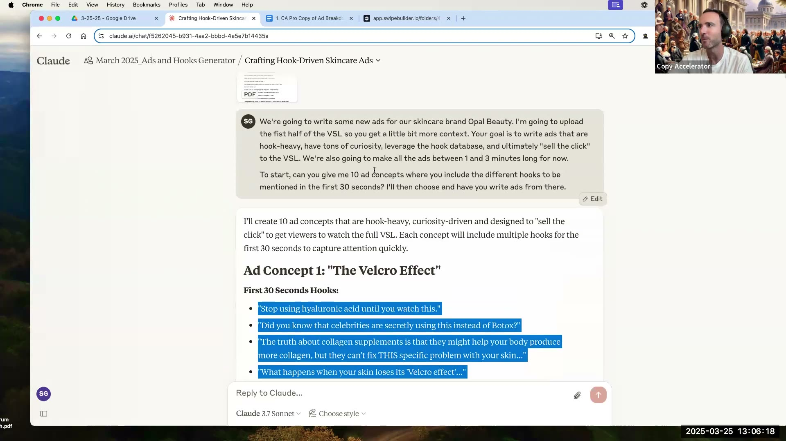
*The first prompt in project "March 2025_Ads and Hooks Generator" (Claude 3.7 Sonnet) and the start of "Ad Concept 1: The Velcro Effect" with its first-30-second hooks. [04:12]*

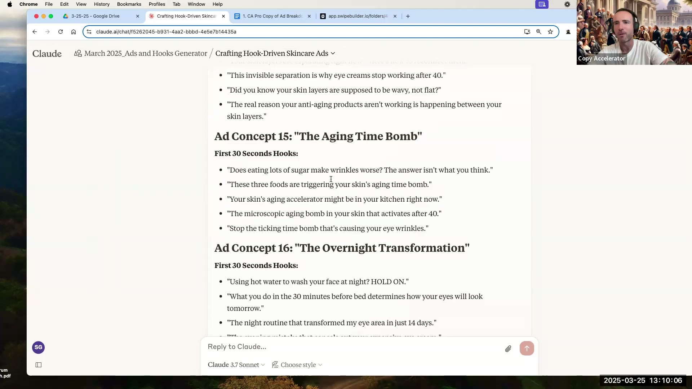
*Concepts 15 ("The Aging Time Bomb") and 16 ("The Overnight Transformation") scrolled past while he reads the earlier concept list: each concept is a named theme plus 4-5 first-30-second hooks. [08:00]*

### 3. Why: the V Shred ad breakdown [08:24–28:33]
- He plays a roughly five-minute V Shred video ad once straight through, then breaks it down "in incredibly minute detail frame by frame" [08:24]. Audience reaction: "hooks. Crazy how many hooks" [15:07].
- A participant who says he was V Shred's creative director "for the past four years" says the company took "a really successful ad that we did" and "put steroids on it with the visuals" (participant claim, unverified) [14:08–15:07].
- **Breakdown method (the part to copy).** An external contractor (Bashir) takes swipes saved in Swipe Builder, uses the Swipe Builder transcript, and writes a line-by-line breakdown: who is speaking, what they say, and what is on screen. Two versions exist: without screenshots (what LLMs get) and with screenshots ("right now isn't that useful for LLMs" but will be when context windows grow) [16:05–17:03]. The deliverable is the "Ad Breakdowns (In-Depth)" doc (seven ads: four V Shred, three Svelte) [28:33].
- Breakdown observations the instructor calls out [17:03–24:20]:
  - Opens on a "what the fuck image" (brown bars dipped in bright red syrup) with an AI narrator line: "This is how to get in shape fast" [18:02].
  - Curiosity gaps from the first lines: "If you want to drop this [points at belly]... start eating more of these" with the food intentionally unclear [18:02].
  - Speaker switching: AI narrator, out-of-shape guy, doctor, female podcast-style endorser, then the doctor again [17:03–18:59].
  - A video-edit pattern interrupt: what looks like B-roll of the doctor on a treadmill is revealed to be him; he stops and speaks to camera ("Stop running on the treadmill") [18:59].
  - Time-compression promise with an on-screen timer: "You may think this will take years to learn, but we're going to teach it to you in 60 seconds. Watch this." [18:59].
  - Direct commands: "you might want to listen to this," "watch this," "just stop and listen to what I'm about to tell you." He counts how many times this happens in the first 30 seconds [19:57–20:53]. He adds "I don't like NLP in copy a lot of the time… overrated" but says "if you think about it, there's a lot of commands in here" [18:59].
  - An AI voiceover inserted mid-script as a pattern interrupt [19:57].
  - Repetitive curiosity: "This is a metabolism killer" said four times over four jar-like objects [20:53].
  - Weird visuals that change colour while the line is spoken (yellow wax blocks flashing from red to yellow while a man holds them) [22:21].
  - Credibility insertion: "Turns out this guy's a celebrity trainer, so there's a bit of credibility here" [21:51].
  - Pattern interrupt jumps: "stop running on the treadmill or I'm going to jump in this pool" [23:20].
  - His name for the style: "ADHD mega hook ads… dopamine machines… constant dopamine supply of curiosity, different visuals" [22:21]. In the prompt and project instructions it becomes "ADHD Super-Hook Ad / Framework."
- Production cost note (instructor claim, vague): "our editor guy… I don't know, like two grand a month or something like that for like a hundred ads a month," using AI to put different people on screen [24:20].
- Doc structure of each breakdown: **Part I. Opening Hooks and Attention Grabbers** then **Part II** ("Root of Ad", "Core Messaging", or "Solution Introduction and Authority Building" depending on the ad). The doc note says the Part I hooks are what get tested; "the ads will have different Part Is, and then all go to this Part II" (Ad Breakdowns doc, Breakdown #1).

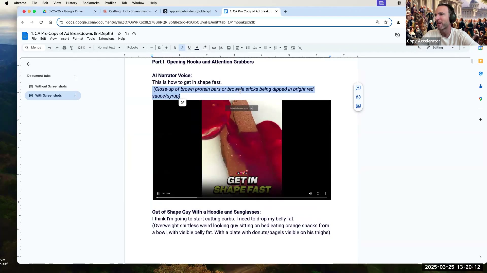
*The "With Screenshots" tab of "1. CA Pro Copy of Ad Breakdowns (In-Depth)": speaker label, spoken line, a description line in italics and a frame under it. The opening frame shows brown bars dipped in red syrup with the on-screen text "GET IN SHAPE FAST". [18:06]*

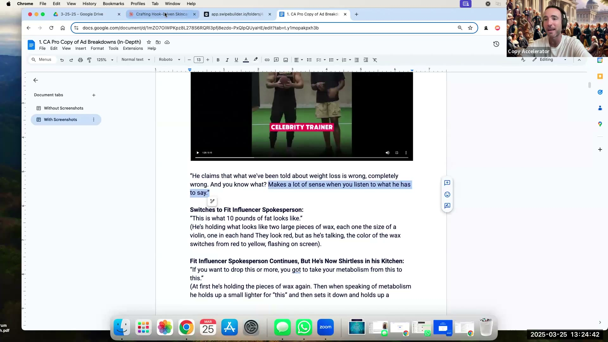
*Same doc during the breakdown: the "CELEBRITY TRAINER" on-screen label, the line "Makes a lot of sense when you listen to what he has to say," and the wax-prop description ("each one the size of a violin") that he reads at [22:21]. The left rail shows the two tabs "Without Screenshots" and "With Screenshots" described at [16:05–17:03]. [22:36]*

### 4. A weak counter-example and a second strong one [25:18–28:33]
- **Weak (stops hooking):** an HPV/genital-warts ad ("this is the fastest way to eliminate HPV and genital warts… Researchers at Harvard University discovered…") starts with curiosity in the editing but "doesn't just sort of keep going with hook after hook" [25:54–26:48]. He labels it a "weird AI, probably some black hat" offer. The unnamed "healthy back institute one" is mentioned but not shown [25:18].
- **Strong:** a Svelte ad: "Drink fruit smoothies first thing in the morning before watching this. Did you know that grapes are loaded with sugar? Hold on. Bananas are sugar bombs. Stop." followed by fast testimonial fragments ("I lost like seven pounds that first week… Lost over 40 pounds…") and curiosity questions ("Do you want to know what happens when you drink one tablespoon of turmeric before you poop?") [26:48–27:41].
- Conclusion he draws: the difference is "a hook and then it just sort of stops" vs. hook after hook; the research question becomes "how do I just layer in these hooks" [27:41].

### 5. The hook-generation pipeline [28:33–45:07]
He states the setup requirements: an ads-breakdown doc, a hook database doc, and the Claude Project instructions; these come from a shared Google Drive ("the whole Google Drive") with six numbered docs [28:33–30:02].

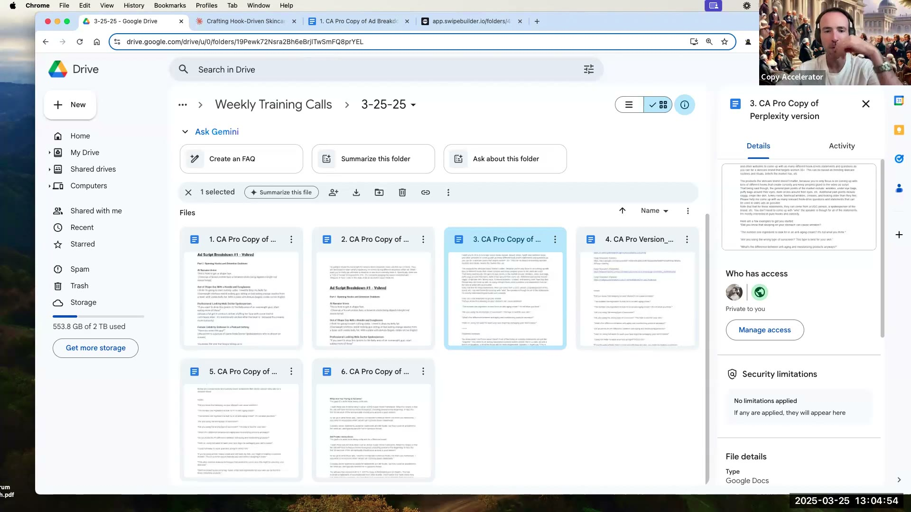
*Drive folder "Weekly Training Calls / 3-25-25" with the six working docs: 1 ad breakdowns, 2 deep-research prompt, 3 Perplexity version, 4 hook database, 5 "still MORE hooks" prompt, 6 Claude Project setup. The right pane shows doc 3. [02:48]*

**Step A: Deep research for first-pass hooks [30:02–37:55]**
- Prompt shape: (1) a paragraph describing the annotated ad transcripts and the ADHD Super-Hook concept, (2) the five annotated ad transcripts pasted in ("in this case I put like five"), (3) the research assignment: use social media signals, beauty blogs, health and wellness blogs to produce as many hook-driven statements and questions as possible for a skincare brand targeting women 35+, with general pain points listed, plus a few seed examples. Full text in Prompts. [30:02–31:52]
- It was run in four tools: Grok, Gemini, Perplexity, OpenAI. Perplexity could not take the PDF with all the ad examples, so he pasted a version with only a few hooks as examples (doc 3) [31:52].
- Results (instructor opinion, one run each):
  - Grok: a few interesting ones ("sleeping on your stomach can cause wrinkles"); like the others "trying to close the loop every time… writing them as fascinations or curiosity bullets" [32:59–34:04].
  - Gemini: heavy analysis; some usable fragments ("the secret ingredient for youthful skin might already be in your kitchen") [34:37].
  - Perplexity (Deep Research): "by far the best… 120 curiosity-driving hooks," e.g. "Do you know the direction you sleep could be adding years to your face?", "Stop massaging your face like this, it's creating more wrinkles than it's solving," "Stop microwaving food in plastic if you care about your skin's elasticity," "the link between your laundry detergent and accelerated skin aging" [35:14–36:46]. He flags some as "a little bit too aggressive" ("this is why your mother has fewer wrinkles than you do," "the collagen-destroying habit 87% of women do every morning without realizing it") [36:15]. The "87%" stat is unsourced; do not reuse.
  - OpenAI: "kind of sucked too" at this step; each tool had "a few good ones" [36:46].
- Process: copy the lines he likes into one doc ("hook database") [36:46].
- First feedback round to Perplexity: "Review these, can come up even more" returned extra lines such as "why your expensive night cream might be working against you while you sleep," "the surprising connection between your gut health and these stubborn forehead wrinkles," "Is your pillowcase secretly sabotaging your skincare routine?" [37:55].

**Step B: "Still MORE hooks" prompt [38:26–43:04]**
- Paste the hook database into a new prompt and add feedback that the lines should be snippets/fragments for multi-speaker ads (verbatim in Prompts) [38:26–39:22].
- Best outputs: Gemini Advanced 2.5 Pro (Experimental) and the OpenAI "GPT-4o1 Pro" per the doc ("about 70" hooks from the OpenAI one) [39:22; 41:47]. He says he is "completely agnostic" and switches models constantly, because the best output differs per run, "for copy Claude is still pretty good… probably still better than all the other ones on average," but for idea generation he runs several [39:22].
- Examples he kept from Gemini: "What if I told you your shower routine is aging you faster?", "the real reason your skin feels tight after cleansing," "Is your skin actually oily or is it just dehydrated?", "What about sugar and skin aging?" (he adds "Does eating lots of sugar make wrinkles worse?") [40:22–41:15].
- Examples from the OpenAI model: "Stop washing your face in the shower until you hear this," "Is that natural face scrub creating micro-tears in your skin?", "This one nutrient deficiency shows up on your face first," "Does your skin have a bedtime?" and the brand-fit line "Eye creams, face taping, and Botox all miss this one invisible layer under your skin" [41:47–43:04].
- His selection rule: "Not all of them are good… you're picking using your judgment." He dislikes lines that are all questions: "I don't like a lot of questions" [42:23–43:04].
- Loop: run deep research once, then run the "more hooks" prompt as often as needed ("do another 100"), and append winners to the database [43:04].

**Step C: Re-target for another niche [44:02–45:07]**
- Replace the audience line ("women 35+") and the pain-point list; change "the product the brand sells" line; leave the rest. Examples he gives: income-seekers (women 35+ stay-at-home moms), or women who want to remove unwanted facial hair [44:37].

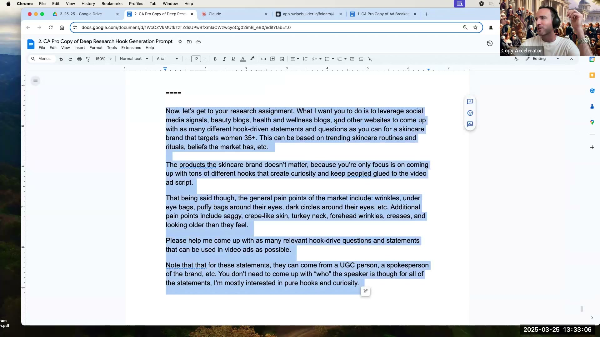
*The research assignment portion of "2. Deep Research Hook Generation Prompt" (highlighted). This is the part to edit for another niche; everything above it in the doc is the annotated ad transcripts. [31:00]*

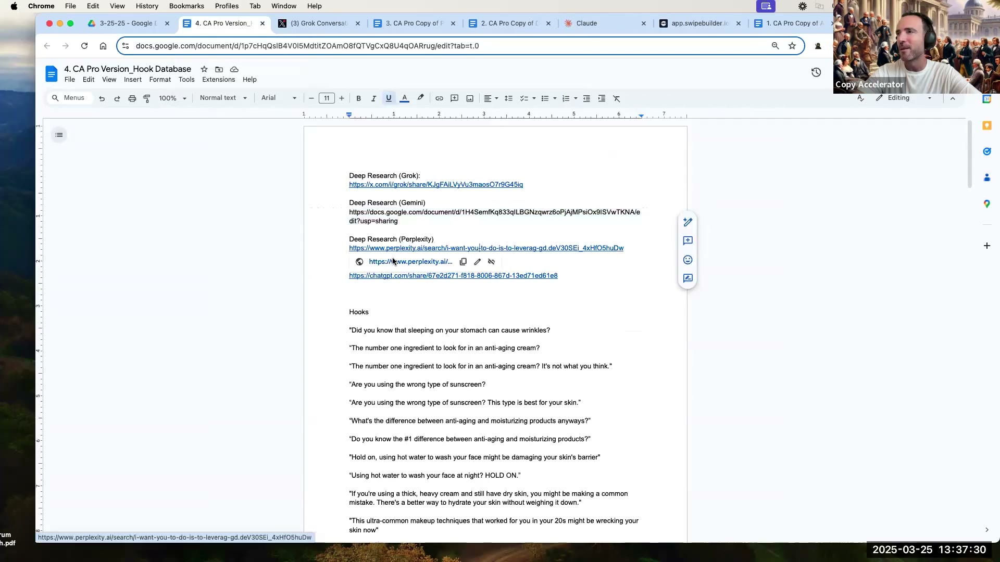
*"4. CA Pro Version_Hook Database": links to the four deep-research runs at the top (Grok, Gemini, Perplexity, OpenAI), then a flat list of hooks. [35:24]*

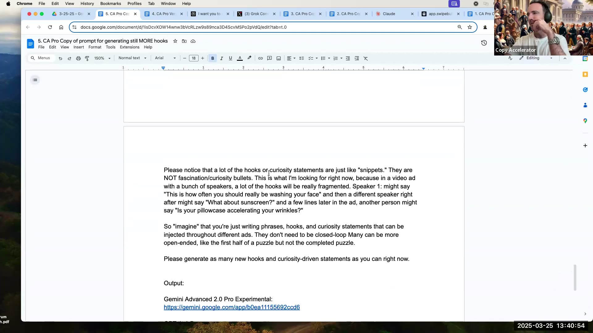
*The closing paragraphs of the "still MORE hooks" prompt: the "snippets, not fascination bullets" instruction, the "first half of a puzzle" line, and "generate as many new hooks and curiosity-driven statements as you can right now." [38:48]*

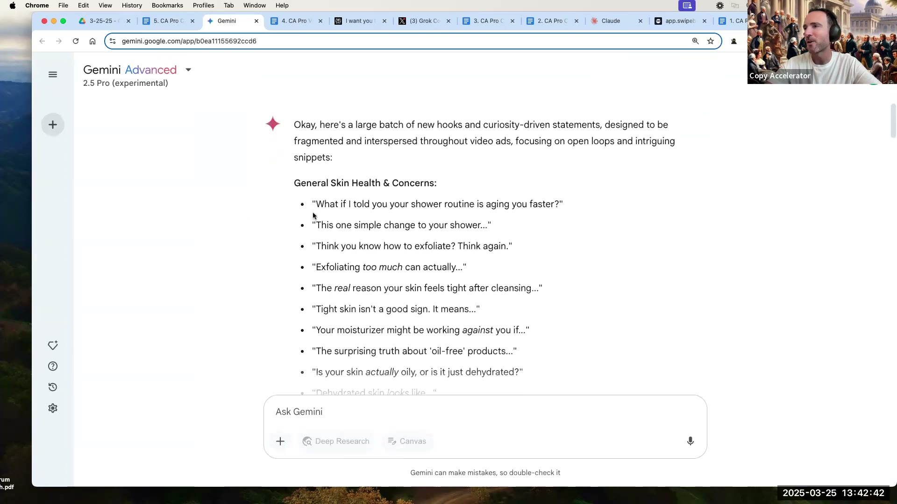
*Gemini Advanced 2.5 Pro (experimental) answering the "more hooks" prompt with fragments such as "This one simple change to your shower…" and "Exfoliating too much can actually…". [40:36]*

### 6. The Claude Project: instructions, knowledge, prompts [45:07–51:21]
- Two project knowledge files: "1. CA Pro Copy of Ad Breakdowns (In-Depth).pdf" (2,417 lines) and "4. CA Pro Version_Hook Database.pdf" (109 lines); screen shows 23% of knowledge capacity used (screen at 46:18).
- The project instructions state the goal ("write hook heavy meta ads"), the ADHD Super-Hook Framework, curiosity-driven statements, the two knowledge docs, and the critical rule: "unless I SPECIFICALLY ask you for it, when writing ads do NOT talk about the product in the ad." The CTA is a click-sell: "you need to watch this" [46:14–48:07]. Full text in Prompts.
- Project-level instructions let each chat prompt stay short: "I don't have to explain all this context" [48:07].
- **Half the VSL, not all of it.** He uploads the first half of the VSL "that goes to the unique mechanism… the promises and the spokesperson" as a PDF, because with the full VSL "it's really hard for the LLM to not also want to grab onto" product and ingredient talk [48:57–49:52]. "I would probably do that as a best practice if I was ever using the VSL or a long form sales page." If you want the product in the ad, change the instructions and supply the full page [49:52].
- Variations to try: add the "you need to see this / you need to watch this" language to the instructions and start a new chat in the project [48:07].

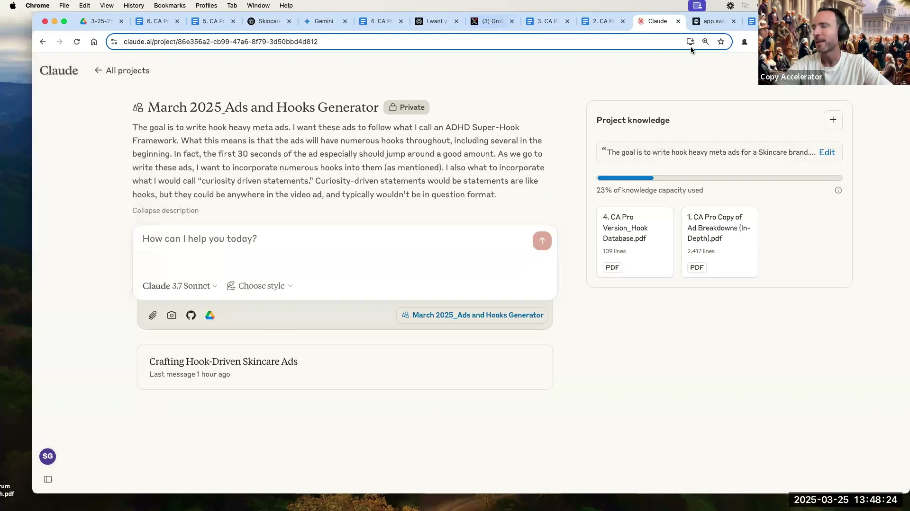
*Project "March 2025_Ads and Hooks Generator": description text on the left, project knowledge on the right with the hook database (109 lines) and ad breakdowns (2,417 lines) at 23% capacity. [46:18]*

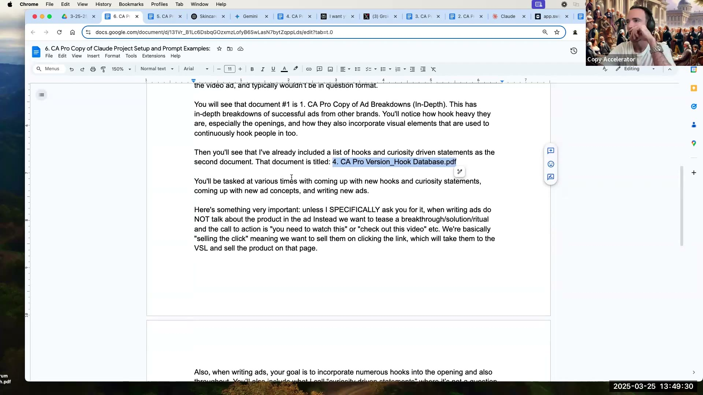
*Doc 6 with the highlighted file name of the hook database and the "do NOT talk about the product… selling the click" paragraph. [47:24]*

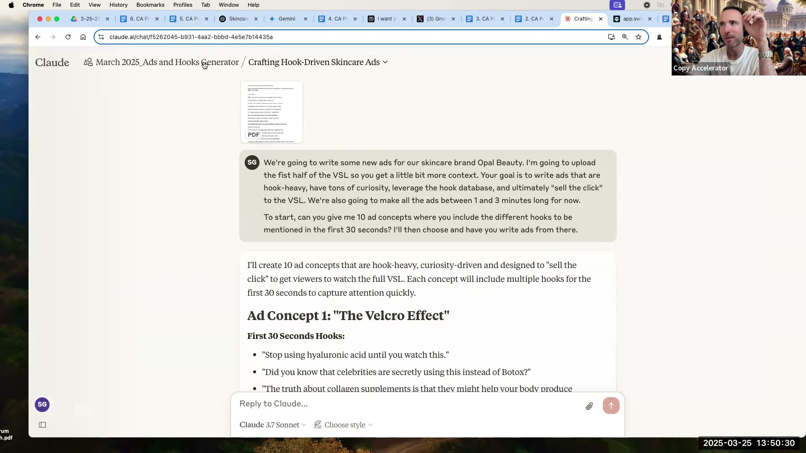
*The chat prompt with the first-half-of-VSL PDF attached; "I'm going to upload the first half of the VSL" is highlighted. [48:30]*

### 7. Iterating inside the project [49:52–56:32]
- Pick by number ("do number four… number eight… number nine… number ten"), ask for more concepts ("give me 10 more concepts"), and the project returns more with names such as "invisible junction, morning mirror shock, Botox alternative, the skin layer separation, the aging time bomb, the overnight transformation" [49:52–51:21].
- He asks for concept 15, reviews the script, and flags edits he would make: "this aging starter for your skin might be in your kitchen right now" instead of "aging accelerator," a doctor who says "there's actually this microscopic aging bomb in your skin that activates after 40," and he dislikes the "aging time bomb" idea [51:52–53:30].
- He notes the script still adds hooks inside the body ("it's still trying to do more hooks throughout") and that he would test an extremely "ADD" version ("honestly, I'd probably still test it. I'd probably just go really hard on the hooks") [50:50–52:30].
- Concept 16 ("Using hot water to wash your face at night. Hold on.") is revised by asking for better transitions: "Good job with loading up the opening with hooks… we need some better transitions between some of the hooks. So let's focus on better transitions between hook two and three and between three and four in the opening." [54:02–55:44]. His preference: "I'd rather have something to work with that's giving me all of these hooks… than something that isn't giving me any of that, and then I can edit on it" [54:02].
- Next implementation idea he floats (not demonstrated): "create a library of pre-edit hooks and then have editors or a creative director shuffle hooks to create winning combos" [55:44].

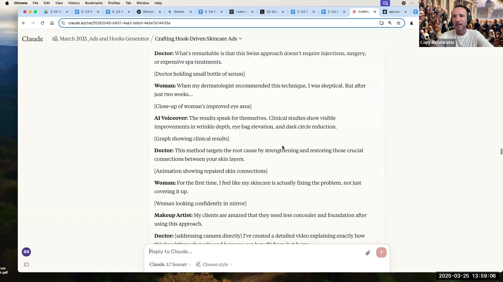
*A written ad inside the project: speaker labels (Doctor, Woman, AI Voiceover, Makeup Artist) interleaved with bracketed visual directions such as "[Graph showing clinical results]". Note the invented-looking claims in this raw output ("Clinical studies show visible improvements in wrinkle depth…"): unverified, replace. [57:00]*

### 8. Tracking and testing hook-stacked ads [56:32–1:02:35]
- Tracking: Opal Beauty "AdCreatives Database" sheet with tabs Videos, Script Database, Lead Database, Hook Database; columns Creative, Status, Frame Link, Launch Date, Script ID, Lead ID, Hook ID, Creative Name, Winner? (e.g. creative name format `AD0001V15_SC001_LD003_SS5`, one row marked "Yes" as winner) [56:32–57:38; screen 57:48].
- Reason: "as we scale… we can modularly combine stuff. This was the winner, take these hooks, take these leads." [57:38]
- Q: how do you know which of 15-20 stacked hooks won? Instructor: "I don't know that we have it down to the hooks specifically"; they tag at ad level, then test variants, e.g. "took that winner and stacked three more hooks on top of it" [58:39–1:00:08].
- Participant idea: put five hooks as primary-text variants and read which does best [1:00:08].
- Guest advice (participant "Tamir," experience claim): "do it gradually… a big hook test and then mix the winners… each of these hooks, even in a minute 40, used to be a winning hook on a video… we went by data, not by the copywriting… put two winners together and it's probably gonna be better" [1:00:08–1:01:07].
- Instructor adopts it: with five good hooks in the first ~60 seconds, "we wouldn't go take 10 more hooks and put them on top… We'd add one more at a time or two"; he admits "I am probably being a little bit greedy" stacking many hooks in new ads and promises to share results (none included in the course files) [1:01:07–1:02:35].

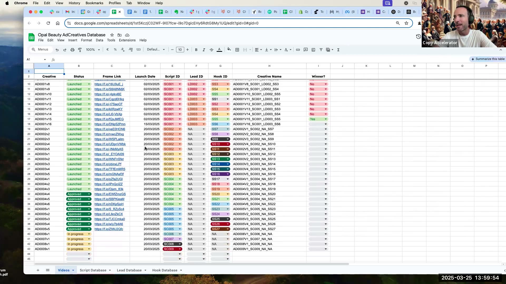
*Sheet "Opal Beauty AdCreatives Database" (tab "Videos"): each ad variant has a Script ID (SC), Lead ID (LD) and Hook ID (SS) concatenated into a creative name, a status (Launched / Approved / In progress) and a Winner? flag. Frame links are Frame.io URLs. [57:48]*

## Steps / framework
**ADHD Super-Hook ad build (as run in this call).**
1. **Collect swipes.** Save strong hook-heavy video ads in a swipe tool; get a transcript. [16:05]
2. **Annotate.** For each ad write line by line: speaker (generic role, not names, to broaden for AI), spoken line, and on-screen visual. Keep a no-screenshot version for LLMs. [16:05–17:03]
3. **Mark Part I vs Part II.** Part I = opening hooks and attention grabbers; Part II = the "root"/core messaging that many openings can lead into. (Ad Breakdowns doc)
4. **Write the research prompt.** Describe the ADHD Super-Hook style; paste annotated ads; ask for hooks for your market with pain points and a few seed examples. [30:02]
5. **Run it in several LLMs.** Prefer the deep-research mode; copy keepers into the hook database doc. [32:59–37:55]
6. **Run the "more hooks" prompt** with the database pasted in, to get fragments rather than closed-loop bullets; run in two or more models; append keepers. [38:26–43:04]
7. **Create the Claude Project.** Instructions + two knowledge docs (breakdowns, hook database). [45:07–47:10]
8. **Prompt for concepts.** Attach the first half of the VSL; ask for 10 concepts with first-30-second hooks. [48:57]
9. **Pick a concept by number**, ask for the full 1-3 minute script, then ask for fixes (transitions, speaker, hook swaps). [49:52–55:44]
10. **Edit aloud.** Fix flow so it reads naturally out loud. [53:30]
11. **Log IDs** (Script, Lead, Hook) and launch; stack new hooks onto winners gradually. [57:38; 1:01:07]

## Examples
- **V Shred ad structure (5 min):** weird-visual cold open → speaker switch → treadmill fake-out → 60-second promise with timer → AI voiceover interrupt → repeated "metabolism killer" lines → commands ("watch this") → celebrity-trainer credibility → "10 pounds of fat" prop → two-word reveal teaser ("visceral fat") → closing quiz CTA [8:24–14:08; 17:03–24:20]. Source clip contains weight-loss testimonials such as "I lost 53 pounds, 10 dress sizes" and "over 200 pounds" [13:31]; treat as the original ad's claims (not substantiated here).
- **Svelte-style opening:** "Drink fruit smoothies first thing in the morning before watching this. Did you know that grapes are loaded with sugar? Hold on. Bananas are sugar bombs. Stop." (new speaker every beat, prop "stop sign" pattern interrupt per breakdown #2) [26:48].
- **Claude-generated first-30-seconds stacks for Opal Beauty:** see concept 1 above and concepts 15-16 in the screenshots.
- **Tracking name pattern:** `AD0001V15_SC001_LD003_SS5` (creative / script / lead / hook).

## Structured units

### Hooks
Heuristic, emotion and self columns are **(derived)**; the lesson does not tag them. Hook text is verbatim from the Hook Database doc or the call. Skincare examples are the course's own; for our brands, copy the pattern and rewrite for the product.

| Hook (verbatim or near) | Heuristic(s) (derived) | Emotion / zone (derived) | Self targeted (derived) | Why it works | Source |
|---|---|---|---|---|---|
| "Stop washing your face in the shower until you hear this…" | Command + loss/avoidance | Alarm | Actual self | Imperative with an open reason; instructor: "that's a good hook" | Hook DB; [41:47] |
| "Hold on, using hot water to wash your face might be damaging your skin's barrier" | Interrupt + warning | Concern | Actual self | "Hold on" breaks flow; a common habit is framed as a threat | Hook DB (seed example in the prompt) |
| "Eye creams, face taping, and Botox all miss this one invisible layer under your skin." | Contrast with failed solutions + mystery location | Curiosity, frustration | Ideal self | Brand-specific hidden-layer mechanism hint; instructor: "That's good for us" | Hook DB; [43:04] |
| "Stop using hyaluronic acid until you watch this." | Command + incomplete answer | Alarm | Actual self | Commands a behavior change and withholds the reason | concept 1; [03:41] |
| "What happens when your skin loses its 'Velcro effect'…" | Metaphor + open loop | Curiosity | Ideal self | Names an unfamiliar mechanism by a physical image | concept 1; [03:41] |
| "Does eating lots of sugar make wrinkles worse?" | Question + common belief | Curiosity | Actual self | Instructor added this line after Gemini's "sugar and skin aging" prompt | [41:15] |
| "Is your pillowcase secretly sabotaging your skincare routine?" | Everyday-object threat | Suspicion | Actual self | Mundane object, unexpected blame | Perplexity round 2 [37:55] |
| "Does your skin have a bedtime?" | Odd question | Curiosity | Actual self | Pattern-interrupt wording; instructor: "It's actually good" | [43:04] |
| "The real reason your skin feels tight after cleansing…" | Hidden truth | Curiosity | Actual self | Familiar symptom plus a withheld cause | Gemini [40:22] |
| "You need to see this microscopic view of what's happening to your skin cells right now." | Command + visual promise | Curiosity | Actual self | Tells viewer to watch and promises a visual | concept; [04:12] |
| "This is a metabolism killer." (said four times) | Repetition + unnamed object | Curiosity, fear | Actual self | V Shred: repeated line while each item stays unidentified | [20:53] |
| "You may think this will take years to learn, but we're going to teach it to you in 60 seconds. Watch this." | Time compression + command | Curiosity | Ideal self | Counter on screen; low effort promise | [18:59] |

### Ad teardowns
| Brand / product (niche) | Format | Hook / opening | What works | What fails | Fix suggested | Principle | Source |
|---|---|---|---|---|---|---|---|
| V Shred (weight loss, men/women) | ~5 min multi-speaker video ad | Odd food image + "This is how to get in shape fast" + belly point + treadmill fake-out | Hook after hook; visual changes; speaker switches; commands; AI voice interrupt; credibility insertion | Not rated as a failure; the original ad's weight-loss claims are unverified | Copy structure, not claims | ADHD super-hook | [08:24–24:20] |
| HPV / genital-warts offer (health) | Video ad with AI voice | "This is the fastest way to eliminate HPV and genital warts" | Some curiosity at the start via editing | "Doesn't just keep going with hook after hook"; "weird AI, probably some black hat" | Keep adding hooks and open loops after the opener | Hook density | [25:54–26:48] |
| Svelte (weight loss) | Video ad | "Don't drink fruit smoothies first thing in the morning before watching this" | Rapid warnings, speakers, testimonials, curiosity questions | Not critiqued | n/a | ADHD super-hook | [26:48–27:41] |
| Opal Beauty (skincare, own brand) | AI-written ads, 1-3 min | Concept 15/16 hook stacks | Fragmented hook stacks | "Aging time bomb" idea disliked; transitions weak between hooks 2-3 and 3-4 | Rewrite lines for flow; request better transitions | Edit AI output | [51:52–55:44] |

### Rewrites (before → after)
| Before | After | What changed | Source |
|---|---|---|---|
| "These three foods are triggering your skin's aging time bomb. Your skin's aging accelerator might be in your kitchen right now." | "This aging starter for your skin might be in your kitchen right now." | Wording and speaker flow; he says he "just doesn't like the idea of an aging time bomb" | [52:30] |
| Woman says the night-routine hook | Doctor says it | Speaker swapped to the expert | [54:02] |
| Hooks written as closed-loop fascination bullets | Fragments with open loops (the "first half of a puzzle") | Format of the output requested | [38:26–39:22] |

## Prompts / templates (verbatim)

### 1. Deep research hook-generation prompt (doc "2. Deep Research Hook Generation Prompt")
The doc has two parts: the opening paragraph, then the annotated ad transcripts, then a research assignment. The ad transcripts are the contents of the Ad Breakdowns doc (do not paste them here; paste your own annotated ads).

```text
I'm going to share the transcripts for several direct response video ads that run on meta. They are annotated to share what's happening on screen during different segments of the ad. What I want you to really pay attention to however is how much curiosity there is. Specifically, there are a TON of "hooks" throughout the VSL. It's constantly keeping the viewer interested and intrigued. In fact, I refer to this style of ad as an ADHD Super-Hook Ad.

[PASTE YOUR ANNOTATED AD TRANSCRIPTS HERE: the lesson's doc has seven breakdowns (Vshred and Svelte), in the form "Ad Script Breakdown #1 - Vshred", "Part I. Opening Hooks and Attention Grabbers", speaker name, spoken line, (visual description)]

====

Now, let's get to your research assignment. What I want you to do is to leverage social media signals, beauty blogs, health and wellness blogs, and other websites to come up with as many different hook-driven statements and questions as you can for a skincare brand that targets women 35+. This can be based on trending skincare routines and rituals, beliefs the market has, etc.

The products the skincare brand sells doesn't matter, because you're only focus is on coming up with tons of different hooks that create curiosity and keep people glued to the video ad script.

That being said though, the general pain points of the market include: wrinkles, under eye bags, puffy bags around their eyes, dark circles around their eyes, etc. Additional pain points include saggy, crepe-like skin, turkey neck, forehead wrinkles, creases, and looking older than they feel.

Please help me come up with as many relevant hook-driven questions and statements that can be used in video ads as possible.

Note that for these statements, they can come from a UGC person, a spokesperson of the brand, etc. You don't need to come up with "who" the speaker is though for all of the statements, I'm mostly interested in pure hooks and curiosity.
```
Niche swap (instructor [44:37–45:07]): change "skincare brand that targets women 35+", the pain-point paragraph, and "the products the skincare brand sells". The doc (as extracted) has typos ("you're only focus", "Note that that") that the instructor acknowledges ("I didn't even write this in coherent English") [30:57]; kept here as in the file.

### 2. Perplexity version (doc "3. Perplexity version")
Used because Perplexity could not read the long PDF. No ad transcripts; the seed hooks stand in for them.

```text
I want you to do is to leverage social media signals, beauty blogs, health and wellness blogs, and other websites to come up with as many different hook-driven statements and questions as you can for a skincare brand that targets women 35+. This can be based on trending skincare routines and rituals, beliefs the market has, etc.

The products the skincare brand doesn't matter, because you're only focus is on coming up with tons of different hooks that create curiosity and keep peopled glued to the video ad script.

That being said though, the general pain points of the market include: wrinkles, under eye bags, puffy bags around their eyes, dark circles around their eyes, etc. Additional pain points include saggy, crepe-like skin, turkey neck, forehead wrinkles, creases, and looking older than they feel.

Please help me come up with as many relevant hook-drive questions and statements that can be used in video ads as possible.

Note that that for these statements, they can come from a UGC person, a spokesperson of the brand, etc. You don't need to come up with "who" the speaker is though for all of the statements, I'm mostly interested in pure hooks and curiosity.

Here are a few examples to get you started:

"Did you know that sleeping on your stomach can cause wrinkles?

"The number one ingredient to look for in an anti-aging cream? It's not what you think."

"Are you using the wrong type of sunscreen? This type is best for your skin."

"What's the difference between anti-aging and moisturizing products anyways?"

"Hold on, using hot water to wash your face might be damaging your skin's barrier"
```
Feedback message in the same doc (sent after the first Perplexity output):
```text
You know what I don't love about these? A lot of the hooks or curiosity statements are just like "snippets." You seem to be writing fascination/curiosity bullets almost. But in a video ad with a bunch of speakers, a lot of the hooks will be really fragmented. Speaker 1: might say "This is how often you should really be washing your face" and then a different speaker right after might say "What about sunscreen?" and a few lines later in the ad, another person might say "Is your pillowcase accelerating your wrinkles?"

So "imagine" that you're just writing phrases, hooks, and curiosity statements that can be injected throughout different ads. They don't need to be closed-loop Many can be more open-ended, like the first half of a puzzle but not the completed puzzle.
```
(Note: the call video says he fed Perplexity's output back with "review these, can come up even more" [37:55]; the doc's feedback text is the "snippets" correction above.)

### 3. "Still MORE hooks" prompt (doc "5. prompt for generating still MORE hooks")
```text
Below are several hooks and curiosity-driven statements that can be used in video ads for a skincare brand:

Hooks

[PASTE YOUR HOOK DATABASE HERE: one hook per line. The lesson's database has ~90 lines, e.g. "Did you know that sleeping on your stomach can cause wrinkles?", "Stop using hyaluronic acid until you watch this.", "Is that 'natural' face scrub creating micro-tears in your skin?"]

===

Please notice that a lot of the hooks or curiosity statements are just like "snippets." They are NOT fascination/curiosity bullets. This is what I'm looking for right now, because in a video ad with a bunch of speakers, a lot of the hooks will be really fragmented. Speaker 1: might say "This is how often you should really be washing your face" and then a different speaker right after might say "What about sunscreen?" and a few lines later in the ad, another person might say "Is your pillowcase accelerating your wrinkles?"

So "imagine" that you're just writing phrases, hooks, and curiosity statements that can be injected throughout different ads. They don't need to be closed-loop Many can be more open-ended, like the first half of a puzzle but not the completed puzzle.

Please generate as many new hooks and curiosity-driven statements as you can right now.
```

### 4. Claude Project instructions (doc "6. Claude Project Setup and Prompt Examples")
"What are you trying to achieve?" (project description text):
```text
The goal is to write hook heavy meta ads.

I want these ads to follow what I call an ADHD Super-Hook Framework. What this means is that the ads will have numerous hooks throughout, including several in the beginning. In fact, the first 30 seconds of the ad especially should jump around a good amount.

As we go to write these ads, I want to incorporate numerous hooks into them (as mentioned). I also want to incorporate what I would call "curiosity driven statements."

Curiosity-driven statements would be statements that are like hooks, but they could be anywhere in the video ad, and typically wouldn't be in question format.
```
Project instructions (as in the doc; "for a Skincare brand" is the course's niche, replace it):
```text
The goal is to write hook heavy meta ads for a Skincare brand.

I want these ads to follow what I call an ADHD Super-Hook Framework. What this means is that the ads will have numerous hooks throughout, including several in the beginning. In fact, the first 30 seconds of the ad especially should jump around a good amount.

As we go to write these ads, I want to incorporate numerous hooks into them (as mentioned). I also what to incorporate what I would call "curiosity driven statements."

Curiosity-driven statements would be statements are like hooks, but they could be anywhere in the video ad, and typically wouldn't be in question format.

You will see that document #1 is 1. CA Pro Copy of Ad Breakdowns (In-Depth). This has in-depth breakdowns of successful ads from other brands. You'll notice how hook heavy they are, especially the openings, and how they also incorporate visual elements that are used to continuously hook people in too.

Then you'll see that I've already included a list of hooks and curiosity driven statements as the second document. That document is titled: 4. CA Pro Version_Hook Database.pdf

You'll be tasked at various times with coming up with new hooks and curiosity statements, coming up with new ad concepts, and writing new ads.

Here's something very important: unless I SPECIFICALLY ask you for it, when writing ads do NOT talk about the product in the ad. Instead we want to tease a breakthrough/solution/ritual and the call to action is "you need to watch this" or "check out this video" etc. We're basically "selling the click" meaning we want to sell them on clicking the link, which will take them to the VSL and sell the product on that page.

Also, when writing ads, your goal is to incorporate numerous hooks into the opening and also throughout. You'll also include what I call "curiosity driven statements" where it's not a question, but a statement from the speaker (could be a UGC person, a doctor, or an AI Voiceover etc) that is curiosity heavy and catches someone's attention.
```

### 5. Chat prompt that starts a session (same doc)
```text
We're going to write some new ads for our skincare brand Opal Beauty. I'm going to upload the fist half of the VSL so you get a little bit more context. Your goal is to write ads that are hook-heavy, have tons of curiosity, leverage the hook database, and ultimately "sell the click" to the VSL. We're also going to make all the ads between 1 and 3 minutes long for now.

To start, can you give me 10 ad concepts where you include the different hooks to be mentioned in the first 30 seconds? I'll then choose and have you write ads from there.
```
Follow-ups spoken on the call (reconstructed, not in the docs): "ad concept number one. Go ahead and write that now" [04:42]; "give me 10 more concepts" [51:21]; "please do concept number 15 now" [51:21]; transitions fix: "Good job with loading up the opening with hooks. I do think we need some better transitions between some of the hooks. So let's focus on better transitions between hook two and three and between three and four in the opening." [55:12].

### 6. Hook-database seed list
The full list (about 90 lines, from the Hook Database doc) is in the source doc; do not copy it into production ads. Source categories visible in the list: habit threats (shower, hot water, plastic, laundry detergent), "kitchen ingredient" secrets, home-remedy tests ("What about cold cucumbers? / banana peels? / potato slices for dark circles?"), mechanism teasers ("Velcro effect," "wavy connection between your skin layers is flattening out"), authority borrowing ("makeup artists use this trick on mature skin"), and comparison-to-failed-solutions lines.

## Screenshots
See inline images above (assets in `../../../../assets/stefan-georgi/rmbc-ii/04-10-using-ai-to-generate-endless-good-hooks/`). Not captured: the V Shred ad itself and the Svelte clip (screen-shared video, played with audio only in this transcript); the Perplexity, Grok and OpenAI output pages.

## How to apply
- [ ] Define your ad format: multi-speaker, hook change every few seconds, 1-3 minutes, click-selling CTA (derived: check platform policy before health or finance claims).
- [ ] Build or collect 3-7 annotated winning ads in your niche (speaker, line, visual) and mark Part I vs Part II.
- [ ] Write your research prompt: swap audience, pain points and seed hooks into the template; run it in at least two LLMs; copy keepers into a hook database.
- [ ] Run the "snippets, not fascination bullets" prompt with your database pasted in; run in two models; append keepers; remove lines you cannot support.
- [ ] Create the Claude Project with instructions, annotated ads and the hook database; do not talk about the product unless asked.
- [ ] Upload only the pre-product half of the VSL or page as context.
- [ ] Ask for 10 concepts, pick by number, ask for a script, then edit for natural speech and transitions.
- [ ] Add "watch this / you need to see this" lines where natural (the instructor's planned experiment).
- [ ] Record hook ID, lead ID and script ID per creative; test hooks, keep winners, add one or two hooks at a time (derived from the call).
- [ ] Replace any invented credential, statistic or testimonial the model produced.

## Related
- Hook-ad concepts built from a brief: [5.2 Brief generator + hook-ad concepts](05-02-the-brief-generator-with-claude-project-unity-eye-serum-exam.md) (concept #3 and the "save 57%" CTA discussion).
- Short VSL structures that these ads feed: [4.9 Short VSLs](04-09-short-vsls-structures-and-examples.md); in-feed ad vs landing-page VSL: [4.11](04-11-vsls-on-landing-pages-vs-vsls-as-in-feed-ads.md).
- Leads and background after the hook: [4.3 Leads after the opening hook](04-03-vsl-leads-after-the-opening-hook.md).
- Unique mechanism language used in the Velcro concept: [3.1 Unique mechanisms overview](03-01-unique-mechanisms-overview.md); Evolve version: [Unique mechanism](../../../evolve/copywriting/concepts/unique-mechanism.md).
- **Evolve hooks (agreement and tension):** Evolve's hook page asks for emotion, a curiosity gap and stakes in one sticky hook and warns "Curious NOT confused" ([Hooks](../../../evolve/copywriting/concepts/hooks.md), [Open loops](../../../evolve/copywriting/concepts/open-loops.md)). This lesson goes the other way on density: many fragmented hooks per ad. The instructor himself says one script "seems like it jumps around a bit… I'd probably still test it" [50:50]. Treat the choice (one clean hook vs a stack) as a test variable, not a settled rule (derived).
- Shared KB: [Curiosity gap heuristic](../../../../concepts/heuristics/curiosity-gap.md) · [Creative testing system](../../../../frameworks/creative-testing-system.md) · [Hooks library](../../../../libraries/hooks.md)
- AI in copywriting (operator view, Evolve): [AI in copywriting](../../../evolve/copywriting/concepts/ai-in-copywriting.md)

## Sources and limitations
- Transcript: <../../../../../raw/stefan-georgi/rmbc-ii/_transcripts/Stefan Georgi - RMBC II (1)/04-VSLS SECTION I-Structure Theory and Examples/10-[9] Using AI to Generate Endless Good Hooks.txt> (machine-generated, 3,828 s). Platform captions: `10-9 Using AI to Generate Endless Good Hooks Examples.srt`.
- Docs (all six used): ad breakdowns (about 52k words, the same seven breakdowns appear twice in the extraction, once without and once with screenshot markers), deep research prompt, Perplexity version, hook database, "still MORE hooks", Claude Project setup.
- **Mishearing fixes:** "hoax" = hooks; "quad/cloud project" = Claude Project; "BSL" = VSL; "spelled" = Svelte; "Dr. Review" = the doctor spokesperson (the breakdown doc names no doctor); "GPT-401 Pro" = the doc's "GPT-4o1 Pro" (an OpenAI o1-pro-class model); "Condago/Kandago" is a name for an agency that is unclear in the audio and left out here. The V Shred ad's own audio plays between 09:24 and 14:08 and is transcribed inline; those lines are not the instructor.
- **Not in the files:** the Grok/Gemini/Perplexity/OpenAI output pages (only links in the Hook Database doc); the full ad breakdowns in the video; performance data from the stacked-hook ads ("I'll share the results" [1:02:35]); the full V Shred and Svelte videos.
- **Instructor claims without data:** that hook-heavy ads are "what I've seen working"; the "two grand a month for a hundred ads" editor cost; V Shred's origin as told by a participant.
- **Compliance flags:** the V Shred/Svelte examples contain weight-loss, health and testimonial claims (pounds lost, "metabolism killer," visceral-fat risk statements) and the HPV example shows "Harvard researchers" authority and "fastest way to eliminate HPV." The Opal Beauty skincare hooks contain claims that would need substantiation or would draw Meta/FTC attention: "celebrities are secretly using this instead of Botox," "banned in three countries," "Japanese women have been using this $3 kitchen ingredient… for centuries," "87% of women do this every morning," "how doctors in Switzerland are treating" wrinkles/Botox-type concerns (concept 9; the transcript line is garbled) [06:32], "I'm never going back to Botox," and fabricated-expert scripts (a "Dr. Schilling," an on-camera "dermatologist recommended this technique"). Copy structure only; do not publish invented authority, statistics, testimonials or medical or disease claims.
- Screenshots were grabbed from the MEGA video at the listed times; the V Shred and Svelte videos themselves were not captured.
