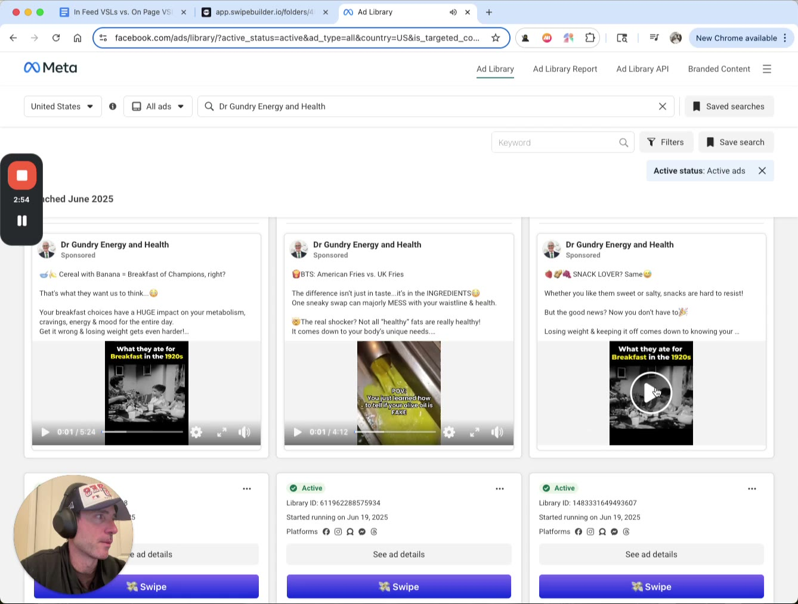
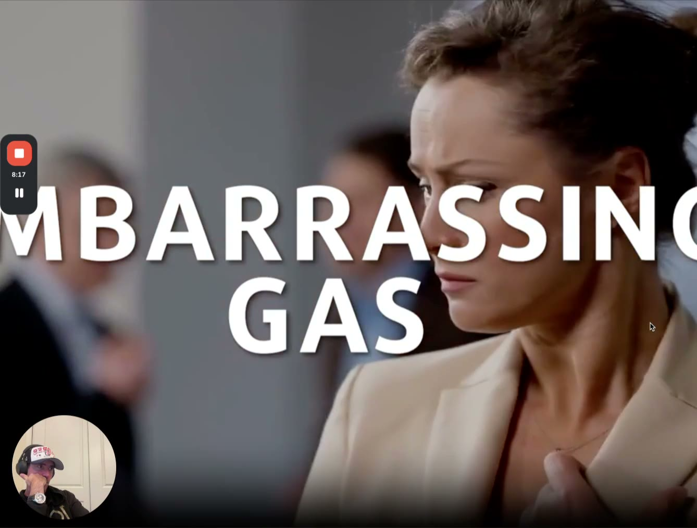
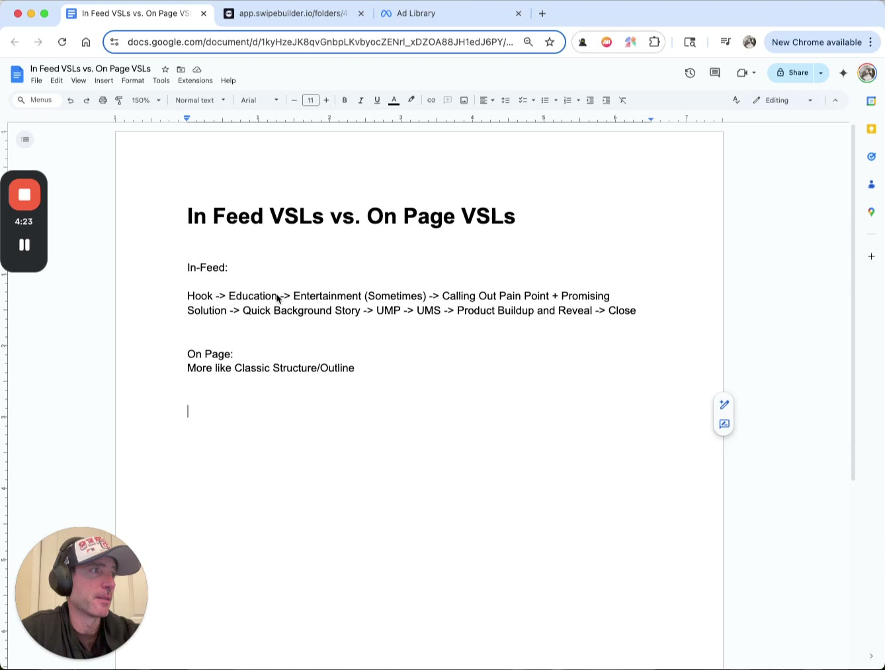

# 4.11 VSLs on Landing Pages vs VSLs as In-Feed Ads
> An in-feed VSL (a video ad on Meta) and an on-page VSL (a video on a landing page in the funnel) serve viewers in different mental states, so the same script cannot simply be moved from one to the other; the lead has to change, and swiping a big brand's long in-feed VSL for an on-page funnel usually fails.

## 🤖 Agent use
- **Use when:** deciding where a VSL will run (Meta in-feed ad vs landing-page/funnel video) before outlining or writing it; adapting an in-feed winner into an on-page VSL (or the reverse); reviewing a swipe of a big-brand VSL; picking which structure to give a Claude VSL project (see [6.1 Claude VSL projects setup](06-01-claude-vsl-projects-setup-overview.md)).
- **Inputs → outputs:** placement (in-feed ad / on-page / both), cold-vs-warm traffic state, the brief, and a candidate script or swipe → the right structure for that placement (in-feed spine vs classic on-page outline), a rewritten lead, and a warning list if the swipe came from the other placement.
- **Rules:**
  - **DO** decide the placement first. The course gives two different spines: in-feed = "Hook or Multiple Hooks (Curiosity Heavy) -> Education -> Entertainment (Sometimes) -> Calling Out Pain Point + Promising Solution -> Quick Background Story -> UMP -> UMS -> Product Buildup and Reveal -> Close"; on-page = "More often follows classic VSL outline discussed in RMBC" (doc "11-101 In Feed VSLs vs On Page VSLs"; [04:02–05:01]).
  - **DO** make in-feed VSLs education- or entertainment-led, curiosity-heavy and often multi-hook. Viewers are on Meta "to talk with friends, watch influencers, consume content… or to learn… or to be entertained" [05:01–05:58].
  - **DO** write the on-page lead as the classic lead: curiosity, "fascinations", pain-point amplification, a tease of the solution and of the unique mechanism. The doc says "ESPECIALLY the lead." [06:30–08:53; doc]
  - **DON'T** drop a good in-feed VSL onto a landing page unchanged. The instructor's example: engagement was good in-feed, but on the page it dropped, because the video "wasn't hooking them in enough… there was no classic lead" [09:59–11:01].
  - **DON'T** swipe a long Dr. Gundry-style in-feed VSL for an on-page funnel and expect it to work: "it never works for them" [v2 00:00–01:56].
  - **IF** you reuse the same VSL body for both placements **THEN** keep most of it but write a different lead for on-page: "a lot of the same VSL actually, but… especially the lead really needs to be different" [11:01].
  - **IF** you are a copywriter asked to "just swipe Dr. Gundry" for a client **THEN** tell the client the placement, journey and economics differ (see Key idea 4) before writing, and do not copy the voice (the instructor's quip: "Hey, you know, avocados for health? No, like, wrong.") [v2 01:34–01:56].
  - **IF** an on-page VSL follows an educational in-feed ad **THEN** the in-feed ad is the "mental warmup" and the page can run a full classic VSL [08:53–09:59]. If the traffic is less warmed up (e.g. a quick ad straight to the page), the on-page lead has to do that warming itself (derived).
- **See also:** [4.2 VSL fundamentals and classic structure](04-02-vsl-fundamentals-classic-structure.md) · [4.3 VSL leads after the opening hook](04-03-vsl-leads-after-the-opening-hook.md) · [4.10 Using AI to generate endless good hooks](04-10-using-ai-to-generate-endless-good-hooks.md) · [4.8 Medium VSLs](04-08-medium-vsls-structures-and-examples.md) · [Native advertising](../../../../concepts/native-advertising.md) · [Evolve: Unaware ads](../../../evolve/copywriting/concepts/unaware-ads.md)

## Key ideas

### 1. Why this video exists [00:00–00:40]
- It is placed right before the section on "actually producing endless VSLs": "there is one last really important thing I want to talk about… the difference or some differences between in-feed VSLs and on-page VSLs" [00:00].
- In-feed = "VSLs are being run as Facebook ads." [00:00]
- The instructor's closing claim: "nobody else talks about it so I feel like this is low-key an extremely important video for you to understand." [11:01] (instructor claim; no evidence given.)
- The attached doc says the same: there are "MAJOR DIFFERENCES and it is CRUCIAL you understand this", and it points to two videos, one about 11 minutes and one about 2 minutes (doc "11-101 In Feed VSLs vs On Page VSLs").

### 2. What an in-feed VSL looks like (Emma Relief ads, Dr. Gundry ads) [00:40–05:01]
- He opens Emma Relief's active Meta ads: the clips "look four minutes long", and "what you're seeing is education" even though the topic is "gross" (constipation) [00:40–02:04].
- He then shows a longer in-feed example, a Dr. Gundry ad from Swipe Builder: "longer, but still in feed, still a Facebook ad." On screen, two active Gundry ads show runtimes of 5:24 and 4:12 [02:04–04:02].
- Structure as he describes it: "a hook or a bunch of hooks" (he points back to the ADHD-style hook ads and to [4.10](04-10-using-ai-to-generate-endless-good-hooks.md)); then "education… curiosity heavy"; "or entertainment, sometimes both"; "calling out pain points and promising a solution, yes. Like do this to get rid of belly fat or bloating overnight. Do this for stuck poop"; then "maybe a quick background story, but it often goes right into the UMP, UMS", then product build-up and reveal, then close [04:02–05:01].
- Product build-up in-feed "might be as simple as quickly introducing the product and getting into a kind of fairly quick close". The background story "may or may not have a ton of stuff. It might just be like, hey, I'm a doctor. I know what I'm talking about." [05:01–05:58]


*Meta Ad Library results for a Dr. Gundry page. Two of the video ads show runtimes of 5:24 and 4:12, with feed-style copy above them. This is what "in-feed VSL" means in the lesson: a multi-minute educational video ad, not a landing-page video. [02:54]*

### 3. Why the on-page VSL is different: the viewer's journey [05:01–09:59]
- Context-specific journeys is a recurring RMBC II theme: people on Meta or YouTube are there "to talk with friends, watch influencers, consume content", "or to learn", "or to be entertained", so "going into a full-on classic VSL doesn't make as much sense" in the feed [05:01–05:58].
- He then plays the Emma Relief on-page VSL, a "classic" VSL that "goes on for like an hour". Observed features:
  - "Hey, today I'm going to talk about this. I'm going to talk about this. This is curiosity, fascinations." [07:11]
  - It teases the UMP "like the start of it" (a clogged, backed-up system) without delivering the full mechanism yet [07:11–08:01].
  - "An amplification of the pain points. All these pain points. When you watch the in-feed stuff, the four-minute-long ads for Emma, you didn't see much of that at all, right? Because it's a different mentality." [08:01–08:53]
- The handoff: in-feed viewers "get educated and get bought into wanting to learn more… being curious about the solution… a seven-second bowel-releasing ritual. They click on the ad. Now they come to the VSL." [08:53]
- He says the one-hour classic VSL "crushes. Or at least did, as very recently, probably still does" (instructor claim; no numbers shown) and that "the mentality is different. That's what people miss." [08:53]
- The same logic holds for other destinations: "Same thing, by the way, for statics, advertorials, VSLs, whatever." [08:53] (Whisper wrote "ecstatic, sabratorials"; corrected using the .srt context.)
- A quick ad that sends colder traffic to the page "still works" but "they're kind of less warmed up". The educational in-feed ads are "almost like a mental warmup. It's native to the content they're trying to see. And then you can come here and then you can do a full classic VSL." [08:53–09:59]


*The on-page Emma Relief VSL leans on pain amplification on screen ("EMBARRASSING GAS" over a distressed model), which the instructor contrasts with the education-first in-feed ads. [08:18]*

### 4. The case study and the swipe warning [09:59–11:01; v2 00:00–01:56]
- **Case:** a "CA Pro member" took an in-feed VSL "that had done pretty well" and put it on a landing page. In-feed engagement was "pretty good"; on the landing page the engagement was "like this" (he gestures down). The reason he gives: the video had the education, but "there actually basically was no strong lead… no classic lead… we were seeing, like, oh, these pain points, we're teasing the mechanism, all the stuff in the classic sales letter outline I shared." [09:59–11:01] ("CA Pro" is as spoken; the program is not defined in the lesson.)
- **Why people fail copying Golden Hippo/Gundry (follow-up video):** he says people see "what Golden Hippo does, like Dr. Gundry, in-feed VSLs" and want that on-page in their own funnel, and "it never works for them". Two reasons: [v2 00:00–00:59]
  1. Economics: Gundry has "their whole call center", "a huge company, really dialed in. You're probably not as dialed in as they are." (instructor claim.) [v2 00:50]
  2. The education component: the educational in-feed pattern is copied into an on-page context, but "where the psychologically prospect is at is different. It's a different journey." [v2 00:59]
- He claims he has seen "big brands, people with lots of money, waste $50,000, $100,000, $150,000 for this exact reason" (instructor claim; no case named). [v2 01:29]
- For copywriters: "I'll just swipe Dr. Gundry for this client… you bomb for your client and don't get hired again." [v2 01:34–01:56]


*The Google Doc the instructor builds the lesson around: in-feed = Hook -> Education -> Entertainment (sometimes) -> pain point + promise -> quick background -> UMP -> UMS -> product buildup and reveal -> close; on-page = "More like Classic Structure/Outline". [04:24]*

## Steps / framework
**Pick the structure by placement (derived from the doc and the video).**

| Question | In-feed VSL (Meta ad) | On-page VSL (landing page / funnel) |
|---|---|---|
| Where is the viewer? | Scrolling to socialize, learn or be entertained [05:01] | Already clicked; "bought into wanting to learn more" if warmed up [08:53] |
| Typical length seen | Emma ads about 4 min; two Gundry ads 4:12 and 5:24 on screen [02:04–04:02] | Emma on-page VSL "like an hour" [07:11] |
| Opening | One hook or many curiosity-heavy hooks [04:02] | Classic lead: curiosity + fascinations + pain-point amplification + tease of solution/UMP [07:11–08:53] |
| Core | Education and/or entertainment, then pain + promised solution [04:02] | Classic outline, more depth and pain amplification [08:01] |
| Background | Quick, or "I'm a doctor" [05:01] | Per classic outline ([4.4](04-04-vsl-background-stories-and-unique-mechanisms.md)) |
| Mechanism | UMP/UMS follows quickly [04:02] | Teased in the lead, delivered after background [07:11] |
| Close | Product buildup and reveal -> close; can be short [05:01] | Full classic close ([4.6](04-06-vsl-closes.md)) |

**Adapting an in-feed winner to a landing page (derived from the case study):**
1. Keep the body (education, UMP, UMS, buildup, close) if it already converts. [11:01]
2. Replace the lead with a classic lead: curiosity, fascinations, amplified pain points, teased solution and mechanism. [09:59–11:01]
3. Match the page's promise to the ad's promise (for example the "seven-second bowel-releasing ritual" named in the ad is the thing the page teases) [08:53].
4. Test lead variants first; the lead was the failure point in the case study.

## Examples
- **Emma Relief in-feed ads (digestive supplement niche).** About 4-minute educational videos; "education" is the draw even for an unglamorous topic; pain-point amplification is light. [00:40–02:04; 08:01]
- **Dr. Gundry in-feed VSLs.** Longer in-feed ads (5:24 and 4:12 shown on screen) with feed copy such as "Cereal with Banana = Breakfast of Champions, right? That's what they want us to think…" and "SNACK LOVER? Same." The instructor uses them as the reference for "in-feed, long, education-heavy" [02:04–04:02; screenshot]. Treat the ad copy as an example of tone only.
- **Emma Relief on-page VSL.** About an hour long, classic structure; opens with "today I'm going to talk about…" curiosity/fascinations, teases the UMP, amplifies pain. [07:11–08:53]
- **The "seven-second bowel-releasing ritual".** Named as the in-feed curiosity hook that the on-page VSL continues to promise. [08:53]
- **Compliance flag:** these are gut-health and supplement examples with health implications ("belly fat or bloating overnight"). Copy structure and mechanism, not the claims; any health benefit claim in our own ads must be substantiated and fit Meta policy and FTC rules.

## Structured units

### Ad teardowns
| Brand / product (niche) | Format | Hook / opening | What works | What fails | Fix suggested | Principle | Source |
|---|---|---|---|---|---|---|---|
| Emma Relief (digestive health) | In-feed Meta video ad, about 4 min | Curiosity-heavy hook plus education (details not read aloud) | Education-first; native to what people go to Meta for | Instructor says the ads are "kind of gross" but still teach; not a failure | n/a | In-feed = education plus curiosity, light pain amplification | [00:40–02:04; 08:01] |
| Dr. Gundry (health / supplements) | In-feed Meta video ad, longer (4:12 and 5:24 on screen) | Feed copy hooks; video starts with a hook | Education and a quick route to UMP/UMS | Fails when swiped for an on-page funnel | Do not copy it on-page; write a classic lead | Placement and journey differ; economics (call center) differ | [02:04–04:02; v2 00:00–01:56] |
| Emma Relief (digestive health) | On-page VSL, about 1 hour | "Today I'm going to talk about…" fascinations, UMP tease | Curiosity, pain amplification, teased mechanism | Not a failure | n/a | On-page leads with classic lead | [07:11–08:53] |
| Unnamed ad of a "CA Pro member" | In-feed VSL moved to a landing page | Education-led, no classic lead | In-feed engagement was good | On-page engagement dropped; "no strong lead" | Add classic lead (pain points, mechanism tease, fascinations) | Same body, different lead | [09:59–11:01] |

### Rules of thumb
- **DO** write a different lead for on-page than for in-feed. [11:01]
- **DON'T** use another brand's in-feed VSL as the template for your on-page funnel. [v2 00:00]
- **IF** the video's job is to warm cold feed traffic **THEN** lead with hooks and education; **IF** its job is to sell a warmed visitor on a page **THEN** use the classic lead. [08:53–09:59] (derived reading)

## Prompts / templates (verbatim)
No prompt is given in this lesson. The doc "11-101 In Feed VSLs vs On Page VSLs" supplies the two outlines verbatim:

```text
In-Feed VSL Structure:
Hook or Multiple Hooks (Curiosity Heavy) -> Education -> Entertainment (Sometimes) -> Calling Out Pain Point + Promising Solution -> Quick Background Story -> UMP -> UMS -> Product Buildup and Reveal -> Close

On Page VSL Structure:
More often follows classic VSL outline discussed in RMBC.
ESPECIALLY the lead. More about curiosity + calling out pain points, teasing solution, teasing unique mechanism, dropping fascinations, etc.
```

The doc links these examples (Meta Ad Library page for Emma Relief; Swipe Builder shares for a Dr. Gundry VSL and the Emma Relief on-page VSL). The Swipe Builder links need an account; the content behind them is not included in the course files.

## Screenshots
Three frames are embedded above (Gundry in-feed ads, the structure doc, the on-page Emma pain-amplification opening). Other frames from the screen share (blank browser tab, mid-VSL gut animations) carried no extra information and were not kept.

## How to apply
- [ ] State the placement (in-feed / on-page / both) at the top of every VSL brief and prompt.
- [ ] For in-feed: write 3 or more hooks, then education/entertainment, then pain + promise, then a short background, UMP, UMS, buildup, close.
- [ ] For on-page: write the lead per [4.3](04-03-vsl-leads-after-the-opening-hook.md) (curiosity, pain amplification, mechanism tease, fascinations).
- [ ] When moving an in-feed winner to a page, rewrite only the lead first, then test.
- [ ] When a client says "do what Gundry does", ask where it will run and what traffic source feeds it before swiping.
- [ ] Check every health or income claim carried over from a swipe for substantiation.

## Related
- Previous: [4.10 Using AI to generate endless good hooks](04-10-using-ai-to-generate-endless-good-hooks.md) · Next module: [5.1 The old brief vs the new brief](05-01-the-old-brief-vs-the-new-brief-overview.md)
- [4.1 VSLs section overview](04-01-vsls-section-overview.md) · [4.2 Classic structure](04-02-vsl-fundamentals-classic-structure.md) · [4.9 Short VSLs](04-09-short-vsls-structures-and-examples.md)
- Evolve (Spencer Pawliw): [Unaware ads](../../../evolve/copywriting/concepts/unaware-ads.md) and [Market awareness](../../../evolve/copywriting/concepts/market-awareness.md) cover the same idea that the ad should match the viewer's awareness stage. RMBC II frames it as placement and mindset ("context-specific journeys") rather than awareness levels.

## Sources and limitations
- Transcripts: [main video](<../../../../../raw/stefan-georgi/rmbc-ii/_transcripts/Stefan Georgi - RMBC II (1)/04-VSLS SECTION I-Structure Theory and Examples/11-[10] VSLs on Landing Pages vs. VSLs as In-Feed Ads.txt>) (11:44) and [follow-up video](<../../../../../raw/stefan-georgi/rmbc-ii/_transcripts/Stefan Georgi - RMBC II (1)/04-VSLS SECTION I-Structure Theory and Examples/11-[10] VSLs on Landing Pages vs. VSLs as In-Feed Ads video2.txt>) (2:04). Document: [11-101 In Feed VSLs vs On Page VSLs](<../../../../../raw/stefan-georgi/rmbc-ii/_extracted/Stefan Georgi - RMBC II (1)/04-VSLS SECTION I-Structure Theory and Examples/11-101 In Feed VSLs vs On Page VSLs.docx.md>).
- The `._converted.mp4` re-encodes of both videos were skipped as duplicates. The "102" caption file belongs to the 2-minute follow-up video.
- Machine transcription (Whisper large-v3-turbo). Fixes made with the platform captions: "Dr. Gundry" (Whisper "Guntry"), "statics, advertorials" (Whisper "ecstatic, sabratorials"), "CA Pro" (Whisper and captions both give an acronym that the lesson does not define), "Golden Hippo" (as spoken). The first minutes of the transcript are noisy because the instructor searches for the example ads live.
- The instructor does not show landing-page conversion numbers for the case study; "crushes", "$50,000-$150,000 wasted" and the Gundry call-center point are instructor claims.
- Examples are supplement/health ads. Do not reuse their health claims.
