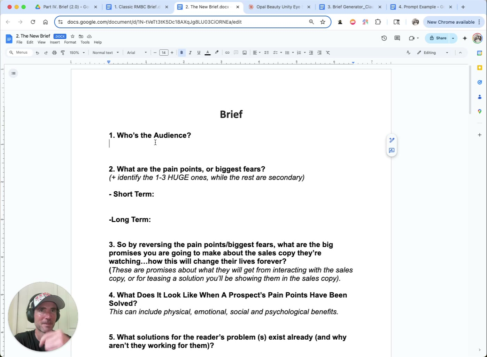

# 5.1 The Old Brief vs. The New Brief (Overview)
> The classic RMBC brief was a 12-question worksheet a human copywriter filled in; the new brief has 25 questions written for an LLM, and you do not fill it in from scratch: an LLM populates it from your research and mechanism work, and then writes the copy from it.

## 🤖 Agent use
- **Use when:** preparing to write any VSL (long, medium, short or in-feed), and optionally a PDP or advertorial, with an LLM; auditing a brief for missing fields; deciding what research to gather before the brief is generated; building the knowledge file for a Brief Generator project (see [5.2](05-02-the-brief-generator-with-claude-project-unity-eye-serum-exam.md)).
- **Inputs → outputs:** research outputs (unified research doc, psychographics, ingredient research), a unique mechanism (UMP and UMS), product facts and offer details → one completed 25-field brief per product/offer that can be handed to an LLM to write copy.
- **Rules:**
  - **DO** produce the brief for every VSL project: "imperative for writing really good copy, especially any kind of VSL… especially imperative for long form… very useful for short form… can also be used for PDPs, advertorials" [00:00–01:03].
  - **DON'T** fill the new brief in by hand from scratch: "You're not going to really need to fill anything out… This is not a document that you fill out from scratch unless you really want to." [10:05]
  - **DO** write the new brief for an LLM reader: "enough detail so that when given to an LLM, it could write this whole section without struggling" (template field 6) [10:05].
  - **DO** separate two kinds of promises: field 3 = promises about what the viewer gets from interacting with the sales copy (teaser promises); field 9 = specific product claims about how their life changes after they buy [08:08–11:09].
  - **DO** future-pace in the brief with physical, emotional, social and psychological results (field 4, repeated as field 23) [08:08–09:08].
  - **DO** give the unique mechanism a nickname for the lead (field 7), for example "the seven-second bowel-releasing ritual", "the 30-second breakfast hack", "paper flipping" for a real-estate arbitrage method [10:05].
  - **IF** the product is a supplement **THEN** list the main ingredients with 2-3 studies each (field 8) [11:09].
  - **IF** the product is an informational program **THEN** use fascinations (curiosity bullets) in the product description [05:12–06:10].
  - **DON'T** invent testimonials, credibility builders or scarcity when filling the brief. The instructor's own wording: "hopefully it's true, but if you have stuff like that, it's good to get this here" [13:12]. Mark unverified items as placeholders.
- **See also:** [5.2 Brief Generator with Claude Project](05-02-the-brief-generator-with-claude-project-unity-eye-serum-exam.md) · [2.4 Unified research process](02-04-unified-research-process.md) · [3.1 Unique mechanisms overview](03-01-unique-mechanisms-overview.md) · [4.4 Background stories and unique mechanisms](04-04-vsl-background-stories-and-unique-mechanisms.md) · [Evolve: Ad idea to brief playbook](../../../evolve/copywriting/playbooks/ad-idea-to-brief.md)

## Key ideas

### 1. Where the brief sits in RMBC [00:00–02:03]
- RMBC = Research, Mechanism, Brief, Copy. "We've gone through research and we've gone through the mechanism… Now we're moving on to the brief." [00:00]
- Do not skip it: "Do not skip it. I feel like in RMBC 1, the brief was also very important, but people who didn't do long form copy kind of skipped over it." [01:03]
- Purpose of the original brief: "getting the information onto a piece of paper that you, a human, would need to write the copy that you were going to write, especially long form" [01:03].
- What changes: the new brief "does the same thing. As you can see, it's more in-depth, but the huge difference is you won't be filling out a lot of it, first of all. And you're doing it to give to an LLM to write copy." [01:03–02:03]
- He still allows human use: "you could still use this to write copy yourself", and shrugs at the anti-AI-copy objection ("I personally cannot understand") [02:03].
- The new brief plus a Claude Project "will set up everything. It will tie together what we did so far. It will also give you what you need to just print all kinds of copy." [01:03]


*The New Brief as the instructor shows it: "Brief" with fields 1-5 visible (audience, pain points short/long term, big promises, what it looks like when solved, existing solutions). [08:24]*

### 2. The classic brief, question by question [02:03–07:10]
- **Audience and pain points.** Real pain points are concrete ("being broke, not having enough money, being overweight, having high blood sugar, having low energy, not feeling confident, not getting women, not getting men"), and "dimensionalized" with short-term and long-term versions. Example long-term version: "ending up alone for the rest of your life and your mother was right… this is another Saturday night, staring at your phone on the couch by yourself, Netflix on" [02:03–03:03].
- **Big promise.** Reverse the pain points: "what's the big promise that they're going to get from interacting with the copy?" This is different from a promise about the product: it is "why you're going to discover a breakthrough solution that can help lower blood sugar, help you burn fat, an easy plug-and-play system" [03:03].
- **Existing solutions and why they fail.** Also covered in the research section [04:11].
- **Unique mechanism.** Mechanism of the solution and of the problem, written "in kind of copy format so that when we went to do a sales letter… we already thought of how to present it" [04:11].
- **Paradoxical question and metaphor.** He skips them ("it's not like a crucial thing") and notes "AI is quite good at metaphors these days, so we don't really need to come up with metaphors as much" [04:11].
- **Bold claim.** Results from using the product, e.g. "$500 to $800 a month in extra income… burning fat around the clock" [05:12].
- **Product.** Features and benefits, or fascinations for informational products: "inside the book, you'll discover why the one thing you should never say to a police officer if you want to get out of a ticket" [05:12–06:10].
- **Background story and story of discovery.** The hero's journey: "somebody like me, or somebody close to me… was in pain… went on a journey and found the solution." Examples: an exhausted mom finds an energy solution; a doctor sees patients struggling and hunts the real cause; a 9-to-5 worker quits for drop shipping [06:10–07:10].
- **Headline ideas and upsell ideas.** "You don't need to stress too much on that because we'll worry about that later." [07:10]

### 3. The new brief, what changed [07:10–16:20]
- Fields kept from the classic brief: audience, pain points, big promises, existing solutions, mechanism, bold claims, product, story. Several are "really like instructions for the LLM as much as for you" [08:08].
- **New field 4: what it looks like when pain points are solved.** "Physical, emotional, social and psychological benefits… future pacing." Example set: blood sugar lower, more income, more confident, girlfriend/boyfriend, physical transformation; emotional "more confident, proud"; social "friends notice and ask you questions"; psychological "empowered, bold, sharper… the little nagging voice in the back of your head dies" [08:08–09:08]. He notes the question appears twice (fields 4 and 23) and keeps both [08:08; 15:15].
- **New field 7: nickname for the mechanism.** "Something that'd be teased early on in the lead of the VSL." [10:05]
- **New field 8: ingredients plus 2-3 studies each** (supplements); he points to the bonus deep-research supplement module ([2.5 Ingredient deep research](02-05-ingredient-deep-research.md)) [11:09].
- **Field 9 vs field 3.** Field 9 = "bold product claims": "the promise is about the results you're going to get using the product or solution… specific promises and claims about how their life will change for the better once they buy" [11:09].
- **Fields 12-14: speakers and brand partnership.** Main speaker with a snapshot of credibility (tired mom, doctor, or a customer with results). Second speaker or expert if there is one, e.g. "in a financial one… a narrator, the interviewer, and then the expert being interviewed", or an everyday person who finds a doctor who "has some speaking lines throughout". Whether the spokesperson partners with a brand once they find the solution [12:12–13:12].
- **Field 15-16: testimonials and credibility builders** for the opening: studies about ingredients or UMP, "Harvard scientists uncover the real cause of your problem", "Tony Robbins endorsed the solution", "featured in Forbes or Good Morning America", "based on breakthrough research from Harvard" [13:12]. These are his illustrative examples; he adds "hopefully it's true".
- **Fields 17-22: price, options, guarantee, bonuses, scarcity.** Normal retail vs actual price ("the normal price is $200, but today only you can get it for $49"), bundle tiers ("one bottle $49 per bottle… three bottles $39… six bottles $29"; "gold package… platinum package"), money-back guarantee ("180 days"), bonuses, and scarcity (limited time, discount expires at midnight, first hundred people) [14:10–15:15].
- **Field 24: objections and answers** ("I've tried supplements before. They haven't worked"; "my back hurts, so I wouldn't do a workout program"), tied back to the research phase [15:15].
- **Field 25: hooks or big ideas to test in the lead** [16:20].
- **Next step:** "we're going to create a brief generator in Claude, where it's going to have this brief and outline some instructions, and you're going to give it basic information and it's going to pump out the brief for you." [16:20]
- He muses about reordering the course so the structure modules come before the brief: "you'll understand more things that I'm talking about in this video if you did the modules before" [11:09] (the course folder order now puts VSL theory in module 4 before the brief in module 5).

## Steps / framework
**Brief creation pipeline (as taught across 5.1-5.5; derived from the sequence):**
1. Research: unified research doc (audience, pain points, desires, language), ingredient research for supplements ([2.4](02-04-unified-research-process.md), [2.5](02-05-ingredient-deep-research.md)).
2. Mechanism: UMP and UMS, nickname ([3.1](03-01-unique-mechanisms-overview.md), [3.5](03-05-creating-a-claude-project-for-unique-mechanisms.md)).
3. Brief: give those documents plus the offer to the Brief Generator project; it fills the 25 fields; you review and give revision notes ([5.2](05-02-the-brief-generator-with-claude-project-unity-eye-serum-exam.md)).
4. Copy: hand the finished brief to the right VSL project ([6.1](06-01-claude-vsl-projects-setup-overview.md)) and ask first for an outline plus an estimated length.

**Old-to-new field mapping** (derived from comparing the two docs):

| Classic brief (12) | New brief (25) |
|---|---|
| 1 Audience | 1 Audience |
| 2 Pain points (short/long term) | 2 Pain points (short/long term) |
| 3 One big promise (1-3 sentences) | 3 Big promises (plural) about the sales copy / teased solution |
| (none) | 4 What it looks like when pain points are solved |
| 4 Existing solutions | 5 Existing solutions |
| 5 New claim / root cause / mechanism | 6 UMP and UMS; 7 nickname; 8 ingredients and studies |
| 6 Paradoxical question; 7 Metaphor | dropped (LLM handles metaphor) |
| 8 Bold claim | 9 Bold product claims |
| 9 Product | 10 Product |
| 10 Background story | 11 Story; 12 main speaker; 13 second speaker; 14 brand partnership |
| (none) | 15 testimonials; 16 credibility builders |
| (none) | 17-22 prices, options, guarantee, bonuses, scarcity |
| (none) | 23 future-paced results; 24 objections; 25 hooks/big ideas |
| 11 Headline ideas; 12 Upsell ideas | dropped (upsells handled later) |

## Examples
- Pain-point dimensionalization: "ending up alone for the rest of your life… another Saturday night… Netflix on" as the long-term version of "not getting a girlfriend" [03:03].
- Mechanism nicknames: "7 second bowel releasing ritual", "30 second breakfast hack", "Paper Flipping" (real-estate arbitrage) [10:05; doc field 7].
- Fascination bullets for an info product: "five words to never say to a beautiful woman at the bar, if you want to get her number" [05:12]. (These are the instructor's illustrative examples, not ads we should reuse.)
- Hero-journey options: exhausted mom, doctor, 9-to-5 worker turned drop shipper [06:10–07:10].

## Structured units

### Templates
| Template | Use for | Example fill | Source |
|---|---|---|---|
| Teaser promise: "I'm going to reveal [hidden reason] why [prior solutions] have failed you" | Brief field 3 (what the copy promises the viewer) | Appears in the Unity eye serum example, field 3 ([5.2](05-02-the-brief-generator-with-claude-project-unity-eye-serum-exam.md)) | doc field 3; [08:08] |
| Future-pace in four lenses: physical, emotional, social, psychological | Brief fields 4 and 23 | "friends notice and ask you questions" (social) | [08:08–09:08] |
| Credibility builder: "[Respected body] uncovered the real cause of [problem]" / "[Endorser] shared this solution" | Brief field 16 | "Harvard scientists uncover the real cause of your problem"; "featured in Forbes or Good Morning America" (instructor's illustrations; require real sources) | [13:12] |
| Hero's-journey story: someone close was in pain, went on a quest, found the mechanism and why prior solutions fail | Brief field 11 | Exhausted mom / doctor / 9-to-5 worker | doc field 11; [06:10] |

### Rules of thumb
- **DO** keep promises (field 3) and claims (field 9) in separate fields. [11:09]
- **DON'T** spend time on headline and upsell ideas in the brief at this stage. [07:10]
- **IF** you already did the research and mechanism work **THEN** most brief fields are already answered. [09:08–10:05]

## Prompts / templates (verbatim)

### The Classic RMBC Brief (doc "01-11 Classic RMBC Brief.docx")
```text
Brief

1. Who’s the Audience?

2. What are the pain points, or biggest fears?
(+ identify the 1-3 HUGE ones, while the rest are secondary)
- Short Term:
-Long Term:

3. So by reversing the pain points/biggest fears, what is the one big promise (1-3 sentences) you are going to make about the sales copy they’re now reading…how this will change their lives forever?

4. What solutions for the reader’s problem (s) exist already (and why aren’t they working for them)?

5. What’s the new claim/root cause/surprising info? And how does this new solution we’re offering them work? [This is the Unique Mechanism Part]
(Think about it as if they had 99% of the solution already, but you’re sharing that missing 1%...the easy but unexpected REAL REASON, or REAL SECRET to their success).

6. Paradoxical Question:

7. Metaphor:

8. Bold Claim
(What’s the huge promise about the results they’re going to get using this product/solution?):

9. What is the Product?
(If you can write out fascinations here, it will help you immensely. This is the part where you get to shape exactly what the product we’re selling will include)

10. Background Story + Story of Discovery:

11. Some Headline Ideas:
(One sentence – something that would be the first line of the VSL, or in the copy above the video screen. Attention grabbing)

12. Ideas for a potential upsell product?
(Something that could be sold to the customer immediately after purchasing the main product. You’d want this to be related to product, but solve an additional problem, or provide a significant additional benefit).
```

### The New Brief (doc "01-12 The New Brief.docx"), full template
```text
Brief

1. Who’s the Audience?

2. What are the pain points, or biggest fears?
(+ identify the 1-3 HUGE ones, while the rest are secondary)
- Short Term:
-Long Term:

3. So by reversing the pain points/biggest fears, what are the big promises you are going to make about the sales copy they’re watching…how this will change their lives forever?
(These are promises about what they will get from interacting with the sales copy, or for teasing a solution you’ll be showing them in the sales copy).

4. What Does It Look Like When A Prospect’s Pain Points Have Been Solved?
This can include physical, emotional, social and psychological benefits.

5. What solutions for the reader’s problem (s) exist already (and why aren’t they working for them)?

6. What is the Unique Mechanism of the Problem and the Unique Mechanism of the Solution?
Please include enough detail so that when given to an LLM, it could write this whole section without struggling.

7. Is There A Unique Nickname for the Unique Mechanism?
This is something that would be teased early on in the lead of the VSL. For example the “7 second bowel releasing ritual” or the “30 second breakfast hack” or “Paper Flipping” to tease a real estate arbitrage method.

8. (Optional, For Supplements): What are the main ingredients in the formulation.
For each main ingredient, include 2-3 studies showing their efficacy.

9. Bold Product Claims
(What’s the huge promise or promises about the results they’re going to get using this product/solution? Note, this is different than the promises from #3. These are now specific promises and claims about how their life will change for the better once they buy the product):

10. What is the Product?
(This is where we’ll include product details. This might include features and benefits for physical products and programs. It might include fascinations or curiosity bullet teasers for informational programs. The more detail here the better).

11. Background Story + Story of Discovery:
This is often a hero's journey structure. The spokesperson or someone the spokesperson knows was in pain. The spokesperson ends up on a quest to find an answer to their pain point. They end up discovering the unique mechanism, why existing solutions don’t work, etc.

12. Who is the main speaker in the VSL?
Include a quick snapshot of who they are and their credibility.

13. Is there a second speaker or “expert’ who also has a large role in the VSL?

14. Does the spokesperson partner with a brand or company once they’ve discovered the product?
If so, please share information about the brand or company here.

15. List of Testimonials or Social Proof If Available

16. Include any Credibility Builders that can be used in the opening of the sales copy.
This could reference studies about the ingredients, or about the UMP, etc. Perhaps Harvard scientists uncovered the real cause of your problem. Maybe Tony Robbins endorsed this solution? Maybe the program has been featured in Forbes or Good Morning America. Etc.

17. What Is The Normal Retail Price For The Product Being Sold?

18. What Is The Actual Price People Who Watch the VSL Will Pay?

19. If the VSL sells a product with multiple options, what are those options and what is the pricing for each option?

20. What Is The Guarantee?

21. Are There Any Bonuses?
If so please list them out.

22. Please List Out Any Other Scarcity Elements If There Are Any.

23. Please Write Out Specific Future-Paced Results and Benefits People Could Expect To Experience After Using the Product.

24. What Are Common Objections Prospects Might Have When Watching the VSL, and How Can We Answer Them?

25. Are there any specific Hooks or Big Ideas that you think should be tested in the lead of the VSL?
```
Note: in the .docx the bold and italic styling carries the question/helper-text split; the plain-text extraction above keeps the wording exactly. Items 12-14 appear with merged formatting in the extraction; the wording is unchanged.

## Screenshots
One frame is embedded above (the New Brief in Google Docs). The classic brief view and talking-head segments added no extra information beyond the verbatim docs.

## How to apply
- [ ] Before writing any VSL, create the brief; do not write copy from raw research.
- [ ] Use the 25-field template above as the target structure for the Brief Generator ([5.2](05-02-the-brief-generator-with-claude-project-unity-eye-serum-exam.md)).
- [ ] Fill fields 1, 2, 5 from the unified research; field 6-8 from the mechanism and ingredient research; fields 17-22 from the offer, with real prices and guarantee terms only.
- [ ] Keep field 3 (teaser promises about the copy) distinct from field 9 (product claims).
- [ ] Mark every credibility builder, testimonial and scarcity item as `[verified]` or `[placeholder]` before the brief goes to a writer or LLM.
- [ ] Add 3-5 hooks or big ideas to field 25, then test them in the lead.

## Related
- Previous: [4.11 VSLs on landing pages vs in-feed ads](04-11-vsls-on-landing-pages-vs-vsls-as-in-feed-ads.md) · Next: [5.2 The Brief Generator with Claude Project](05-02-the-brief-generator-with-claude-project-unity-eye-serum-exam.md)
- [5.3 Airbnb arbitrage example](05-03-airbnb-arbitrage-example.md) · [5.4 Blood sugar supplement example](05-04-blood-sugar-supplement-example.md) · [5.5 Financial promo example](05-05-financial-promo-example.md)
- [Evolve: Ad idea to brief playbook](../../../evolve/copywriting/playbooks/ad-idea-to-brief.md) is a per-ad concept brief; the RMBC II brief is a per-offer brief that feeds many scripts. [Shared: creator brief playbook](../../../../playbooks/creator-brief.md) covers UGC creator briefs, a different artifact.
- [Evolve: Unique mechanism](../../../evolve/copywriting/concepts/unique-mechanism.md) · [Evolve: Objection handling](../../../evolve/copywriting/concepts/objection-handling.md)

## Sources and limitations
- Transcript: [01-[1] The Old Brief vs. The New Brief (Overview).txt](<../../../../../raw/stefan-georgi/rmbc-ii/_transcripts/Stefan Georgi - RMBC II (1)/05-BRIEF 20/01-[1] The Old Brief vs. The New Brief (Overview).txt>). Documents: [Classic RMBC Brief](<../../../../../raw/stefan-georgi/rmbc-ii/_extracted/Stefan Georgi - RMBC II (1)/05-BRIEF 20/01-11 Classic RMBC Brief.docx.md>) and [The New Brief](<../../../../../raw/stefan-georgi/rmbc-ii/_extracted/Stefan Georgi - RMBC II (1)/05-BRIEF 20/01-12 The New Brief.docx.md>).
- The `._converted.mp4` re-encode was skipped as a duplicate.
- Machine transcription (Whisper large-v3-turbo); the full 17:04 recording is covered. He pauses for a newborn; those asides are omitted. The instructor says he "might" reorder the modules; this is course-structure musing, not an instruction.
- Examples about income ("$500 to $800 a month"), "Harvard", "Tony Robbins", "Forbes" and "Good Morning America" are illustrative. Do not reuse them as claims or endorsements.
