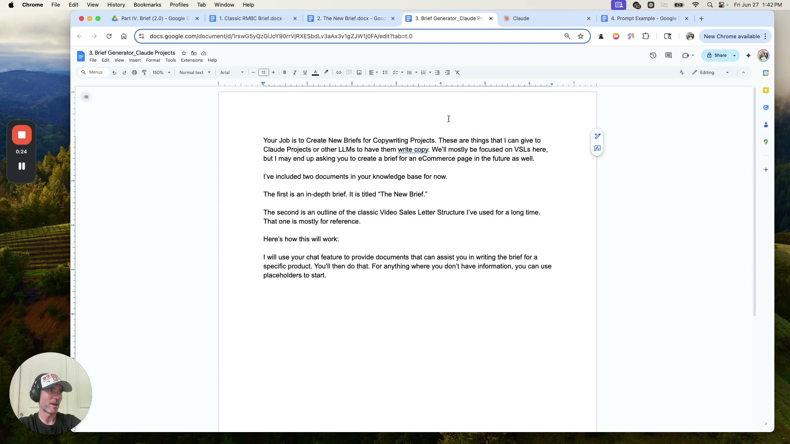
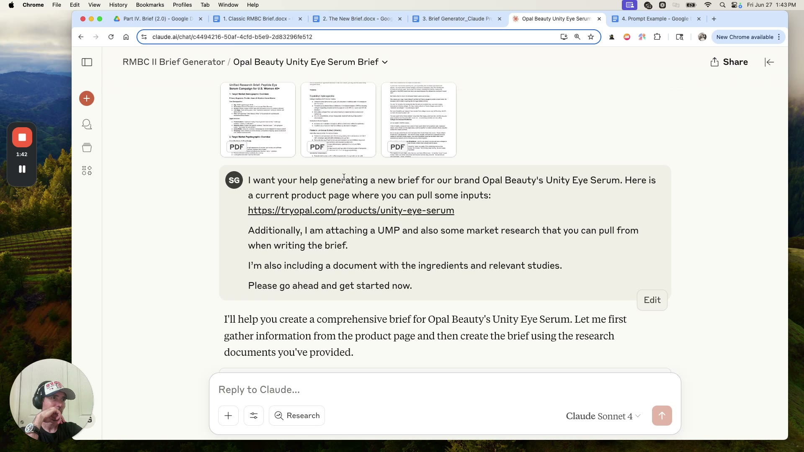
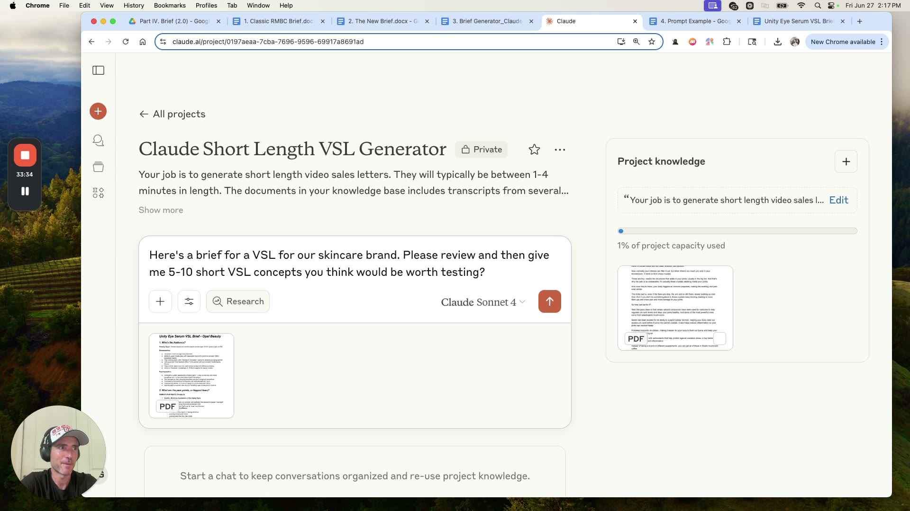
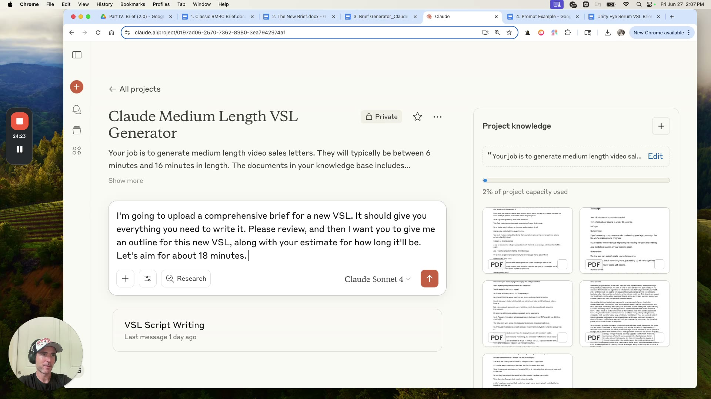
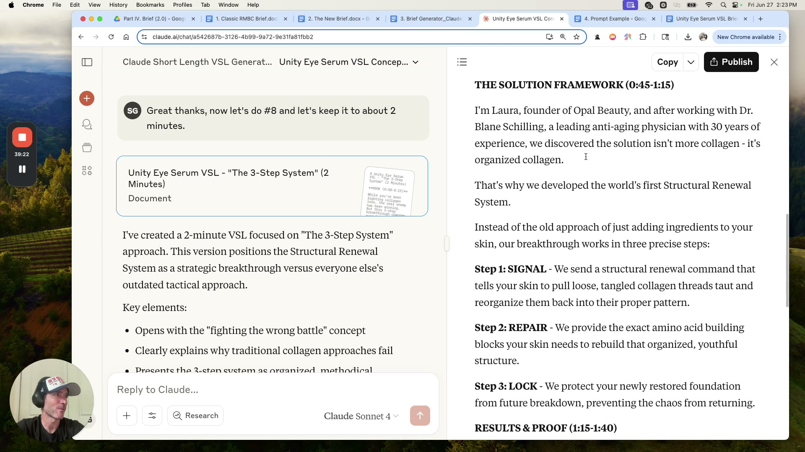

# 5.2 The Brief Generator With Claude Project + Unity Eye Serum Example
> A Claude Project loaded with the New Brief template turns your research, mechanism and ingredient documents (plus a product-page URL) into a complete 25-field VSL brief in one prompt; the instructor then revises it by chat and uses it to generate medium, short, hook-ad and long-form VSL drafts in minutes.

## 🤖 Agent use
- **Use when:** you have a product (or offer) plus any of: a unified research doc, a UMP/UMS, an ingredient/studies doc, a product page, and you need a full VSL brief; or you need to build the "RMBC II Brief Generator" Claude Project; or you need the copy-ready revision and generation prompts that follow a brief.
- **Inputs → outputs:** `The New Brief` template + classic VSL outline (project knowledge) + per-product attachments (UMP, market research, ingredients/studies) + optional product URL → a populated 25-field brief with `[placeholders]` where facts are missing → revised brief → outline + estimated length → VSL draft, short-VSL concept list, or hook-ad concepts.
- **Rules:**
  - **DO** set up the project exactly as in the instructions below: purpose paragraph, then two knowledge files, "The New Brief" and the classic VSL structure outline ("mostly for reference") [00:00–01:02].
  - **DO** give per-product inputs in the chat, not in the project knowledge: product-page link, UMP, market research, ingredients and studies, with the line "Please go ahead and get started now." [01:02–03:07]
  - **DO** enable web search so Claude can read the product page (it is "just web search enabled") [03:07].
  - **DO** allow placeholders where information is missing; the generator instructions say so explicitly. Replace them before final copy [00:00; 11:49–12:48].
  - **DO** review the brief as "director… copy chief… CMO" and revise by chat rather than by hand. Example fixes: choose one-time pricing for the VSL, name the main speaker, add the expert, say no bonuses [17:46–23:00; v. blood-sugar example in [5.4](05-04-blood-sugar-supplement-example.md) at 08:53].
  - **DO** save the first good brief to a document before revising "so I don't want anything to get screwed up" [17:46].
  - **DO** feed the finished brief to the right length project and first ask for an outline and an estimated length, then approve before writing [23:00–25:57]. Instructor note: Claude "estimates a little low", so he asks for about 18 minutes for a medium VSL [23:00].
  - **DON'T** mention the brand name inside the VSL script unless intended; he notes the generated script says "founder at Opal Beauty" and "you probably wouldn't mention Opal Beauty in the VSL" [26:59].
  - **DON'T** accept invented credentials, studies or statistics from the generator. In this very example the brief contains "Harvard researchers…", "97% of eye creams fail" and "45% wrinkle reduction in 60 days"; none of these figures appears in the starting assets supplied (see Compliance check). Bracket as unverified.
  - **IF** a section feels overloaded (here the DEJ jargon plus the weave metaphor) **THEN** tell Claude to rewrite the mechanism without the jargon; the instructor says he would "just tell Claude, hey, this is good… I want to move away from the DEJ, rewrite the mechanism without it" [07:58].
  - **IF** you want a scripted creator voice **THEN** specify the speaker and the expert in the revision note (here the whole VSL comes from "Laura", recounting what "Dr. Schilling" told her) [19:03–20:19].
- **See also:** [5.1 Old brief vs new brief (templates verbatim)](05-01-the-old-brief-vs-the-new-brief-overview.md) · [3.4 Eye serum UMP walkthrough](03-04-ideation-validation-and-expansion-walkthrough-eye-serum-exam.md) · [2.4 Unified research process](02-04-unified-research-process.md) · [3.5 Claude Project for unique mechanisms](03-05-creating-a-claude-project-for-unique-mechanisms.md) · [6.1 Claude VSL projects setup](06-01-claude-vsl-projects-setup-overview.md) · [Evolve: AI in copywriting](../../../evolve/copywriting/concepts/ai-in-copywriting.md)

## Key ideas

### 1. The project: instructions plus two knowledge files [00:00–03:07]
- Project name on screen: "RMBC II Brief Generator". Instructions are "pretty simple": tell Claude the purpose, "create new briefs for copywriting projects… things that I can give to Claude Projects or other LLMs to have them write copy… mostly VSLs… may end up asking you to create a brief for an e-commerce page in the future as well" [00:00].
- Knowledge: (1) "The New Brief", uploaded blank ("nothing filled in, just the new brief"), and (2) "my classic sales letter outline" [01:02]. Both are described in [5.1](05-01-the-old-brief-vs-the-new-brief-overview.md) and [4.2](04-02-vsl-fundamentals-classic-structure.md).
- Instructions text is saved verbatim in the Prompts section. The model shown in the UI during the demo is "Claude Sonnet 4" (screen).


*The Brief Generator project instructions as saved in the course Google Doc ("3. Brief Generator_Claude Projects"). Matches the verbatim text below. [00:24]*

### 2. The per-product prompt and attachments [01:02–03:07]
- Prompt (exact text in Prompts): ask for a new brief for the brand and product, link the live product page ("Claude can go to the internet"), attach "a UMP and also some market research", attach "a document with the ingredients and relevant studies", then "Please go ahead and get started now." [01:02–02:02]
- Attachments in the example: (a) the unified research document built in [2.4](02-04-unified-research-process.md) ("Claude Unified Research Output_Eye Serum"), (b) the combined ingredient research from [2.5](02-05-ingredient-deep-research.md) ("Combined Ingredient Research_Unity Eye Serum"), (c) the UMP and UMS text ("Eye Serum UMP and UMS") [02:02–03:07].
- The UMP chosen: "collagen architecture breakdown" with the "college and architecture breakdown" typo in the transcript fixed. He says: "Is this the world's best UMP or UMS? I don't know still, but for example purposes, I thought it was good enough. So this was generated verbatim. I didn't change anything." [03:07]
- He promises four examples across this module: eye serum (has a website), Airbnb arbitrage (no website), a supplement with only ingredient research, and a financial offer [03:07–04:12]. See [5.3](05-03-airbnb-arbitrage-example.md), [5.4](05-04-blood-sugar-supplement-example.md), [5.5](05-05-financial-promo-example.md).


*The chat inside project "RMBC II Brief Generator": three PDFs attached (unified research, ingredients, UMP/UMS) and the example prompt. The response starts "Let me first gather information from the product page and then create the brief using the research documents you've provided." [01:42]*

### 3. What came back, field by field [04:12–17:46]
Claude produced the 25-field brief in an artifact. Source of each field, as the instructor traces it:

| Brief field | What Claude produced | Where it came from | Source |
|---|---|---|---|
| 1 Audience | "Problem-aware and solution-aware woman aged 35 to 60, peak target 40 to 55"; demographics, psychographics | Unified research doc ("how did we get that? From our unified research document") | [04:12] |
| 2 Pain points | Big 3: sudden aging signs around the eyes ("appear overnight"), loss of identity/confidence, financial frustration from failed products; short- and long-term lists | Unified research | [05:10] |
| 3 Promises | Four teaser promises, e.g. reveal the hidden reason eye creams failed; "the one missing piece" | Claude, from research | [05:10–06:02] |
| 4 Solved state | Visual, emotional, lifestyle benefits (go makeup-free, faster routine, financial relief) | Claude | [06:02] |
| 5 Existing solutions | Mass-market creams, prestige department-store brands, professional treatments, budget active serums, high-end "miracle" creams, each with why inadequate | Unified research | [07:00] |
| 6 UMP / UMS | UMP "collagen architecture breakdown" at the dermal-epidermal junction (DEJ) with a fabric-weave metaphor; UMS "structural renewal system" in 3 steps: signal, repair, lock | The attached UMP/UMS; Claude also tied it to the DEJ language already on the product page | [07:58–09:54] |
| 7 Nickname | "The DEJ renewal protocol" or "the structural renewal system"; teaser phrases such as "the three-step skin unifying system that rebuilds your eye area from the inside out" | Claude ("These were not in any of these things. But Claude came up with them") | [09:54] |
| 8 Ingredients/studies | Six ingredients with study stats | Ingredient research doc, "directly" | [10:51] |
| 9 Bold claims | "Visibly reduce crow's feet and fine lines for up to 39% in just four weeks"; brighten dark circles; lift sagging under-eye bags; emotional transformation claims | Product page / Claude (39% not found in the supplied assets) | [10:51] |
| 10 Product | Unity Eye Revive Serum by Opal Beauty: size, texture, clean formula, "fascinations" | Product page; instructor: "I would probably confirm… should have got from the website" | [11:49] |
| 11 Story | Placeholder "need information about the brand founder spokesperson", but a seven-beat "discovery story framework" was drafted: problem escalation, traditional solutions failing, research quest, breakthrough, testing, success sharing, decision to share | Claude | [11:49–12:48] |
| 12-14 Speakers/brand | Main speaker "placeholder"; second speaker "Dr. Blaine Schilling"; brand values pulled from the site | Product page | [12:48–13:46] |
| 15-16 Proof/credibility | Reviews from the product page; credibility lines such as "Harvard researchers have identified the hidden cause…", "reveals why 97% of eye creams fail", "up to 45% wrinkle reduction in 60 days" | Product page and Claude; instructor: "you might need to tweak a few things here" | [13:46–14:52] |
| 17-22 Price/offer | Retail, VSL price tiers, 180-day guarantee, no bonuses, supply- and offer-based scarcity | Product page; subscribe-and-save needed a decision | [14:52–15:50] |
| 23 Future-paced | Week 1-2, 3-4, 5-8 and month 3-6 results | Claude / site | [15:50] |
| 24 Objections | "I've tried everything, nothing works", "too expensive", "genetic dark circles", "no time", "sensitive skin", "peptides are marketing hype" with answers | Claude | [15:50–16:48] |
| 25 Hooks / big ideas | Five hooks (betrayal, money waste, hidden truth, scientific discovery, personal story) and five big ideas | Claude; instructor: "I always kind of write the lead separately" | [16:48–17:46] |

- His reaction: "do you see how nice this is though already? When you go to write copy or VSL, or when your LLM goes to write copy… you're going to have everything that you need. Now you might need to change it, tweak it… but overall it's really good." [07:00]
- On the UMP presentation: "is it kind of like trying to do too much? Maybe. I might give feedback or revise it." [08:58]


*Later in the lesson the finished brief is attached to a different project, "Claude Short Length VSL Generator", with the prompt "Here's a brief for a VSL for our skincare brand. Please review and then give me 5-10 short VSL concepts you think would be worth testing?" [33:36]*

### 4. The revision pass [17:46–23:00]
- He copies the brief into a Google Doc for safekeeping, then replies in the same chat: "This was great overall. Really good job. Here are a few tweaks or pieces of information for revisions." [17:46–19:03]
- Revisions (spoken; reconstruction in Prompts): (1) pricing: use one-time-purchase pricing in the VSL and show subscribe-and-save below the VSL; (2) main speaker is Laura, "a mom of two in Florida"; (3) expert Dr. Schilling explains the UMP and UMS; the whole VSL comes from Laura recounting what he said; (4) Laura partnered with her husband to create the brand; (5) no bonuses [19:03–20:19].
- Disclosure: he says these personal details are not actually true of Laura ("this is not actually true for Laura… I'm using this mostly for an example"; "my wife, Laura") [13:46; 19:03]. Do not reuse the persona.
- After revision he checks that the story still reads right ("I'm going to make sure the story stayed the same") and replaces the stored brief with the revised one [20:19–23:00].

### 5. Using the brief with the length-specific projects [23:00–47:10]
All of these used Claude Projects that are set up in [6.1](06-01-claude-vsl-projects-setup-overview.md). The instructor says he will cover the writing in later modules and keeps this a "teaser" [24:26].

- **Medium (about 18 min).** Prompt: upload "a comprehensive brief for a new VSL. It should give you everything you need to write it. Please review, and then I want you to give me an outline for this new VSL, along with your estimate for how long it'll be. Let's aim for about 18 minutes." [23:00–24:26] The outline (hook/opening, problem agitation, three phases of eye aging, failed solutions, financial frustration, emotional impact, ironic twist, big revelation, why creams fail) is accepted with one edit: the revelation must show how she was introduced to Dr. Schilling and that he shares the real reason (UMP/UMS) [24:26–25:57]. Then: "please go ahead and start writing the VSL now" [25:57].
  - Output opening, quoted: "If you're like most women over 40, you probably felt betrayed by your own reflection lately…" and "I was introduced to Dr. Blaine Schilling… He said, Laura, the reason your eye creams aren't working has nothing to do with the creams themselves. It's because you're trying to solve the wrong problem." [26:59–27:51]
  - His verdict: "a medium length VSL, which is frankly quite good. Now, there's things we would do again, like we'll test, add stuff to the lead, a little copy editing… but it's definitely not bad." [32:02]
- **Short (about 3 min).** Prompt: brief plus "give me 5-10 short VSL concepts you think would be worth testing" [32:02–33:35]. Concept list included "Scientific Betrayal", "$200 eye cream" and "Three-step system" ideas; he picks #6 and then asks "please write a three minute VSL ad now for this VSL. Don't reveal the price; instead the call to action will be to visit Opal Beauty's website and save" [34:41]. The draft opens "That $200 eye cream you bought last month, according to new research, is actually making your eye aging worse. Here's what department stores don't want you to know." [36:19]
  - His commentary: "It literally takes me longer to order sandwiches on Postmates than it does to write VSLs and copy. Does that not blow your mind?" [36:19]
  - Edits he would make: Laura is "not 42" so fix the age [37:16]; "Is this too confusing? Maybe, so we'll edit it later" about the DEJ jargon [37:16].
  - Second pick: concept #8, "keep it to about two minutes" (Claude: "fighting the wrong battle", three-step signal/repair/lock) [38:11–39:21].
- **ADHD hook ads.** Asks for "five ADHD hook ad concepts to choose from", likes concept 3 "This is what's really happening under your crow's feet", and asks for the CTA to "save 57% off their order when they visit the website" [39:21–41:00]. Critique: "I don't like the 'skin hooks' thing, so I might change that. I probably would have removed that from the brief." And: "this has really run more to sell the solution than to sell the VSL… I probably could have done 'save 57% off to get more information'" [42:17–43:17]. (See [4.10](04-10-using-ai-to-generate-endless-good-hooks.md) for hook-ad structure.)
- **Long form (about 28 min).** "Write a long form VSL for our brand Opal Beauty. Please provide an outline. Tell me the estimated length. Let's shoot for about 25 minutes long. I have to do a little longer, 28 minutes long." [43:17–44:30] The result, saved as a document, is 5,167 words (stated at the start of [5.3](05-03-airbnb-arbitrage-example.md), 00:00). He says "I may be more picky" and defers to the VSL-writing modules [44:30–47:10].
- Close: "once we generate that brief, we can do so much stuff with it. We can write so much copy." [47:10]


*"Claude Medium Length VSL Generator" project: the project description ("Your job is to generate medium length video sales letters. They will typically be between 6 minutes and 16 minutes…") and the prompt asking for an outline and an 18-minute estimate. The project knowledge panel shows the example transcripts (2% capacity used). [24:24]*


*Output for concept #8 ("The 3-Step System", 2 minutes) with section timings: "Solution framework (0:45–1:15)", Step 1 SIGNAL, Step 2 REPAIR, Step 3 LOCK, then "Results & proof (1:15–1:40)". [39:24]*

## Steps / framework
**Brief Generator workflow (as run in this lesson; steps marked derived are application advice).**
1. Create a Claude Project named for the generator ("RMBC II Brief Generator"). Paste the instructions (below) as the project instructions. Upload "The New Brief" (blank) and the classic VSL structure outline to project knowledge. [00:00–01:02]
2. Enable web search if you will link a product page. [03:07]
3. Start a chat per product. Attach the unified research doc, the UMP/UMS doc, and the ingredient/studies doc; link the product page; send the example prompt. [01:02–02:02]
4. Read the artifact against the field list in [5.1](05-01-the-old-brief-vs-the-new-brief-overview.md). List every `[placeholder]` and every claim without a source (derived).
5. Save the output as a document, then reply in-chat with revision notes (pricing, speakers, bonuses, mechanism simplification, story). [17:46–23:00]
6. Replace the saved brief with the revised brief. [23:00]
7. Send the final brief to the length-specific project and ask for an outline and estimated length; approve; then "go ahead and start writing". [23:00–25:57]
8. For testing, ask for 5-10 short concepts or five hook-ad concepts and pick by number; specify CTA and runtime. [32:02–41:00]

## Examples
- **Brief inputs vs output:** about 3,950 words of extracted attachment text (UMP/UMS 3 pages, unified research 5 pages, ingredient research 8 pages) became a 3,376-word brief (doc "Unity Eye Serum VSL Brief - Opal Beauty").
- **Unity Eye Serum mechanism (UMP/UMS) as the instructor's sample:** collagen architecture breakdown at the DEJ (UMP); signal + repair + lock "structural renewal system" (UMS); fabric weave metaphor. From the attached UMP doc: "Think of healthy, young skin like a piece of high-quality fabric with a perfectly tight, organized weave." Ingredient roles: dipalmitoyl hydroxyproline as "master weaver", proline/glycine/alanine as building blocks, MMP-inhibiting compounds as "integrity locking".
- **Customer-voice phrases captured in the research doc and used in the brief:** "I wake up one day, look in the mirror, and notice something new—a line where there wasn't one before." (unified research doc).
- **Persona used:** a mother of two founder, Laura, plus Dr. Blaine Schilling with "30 years of experience" (in the revised brief). These are example inputs, not verified facts.

## Structured units

### Hooks
| Hook (verbatim or near) | Heuristic(s) | Emotion / zone | Self targeted | Why it works | Source |
|---|---|---|---|---|---|
| "If you're like most women over 40, you've probably felt betrayed by your own reflection lately…" | Identity callout; betrayal (derived) | Shock/betrayal (from research phrases) | Ideal self vs. current (derived) | Mirrors the research language "shocked… betrayed by their changing face" | brief field 25 (Hook 1); [16:48] |
| "A new clinical study reveals why you've wasted thousands of dollars on eye treatments that will never work…" | Novelty, money-waste (derived) | Frustration | Ought self (derived) | Targets the third big pain point, financial frustration | brief field 25 (Hook 2); [16:48] |
| "The beauty industry's $50 billion secret: why they don't want you to know the real reason your eyes are aging…" | Hidden truth / enemy (derived) | Suspicion | — | Pairs a new enemy with curiosity. The "$50 billion" figure is unsourced; do not use. | brief field 25 (Hook 3); [16:48] |
| "Harvard researchers just discovered the hidden cause of eye aging—and it's not what you think…" | Authority borrowing (derived) | Curiosity | — | Authority plus open loop. "Harvard" is unsourced here. | brief field 25 (Hook 4); [16:48] |
| "That $200 eye cream you bought last month, according to new research, is actually making your eye aging worse. Here's what department stores don't want you to know." | Specific recent action, enemy (derived) | Alarm | — | Opens in the viewer's recent behavior | [36:19] (short-VSL draft) |
| "This is what's really happening under your crow's feet. Your skin layers are separating right now and you don't even know it." | Reveal / open loop (derived) | Curiosity, dread | — | Hook-ad concept #3; instructor "really liked that line" | [41:00] |

### Rewrites (before → after)
| Before | After | What changed | Source |
|---|---|---|---|
| CTA "save 57% off their order when they visit the website" | CTA to "save 57% off to get more information" | Sell the next step (watch/learn), not the product | [43:17] (instructor's second thought; not run) |
| Brief pricing with subscribe-and-save in the VSL | One-time purchase pricing in the VSL; subscribe-and-save shown below the VSL | Simplifies the offer in the video | [19:03] |
| Main speaker placeholder | Laura narrates what Dr. Schilling explained | Gives a first-person narrator and an expert for the UMP/UMS | [19:03–20:19] |

### Rules of thumb
- **DO** let Claude draft the whole brief, then edit; he calls the user "like the director… the boss, like the copy chief or the CMO". [v. 5.4 at 08:53]
- **DON'T** treat generated testimonial/credibility lines as facts; replace with real sources.
- **IF** the first brief has too much mechanism jargon **THEN** ask for a simpler rewrite before generating scripts. [07:58; 37:16]

## Prompts / templates (verbatim)

### A. Brief Generator Claude Project: instructions (doc "02-21 Brief Generator_Claude Projects.docx", complete)
```text
Your Job is to Create New Briefs for Copywriting Projects. These are things that I can give to Claude Projects or other LLMs to have them write copy. We’ll mostly be focused on VSLs here, but I may end up asking you to create a brief for an eCommerce page in the future as well.

I’ve included two documents in your knowledge base for now.

The first is an in-depth brief. It is titled “The New Brief.”

The second is an outline of the classic Video Sales Letter Structure I’ve used for a long time. That one is mostly for reference.

Here’s how this will work:

I will use your chat feature to provide documents that can assist you in writing the brief for a specific product. You’ll then do that. For anything where you don’t have information, you can use placeholders to start.
```
Project knowledge to upload: (1) `The New Brief` (blank; full text in [5.1](05-01-the-old-brief-vs-the-new-brief-overview.md#the-new-brief-doc-01-12-the-new-briefdocx-full-template)), (2) the classic VSL structure/outline (see [4.2](04-02-vsl-fundamentals-classic-structure.md) and the reference doc "08-71 REFERENCE_Classic VSL Overview and Structure"). Name the project "RMBC II Brief Generator" (screen). The instructor says the same text goes in the project's description and instructions fields [00:00].

### B. Per-product prompt: Unity Eye Serum (doc "Eye Serum Prompt Example.docx", complete)
```text
I want your help generating a new brief for our brand Opal Beauty's Unity Eye Serum. Here is a current product page where you can pull some inputs:

https://tryopal.com/products/unity-eye-serum

Additionally, I am attaching a UMP and also some market research that you can pull from when writing the brief.

I’m also including a document with the ingredients and relevant studies.

Please go ahead and get started now.
```
Reusable form (derived): replace the brand/product and the URL, and attach your own UMP, research and ingredient documents.

### C. Revision message (reconstructed from the transcript at [19:03–20:19]; spoken, so wording is approximate)
```text
This was great overall. Really good job. Here are a few tweaks or pieces of information for revisions.
First off, for the pricing, let's go with the one-time purchase pricing in the VSL and show the subscribe and save options below the VSL.
Second, the main speaker would be Laura. She's a mom of two in Florida.
Dr. Schilling helps explain what's really going on, the UMP and UMS. The whole VSL will come from Laura, recounting what Dr. Schilling shared. Ultimately, Laura partnered with her husband to create Opal Beauty.
Lastly, go with no bonuses.
```

### D. Length-project prompts used after the brief (screen text and transcript)
Medium-length project (screen text at [24:24]):
```text
I'm going to upload a comprehensive brief for a new VSL. It should give you everything you need to write it. Please review, and then I want you to give me an outline for this new VSL, along with your estimate for how long it'll be. Let's aim for about 18 minutes.
```
Follow-up (spoken, approximate): make sure the big revelation covers how she was introduced to Dr. Schilling and that he shares the real reason (UMP and UMS), then "please go ahead and start writing the VSL now." [24:26–25:57]

Short-length project (screen text at [33:36]):
```text
Here's a brief for a VSL for our skincare brand. Please review and then give me 5-10 short VSL concepts you think would be worth testing?
```
Follow-ups (spoken): "let's go ahead and start with number six. Please write a three minute VSL ad now for this VSL. Don't reveal the price; instead the call to action will be to visit Opal Beauty's website and save." [34:41]; "Great thanks, now let's do #8 and let's keep it to about 2 minutes." (screen, [39:24]).

ADHD hook ads (spoken, approximate; hook structure in [4.10](04-10-using-ai-to-generate-endless-good-hooks.md)): "Here's the brief for a VSL. I need five ADHD hook ad concepts to choose from." Then: "I like concept number three the most. Let's lead with [that line]. Let's have the CTA be to save 57% off their order when they visit the website. Write the script." [39:21–41:00]

Long-form project (spoken, approximate): "Write a long form VSL for our brand Opal Beauty. Please provide an outline. Tell me the estimated length. Let's shoot for about 25 minutes long [he then raises it to 28]." [43:17–44:30]

### E. Template reference
The 25-field New Brief template (verbatim) is in [5.1](05-01-the-old-brief-vs-the-new-brief-overview.md). The output brief for this example runs the 25 fields in order; its headings are exactly the template questions.

## Compliance check (claims in the example brief and scripts)
Course-example text, not for reuse:
- Statistics or authority claims with no source in the supplied assets: "Harvard researchers have identified…", "97% of eye creams fail", "up to 45% wrinkle reduction in 60 days" (the ingredient doc gives 32% wrinkle reduction and 14% firmness for one ingredient), "$50 billion secret", "up to 39% in 4 weeks" (not in the starting assets), "over 5,800 women" (generated VSL), "This separation happens to 99% of women over 40" and "the number one reason Botox doesn't work long term" (generated hook ad).
- Cosmetic-claim risk: "reverses collagen architecture breakdown", "repairs the organized structure", "rebuilds from the inside out", "Botox alternative" language can read as drug/structure-function claims; substantiate or soften.
- Persona: "Laura, 42, mom of two in Florida" and "Dr. Blaine Schilling… 30 years" are placeholders for example purposes (instructor says Laura's details are not true).
- Reviews and star counts came from a live product page; verify before use.

## Screenshots
Five frames are embedded above (generator instructions, prompt with attachments, medium-length project, short-length project, two-minute output). Other frames of the long scrolling output carried no extra information.

## How to apply
- [ ] Build the Brief Generator project with the verbatim instructions and the blank New Brief + classic outline in knowledge.
- [ ] Collect per-product inputs: product URL, unified research, UMP/UMS, ingredient studies, price, guarantee.
- [ ] Run prompt B (adapted). Save the first output before editing.
- [ ] Mark every unsourced statistic or authority in the brief `[unverified]` and either source or delete it.
- [ ] Send a revision (pricing, speakers, bonuses, mechanism simplification).
- [ ] Ask the length project for an outline plus estimated length first; set a target length 10-15% above what you need if the model tends to run short (instructor tendency: Claude estimates a little low).
- [ ] Generate 5-10 short concepts or five hook-ad concepts, then pick one by number.

## Related
- Previous: [5.1 Old brief vs new brief](05-01-the-old-brief-vs-the-new-brief-overview.md) · Next: [5.3 Airbnb arbitrage example](05-03-airbnb-arbitrage-example.md)
- [5.4 Blood sugar supplement example](05-04-blood-sugar-supplement-example.md) · [5.5 Financial promo example](05-05-financial-promo-example.md) · [3.2 UMP ideation with LLMs](03-02-ump-ideation-with-llms.md)
- Evolve: [Ad idea to brief playbook](../../../evolve/copywriting/playbooks/ad-idea-to-brief.md) and [AI in copywriting](../../../evolve/copywriting/concepts/ai-in-copywriting.md) cover per-ad briefs and LLM use in the Evolve method; RMBC II's brief is per offer and feeds many scripts.

## Sources and limitations
- Transcript: [02-[2] The Brief Generator With Claude Project + Unity Eye Serum Example.txt](<../../../../../raw/stefan-georgi/rmbc-ii/_transcripts/Stefan Georgi - RMBC II (1)/05-BRIEF 20/02-[2] The Brief Generator With Claude Project + Unity Eye Serum Example.txt>). Documents: [Brief Generator instructions](<../../../../../raw/stefan-georgi/rmbc-ii/_extracted/Stefan Georgi - RMBC II (1)/05-BRIEF 20/02-21 Brief Generator_Claude Projects.docx.md>), [Unity Eye Serum VSL Brief](<../../../../../raw/stefan-georgi/rmbc-ii/_extracted/_unzipped/05-BRIEF 20/02-22 Eye Serum Example-20250708T091118Z-1-001/2.2. Eye Serum Example/Unity Eye Serum VSL Brief - Opal Beauty.docx.md>), [starting assets and prompt](<../../../../../raw/stefan-georgi/rmbc-ii/_extracted/_unzipped/05-BRIEF 20/02-22 Eye Serum Example-20250708T091118Z-1-001/2.2. Eye Serum Example/Eye Serum Prompt Example.docx.md>).
- Machine transcription (Whisper large-v3-turbo). Corrected: "Claude" (Whisper "Quad"), "VSL" (Whisper "BSL"), "collagen architecture" (Whisper "college and architecture"), "dipalmitoyl hydroxyproline" (Whisper "diplomatol hydroxyproline"), "Opal Beauty" (Whisper "Local/Open Beauty"), "Dr. Blaine Schilling" (the doc spells "Blane"), "Postmates"/"Jersey Mike's" (as in the captions).
- Timestamps cite paragraph starts of the 50-second transcript chunks; the exact sentence can be up to a minute later. The medium VSL, short VSLs, hook-ad concepts and long-form VSL generated in the video are not included as files in the course (only the brief is); sections quoted above come from the video. The long-form VSL's word count (5,167) is stated in lesson 5.3.
- Only the brief, the prompt and the starting assets are in the zip. The product page (tryopal.com) was not captured in the course files, so any field "from the website" cannot be checked.
- Frames from the video show the model as "Claude Sonnet 4"; output quality will differ for other models.
