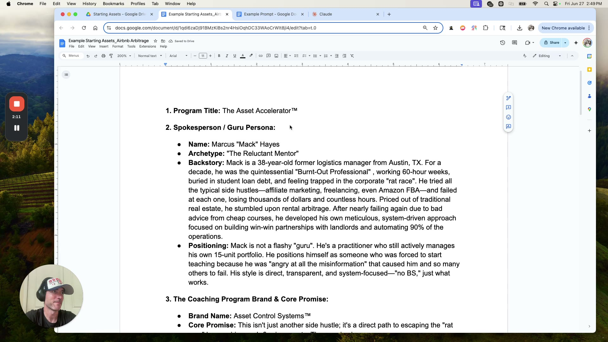
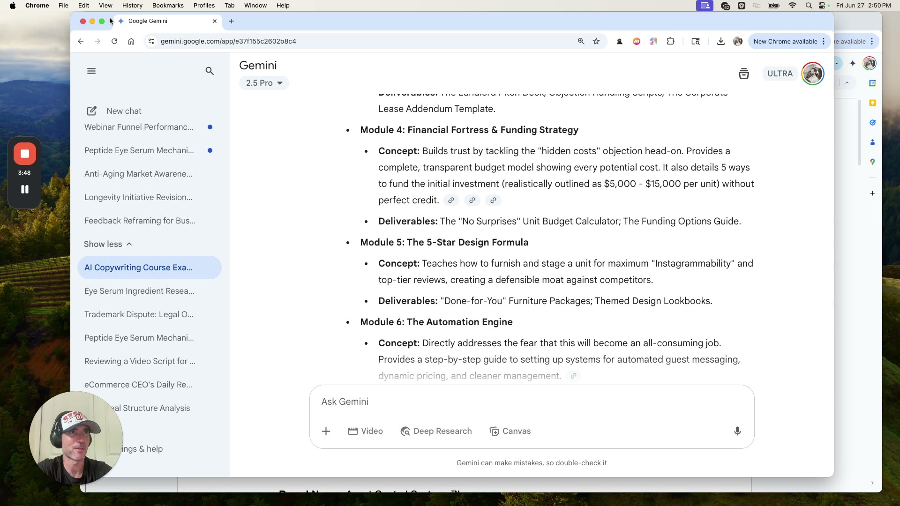

# 5.3 Airbnb Arbitrage Example
> How to get a complete VSL brief for an offer that has no website or product page: have an LLM draft a short "case study" overview of the program (spokesperson, curriculum, price, guarantee), then give that overview plus the UMP and unified research to the Brief Generator.

## 🤖 Agent use
- **Use when:** the offer is a coaching program, course or other info product with no live page; the only assets are a mechanism (UMP/UMS), a research doc and a rough idea of the offer; or you need a worked example of a biz-opp brief.
- **Inputs → outputs:** `UMP/UMS` + `unified research doc` + `offer overview doc` (program name, spokesperson, core promise, curriculum, coaching components, price, guarantee) → a populated 25-field brief for a coaching VSL, with proof categories (not fake proof) and a hook list.
- **Rules:**
  - **DO** supply an offer overview when no page exists: "you usually would have at least some information" about the program [01:04]. The instructor generated it with Gemini only to create a teaching case study. For a real client, replace it with their actual program details.
  - **DO** use the same Brief Generator prompt shape as for products, adapted: "our Airbnb Arbitrage Coaching Program", attach UMP and research, attach one document with "additional relevant information", "Please go ahead and get started now." [03:31]
  - **DO** feed Claude the real product description when you later write the VSL; the brief's product section was "sort of brief", so "if I went to write the VSL, I probably would upload" the longer offer document too [06:34].
  - **DO** pick the VSL type by price: at roughly $8,000 he "would do this as a book-a-call VSL, not as a VSL to sell a product… a program for that much money" [07:38].
  - **DON'T** invent proof for a real offer. The generated brief lists "proof categories" (before/after financial snapshots, landlord interviews, community screenshots) as needed assets rather than facts; keep that approach.
  - **DON'T** reuse the brief's numbers as claims. "$12,000+ monthly passive income", "generated over $250,000 for students", "150+ property owners", "90% of millionaires build wealth through real estate", "Featured in BiggerPockets" and "Federal Reserve data confirms…" are generated example text with no source in the files. See Compliance check.
  - **IF** the market has already tried the model and been burned **THEN** put the objection list to work: "this is another guru trying to get rich selling courses", "landlords will never agree", "everyone is doing this now" [07:38–08:43].
- **See also:** [5.2 Brief Generator (instructions and prompt)](05-02-the-brief-generator-with-claude-project-unity-eye-serum-exam.md) · [3.3 UMP evaluation: Airbnb arbitrage](03-03-ump-evaluation-prompt-and-process-airbnb-arbitrage.md) · [5.1 New brief template](05-01-the-old-brief-vs-the-new-brief-overview.md) · [4.4 Background stories and UMs (biz-opp VSLs)](04-04-vsl-background-stories-and-unique-mechanisms.md) · [Evolve: Unique mechanism](../../../evolve/copywriting/concepts/unique-mechanism.md)

## Key ideas

### 1. Recap and word count [00:00–01:04]
- The previous example's 28-minute Opal Beauty long-form VSL, saved to a document, was "5,167 words. Pretty crazy" [00:00]. (Useful scale: about 180 words per minute implied by 5,167 words for the 28-30 minutes he mentions; derived.)
- He returns to the "RMBC II Brief Generator" project, the same one built in [5.2](05-02-the-brief-generator-with-claude-project-unity-eye-serum-exam.md) [00:00].

### 2. What you need when there is no website [01:04–03:31]
- Prompt shape: new brief for "our Airbnb arbitrage coaching program", attach a UMP and market research, attach "a document with some additional relevant information" [01:04].
- The mechanism used: the "asset gap" idea from [3.3](03-03-ump-evaluation-prompt-and-process-airbnb-arbitrage.md): "you're trying to solve an asset gap problem with an income gap solution." [01:04] The attached UM text is a script-style explanation that opens "The Hidden Truth About Why Every Side Hustle You've Tried Has Failed" (doc "Airbnb Arbitrage UM Example").
- The research doc: the unified research output from [2.4](02-04-unified-research-process.md) for this market (problem- and solution-aware segments, archetypes such as the Burnt-Out Professional) [01:04].
- The third file is the offer overview. The instructor used Gemini to draft it: he gave it the unified research and the UMP and asked it to "sketch the program details… I can use it as an example… also create a fictional spokesperson and other relevant data" [03:31]. He did the same for the financial example in [5.5](05-05-financial-promo-example.md).
- The overview he got ("The Asset Accelerator") has six parts: program title; spokesperson/guru persona ("The Reluctant Mentor"); brand and core promise; the core curriculum (an 8-week program, eight named modules); high-ticket coaching components; and the offer, pricing and guarantee ($8,000 or 3 payments of $3,000; an action-based "First Property" guarantee) [02:10; doc "Example Starting Assets_Airbnb Arbitrage"].
- Note on names: the transcript has "Marcus McHays... 34 year old"; the document reads "Marcus 'Mack' Hayes... 38-year-old". The document is used here.


*The "Example Starting Assets_Airbnb Arbitrage" Google Doc: program title, spokesperson persona with a "Reluctant Mentor" backstory, and the brand/core-promise block that the brief generator consumed. This is the page you must replace with real program facts for a real client. [02:12]*


*Gemini (2.5 Pro) output showing modules 4-6 of the generated curriculum with "Concept" and "Deliverables" lines, the source of the starting-assets document. [03:48]*

### 3. The generated brief, reviewed fast [03:31–08:43]
He deliberately "went kind of fast" and tells you to read the doc yourself [08:43]. Highlights in order:

| Field | Generated content (short) | Source |
|---|---|---|
| 1 Audience | Problem/solution-aware middle-class Americans 18-45; archetypes: Burnt-Out Professional, Under-Resourced Millennial/Gen Z, Ambitious Student, Stay-at-Home Parent, FIRE adherent; "awakened" in-group vs "sheep" | [04:44]; brief field 1 |
| 2 Pain points | Big 3: the Asset Gap problem, financial entrapment in a "rigged" system, barriers to real estate (capital, credit, control); short term: paycheck-to-paycheck, no emergency cushion, student loans, failed side hustles; long term: never escaping the 9-to-5, no generational wealth, "work until death" | [04:44] |
| 3 Promises | "Show you the hidden truth about why every side hustle you've tried has failed… reveal the 'Asset Control Method'… without needing hundreds of thousands of dollars or perfect credit" | [04:44] |
| 4 Solved state | "Waking up to money deposited from guests who stayed while they slept", $5,000-$15,000+ monthly passive income (example), autonomy, quit the corporate job, legacy for children | [04:44–05:34] |
| 5 Existing solutions | High-ticket arbitrage coaching ($3,000-$15,000+: misleading costs, poor support), cheap DIY courses (isolation), traditional real estate (20-25% down, credit), other side hustles, FIRE | [05:34] |
| 6 UMP/UMS | UMP "the Asset Gap"; UMS "the Asset Control Method": operate leased properties as short-term rentals without owning | [05:34] |
| 7 Nicknames | "The Rental Arbitrage Loophole", "The Asset Gap Bridge", "The Control Without Ownership System" | [05:34] |
| 9 Bold claims | "Acquire and automate your first cash-flowing rental asset in 90 days"; "replace your 9-to-5 within 18 months"; "$5,000-$15,000 per unit instead of $100,000+" | [05:34–06:34] |
| 10 Product | The Asset Accelerator, 8 modules plus coaching calls, community, live deal reviews, resource vault, VA kit | [06:34] |
| 11-14 Story/speaker | Hero's journey of the persona; main speaker only; no second speaker; company "Asset Control Systems" | [06:34] |
| 15-16 Proof | "Categories of proof needed": before/after snapshots, booking-income screenshots, landlord interviews; credibility lines (research, industry, results) | [06:34–07:38] |
| 17-22 Offer | Retail $12,000; VSL price $8,000 or 3 x $3,000; first-property guarantee; four bonuses ($4,750 stated value); scarcity: 50 students per quarter, price rise | [07:38] |
| 23 Future pace | 30/60/90 days, 6/12/18 months milestones | [07:38] |
| 24 Objections | Eight: another guru, hidden costs, landlords/legality, saturation, overwhelming side hustle, past failures, no starting money, market crash/regulation | [07:38–08:43] |
| 25 Hooks | Five, listed below | [08:43] |

- He still notes the generator gave bonuses and "got a lot of objections", and flags one thing he would change in practice: sell this with a book-a-call VSL [07:38].
- Conclusion: "it's really about generating the brief… research, mechanism, and the other part of it, too, the little starting thing. Same thing as with the Unity Eye Serum example. We can now take this and write all kinds of copy. Short, long." [08:43]

## Steps / framework
**No-website brief workflow (derived from the video).**
1. Build research and UMP/UMS as usual ([2.4](02-04-unified-research-process.md), [3.3](03-03-ump-evaluation-prompt-and-process-airbnb-arbitrage.md)).
2. Write (or have an LLM draft, then verify) a 1-2 page offer overview using these headings from the starting-assets doc: Program Title; Spokesperson / Guru Persona (name, archetype, backstory, positioning); The Coaching Program Brand & Core Promise; The Core Curriculum (module concept and deliverables); The High-Ticket Coaching Components; The Offer, Pricing & Guarantee.
3. Open a Brief Generator chat; paste the prompt; attach UMP, research and the overview.
4. Mark all invented persona facts, income results, student counts and "studies" as `[placeholder]` before the brief goes to a writer.
5. Revise by chat (speaker, price, guarantee, scarcity). Then generate with the right length project ([6.1](06-01-claude-vsl-projects-setup-overview.md)); for a high-ticket offer ask for a book-a-call structure.

## Examples
- **Core promise (example):** "We help you acquire and automate your first cash-flowing rental asset in 90 days, providing you with the blueprint to replace your 9-to-5 income within 18 months." (doc "Example Starting Assets_Airbnb Arbitrage"). An unverifiable income promise: do not use for a real offer without substantiation.
- **Mechanism contrast:** "income problem" vs "asset problem": "there's no such thing as being 'income rich' in the long run… being asset rich, that's where real wealth comes from" (UM doc). The structure (reframe the cause, then "control without owning") is the reusable pattern, not the real-estate claims.
- **Action-based guarantee:** "if you follow the program, attend the calls, and submit at least 5 landlord proposals… you will secure your first property within 4 months. If you don't, our team will work with you 1-on-1, for free, until you do." Pattern: guarantee conditioned on required actions.
- **Objection to answer bundle:** "Landlords will never agree to this, and it might be illegal" is answered with "responsible arbitrage", legal frameworks and landlord testimonials (brief field 24). In real life, landlord permission and local rules are the substance; do not imply that arbitrage needs no consent.

## Structured units

### Hooks
| Hook (verbatim or near) | Heuristic(s) | Emotion / zone | Self targeted | Why it works | Source |
|---|---|---|---|---|---|
| "The Hidden Truth About Why Every Side Hustle You've Tried Has Failed" | Hidden-cause reframe, curiosity (derived) | Frustration, hope | Ideal self (derived) | Explains past failure, then opens a loop about the real cause | brief field 25, Hook 1; [08:43] |
| "The Rental Arbitrage Loophole That Landlords Actually Want" | Loophole + reverses an objection (derived) | Curiosity | — | Names the mechanism and pre-empts "landlords won't agree" | Hook 2; [08:43] |
| "How I Control $2.3 Million in Real Estate Assets Without Owning a Single Property" | Specific number + paradox (derived) | Aspiration | Ideal self | Concrete claim + "without" contradiction. The number is unsourced example text. | Hook 3; [08:43] |
| "The 'Asset Control Method' That's Creating Millionaires While Traditional Investors Wait for Down Payments" | Contrast with slow alternative (derived) | Envy/urgency | — | Positions the method against the traditional path | Hook 4 |
| "Why the Housing Crisis Is Actually Creating the Biggest Wealth Opportunity of Our Lifetime" | Counter-intuitive timing (derived) | Opportunity | — | Turns a bad-news context into an opportunity | Hook 5 |

### Rules of thumb
- **DO** state price-based VSL type: high ticket = book-a-call, not direct purchase. [07:38]
- **DO** convert "proof needed" into a collection checklist (screenshots, landlord interviews) instead of stating facts you do not have.
- **IF** the offer has no page **THEN** write the offer overview first. [01:04]

## Prompts / templates (verbatim)

### Per-offer prompt (doc "Example Prompt.docx", complete)
```text
I want your help generating a new brief for our Airbnb Arbitrage Coaching Program.

I am attaching a UMP and also some market research that you can pull from when writing the brief.

I’m also including a document with some additional relevant information.

Please go ahead and get started now.
```
Attach: (1) UMP/UMS document, (2) unified research output, (3) offer overview. Project and instructions: [5.2](05-02-the-brief-generator-with-claude-project-unity-eye-serum-exam.md).

### Prompt to draft the offer overview with an LLM (spoken, approximate [03:31]; reconstruct and adapt)
```text
[Offer type, e.g. high-ticket coaching program] sales funnel. Sketch the program details here. I can use it as an example. Also create a fictional spokesperson and other relevant data.
[Attach: unified research doc, UMP]
```
Use this only to create training examples. For a real product, replace with the real offer details. The instructor does the same with a winning financial VSL in [5.5](05-05-financial-promo-example.md).

### Offer-overview headings (verbatim headings from "Example Starting Assets_Airbnb Arbitrage")
```text
1. Program Title:
2. Spokesperson / Guru Persona: (Name, Archetype, Backstory, Positioning)
3. The Coaching Program Brand & Core Promise: (Brand Name, Core Promise)
4. The Core Curriculum: "The Asset Accelerator™ Blueprint" (Modules 1-8, each with Concept and Deliverables)
5. The High-Ticket Coaching Components (The "Why We're Different")
6. The Offer, Pricing & Guarantee: (Price, Guarantee)
```

### Brief template
The 25-field template is in [5.1](05-01-the-old-brief-vs-the-new-brief-overview.md). The generated brief for this example is the document "Airbnb Rental Arbitrage Coaching Program - VSL Brief" (25 headed sections matching the template).

## Compliance check (biz-opp example)
- Earnings claims and implied typical results (passive income per month, replacing a salary in 18 months, "students generated $250,000", "average student achieves positive cash flow within 60 days") need substantiation and typical-results disclosures; the FTC treats income claims for business opportunities and coaching strictly, and Meta restricts get-rich-quick style ads. None of the numbers here is backed by files in the course.
- Fabricated credentials/endorsements to avoid: BiggerPockets feature, Superhost with 500+ reviews, "90% of millionaires", Federal Reserve statements, "150+ property owners".
- Scarcity such as "limited to 50 new students per quarter" and "final enrollment at this price" must be real.
- The persona (Marcus "Mack" Hayes, 15-unit portfolio) is fictional; never present a fictional spokesperson as real.

## Screenshots
Two frames embedded above (the starting-assets doc and the Gemini output). Other frames were the Claude upload view and brief artifact; the artifact text is quoted from the document instead.

## How to apply
- [ ] Decide whether the offer has a page. If not, draft a 1-2 page offer overview with the six headings.
- [ ] Attach UMP, research and overview to the Brief Generator and run the prompt.
- [ ] Replace every fictional name, number and credential with real data or a bracketed placeholder.
- [ ] Convert the "proof needed" list into a collection task for the client.
- [ ] For $3,000+ offers, plan a book-a-call VSL structure with the client; see [4.4](04-04-vsl-background-stories-and-unique-mechanisms.md) for the biz-opp pattern.
- [ ] Run claims through the compliance check before drafting copy.

## Related
- Previous: [5.2 Brief Generator](05-02-the-brief-generator-with-claude-project-unity-eye-serum-exam.md) · Next: [5.4 Blood sugar supplement example](05-04-blood-sugar-supplement-example.md)
- [5.5 Financial promo example](05-05-financial-promo-example.md) · [3.2 UMP ideation with LLMs](03-02-ump-ideation-with-llms.md)
- Evolve: [Ad idea to brief](../../../evolve/copywriting/playbooks/ad-idea-to-brief.md) · [Objection handling](../../../evolve/copywriting/concepts/objection-handling.md)

## Sources and limitations
- Transcript: [03-[3] Airbnb Arbitrage Example.txt](<../../../../../raw/stefan-georgi/rmbc-ii/_transcripts/Stefan Georgi - RMBC II (1)/05-BRIEF 20/03-[3] Airbnb Arbitrage Example.txt>). Documents: [brief](<../../../../../raw/stefan-georgi/rmbc-ii/_extracted/_unzipped/05-BRIEF 20/03-3 Airbnb Arbitrage Example-20250708T091214Z-1-001/3. Airbnb Arbitrage Example/Airbnb Rental Arbitrage Coaching Program - VSL Brief.docx.md>), [starting assets](<../../../../../raw/stefan-georgi/rmbc-ii/_extracted/_unzipped/05-BRIEF 20/03-3 Airbnb Arbitrage Example-20250708T091214Z-1-001/3. Airbnb Arbitrage Example/Starting Assets/Example Starting Assets_Airbnb Arbitrage.docx.md>).
- Machine transcription (Whisper large-v3-turbo); full 9:19 recording covered. Fixes: "Claude" (Whisper "Quad/cloud"), "Marcus 'Mack' Hayes" (Whisper "Marcus McHays/McKay", age from the document).
- Timestamps are paragraph starts of 45-second chunks. The attached UM document and unified research are summarized here; their full text is in [3.3](03-03-ump-evaluation-prompt-and-process-airbnb-arbitrage.md) and [2.4](02-04-unified-research-process.md) sources.
- The Gemini prompt is spoken in the video and is partly garbled in both caption sources; the version above is a reconstruction.
- No VSL script was generated in this video, so there is no output beyond the brief.
