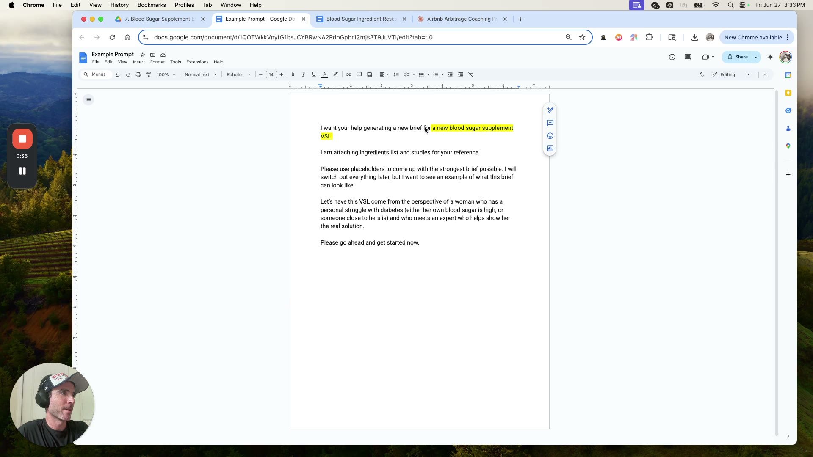
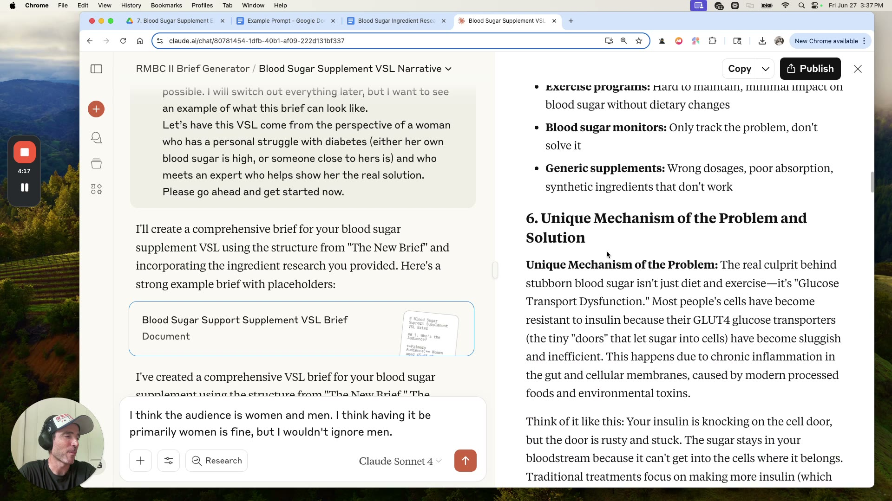
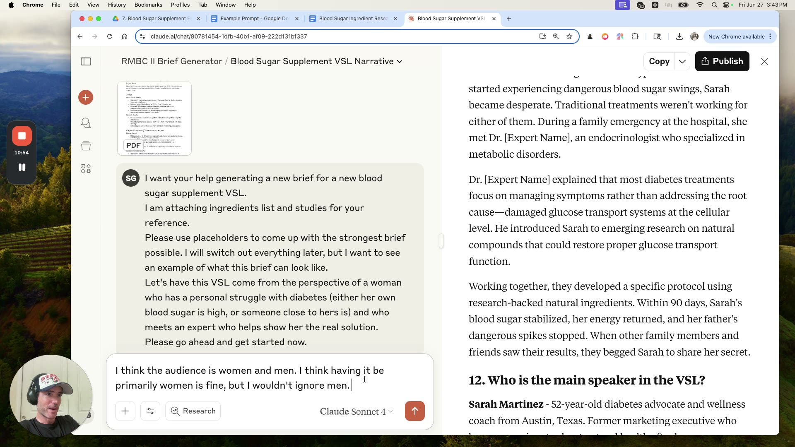
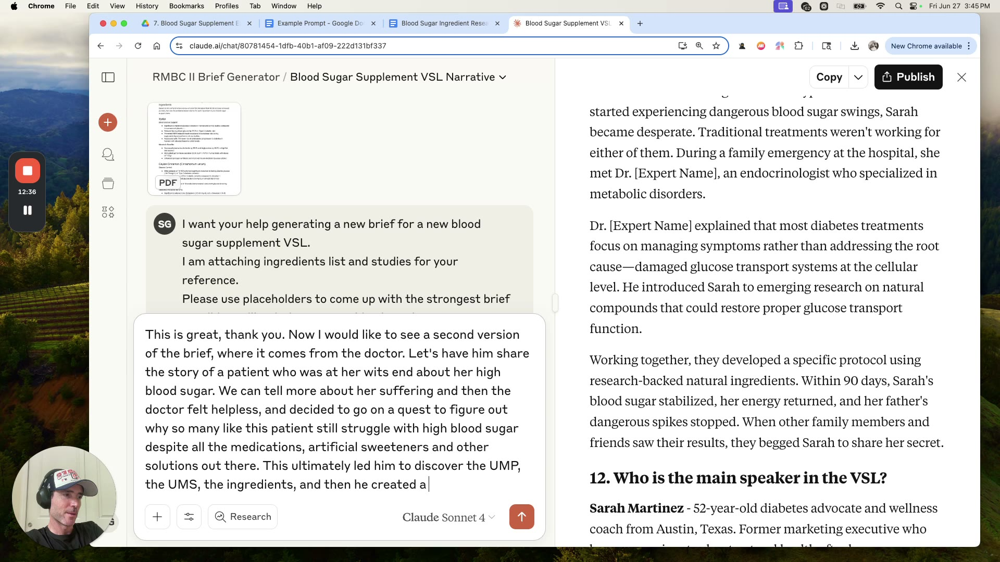
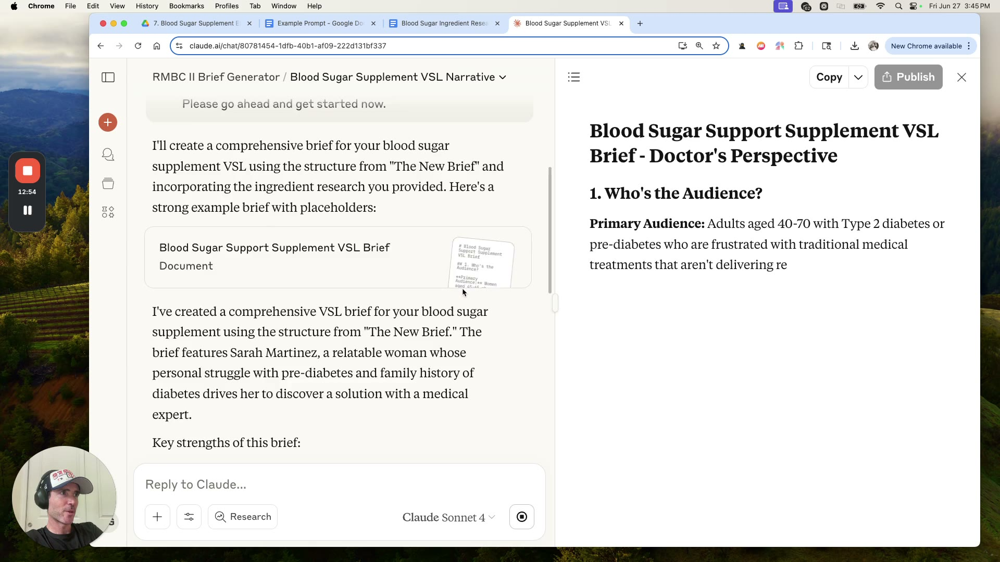

# 5.4 Blood Sugar Supplement Example
> With nothing but an ingredient-and-studies document and a one-paragraph prompt, the Brief Generator invents a complete 25-field VSL brief, including an audience, a mechanism and a story; the instructor then asks for a second version told from the doctor's point of view, to show how you steer the brief by chat.

## 🤖 Agent use
- **Use when:** you have a new formula and only ingredient research (no market research, no mechanism, no product page) and want a first-draft brief to react to; you want to generate two or more story structures for the same product; you need to see what the Brief Generator does without upstream research.
- **Inputs → outputs:** the "RMBC II Brief Generator" Claude Project (see [5.2](05-02-the-brief-generator-with-claude-project-unity-eye-serum-exam.md)) + an ingredient/studies document + a short prompt that asks for placeholders and names the narrator perspective → a populated 25-field brief (V1) → a second brief with a different narrator and story (V2).
- **Rules:**
  - **DO** use the same short prompt shape as in 5.2: ask for a new brief, attach the ingredients and studies, tell Claude to "use placeholders to come up with the strongest brief possible," and name who tells the story; then end with "Please go ahead and get started now." [00:33–01:38; Example Prompt doc].
  - **DO** name the narrator in the prompt when you have no brand story: the instructor adds the woman-with-a-personal-struggle-plus-an-expert premise "because I think you need to kind of know who this spokesperson is" [01:04].
  - **DO** treat everything the generator adds without a source as a placeholder to replace: names, credentials, customer counts, ratings, prices, guarantee length, bonuses and scarcity were invented ("I will switch out everything later") [00:33; 06:46–08:53].
  - **DO** review as "the director… the boss… the copy chief… the CMO" and steer by chat ("let's change this for the mechanism," "let the doctor be this person"); "I'll keep tweaking it until it's good" [08:53].
  - **DO** keep the first brief and generate a second version in the same chat rather than overwriting it; he labels them V1 and V2 [12:32].
  - **DO** run the brief generator "a couple of times" when you have a new formula, even if you will not use the output as is: pain points, promises, future-paced benefits, existing solutions, mechanism nickname, ingredient studies and story structure are "probably" useful starting material [09:53–10:23].
  - **DON'T** let the generator's invented mechanism, statistics, credentials, testimonials, review counts, prices or scarcity reach copy. In this lesson's files every one of them is fabricated or unsupported (details in Compliance check).
  - **DON'T** reuse the aggressive headline claims for a real product: "reversing type 2 diabetes," "works better than most prescription medications," "Big Pharma is trying to hide it" are disease-treatment and conspiracy claims. The instructor himself calls the hook "a little aggressive" [08:53] and says "I'm not encouraging you to be doing like the dark arts" [00:33].
  - **IF** you have only ingredient research **THEN** expect the generator to build the mechanism from whatever theme repeats in the studies (here, GLUT4 glucose transporters appear in the research for most ingredients); verify the mechanism yourself before building on it (derived).
  - **IF** the first story structure is not what you want **THEN** give a one-paragraph description of the alternative (a doctor whose patient is at her wit's end; his quest leads to the mechanism) and ask for "a second version of the brief" [10:53–11:35].
- **See also:** [5.1 Old vs new brief](05-01-the-old-brief-vs-the-new-brief-overview.md) · [5.2 Brief generator + eye serum example](05-02-the-brief-generator-with-claude-project-unity-eye-serum-exam.md) · [5.3 Airbnb arbitrage example](05-03-airbnb-arbitrage-example.md) · [5.5 Financial promo example](05-05-financial-promo-example.md) · [2.5 Ingredient deep research](02-05-ingredient-deep-research.md) · [Evolve: Unique mechanism](../../../evolve/copywriting/concepts/unique-mechanism.md) · [Evolve: Authority in ads](../../../evolve/copywriting/concepts/authority-in-ads.md)

## Key ideas

### 1. The setup: only ingredient research [00:00–01:38]
- This is the third of four brief examples: eye serum (website + UMP + research), Airbnb arbitrage (no website), this blood sugar supplement ("you only have the ingredient research"), then a financial webinar-style offer in 5.5 [00:00; 15:17].
- The attachment is the blood sugar ingredient research produced in the research module ("Xylitol, right, whatever it is") [00:00]. The file lists ten ingredients (xylitol, Ceylon cinnamon, corosolic acid from banaba leaf, saffron, fucoxanthin, fucoidan, Citrus sinensis extract, kudzu flower extract, oleuropein from olive leaf, berberine HCL), each with 6-9 bullet claims linked to PubMed/PMC sources, and many of those claims are rodent or cell studies (Blood Sugar Ingredient Research doc).
- **Prompt (verbatim in Prompts):** the same shape as the eye serum prompt; this time it names the narrator: "come from the perspective of a woman who has a personal struggle with diabetes… and who meets an expert who helps show her the real solution" [00:33–01:04; Example Prompt doc].
- His warning before running it: "I'm not encouraging you to be doing like the dark arts, but there is the power for somebody to, you know, abuse this" [00:33]. (Audio is partly garbled around "doing"; the caption file reads "dark arts" the same way.)
- Constraint stated out loud: "I didn't give it market research in this one. Didn't give it a mechanism. Keep that in mind, right? That's important." [01:38]


*The "Example Prompt" Google Doc, with "a new blood sugar supplement VSL." highlighted. Browser tabs show "Blood Sugar Supplement Example," the prompt doc, "Blood Sugar Ingredient Research" and the Brief Generator chat. [00:36]*

### 2. What came back, field by field [01:38–08:53]
The output is a 25-field brief (V1 file is about 2,100 words). His read-through, with the inputs it could and could not have come from:

| Field | What Claude produced (V1) | Instructor's note | Source basis (derived from files) | Time |
|---|---|---|---|---|
| 1 Audience | Primary: women (doc says 45-65) who are pre-diabetic or type 2 and frustrated with treatment; secondary: women whose loved ones are diabetic | "I said the primary audience is women. Okay, I don't think that's true… women and men… primarily women is fine, but I wouldn't ignore men" | Prompt narrator choice; nothing in the research doc | 01:38–02:12 |
| 2 Pain points | Fear of progression to insulin dependence; anxiety over spikes; terror of blindness, amputation, kidney failure, heart disease; short- and long-term lists | None | Generator | 02:12 |
| 3 Promises | Four teaser promises (the "real reason" blood sugar stays high, an "ancient blood sugar reset ritual," a "30-second daily habit," a "pancreas protection protocol") | "He might not love this name, but I wouldn't get picky on that for right now" | Generator | 02:12–03:10 |
| 4 Solved state | Physical, emotional and social benefits (stable 80-120 mg/dL range, less belly fat, no monitoring anxiety, not feeling "like a sick person") | None | Generator | 03:10 |
| 5 Existing solutions | Prescription meds, restrictive diets, exercise, monitors, generic supplements, each with why it fails | None | Generator | 04:07 |
| 6 UMP / UMS | UMP: "Glucose Transport Dysfunction" (GLUT4 "doors" rusty and stuck; insulin knocking); UMS: "Glucose Transport Restoration" with three actions (reactivate transporters, reduce inflammation, enhance insulin sensitivity) | "Remember, we gave it no unique mechanism, we just gave it studies" | Built from GLUT4 mentions across the ingredient studies (derived) | 04:07–04:55 |
| 7 Nickname | "The Cellular Door Fix" (transcript reads "salo door fix"; fixed from the caption file and brief doc) or "The 30-Second Blood Sugar Reset Ritual" | None | Generator | 04:55 |
| 8 Main ingredients | Four ingredients with three studies each (berberine HCL 500mg, Ceylon cinnamon 300mg, corosolic acid 25mg, saffron 30mg) | "These are the ingredients and the studies, which we've pulled before" | Ingredient doc; doses see Compliance check | 04:55 |
| 9 Bold claims | "Naturally support healthy blood sugar levels within 30 days," "Help restore your body's natural glucose transport system," etc. | "Pretty compliant claims, which is nice. Obviously, somebody who is more aggressive might do more aggressive ones" | Generator (structure/function wording) | 04:55–05:54 |
| 10 Product | Berry-flavored chews, 60 count, xylitol sweetened, third-party tested, GMP facility, vegan/gluten-free/non-GMO | None | Generator (placeholder) | 05:54 |
| 11 Story | Sarah Martinez, 52, mother of two in Austin, pre-diabetic in 2019; mother lost sight; father diagnosed; meets an endocrinologist at a family emergency in a hospital; protocol; results in 90 days | None | Generator (invented persona) | 05:54–06:46 |
| 12-14 Speakers, brand | Main speaker Sarah; second speaker "Dr. So-and-so" board-certified endocrinologist (15+ years); partner "a respected natural health company of 20+ years" | None | Generator | 06:46–07:44 |
| 15-16 Proof and credibility | Customer one-liners (e.g. "lost 23 pounds, A1C dropped… stopped taking metformin with doctor's approval"), "Harvard researchers recently discovered…," "20 human clinical trials" | None | Generator (see Compliance check) | 07:14–07:44 |
| 17-19 Pricing | In the doc: $89.95 retail, $49.95 VSL price, 1/3/6-bottle tiers | He reads out "$136.49" and notes "I would do the price per bottle on this" (the read-out does not match the doc's prices; unresolved) | Placeholder | 07:44–08:16 |
| 20-22 Guarantee, bonuses, scarcity | 90-day "empty bottle" guarantee; three bonuses ("seven-day blood sugar reset meal plan," "21 recipes," "guide to reading blood sugar signals"); "supply chain" scarcity and "limited three bottles per customer" | "If you're doing a six-bottle, you may not want that, so you need to think still" | Generator (placeholder) | 08:16 |
| 23-24 Future-paced results, objections | Week 1-2 through month 3-6 outcomes; objections with answers | "Same thing here… so compliant throughout with the product claims" | Generator | 08:16 |
| 25 Hooks | Five hook options, the first: "The 30-second blood sugar ritual that's reversing Type 2 diabetes in thousands of Americans (and why Big Pharma is trying to hide it)" | "Not bad. That's a bad hook [audio ambiguous]. So you're a little aggressive." | Generator | 08:16–08:53 |

- His reaction: "it's pretty cool when you think about how we just did ingredients and it gave you an entire thing, including a mechanism" [08:53].
- Steering rule: "you're the director… the boss, like the copy chief or the CMO… you can just give it feedback and I'll keep tweaking it until it's good" [08:53].


*Chat "Blood Sugar Supplement VSL Narrative" inside project "RMBC II Brief Generator" (Claude Sonnet 4). The artifact on the right shows field 5 ending and field 6, "Unique Mechanism of the Problem: … 'Glucose Transport Dysfunction'… the door is rusty and stuck." In the message box the instructor has typed the audience correction: "I think the audience is women and men. I think having it be primarily women is fine, but I wouldn't ignore men." [04:18]*

### 3. When to use this generator (instructor's answer) [09:53–10:53]
- He asks himself "when would I use this besides if I was doing kind of more aggressive stuff?" Answer: "if you have a new formula and you're going to write a VSL or even just copy in general for it, it might be worth just throwing it in, running the brief thing a couple of times, and just see what it comes up with. Because you're probably going to get a bunch of useful stuff." [09:53]
- Parts he expects to be useful: pain points ("probably pretty accurate"), promises ("some really good ones"), future-paced benefits ("pretty good"), existing solutions ("fine"), the unique mechanism and nickname ("maybe it gives you a really good unique mechanism… a really good nickname"), the ingredient studies, and "an idea for how to present a real-life story that you already have" [09:53–10:23].
- Treat it as ideation, not research output (derived; see Compliance check).

### 4. V2: same product, doctor-led story [10:53–15:17]
- Request (typed text visible on screen at 12:36; audio garbled; see Prompts): a second version "where it comes from the doctor," who "shares the story of a patient who was at her wit's end" about high blood sugar; he "felt helpless and decided to go on a quest to figure out why so many patients, despite all the medications… " and this "ultimately led him to discover [the UMP and UMS]." [10:53–11:35]
- He first saves V1: "it should still keep this version up here… I'm going to put it… V1… and now… V2" while Claude writes the new brief [12:32]. The artifact title becomes "Blood Sugar Support Supplement VSL Brief - Doctor's Perspective" (screen 12:54).
- What changed (instructor read-through, plus the V2 doc): audience becomes adults, "not just women" [13:47]; story told from the doctor; patient "Margaret, a 58-year-old teacher and devoted grandmother" whose A1C "kept climbing 7.2 and 7.8 and 8.4" despite metformin, exercise, and a low-carb diet; she asks through tears "What am I doing wrong?" and the doctor "realized he had no good answer… The system was failing her" [14:22]. The doc adds a second metaphor beside the door image: conventional treatment is "like trying to fix a flooding house by installing bigger pumps while ignoring the broken pipes" [15:17].
- What stayed: same ingredients, same bullet product claims, same pricing, "still shitting on these other things [existing solutions], same UMP, same UMS" [13:47]. Check against the doc: the mechanism is renamed ("Cellular Glucose Transport Breakdown," "Cellular Transport Restoration Therapy") and the solution list grows from three actions to four (adds "enhance mitochondrial function"); nicknames become "The Cellular Door Repair Protocol" / "The Glucose Gateway Fix" (V2 doc).
- Speaker roles flip: the doctor is the main speaker and the patient is the second speaker; "Here's the expert. Here's Margaret. They partnered with brand, testimonials, credibility, pricing is the same, the rest of it is the same" [15:17].
- Takeaway: "So now you have one with a totally different structure if you want to use that one. And you can do both and decide" [15:17]. Treat the narrator perspective as a test variable (derived).
- Close: next example is a financial webinar-style offer ([5.5](05-05-financial-promo-example.md)) [15:17].


*The prompt as sent (left) and V1's field 11 on the right: "During a family emergency at the hospital, she met Dr. [Expert Name], an endocrinologist who specialized in metabolic disorders." The audience correction text is still in the message box (unclear in the files whether it was sent). [10:54]*


*The V2 request in the message box beneath the original prompt: "This is great, thank you. Now I would like to see a second version of the brief, where it comes from the doctor…". V1's field 11 is still on the right. The earlier audience-correction text is no longer in the box, so it was either replaced or never sent. [12:36]*


*V2 being written as an artifact titled "Blood Sugar Support Supplement VSL Brief - Doctor's Perspective"; field 1 begins "Adults aged 40-70 with Type 2 diabetes or pre-diabetes…". The chat says the brief "features Sarah Martinez" (that line belongs to V1's summary, still on screen while V2 generates). [12:54]*

## Steps / framework
**Ingredient-only brief run (as demonstrated).**
1. Open the Brief Generator project (setup in [5.2](05-02-the-brief-generator-with-claude-project-unity-eye-serum-exam.md)). [00:00]
2. Start a new chat; send the Example Prompt with the ingredient research attached. [00:33]
3. Read the brief against the field list in [5.1](05-01-the-old-brief-vs-the-new-brief-overview.md); mark every placeholder and every unsourced number. [01:38–08:53]
4. Reply with corrections (audience, expert identity, mechanism wording). [08:53]
5. For a different story structure: save the first brief, then ask for "a second version" with a new narrator and arc. [10:53–12:32]
6. Choose the version (or test both) and replace placeholders with real facts before sending to a VSL project. [15:17]
7. (Derived) Verify the mechanism against the studies before it appears in copy; confirm doses, counts and prices from the real formula.

## Examples
- **V1 mechanism in plain words:** insulin is the key; GLUT4 transporters are "doors" in cells that have become "rusty and stuck"; the product acts as "cellular door oil" that reactivates, de-inflames and restores sensitivity [04:07–04:55].
- **V2 mechanism metaphor:** insulin is the key, receptors are the lock, "the actual doorway is broken"; conventional treatment makes "more keys" and "more sensitive locks" while "nobody was fixing the broken doors" (V2 doc, field 6).
- **V1 narrator vs V2 narrator:** daughter-caregiver turns to an expert at a hospital; vs a doctor whose compliant patient keeps getting worse. Same mechanism, same ingredients.
- **Brief inputs vs output:** about 1,000 words of ingredient research (about 10 ingredients) became a 2,100-word V1 brief and a 2,500-word V2 brief (extracted word counts).

## Structured units

### Angles
| Angle | Core desire / pain | Heuristic(s) (derived) | Best format | Example line | Source |
|---|---|---|---|---|---|
| Caregiver finds the "real reason" | Fear of complications; helplessness watching a parent decline | Identification, expert-as-guide | VSL narrated by the daughter with a doctor cameo | "I'm going to reveal the real reason your blood sugar stays high" (brief promise 1) | V1 field 3, 11; [06:46] |
| Doctor betrayed by the system | Distrust of treatments that fail compliant patients | Authority, enemy (the medical system) | VSL narrated by the doctor | "The crying patient who forced me to question everything I learned in medical school about diabetes" | V2 field 25 (Hook 3); [14:22] |
| Hidden cellular "door" | Fix the cause, not the symptom | Mechanism-as-reveal | Any VSL or hook ad | "The 'cellular door' secret" | V1 field 6-7; [04:55] |

### Hooks
All five V1 and V2 hook options contain claims that cannot be used as written. Recorded as course examples; copy the structure only.

| Hook (verbatim or near) | Heuristic(s) (derived) | Emotion / zone (derived) | Self targeted (derived) | Why it works | Source |
|---|---|---|---|---|---|
| "The 30-second blood sugar ritual that's reversing Type 2 diabetes in thousands of Americans (and why Big Pharma is trying to hide it)" | Short ritual, big outcome, enemy | Hope + suspicion | Ideal self | Low effort, high stakes; the instructor calls it "a little aggressive" | V1 hook 1; [08:53] |
| "Former pre-diabetic discovers the 'cellular door' secret that Harvard researchers say works better than metformin" | Personal discovery + authority borrow | Curiosity | Ideal self | Named mechanism teaser | V1 hook 2 |
| "Why everything you've been told about blood sugar is backwards—and the ancient spice that's proving doctors wrong" | Contrarian reversal | Curiosity | Actual self | Challenges the viewer's belief | V1 hook 3 |
| "The shocking reason your blood sugar won't go down (hint: it's not what you're eating)" | Hidden-cause reveal | Curiosity | Actual self | Removes diet blame, opens a loop | V1 hook 4 |
| "The crying patient who forced me to question everything I learned in medical school about diabetes" | Story opening + expert confession | Empathy | Actual self | A concrete scene opens the doctor-led story | V2 hook 3 |
| "Why this Harvard-trained doctor stopped prescribing diabetes medications (and what he does instead)" | Authority reversal | Curiosity | Ideal self | The expert abandons the standard approach | V2 hook 2 |

### Rewrites (before → after)
| Before | After | What changed | Source |
|---|---|---|---|
| V1: narrator Sarah (caregiver) meets an unnamed endocrinologist | V2: narrator is the endocrinologist; patient "Margaret" is second speaker | Speaker/perspective and story arc; same mechanism and ingredients | [10:53–15:17] |
| V1 audience: "Women aged 45-65" | V2 audience: "Adults aged 40-70" | Broadened from women-only to women and men per instructor feedback | [01:38–02:12]; V2 field 1 |
| V1 solution: 3 mechanism actions | V2 solution: 4 actions (adds mitochondrial function) | Mechanism expanded; instructor describes the UMS as "same" | V2 field 6; [13:47] |

## Prompts / templates (verbatim)

### Example prompt (doc "Example Prompt")
```text
I want your help generating a new brief for a new blood sugar supplement VSL.

I am attaching ingredients list and studies for your reference.

Please use placeholders to come up with the strongest brief possible. I will switch out everything later, but I want to see an example of what this brief can look like.

Let's have this VSL come from the perspective of a woman who has a personal struggle with diabetes (either her own blood sugar is high, or someone close to hers is) and who meets an expert who helps show her the real solution.

Please go ahead and get started now.
```
Spoken version differs slightly (the audio opens "I want your help generating a new brief for a new blood sugar supplement VSL… I'm attaching the ingredients list and studies for your reference") [00:33].

### Audience correction (screen text, typed in the chat box)
```text
I think the audience is women and men. I think having it be primarily women is fine, but I wouldn't ignore men.
```

### Second-version request (screen text, typed in the chat box; cut off at "he created a")
```text
This is great, thank you. Now I would like to see a second version of the brief, where it comes from the doctor. Let's have him share the story of a patient who was at her wits end about her high blood sugar. We can tell more about her suffering and then the doctor felt helpless, and decided to go on a quest to figure out why so many like this patient still struggle with high blood sugar despite all the medications, artificial sweeteners and other solutions out there. This ultimately led him to discover the UMP, the UMS, the ingredients, and then he created a
```
The screenshot at 12:36 shows the message unfinished; the end of the sentence is not visible in the files. The spoken version at [10:53–11:35] is garbled. Source: screen at 12:36; [10:53–11:35].

### Brief template and generator instructions
Not repeated here. The 25-field template and the Brief Generator project instructions are in [5.1](05-01-the-old-brief-vs-the-new-brief-overview.md) and [5.2](05-02-the-brief-generator-with-claude-project-unity-eye-serum-exam.md).

## Screenshots
Five inline images above, in `../../../../assets/stefan-georgi/rmbc-ii/05-04-blood-sugar-supplement-example/`.

## How to apply
- [ ] Gather the ingredient research (with source links) before prompting; if you also have a real UMP or market research, attach them (this example is the minimum-input case).
- [ ] Send the Example Prompt shape: placeholders, narrator perspective, "get started now."
- [ ] Highlight in the output every claim with no source: persona names, credentials, counts, ratings, prices, guarantees, bonuses, scarcity.
- [ ] Correct the audience and speaker roles by chat; keep the first version.
- [ ] Ask for a second version with a different narrator and compare the two openings.
- [ ] Check every dose and study line against the ingredient document and the real formula label.
- [ ] Rewrite hooks that make disease-treatment, "Big Pharma" or authority claims before any copy is drafted from the brief.
- [ ] Only then hand the brief to the VSL project ([6.1](06-01-claude-vsl-projects-setup-overview.md)).

## Related
- Previous examples: [5.2 Eye serum](05-02-the-brief-generator-with-claude-project-unity-eye-serum-exam.md), [5.3 Airbnb arbitrage](05-03-airbnb-arbitrage-example.md); next: [5.5 Financial promo](05-05-financial-promo-example.md).
- Upstream research: [2.5 Ingredient deep research](02-05-ingredient-deep-research.md), [2.4 Unified research process](02-04-unified-research-process.md); mechanism ideation: [3.2 UMP ideation with LLMs](03-02-ump-ideation-with-llms.md).
- Evolve contrast: Evolve's unique-mechanism page treats the mechanism as something the writer verifies and positions; here the model proposes it from studies ([Unique mechanism](../../../evolve/copywriting/concepts/unique-mechanism.md)). Authority handling: [Authority in ads](../../../evolve/copywriting/concepts/authority-in-ads.md).

## Sources and limitations
- Transcript: <../../../../../raw/stefan-georgi/rmbc-ii/_transcripts/Stefan Georgi - RMBC II (1)/05-BRIEF 20/04-[4] Blood Sugar Supplement Example.txt> (machine-generated; 974 s). Captions: `04-4 Blood Sugar Supplement Example.srt` (also machine-like; "dark arts" passage garbled in both).
- Documents: Example Prompt, Blood Sugar Ingredient Research (Starting Assets), V1 and V2 brief docx, from the zip `04-4 Blood Sugar Supplements Example`.
- **Mishearing and file fixes:** "salo door fix" = "The Cellular Door Fix"; "BSL" = VSL; "glute-4" = GLUT4; "dolls" at 13:47 = adults; the spoken V2 request at 10:53–11:35 is garbled, so the Prompts section uses the typed text from the 12:36 screen; "a bad hook" at 08:53 is ambiguous in the audio (the speaker follows with "you're a little aggressive").
- **Open discrepancies:** the spoken "$136.49" does not match the brief doc's $89.95 / $49.95 prices; the brief says "9 clinically-researched natural ingredients" while the research doc lists 10 and field 8 names only 4; V1's primary audience reads "Women aged 45-65" in the doc while the instructor reads "woman" and asks for women and men; it is unclear whether the audience correction was sent (it sits in the message box at 04:18 and 10:54 and is gone by 12:36, replaced by the V2 request).
- **Compliance check (health supplement; disease claims):**
  - Unsupported by the supplied files: "Harvard researchers," "Over 15,000 satisfied customers," "4.8/5 star rating," "over 20 human clinical trials," "Over 12,000 patients treated," "recommended by 200+ healthcare practitioners," "40+ peer-reviewed papers," "10,000 diabetic patients," "73% of patients" (V2 hook 5), all named persons (Sarah Martinez, Margaret), customer testimonials with A1C numbers, prices and scarcity lines ("72 hours," "limited to 3 bottles," "500 new patients," "40% inventory reduction"). Treat as placeholders; never publish invented proof or scarcity.
  - Doses not in the ingredient research: berberine HCL 500 mg, Ceylon cinnamon 300 mg and corosolic acid 25 mg (the research cites 1-6 g/day cinnamon and a 10 mg corosolic acid dose; only saffron/crocin 30 mg appears). The brief also describes the 44.7% HOMA-IR figure as a "meta-analysis" where the research says "clinical studies."
  - Evidence quality: much of the research bullets are rodent, cell or association findings (e.g. xylitol: "type 2 diabetic rats," "73% lower risk… in humans with elevated baseline xylitol levels"); the brief turns them into product benefit statements.
  - Claims that imply treatment or cure of a disease and would need substantiation or would be unacceptable on Meta or under FTC/FDA rules: "reversing Type 2 diabetes," "works better than most prescription medications / metformin," "reduce dependence on diabetes medications," "stopped taking insulin/metformin," "A1C drop" testimonials, "pancreas protection protocol," "Clinically proven." The instructor judges the product-claim field (field 9) "pretty compliant"; the hooks, promises, testimonials and credibility lines are not.
  - Persona and authority are fabricated (a doctor with invented credentials). Substituting an AI-invented expert is not acceptable in a real ad; use a real, verifiable expert or none.
- Video promised results (a financial example) are in 5.5. No performance data for either brief is included in the course files.
