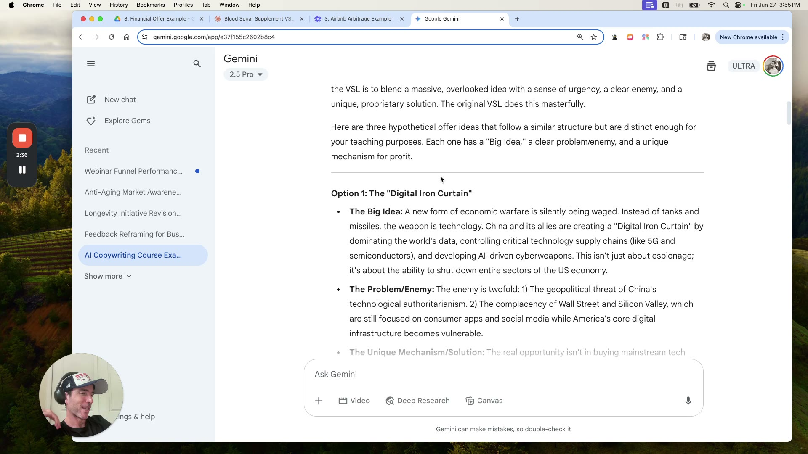
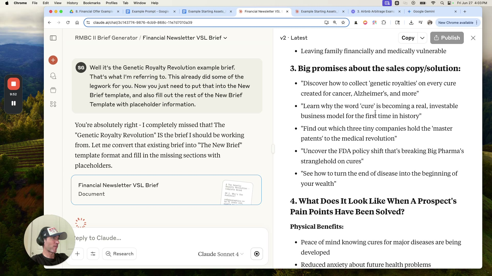
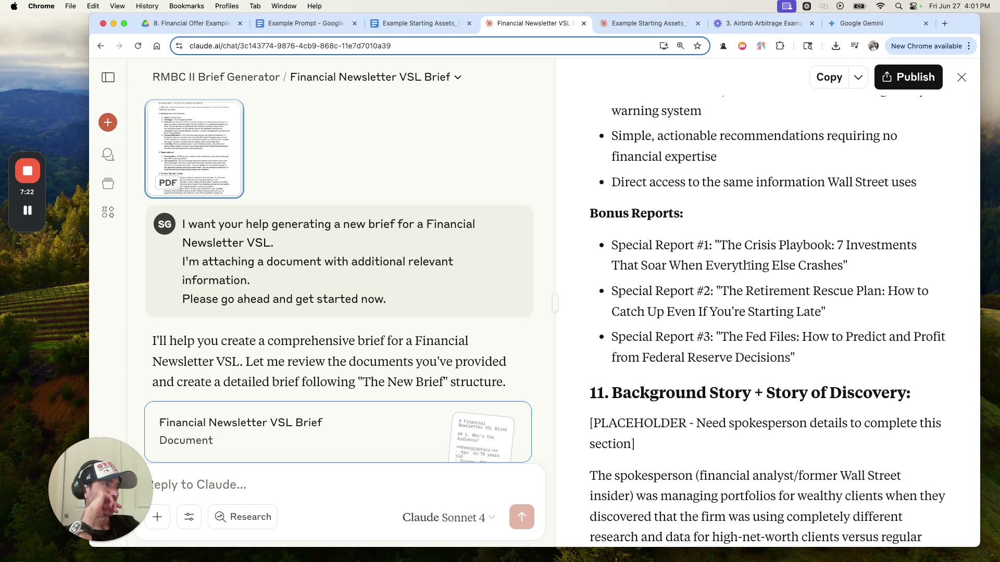
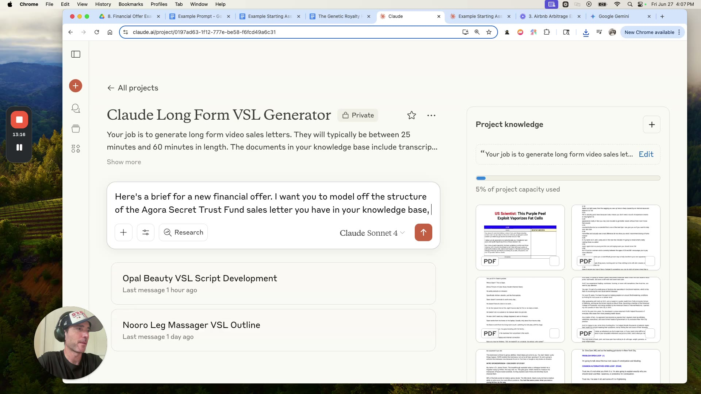
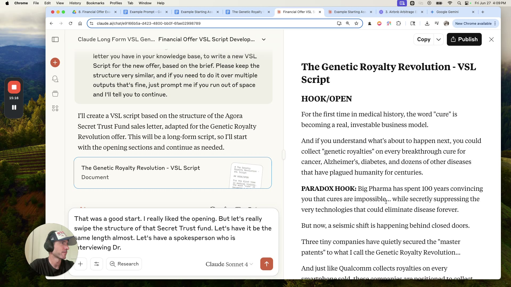
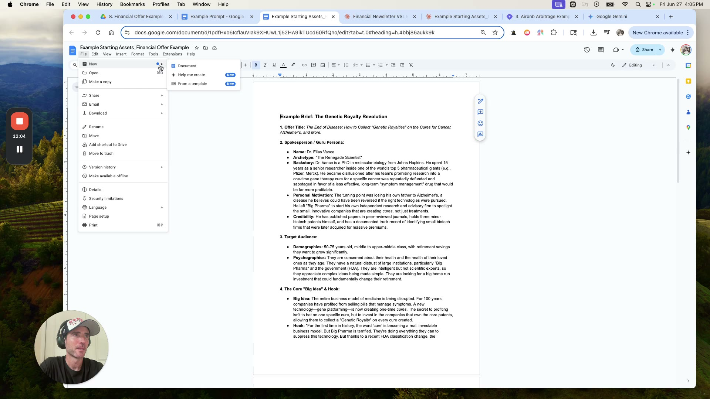
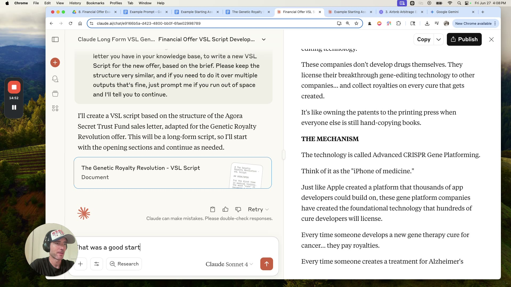

# 5.5 Financial Promo Example
> The fourth and last Brief Generator example: use an LLM to invent a teaching-grade financial-newsletter offer from a winning VSL, turn it into a 25-field brief, then have the Long Form VSL Generator project write a new script that swipes the winner's structure, shown here with a heavily non-compliant "cure" thesis that you should copy only as a process, never as claims.

## 🤖 Agent use
- **Use when:** you need to (a) brainstorm a new offer or big idea "similar but different" to a proven long-form VSL, (b) convert a rough offer write-up into the 25-field New Brief, or (c) generate a long-form script that follows a proven winner's structure (host plus expert interview) from a brief. Also use it as the worked example of the "recover when the generator ignores your attachment" move.
- **Inputs → outputs:** winning VSL transcript (PDF) → LLM offer ideas (3 named options) → chosen offer written up as "Example Starting Assets" (persona, audience, big idea, mechanism, proof, product suite, price) → Brief Generator project + short prompt + that document → 25-field brief with `[PLACEHOLDER]` fields → Long Form VSL Generator project + "model off the structure of [winner]" prompt → multi-part script (about 7,100 words saved in the course file, ends mid-offer).
- **Rules:**
  - **DO** use an LLM to ideate offers by giving it a winning VSL transcript and asking for a hypothetical offer "similar to this one but different enough" [00:00–00:31]. Instructor: "this is where AI is incredible for idea generation" [02:17].
  - **DO** attach the offer write-up to the brief prompt and then check that the output actually uses it. The first run ignored the attachment and produced a generic "financial newsletter" brief (inflation, "consistent 15-25% annual returns"). He judged: "I'm almost wondering, did I give it the right document? I almost feel like it did not" [07:05].
  - **IF** the generator drifts from your attachment **THEN** re-upload it and say what it is. The recovery message, read from the screen at about 09:52: "Well it's the Genetic Royalty Revolution example brief. That's what I'm referring to. This already did some of the legwork for you. Now you just need to put that into the New Brief template, and also fill out the rest of the New Brief Template with placeholder information." After that: "Okay, this is way better... So this is why you gotta stand on top of it." [08:56]
  - **DO** save the finished brief to Drive/Docs before using it as the next prompt's input [12:02].
  - **DO** tell the VSL project to model the winner's structure and permit multi-output generation: "if you need to do it over multiple outputs that's fine, just prompt me if you run out of space and I'll tell you to continue" (screen, 14:52; spoken at 13:22).
  - **IF** the first draft starts well but strays **THEN** reply "I really liked the opening. Let's really swipe the structure of Secret Trust Fund. Have it be the same length." and specify the interview format (spokesperson interviewing the expert) [14:06–15:07].
  - **DON'T** ship these claims. The brief and script assert cures for cancer and Alzheimer's, "you could watch your own net worth soar", future 5x-10x returns, a fabricated track record ("1,200% premium" takeover), named billionaire investors "pouring fortunes" into the space, "3 stocks that could crash 50-80%... or go to zero", and "Big Pharma suppressed cures for 100 years". Every one needs substantiation or removal under SEC/FINRA/FTC and platform rules (derived). The instructor himself says "I know it's not compliant" [15:07] and "my biggest thing would be on compliance side" [02:17].
  - **DON'T** invent a spokesperson, credentials, patents, tickers or a track record for a real offer. "Dr. Elias Vance" (Johns Hopkins PhD, 15 years at Big Pharma, "three biotech patents"), the "Gene-Sys Inc." call and the interviewer "Aaron Mitchell" are all fictional teaching props (derived from the brief's own "e.g." wording).
  - **DON'T** copy the swiped lines. The instructor admits "this is a really direct swipe now" and that parts ("the hundred year thing") "don't make sense" and "would need to be tweaked or modified" [16:30]. Copy structure, rewrite everything else (house rule: copy the mechanism, not the asset).
- **See also:** [5.1 Old brief vs new brief (templates verbatim)](05-01-the-old-brief-vs-the-new-brief-overview.md) · [5.2 Brief generator + eye serum](05-02-the-brief-generator-with-claude-project-unity-eye-serum-exam.md) · [5.3 Airbnb arbitrage example](05-03-airbnb-arbitrage-example.md) · [5.4 Blood sugar supplement example](05-04-blood-sugar-supplement-example.md) · [4.7 Long-form financial VSL breakdowns (the Secret Trust Fund VSL)](04-07-long-form-financial-vsl-examples-and-break-downs.md) · [6.1 Claude VSL projects setup](06-01-claude-vsl-projects-setup-overview.md) · [3.2 UMP ideation with LLMs](03-02-ump-ideation-with-llms.md)

## Key ideas

### 1. Offer ideation by "structural cousin" [00:00–02:48]
- Starting point: the Agora "Secret Trust Fund" long-form VSL, "which I included the breakdown of with the long-form VSLs" ([4.7](04-07-long-form-financial-vsl-examples-and-break-downs.md)). He uploaded its transcript PDF to Gemini (the screen shows "Gemini 2.5 Pro" and a file "Agora Financial Secret Trust Fund VSL.pdf") and asked for "a hypothetical offer for the financial space that's kind of similar to this one but different enough to be used for teaching purposes" [00:00–00:31].
- Gemini returned three options, each with a "Big Idea", a problem/enemy and a unique mechanism/solution (screen, 02:36): "The Digital Iron Curtain", "The AI Energy Paradox" and "The Genetic Royalty Revolution". He picked the last [00:31].
- The pitch for it, as read aloud: big pharma has "made fortunes from one-size-fits-all drugs that treat symptoms"; gene editing and personalised medicine make that model obsolete; a few biotech firms hold the core patents ("like owning the oil reserves of the 21st century"); enemy = big pharma's R&D budgets, chronic-treatment profits and lobbyists; "unique mechanism solution: you don't need to be a scientist to profit... invest in the companies that don't sell the drugs themselves but own the patents and collect a genetic royalty on every treatment" [00:31–01:43].
- Why Gemini said it works (read aloud): taps universal desire for health and longevity plus distrust of pharma; "the royalty concept is a powerful and easily understood investment mechanism"; spokesperson could be "a renegade PhD or former FDA scientist" [01:18–01:43].
- He then asked it for "an example brief that I can use for a case study", and it produced the persona, motivation, credibility and target market. Note: "I didn't tell it about the brief... it kind of did some of the brief stuff here... which is kind of amazing" [01:43–02:17]. The resulting file is "Example Starting Assets_Financial Offer Example" (Starting Assets, below).
- His market judgment: "I'm not financial... financial bros might be like no this won't work... in a long VSL the idea is sort of like this genetic royalty. I actually think it's probably a really interesting idea that could do well." Also: "Maybe someone already tested it and Google swiped it. I don't know" [02:17–02:48]. (Instructor opinion; not tested.)


*Gemini 2.5 Pro answering "come up with a hypothetical offer... similar... but different enough". Option 1 shown: "The Digital Iron Curtain" with Big Idea, Problem/Enemy and Unique Mechanism fields, the same trio that the Brief asks for. [02:36]*

### 2. The brief-generator run, including the failed first pass [02:48–11:00]
- Same prompt shape as the Airbnb example ([5.3](05-03-airbnb-arbitrage-example.md)): a general "new brief for a Financial Newsletter VSL" line, one attached document, "Please go ahead and get started now." (verbatim in Prompts) [03:20–04:04]. Unlike earlier examples there is no separate UMP file: "I'm really just attaching a single document... kind of a UMP... in case you didn't have this in depth of a thing" [03:20–04:04].
- Run 1 output (screen at 07:24 and transcript 04:51–06:18) reads as a different offer: audience 45-70, income $75,000+, net worth "$250 to $2 million"; pains "retirement insecurity, inflation erosion, market manipulation"; promises such as "Discover the secret investment strategy that Wall Street doesn't want you to know about", "consistent 15-25% annual returns regardless of market conditions" and "multiply your retirement savings by 5-10x"; bonus reports "The Crisis Playbook", "The Retirement Rescue Plan", "The Fed Files"; and a Background Story field reading "[PLACEHOLDER - Need spokesperson details to complete this section]" (screen).
- His reactions: "a little boring and generic, but it's fine"; "I don't know if these are too strong or not. Probably, maybe" [05:48–06:18]. He starts a point about financial copy ("You don't actually really need a mechanism or a 72-hour...") but the captions cut off after "72-hour." Not recoverable [06:48–07:04].
- Diagnosis: the attachment was ignored. Fix and result as in Agent use rule 2. Run 2 maps the Genetic Royalty write-up onto all 25 fields and fills the gaps with placeholders: "Short-term, long-term. This is good" [08:56].
- Run 2 promises (verbatim, also on screen at 09:52): "Discover how to collect 'genetic royalties' on every cure created for cancer, Alzheimer's, and more"; "Learn why the word 'cure' is becoming a real, investable business model for the first time in history"; "Find out which three tiny companies hold the 'master patents' to the medical revolution"; "Uncover the FDA policy shift that's breaking Big Pharma's stranglehold on cures"; "See how to turn the end of disease into the beginning of your wealth" [08:56–10:01]. His reaction: "Oh my gosh. So good. It's probably not very compliant, but like it's so good now" [10:01].
- Observation on health plus money: the benefits include peace of mind and being "excited about cures and longevity". "Arguably this is what would make this promo like... [messed] up because it's... preying on people's dreams... but I'm not going to be judgmental" [10:34–10:46]. (Instructor admission; treat as the compliance and ethics flag.)


*Project "RMBC II Brief Generator", chat "Financial Newsletter VSL Brief". The recovery message is visible, and field 3 now shows the five Genetic Royalty promises (artifact v2). Model shown: Claude Sonnet 4. [09:54]*


*The failed first pass: bonus reports "The Crisis Playbook", "The Retirement Rescue Plan", "The Fed Files" and a placeholder background story, none from the attached Genetic Royalty document. [07:24]*

### 3. From brief to script: swipe the structure of the winner [12:02–19:27]
- After saving the brief in Drive he does "something a little bit crazy": open the **Claude Long Form VSL Generator** project (set up in [6.1](06-01-claude-vsl-projects-setup-overview.md); its knowledge includes the Agora Secret Trust Fund transcript, see Prompts below) and ask it to "model off the structure of the Agora Secret Trust Fund" [12:02–13:22]. The project screen shows "5% of project capacity used" and its first line "Your job is to generate long form video sales letters. They will typically be between 25 minutes and 60 minutes in length" [13:18].
- First output started "okay", then he interrupted: "I really liked the opening. Let's really swipe the structure. Secret Trust Fund. Have it be the same length. [Spokesperson] interviewing doctor" [14:06–15:07].
- Output as he reads it at 15:07: "Mitchell, for years we've been told there's no cure for cancer, no cure for Alzheimer's, no cure for diabetes. But there's a side to the story you've never heard before. A secret technology so powerful it could eliminate disease forever and create the biggest investment opportunity of our lifetime. According to our guest today..." (matches the saved script's Hook section.)
- His assessment: "a really direct swipe now. But honestly you could do something pretty close to this, tweak it and modify it... and potentially have yourself a banger. We know this structure worked. We know the ideas worked" [16:30–16:49]. Caveat: "the hundred year thing doesn't make sense right there; some ideas would need to be tweaked or modified" [16:49].
- Claude's own mid-run commentary (read aloud, 17:00): the structure "really following the Secret Trust Fund format closely. Their initial interviewer approach is working well. Dr. Vance as the expert is compelling", then asks whether to continue; he replies "Yes, please do!" [17:00–18:18].
- Strongest claim of the lesson (instructor claim, unverified): "one of the knocks that RMBC [I] won was that you couldn't use it to write financial copy, which is kind of true. But... you definitely can now" [18:18–18:53].


*"Claude Long Form VSL Generator" project: description, instruction snippet, 5% knowledge capacity and the winner-structure prompt being typed. Other chats listed (Opal Beauty VSL, Nooro leg massager) are earlier example runs. [13:18]*


*First draft (artifact "HOOK/OPEN" with a "PARADOX HOOK" label) beside the follow-up prompt "let's really swipe the structure of that Secret Trust fund... same length almost... a spokesperson who is interviewing Dr." [15:16]*

### 4. Where the process goes next [18:53–20:24]
- Next module: how to set up Claude projects for the different VSL lengths ([6.1](06-01-claude-vsl-projects-setup-overview.md)). "Once you have the Claude projects, you're taking your brief, you're putting it in, you're giving it commands and prompts, it pumps stuff out" [19:27].
- Scope: advertorials, product pages, upsells and emails are "basically the same thing... Claude projects, giving examples, having relevant information... whether that's inputs or briefs". What stays hard is "knowing what you're talking about": market awareness, mechanism and understanding copy [19:27–20:24].

## Steps / framework
**Offer-to-script pipeline shown (steps marked derived are application advice).**
1. Ideate: give an LLM a proven VSL transcript and ask for 3 hypothetical offers that share its structure but differ in subject. Require each to have a big idea, an enemy and a unique mechanism [00:00–01:43].
2. Pick one and have the LLM expand it into a rough brief (persona, audience, big idea, hook, narrative, mechanism, proof, product suite, price, CTA) [01:43].
3. Save as a doc. Start the Brief Generator project chat with the short prompt plus the doc [03:20–04:04].
4. Check the output against the attachment (names, bonuses, price). If it differs, re-upload and name the doc [07:05–08:56].
5. Fill or flag every `[PLACEHOLDER]` field with real facts (derived: for a real offer these are speaker, expert, partner brand, testimonials, options, which the example leaves open: fields 13, 14, 15, 19).
6. Open the length-matched generator project, paste or attach the brief, say "model off the structure of [winner in knowledge base]" and allow multiple outputs [13:22].
7. Review the first section; if the opening is good, tell the model to swipe the winner's structure, length and format more tightly [14:06–15:07].
8. Compliance edit before any production (derived): remove disease-cure, return, endorsement and track-record claims that cannot be substantiated.

## Examples

### Example brief: Genetic Royalty Revolution (course file "The Genetic Royalty Revolution - Complete Brief") — 25 fields
| # | Field | What the file says (abbreviated, verbatim where quoted) |
|---|---|---|
| 1 | Audience | 50-75, middle to upper-middle class, retirement savings to "grow significantly"; distrust of Big Pharma and FDA; "intelligent but not scientific experts"; "looking for a big home run investment" |
| 2 | Pains (Big 3) | Health deterioration; medical bankruptcy; investment stagnation. Short term: missing breakthrough biotech, losing money in pharma stocks "about to be disrupted". Long term: running out of retirement funds, leaving family "financially and medically vulnerable" |
| 3 | Promises | The five promises quoted above |
| 4 | Solved state | Peace of mind, excitement, "status as someone who 'saw it coming'", "fighting back against Big Pharma's greed", legacy for grandchildren |
| 5 | Existing solutions | Pharma stocks, biotech ETFs ("too diversified"), single drug stocks ("too risky"), healthcare mutual funds, traditional medical research |
| 6 | UMP / UMS | UMP: "a patient cured is a customer lost", century-old symptom-management model, suppression of gene therapy. UMS: "Genetic Royalty Play": own the "platform patents" (like Qualcomm for 5G), collect royalties on every cure, "toll road" model |
| 7 | Nickname | "Genetic Royalties" |
| 8 | Ingredients | Not applicable (newsletter) |
| 9 | Bold claims | "new titans of medicine"; same intelligence "billionaire investors like Peter Thiel are using"; profit from the "$4 trillion healthcare industry"; "generational wealth"; "biggest medical breakthrough since penicillin" |
| 10 | Product | Monthly newsletter "Bio-Genetic Profits": 12 issues, stock recommendations with buy/sell guidance, FDA policy updates, portfolio tracking, members site |
| 11-12 | Story / speaker | Dr. Elias Vance, "The Renegade Scientist": 15 years inside a top-5 pharma, sabotaged one-time cancer gene-therapy research, lost his father to Alzheimer's |
| 13-14 | Second expert / partner | `[PLACEHOLDER]` (financial analyst or biotech insider; newsletter publisher) |
| 15 | Social proof | Fabricated example "Gene-Sys Inc." call; Thiel "pouring money"; `[PLACEHOLDER - Need specific subscriber testimonials]` |
| 16 | Credibility builders | On-screen patent numbers, Royalty Pharma (RPRX) chart, Nature/Science papers, FDA "Fast Track" designations, penicillin and Cisco analogies |
| 17-19 | Price | $299/yr "retail", $49 for one year (80%+ discount), options `[PLACEHOLDER]` |
| 20 | Guarantee | 3-6 months money back; "keep all the bonus reports as my gift" |
| 21 | Bonuses | Reports: "The Royalty Rich List: 3 Companies With an Iron Grip on the Future of Medicine"; "The Pharma Takedown: 3 Dinosaurs of Medicine to Sell Immediately"; "The 100-Year Human"; fast-action guide |
| 22 | Scarcity | Offer only on this video page; price returns to $299 |
| 23 | Future-paced | 3 months, 6 months, 12 months, 3-5 years (gains, pride, "generational wealth created") |
| 24 | Objections | Too futuristic; too risky; "I don't understand the science"; "What if Big Pharma stops this?"; "too good to be true" (each with a one-line answer) |
| 25 | Hooks / big ideas | Six, including "For the first time in history, the word 'cure' is becoming a real, investable business model" and "Former Big Pharma insider reveals the investment secret they don't want you to know" |

### Generated script structure (course file "The Genetic Royalty Revolution - VSL Script", about 7,100 words; stops inside the offer segment)
Section headings as saved, in order: HOOK ("The $4 Trillion Medical Secret Hidden for 100 Years", quote from the expert, then host "Aaron Mitchell" teaser) → THE HIDDEN FORTUNE (guest intro with credentials) → THE $4 TRILLION "TRUST" NO ONE TALKS ABOUT → WHY YOU HAVEN'T HEARD ABOUT THIS... UNTIL NOW → A NEW MEDICAL PARADIGM FOR AMERICA? → THE MEDICAL INDUSTRY'S BEST-KEPT SECRET, HIDING IN PLAIN SIGHT (the Qualcomm platform-patent explanation) → BIG PHARMA'S HARSHEST CRITICS WILL SOON FALL SILENT → THE GOLD RUSH OF THE 21ST CENTURY? → AMERICA'S FIRST-EVER GENETIC ROYALTY BOOM → BREAKING BIG PHARMA'S DECADES-OLD MONOPOLY → THIS SINGLE POLICY STRANGLED MEDICAL INNOVATION... BUT NOW IT'S HISTORY! → AN HISTORIC TURNING POINT FOR MEDICINE → 100 YEARS OF MEDICAL PROGRESS... IN THE NEXT DECADE → HISTORICAL WINDFALLS - COULD IT HAPPEN AGAIN? → BILLIONAIRES LINING UP TO CASH IN... → MAKING AMERICA HEALTHY AGAIN → THE PHARMA TAKEDOWN - THREE STOCKS TO AVOID AT ALL COSTS (recap of three reports; transition to "Bio-Genetic Profits").

Mechanics worth copying (structure only, derived from the file):
- Host asks the objection the viewer would ask, immediately after each big claim ("Forgive me, but I'm hung up on this idea. Gene therapy that can actually cure diseases? How?").
- Mechanism is explained by analogy to a known platform business: "Qualcomm doesn't make phones. But every smartphone manufacturer pays them royalties to use their core patents."
- Historic-windfall proof via charts, then hedged: "these are 'best case scenarios.' Most people aren't going to get in at the absolute bottom."
- "Why now" catalyst: a policy change. "Why small investors win": billionaires are "constrained by their wealth" (the $500-position example).
- Each bonus report is introduced as a response to a host question, then displayed as a cover image. Same list the brief had, so the brief's field 21 drives script structure.
- Risk disclaimer inside the script: "there are no guarantees, so you should never invest more than you can comfortably afford to lose."

## Structured units

**Offer / angle candidates (Gemini, ideation step)**
| Angle | Core desire / pain | Heuristic(s) | Best format | Example line | Source |
|---|---|---|---|---|---|
| The Digital Iron Curtain | Fear of a hidden economic/tech war; safeguard wealth | Fear, hidden enemy (derived) | Long-form financial VSL | Big Idea per screen: "A new form of economic warfare is silently being waged" | [00:31]; screen [02:36] |
| The AI Energy Paradox | Profit from AI's hidden infrastructure need (only the name is read aloud; body not shown) | Contrarian "picks and shovels" (derived) | Long-form financial VSL | n/a (not read on screen) | [00:31] |
| The Genetic Royalty Revolution (chosen) | Longevity hope plus pharma distrust plus "infrastructure/royalty" investing | Enemy (Big Pharma), insider reveal, simple analogy | Interview-style long-form VSL | "For the first time in history, the word 'cure' is becoming a real, investable business model" | [00:31–01:43]; brief field 25 |

**Rewrites (brief generator run 1 → run 2)**
| Before | After | What changed | Source |
|---|---|---|---|
| Promise: "Discover the secret investment strategy that Wall Street doesn't want you to know about" (his comment: "a little boring and generic") | "Find out which three tiny companies hold the 'master patents' to the medical revolution" | Specific, curiosity-driven, named mechanism and a countable payoff; ties to the big idea | [05:19]; [09:01] |
| "consistent 15-25% annual returns regardless of market conditions" | "Collect 'genetic royalties' on every cure created" | Return promise replaced by mechanism-based promise (also less claim-heavy; still needs compliance review, derived) | [05:48]; [08:56] |

**Templates**
| Template | Use | Source |
|---|---|---|
| "Come up with a hypothetical offer... similar to this one but different enough to be used for teaching [or testing]" + attach winner transcript | Offer/big idea ideation | [00:00–00:31] |
| "Model off the structure of [winner] in your knowledge base... if you need to do it over multiple outputs that's fine" | Structure-swipe script generation | (screen) 14:52 |

## Prompts / templates (verbatim)

**Brief prompt (course file "Example Prompt"; the highlighted words are the only per-offer edit):**
```
I want your help generating a new brief for a Financial Newsletter VSL.

I'm attaching a document with additional relevant information.

Please go ahead and get started now.
```

**Recovery message after the first run ignored the attachment** (read from screen, about 09:52; the message begins mid-thought, so the spoken lead-in may differ):
```
Well it's the Genetic Royalty Revolution example brief. That's what I'm referring to. This already did some of the legwork for you. Now you just need to put that into the New Brief template, and also fill out the rest of the New Brief Template with placeholder information.
```

**Ideation prompt to Gemini** (reconstructed from speech [00:00–00:31] and the visible start of the chat; not a verbatim file):
```
I'm doing a copywriting course where [I show how to use] AI to create different formats of copy. Right now I'm working on long-form copy. I want to do an example in the financial space. [Attached: Agora Financial Secret Trust Fund VSL.pdf] Come up with a hypothetical offer for the financial space that's kind of similar to this one but different enough to be used for teaching purposes. Can you share some ideas?
```
Follow-up (spoken): ask for "an example brief that I can use for a case study" for the chosen option [01:43].

**Long Form VSL Generator, first message** (read from screen, 14:52; typed at 13:18 and truncated on screen):
```
Here's a brief for a new financial offer. I want you to model off the structure of the Agora Secret Trust Fund sales letter you have in your knowledge base, to write a new VSL Script for the new offer, based on the brief. Please keep the structure very similar, and if you need to do it over multiple outputs that's fine, just prompt me if you run out of space and I'll tell you to continue.
```
(The brief was attached or pasted with this message; the visible text does not show how.)

**Follow-up after the first draft** (read from screen, 15:16; the sentence is cut off at "Dr."):
```
That was a good start. I really liked the opening. But let's really swipe the structure of that Secret Trust fund. Let's have it be the same length almost. Let's have a spokesperson who is interviewing Dr. [Vance...]
```
Continue message: "Yes, please do!" [18:18]

**Starting assets (excerpt of the course file; shows the structure of what to feed the Brief Generator):** headings were "1. Offer Title", "2. Spokesperson / Guru Persona" (name, archetype, backstory, personal motivation, credibility), "3. Target Audience" (demographics, psychographics), "4. The Core 'Big Idea' & Hook", "5. The Overarching Narrative (The Story)" (six beats: The Lie, The "Enemy", The Breakthrough, The Catalyst, The Unique Solution, The Urgency), "6. The Unique Mechanism", "7. Proof Points & Credibility Boosters", "8. The Product Suite & Offer", "9. The Call to Action & Offer Details". Full text is in the source file and the screenshot below.


*The "Example Starting Assets_Financial Offer Example" document used as the brief generator's single attachment (sections 1 to 4 visible). [12:06]*

## Screenshots
Embedded inline: offer ideation (02:36), first-run brief (07:24), recovery and v2 brief (09:54), starting assets doc (12:06), long-form project (13:18), first script draft and follow-up (15:16), plus the draft mechanism section here:


*First draft of the mechanism section before the "swipe the structure" correction: "Think of it as the 'iPhone of medicine'" and a printing-press analogy. The final saved script replaced this with the Qualcomm platform-patent analogy. [14:54]*

## How to apply
- [ ] Pick a proven long-form VSL in your niche (with its transcript) and ask an LLM for 3 "similar but different" offers with big idea, enemy and mechanism.
- [ ] Write the chosen offer as a one-page starting document; mark invented items (names, credentials, track records) as placeholders for real facts.
- [ ] Run the Brief Generator with the standard prompt; compare the output to your attachment; fix drift with the recovery message.
- [ ] Replace every placeholder with verified facts (speaker, expert, partner brand, testimonials, options) before drafting.
- [ ] Generate the script in the length-matched project with a "model the structure of [winner]" prompt; allow multiple outputs.
- [ ] Rewrite all lines lifted from the winner and every unsupported claim; keep only the structure and pacing.
- [ ] For finance or health-adjacent offers: legal review before production. No cure claims, return promises, endorsements or fabricated track records.

## Related
- [5.1 Old brief vs new brief](05-01-the-old-brief-vs-the-new-brief-overview.md) (the 25-field template verbatim)
- [5.2 Brief generator + eye serum](05-02-the-brief-generator-with-claude-project-unity-eye-serum-exam.md), [5.3 Airbnb arbitrage](05-03-airbnb-arbitrage-example.md), [5.4 Blood sugar](05-04-blood-sugar-supplement-example.md)
- [4.7 Long-form financial VSL examples and breakdowns](04-07-long-form-financial-vsl-examples-and-break-downs.md): the Secret Trust Fund VSL analysed
- [6.1 Claude VSL projects setup](06-01-claude-vsl-projects-setup-overview.md)
- [Evolve: AI in copywriting](../../../evolve/copywriting/concepts/ai-in-copywriting.md) and [unique mechanism](../../../evolve/copywriting/concepts/unique-mechanism.md): same "mechanism" idea; this lesson's financial example shows a mechanism built as an analogy to a known business (Qualcomm royalties).

## Sources and limitations
- Transcript is machine-generated; gaps exist where the instructor paused the recording while Claude generated (about 07:05–08:56, 10:46–12:02, 16:07–16:30). I used the `.srt` captions to fill spoken phrases; where still garbled I say so (e.g. the cut-off "72-hour" sentence at 06:58; "medical nurse" at about 16:13 is unintelligible).
- Fixes applied to Whisper text: "Jag Royalty" read as "Genetic Royalty"; "quad" read as "Claude"; "Gene, editing" as "gene editing"; "Mitchell" in the read-aloud hook is the host "Aaron Mitchell" from the script file.
- Screenshots: 7 frames, all embedded. Text read from screens is labelled "(screen)". The long-form generator's own instruction text is not fully visible here; see [6.1](06-01-claude-vsl-projects-setup-overview.md).
- The course's saved script ends inside the offer section ("Can you give us a little background on that?"), so the price reveal, guarantee and close were not generated in the shared file. Whether the instructor continued is not shown past 18:53.
- The financial-offer content, persona, interviewer and all performance numbers are teaching fabrications by an LLM. No real-world results or audience data are provided in the lesson.
