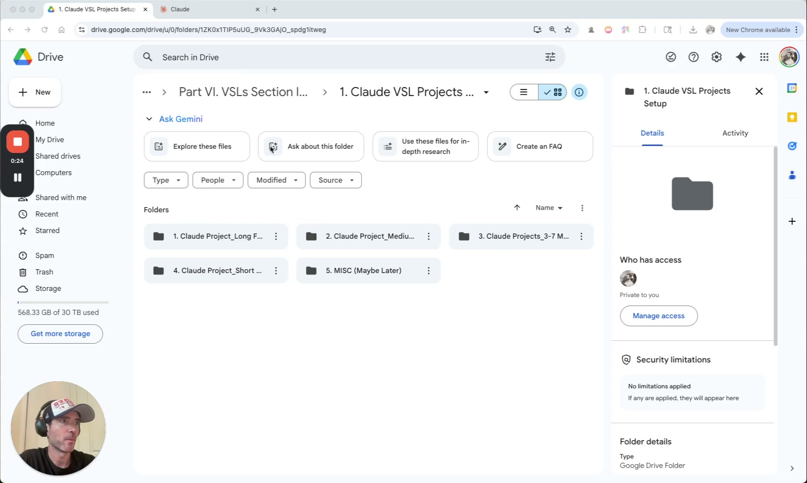
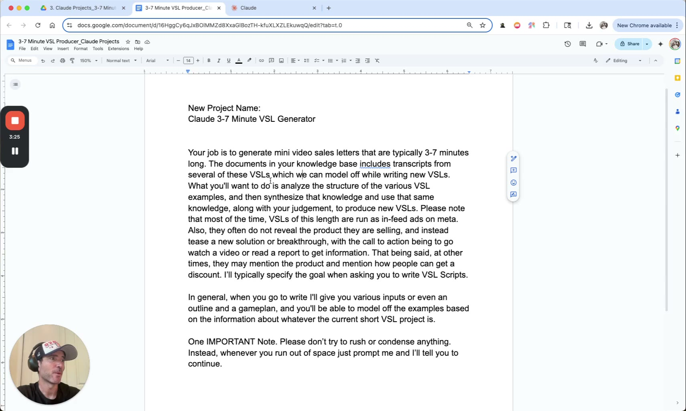
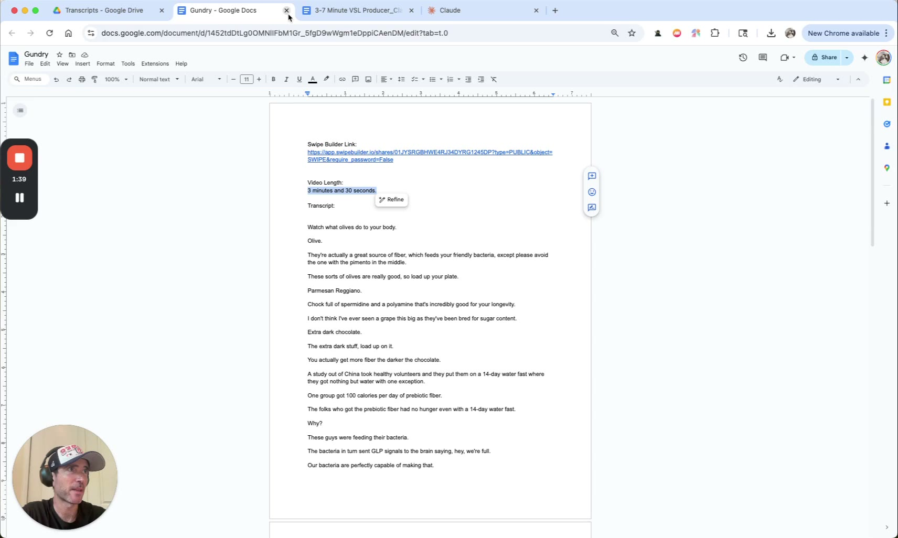
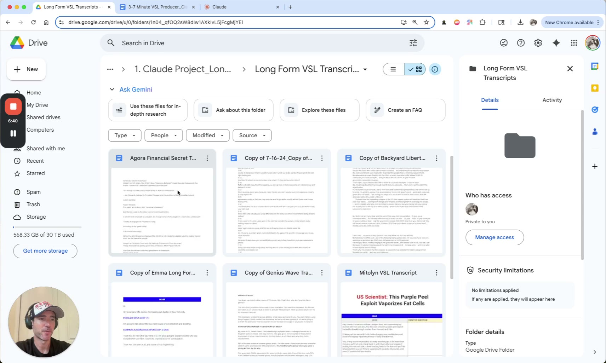
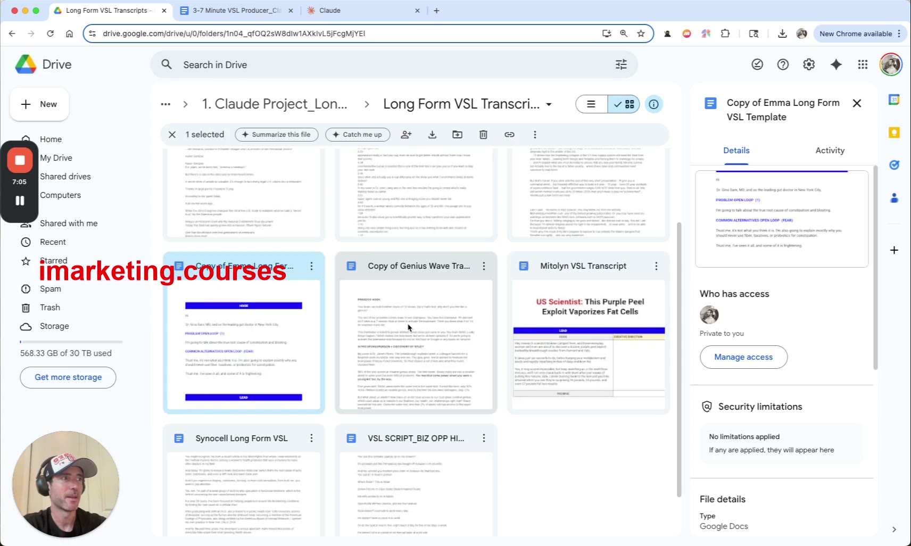

# 6.1 Claude VSL Projects Setup Overview
> The four Claude Project definitions (long, medium, 3-7 minute, short) that turn a finished brief into a VSL draft: each is a short instruction paragraph plus a folder of winning-VSL transcripts, and the instructor says to synthesize across the examples into a composite rather than swipe any one of them.

## 🤖 Agent use
- **Use when:** you need to create or re-create a "VSL Generator" Claude Project (any length), choose which of the four to use, decide how many and which example transcripts to load, or explain why the generator is told to "analyze... synthesize... use your judgement" instead of "rewrite this letter".
- **Inputs → outputs:** project name + instruction text (verbatim below) + a folder of example transcripts → a reusable project; per-job input is a finished brief ([5.2](05-02-the-brief-generator-with-claude-project-unity-eye-serum-exam.md)) plus a chat prompt asking first for an outline and an estimated length (prompt example below) → outline → approved → script written in as many outputs as needed.
- **Rules:**
  - **DO** finish the brief section first. "It's really important that you did if you're doing VSLs especially" [00:00]. The projects only consume the brief; they do not do research.
  - **DO** make one project per length band: long form (25-60 min), medium (6-16 min), 3-7 minute, short (1-4 min in the instruction text; "almost all one to two minutes" in speech) [00:30; instruction docs].
  - **DO** build each project the same way: "create new project, you name it... What are you trying to achieve? Copy this, paste it in... hit plus, add content, or just drag and drop PDFs" [05:46].
  - **DO** put the instruction text in the project's description/"what it's about" field and as project instructions: "It's literally what the project's about when you create a project. And then it's again here in the description" [05:46].
  - **DO** keep the line "Please don't try to rush or condense anything. Instead, whenever you run out of space just prompt me and I'll tell you to continue." in every project. He says it matters little below roughly 20 minutes of script "because Claude just has really long outputs now", but keeps it [03:56].
  - **DO** (optional experiment) record each example's running time at the top of its transcript. Done only for the 3-7 minute folder, to give Claude "a frame of reference when I tell Claude to write new" ones. It is unproven: "I'm wondering" [01:29].
  - **DO** tell the project the goal each time (e.g., tease without revealing product, or sell with discount) because the 3-7 and short projects say "I'll typically specify the goal" [03:38; 3-7 instructions].
  - **DON'T** over-tune the setup. "Most of the experiments you want to do are probably going to give you incremental gains"; some people "get hyper focused and fixated on tweaking these processes as a distraction from actually doing the work", so "use the processes rather than try to tweak them" unless there is a really good reason [04:24–05:16]. (Instructor opinion.)
  - **DON'T** treat the example offers as endorsements. Some are "really aggressive" ClickBank-style offers; the point is structure, and an LLM "would just make less aggressive claims, especially if you told it to" [07:18–08:18]. Flag unsubstantiated claims on any generated output (derived).
  - **IF** you want a near-copy of your own winning VSL for another category **THEN** swipe-and-rewrite is fine ("it's my VSL and I want to swipe my VSL") [09:15]. **IF** you are a copywriter or agency **THEN** use the composite method; close swipes of another brand's letter are "maybe too close for comfort" and can lead to disputes: "landmines that you need to dodge" [09:15–10:13].
  - **IF** you need an ad-length (1-7 minute) script **THEN** use the 3-7 or short project; the instructor says these "are almost always going to be honestly the same thing as video ads" [00:30].
  - **IF** the project's output is too short **THEN** reply "continue" rather than re-prompting; the instructions already invite it [03:56].
- **See also:** [5.2 Brief generator + medium/short/long runs](05-02-the-brief-generator-with-claude-project-unity-eye-serum-exam.md) · [5.5 Financial promo (long-form generator run)](05-05-financial-promo-example.md) · [3.5 Creating a Claude Project for unique mechanisms](03-05-creating-a-claude-project-for-unique-mechanisms.md) · [4.1 VSL section overview](04-01-vsls-section-overview.md) · [4.2 VSL fundamentals](04-02-vsl-fundamentals-classic-structure.md) · [4.8 Medium VSLs](04-08-medium-vsls-structures-and-examples.md) · [4.9 Short VSLs](04-09-short-vsls-structures-and-examples.md) · [Evolve: AI in copywriting](../../../evolve/copywriting/concepts/ai-in-copywriting.md)

## Key ideas

### 1. Four projects, one setup [00:00–03:56]
- "All we're doing in here is we're setting up projects": long form, medium form, 3-7 minute and short [00:00–00:30]. The Drive folder shows five subfolders: "1. Claude Project_Long F...", "2. Claude Project_Mediu...", "3. Claude Projects_3-7 M...", "4. Claude Project_Short...", "5. MISC (Maybe Later)" (screen, 00:25).
- Short versus 3-7 minute: short ones are "almost all one to two minutes long" and consist of "a bunch of short ad transcripts"; the 3-7 folder has eight transcripts ranging "a little over three minutes up to about seven minutes... The [Nooro] one in here is seven minutes long" [00:30–01:29]. "Neural/neuro one" in the transcript is the Nooro leg massager VSL (the document name confirms; 6:54).
- He added each ad's length to the 3-7 transcripts only ("Neuro one is six minutes and 54 seconds"), as an experiment [01:29]. Verified lengths in the files: Nooro 6:54, City Beauty 6:27, Emma 4:06, ReActivate 3:45, Vital BP 3:37, Gundry 3:30, Pup Labs 3:08; Akka Superbiotics has no length line.
- Process note: the 3-7 project is new. "I had projects for some different length VSLs... but I didn't have one specifically for three to seven minutes. Now I do. And I gave it the time." RMBC II itself improved his process: "even the brief thing... I did it differently up until RMBC II, and then I'm like, oh shit, this is the way to do it" [01:59–02:55]. (Instructor claim.)
- He shows the 3-7 instruction doc as the template: "I could have actually stuck with that one... I like this much bigger. So this one's actually a little bit longer" [02:55]. The documents are saved verbatim below.


*Course Drive "Part VI. VSLs Section II" with one folder per project (long, medium, 3-7, short) plus "5. MISC (Maybe Later)", which he tells you to ignore [10:13–10:37]. [00:25]*


*"3-7 Minute VSL Producer_Claude Projects" Google Doc: project name plus the instruction paragraph (text identical to the verbatim block below). [03:25]*


*Example transcript document layout used in the 3-7 folder: "Swipe Builder Link", "Video Length: 3 minutes and 30 seconds", "Transcript:" then the spoken script, one line per sentence. [01:40]*

### 2. What the instruction paragraph says (the pattern) [02:55–04:24]
Every project instruction has the same 4 parts (derived from the four verbatim documents):
1. **Role and length band:** "Your job is to generate [type] video sales letters. They will typically be between X and Y minutes in length."
2. **Knowledge:** "The documents in your knowledge base include transcripts from several [type] VSLs which we can model off while writing new VSLs."
3. **Method:** "analyze the structure of the various [type] examples, and then synthesize that knowledge and use that same knowledge, along with your judgement, to produce new [type] VSLs."
4. **Inputs and output behaviour:** "when you go to write I'll give you various inputs or even an outline and a gameplan... don't try to rush or condense anything... whenever you run out of space just prompt me and I'll tell you to continue."
Extra parts: the 3-7 project adds usage context (in-feed Meta ads that often tease and do not name the product; CTA to watch a video or read a report; sometimes mention the product and a discount). The long-form project adds a "match structures and lengths" requirement and a sample prompt.

### 3. Knowledge-base contents: the inventory [05:46–08:18]
- **Long form (8 documents).** In order, as he describes them [06:18–07:48]: Agora Financial (Secret Trust Fund; see [4.7](04-07-long-form-financial-vsl-examples-and-break-downs.md) and [5.5](05-05-financial-promo-example.md)), Beverly Hills MD "pinch test" ("one that I taught during the VSL training"), Backyard Liberty ("a classic survival letter from way back in the day"), Emma ("really good and pretty white hat"; the file is an annotated gut-health template), Genius Wave ("a manifestation offer that was really successful on ClickBank"), Mitolyn ("a really aggressive weight loss offer on ClickBank"), Synocell (from a swipe folder; "seemed pretty white hat"), and a "biz op one" (high-ticket offer, book a call). He admits "I honestly don't even know a ton about these guys, but their copy's pretty good" [07:18].
- **Medium (5 documents; no inventory narrated):** Beverly Hills M.D. weight loss, Gundry MD olive oil, Gundry MD BioComplete, Miami MD, Nooro 15-minute edema example.
- **3-7 minute (8 documents):** Akka Superbiotics, City Beauty, Emma, Gundry, Nooro 7 Minute VSL, Pup Labs, ReActivate, Vital BP.
- **Short (1 combined document):** "Short VSL Scripts (Combined)" with 12 scripts separated by rules (about 6,700 words). Not walked through in the video.


*"Long Form VSL Transcripts" folder: Agora Financial Secret Trust Fund, the 7-16-24 Beverly Hills MD pinch test, Backyard Liberty, then Emma template, Genius Wave and Mitolyn. [06:40]*


*Same folder scrolled: Emma Long Form VSL Template (blue section bars), Genius Wave, Mitolyn (creative-direction column), Synocell, and the biz-opp "book a call" script. [07:05]*

### 4. Why "composite", not "swipe" [08:18–10:13]
- Old process: "swipe specific sales letters": give an LLM a winning letter and the inputs (the brief) and say "rewrite this winning sales letter with these briefs but basically model and swipe the structure really closely", then edit to make it different enough. "There's still value to doing that", as in the financial example ([5.5](05-05-financial-promo-example.md)) [08:49–09:15].
- Problem: swipes land "really close to other people's"; sometimes wanted (your own VSL into another category) but for a copywriter told to swipe a winner "it can be maybe too close for comfort", whether the copywriter or the business owner feels that, or they "get into a big dispute with somebody else" [09:15–09:45].
- New process: "synthesize the information and essentially create a composite. We avoid a lot of those problems because it's going to take the best, or at least good elements from all of these sales letters, whatever length they are, and then create new stuff" [09:45–10:13].
- He calls the key sentence "one of the really key phrases": "analyze the various structures, synthesize that knowledge, and use that same knowledge along with your judgment to produce new long-form VSLs" [08:18].
- Legal/ethical side: the composite approach is an instructor-stated risk reduction, not legal advice. Course note [4.7](04-07-long-form-financial-vsl-examples-and-break-downs.md) and the house rule (copy structures, not assets) still apply.

### 5. Aggressive source copy [07:18–08:18]
- Background: "Back in the day, I would teach a lot about stuff on ClickBank. And I wrote stuff for ClickBank a lot. And then I sort of got called out for that. Kind of rightfully... I still don't pass judgment." [07:18]
- Position: "there's really aggressive stuff on ClickBank and people make claims... some of it's inaccurate... but that doesn't mean the copy is not good. Even if you had this as really aggressive... you could give it to an LLM and it would just make less aggressive claims, especially if you told it to, and then the structure might still be really good." [07:48–08:18]
- Application (derived): when generating from aggressive examples, add an explicit instruction in the job prompt such as "Do not reuse any claims, statistics, studies or credentials from the examples; use only the facts in the brief" and run a claim audit afterwards.

### 6. Next step and scope [10:37–11:17]
- Use the projects to "generate different lengths of copy". Examples already shown: Unity Eye Serum, financial, blood sugar [10:37]. The next section starts "actually writing copy using Claude projects" [11:06].
- Folder 5 (MISC) holds early drafts that "will probably not make it into the final RMBC II": ignore [10:13].

## Steps / framework
**Create a VSL Generator project (any length).**
1. In Claude, create a new project; name it "Claude [Long Form / Medium Length / 3-7 Minute / Short Length] VSL Generator". [05:46]
2. Paste the matching instruction text (below) into "What are you trying to achieve?" / project instructions. [05:46]
3. Add example transcripts to project knowledge ("plus" > add content, or drag PDFs). Long: 8 docs; medium: 5; 3-7: 8 (with lengths); short: 1 combined doc of many scripts. [05:46–06:18]
4. (Optional, 3-7 only in the course) add "Video Length: m minutes s seconds" to each transcript. [01:29]
5. Start a chat per job. First message: brief plus the outline-and-length request (prompt below). [Long-form docx prompt example]
6. Approve or edit the outline, then "go ahead and write it". Continue when the model asks. [03:56; [5.2](05-02-the-brief-generator-with-claude-project-unity-eye-serum-exam.md) 23:00–25:57]
7. Edit for compliance and originality (derived).

**Project selection table (derived from the instruction documents)**
| Project | Typical length | Typical use in the course | Examples in knowledge | Source |
|---|---|---|---|---|
| Long Form VSL Generator | 25-60 min | Used in [5.5](05-05-financial-promo-example.md) for a host-and-expert financial VSL; page placement not stated here (see [4.11](04-11-vsls-on-landing-pages-vs-vsls-as-in-feed-ads.md)) | 8 | Long-form docx |
| Medium Length VSL Generator | 6-16 min | Used in [5.2](05-02-the-brief-generator-with-claude-project-unity-eye-serum-exam.md) with a request for about 18 min (slightly above the stated band) | 5 | Medium docx |
| 3-7 Minute VSL Generator | 3-7 min | "Almost always" in-feed Meta video ads; tease, CTA to a video or report | 8 | 3-7 docx; [00:30] |
| Short Length VSL Generator | 1-4 min (spoken: 1-2) | Short ads | 12 scripts in 1 doc | Short docx; [00:30] |

## Examples
- **Annotated example documents.** Three of the long-form transcripts carry the instructor's structure labels that the model can read: the Emma template (section bars HOOK, LEAD, AUTHORITY, EDUCATION, DISCOVERY, INGREDIENTS, PRODUCT, PRICE, CLOSE, plus roughly 66 inline labels such as "PROBLEM OPEN LOOP (1)", "COMMON ALTERNATIVES OPEN LOOP (FEAR)", "BIG IDEA (STUCK POOP)", "INGREDIENT TRANSUBSTANTIATION"), Genius Wave (9 labels: PARADOX HOOK, INTRO SPOKESPERSON + DISCOVERY OF STUDY, FLOW STATE, THE REAL PROBLEM, FREE VALUE, TRANSITION TO UMS / SOLUTION, TRYING OUT SOLUTION AND OTHERS RESULTS, INTRO PRODUCT, FAQ SECTION) and Mitolyn (LEAD with a HOOK / CREATIVE DIRECTION table, then INTRO, UNIQUE INGREDIENT, UNIQUE MECHANISM, INGREDIENTS, STUDY, CLOSE, FAQ). The others are plain transcripts. Pattern (derived): label sections in your own example files to teach structure; see [4.2](04-02-vsl-fundamentals-classic-structure.md) and [Evolve open loops](../../../evolve/copywriting/concepts/open-loops.md).
- **Opening lines that show each length band's style (verbatim from the example files; for structure study only).**
  - Medium, Nooro: "Just 15 minutes at-home edema relief. Three facts about edema in under 30 seconds. Let's go. Number one..." (numbered facts opener).
  - 3-7 min, Nooro: "This is why people with edema are switching to this genius affordable device. Lifting your legs up is the best way to relieve edema, right? Nope. What about compression socks? Really?" (contrarian Q-and-nope pattern).
  - 3-7 min, Vital BP: "Fastest way to healthy arteries. Eating too much salt causes hypertension, right? Nope. What about too much bacon and red meat? Nope." Same pattern, ReActivate: "Quickest way to smooth wrinkled skin. Moisturizer helps your skin, right? Nope. What about collagen? Nope."
  - 3-7 min, Pup Labs: "Doing physical therapy for your dog's arthritis actually makes it worse. Here's what to do instead."
  - Short (combined doc): "If your toe pain is driving you nuts and you can't walk without limping, this video is for you." and "He's 60 but has the hair of a 25-year-old. What's his secret?"
  - Long, Genius Wave: "PARADOX HOOK: Your brain can hold 3 million hours of TV shows. But if that's true, why don't you feel like a genius?"
  - Long, Beverly Hills MD: "Does your skin pass the pinch test? Let's try an experiment..."
  The repeated "right? Nope. What about X? Nope." opener across Nooro, Vital BP and ReActivate is a template the 3-7 project will pick up (derived). See [4.10 hooks with AI](04-10-using-ai-to-generate-endless-good-hooks.md) and [4.9](04-09-short-vsls-structures-and-examples.md).
- **Health/finance content in the examples (flag).** The libraries include disease claims, "root cause" claims, cure/return claims and political-fear framing (e.g., FEMA-confiscation survival letter, "Vaporizes Fat Cells" lead, financial "trust fund"). They are structure references. Do not carry their claims into new copy.

## Structured units

**Template pattern (instruction text skeleton, derived from the four documents)**
| Slot | Long | Medium | 3-7 | Short |
|---|---|---|---|---|
| Project name | Claude Long Form VSL Generator | Claude Medium Length VSL Generator | Claude 3-7 Minute VSL Generator | Claude Short Length VSL Generator |
| Length band | 25-60 min | 6-16 min | 3-7 min ("mini video sales letters") | 1-4 min |
| Use context line | none | none | in-feed Meta ads; often tease; CTA to video or report; sometimes discount | none |
| Special note | match structures and lengths; sample outline prompt | none | "I'll typically specify the goal" | none |

**Rules of thumb**
- **DO** use one project per length; do not mix lengths in one knowledge base (derived from structure of the course).
- **DON'T** copy aggressive claims from example transcripts; replace with brief-supported claims [07:48–08:18].
- **IF** you add more transcripts **THEN** treat it as an experiment and expect incremental gains: "feel free to experiment... you're an experimenter and a scientist" but gains "probably" small [04:24–04:51].

## Prompts / templates (verbatim)

### Project 1: Claude Long Form VSL Generator
```
New Project Name:
Claude Long Form VSL Generator

Your job is to generate long form video sales letters. They will typically be between 25 minutes and 60 minutes in length. The documents in your knowledge base include transcripts from several long form VSLs which we can model off while writing new VSLs. What you'll want to do is analyze the structure of the various long form VSL examples, and then synthesize that knowledge and use that same knowledge, along with your judgement, to produce new long form VSLs.

In general, when you go to write I'll give you various inputs or even an outline and a gameplan, and you'll be able to model off the examples based on the information about whatever the current long form VSL project is.

One IMPORTANT Note. Please don't try to rush or condense anything. It's very important that if we're writing a long-form VSL, we're matching the structures and lengths of other long-form VSLs (even when it's a compository structure of several VSL examples from your knowledge base). So whenever you run out of space, just prompt me and I'll tell you to continue.

Prompt Example:

Here are a list of inputs for a new VSL that we are going to be writing. After reviewing them, I want you to come up with an outline for a new VSL based on this inputs. When providing this outline, please provide an estimated length for the new VSL. After I have reviewed the outline and approved I will let you know and we can actually write it.
```
(Source text with typographic apostrophes straightened, including "compository" and "based on this inputs"; the second line of the Prompt Example uses the course's own wording.)

### Project 2: Claude Medium Length VSL Generator
```
New Project Name:
Claude Medium Length VSL Generator

Your job is to generate medium length video sales letters. They will typically be between 6 minutes and 16 minutes in length. The documents in your knowledge base includes transcripts from several medium length VSLs which we can model off while writing new VSLs. What you'll want to do is analyze the structure of the various medium length VSL examples, and then synthesize that knowledge and use that same knowledge, along with your judgement, to produce new medium length VSLs.

In general, when you go to write I'll give you various inputs or even an outline and a gameplan, and you'll be able to model off the examples based on the information about whatever the current medium length VSL project is.

One IMPORTANT Note. Please don't try to rush or condense anything. Instead, whenever you run out of space just prompt me and I'll tell you to continue.
```

### Project 3: Claude 3-7 Minute VSL Generator
```
New Project Name:
Claude 3-7 Minute VSL Generator

Your job is to generate mini video sales letters that are typically 3-7 minutes long. The documents in your knowledge base includes transcripts from several of these VSLs which we can model off while writing new VSLs. What you'll want to do is analyze the structure of the various VSL examples, and then synthesize that knowledge and use that same knowledge, along with your judgement, to produce new VSLs. Please note that most of the time, VSLs of this length are run as in-feed ads on meta. Also, they often do not reveal the product they are selling, and instead tease a new solution or breakthrough, with the call to action being to go watch a video or read a report to get information. That being said, at other times, they may mention the product and mention how people can get a discount. I'll typically specify the goal when asking you to write VSL Scripts.

In general, when you go to write I'll give you various inputs or even an outline and a gameplan, and you'll be able to model off the examples based on the information about whatever the current short VSL project is.

One IMPORTANT Note. Please don't try to rush or condense anything. Instead, whenever you run out of space just prompt me and I'll tell you to continue.
```
(Source text says "the current short VSL project", a copy-paste leftover; keep or change to "3-7 minute".)

### Project 4: Claude Short Length VSL Generator
```
New Project Name:
Claude Short Length VSL Generator

Your job is to generate short length video sales letters. They will typically be between 1-4 minutes in length. The documents in your knowledge base includes transcripts from several short VSLs which we can model off while writing new VSLs. What you'll want to do is analyze the structure of the various short length VSL examples, and then synthesize that knowledge and use that same knowledge, along with your judgement, to produce new short VSLs.

In general, when you go to write I'll give you various inputs or even an outline and a gameplan, and you'll be able to model off the examples based on the information about whatever the current short VSL project is.

One IMPORTANT Note. Please don't try to rush or condense anything. Instead, whenever you run out of space just prompt me and I'll tell you to continue.
```

### Spoken version of the 3-7 text (transcript, for comparison) [02:55–04:24]
The instructor reads it slightly differently: "...tease a new solution or breakthrough with the call to action being to go watch a video or read a report to get information. That being said, at other times they may mention the product and mention how people can get a discount... don't try to rush or condense anything. Instead, whenever you run out of space, just prompt me and I'll tell you to continue." The on-screen document (03:25) matches the verbatim block above.

### Prompts used with these projects elsewhere in the course (verbatim, see source lessons)
- Medium: "...a comprehensive brief for a new VSL. It should give you everything you need to write it. Please review, and then I want you to give me an outline for this new VSL, along with your estimate for how long it'll be. Let's aim for about 18 minutes." ([5.2](05-02-the-brief-generator-with-claude-project-unity-eye-serum-exam.md) 23:00)
- Short: "Here's a brief for a VSL for our skincare brand. Please review and then give me 5-10 short VSL concepts you think would be worth testing?" ([5.2](05-02-the-brief-generator-with-claude-project-unity-eye-serum-exam.md) 33:36)
- Long: "Here's a brief for a new financial offer. I want you to model off the structure of the Agora Secret Trust Fund sales letter you have in your knowledge base..." ([5.5](05-05-financial-promo-example.md) 14:52)

### Example-file inventory (22 documents; word counts from our extraction)
| Folder | File | Words | Notes |
|---|---|---|---|
| Long | Agora Financial Secret Trust Fund VSL | 10,326 | Host plus expert interview; plain transcript |
| Long | 7-16-24 Beverly Hills MD Pinch Test VSL | 6,818 | Timestamp-inline transcript (96 timestamps) |
| Long | Backyard Liberty Sales Letter | 7,602 | Written sales letter (survival/food stockpile, political-fear framing) |
| Long | Emma Long Form VSL Template | 11,138 | Annotated: section bars plus open-loop labels |
| Long | Genius Wave Transcript | 7,075 | Annotated (9 labels) |
| Long | Mitolyn VSL Transcript | 11,014 | Hook/creative-direction table |
| Long | Synocell Long Form VSL | 7,879 | Plain transcript |
| Long | VSL SCRIPT_BIZ OPP HIGH TICKET OFFER / BOOK A CALL | 6,044 | Biz-opp; CTA is a call booking |
| Medium | Beverly Hills M.D. Weight Loss | 4,904 | |
| Medium | Gundry MD Medium Length VSL_Olive Oil | 2,954 | |
| Medium | Gundry Medium Length_BioComplete | 2,161 | |
| Medium | Miami MD Medium Length VSL | 1,861 | Contains a Swipebuilder link |
| Medium | Nooro Medium Length VSL Example 1 | 3,025 | |
| 3-7 | Akka Superbiotics | 921 | No length line |
| 3-7 | City Beauty | 1,347 | 6:27 |
| 3-7 | Emma | 798 | 4:06 |
| 3-7 | Gundry | 629 | 3:30 |
| 3-7 | Nooro 7 Minute VSL | 1,407 | 6:54 |
| 3-7 | Pup Labs | 675 | 3:08 |
| 3-7 | ReActivate | 792 | 3:45 |
| 3-7 | Vital BP | 704 | 3:37 |
| Short | Short VSL Scripts (Combined) | 6,709 | 12 scripts |

## Screenshots
Five frames are embedded above: Drive folders (00:25), Gundry transcript layout (01:40), 3-7 instruction document (03:25), and two views of the long-form transcript folder (06:40, 07:05). No Claude Project screen is shown in this lesson; the project UI appears in [5.2](05-02-the-brief-generator-with-claude-project-unity-eye-serum-exam.md) and [5.5](05-05-financial-promo-example.md).

## How to apply
- [ ] Create four Claude Projects (or only the lengths you need) named exactly as in the instruction blocks.
- [ ] Paste the matching instruction text; add your own brand rule: "Use only facts in the brief; never invent studies, credentials, testimonials or numbers" (derived).
- [ ] Load 5-8 high-quality transcripts per length band from your own niche or from sources you have rights to study; label sections (HOOK, LEAD, mechanism, offer) in at least a few (derived from the annotated Emma/Genius Wave files).
- [ ] For 3-7 minute and short projects, add "Video Length: m:ss" lines to each transcript, then compare output pacing with and without (an experiment the instructor leaves open).
- [ ] First request is always "outline plus estimated length"; approve, then write; answer "continue" when asked.
- [ ] Review for compliance and originality; do not paste competitor lines.
- [ ] Do not tune the setup further until you have shipped a few scripts: "use the processes rather than try to tweak them".

## Related
- Brief and generator: [5.1](05-01-the-old-brief-vs-the-new-brief-overview.md), [5.2](05-02-the-brief-generator-with-claude-project-unity-eye-serum-exam.md), [5.3](05-03-airbnb-arbitrage-example.md), [5.5](05-05-financial-promo-example.md)
- VSL theory: [4.1](04-01-vsls-section-overview.md), [4.2](04-02-vsl-fundamentals-classic-structure.md), [4.3 leads](04-03-vsl-leads-after-the-opening-hook.md), [4.6 closes](04-06-vsl-closes.md), [4.11 VSLs on landing pages vs in-feed ads](04-11-vsls-on-landing-pages-vs-vsls-as-in-feed-ads.md)
- Evolve: [AI in copywriting](../../../evolve/copywriting/concepts/ai-in-copywriting.md) (project-based prompting with example libraries) and [open loops](../../../evolve/copywriting/concepts/open-loops.md) (the Emma template labels open loops by number).

## Sources and limitations
- Video is 11:17 with no demonstration of an actual generation; the screen shows Google Drive folders and Docs, not the Claude UI.
- Whisper corrections: "cloud projects" read as "Claude projects"; "neural/neuro" read as Nooro; "RMB-C2" as RMBC II; "Mitoline" and "Mydalene" (SRT) as Mitolyn (document name). "Emma Relief" in the speech and captions is not a document name; the files are "Emma" (gut health, 3-7 min) and "Emma Long Form VSL Template".
- The instruction documents are verbatim from the extraction of the Google Docs; line breaks and the typo "compository" are retained. Spoken and written 3-7 text differ slightly (see above).
- The long-form folder is described as eight documents by name; count and names are from the extracted files, not read off the video except where cited.
- The short-form project's example count (12 scripts) is from our extraction of the combined document; the instructor says only "a bunch" [00:58].
- The instructor's claims about process improvement, experiments yielding "incremental gains" and composites avoiding disputes are opinions without evidence in the lesson.
