# 7.1 Long Form VSL
> A four-hour live build of long-form VSLs (27-minute eye-serum letter, 25-minute Airbnb-arbitrage "book a call" letter, a blood-sugar supplement letter, a financial promo) in the "Claude Long Form VSL Generator" project: audit the brief, outline first, draft in two models, then act as copy chief and merge, patch and re-lead the draft by chat.

## 🤖 Agent use
- **Use when:** you must produce a 25-60 minute VSL script from a finished brief; you need the order of operations (brief audit, swipe-or-composite decision, outline, draft, merge, length check, alternate leads); or you need to review an LLM VSL draft the way the instructor does.
- **Inputs → outputs:** brief ([5.2](05-02-the-brief-generator-with-claude-project-unity-eye-serum-exam.md)) + "Long Form VSL Generator" project (instructions + 8 long-form VSL transcripts as knowledge, see [6.1](06-01-claude-vsl-projects-setup-overview.md)) + optional classic-structure outline ([4.2](04-02-vsl-fundamentals-classic-structure.md)) → timed outline (approved by you) → full draft (written over several outputs) → merged master script → word-count / runtime check → extra pre-leads/leads from a hook project.
- **Rules:**
  - **DO** audit the brief before any copy exists. Read the mechanism as a skeptical prospect would and delete lines that do not fit the metaphor ("hooks that connect your skin layers" in a weave metaphor) [v1 00:58–01:58].
  - **DO** strip brief sections you do not want the model to anchor on ("Big ideas to test", the brief's hook list) when leads will be written separately [v1 10:26–11:31].
  - **DO** decide first how directly to swipe: close model of one winning VSL (new niche, same structure) versus composite of several. For a new brand, use the composite [v1 12:28–14:49; 25:54].
  - **DO** ask for an outline with timings first and approve it before the draft is written ("once approved, I'll have you write it") [v1 28:33].
  - **DO** copy-chief the outline: check the flow logically and fix gaps (who tells the story, how the expert is introduced, where the brand name first appears) before drafting [v1 32:48–38:07].
  - **DO** tell the model "if you need to do this over multiple outputs, that's fine… I'll prompt you to continue" [v1 41:15–42:30].
  - **DO** run the same brief and outline through a second model (Gemini 2.5 via Poe) and merge the best sections. Claude had a reference VSL; Gemini did not, so Claude's close was better [v2 00:00–06:38; 29:10].
  - **DO** merge by section (lead, background, UMP, UMS, buildup, close) and give the model targeted fixes for what is missing ("which ingredients map to step three?") [v3 02:44–30:59].
  - **DO** measure length yourself: model estimates are unreliable (Claude said about 8,500 words; actual 5,707; a script timer said about 31 minutes) [v3 01:13].
  - **DO** write leads as a separate step with the hook project and drop in 3-4 options at the top of the script [v4 00:00–15:55].
  - **DON'T** let the lead assume the viewer's state ("you're probably living it too"): it can put the viewer on the defensive [v1 48:29–49:33].
  - **DON'T** name the product or hint it is a cream in the lead ("applying this every morning" became "using this breakthrough"); curiosity must survive to the buildup [v1 47:26–48:29].
  - **DON'T** mention the brand until the end of the product buildup and reveal [v1 31:13–32:48].
  - **DON'T** pass placeholder or generated testimonials, income claims, "Harvard" credentials or invented studies into a live script. This lesson's examples contain them; see the Compliance check.
  - **IF** a model glitches or returns stale output **THEN** switch model or tool (Sonnet 4 to 3.7, Claude to Gemini via Poe) rather than debug for long [v1 21:45; 43:39; v5 59:16–1:01:18].
  - **IF** the copy is already decent **THEN** stop agonizing and ship the edited first draft: "get a great first draft, tweak, modify, edit, and ship" [v2 06:38].
  - **IF** the format does not fit the channel **THEN** do not run it there: long VSLs suit ClickBank-type traffic, and for Meta he "would probably shoot for a shorter video ad" [v2 34:11–35:17].
- **See also:** [4.2 Classic structure](04-02-vsl-fundamentals-classic-structure.md) · [4.3 Leads](04-03-vsl-leads-after-the-opening-hook.md) · [4.4 Background stories and UMP/UMS](04-04-vsl-background-stories-and-unique-mechanisms.md) · [4.5 Buildup and reveal](04-05-vsl-product-buildup-and-reveal.md) · [4.6 Closes](04-06-vsl-closes.md) · [4.7 Long-form financial VSL](04-07-long-form-financial-vsl-examples-and-break-downs.md) · [5.2 Brief generator](05-02-the-brief-generator-with-claude-project-unity-eye-serum-exam.md) · [6.1 VSL projects setup](06-01-claude-vsl-projects-setup-overview.md) · [4.10 AI hooks](04-10-using-ai-to-generate-endless-good-hooks.md)

## Key ideas

### 0. What is in the lesson (video map)
The files are one continuous screen-share across seven recordings. Citations use `[v1 mm:ss]` etc.

| Cite | File | Length | Content |
|---|---|---|---|
| v1 | `01-[1] Long Form VSL` (caption: "Part I") | 50:31 | Brief fixes, swipe test (Mitolyn), outline, first draft in Claude and Gemini leads |
| v2 | `… video2` ("Part II") | 35:43 | Claude vs Gemini background story, UMP, UMS, buildup |
| v3 | `… video3` ("Part III") | 34:43 | Word count, merging both drafts into one master |
| v4 | `… video4` | 16:19 | Extra pre-leads via the hook project |
| v5 | `… video5` | 1:05:40 | Airbnb-arbitrage "book a call" VSL (no price, CTA = application call) |
| v6 | `… video6` | 40:41 | Blood-sugar supplement: add a big idea, outline, draft, ingredient patch |
| v7 | `… video7` | 2:27 | Note on a long-form financial VSL generated earlier |

Models and tools visible on screen: Claude Sonnet 4 and Sonnet 3.7 inside Claude Projects, Gemini 2.5 Pro through Poe, Perplexity deep research for hooks, "Script Timer & Words" (Edge Studio) for runtime. "Quad/cloud/clod" in the transcript is Whisper for "Claude". Only the eye-serum script, outline and brief are provided as documents; the Airbnb, blood-sugar and financial drafts exist only on screen.

### 1. Audit the brief before you write: "catch weird stuff before you go to write copy" [v1 00:00–11:31]
- He re-opens the Unity Eye Serum brief from [5.2](05-02-the-brief-generator-with-claude-project-unity-eye-serum-exam.md) because he "noticed a couple little things" last time. The existing-solutions section and the mechanism ("collagen architecture breakdown", "happening at the DEJ") stay [v1 00:00].
- Problem found: the mechanism paragraph says "The hooks that connect your skin layers at the DEJ break down and disappear." He deletes it: "The hook made sense for the previous mechanism, but if we're talking about this architecture and a fabric and weaving analogy, then there's no reason for that… I don't want that in my copy or the LLM to talk about it" [v1 00:58].
- Second problem: "The separation between skin layers means…" does not follow from "stretched and twisted fabric". Either explain the link inside the weave metaphor or cut [v1 01:58–03:53].
- Third: the nickname teasers focus on a "DEJ breakthrough". He wants the sales letter centred on the weave/architecture, with the DEJ only as the place where it starts: "I don't want to get rid of the DEJ altogether. I actually like saying it starts at the DEJ. Just need to make [the] main focus this collagen architecture breakdown that happens there" [v1 05:31; 09:12].
- Why: "when I am copy-chiefing… part of what you want to do… the brief and the mechanism are important to catch weird stuff before you go to write copy. It's the same whether you're working with a copywriter… or AI… your junior copywriter can write at the level of an absolute world-class legendary copywriter" [v1 05:31].
- He then removes two brief sections: "Big ideas to test" ("I don't want Claude to specifically focus on those") and the brief's hooks ("I don't think these hooks are that good… I'm still going to end up writing leads separately") [v1 10:26–11:31].
- Mechanical step: paste the revised text, download as PDF, attach the PDF to the chat in the Long Form VSL Generator project (screen shows it attached to the prompt box, not stored in project knowledge) [v1 11:31; screenshot 15:36].

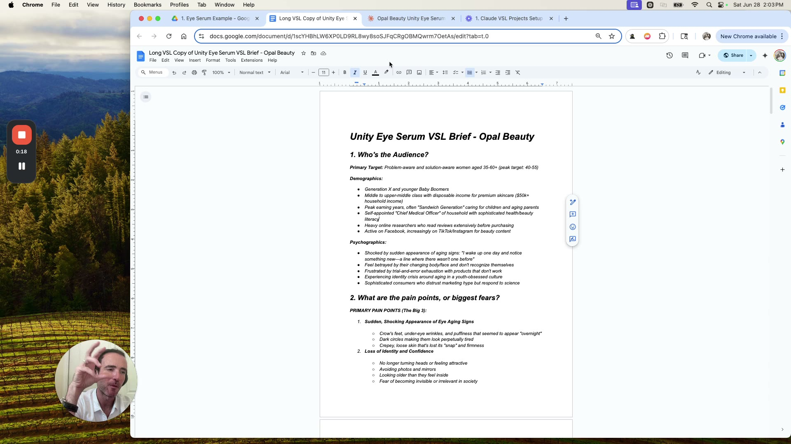
*Google Doc copy of "Unity Eye Serum VSL Brief - Opal Beauty" (brief sections 1-2 visible), the input he edits before generation. [v1 00:18]*

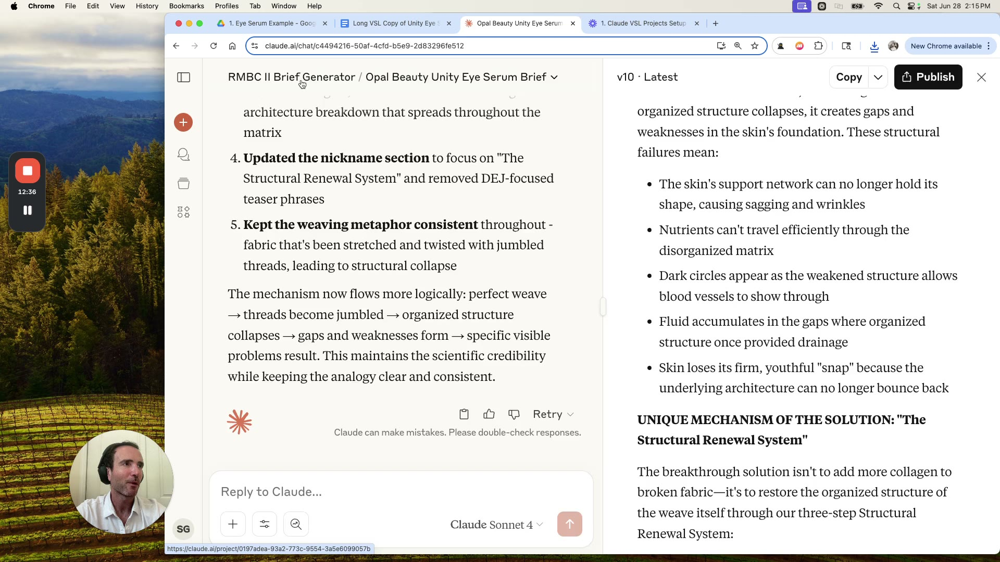
*Brief Generator chat after the revision: "Updated the nickname section to focus on 'The Structural Renewal System' and removed DEJ-focused teaser phrases"; "Kept the weaving metaphor consistent throughout". Model shown: Claude Sonnet 4. [v1 12:36]*

### 2. Swipe or composite? The "lazy swipe" test [v1 12:28–28:33]
- Project name on screen: "Claude Long Form VSL Generator" (instructions + 8 long-form transcripts, "5% of project capacity used"). He reads the knowledge list aloud: Mitolyn (called "super aggressive weight loss thing, pretty long… could swipe it"), high-ticket coaching ("wouldn't make sense"), Synocell (doctor-driven, "pretty white hat, but solid"), Emma ("very white hat"), Backyard Liberty and the Agora Financial trust letter ("wouldn't really make sense") [v1 12:28–13:46]. (Whisper: "Mitoline", "Sinocell"; captions say "Midoline", "Sign to Sell". File names in the course zip: Mitolyn, Synocell.)
- Two options: (1) direct swipe: attach the brief, say "model the structure, length, everything else of this existing VSL, but for a new market and product"; you can even add a VSL file just to this chat; (2) composite from the project's examples [v1 13:46].
- He runs (1): "Can you do the first 1,000 words… following the Mitolyn structure so I can see what that looks like?" [v1 14:49]. First result (Sonnet 4) is "super weird… nonsensical": conflates Mitolyn with the long Amazon example, invents "Sarah, a 47-year-old working mom from Phoenix", repeats "breakthrough studies" [v1 17:08–20:12]. He asks Claude to review it: "still weird". Cause suspected: the brief itself keeps calling Laura "founder of Opal Beauty", so he deletes the brief from the chat and re-uploads the edited version [v1 20:12].
- Retry on Sonnet 3.7 (same prompt): now it copies the Mitolyn lead almost line for line, e.g. Mitolyn's "…these everyday women and men are about to discover a bizarre purple peel exploit backed by breakthrough studies from Harvard and Yale… takes just six seconds to do" becomes "…about to discover a bizarre structural renewal exploit… six seconds… rebuilds the collagen architecture in your eye area like a master weaver…" with the same testimonial count pattern [v1 21:45–24:54].
- His judgement: not "bad". "If it was already your VSL and your structure really worked, and you want to do the exact same thing for a new product category, a new niche, then you might want to swipe yourself heavily" [v1 24:54]. But a mechanism name like "structural renewal exploit" is too lifted; he would swap in "three-step skin unifying system" and change the speaker from the doctor to Laura with before/afters [v1 25:54–27:26].
- Rule for this KB: "copy the mechanism, not the asset". Use the swipe only to see a structure; never ship near-verbatim lines or claims ("Harvard and Yale") from a competitor script.

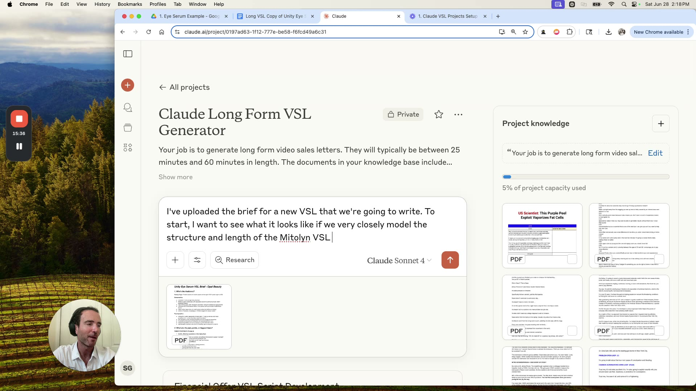
*Project "Claude Long Form VSL Generator" with the brief PDF attached and the first prompt half-typed: "I've uploaded the brief for a new VSL that we're going to write. To start, I want to see what it looks like if we very closely model the structure and length of the Mitolyn VSL". Right side: PDF knowledge files. [v1 15:36]*

### 3. Outline first, then copy-chief the outline [v1 28:33–40:12]
- Prompt: brief + "about 27 minutes" + "please [give me] an outline… and once approved, I'll have you write it". He chooses Sonnet over Opus: "probably going to take longer… slower. I don't think I need it. Other people have mentioned liking Sonnet more than Opus" [v1 28:33].
- Edits he gives the outline (before → after in the Rewrites table): add an explicit solution promise and future-pace in the lead; do not tell Laura's whole story in the lead; do not name Opal Beauty until the end of the buildup; then, after he loads the classic structure, make Dr. Schilling's introduction explicit [v1 29:52–38:07].
- He supplies his own classic structure mid-chat: "I wouldn't always do this, but I want to make sure it gets it right. I'd experiment with putting it in the Claude project too" [v1 32:48].
- Copy-chief mindset: "it's sort of like you're copy-chiefing the ideas and the plan, and then you'll get a chance to copy-chief the final copy as well… pulling back and thinking through the flow logically… you're like, okay, this all makes a lot of sense. But there's a part that doesn't make sense" [v1 38:07].
- Option: generate several outlines with different structures, write several VSLs, then choose [v1 38:07].
- Dr. Schilling is a real hired spokesperson in the course's example world: "He's kind of like an endorsement machine… We paid him earlier on to review our stuff and be a spokesperson" [v1 39:14] (instructor claim; the persona is a course asset, not a source you can reuse).
- He saves the approved outline as "Unity Eye Serum 27 Minute VSL Outline #1_Claude" and downloads a PDF so the same outline can go to another model [v1 40:12–41:15].

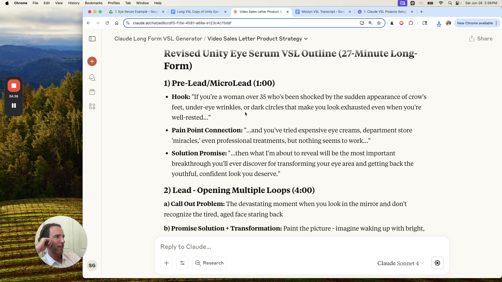
*First outline from the project: "1) Pre-Lead/MicroLead (1:00)… 2) Lead - Opening Multiple Loops (4:00)" with Hook / Pain Point Connection / Solution Promise lines. [v1 34:36]*

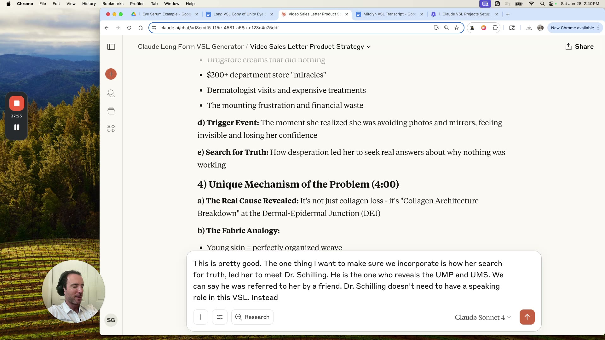
*Outline section "4) Unique Mechanism of the Problem (4:00)" with his feedback typed into the box (text in Prompts, C5). In the first output the doctor is not yet connected to Laura's story. [v1 37:23]*

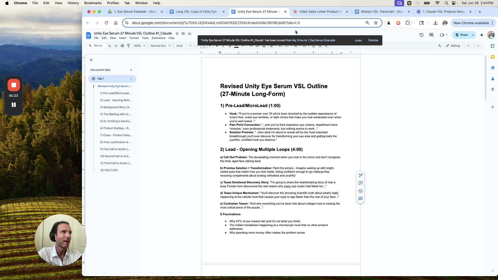
*The revised outline saved in Google Docs: twelve sections in the left-hand navigator (see the table in Steps). [v1 41:23]*

### 4. Two models, two drafts, one master [v1 40:12–v3 33:03]
- Same outline + brief go to Claude ("please go ahead and start writing the VSL now") and, in parallel, to Gemini 2.5 Pro in Poe with a hand-typed prompt (Prompts, C6). Rationale: "What if Claude's being weird? What if Claude's down?… You need to be kind of multimodal" [v1 41:15–43:39].
- Claude wrote the whole script "in one take… 8,500 words" per its own claim; actual length 5,707 words [v2 34:11; v3 01:13]. Script Timer (Edge Studio setting) said about 31 minutes: "I like that Claude was wrong here… if I add some leads in front it might end up a bit longer" [v3 01:13].
- First comparison is on the lead only: Gemini's reads "more authentic sounding", Claude's "hits the direct response beats a little bit more" and includes testimonials; "I'm honestly kind of torn" [v2 02:58]. He picks the pieces by section (table below).
- Stance on tool choice: "You can destroy yourself with possibilities. The short answer… what the AI is going to write, whether Gemini or ChatGPT or Manus or whatever… is going to be better than what 99% of copywriters would write on their own" (instructor claim; he says he reviews "20-plus pieces of copy a week at least") [v2 05:30].
- Then the limit: "Are you going to be able to make it even better? Probably. But rather than agonizing over every decision… it is better to get a great first draft, tweak, modify, edit, and ship" [v2 06:38].
- Time comparison: two VSLs "under the course of about two hours of me talking and recording. If I was doing this myself… maybe 20, 30 minutes… Copy is kind of a commodity. Good copy is not. It's still hard. It takes thinking" [v3 00:00].

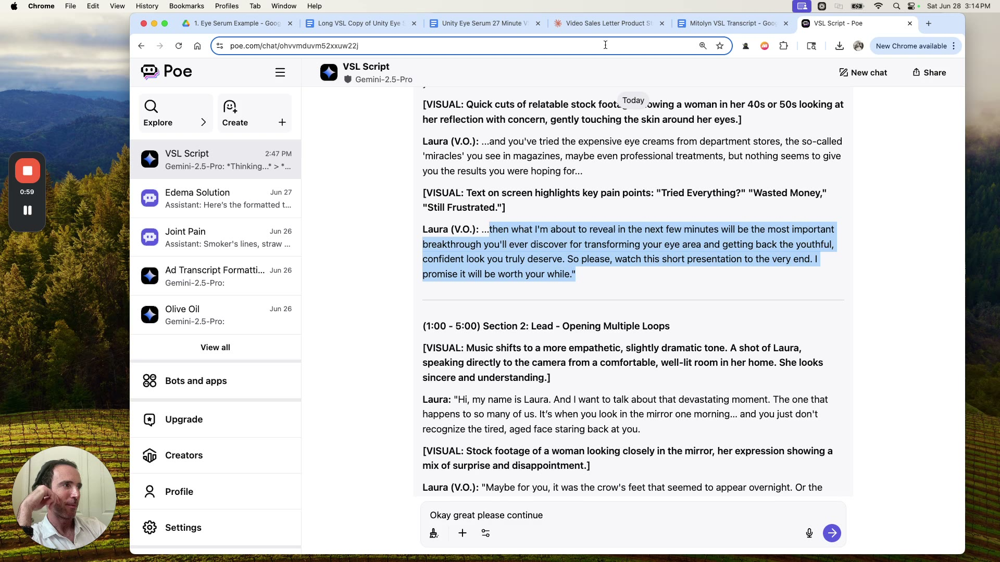
*Poe chat "VSL Script" on Gemini-2.5-Pro: the model added [VISUAL] cues and "Laura (V.O.)" labels; he reads it against the Claude lead. Highlighted: the micro-lead's closing promise. [v2 00:59]*

#### Section-by-section merge log (which model's text won, and why)
| Section | Claude draft | Gemini draft | Final choice | Source |
|---|---|---|---|---|
| Pre-lead close | "…please watch every step of this presentation" (ended without a strong promise) | "So please, watch this short presentation to the very end. I promise it will be worth your while." | Gemini: "more earnest and authentic" | [v3 03:44] |
| Lead opener | "My name is Laura… You know that devastating moment… I know exactly how that feels because I lived it. If you're watching this right now, chances are you're living it too." | "Hi, my name is Laura. And I want to talk about that devastating moment. The one that happens to so many of us." | Gemini: Claude's version "assumes too much… does it put a viewer on the defensive?" | [v1 48:29–49:33]; [v3 04:36] |
| Future pacing | "Picture waking up tomorrow morning…" (4 images, incl. "cringing and wondering when you started looking so old") | "Imagine waking up… feeling so confident… compliments… not asking if you're tired" | Kept Claude's four-image block; added Gemini's "That transformation is possible… has nothing to do with the expensive creams you've been using" as "a sliver of hope" | [v3 04:36–06:15] |
| Qualifier | n/a | "specifically for women over 35… ready for a real, science-backed solution" | Added "science-backed" because the unified research said this audience likes science ([2.4](02-04-unified-research-process.md)) | [v3 07:50] |
| Testimonial teases | "she actually looks forward to applying this every morning and night" | n/a | "using this breakthrough every night": "applying" reveals a cream; "what is it?" keeps curiosity | [v1 47:26–48:29]; [v3 08:43] |
| Background opening | "My name is Laura, and just like you, I'm a busy mom…" | n/a | Claude kept (he first flags "just like you" as assumptive, then keeps it) | [v2 07:38]; [v3 10:05] |
| Mirror scene | "caught my reflection in the bathroom mirror, and I literally froze" | "getting ready to go out for dinner with my husband… under that bright, unforgiving light" | Gemini scene (better "dimensionalization") then Claude's "But it wasn't just the lines. The skin under my eyes looked different. Loose, crepey…" | [v3 11:07] |
| Failed solutions | Drugstore, department store with prices, derm, laser, Botox, "$3,000" | Generic ("$200 miracle serums") | Claude: "I kind of like the specificity here, Botox, retinoids… it's probably $3,000" | [v3 11:07–13:17] |
| Referral | "my friend Sarah mentioned Dr. Schilling" | "a friend's concerned referral" | Claude, with first name added: "Dr. Blaine Schilling" | [v3 13:17] |
| UMP scene | Diagram narrative, "maybe, just maybe" ("a little cheesy") | Doctor says "it's not your fault… designed to solve the wrong problem"; fabric analogy; "throwing new threads into a tangled pile of yarn and expecting it to become a sweater" | Gemini scene; Claude version deleted ("we probably don't need the Claude one here") | [v2 16:07; v3 15:13–19:44] |
| UMS | Three steps with "little scissors" MMP analogy | "inhibit" wording (he would not use it) | Claude's steps + Gemini's "He had given me the map… I'd have to find or create the solution myself" | [v2 20:49–24:14]; [v3 22:09–24:15] |
| Product buildup | Dipalmitoyl hydroxyproline and mastic only; steps not mapped | Summarised, skipped ingredients | Claude, then patched (ingredient prompt below) | [v2 29:10–32:51]; [v3 26:53–30:59] |
| Close / price | Followed the project's reference closes | No reference VSL given, so weaker | Claude close, unchanged: "I'm not worried about the close so much" | [v2 29:10]; [v3 32:01] |

### 5. Lead alternatives as a separate step [v4 00:00–15:55]
- He opens the "ADHD Hook Ads Generator (1-6 Minutes)" project (screen), pastes the finished script and asks for 10 hook-heavy lead concepts for the micro lead, "pull from the database plus ideas from the VSL" [v4 00:00–01:29; screenshot 8:53].
- First pass fails two ways: it is "using hooks a lot but not pulling from the actual database", and every concept is built on the mechanism: "focused on the UMP… less DEJ". Fix: "do these where it's less… all focused on the UMP so much. More for the curiosity. We talk about collagen breaking down. We don't need to talk about collagen architecture" [v4 02:30–05:05].
- A further message requests "using eye creams with collagen is a mistake" and other "mistake" hooks; he likes the department-store one ("Don't make this $400 mistake") and asks for "a new micro lead… about the same length as the current pre-lead/micro lead in the VSL I uploaded" [v4 06:02–08:54].
- Three new micro leads (options 2, 3, 4 in the final script file) are pasted above the original (option 1). He notes he does not always need "the if-if framework" [v4 08:54–14:56]. See the Rewrites and Hooks tables.

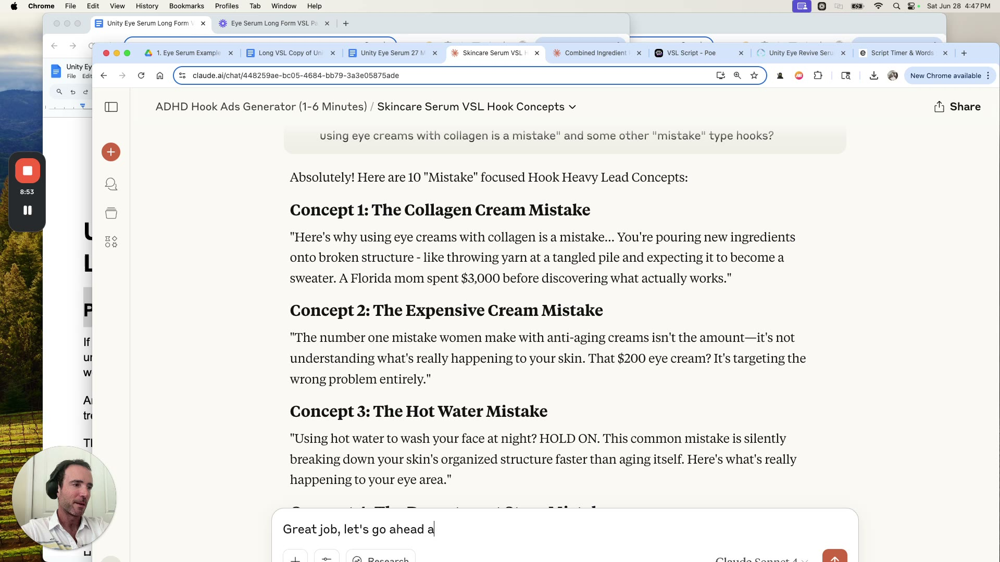
*"ADHD Hook Ads Generator (1-6 Minutes) / Skincare Serum VSL Hook Concepts": Concept 1 "The Collagen Cream Mistake" (yarn-on-a-tangled-pile line), Concept 2 "The Expensive Cream Mistake", Concept 3 "The Hot Water Mistake". Next message being typed: "Great job, let's go ahead a…". [v4 08:55]*

### 6. Fixing gaps by chat: ingredients mapped to the three steps [v2 29:10–32:51; v3 26:53–30:59]
- Audit result on Claude's buildup: it introduces dipalmitoyl hydroxyproline and mastic but "the one thing I think it's missing would be the specific amino acids"; Gemini also left them out. Fix is a patch prompt to Claude, not a rewrite [v2 29:10].
- Next problem: the brief promised a three-step system but the buildup only grounded steps one and two. He asks which ingredients belong to step three ("After all, we said it's a three-step system. How can we make this work?"), allowing "other ingredients in the formula as optional" [v3 28:22–29:55].
- Result in the final script: Step One = dipalmitoyl hydroxyproline (also stimulates TIMPs); Step Two = Pistacia lentiscus plus proline, glycine, alanine ("nearly 23% of collagen's structure"); Step Three = vitamins C and E plus the TIMP shield. The close then re-lists all six ingredients [script doc, "Product Buildup + Reveal" and "Close - Product Details & Value Building"].
- He also asks that the amino acids be "referenced again in the ingredient section of the close" [v3 26:53].

### 7. Book-a-call VSL for Airbnb arbitrage (no website, no price) [v5 00:00–1:05:28]
- Hooks first. He runs a hook-generation prompt (text in Prompts, C9) in Perplexity deep research, attaching the unified research brief; Gemini and ChatGPT run in the background. "Perplexity tends to give me the best hooks that I like." He keeps them: "It's almost overwhelming how many good hooks there are… I kind of have goosebumps" [v5 00:00–05:02].
- Decision: hooks come after the outline. "I'm torn on this. This is where I may be an experimenter. I'm going to try it with just giving it the brief to start" [v5 05:02–07:43].
- Prompt: brief + book-a-call framing + "problem aware more than solution aware" + "outline for a 25 minute VSL" (Prompts, C10). Target length: "medium form for sure, that's like 15 minutes… or 30, 40 minutes. There's a lot of variance" [v5 05:02].
- Outline sections (spoken/screen): hook and pattern interrupt (2-3 min), problem agitation (rigged system, why advice fails, asset gap vs income gap), teaser, case studies, speaker introduction and personal journey, failed side hustles, the asset-gap revelation, wealthy-person secret, solution reveal ("asset control method"), proof of concept, transformation and future pacing, social proof, qualifications, who it is for and not for, application process, scarcity and urgency, final CTA and emotional appeal [v5 07:43–09:24; screenshot 9:00].
- Outline edits: (1) add named case-study teasers with placeholders "and I'll get real success stories… later"; (2) repeat the case studies "a few times throughout… at the end of the story of discovery… again after the secret, market timing, situation reveal" [v5 10:48–12:19]. His rule: "you're still the copy chief or the director… lots of social proof, and continuously remind them of this great solution that you're going to discover" [v5 13:18].
- Placeholder warning from the instructor: "It's the one big thing the FTC goes after for a biz opp… fake testimonials and fake income claims. But this is for demonstration purposes" [v5 10:48]. Agent rule: leave `[placeholder]` marks and never replace them with invented people or results.
- Draft problems he catches, in order:
  - Hook says "twice as hard and twice as educated": delete "twice as educated". "Why only speak to educated people?" [v5 15:59–17:17].
  - Draft assumes the viewer is "trapped in the corporate rat race": change to "where a lot of people probably are right now" [v5 24:56].
  - Add a stance-setting paragraph after the objection block: "No, I'm not talking about traditional real estate where you need $100,000 down payments… not the stock market, cryptocurrency… not affiliate marketing, dropshipping, or any other make-money-online scheme you've seen before" [v5 23:26].
  - Add an early future-pacing block (waking to deposits, never asking permission for time off), and change "wealthy" to "the truly rich people do" to avoid repeating "wealthy" [v5 28:05–29:10].
  - Abrupt jump from "be asset rich" to rental properties: ask for "a few lines to shift the mindset of the prospect so that they are… accepting of real estate as a good solution", via "you probably think about real estate… but normally real estate requires X, Y and Z" [v5 33:06–35:58].
  - Furnishing objection: "my immediate objection is, oh, that's expensive. So maybe we remove it. After all, plenty of properties will come furnished" [v5 40:28; 43:25].
  - Logic gap: an arbitrage model needs a stated path from controlling to owning ("as more income comes in they can use it to actually buy properties", with property managers), added as the second way it scales [v5 43:25–47:44].
- The close follows the book-a-call pattern: qualification ("this is not for people looking for passive solutions… not for people who aren't willing to invest $5,000 to $15,000"), a "free asset control strategy session" with limited weekly spots and personal application review, then two-choice CTA and repeated button instruction [v5 47:44–52:14].
- Lead swap: with the draft saved, he gives Claude the hook list plus "this is targeted at problem-aware people, not people who are super knowledgeable of Airbnb arbitrage" and asks for a new micro lead. Claude is "wonky": it keeps returning skincare hooks (the hook document still contained the skincare seed examples) and then stale output. He moves to Gemini, which produces three openers from the hooks (birthday-off hook, "40 years vs 40 weeks" hook) [v5 52:14–1:05:28].
- Medium version: "I could take the same VSL and say, hey, this is great, now make a 15-minute version of it. That's frankly what I probably would do to start" [v5 1:05:28]. See 7.2 in this module.

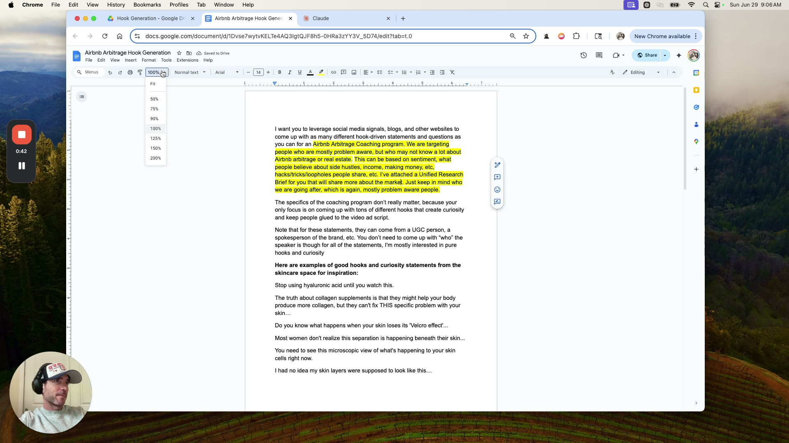
*Google Doc "Airbnb Arbitrage Hook Generation": the deep-research prompt with the skincare seed hooks ("Stop using hyaluronic acid until you watch this", "Velcro effect") that he forgot to swap out; the yellow-highlighted part is the product-specific block. [v5 00:42]*

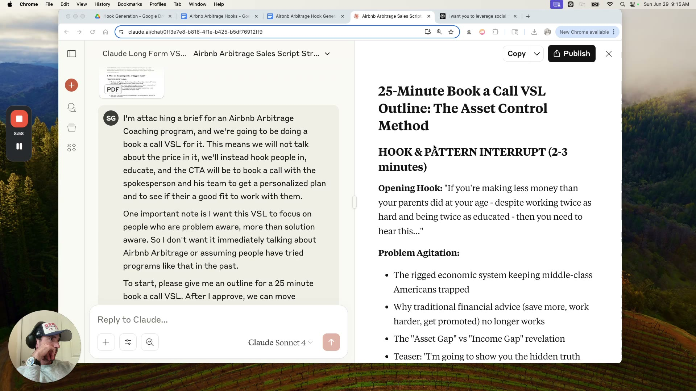
*Prompt in the project (left) and "25-Minute Book a Call VSL Outline: The Asset Control Method" artifact (right): hook and pattern interrupt, problem agitation, "Asset Gap vs Income Gap" revelation. [v5 09:00]*

### 8. Blood-sugar supplement: fix the big idea before the script [v6 00:00–40:37]
- He says outright that this video is about ideas, not another full read-through: "it's really more about the ideas than it is anything else" [v6 08:26].
- Mechanism in the doctor brief (V2): cellular glucose transport breakdown (glucose "doors" rusty and stuck, insulin present but the doorway broken). He calls it a simple, probably obvious mechanism that most people do not know; "if I was really [selling] a blood sugar supplement, would I 100% use this mechanism? No, I probably would have done other mechanism research" [v6 00:00–01:00].
- Gap he spots: nothing big enough to make someone watch a long VSL. He asks Claude for big-idea options and compares them to market formats ("the seven-second blood sugar reset ritual"), ingredient-led ones (saffron) and an exotic-ritual angle. He rejects "Himalayan diabetes cure" and a "$3,000 spice" as too aggressive or unworkable: "I can't afford $3,000, so they don't watch it" [v6 02:24–04:47].
- Chosen direction (screen text, Prompts C13): keep a "30 second blood sugar reset ritual", use "The Missing Page From Every Medical Textbook" as a teaser line (not the big idea), and a "Himalayan Rice Hack" later revealed to be a spice or flavouring added to rice [v6 08:26; screenshot 9:36].
- Hook options returned; he edits for compliance: option 1 is "a very good hook, we just aren't going to say reverses diabetes"; he prefers option 2 and changes the verb to "rapidly lowering blood sugar" ("a little bit more defensible"); "this isn't compliant. You can't compare yourself to a medication" [v6 09:35–11:00; 13:09].
- Updated brief saved as "Doctor Blood Sugar Brief_V2" with the big idea added, then attached with the classic outline. He does not store the classic structure in this project: "I don't want that classic structure necessarily for financial… I'd rather just do it each time, even though that's kind of annoying" [v6 11:00–12:56].
- Outline fixes: explain why a village eating high-carb rice has little diabetes (people ask "why?"); call out that "golden spice" is not turmeric; keep one consistent name for the ritual ("30-second Himalayan rice ritual"; Whisper wrote "second") [v6 14:39–17:03].
- Draft review: fine on the lead (with a lot of aggressive claims, including "often better than metformin itself"), no future pacing yet, and a skimpy ingredient section. Patch: "after the last paragraph of the UMS, build on by mentioning the ingredients… I also found X ingredient that works by doing Y, and here are studies proving it" [v6 20:26–25:01].
- Second patch: saffron repeated and berberine named as the active in the "golden spice": "I thought we were talking about saffron the whole time… in that case, I guess we can add in saffron too". Then: list the five other compounds in the close, give each a benefit line, and add the dose: "he needs to know the dose" [v6 26:25–31:37].

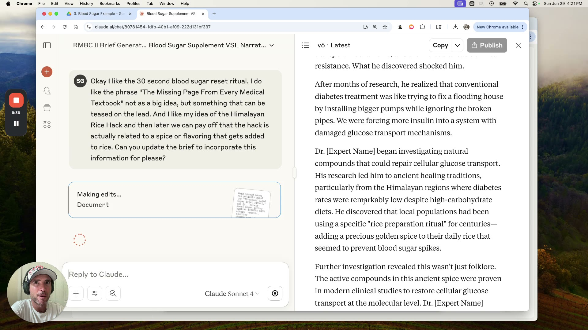
*"RMBC II Brief Generator / Blood Sugar Supplement VSL Narrat…": his message choosing the "30 second blood sugar reset ritual", the "Missing Page From Every Medical Textbook" phrase as a teaser, and the Himalayan rice hack; Claude is "Making edits…" to the brief document. [v6 09:36]*

### 9. Long-form financial promo (note only) [v7 00:00–02:27]
- The financial VSL was generated at brief time ([5.5](05-05-financial-promo-example.md)). He ran it past a former Agora financial copywriter who "thought it was pretty good"; he adds it is "a pretty direct swipe of the secret trust fund offer". A friend's check found real research and patents behind the invented idea [v7 00:00–01:07].
- Workflow remark: Gemini produced the idea (ideation workflow from [3.2](03-02-ump-ideation-with-llms.md)), Claude wrote the script [v7 01:07].
- He skips the medium and 3-7 minute versions in this note and goes to short-form "sell the click" ads [v7 02:08].

## Steps / framework
The sequence he follows on every long-form run:

1. **Finish the brief** ([5.2](05-02-the-brief-generator-with-claude-project-unity-eye-serum-exam.md)); read it for logic breaks; delete unwanted "big ideas" and hook lists; add a real big idea if the mechanism is weak (blood sugar). [v1 00:00–11:31; v6]
2. **Open the Long Form VSL Generator project** (instructions in Prompts A; knowledge = 8 long-form scripts). Attach the brief PDF to the chat. [v1 12:28–15:00]
3. **Decide the mode:** closest swipe of one VSL (new niche, same structure) or composite. Test the swipe with "first 1,000 words". [v1 13:46–27:26]
4. **Request an outline with a target length** (about 27 min eye serum, 25 min book-a-call) and an estimated length. Optionally attach the classic structure. [v1 28:33–32:48]
5. **Copy-chief the outline** and save it as a doc plus PDF. [v1 32:48–41:15]
6. **Write:** "please start writing the VSL… over multiple outputs… I'll prompt you to continue" in Claude; the same in a second model. [v1 41:15–43:39]
7. **Read the leads first** (they carry the hook and the open loops), then compare section by section. [v1 44:48; v2]
8. **Merge** the best text into one doc; patch gaps by chat (ingredient mapping, stance, bridge, objection fixes, delete duplicates). [v3; v5; v6]
9. **Check length** with a script timer; do not trust the model's claim. [v3 01:13]
10. **Generate extra leads** in the hook project; paste 3-4 pre-lead options at the top. [v4]
11. **Replace placeholders** with real proof, remove or substantiate claims, then cut down to medium/short (next lessons in this module).

#### The outline that was approved (eye serum, 27-minute target) [doc 01-2]
| # | Section | Planned time | Contents (short) |
|---|---|---|---|
| 1 | Pre-lead / micro lead | 1:00 | Hook (woman over 35, crow's feet), pain point connection, solution promise |
| 2 | Lead, opening multiple loops | 4:00 | Call out problem; promise solution + transformation; tease emotional discovery story; tease UMP; contrarian teaser; 3 fascinations; brief credibility; qualifiers; address skepticism; broad testimonials |
| 3 | Background story | 4:00 | Who Laura is; her pain; traditional solutions failed; trigger event (avoiding photos); search for truth |
| 4 | Meeting with Dr. Schilling and UMP reveal | 4:00 | Friend's referral; consultation; "wrong problem" revelation; collagen architecture breakdown at the DEJ; fabric analogy |
| 5 | Dr. Schilling's solution, UMS reveal | 4:00 | "Structural Renewal System"; macro idea (rebuild the architecture) and 3 micro steps; no product exists |
| 6 | Product buildup + reveal | 5:00 | Laura's search; why existing products fail; creating the formula; setbacks; breakthrough; doctor's approval; proof; others demand it; product born |
| 7 | Close: product details and value building | 4:00 | Ingredients, dismiss alternatives, testimonials, how to use, scarcity, personal mission |
| 8 | Price justification and reveal | 1:30 | Cost of alternatives; retail $96; three packages; "smart people buy more" |
| 9-11 | Calls to action 1, 2, 3 | 0:30 / 0:30 / 0:15 | What happens next + guarantee; two choices + urgency; thank you |
| 12 | FAQ | 1:00 | "I've tried everything", "too expensive", "sensitive skin", "will it work for me" |

Planned times sum to about 29:45 although the title says 27 minutes (derived). The script timer later estimated about 31 minutes for the draft (before leads) [v3 01:13].

## Examples
- **Final merged script (document "01-3 Unity Eye Serum Long Form VSL_RMBC II Example", 6,575 words):** four pre-lead options, lead, background story, meeting with Dr. Schilling (UMP), his solution (UMS), product buildup, close, price, three CTAs, FAQ. The "Example1" copy is identical.
- **UMP delivery pattern (final script):** the mechanism is spoken by the expert inside the narrator's story ("Laura, everything you've tried has failed because every single product… is targeting the wrong problem") with an analogy (fabric weave, yarn-into-sweater) and three consequences (wrinkles, dark circles, puffiness). Copy the pattern, not the biology.
- **UMS delivery pattern:** three named steps (Structural Renewal Signal, Targeted Repair Complex, Integrity Locking System), a rhythm line ("Signal. Repair. Lock."), then "no company was actually using this comprehensive approach… I'd have to find, or create, the solution myself", which sets up the buildup.

## Structured units

### Hooks
| Hook (verbatim or near) | Heuristic(s) | Emotion / zone | Self targeted | Why it works | Source |
|---|---|---|---|---|---|
| "Stop believing you need $100,000 to start investing in real estate." (Perplexity) | Barrier busting (derived) | Frustration | Ought self (derived) | Targets the capital objection; unverified | [v5 02:31] |
| "I realized something was wrong when I asked permission to take my own birthday off." | Specific scene, identity (derived) | Resentment | Actual vs ideal (derived) | Instructor: "a good hook"; became lead option 1 | [v5 03:46; 1:01:18] |
| "Most people work 40 years before retirement, but this strategy works in 40 weeks." | Time contrast (derived) | Hope | Ideal self (derived) | "Also a very good hook"; built into a lead about "getting free fast" | [v5 03:46; 1:02:54] |
| "Do you know that 69% of millennials are stuck in side hustles that barely pay $500 a month?" | Statistic (derived) | Alarm | n/a | Statistic unsourced; do not use without a source | [v5 02:31] |
| "Here's why using eye creams with collagen is a mistake…" | Mistake / counter-belief (derived) | Alarm | n/a | Attacks what she already buys; "pouring new ingredients onto broken structure" | [v4 08:54; script option 2] |
| "Don't make this $400 mistake at the department store." | Money waste, specific price | Regret | Ought self (derived) | Instructor: "I like the $400 department store" | [v4 10:35; script option 3] |
| "Stop using collagen creams until you watch this." | Prohibition (derived) | Curiosity | n/a | Seed from the hook database; mechanism teased through yarn/sweater metaphor | [v4 01:29; 14:56; script option 4] |
| "The Missing Page From Every Medical Textbook" (blood sugar) | Forbidden knowledge (derived) | Curiosity | n/a | "Not as a big idea, but something that can be teased on the lead" | [v6 08:26; screenshot 9:36] |

### Rewrites (before → after)
| Before | After | What changed | Source |
|---|---|---|---|
| Brief: "The hooks that connect your skin layers at the DEJ break down and disappear." | Deleted | Removed an image from the earlier mechanism that clashes with the weave metaphor | [v1 00:58] |
| Brief teasers built on a "DEJ breakthrough" | Teasers on the "Structural Renewal System" / collagen architecture breakdown; DEJ kept as where it starts | Focus moved from jargon to the metaphor | [v1 05:31–10:26] |
| Brief with "Big ideas to test" and hooks | Both removed | Stops the model anchoring; leads written separately | [v1 10:26–11:31] |
| Outline lead includes Laura's story and Dr. Schilling | Lead only teases a "Florida mom" and an "anti-aging doctor"; brand unnamed until after buildup | Keeps curiosity | [v1 31:13–32:48] |
| Outline: no link between Laura and the doctor | "Search for truth led her to meet Dr. Schilling… referred by a friend… Laura recounting what he told her" | Fixes who speaks and why the doctor appears | [v1 36:45; 37:23] |
| Buildup grounds steps 1-2 only | Steps 1-3 each have ingredients; amino acids added; repeated in the close | Makes the system complete | [v3 26:53–30:59] |
| Airbnb hook: "twice as hard and twice as educated" | "twice as educated" removed | Do not narrow the audience to degree holders | [v5 15:59] |
| Airbnb: "trapped in the corporate rat race… where you are right now" | "where a lot of people… probably are right now" | Avoid asserting the viewer's state | [v5 24:56] |
| Airbnb: furnishing step | Removed ("plenty of properties will come furnished") | Removes a cost objection | [v5 43:25] |
| Blood sugar: "reversing diabetes in thousands of Americans" | "rapidly lowering blood sugar… thousands of Americans with diabetes" | More defensible; still needs substantiation | [v6 09:35–11:00] |
| Blood sugar: "golden spice" | "I'm not talking about turmeric" added | Pre-empts the obvious guess | [v6 16:06] |

## Prompts / templates (verbatim)

### A. Project instructions: "Claude Long Form VSL Generator" (doc "Long Form VSL Generator Claude Project_Setup and Prompts", complete)
```text
New Project Name:
Claude Long Form VSL Generator

Your job is to generate long form video sales letters. They will typically be between 25 minutes and 60 minutes in length. The documents in your knowledge base include transcripts from several long form VSLs which we can model off while writing new VSLs. What you'll want to do is analyze the structure of the various long form VSL examples, and then synthesize that knowledge and use that same knowledge, along with your judgement, to produce new long form VSLs.

In general, when you go to write I'll give you various inputs or even an outline and a gameplan, and you'll be able to model off the examples based on the information about whatever the current long form VSL project is.

One IMPORTANT Note. Please don't try to rush or condense anything. It's very important that if we're writing a long-form VSL, we're matching the structures and lengths of other long-form VSLs (even when it's a compository structure of several VSL examples from your knowledge base). So whenever you run out of space, just prompt me and I'll tell you to continue.

Prompt Example:

Here are a list of inputs for a new VSL that we are going to be writing. After reviewing them, I want you to come up with an outline for a new VSL based on this inputs. When providing this outline, please provide an estimated length for the new VSL. After I have reviewed the outline and approved I will let you know and we can actually write it.
```
Knowledge files in the zip: Beverly Hills MD "Pinch Test" VSL, Agora Financial "Secret Trust Fund" VSL, Backyard Liberty sales letter, Emma long-form template, Genius Wave, Mitolyn, Synocell, and a biz-opp high-ticket book-a-call script (see [6.1](06-01-claude-vsl-projects-setup-overview.md)).

### B. Mechanism fix message (brief chat; partly audible) [v1 05:31–09:12]
```text
Please update these parts based on my feedback. Again, I don't want to get rid of the DEJ altogether. I actually like saying it starts at the DEJ. Just need to make the main focus this collagen architecture breakdown that happens there.
```
(First sentence reconstructed; the rest is quoted from the audio.)

### C. Prompts used in the generation runs

**C1. "Lazy swipe" test** (screen 15:36 + audio 14:49) [v1]
```text
I've uploaded the brief for a new VSL that we're going to write. To start, I want to see what it looks like if we very closely model the structure and length of the Mitolyn VSL that's in your project knowledge, but doing it for this new product and brand. Can you do the first 1,000 words of the new VSL following the Mitolyn structure so I can see what that looks like?
```
(Words after "Mitolyn VSL" come from audio.)

**C2. Outline request** [v1 28:33; captions]
```text
Here's the brief for a new product and brand to write a new long-form VSL that is about 27 minutes in length. Please [give me] an outline for this new VSL that I can look at, and once approved, I'll have you write it.
```

**C3. Outline feedback 1** (spoken; approximate) [v1 29:52–32:48]
```text
This is good, but we also want to promise a solution, something that's going to fix their eye area, fine lines, crow's feet, etc. It should picture what life is going to look like for them once they've discovered this solution and used it for themselves.
I also don't think we want to do too much about Laura in the lead. I'm going to talk about Dr. Schilling in the speaker credibility section, unless it's only teasing that an anti-aging doctor revealed something shocking. And we don't want to talk about Opal Beauty until much later: not until the end of the product buildup and reveal.
```

**C4. Classic structure attachment** [v1 32:48]
```text
I'm going to share a classic VSL structure with you. Please check this out for a general idea of how the VSL will flow, and then modify your outline accordingly, based on information in the brief.
```

**C5. Outline feedback 2** (screen 37:23 + audio 36:45) [v1]
```text
This is pretty good. The one thing I want to make sure we incorporate is how her search for truth led her to meet Dr. Schilling. He is the one who reveals the UMP and UMS. We can say he was referred to her by a friend. Dr. Schilling doesn't need to have a speaking role in this VSL. Instead, it can be Laura recounting what he told her about the UMP and UMS.
```
(Screen text stops at "Instead"; the rest is audio.) After approval: "Please go ahead and start writing the VSL now."

**C6. Second model (Poe, Gemini 2.5 Pro)** [v1 41:15–42:30]
```text
We're going to write a new VSL for a skincare brand. It's direct response, going to be 27 minutes long, roughly. I'm attaching the brief and also the outline of how I want it to go. Please start writing the VSL right now. If you need to do this over multiple outputs, that's fine. Whenever you run out of room, simply let me know and I'll prompt you to continue.
```

**C7. Ingredient patch prompts** (spoken, approximate) [v3 26:53–29:55]
```text
When we get to the product buildup, I'd like these amino acids referenced in this section as part of the three-step solution. We'll want to mention them again in the ingredient section of the close.

One thing that's not clear is which of these ingredients are related to step three. After all, we said it's a three-step system. How can we make this work? We can add other ingredients in the formula as optional.
```

**C8. Hook-heavy lead concepts (hook project)** [v4 00:00–08:54]
```text
Here's a new VSL script I wrote for a skincare serum. Please give me 10 hook-heavy lead concepts I could use for the micro lead. You can pull from the database plus ideas from the VSL. I'll then select the ones I want to turn into new pre-leads or leads.

[follow-up] Can you now do these where they're not all focused on the UMP so much? More for the curiosity. We talk about collagen breaking down. We don't need to talk about collagen architecture.

[follow-up, screen 8:53] ...using eye creams with collagen is a mistake" and some other "mistake" type hooks?

[select] Great job, let's go ahead and do a new micro lead with [concept]. Let's keep it to about the same length as the current pre-lead/micro lead in the VSL I uploaded [as a PDF].
```
(Brackets filled from audio; the screenshot shows only the tail of the second follow-up.)

**C9. Airbnb hook-generation prompt** (Google Doc on screen 0:42, verbatim; the seed list continues beyond the frame) [v5 00:00–01:06]
```text
I want you to leverage social media signals, blogs, and other websites to come up with as many different hook-driven statements and questions as you can for an Airbnb Arbitrage Coaching program. We are targeting people who are mostly problem aware, but who may not know a lot about Airbnb arbitrage or real estate. This can be based on sentiment, what people believe about side hustles, income, making money, etc, hacks/tricks/loopholes people share, etc. I've attached a Unified Research Brief for you that will share more about the market. Just keep in mind who we are going after, which is, again, mostly problem aware people.

The specifics of the coaching program don't really matter, because your only focus is on coming up with tons of different hooks that create curiosity and keep people glued to the video ad script.

Note that for these statements, they can come from a UGC person, a spokesperson of the brand, etc. You don't need to come up with "who" the speaker is though for all of the statements, I'm mostly interested in pure hooks and curiosity.

Here are examples of good hooks and curiosity statements from the skincare space for inspiration:
Stop using hyaluronic acid until you watch this.
The truth about collagen supplements is that they might help your body produce more collagen, but they can't fix THIS specific problem with your skin...
Do you know what happens when your skin loses its 'Velcro effect'...
Most women don't realize this separation is happening beneath their skin...
You need to see this microscopic view of what's happening to your skin cells right now.
I had no idea my skin layers were supposed to look like this...
```
Swap the seed list for examples from the target niche; he later had skincare hooks leak into the Airbnb run [v5 54:02–55:07].

**C10. Book-a-call outline prompt** (screen 9:00, first part verbatim) [v5 05:02–09:24]
```text
I'm attaching a brief for an Airbnb Arbitrage Coaching program, and we're going to be doing a book a call VSL for it. This means we will not talk about the price in it, we'll instead hook people in, educate, and the CTA will be to book a call with the spokesperson and his team to get a personalized plan and to see if they're a good fit to work with them.

One important note is I want this VSL to focus on people who are problem aware, more than solution aware. So I don't want it immediately talking about Airbnb Arbitrage or assuming people have tried programs like that in the past.

To start, please give me an outline for a 25 minute book a call VSL. After I approve, we can move [on to writing it].
```
Outline feedback (spoken, approximate): "…add names for the teaser reference to some case studies, like Joey, who quit his job… and Sam, who was doing deliveries for Amazon and now enjoys time freedom, etc. For now please just fill these in with placeholders and I'll get real success stories from Mac later." Then: "include more of those case studies a few times throughout… again at the end of the story of discovery… and again after the secret, market timing, situation reveal." [v5 10:48–12:19]

**C11. Draft request with outline** [v5 18:25–19:35]
```text
I'm also attaching the outline for the structure. Please go ahead and write the VSL. If you need to do it over multiple outputs, that's fine. Simply tell me when you run out of space and I'll prompt you to continue.
```

**C12. Bridge and logic fixes** (spoken, approximate) [v5 33:06; 43:25–44:52]
```text
I think we need a better transition to real estate. It's kind of abrupt. Maybe we need a few lines to shift the mindset of the prospect so that they are focused on, and accepting of, real estate as a good solution. Something like: you probably think about real estate, but normally real estate requires X, Y and Z.

First, this section: my immediate objection is, oh, that's expensive. So maybe we remove it. After all, plenty of properties will come furnished.
Second, I'm not sure this makes sense because we're talking about arbitrage. We have to be clear before this that as more income comes in, they can use it to actually buy properties and own the assets, and even get property managers to do the work for them.
```

**C13. Blood-sugar big-idea message** (screen 9:36, verbatim) [v6]
```text
Okay I like the 30 second blood sugar reset ritual. I do like the phrase "The Missing Page From Every Medical Textbook" not as a big idea, but something that can be teased on the lead. And I like my idea of the Himalayan Rice Hack and then later we can pay off that the hack is actually related to a spice or flavoring that gets added to rice. Can you update the brief to incorporate this information for please?
```

**C14. Blood-sugar outline and patches** (spoken, approximate) [v6 11:57–31:37]
```text
Here's the brief for a new [doctor-led] offer. I've also included my classic sales letter outline. Please use this information plus the instructions in your knowledge to create a compelling outline for this new VSL.

After the last paragraph of the UMS, build on it by mentioning the ingredients: "I also found X ingredient that works by doing Y, and here are studies proving it."
Can we list what the five other compounds are, and for each one include a line about how it helps? Include the dose.
```

## Screenshots
Eleven frames are embedded in Key ideas: brief document, brief chat after the weave fix, swipe prompt in the project, first outline, outline feedback prompt, saved outline doc, Gemini lead in Poe, mistake hook concepts, Airbnb hook prompt doc, book-a-call prompt and outline, blood-sugar big-idea message. Other sampled frames showed scrolling text with no extra information. No frames were taken for the financial note (v7).

## How to apply
- [ ] Confirm the brief: mechanism consistent with its metaphor, nothing in it you do not want echoed, real proof marked `[verified]` or `[placeholder]`.
- [ ] Create or open the long-form project with the instructions in A; load several long-form transcripts that fit your niche's compliance level.
- [ ] Run a swipe test only to see structure; ship the composite, not the swipe.
- [ ] Prompt for an outline with target length and estimated length; approve it only after fixing the speaker/expert link, the brand-reveal point, the solution promise and the future pacing.
- [ ] Draft in two models; read both leads first; build a merge table like the one above.
- [ ] Patch: missing ingredients or steps, viewer-assumption lines, abrupt transitions, cost objections, duplicate sections.
- [ ] Count words and time the read; allow 3-4 minutes more for added leads and cut-ins (derived).
- [ ] Generate 3-4 alternate micro leads with the hook project and test them against each other ([4.10](04-10-using-ai-to-generate-endless-good-hooks.md)).
- [ ] Run the compliance pass below before anything is recorded.

## Compliance check (course examples; do not reuse the claims)
- **Eye serum script:** "97% of eye creams fail", "Harvard researchers", "world's first and only eye treatment"; percentages (32% wrinkle reduction, 14% firmness, 33% enzyme reduction, 51% fibers, 134% hydration) come from studies of single ingredients, not the finished product; "5,800 happy customers / 4.8 stars"; "supplies are always limited" and "won't be available much longer" scarcity; week-by-week result timeline; "most dark circles are caused by broken capillaries"; Botox and laser price figures. "Laura" and "Dr. Blaine Schilling" are course-world personas; testimonials (Carol, Elizabeth, Patricia) come from a live product page and must be verified. "Rebuilds the collagen architecture" and "reverses" can read as drug or structure-function claims.
- **Mitolyn swipe output:** "Harvard and Yale", "turbocharging metabolism", fat-loss pound results are competitor claims; copying them is the swipe risk shown at [v1 21:45–24:54].
- **Airbnb book-a-call script:** invented spokesperson, "$8,000 a month" case study, "$4,000-$8,000 per month at month 6", "$10,000-$20,000 at month 18", "$2.3 million portfolio", housing-shortage and asset-price statistics are unsourced. Fake case studies, fake testimonials and earnings claims are the FTC risk the instructor names [v5 10:48]. Use documented results and required disclosures.
- **Blood-sugar script:** "reversing diabetes", "better than metformin", "Harvard-trained endocrinologist", "2,000 years" ritual and the named patient are not substantiable as written; he says "this is still not compliant" [v6 09:35]. Disease-treatment claims break Meta, FTC and FDA rules.
- **Hook examples** with statistics ("69% of millennials", "41% of Americans") come from a deep-research tool; sources not checked in the course.

## Related
- Structure being modelled: [4.2](04-02-vsl-fundamentals-classic-structure.md), [4.3 leads](04-03-vsl-leads-after-the-opening-hook.md), [4.4 background and mechanism](04-04-vsl-background-stories-and-unique-mechanisms.md), [4.5 buildup](04-05-vsl-product-buildup-and-reveal.md), [4.6 closes](04-06-vsl-closes.md), [4.7 long-form financial VSL](04-07-long-form-financial-vsl-examples-and-break-downs.md), [4.11 landing page vs in-feed](04-11-vsls-on-landing-pages-vs-vsls-as-in-feed-ads.md).
- Briefs and mechanisms used: [5.2 eye serum](05-02-the-brief-generator-with-claude-project-unity-eye-serum-exam.md), [5.3 Airbnb arbitrage](05-03-airbnb-arbitrage-example.md), [5.4 blood sugar](05-04-blood-sugar-supplement-example.md), [5.5 financial](05-05-financial-promo-example.md), [3.3 Airbnb UMP](03-03-ump-evaluation-prompt-and-process-airbnb-arbitrage.md), [3.4 eye serum UMP](03-04-ideation-validation-and-expansion-walkthrough-eye-serum-exam.md). Project setup: [6.1](06-01-claude-vsl-projects-setup-overview.md).
- Evolve Copywriting: [AI in copywriting](../../../evolve/copywriting/concepts/ai-in-copywriting.md), [unique mechanism](../../../evolve/copywriting/concepts/unique-mechanism.md), [open loops](../../../evolve/copywriting/concepts/open-loops.md), [hooks](../../../evolve/copywriting/concepts/hooks.md); shared [iteration vs variation](../../../../concepts/iteration-vs-variation.md). Difference: Evolve writes per ad from a short brief and a human draft; RMBC II has the model draft a 25+ minute script from an offer-level brief and the human edits as copy chief.
- Next in module: [7.4 Short VSL](07-04-short-vsl.md); 7.2 (medium) and 7.3 (3-7 minute) follow in the same module.

## Sources and limitations
- Transcripts (Whisper large-v3-turbo, machine-generated), folder `07-62 VSL SECTION II- VSL Creation Examples`: [v1](<../../../../../raw/stefan-georgi/rmbc-ii/_transcripts/Stefan Georgi - RMBC II (1)/07-62 VSL SECTION II- VSL Creation Examples/01-[1] Long Form VSL.txt>), [v2](<../../../../../raw/stefan-georgi/rmbc-ii/_transcripts/Stefan Georgi - RMBC II (1)/07-62 VSL SECTION II- VSL Creation Examples/01-[1] Long Form VSL video2.txt>), [v3](<../../../../../raw/stefan-georgi/rmbc-ii/_transcripts/Stefan Georgi - RMBC II (1)/07-62 VSL SECTION II- VSL Creation Examples/01-[1] Long Form VSL video3.txt>), [v4](<../../../../../raw/stefan-georgi/rmbc-ii/_transcripts/Stefan Georgi - RMBC II (1)/07-62 VSL SECTION II- VSL Creation Examples/01-[1] Long Form VSL video4.txt>), [v5](<../../../../../raw/stefan-georgi/rmbc-ii/_transcripts/Stefan Georgi - RMBC II (1)/07-62 VSL SECTION II- VSL Creation Examples/01-[1] Long Form VSL video5.txt>), [v6](<../../../../../raw/stefan-georgi/rmbc-ii/_transcripts/Stefan Georgi - RMBC II (1)/07-62 VSL SECTION II- VSL Creation Examples/01-[1] Long Form VSL video6.txt>), [v7](<../../../../../raw/stefan-georgi/rmbc-ii/_transcripts/Stefan Georgi - RMBC II (1)/07-62 VSL SECTION II- VSL Creation Examples/01-[1] Long Form VSL video7.txt>). The `video7._converted` file is a duplicate and was skipped.
- Documents: [brief](<../../../../../raw/stefan-georgi/rmbc-ii/_extracted/Stefan Georgi - RMBC II (1)/07-62 VSL SECTION II- VSL Creation Examples/01-1 Long VSL_Unity Eye Serum VSL Brief - Opal Beauty.docx.md>), [outline](<../../../../../raw/stefan-georgi/rmbc-ii/_extracted/Stefan Georgi - RMBC II (1)/07-62 VSL SECTION II- VSL Creation Examples/01-2 Unity Eye Serum 27 Minute VSL Outline 1_Claude.docx.md>), [script](<../../../../../raw/stefan-georgi/rmbc-ii/_extracted/Stefan Georgi - RMBC II (1)/07-62 VSL SECTION II- VSL Creation Examples/01-3 Unity Eye Serum Long Form VSL_RMBC II Example.docx.md>) (the "Example1" copy has identical text), [project instructions](<../../../../../raw/stefan-georgi/rmbc-ii/_extracted/_unzipped/06-61 VSL SECTION II- Claude VSL Projects Setup/01-1 Claude Project_Long Form VSL Generator-20250708T091611Z-1-001/1. Claude Project_Long Form VSL Generator/Long Form VSL Generator Claude Project_Setup and Prompts.docx.md>). The Part I, II, III, blood-sugar and financial-note `.srt` captions were used for corrections.
- Whisper fixes: "Claude" (heard "quad/cloud/clod"), "VSL" (heard "BSL/DSL/ESL"), "Mitolyn" (heard "Mitoline"; captions "Midoline"), "Synocell" (caption "Sign to Sell"), "purple peel" (heard "purple pill"), "Dr. Blaine Schilling", "Marcus Hayes / Mac" (as in [5.3](05-03-airbnb-arbitrage-example.md)).
- Timestamps are 45-50 second paragraph starts from our transcripts; a quoted line can sit up to a minute later. Several typed feedback messages are not fully legible; those are marked "approximate" or "reconstructed".
- Not in the course files: the full Claude and Gemini first drafts (only the final merged eye-serum script is), the Airbnb and blood-sugar outlines and scripts, the financial VSL text, and the hook-project instructions used in v4. The Airbnb video (v5) has no caption file.
- The script timer's "about 31 minutes" is the tool's estimate for the draft without leads. "20, 30 minutes" for doing the work himself and "better than 99% of copywriters" are instructor claims. Model behaviour varies by day and version; the screen shows Claude Sonnet 4 and 3.7 and Gemini 2.5 Pro.
