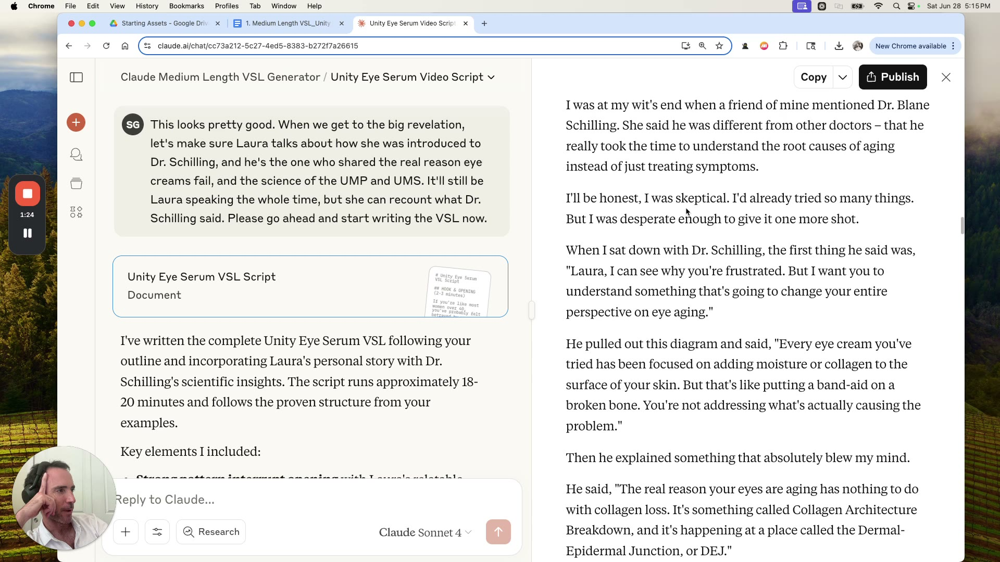
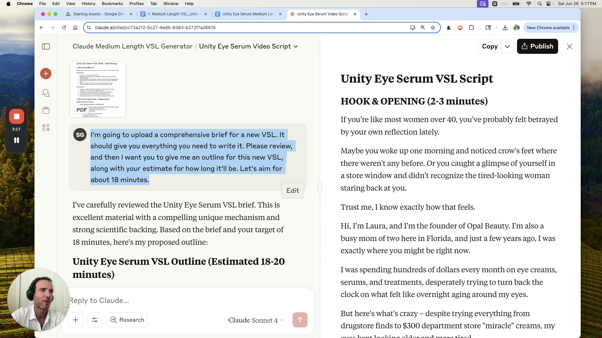
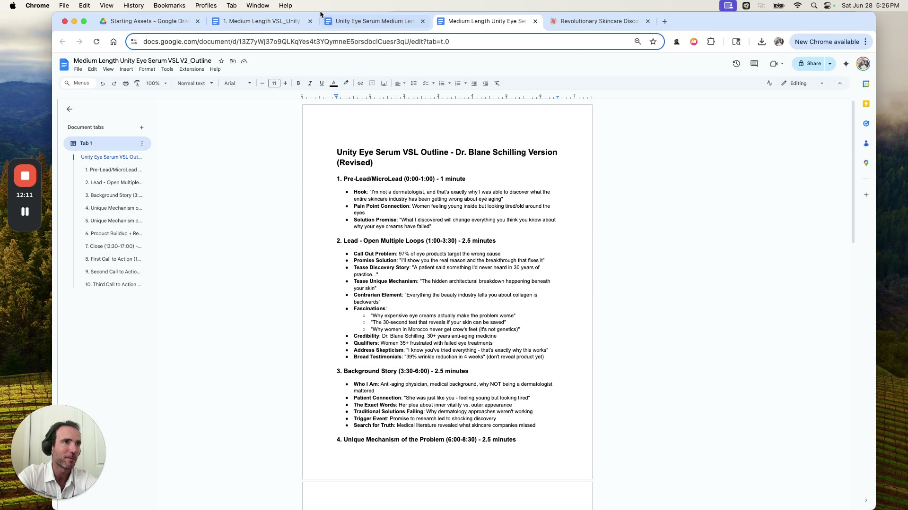
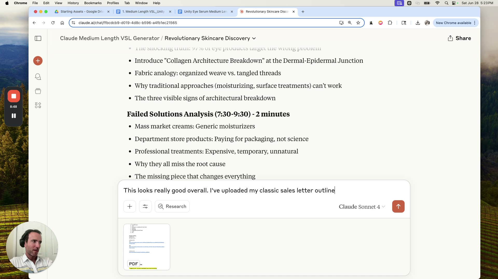
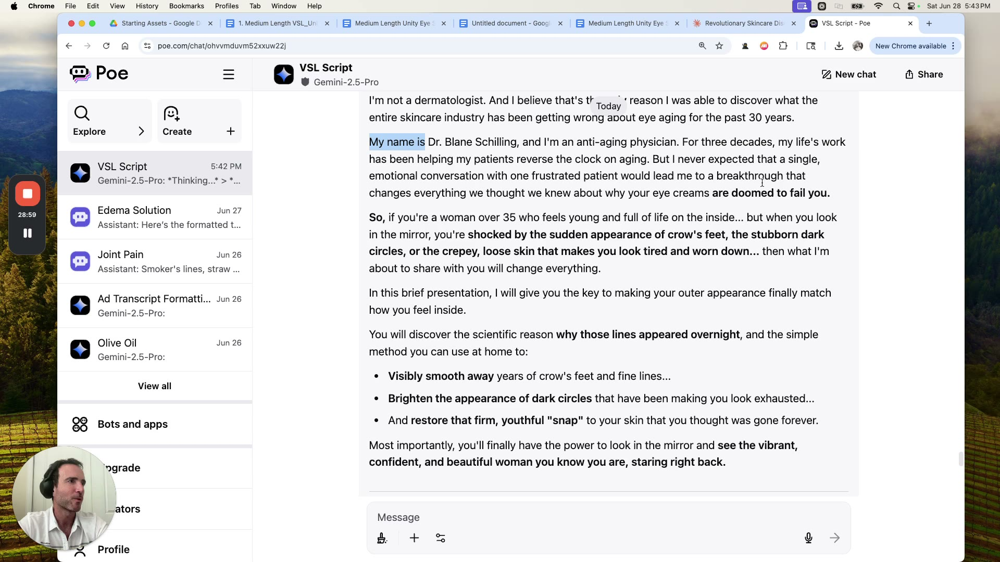
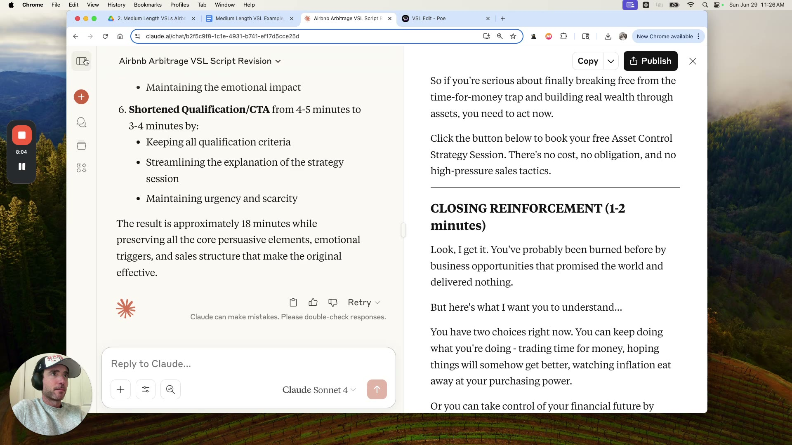
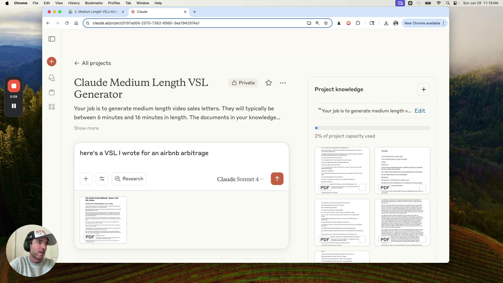
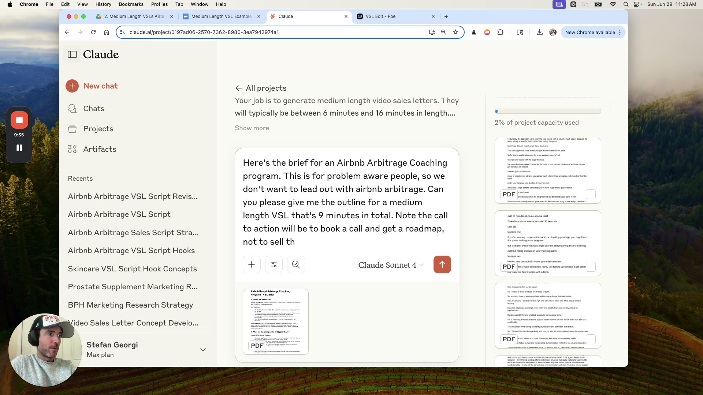

# 7.2 Medium Length VSL
> Two live runs of the "Claude Medium Length VSL Generator" show how to turn a finished brief (or an existing long VSL) into a 9-18 minute script, then change the spokesperson, remix the structure, patch the lead and get a second model's opinion, instead of rewriting by hand.

## 🤖 Agent use
- **Use when:** drafting or revising a 6-18 minute VSL (in-feed or on-page) from a finished brief; turning a long-form VSL you already like into a shorter cut; testing a founder-voice version against an expert-voice version of the same offer; reviewing an LLM draft before it goes to a human.
- **Inputs → outputs:** brief (25-field format from [5.1](05-01-the-old-brief-vs-the-new-brief-overview.md)), target length, spokesperson and background-story instruction, optional "classic sales letter outline", optional existing long VSL, optional hook list → (1) an outline with timed blocks, (2) a written script, (3) a short edit list (lead promise, unpaid loops, AI phrases, compliance), (4) saved outline files so the same outline can be re-run in a second model.
- **Rules:**
  - **DO** run it as a pipeline: brief + length + spokesperson → outline → (optional) remix against the classic structure → "write it" → read it → patch the lead. The outline is the checkpoint before writing (the same habit appears in [7.3](07-03-3-7-minute-vsl.md)). [v1 03:16; 08:48; 10:25]
  - **DO** state the target length in the prompt and ask Claude for its own length estimate, then verify it yourself. "Claude just skews a little bit, thinks it's a little bit longer than it is." [v2 01:53] (derived: check by word count, about 150 words per spoken minute).
  - **DO** change the spokesperson and background story in the prompt, not in the brief, when you only want a test variant: "I can modify the actual brief on the brief level, but I can also just sort of do it here." [v1 06:55] Keep the offer, mechanism and ingredients identical.
  - **DO** prefer an expert/outsider narrator for health-adjacent mechanism VSLs: "we probably want to do more like an expert viewpoint" than the founder voice, but "you could test doing it from Laura or a spokesperson." [v1 10:43; SRT 10:43-11:10]
  - **DO** attach the brief to the same message. When he forgot, he had to stop and redo: "I didn't upload the brief though." [v1 07:05]
  - **DO** upload the classic structure and ask for a *different* arrangement than the last outline: "I don't want to be in the exact same structure as the last one." [v1 08:48]
  - **DO** save every outline you like as its own file (he names it "eye serum VSL V2 outline") so it can be re-run in Gemini with the brief. [v1 10:57-11:58]
  - **DO** keep multiple models available. When Claude misbehaved he ran the identical prompt in Gemini: "this is why you need to have multiple models, and you're screwed if you don't." [v2 02:51-03:40]
  - **DO** for a cut-down, keep the opening options and let Claude trim around them: "Keep the three options for the openings since each video would only have one of those options." [v2 00:28-01:01]
  - **DO** read for transitions. In the 9-minute Airbnb script the move from "systems and automation" straight into objections is abrupt: "we need a better transition." [v2 13:05-14:18]
  - **DO** end the micro lead with a small promise and future-pace: "one thing I might like to see at the end of the micro lead is a little promise." [v1 26:26-27:02]
  - **DON'T** open a loop you will not close. The Morocco "women never develop crow's feet" tease "wasn't paid off right"; ask the model for a different fascination "that does get paid off later in the VSL." [v1 29:53; 30:08-30:37]
  - **DON'T** keep AI-sounding phrases: "reclaim their vitality? Not really, kind of an AI phrase." [v1 12:36]
  - **DON'T** assume the lead is finished. "You need a better lead"; "I would test other little leads in front of it." [v1 01:51; 24:20]
  - **IF** you already like a long VSL **THEN** cut it down rather than starting from a brief: "if I like the long VSL, this is probably just how I would do it." [v2 08:03]
  - **IF** the offer is a book-a-call coaching program **THEN** make the CTA "book a call and get a roadmap," not "sell the program," and keep qualification language. [v2 09:03]
  - **IF** the script has health claims, doctor credentials, scarcity, "only treatment that reverses" language or income numbers **THEN** copy the beat, never the claim (see Compliance flags).
- **See also:** [4.8 Medium VSLs (structures and examples)](04-08-medium-vsls-structures-and-examples.md) · [6.1 Claude VSL projects setup](06-01-claude-vsl-projects-setup-overview.md) (verbatim project instructions) · [5.2 Brief Generator (Unity Eye Serum)](05-02-the-brief-generator-with-claude-project-unity-eye-serum-exam.md) · [5.3 Airbnb Arbitrage brief](05-03-airbnb-arbitrage-example.md) · [7.1 Long-form VSL](07-01-long-form-vsl.md) (lead process, video 4) · [7.3 3-7 minute VSL](07-03-3-7-minute-vsl.md) · [7.4 Short VSL](07-04-short-vsl.md) · [Evolve: unique mechanism](../../../evolve/copywriting/concepts/unique-mechanism.md) · [Evolve: objection handling](../../../evolve/copywriting/concepts/objection-handling.md)

## Key ideas

### 1. Setup: a project whose job is "medium length" [v1 00:00-02:28; v2 frame 01:00]
- Definition in this lesson: "between 6 and 16 minutes," yet his first request is "let's make an 18 minute VSL." [v1 00:00-00:17] The project's own instruction text on screen reads: "Your job is to generate medium length video sales letters. They will typically be between 6 minutes and 16 minutes in length. The documents in your knowledge…" [v2 frame 01:00] ([6.1](06-01-claude-vsl-projects-setup-overview.md) has the full text). [4.8](04-08-medium-vsls-structures-and-examples.md) defines medium as 8-15, "maybe at most 20." Treat 16-18 as the upper edge of "medium" and the 3-7 project as the lower tier. (derived)
- The Unity Eye Serum script was already generated before this recording (the Laura draft). He recaps the brief's "three phases of aging eyes": phase one crow's feet, then dark circles, phase three losing elasticity. [v1 00:04-00:51]
- His review of that first draft: "I think this is pretty good… you need a better lead." And "I feel like I gave you the keys to the kingdom of how to create these," meaning the long-form lessons ([7.1](07-01-long-form-vsl.md)). [v1 01:21-02:28]


*The earlier Laura-narrated draft: his steering prompt ("Laura talks about how she was introduced to Dr. Schilling… start writing the VSL now") and Claude's "approximately 18-20 minutes" estimate, in the project "Claude Medium Length VSL Generator" on Claude Sonnet 4. [v1 01:24 frame]*

### 2. Variant 1: swap the founder for an anti-aging doctor [v1 02:28-07:58]
- Goal: "I want to see one that comes from an anti-aging expert or doctor." [v1 02:39] He re-saves the old script, uploads the brief and dictates the swap (verbatim prompt below). [v1 03:16-06:55]
- Brief fact: the brief already has a "Second Speaker or Expert" (Dr. Blane Schilling, MD, 30+ years) and Laura as main speaker. Changing the narrator is a prompt-level edit, not a brief rewrite. [1. Medium Length VSL_Unity Eye Serum Brief.docx, sections 12-13]
- The new angle: the doctor is "not a dermatologist," so he can see what skincare missed. Claude's outline calls it "brilliant - it gives him credibility while positioning him as someone who can see what the skincare industry missed." [v1 07:50; frame 07:48]
- His reason for running a second version at all: you can test founder vs spokesperson, "but we probably want to do more like an expert viewpoint." [v1 10:43-11:10]


*The brief PDF attached to the outline request: "I'm going to upload a comprehensive brief for a new VSL… give me an outline… along with your estimate for how long it'll be. Let's aim for about 18 minutes." [v1 03:18 frame]*

### 3. Remix the outline against the classic structure [v1 07:50-11:58]
- First outline was a loose sequence (opening hook, failed-solutions analysis, etc.). He uploads his "classic sales letter outline" and asks for a second outline "that incorporates things you think should be added or changed," not identical to the first. [v1 08:48]
- The output is a 10-block classic structure with minutes (screen at [v1 12:11]; blocks 5-6 timings are not visible):

| # | Block | Time | Contents on screen |
|---|---|---|---|
| 1 | Pre-Lead / MicroLead | 0:00-1:00 | Hook ("I'm not a dermatologist…"), pain-point connection (feel young inside, look tired/old around the eyes), solution promise |
| 2 | Lead, open multiple loops | 1:00-3:30 | Call out problem (97% of eye products target the wrong cause), promise solution, tease discovery story, tease mechanism, contrarian element ("everything the beauty industry tells you about collagen is backwards"), 3 fascinations, credibility, qualifiers, address skepticism, broad testimonials without revealing the product |
| 3 | Background story | 3:30-6:00 | Who I am (why NOT being a dermatologist mattered), patient connection, her exact words, traditional solutions failing, trigger event (promise to research), search for truth |
| 4 | Unique mechanism of the problem | 6:00-8:30 | (not visible) |
| 5 | Unique mechanism of the solution | n/v | (not visible) |
| 6 | Product build-up + reveal | n/v | (not visible) |
| 7 | Close | 13:30-17:00 | (not visible) |
| 8-10 | First, second, third call to action | n/v | (document tabs only) |

- Fascinations in the lead (screen): "Why expensive eye creams actually make the problem worse"; "The 30-second test that reveals if your skin can be saved"; "Why women in Morocco never get crow's feet (it's not genetics)". [v1 12:11 frame]
- This matches the 8-part classic outline in [4.2](04-02-vsl-fundamentals-classic-structure.md); the new element is simply asking the LLM to *re-arrange* its own earlier outline against that reference.


*"Unity Eye Serum VSL Outline - Dr. Blane Schilling Version (Revised)" with the classic blocks 1-4 timed and tabs for blocks 5-10. Use as a template for medium outlines. [v1 12:11 frame]*


*Claude's first outline (opening hook, failed solutions analysis 7:30-9:30) with the "classic sales letter outline" PDF attached to the next message. [v1 08:48 frame]*

### 4. Reading the doctor script [v1 12:17-24:30]
Beats as he reads them (script is in 3. Unity Eye Serum Medium Length VSL Example 1.docx for the Laura version; the doctor version is read on screen and in the video only):
1. **Micro lead and loop stack** [12:17-13:58]: "I'm not a dermatologist and that's exactly why I was able to discover what the entire skincare industry has been getting wrong about eye aging for the past 30 years," name and credential, then a "you'll discover" list: the patient who said something never heard in 30 years; "collagen architecture breakdown"; "everything the beauty industry has told you about collagen is backwards"; why department-store creams "make the problem worse"; a 30-second test; why women in parts of Morocco never develop crow's feet.
2. **Skepticism and proof tease** [13:58]: "I've tried everything, nothing works for me, and that's exactly why this breakthrough is so important"; "clinical studies showing up to 39% wrinkle reduction in just four weeks" (instructor does not comment; see compliance).
3. **Bridge to story** [14:17]: "before I reveal exactly what this breakthrough is… the story of how I discovered it."
4. **Background story** [14:17-15:44]: not a dermatologist, anti-aging physician; patient Maria "I don't feel tired or old… my face, particularly the eye area, doesn't match how I feel inside"; her failed products; his promise "I wasn't a skin expert, but I was a research expert."
5. **Straight into the mechanism** [15:44-17:56]: "this is good how it goes right into the mechanism." UMP = "collagen architecture breakdown" at the dermal-epidermal junction; fabric/weave analogy; every eye cream "adding more threads to broken fabric… fix the collapsed building by painting the walls."
6. **Mechanism of the solution** [17:56-19:44]: "Structural Renewal System": Signal, Target repair complex, Integrity locking; each step has an ingredient and a number.
7. **Product build-up** [19:44-21:27]: "not a single product was targeting collagen architecture breakdown"; he partnered with cosmetic chemists; two formulation challenges (therapeutic concentration, penetration to the DEJ); Maria's results; product named only now: "that's how Unity Eye Revive Serum was born."
8. **Close** (skimmed) [21:27-22:27]: other ingredients, department stores "suck," laser treatments "not as bad," "never addressed root cause," "only treatment that reverses structural damage," testimonials, "supplies are limited."
- Verdict: "besides Vitality, this is, I think, really good. I honestly don't really have edits to make." [v1 24:08-24:20] "Besides Vitality" most likely refers to the "reclaim their vitality" line he called an AI phrase at [12:36] (derived).
- Two content notes he raises while reading: the "patient" proof line needs thought because the Laura version said the serum had been given to many people ("I'll have to think about that part") [v1 25:25-25:57]; and the lead needs a promise (below).

### 5. Patch the lead with a second model [v1 25:30-31:40]
- Edit list he sends back to Claude: add a little promise to the end of the micro lead (future pace), and fix the Morocco loop. [v1 26:26-27:11; 29:53]
- Then he pastes only the opening into Gemini 2.5 Pro (via Poe) with a short review ask (verbatim below). Gemini's reply keeps the hook ("I don't think we need to rewrite this opening hook") and rewrites the micro lead: "So, if you're a woman over 35 who feels young and full of life on the inside… then what I'm about to share with you will change everything. In this brief presentation, I will give you the key to making your outer appearance finally match how you feel inside." [v1 27:56-29:21; frame 28:59] He adopts it: "I like that a little bit more. So I'm going to switch the lead out for this."
- Morocco: because it "wasn't paid off," he asks for a different curiosity item that is paid off later. Of the replacements: "they're not great… this is classic scarcity. It works. It's a little hypey, but as much as you might not like it, it tends to work. So I probably would just do that." (the exact replacement line is garbled in both caption files; our reading is a "$50 billion skincare industry is terrified" type fascination, matching "the beauty industry has a $50 billion secret" in the Laura script.) [v1 30:08-31:17]
- Final steer: for the lead, "I can still do the same lead process I've shared in the long form VSL… video four of the long form example for the eye serum… you don't need to see me do this endless times. I think you should just play around with it." [v1 31:09-31:40] See [7.1](07-01-long-form-vsl.md).


*Gemini-2.5-Pro (in Poe, chat "VSL Script") rewriting the micro lead with the added promise list (smooth away crow's feet, brighten dark circles, restore firm "snap") and a closing future-pace line. [v1 28:59 frame]*

### 6. Airbnb arbitrage: cut an existing long VSL down [v2 00:00-08:03]
- Starting assets: a long book-a-call VSL already written for the Airbnb arbitrage coaching program, plus additional leads saved as PDFs (the Google Docs are in the long-form lesson). [v2 00:00-00:28] The hooks PDF has 12 categories (financial frustration, system escape, real-estate barriers, side-hustle failure, passive income reality, housing crisis, trust, market saturation, legal/ethical, urgency, social proof/community, transformation/vision). [1. Airbnb Arbitrage Hooks.pdf]
- Prompt: take the VSL and make "an 18 minute" version, keeping the three opening options; he changes to 16 minutes mid-sentence. [v2 00:28-01:53]
- Problem: Claude was misbehaving that day ("Claude makes updates. Sometimes things get a little wonky"), returning odd extra hooks and a draft that opens on an unrelated character ("this guy, Rick"), which he aborted. [v2 01:53-02:51] He re-ran the same prompt in Gemini, then again in Claude (Sonnet 4; "I think 4 just does longer outputs" vs 3.7). [v2 02:51-05:13]
- Result: "basically the same VSL, just more succinct," openings kept, a bit short but "probably a good length." [v2 01:53; 05:13-05:54] Saved as "Medium Length VSL Example_Airbnb Arbitrage_Claude Version 1 (Cut Down Existing)." [v2 07:02]
- Structure of that cut (docx): three alternative openings → Story of Struggle & Discovery (3-4 min) → Core Problem Education (4-5) → Solution Reveal (3-4) → Future Pacing & Vision (2-3) → Qualification & CTA (3-4) → Closing Reinforcement (1-2). Claude's change log (screen) said it shortened qualification/CTA from 4-5 to 3-4 minutes while keeping all qualification criteria and the urgency. [3. … Cut Down Existing.docx; v2 frame 08:04]


*Claude's explanation of how it shortened the long Airbnb VSL ("Shortened Qualification/CTA from 4-5 minutes to 3-4 minutes… approximately 18 minutes while preserving all the core persuasive elements") next to the closing section. [v2 08:04 frame]*


*The Claude Medium Length VSL Generator project page (project knowledge holds example-VSL transcripts, 2% capacity used) with the Airbnb prompt started: "here's a VSL I wrote for an airbnb arbitrage." [v2 00:59 frame]*

### 7. Airbnb arbitrage: write a 9-minute version from the brief [v2 08:03-17:58]
- "If I wasn't going to do that [cut down], I might just do something like the brief." He pastes the brief and constrains it: problem-aware audience so "we don't want to lead out with airbnb arbitrage"; nine minutes; CTA is "to book a call and get a roadmap, not to sell." [v2 08:03-09:36; frame 09:35]
- "It's honestly just writing it because nine minutes is pretty short." He reads it live. [v2 09:36]
- Outline (docx V2, 9 minutes): Opening Hook 0:00-0:30 → Problem Agitation 0:30-2:30 → Solution Introduction 2:30-4:00 → Proof/Results 4:00-5:30 → Unique Mechanism Deep Dive 5:30-7:00 → Addressing the Skepticism 7:00-8:00 → Call to Action 8:00-9:00. [5. … V2_9 Minutes_.docx]
- The mechanism is "Asset Gap" (problem) and "Asset Control Method" (solution): "You don't have an income problem, you have an asset gap problem… you've been trying to solve an asset gap problem with income solutions." [v2 10:54; brief section 6]
- The opener is a pattern interrupt that promises an insight, not the product: "What I'm about to show you explains why every side hustle you've tried has failed and has nothing to do with your work ethic, your intelligence, or even how much money you started with." [v2 09:36]
- The skepticism block: four objections (everyone's doing this now; regulations; "I don't have time"; "what if I fail again") each answered in two to four sentences. [v2 15:02-15:54]
- His critique: "That's kind of weird how it just kind of goes into the objection handling… we need a better transition." [v2 13:05-14:18] He plans to "take V1 [the longer script] into here" and modify the mechanism and the "fail again" objection (the sentence is garbled; our reading). [v2 15:54]
- CTA: free training that is also a screening step: you register, "answer a few questions about your situation, and if you look like a good fit, you get access to schedule your session." Value stack: market analysis, "landlord partnership script that has an 85% success rate" (fictional number; see flags), cost/timeline breakdown, how to identify the first property. [v2 16:50-17:19]
- Verdict: "That's pretty solid, actually"; named "B2, nine minutes"; hooks from the PDF can be swapped in ("let's do this hook, let's do that hook"). [v2 17:19-17:58]


*The 9-minute outline prompt in the Claude project: "This is for problem aware people, so we don't want to lead out with airbnb arbitrage… 9 minutes in total… the call to action will be to book a call and get a roadmap, not to sell th[e program]" with the VSL brief PDF attached. Recent chats include "Airbnb Arbitrage VSL Script Hooks." [v2 09:35 frame]*

## Steps / framework
**Pipeline A: brief to medium script with a spokesperson test**
1. Attach the brief; state target length; ask for an outline plus Claude's length estimate. [v1 03:16]
2. State spokesperson and backstory overrides (founder vs expert). [v1 03:16-06:55]
3. Read the outline for: curiosity-gap hook, one clear mechanism line, enough loops to pay off. [v1 07:50; 09:46]
4. Attach the classic structure and ask for a re-arranged outline. [v1 08:48]
5. Save the outline (own file). Optionally re-run in Gemini. [v1 10:57-11:58]
6. "Let's go ahead and write it." [v1 10:25]
7. Read the whole thing aloud; list edits (promise, unpaid loops, AI phrases, testimonial wording). [v1 12:17-24:30]
8. Send the opening to a second model with "anything you'd change or edit?" and swap in the better lead. [v1 27:56-29:21]
9. Test other leads in front of the same body (the body is stable; the lead is the variable). [v1 24:20]

**Pipeline B: existing long VSL to medium length**
1. Paste the long VSL; ask for an N-minute version "that strategically cuts things down." Keep alternative openings as-is. [v2 00:28-03:40]
2. If the model drifts (wrong persona, weird hooks), re-run the identical prompt in another model or model version. [v2 02:51-05:13]
3. Check length (derived: word count ÷ 150). Accept "a little short" if all beats survive. [v2 05:54]
4. Save as "Version 1 (Cut Down Existing)."

**Pipeline C: brief to ultra-short medium (9 min) book-a-call**
1. Brief + "problem aware, don't lead out with the offer" + CTA = book a call / get roadmap. [v2 09:03]
2. Accept the 7-block outline above; repair the transition into objections. [v2 13:05-14:18]
3. Swap hooks from the hooks PDF. [v2 17:19]

## Examples
### Script structures (course examples)
| Version | Narrator | Length | Structure |
|---|---|---|---|
| Unity Eye Serum, Laura draft | Laura (founder, busy mom of two in Florida) | requested ~18; Claude says 18-20 | Hook & Opening 2-3 → Problem Agitation 3-4 → The Big Revelation 4-5 → Solution Mechanism 3-4 → Proof & Testimonials 2-3 → Objection Handling & Urgency 2-3 → Offer & Close 1-2 (sum 17-24 min as labelled) [3. Unity Eye Serum Medium Length VSL Example 1.docx] |
| Unity Eye Serum, Dr. Schilling | Dr. Blane Schilling, "anti-aging physician" | 18 | Classic 10-block outline (above) |
| Airbnb, cut-down | "Marcus Hayes" ("Mack") | ~16-18 | 3 opening options + 6 blocks (above) |
| Airbnb, 9-minute | Marcus Hayes | 9 | 7 blocks (above) |

### Objection list in the Laura close (reuse as a menu)
"I've tried everything, nothing works for me"; "This sounds expensive"; "My dark circles are genetic"; "I don't have time for complicated routines"; sensitive-skin concern; each answered in 2-5 sentences, then urgency ("sold out twice in the past six months") and the offer. [3. Unity Eye Serum Medium Length VSL Example 1.docx, Objection Handling & Urgency]

## Structured units

### Hooks (verbatim from the scripts and hooks file)
Columns "Heuristic" and "Why it works" are our reading (derived); the course does not label them.

| Hook | Heuristic (derived) | Emotion / zone (derived) | Self targeted (derived) | Why it works (derived) | Source |
|---|---|---|---|---|---|
| "I'm not a dermatologist and that's exactly why I was able to discover what the entire skincare industry has been getting wrong about eye aging for the past 30 years." | Contrarian / outsider authority | Curiosity, betrayal by industry | Ideal self (look as vibrant as I feel) | Turns a credential gap into a reason to trust, and implies a hidden cause | [v1 12:17] |
| "If you're making less money than your parents did at your age - despite working twice as hard and being twice as educated - then you need to hear this..." | Call-out + relative deprivation | Frustration, injustice | Actual self (stuck) | Names the reader's grievance in the first sentence | Airbnb cut-down, Opening Option 1 |
| "I realized something was wrong when I had to ask permission to take my own birthday off." | Story hook, specific vivid moment | Resentment, autonomy loss | Actual self | One small scene stands for the whole 9-to-5 trap | Airbnb cut-down, Opening Option 2; also in hooks PDF |
| "Most people work 40 years to afford retirement - but this strategy works in 40 weeks." | Number contrast / unrealistic-speed promise (claim needs substantiation) | Hope | Ideal self | Parallel "40/40" construction is easy to remember | Airbnb cut-down, Opening Option 3; also in hooks PDF |
| "What I'm about to show you explains why every side hustle you've tried has failed… and it has nothing to do with your work ethic, your intelligence, or even how much money you started with." | Removes self-blame + insight promise | Relief | Actual self | Doesn't mention the product; promises a new explanation | 9-minute Airbnb V2, opening hook [v2 09:36] |

### Rewrites (before → after)
| Before | After | What changed | Source |
|---|---|---|---|
| Laura-narrated 18-min script (founder tells her story, quotes Dr. Schilling) | Dr. Schilling narrates; patient "Maria" supplies the relatable story; opening is "I'm not a dermatologist…" | Spokesperson, background story, credibility mechanic (outsider expert) | [v1 03:16-07:58] |
| First outline: opening hook → … → failed-solutions analysis | 10-block classic structure with timings | Structure re-arranged against the classic reference | [v1 08:48; 12:11 frame] |
| Micro lead ending "The one I'm about to share with you will change everything." | Lead that adds "In this brief presentation, I will give you the key to making your outer appearance finally match how you feel inside…" plus a three-item promise list and a closing "see the vibrant, confident, and beautiful woman you know you are" | Added explicit promise and future pace | [v1 12:51; 28:58; frame 28:59] |
| Airbnb long VSL (book-a-call) | 16-18 min cut: same openings, shorter qualification/CTA (4-5 → 3-4 min) | Trimmed blocks, kept every beat | [v2 frame 08:04] |
| Abrupt jump from "systems and automation" to objections | Adds "this sounds almost too good to be true… so let me address the questions that are probably going through your head" | Added bridge (the docx contains it as "Natural Transition") | [v2 13:05-14:18]; 5. … V2_9 Minutes_.docx |

### Templates
**Medium outline (18 min, expert narrator)**: Micro lead 0:00-1:00 → Lead (open loops) 1:00-3:30 → Background story 3:30-6:00 → UMP 6:00-8:30 → UMS → Product build-up + reveal → Close 13:30-17:00 → CTA 1/2/3. (from [v1 12:11 frame])

**9-minute book-a-call**: Opening hook 0:00-0:30 → Problem agitation 0:30-2:30 → Solution intro 2:30-4:00 → Proof/results 4:00-5:30 → Mechanism deep dive 5:30-7:00 → Skepticism 7:00-8:00 → CTA 8:00-9:00. (from 5. … V2_9 Minutes_.docx)

### Rules of thumb
- **DO** keep the offer fixed and vary spokesperson, hook or lead; the point is to "test lots of stuff." [v1 10:43]
- **DON'T** let the model invent a bridge: look for the transition between "mechanism/system" and "objections." [v2 13:05]
- **IF** Claude misbehaves **THEN** same prompt, different model. [v2 02:51-03:40]

## Prompts / templates (verbatim)
### P1. Outline request with length estimate (on screen [v1 03:18]; same wording is used in 5.2)
```text
I'm going to upload a comprehensive brief for a new VSL. It should give you everything you need to write it. Please review, and then I want you to give me an outline for this new VSL, along with your estimate for how long it'll be. Let's aim for about 18 minutes.
```

### P2. Steering the Laura draft before writing (on screen [v1 01:24])
```text
This looks pretty good. When we get to the big revelation, let's make sure Laura talks about how she was introduced to Dr. Schilling, and he's the one who shared the real reason eye creams fail, and the science of the UMP and UMS. It'll still be Laura speaking the whole time, but she can recount what Dr. Schilling said. Please go ahead and start writing the VSL now.
```

### P3. Spokesperson and background-story swap (dictated [v1 03:31-06:55]; assembled from the SRT and the on-screen tail; Whisper "died/dermatologist" mishearings fixed)
```text
[Attach the brief.] Please give me an outline. One important note: I want this version to actually not come from Laura. Let's instead have it come from Dr. Blane Schilling. So we'll want to change the spokesperson and the background story. Let's just have it be that Dr. Schilling is an expert. A woman came into his anti-aging medical practice and said something he'd never heard before. She said she wasn't there because she felt tired or old. She actually felt young and full of life inside. She was there because her skin, especially the area around her eyes, didn't match up with how she felt. She looked tired and old even though she still felt in the prime of her life: wise, confident, empowered. Dr. Schilling was surprised by this. He's an anti-aging doctor, not a dermatologist, but he wanted to help, so he promised to do some research for the lady. What he discovered changed everything you think you know about skincare, wrinkles, eye problems, etc.

This is a cool angle I think, because it can talk about how he was able to find the truth because he was coming at the problem from an outsider's perspective.
```
Note: the full spoken text is partly garbled; the final sentence is confirmed on screen [frame 07:48 shows "This is a cool angle I think because it can talk about how he was able to find the truth because he was coming at the problem from an outsider's perspective."].

### P4. Classic-structure remix (on screen opening + SRT [v1 08:48-09:29])
```text
This looks really good overall. I've uploaded my classic sales letter outline. While we might not be able to go super in-depth on every aspect of this, I think it helps. Can I see another version of the outline that incorporates things that you think should be added or changed based on this document? Because I don't want to be in the exact same structure as the last one. I really liked what I had before.
```
Then: `Let's go ahead and write it.` [v1 10:25]

### P5. Second-model review of the lead (dictated [v1 27:56-28:18])
```text
Here's the start of another version that comes from Dr. Schilling. Is there anything you'd change or edit with it?
```
(he pastes the opening hook and micro lead). Follow-up for the Morocco loop: `The Morocco thing wasn't paid off right. Is there a different fascination we could use there that would create curiosity, but that does get paid off later in the VSL?` [v1 29:53-30:37, reconstructed from SRT].

### P6. Cut-down of an existing long VSL (dictated [v2 00:28-01:53; 03:40])
```text
Here's a VSL I wrote for an Airbnb arbitrage coaching program. Can you take this and do a version that is 16 minutes long? Keep the three options for the openings, since each video would only have one of those options. So that should be taken into account. It should be the same VSL, just strategically cutting things down to make it fit the length.
```
(He first says 18 then "Oh hell, let's do 16 minutes".)

### P7. 9-minute outline from a brief (on screen [v2 09:35]; end of sentence cut off on screen)
```text
Here's the brief for an Airbnb Arbitrage Coaching program. This is for problem aware people, so we don't want to lead out with airbnb arbitrage. Can you please give me the outline for a medium length VSL that's 9 minutes in total. Note the call to action will be to book a call and get a roadmap, not to sell th[e program].
```
(The bracketed completion is our reading; spoken audio says "not to sell." [v2 09:03])

### P8. Agent version (derived, not a course asset)
```text
Role: medium-length VSL writer. Inputs: [brief], [target minutes], [narrator: founder | expert | customer], [CTA: buy | book a call | watch longer video], [awareness level], [classic outline].
1) Outline in the classic blocks with a time range per block and your estimated total runtime. Stop for approval.
2) After approval, write the script in the narrator's voice. Use only facts, proof and numbers present in the brief; bracket any claim that needs substantiation.
3) Self-check: every opened loop is paid off; the mechanism appears before minute [X]; one bridge sentence precedes objection handling; list phrases that sound like AI copy.
```

## Screenshots
Eight frames are embedded above (spokesperson steer, outline prompt, classic outline upload, revised outline doc, Gemini lead, cut-down summary, project instructions, 9-minute prompt). Other frames were Poe/Claude chat lists with no extra information.

## Compliance flags (course examples, do not copy claims)
- **Eye serum (cosmetic):** "reverse" or "reverses structural damage," "clinical studies showing up to 39% wrinkle reduction in just four weeks," "97% of eye products target the wrong cause," "$50 billion secret," "supplies are limited / sold out twice," a physician narrator and a "Dr. Blane Schilling, MD" endorsement quote are all asserted by the brief or the model. Each needs substantiation, a real expert or a fictional-character disclosure, and real scarcity. In the 3-7 lesson he says "reversing" and "clinical studies" would have to be cleaned up ([7.3](07-03-3-7-minute-vsl.md) [v1 08:16]).
- **Ingredient numbers** quoted in the script (32% wrinkle depth, 14% firmness, 33% enzyme activity, 51%, 134%, 440%) come from ingredient-level studies listed in the brief, not from tests of the finished product; do not present them as product results.
- **Testimonials** in the Laura script (Carol M., Patricia L., Elizabeth K.; "5,800 happy customers"; "4.8 out of 5 across more than 3,400 reviews") are examples copied from the brief; replace with real, verifiable ones.
- **Airbnb arbitrage (biz-opp):** the persona "Marcus Hayes" is fictional (15-unit portfolio, "$2.3 million in cash-flowing real estate assets," "$12,000 monthly passive income," students "Sarah… $3,200 monthly," "85% success rate" landlord script). Income claims and typical-results disclosures are required; the FTC and Meta restrict this category. "I personally review every application" and "a few times a year" must be true.
- Patient story "Maria" is a narrative device; do not present a fictional patient as real.

## How to apply
- [ ] Finish the brief ([5.2](05-02-the-brief-generator-with-claude-project-unity-eye-serum-exam.md)); decide target length (9, 16-18) and CTA.
- [ ] Create a "medium" project with example-VSL transcripts ([6.1](06-01-claude-vsl-projects-setup-overview.md)).
- [ ] Prompt P1 or P7 for an outline; read it; then P4 with the classic outline.
- [ ] Decide narrator (founder vs expert vs customer) and run a variant with P3.
- [ ] Write; read aloud; send one edit list to the same model.
- [ ] Paste the opening into a second model (P5); keep the better micro lead and confirm it ends with a promise.
- [ ] Audit loops (each tease paid off) and transitions (mechanism → objections).
- [ ] Save outline and script files with version names.
- [ ] Run the compliance pass before any script is recorded.

## Related
- Same section: [7.1 Long-form VSL](07-01-long-form-vsl.md) · [7.3 3-7 minute VSL](07-03-3-7-minute-vsl.md) · [7.4 Short VSL](07-04-short-vsl.md)
- Theory: [4.2 Classic structure](04-02-vsl-fundamentals-classic-structure.md) · [4.3 VSL leads](04-03-vsl-leads-after-the-opening-hook.md) · [4.4 Background stories and unique mechanisms](04-04-vsl-background-stories-and-unique-mechanisms.md) · [4.6 Closes](04-06-vsl-closes.md) · [4.10 AI hooks](04-10-using-ai-to-generate-endless-good-hooks.md)
- Evolve: [open loops](../../../evolve/copywriting/concepts/open-loops.md) · [bridges](../../../evolve/copywriting/concepts/bridges.md) · [authority in ads](../../../evolve/copywriting/concepts/authority-in-ads.md)

## Sources and limitations
- Transcripts: [video 1 (31:46)](<../../../../../raw/stefan-georgi/rmbc-ii/_transcripts/Stefan Georgi - RMBC II (1)/07-62 VSL SECTION II- VSL Creation Examples/02-[2] Medium Length VSL.txt>) and [video 2 (18:01)](<../../../../../raw/stefan-georgi/rmbc-ii/_transcripts/Stefan Georgi - RMBC II (1)/07-62 VSL SECTION II- VSL Creation Examples/02-[2] Medium Length VSL video2.txt>). Video 1 is the Unity Eye Serum run; video 2 is the Airbnb arbitrage run.
- Fixes using the platform captions: "Dr. Blaine Schilling" (brief spells "Blane"; both used), "Dipalmitoyl Hydroxyproline" (Whisper "Dipalmital"), "Unity Eye Revive Serum" (Whisper "Unity I Revised Serum"), "Unity eye serum" (Whisper "UDI"), "Gemini" via Poe, Claude "Sonnet 4."
- The spoken video-1 transcript has long garbled stretches (his dictated prompt; the lead feedback at ~[26:00-27:30] and [30:00-31:20]). P3, P5 and the Morocco replacement are reconstructions from the SRT plus on-screen text. The doctor-version script itself is read aloud but is not in the course files (the document in the zip is the Laura version); the Claude conversation link in the zip (2. Claude Conversation Link.docx) is a web link whose content is not included. The Airbnb zip also lists two Claude conversation links only (6. Claude Conversation Histories.docx).
- The long Airbnb VSL ([2. Airbnb Arbitrage Long Book a Call VSL Example.pdf]) was read for structure only; it contains `[PLACEHOLDER]` testimonial slots.
- Screenshots: frames taken from MEGA; the on-screen recording timer differs slightly from our transcript clock (a few seconds). Screenshots avoid account identifiers.
