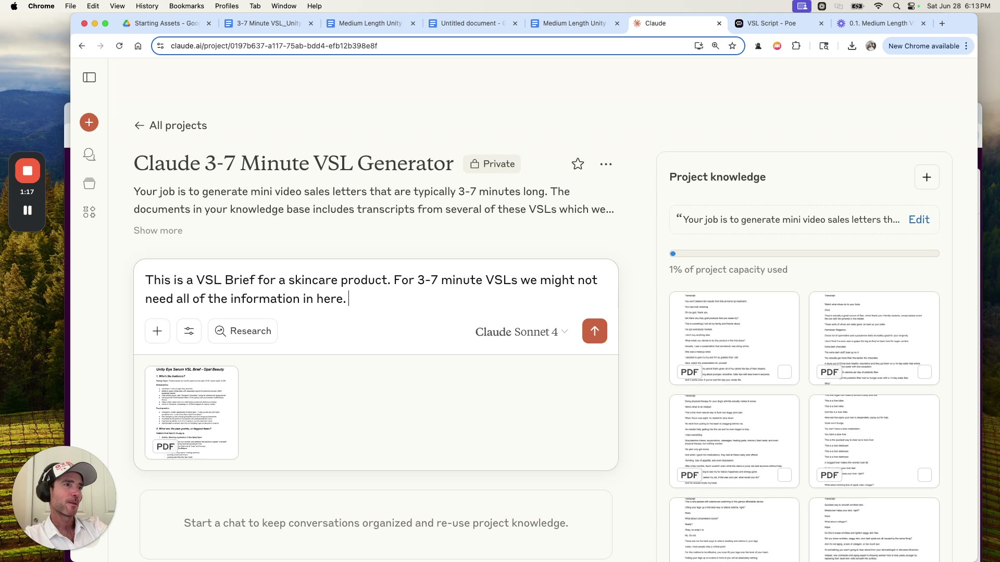
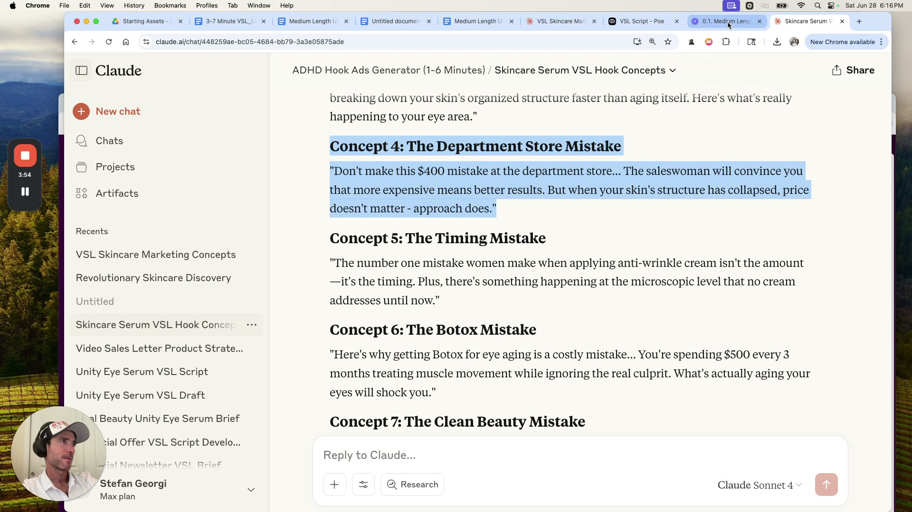
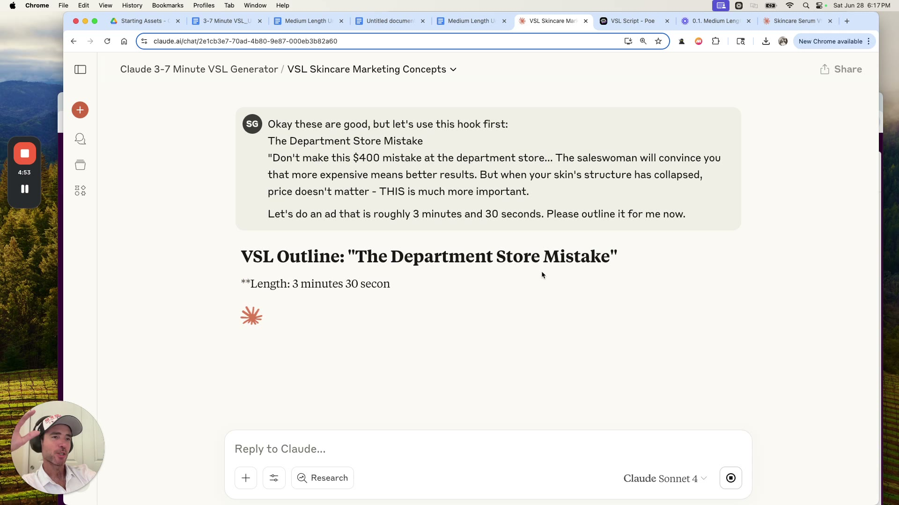
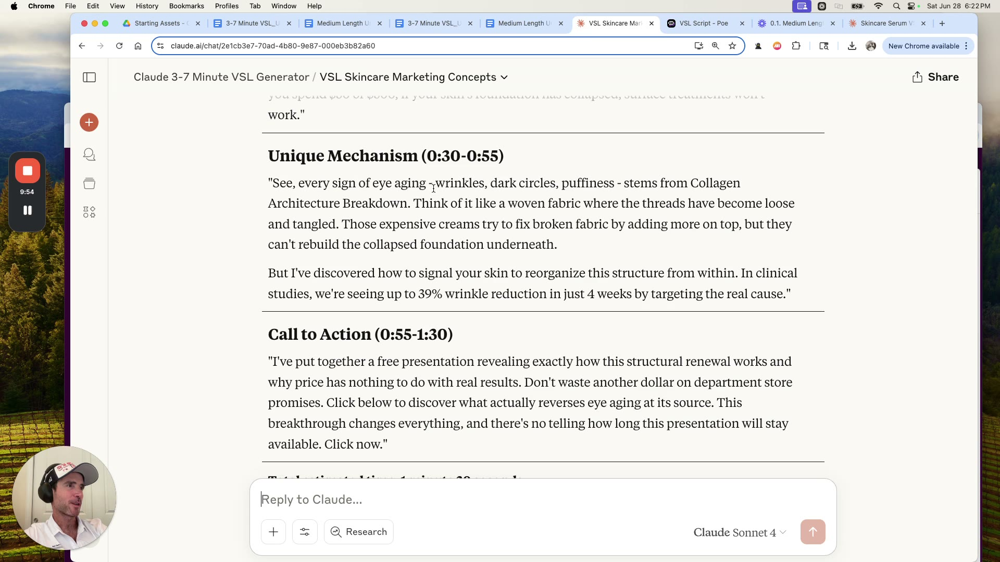
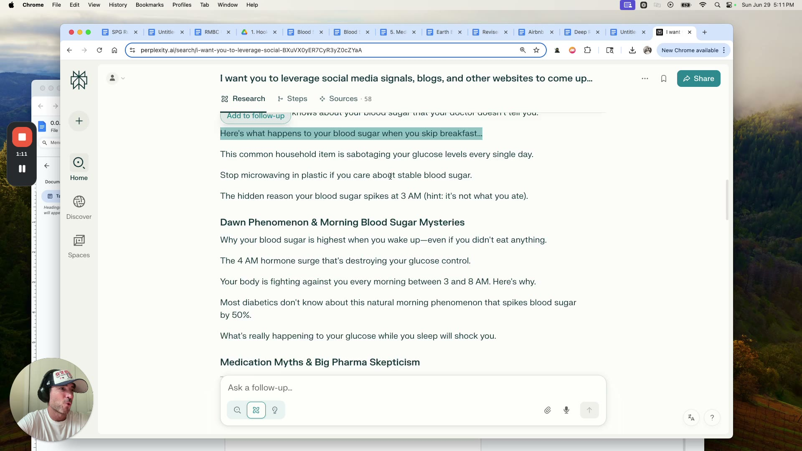
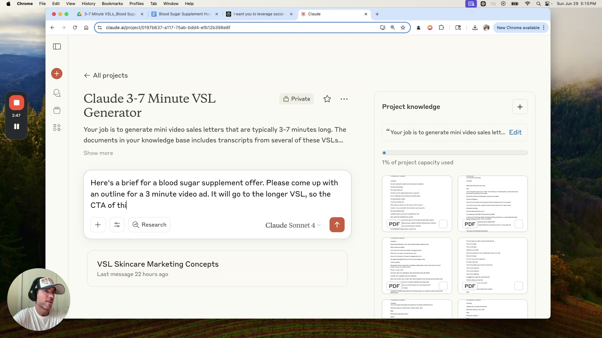
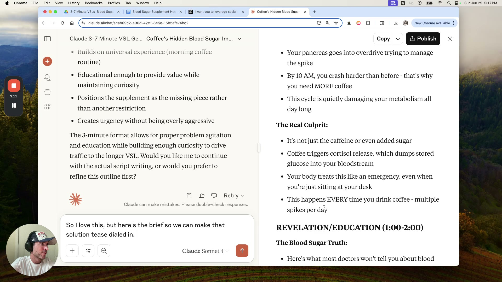
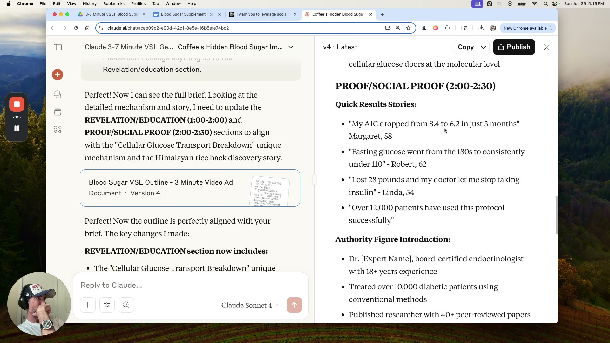

# 7.3 3-7 Minute VSL
> The "Claude 3-7 Minute VSL Generator" turns a brief plus one chosen hook into a 1.5-3.5 minute mechanism-heavy video ad that sells the click to a longer VSL; keep everything after the hook-specific problem section identical and you get an endless supply of single-variable hook tests.

## 🤖 Agent use
- **Use when:** writing an in-feed video ad that sends cold traffic to a longer VSL or landing page; turning a hook list into testable video scripts; producing a shorter or longer sibling of an ad you already like.
- **Inputs → outputs:** a finished brief (does not all need to be used), a hook list (concept list, or a Perplexity deep-research list), a chosen hook, target length, CTA (watch the full presentation) → an outline that is almost a script, then the written script, then variants (new hook / shorter cut).
- **Rules:**
  - **DO** treat the brief as optional detail: "For 3-7 minute VSLs we might not need all of the information in here." [v1 00:30-01:14] But do attach it before you ask for the mechanism and proof: when he forgot, Claude built the outline from the example VSLs alone and the solution tease did not match the offer. [v2 04:37-05:10]
  - **DO** make the CTA "watch the video" and keep brand and product out of the ad: "let's assume the CTA is going to be to watch video. Won't talk about brand or product at all." [v1 01:47-02:09]
  - **DO** pick the hook before the outline and paste it verbatim; ask for an outline first even though it comes back near-final: "I still like the outline thing because… it makes me double check and confirm there's nothing I want to tweak or change before." [v1 04:50]
  - **DO** make 3-7 minute ads "pretty mechanism heavy" (UMP explained in a fabric/key-lock analogy, why alternatives fail, tease the solution). [v1 04:50-05:16]
  - **DO** make short ads educational: "I think about for short ones especially, kind of like educational is good… lots of curiosity and some promises." [v2 01:10; 02:46]
  - **DO** run the hook-swap test: "everything after the revelation/education section is pretty much the same, but we do a different hook." That tests "a different hook with the same structure." [v2 08:58-09:35] See [Iteration vs variation](../../../../concepts/iteration-vs-variation.md) (derived: this is a variation test on one variable).
  - **DO** keep the Nope-sequence logically consistent with the hook (hook line → "You think X, right? Nope. What about Y? Nope. How about Z? Still nope. Here's what's really…"). When Claude wrote nonsense for the laundry hook ("eating too much sugar causes diabetes? Nope"), he rewrote it around cleaners. [v2 11:04-12:11]
  - **DO** run a 1:30 version of a script you like, even in a project built for 3-7 minutes: "even though that's not what the project's for, I want to check that out too." [v1 08:33-08:58]
  - **DO** test depth of mechanism: "a version that has more of the mechanism… versus a version that has less mechanism and is more to the point." [v1 09:56-10:26]
  - **DON'T** ship regulated claims. He flags "reversing" and "clinical studies" for cleanup in the eye-serum script: "a few compliance things… we would have to clean up." [v1 08:04] "We can't say clinical studies. We're not doing clinical studies with the ingredient." [v1 09:56]
  - **DON'T** trust unverified citations: "one of these studies comes from Harvard. I have to confirm if Harvard actually does." [v1 02:31]
  - **DON'T** keep a weak mechanism name when you can improve it: of "Cellular Glucose Transport Breakdown" he says "I actually don't like this term, so I would use a different nickname if this was a real offer." [v2 06:35]
  - **IF** a mechanism element could be confused with a saturated product category **THEN** neutralize it in the first mention (the "golden spice" is "not turmeric," said right away so people don't think it's "another thing selling turmeric"). [v2 07:06; doc 4. Claude Conversation_]
  - **IF** the model's duration label looks too good **THEN** check the word count (derived: the 3-minute blood-sugar scripts run about 790-850 words, i.e. 5+ minutes at 150 words per minute; the eye-serum "3:30" script is ~550 words).
- **See also:** [7.2 Medium length VSL](07-02-medium-length-vsl.md) · [7.4 Short VSL](07-04-short-vsl.md) · [7.1 Long-form VSL](07-01-long-form-vsl.md) · [4.9 Short VSLs (structures and examples)](04-09-short-vsls-structures-and-examples.md) · [4.10 Using AI to generate endless hooks](04-10-using-ai-to-generate-endless-good-hooks.md) · [6.1 Claude VSL projects setup](06-01-claude-vsl-projects-setup-overview.md) · [4.11 VSLs on landing pages vs in-feed](04-11-vsls-on-landing-pages-vs-vsls-as-in-feed-ads.md) · [Evolve: hooks](../../../evolve/copywriting/concepts/hooks.md) · [Evolve: unique mechanism](../../../evolve/copywriting/concepts/unique-mechanism.md)

## Key ideas

### 1. The project and why a 3-7 minute asset exists [v1 00:00-01:47]
- Project name and instruction on screen: "Claude 3-7 Minute VSL Generator." "Your job is to generate mini video sales letters that are typically 3-7 minutes long. The documents in your knowledge base includes transcripts from several of these VSLs which we…" (rest not visible; the full text is in [6.1](06-01-claude-vsl-projects-setup-overview.md)). Project knowledge is example-VSL transcripts (1% of capacity). [v1 frame 01:18] He says the setup was shown in the earlier section ("You've already seen how I set this Claude project up"). [v1 00:00-00:30]
- Role in the funnel: "going back to what's the purpose of these, it's usually to either go to a landing page… or a VSL as well." The test CTA is "watch video." [v1 01:14-02:09]
- Structure expectation: the classic VSL structure "using the short and medium is going to be less important." [v1 00:00-00:30]


*Project page with the instruction paragraph and a stack of example-VSL transcript tiles; the Unity Eye Serum brief PDF is attached to a new message that begins "This is a VSL Brief for a skincare product. For 3-7 minute VSLs we might not need all of the information here." [v1 01:18 frame]*

### 2. Eye serum run: concept list, then the "mistake" hook [v1 01:14-05:51]
- Prompt: five VSL concepts, Dr. Schilling as spokesperson, CTA = watch the video, no brand or product mention (verbatim below). "I could take the Dr. Schilling stuff from the medium VSL, which I really liked, and put it on here." [v1 01:14-02:31] (the doctor angle was built in [7.2](07-02-medium-length-vsl.md)).
- Review: the concepts are "pretty on the nose"; "honestly, these are pretty similar to the short VSLs or the ADHD kind of hook things we did. So as we get into medium and short length ones, having good hooks out the gate is pretty helpful." [v1 02:31-03:15] (He is using the chat inside the "ADHD Hook Ads Generator (1-6 Minutes)" project: the screen header reads "ADHD Hook Ads Generator (1-6 Minutes) / Skincare Serum VSL Hook Concepts.")
- Concepts visible on screen (names only): Concept 4 "The Department Store Mistake," 5 "The Timing Mistake," 6 "The Botox Mistake," 7 "The Clean Beauty Mistake." Concepts 1-3 and 8+ are not visible. [v1 frame 03:54]
- He picks #4: "I really like that mistake one." [v1 03:15-03:55]. On screen he edits the hook's last clause from "price doesn't matter - approach does" to "price doesn't matter - THIS is much more important." [frames 03:54 and 04:53]
- Then: "Let's do an ad that is roughly 3 minutes and 30 seconds. Please outline it for me now." [v1 03:55-04:50]


*Concept 4 "The Department Store Mistake" highlighted in the ADHD Hook Ads Generator chat, with Concepts 5-7 below ("The Timing Mistake," "The Botox Mistake," "The Clean Beauty Mistake"). [v1 03:54 frame]*


*The picked hook pasted into the 3-7 minute project with "Let's do an ad that is roughly 3 minutes and 30 seconds. Please outline it for me now." [v1 04:53 frame]*

### 3. What came back: a near-final, mechanism-heavy script [v1 04:50-08:04]
- "It was supposed to be an outline, but they're so short. It just kind of wrote it." [v1 04:50]
- Beats (docx and read aloud): the department-store mistake ($200-$400 creams) → authority and agitation (I'm Dr. Blane Schilling, 30 years…) → mechanism intro (collagen architecture breakdown, woven-fabric analogy, dermal-epidermal junction, dark circles/puffiness/wrinkles all explained) → why current solutions fail ("trying to fix broken fabric by adding more fabric on top") → solution tease ("signal your skin to rebuild… command your collagen threads to reorganize") → CTA to a free presentation about the "structural renewal system." [v1 05:51-08:04]
- Verdict: compliance cleanup needed, "but overall, frankly, it's good. I don't really have anything to change for that. I would test that for sure." [v1 08:04-08:33]
- Timing labels in the file: Opening Hook 0:00-0:15; Problem Agitation 0:15-0:45; Unique Mechanism Introduction 0:45-1:30; Why Current Solutions Fail 1:30-2:15; Solution Tease 2:15-2:50; Call to Action 2:50-3:30. [3-7 Minute VSL_Unity Eye Serum.docx]


*The 1:30 sibling: "Unique Mechanism (0:30-0:55)" compresses the fabric analogy to a short paragraph and "Call to Action (0:55-1:30)" keeps the free-presentation pitch and a soft scarcity line. [v1 09:54 frame]*

### 4. Shorter version and the mechanism-depth test [v1 08:33-11:05]
- "Now please do a 1 minute and 30 second version." The new file keeps the same hook, merges problem and authority, compresses the mechanism, and keeps the CTA. Timing labels: Hook 0:00-0:10 → Problem + Authority 0:10-0:30 → Unique Mechanism 0:30-0:55 → CTA 0:55-1:30. [Shorter Version_ VSL_Unity Eye Serum.docx]
- "It's faster… a little bit more to the point, but frankly, maybe even better. And that's what you would test." [v1 09:56-10:26]
- He admits the limit of what he can add: "you know what works for a good copy… it's hard for me to tell you more than that." The projects "make it so easy." [v1 10:26-10:50]
- Repeat the pattern: ask for other lengths and give "more hooks in the brief"; "just tell it what you want and you get it." The eye-serum Claude conversation is not included in the zip. [v1 08:44-08:58]

### 5. Blood-sugar run: hooks from Perplexity, then a hook-swap factory [v2 00:00-12:52]
- Hook source: the same hook prompt run for the blood sugar supplement ("mostly problem aware and solution aware"), run in Perplexity deep research (58 sources on screen), saved as "Blood Sugar Supplement Hooks.docx" with 14 headed sections and 78 hooks. [v2 00:00-00:35; frame 01:11; hooks doc]
- Hooks he reads: "Stop drinking coffee until you see what it's really doing to your blood sugar"; "Your morning routine is secretly spiking your glucose levels - and it's not what you think"; "sunburn can spike your blood sugar"; "nose spray…"; "laundry detergent and insulin resistance"; "skip breakfast." His note: "This is basic, but actually kind of interesting… for short ones especially, kind of like educational is good." [v2 00:35-01:10]
- Outline prompt (verbatim below): 3-minute video ad that goes to the longer VSL, educational with curiosity and promises, hook = coffee. [v2 02:04-03:25]
- Claude's first outline had no mechanism because "I didn't include the brief." Second message: "here's the brief (which I forgot to attach) so we can make that solution tease dialed in. Please don't change anything up to the Revelation/education section." Claude updated Revelation/Education, Proof and CTA to the brief's mechanism ("Cellular Glucose Transport Breakdown," GLUT4 "doors," Himalayan rice hack). [v2 04:37-06:35; doc 4. Claude Conversation_]
- Stefan's edit: mention "right away" that the golden spice "is not turmeric." Then "please write the ad." [v2 07:06-08:05]
- Variants: hook 2 "Here's what happens to your blood sugar when you skip breakfast…"; hook 3 "The shocking connection between your laundry detergent and insulin resistance." For hook 3 Claude's Nope sequence was nonsensical, so he steered it ("fragrance-free cleaners… natural cleaners…"). [v2 08:58-12:11]
- Close: "you could do endless structures. But I think this one's cool because you saw how you can take basically the same structure… and do multiple hooks for it." And a side lesson: "there's gems in every single thing. I'm trying to give you the most all-encompassing view of how copy gets created… you gotta consume a lot of content." [v2 09:35; 12:43]


*Perplexity research output titled "I want you to leverage social media signals, blogs, and other websites to come up…" with "Here's what happens to your blood sugar when you skip breakfast…" highlighted and the "Dawn Phenomenon & Morning Blood Sugar Mysteries" category below. [v2 01:11 frame]*


*Claude 3-7 Minute VSL Generator with "Here's a brief for a blood sugar supplement offer. Please come up with an outline for a 3 minute video ad. It will go to the longer VSL…" typed in. [v2 02:47 frame]*


*Claude's first outline (Document, coffee as villain, "The Real Culprit: coffee triggers cortisol release…") and the follow-up in the box: "So I love this, but here's the brief so we can make that solution tease dialed in." [v2 05:11 frame]*


*After the brief is attached (Version 4): the Proof/Social Proof section now lists patient quotes, "Over 12,000 patients," and an authority block "Dr. [Expert Name]" with placeholder credentials. All of it is example copy; see Compliance flags. [v2 07:05 frame]*

## Steps / framework
**3-7 minute hook-swap workflow (as run)**
1. Brief done ([5.2](05-02-the-brief-generator-with-claude-project-unity-eye-serum-exam.md), [5.3](05-03-airbnb-arbitrage-example.md)); load it with the 3-7 project. [v1 00:30]
2. Get a hook list: Claude hook concepts (eye serum) or a deep-research list (blood sugar); the latter used the same hook prompt "I've used a bunch of times." [v1 03:15; v2 00:00-00:35]
3. Choose one hook; paste verbatim; state length and CTA. [v1 03:55; v2 02:46-03:25]
4. Review the near-final outline; if a mechanism is missing, attach the brief and lock the earlier sections ("don't change anything up to…"). [v2 04:37-05:10]
5. Fix mechanism naming, one-line objections ("not turmeric") and the Nope sequence; then "write the ad." [v2 06:35-08:05]
6. Ask for variants with a new hook only; everything after the hook-specific section identical. [v2 08:58-09:35]
7. Ask for shorter versions (1:30) and for more-mechanism vs less-mechanism cuts. [v1 08:33-10:26]
8. Compliance cleanup before production. [v1 08:04]

**Blood-sugar 3-minute skeleton (docx timing labels)**: Hook 0:00-0:15 (hook line + Nope sequence) → Problem Agitation 0:15-1:00 (hook-specific) → Revelation/Education 1:00-2:00 (UMP + discovery tease; identical across variants) → Proof/Social Proof 2:00-2:30 (identical) → CTA 2:30-3:00 (identical). [3-7 Minute VSL Examples_Blood Sugar_.docx]

## Examples

### Ad / script teardowns (course-generated examples, not live ads)
| Brand / product (niche) | Format | Hook / opening | What works | What fails | Fix suggested | Principle | Source |
|---|---|---|---|---|---|---|---|
| Unity Eye Serum (Opal Beauty; skincare) | 3:30 doctor-to-camera VSL ad, CTA to free presentation | "Don't make this $400 mistake at the department store…" | Price-mistake hook creates a clear villain; mechanism explained with one analogy; all alternatives dismissed in one block | "reversing" and "clinical studies" claims; "Harvard" study unverified | Clean up compliance words before use [v1 08:04; 02:31] | Mechanism-heavy short ad | docx + [v1 05:51-08:04] |
| Unity Eye Serum, 1:30 cut | Same, shorter | Same hook | Faster; mechanism compressed | Still says "In clinical studies" in the file (he says to remove it) | Replace with "we're seeing…" only if substantiated [v1 09:56] | More to the point vs more mechanism | Shorter Version docx |
| Blood-sugar supplement (physician narrator) | 3-minute educational video ad, CTA to the full presentation | "Stop drinking coffee until you see what it's really doing to your blood sugar…" | Nope-sequence pattern interrupt; educational; open curiosity (golden spice, not turmeric) | Disease and medication claims, fabricated proof (see flags) | Use own substantiated claims; real expert | Hook-swap with identical body | docx + [v2 03:25-08:05] |

## Structured units

### Hooks
Columns beyond "Hook" are our reading (derived).

| Hook (verbatim) | Heuristic(s) | Emotion / zone | Self targeted | Why it works | Source |
|---|---|---|---|---|---|
| "Don't make this $400 mistake at the department store… The saleswoman will convince you that more expensive means better results. But when your skin's structure has collapsed, price doesn't matter - THIS is much more important." | Warning / mistake frame, price anchor | Fear of waste, vindication | Actual self (burned by creams) | Names a specific costly mistake and a hidden cause that is "more important" than price | [v1 03:54; docx] |
| "Stop drinking coffee until you see what it's really doing to your blood sugar…" then "You think coffee helps with energy, right? Nope. What about switching to green tea? Nope. How about cutting out sugar entirely? Still nope. Here's what's really spiking your blood sugar…" | Pattern interrupt, challenge to a daily habit | Fear, curiosity | Actual self | Familiar habit turned villain; "Nope" ladder closes easy outs | [v2 03:25; docx] |
| "Here's what happens to your blood sugar when you skip breakfast…" then "You think skipping breakfast helps you lose weight, right? Nope. What about intermittent fasting being good for blood sugar? Nope. How about eating smaller, more frequent meals? Still nope." | Counter-intuitive claim vs a popular belief | Surprise | Ought self (doing the "healthy" thing) | Attacks a belief held by health-conscious people | [v2 08:58; docx] |
| "The shocking connection between your laundry detergent and insulin resistance." then "You think fragrance-free cleaners are safe, right? Nope. What about 'natural' cleaning products? Nope. How about those eco-friendly laundry pods? Still nope." | Unexpected cause / household villain | Alarm | Ought self (buying safer products) | The ladder targets "safer" product beliefs; unsupported health claim (see flags) | [v2 11:04-12:11; docx] |
| Other eye-serum hook concepts: "The Timing Mistake," "The Botox Mistake," "The Clean Beauty Mistake" | Same "mistake" family | n/a | n/a | Concept names only; full text not shown on screen | [v1 frame 03:54] |

### Rewrites (before → after)
| Before | After | What changed | Source |
|---|---|---|---|
| "...price doesn't matter - approach does." | "...price doesn't matter - THIS is much more important." | Replaced a vague abstraction with a pointing word that creates a curiosity gap | frames [v1 03:54 vs 04:53] |
| Nope sequence: "You think eating too much sugar causes diabetes, right? Nope. What about not exercising enough? Nope. How about genetics and family history? Still nope." | "You think fragrance-free cleaners are safe, right? Nope. What about 'natural' cleaning products? Nope. How about those eco-friendly laundry pods? Still nope." | Removed implausible denial; all three items now sit inside the hook's villain category | [v2 11:04-12:11; docx 4. Claude Conversation_] |
| Outline built without the brief | Same outline, Revelation/Education + Proof + CTA rewritten to the brief | Attach the brief and lock earlier sections | [v2 04:37-06:35] |
| 3:30 script | 1:30 script | Hook kept; problem merged with authority; mechanism compressed to a short paragraph | docx pair |
| Golden spice described only as "precious golden spice" | "…And no, it's not turmeric." | Pre-empts category confusion | [v2 07:06; docx] |

### Templates
**Nope-sequence template (from the three blood-sugar scripts)**
```text
[Hook line].
You think [common belief 1], right?
Nope.
What about [common belief 2]?
Nope.
How about [common belief 3]?
Still nope.
Here's what's really [spiking / sabotaging] your [outcome] that you never suspected...
```

**Eye-serum 3:30 skeleton**: Hook 0:00-0:15 → Problem Agitation 0:15-0:45 → UMP introduction 0:45-1:30 → Why current solutions fail 1:30-2:15 → Solution tease 2:15-2:50 → CTA 2:50-3:30.

**Eye-serum 1:30 skeleton**: Hook 0:00-0:10 → Problem + Authority 0:10-0:30 → UMP 0:30-0:55 → CTA 0:55-1:30.

### Rules of thumb
- **DO** lock the section boundary ("Revelation/Education onward is fixed") before asking for variants.
- **DON'T** explain the product's name, price or offer in a 3-7 minute ad that exists to send a click.
- **IF** the example scripts blur into each other, **THEN** ask for a different hook family, not a rewrite of the body.

## Prompts / templates (verbatim)
### Q1. Eye serum: five concepts (typed on screen + SRT [v1 00:30-02:14])
```text
This is a VSL Brief for a skincare product. For 3-7 minute VSLs we might not need all of the information here. Right now I want 5 VSL concepts from you. I want them to come from Dr. Schilling as the spokesperson. Set it up with Laura. [Let's assume the CTA is going to be to watch the video. Don't talk about the brand or product at all. Go ahead and give me some concepts now, please.]
```
Note: the first two sentences are on screen; the rest is spoken (SRT). "Set it up with Laura" is as captioned; the intent is unclear (derived: founder Laura may introduce Dr. Schilling). Bracketed text is a faithful reconstruction.

### Q2. Pick the hook and ask for a 3:30 outline (on screen [v1 04:53])
```text
Okay these are good, but let's use this hook first:
The Department Store Mistake
"Don't make this $400 mistake at the department store... The saleswoman will convince you that more expensive means better results. But when your skin's structure has collapsed, price doesn't matter - THIS is much more important.

Let's do an ad that is roughly 3 minutes and 30 seconds. Please outline it for me now.
```

### Q3. Shorter sibling (spoken [v1 08:32-08:47])
```text
This is awesome. Now please do a 1 minute and 30 second version.
```

### Q4. Hook generation for the blood-sugar supplement (spoken [v2 00:00-00:35]; the saved prompt text is not in the course files)
```text
For a blood sugar support supplement, we're targeting people who are mostly problem aware and solution aware. [Use social media signals, blogs and other websites to come up with hooks…] basically the same prompt I've used a bunch of times.
```
The on-screen title of the Perplexity search reads "I want you to leverage social media signals, blogs, and other websites to come up…" (rest truncated). The hook prompt itself is covered in [4.10](04-10-using-ai-to-generate-endless-good-hooks.md).

### Q5. 3-minute outline from a brief and a hook (verbatim, 4. Claude Conversation_.docx)
```text
Here's a brief for a blood sugar supplement offer. Please come up with an outline for a 3 minute video ad. It will go to the longer VSL, so the CTA of this video ad will be to get people to go watch the full presentation. Let's also make the ad fairly educational while still having lots of curiosity and some promises. Let's use the following as the opening hook: Stop drinking coffee until you see what it's really doing to your blood sugar...
```

### Q6. Attach the brief and lock earlier sections (verbatim, same doc)
```text
So I love this, but here's the brief (which I forgot to attach) so we can make that solution tease dialed in. Please don't change anything up to the Revelation/education section.
```

### Q7. Pre-empt the turmeric objection and write (verbatim)
```text
This looks good. One thing, when we reference the golden spice, please mention that it is not turmeric right away, so people don't think it's another thing selling turmeric.
```
```text
Thanks please write the ad.
```

### Q8. Hook swap (verbatim)
```text
Okay great. Now I want to do another ad where everything after the Revelation/Education section is pretty much the same. But we do a different hook. In this case let's do this hook: Here's what happens to your blood sugar when you skip breakfast...
```
```text
Thanks, and let's do one more version, same instructions as before but let's use this hook:

The shocking connection between your laundry detergent and insulin resistance.
```

### Q9. Fix the Nope sequence (verbatim)
```text
I think we have to modify this part. I don't think saying too much sugar doesn't cause diabetes makes sense. Or that those things don't. I think we should focus on maybe like: "think fragrance free cleaners are safe?" "What about natural cleaners?" How about ___.
```

### Q10. Agent template (derived, not a course asset)
```text
Role: 3-7 minute video-ad writer (mini VSL).
Inputs: [brief], [chosen hook, verbatim], [length], [CTA = watch the full presentation], [narrator].
Output 1: outline with time ranges (hook, problem, mechanism, why alternatives fail, solution tease, proof, CTA), then wait.
Output 2 after approval: the script. Keep brand, price and offer out. Use only proof present in the brief; bracket anything that needs substantiation; no disease, cure or "reverse" claims.
For variants: change only the hook and the hook-specific problem section; keep every section from the mechanism onward identical.
```

## Screenshots
Eight frames are embedded above (project page, hook concepts, picked-hook prompt, 1:30 version, Perplexity hooks, 3-minute prompt, outline draft, brief-added proof section). Chat-list and tab views carried no further information.

## Compliance flags (course examples, do not copy claims)
- **Eye serum:** "reversing eye aging," "up to 39% wrinkle reduction in just four weeks" (the brief lists 39% as a bold claim; the ingredient studies in the brief give 32% wrinkle depth and 14% firmness for one ingredient), "clinical studies," "results that rival professional treatments," "no telling how long the presentation will stay available," and the "Harvard" mention. Instructor: "I'm reversing, and clinical studies we would have to clean up." [v1 08:04]
- **Blood sugar (supplement; health claims):** these scripts include "my doctor actually let me stop taking insulin," "A1C dropped from 8.4 to 6.2 in just 3 months," "over 12,000 patients," "outperformed the diabetes drug metformin in clinical studies," "repairs those broken cellular glucose doors at the molecular level," "your medications are only treating symptoms," "the medical establishment doesn't want this information widely available," "can only accept 500 new patients," "before this presentation gets taken down," plus a household-chemicals-cause-insulin-resistance story and "skipping breakfast spikes blood sugar higher than a donut." None is supported by course files. Disease-treatment and medication-replacement claims would break supplement and ad-platform rules (derived: FTC/FDA structure-function limits; Meta health policies). Testimonial names (Margaret 58, Robert 62, Linda 54) and "Dr. [Expert Name]" are placeholders; never present placeholders as real.
- **Mechanism names** (Collagen Architecture Breakdown, Cellular Glucose Transport Breakdown, Himalayan rice hack) are brief-level concepts; the instructor reviews them as copy devices, not as established science.

## How to apply
- [ ] Define: traffic source, destination (landing page vs longer VSL), CTA = watch / click.
- [ ] Generate 10+ hooks (deep research or concept list); pick one per script.
- [ ] Outline with length and CTA; attach the brief; lock early sections when revising.
- [ ] Write; check mechanism naming, Nope-sequence logic and "not X" pre-emption.
- [ ] Count words against the target length (about 150 words per spoken minute).
- [ ] Produce a 1:30 version and a less-mechanism version for the test matrix.
- [ ] Swap only the hook (and hook-specific problem section) to make variants; log hook ID per variant.
- [ ] Strip disease, "reverse," "clinical studies," fabricated proof and fake scarcity before recording.

## Related
- Same section: [7.1 Long-form VSL](07-01-long-form-vsl.md) · [7.2 Medium length VSL](07-02-medium-length-vsl.md) · [7.4 Short VSL](07-04-short-vsl.md)
- Theory and briefs: [4.9 Short VSLs](04-09-short-vsls-structures-and-examples.md) · [4.10 AI hooks](04-10-using-ai-to-generate-endless-good-hooks.md) · [4.3 VSL leads](04-03-vsl-leads-after-the-opening-hook.md) · [5.2 Brief generator (eye serum)](05-02-the-brief-generator-with-claude-project-unity-eye-serum-exam.md)
- Evolve and shared: [Evolve: open loops](../../../evolve/copywriting/concepts/open-loops.md) · [Iteration vs variation](../../../../concepts/iteration-vs-variation.md)

## Sources and limitations
- Transcripts: [video 1 (11:07, eye serum)](<../../../../../raw/stefan-georgi/rmbc-ii/_transcripts/Stefan Georgi - RMBC II (1)/07-62 VSL SECTION II- VSL Creation Examples/03-[3] 3-7 Minute VSL.txt>) and [video 2 (12:52, blood sugar)](<../../../../../raw/stefan-georgi/rmbc-ii/_transcripts/Stefan Georgi - RMBC II (1)/07-62 VSL SECTION II- VSL Creation Examples/03-[3] 3-7 Minute VSL video2.txt>). Captions: 03-1 and 03-2 .srt files used for corrections.
- Fixes: "UDI serum" is "Unity Eye serum"; "costume/costing mistake" is "costly mistake"; "dating on Claw/quad" is Claude (a side remark about an old chat history); "Dr. Blaine" vs "Blane" (both appear); "Sediment" is "sentiment"; Whisper's "cellular glucose stores" is "doors" per the docx; "doctor put together…Testimonials" lines are garbled around [v2 06:35-07:06].
- Not in the course files: the eye-serum Claude conversation, the skincare hook-concepts list (only partly visible), and the blood-sugar hook prompt text. The Claude conversation inside the blood-sugar zip is included and quoted.
- Concepts 1-3 and 8+ of the skincare concept list and the saved "shorter version" conversation are not visible or not included.
- Screenshots come from MEGA keyframes; on-screen recording timers differ from transcript time by a few seconds.
