# 7.4 Short VSL
> Four live Claude runs (eye serum, Airbnb arbitrage coaching, blood sugar supplement, financial newsletter) show how to turn a hook plus a brief or an existing VSL into many 1.5-4 minute video ads that sell the click, then multiply them by swapping hook, CTA, mechanism and awareness level.

## 🤖 Agent use
- **Use when:** you already have a brief (or a finished 3-7 minute / long VSL) and need a batch of short video ads (about 90 seconds to 4 minutes) that push to a VSL, free training, presentation, call booking or a product page; you need to multiply one winning ad into test variants; you need a hook-first workflow for in-feed video.
- **Inputs → outputs:** brief (the 25-field Brief 2.0, see [5.2](05-02-the-brief-generator-with-claude-project-unity-eye-serum-exam.md)) or an existing VSL script + 1 chosen hook + the destination/CTA + awareness level + max length → an outline, a full script, then 3-5 variants of that script that change only one lever (CTA, hook, mechanism, product-vs-tease).
- **Rules:**
  - **DO** choose the destination before prompting: "what are you trying to do with your short VSL? Is it just to get someone to watch longer presentation, or is it to get them to go right to a book a call?" [v2 00:01–00:31]
  - **DO** make the hook the first variable you control: "it's really going to come back down to the hook a lot" [v1 02:04]; "the key, it's having good hooks" [v1 10:49]; hooks are "how you can generate endless ads" [v1 14:45]. Hook generation itself is taught in [4.10](04-10-using-ai-to-generate-endless-good-hooks.md).
  - **DO** paste the hook into the prompt verbatim and say "the rest of the ad from this point on can basically stay the same" to get a clean one-variable swap. Blood sugar example: coffee hook → sleep-apnea hook, same mechanism and CTA. [v3 05:43; doc "4. Claude Conversation History"]
  - **DO** state the awareness level in the prompt. Airbnb example: "These ... VSLs will be going mostly to problem aware people so let's focus most on them." [v2 05:47; screen v2 09:00]
  - **DO** tell Claude the brief will not all fit: "some of what is in the brief won't need to make it into these VSLs since they'll be short." [v1 10:00; screen v1 11:00]
  - **DO** correct the output in plain language and re-run; "you're still sort of the conductor." [v4 04:17] The valuable part is "how I just very quickly correct" the model, not the first output. [v4 04:17]
  - **DO** read the draft hook aloud as a viewer would and fix reach/relevance. He changed "Your makeup artist can tell your real age" to "Here's why makeup artists can tell your real age" because "it's not like everyone has a makeup artist." [v1 04:17]
  - **DO** use a "tease, don't teach" body when the destination is a longer presentation: "Now, I can't reveal all the details in this short video..." [doc "3. Short VSLs_Financial Newsletter Example", concept 3]
  - **DON'T** accept a hook that is "just a little bit generic" [v1 10:49]; rewrite it or pull one from a hook list. Also reject too-aggressive lines: "This is too aggressive" ($4 trillion secret hook). [v4 06:26]
  - **DON'T** copy the invented proof in these examples (students "Sarah", "Jake and Lisa", "Elizabeth", "Carol", billionaire investors, "leaked memo", "85% success rate", "10x, 20x"). They are model output, not evidence. See the compliance table below.
  - **IF** the copy is an offer in a regulated area (health, investing, income) **THEN** treat the instructor's own warning as binding: of one financial hook he says "probably not compliant" [v4 02:26–02:36] and of the later script "I'm sure there's some compliance issues with it" [v4 14:34].
  - **IF** a hook set is "focused on the FDA and like diseases" but the offer is an investment **THEN** instruct the model to refocus on "the investment opportunity" [v4 02:51–03:39]. Match the hook's subject to the product's real promise.
- **See also:** [4.9 Short VSLs (structures and examples)](04-09-short-vsls-structures-and-examples.md) · [4.10 Using AI to generate endless good hooks](04-10-using-ai-to-generate-endless-good-hooks.md) · [4.8 Medium VSLs](04-08-medium-vsls-structures-and-examples.md) · [4.11 VSLs on landing pages vs in-feed ads](04-11-vsls-on-landing-pages-vs-vsls-as-in-feed-ads.md) · [5.2 Brief generator](05-02-the-brief-generator-with-claude-project-unity-eye-serum-exam.md) · [5.3 Airbnb arbitrage brief](05-03-airbnb-arbitrage-example.md)

## Key ideas

### 1. Same method as the 3-7 minute VSL, just shorter [v1 00:00–01:12; v3 00:00–00:41]
- He records the short examples in a row, then returns to long form. UGC-style ads are skipped here: "we'll save that for the Facebook ads section." [v1 00:00–00:31]
- The 3-7 minute VSL generator can already turn a hook into a short ad ("we hit that hook and we're like, hey, make it into a short ad. I did it") but there is also a dedicated short-VSL project: "Claude Short Length VSL Generator" (instruction visible on screen: "Your job is to generate short length video sales letters. They will typically be between 1-4 minutes in length. The documents in your knowledge base includes transcripts from several..."; the rest is cut off and not included in the course files). [v1 00:31–01:12; screen v1 01:00]
- Blood sugar: "It's honestly going to be basically identical to the three to seven minute ones." [v3 00:00]
- He calls the output "more like ads to me than VSLs in a way. It really gets intertwined." [v1 01:12–02:04]

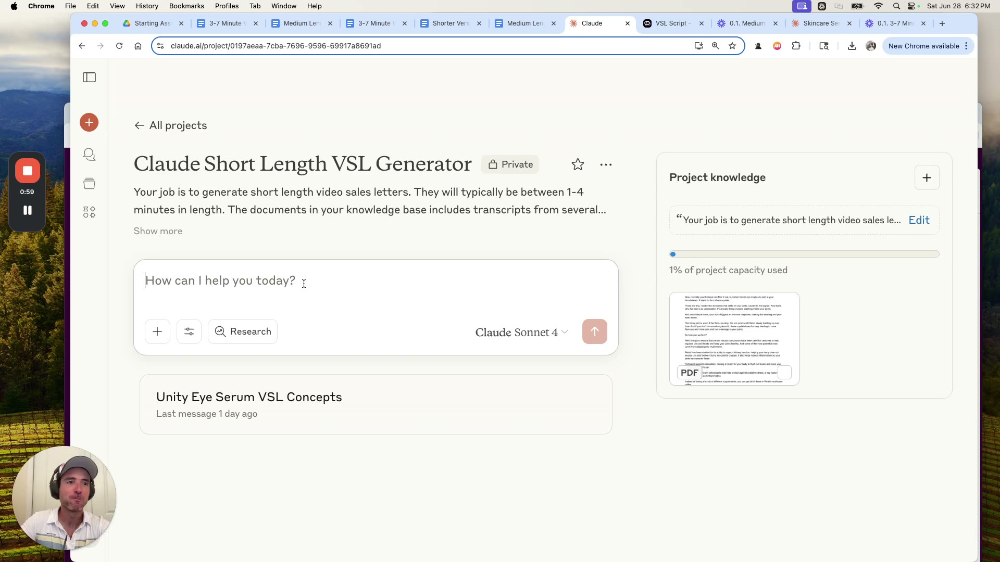
*"Claude Short Length VSL Generator" project: a one-paragraph instruction (1-4 minute VSLs) and a single PDF of example transcripts in project knowledge. [v1 01:00]*

### 2. The destination decides the script [v2 00:01–01:16; v1 12:15–13:54]
- Two cases in the Airbnb run: (a) send people to a longer presentation; (b) send them "right to a book a call." For (b), "you could always just take one of the VSL options you did already" and ask for "a two minute version of this ... with the CTA to call/book a call." [v2 00:01–00:31]
- Eye-serum run shows three CTA states for the same ad: shop now with price/discount; click the ad and "save up to 57%" with no prices shown; watch a presentation by "Dr. Schilling" with the product not mentioned and "a breakthrough" teased. [v1 12:15–13:54; screen v1 13:00–14:00]
- Blood sugar and financial runs both end by sending the viewer to "watch the full presentation". [v3 00:00; v4 05:52]

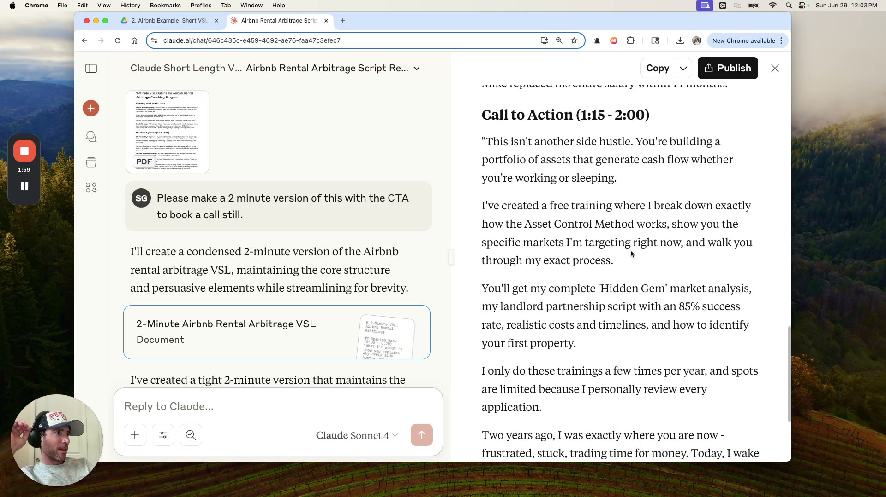
*Prompt "Please make a 2 minute version of this with the CTA to book a call still", with the 2-minute Airbnb VSL beside it. [v2 02:00]*

### 3. Hook-first generation, then one lever at a time [v1 10:49–14:45; v2 02:25–05:47]
- Order he demonstrates: (1) get 10 concepts; (2) pick one; (3) read it, fix the hook; (4) swap in a hook from a list; (5) re-run the same body with a different CTA or a "tease, don't sell the product" brief. [v1 01:12–14:45]
- "All I want you to see is how you can take that same ad and a bunch of versions of it that you could also be testing." [v1 13:54]
- He ties this to the hook-generation training: "That's why the hooks is so important... that's really how you can generate endless ads." [v1 14:45]
- Related rule from the Evolve course: change one thing at a time. See [iteration vs variation](../../../../concepts/iteration-vs-variation.md). (derived)

### 4. Hook source differs by offer type [v4 00:00–01:47]
- The blood sugar hook came from an educational "don't do X until you see this" pattern: "Stop drinking coffee until you see what it's really doing to your blood sugar" then "Coffee actually spikes cortisol... but there's a Himalayan spice hack that fixes it. Go here." [v4 01:23]
- For the financial newsletter he deliberately moved away from generic "investment mistake" hooks because "when you have a really strong, big idea about, like, a genetic royalty type of thing... we probably want more congruency." He says "I don't normally do it this way, but I did here." [v4 00:50–01:23]
- Hook-generation prompt differences for the financial run: it asks for hooks across social-media sentiment and attaches the script, but says "your job is NOT to only come up with hooks from the script" (verbatim prompt below). [v4 00:31–00:50; screen v4 01:00]

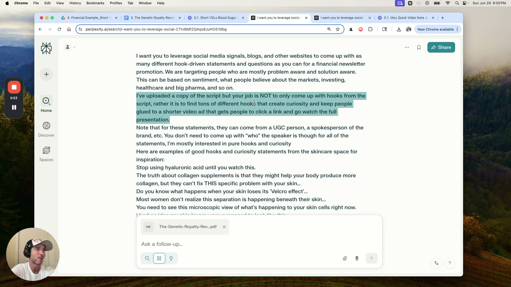
*Perplexity hook prompt for the financial newsletter, with skincare hooks as style examples. [v4 01:00]*

### 5. Iterate with plain-language feedback; do not accept the first batch [v4 02:11–05:14]
- First Perplexity batch: "The FDA policy that strangled medical innovation for decades just got reversed. That's interesting. This is good." Another: "This former big pharma insider walked away from his seven-figure salary to expose this" → "probably not compliant". [v4 02:11–02:36]
- Critique: too Big-Pharma/disease-focused; "I think we want them to be more focused on the investment opportunity as well." Follow-up prompt below. [v4 02:51–03:39]
- Result: "these seem okay, but I honestly don't like them that much... I'd rather just see what Claude comes up with first." [v4 05:14] He then asked Claude directly for 10 two-minute concepts and found "some good ones" ("The FDA just made an announcement that could destroy Big Pharma's business model... pretty good", "Forget buying individual biotech stocks. There's a much smarter way to profit from gene therapy"). [v4 06:26–07:32]
- Lesson: hook tools are interchangeable inputs. If Perplexity's batch is flat, generate hooks inside the project that holds the winning examples.

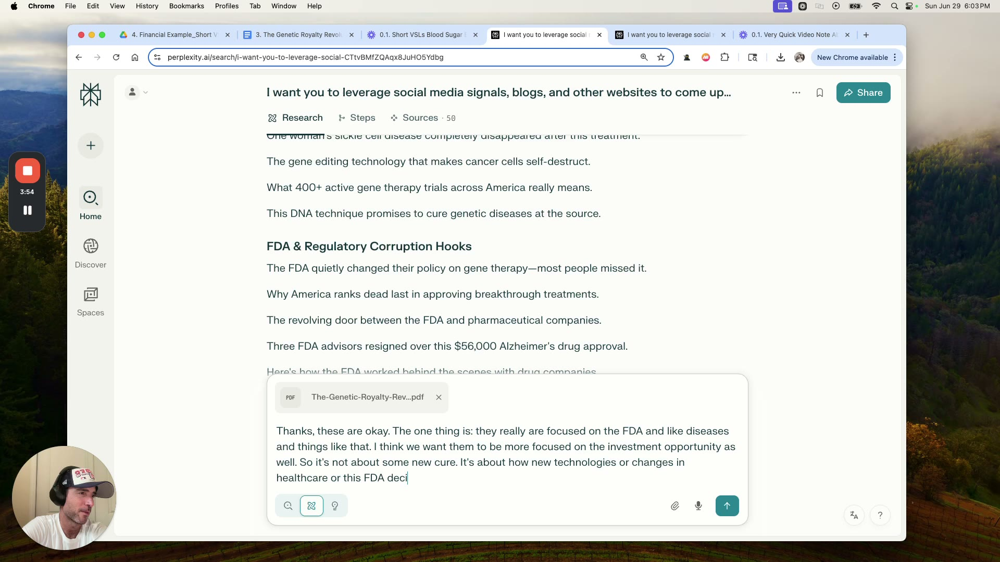
*Correction prompt: refocus hooks on the investment opportunity, not the FDA or diseases. [v4 04:00]*

### 6. "Tease, don't explain" writing for a short script [v4 08:45–15:04]
- Instruction that fixed the first draft: "Let's make it more teasing. Opportunity, teasing genetic royalties, FDA decision, et cetera. Let's not [reveal] so much. So just teasing what happened, the FDA and the opportunity, the consequences." (audio, partly garbled). [v4 08:45–09:47]
- His reaction: "I like that a lot more already, right? The genetic royalties hook is just so good. Might as well use it." [v4 09:47]
- Pattern in the four financial scripts: one hook, then 4-5 labelled "TEASE ..." beats (the decision, the opportunity, the consequence, the timeline), then an urgent CTA to a presentation. Concept 3 adds the information-gap bridge "Now, I can't reveal all the details in this short video...". Section labels are in the document "3. Short VSLs_Financial Newsletter Example".
- He generated a new hook while watching a script read-out, "Don't buy Big Pharma stocks until you see this" [v4 11:16], asked for a version, and called the result "way better" [v4 12:19].
- Line-level edit he would make: replace a specific time claim with a vaguer one: "the three weeks I'd probably do like 'recent' versus 'three weeks'" [v4 14:09] (avoids a checkable false specific). (derived rationale)

### 7. Awareness and length as prompt parameters [v2 05:47; v4 00:00–00:31]
- Financial: "mostly problem aware and solution aware... We didn't do research on this, but ultimately, yeah, they're problem aware about their investment stuff. They're solution aware. They know newsletters." [v4 00:00–00:31]
- Airbnb: 2-minute VSLs "going mostly to problem aware people". [v2 05:47]
- See [2.1 Product-market awareness](02-01-product-market-awareness.md) and Evolve's [market awareness](../../../evolve/copywriting/concepts/market-awareness.md).

### 8. Mechanism swap in the same ad [v1 06:46–08:54]
- He attached a brief with a new mechanism and asked for "another of this ad that keeps everything else the same, but the change mentioned above, and it also... modified for the UMP/UMS in the brief." [v1 06:46–07:21]
- Variant 1 mechanism: the skin-layer junction ("dermal-epidermal junction", "DEJ") separates, so blood vessels show through. Variant 2: collagen as "high-quality fabric with a perfectly tight organized weave" that becomes "loose, tangled" ("collagen architectural breakdown"). [v1 04:48; 08:18]
- Caveat he notes on variant 2: "it doesn't really explain why makeup artists can know, but it kind of works in this new mechanism." [v1 08:09–08:18] A hook that promises a specific explanation must be paid off by the mechanism.
- Mechanism background: [3.1 Unique mechanisms overview](03-01-unique-mechanisms-overview.md), [3.4 eye-serum walkthrough](03-04-ideation-validation-and-expansion-walkthrough-eye-serum-exam.md); Evolve's [unique mechanism](../../../evolve/copywriting/concepts/unique-mechanism.md).

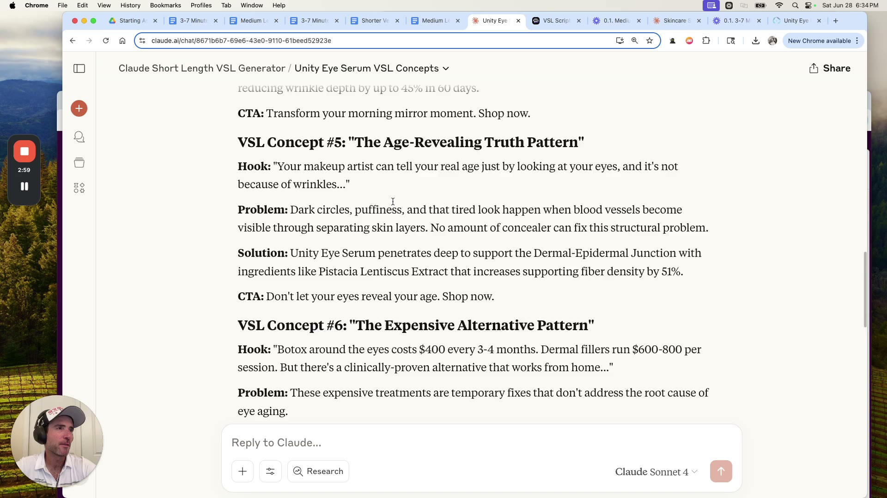
*Ten concept outlines (hook, problem, solution, CTA) for the eye serum, each ending "Shop now." [v1 03:00]*

## Steps / framework

### The short-VSL variation loop (as demonstrated in all four runs)
| # | Step | What he does | Evidence |
|---|---|---|---|
| 1 | Set the destination and length | "1 minute, 30 second video... CTA... watch the full presentation"; "2 minutes... CTA to book a call"; "shop now" | [v3 00:00]; [v2 03:13]; [v1 01:12] |
| 2 | Load inputs | Brief PDF (or an existing VSL script) uploaded into the short-VSL project; product page URL for the eye serum | [v1 10:00]; [v2 03:13]; screen v1 02:00 |
| 3 | Set awareness | "mostly problem aware and solution aware" / "mostly to problem aware people" | [v4 00:00]; [v2 05:47] |
| 4 | Get a hook | Paste a chosen hook, or ask for 10 concepts and pick one; hook lists come from Perplexity deep research (blood sugar, financial) or the hooks training | [v1 01:12]; [v4 00:31]; doc "1. Blood Sugar Supplement Hooks" |
| 5 | Outline before writing (optional) | Blood sugar: outline with time stamps, edit it, then "write the ad". Eye serum: ask for the full script of concept #5 | [v3 00:41–04:06]; screen v1 04:00 |
| 6 | Edit lines in plain language | Rename the ritual, add a line, change "your makeup artist" to "here's why makeup artists" | [v3 01:19–02:22]; [v1 04:17] |
| 7 | Generate variants | New hook with "the rest of the ad ... can basically stay the same"; new CTA; product-free tease; new mechanism | [v3 05:43]; [v1 12:15–13:54]; [v1 06:46] |
| 8 | Save everything | "I'll put all these in a folder, all these scripts, conversations" (the course supplies share links and docs) | [v1 14:45]; doc "04-1 Claude Conversations and Prompts" |

### Timed outlines Claude produced (use as skeletons; the numbers are Claude's, not tested)
**A. 90-second blood-sugar educational ad, CTA to the full presentation** (docs "4. Claude Conversation History", "3. Short VSL Examples_Blood Sugar")
1. Hook (0-8 s): "Stop drinking coffee until you see what it's really doing to your blood sugar..."
2. Problem agitation (8-25 s): morning coffee "quietly sabotaging your glucose levels"; cortisol makes the liver dump glucose.
3. Credibility/authority (25-35 s): "Dr. [Expert Name], a board-certified endocrinologist who's treated over 10,000 diabetic patients in my 18-year career" (placeholder persona from the brief).
4. Revelation/education (35-55 s): "cellular glucose doors" (GLUT4 transporters) made "rusty and stuck" by inflammation.
5. Solution tease (55-75 s): "ancient Himalayan rice ritual" repairing the doors "in just 30 seconds a day"; "a specific golden spice... I'm not talking about turmeric here."
6. Promise/benefit (75-85 s): blood sugar can "normalize naturally".
7. CTA (85-90 s): "free presentation... before it's taken down."

**B. 2-minute Airbnb book-a-call cut from the 9-minute VSL** (doc "5. Claude Short VSLs_Airbnb Arbitrage Example_9 Min to 2 Min Version")
1. Opening hook (0:00-0:20): "explains why every side hustle you've tried has failed" + "Asset Gap problem" vs "Income Gap solutions" + persona name and a headline result.
2. Problem agitation (0:20-0:45).
3. Solution introduction (0:45-1:15): "Asset Control Method" + three proof sentences.
4. CTA (1:15-2:00): free training, what is in it, limited spots, return to the persona's "two years ago I was exactly where you are now", click to register.

**C. 2-minute financial-newsletter ads, CTA to a presentation or report** (doc "3. Short VSLs_Financial Newsletter Example")
- "Why Billionaires Are Panicking" (revised): hook 0:00-0:15 → tease the FDA decision 0:15-0:40 → tease the opportunity 0:40-1:10 → billionaire-disadvantage tease 1:10-1:30 → consequences 1:30-1:45 → urgency + CTA 1:45-2:00.
- "Don't Buy Any Big Pharma Stocks Until You See This": hook → threat → FDA catalyst → opportunity flip → timeline → CTA.
- Newscaster voice-over: hook → disruption → catalyst → consequences → urgency → CTA.
- "The Biggest Wealth Transfer in Medical History": hook → transfer → mechanism ("toll booth on the highway to medical innovation") → timeline → opportunity size → urgency CTA.

**D. Eye-serum concept #5 (about 3:45)** as shown on screen: Hook & Problem Introduction (0-30 s) → Hidden Problem Revelation (30 s-1:00) → The Domino Effect (1:00-1:30) → solution and ingredient credibility → Social Proof & Results (2:15-2:45) → The Transformation Promise (2:45-3:15) → Call to Action & Urgency (3:15-3:45). The names of the 1:30-2:15 sections are not visible on screen. [screen v1 04:00–07:00]

**E. Airbnb five scripts "From Brief"** (doc "6. Claude Short VSLs_Airbnb Arbitrage Example_From Brief_"): hook line → short story of one named person → the "Asset Control Method" in one paragraph → three numbers (cost to start, time to first income, monthly income) → honest-caveat line ("I'm not saying this is easy") → free strategy session CTA → one-line sign-off ("Book your call now."). The structure repeats in all five; the hook and the story frame are the only changes. (derived summary)

## Examples

### Eye serum: one script, many versions [v1 03:29–14:45]
- Concept #5 hook as generated: "Your makeup artist can tell your real age just by looking at your eyes, and it's not because of wrinkles." Edited to "Here's why makeup artists can tell your real age just by looking at your eyes, and it's not because of wrinkles." [v1 03:29–04:17]
- Body mechanism (DEJ): skin layers separate at the dermal-epidermal junction, blood vessels show through ("Hello, dark circles"), fluid collects ("Welcome to puffy eye bags"), structure collapses ("Now you've got crow's feet and wrinkles"). He notes that the current website talks about the DEJ. [v1 03:29–05:16]
- CTA as generated: free shipping, "180-day money-back guarantee", "up to 62% off your first order, but only for a limited time". [v1 06:20–06:46] A re-run said "up to 57%" (screen v1 08:00). Offer terms must come from the brief or the live offer page, not the model.
- Second hook he prefers over the first batch's "generic" hooks: "The number one mistake women make with anti-aging creams isn't the amount - it's not understanding what's really happening to your skin. That $200 eye cream? It's targeting the wrong problem entirely." (screen: "Concept 2: The Expensive Cream Mistake"). He says it is similar to "that department store mistake". [v1 10:49; screen v1 12:00]
- Variants asked for: V2 CTA "click the ad and save up to 57% but we don't reveal the prices"; "one that sells like the solution"; V3 CTA "go watch the presentation that Dr. Schilling has put together", with no product mention and a teased breakthrough. [v1 12:15–13:54; screen v1 13:00–14:00]
- The closing read-out of the V3 outline is too garbled in both transcripts to quote. The two sources agree on: testimonials/results tease, "special presentation reveals what's going on", why expensive creams fail, a hidden cause, a breakthrough approach, proof, access limited in time. [v1 13:54–14:45] (approximate)

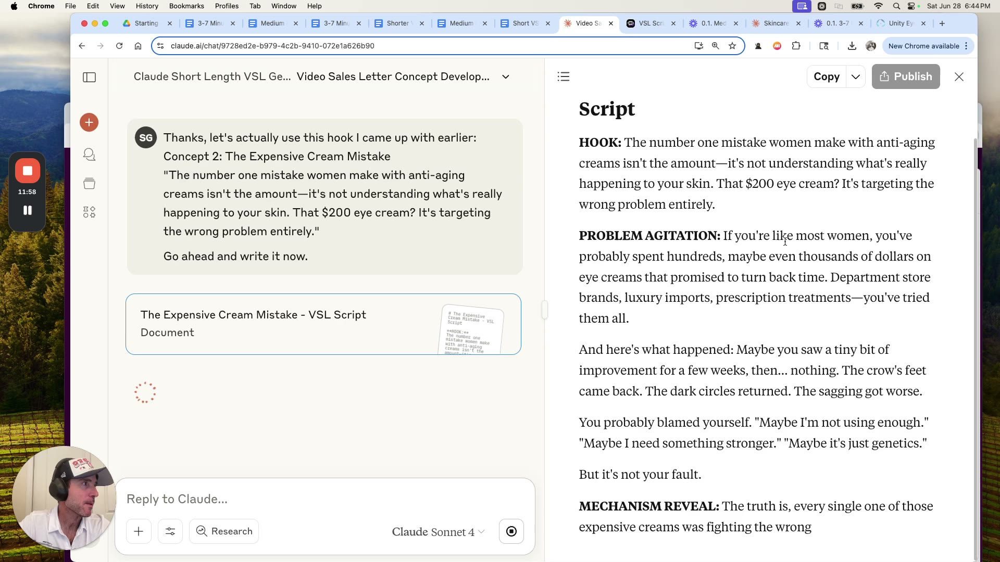
*Prompt pasting the "number one mistake women make with anti-aging creams" hook and the script it produced (hook, problem agitation, mechanism reveal). [v1 12:00]*

### Airbnb: five hooks, five 2-minute scripts [v2 03:13–10:28]
- Hooks selected from the 12-category hook document (see Structured units): "Most people work 40 years to afford retirement - but this strategy works in 40 weeks."; "Most people think real estate investing requires six figures - this couple started with $3,000."; "I realized something was wrong when I asked permission to take my own birthday off."; "Stop chasing shiny objects and start building real assets."; "What if your rent payment could be generating income for YOU instead?" [v2 04:21–05:47; doc "6. ..._From Brief_"]
- His only edit shown: on the rent hook, "income for you instead of lining someone else's pocket... more emotionally charged." [v2 09:36–10:25; captions]
- Why he does not read all five aloud: "For long form, it's important, because you gotta see how I edit and change it. But, like, even that's pretty brief on the long form." [v2 08:51; captions]
- He did not do a 3-7 minute Airbnb version: "it's really just dealer's choice", and he refers to a later training on picking the funnel flow, "and there's a whole little matrix". [v2 10:28–10:45; captions]

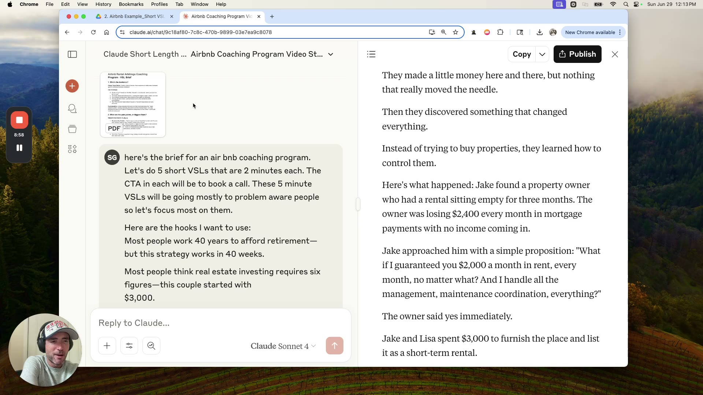
*The Airbnb brief PDF attached, instruction, awareness note and the five chosen hooks. [v2 09:00]*

### Blood sugar: hook A → hook B [v3 00:41–06:17]
- Script A (coffee hook) and script B (sleep apnea hook) share everything after the hook. Script B swaps only the problem-agitation paragraph: "sleep apnea creates a vicious cycle... cortisol, which floods your system with glucose all night long", then "Even if you get your sleep apnea treated with a CPAP machine, your blood sugar can still remain stubborn because the real problem... is how chronic sleep apnea damages... your 'cellular glucose doors.'" [doc "3. Short VSL Examples_Blood Sugar"; v3 05:43–06:17]
- Hooks came from the Perplexity deep-research hooks document; "Why your sleep apnea is making diabetes impossible to control" is in its "Sleep & Stress Connections" section. [screen v3 05:00; doc "1. Blood Sugar Supplement Hooks"]
- He edits the first outline in two places: "ancient Himalayan rice preparation ritual" → "ancient Himalayan rice ritual", and adds "I'm not talking about turmeric here. As a big natural health guy, this golden spice is something I never would have expected." [v3 01:19–02:22; doc "4. Claude Conversation History"]
- Transcript fix: Whisper writes "race" for "rice" and "stores" for "doors"; the document and screen say "rice ritual" and "cellular glucose doors".

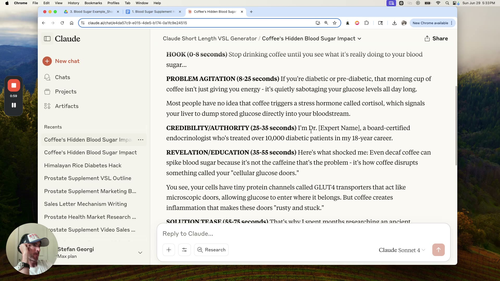
*Claude's 90-second outline: hook 0-8 s, problem agitation 8-25 s, credibility/authority 25-35 s, revelation/education 35-55 s, solution tease 55-75 s. [v3 01:00]*

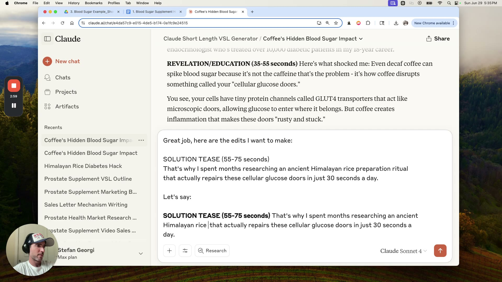
*"Great job, here are the edits I want to make:" followed by old line, "Let's say:", new line. [v3 03:00]*

### Financial newsletter: fixing a flat hook set [v4 00:00–16:17]
- The brief and script are for "The Genetic Royalty Revolution" (50-75 year-old retirees, distrust of Big Pharma/FDA; mechanism nickname "Genetic Royalties": own platform-patent companies that collect royalties on every cure). [doc "1. The Genetic Royalty Revolution - Complete Brief", sections 1, 6, 7]
- "The genetic royalties hook is just so good. Might as well use it." became the spine of the first rewritten script (concept 3 "revised"). [v4 09:47]
- Last version, "biggest wealth transfer in medical history": "I'm not going to read the whole thing. You can see the rest of it." [v4 15:48]
- Closing: this finishes the VSL section; a "tying it all together" video will cover "everything up to here", then advertorials, product pages, ads. [v4 16:17–16:54]

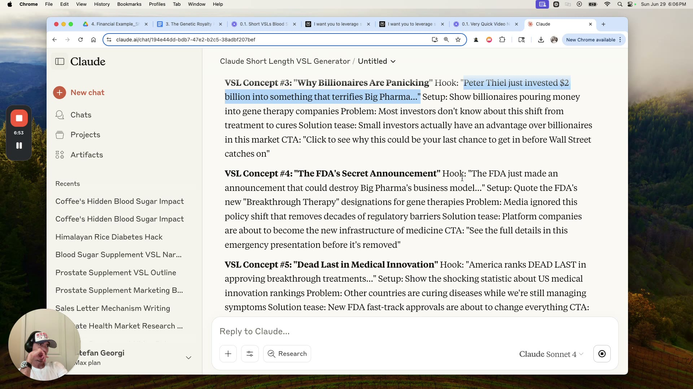
*Concepts 3-5 from the 10-concept list; concept 3's hook is highlighted for use. [v4 07:00]*

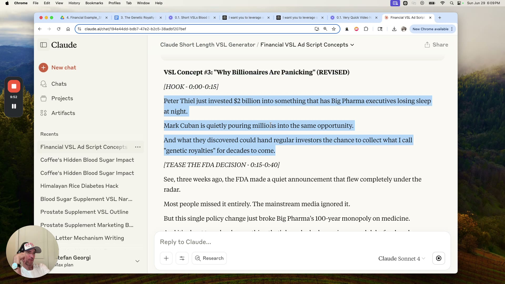
*"Why Billionaires Are Panicking (REVISED)" with the three-line hook highlighted. [v4 10:00]*

## Structured units

### Hooks
| Hook (verbatim or near) | Heuristic(s) | Emotion / zone | Self targeted | Why it works | Source |
|---|---|---|---|---|---|
| "Stop drinking coffee until you see what it's really doing to your blood sugar..." | "Stop X until you see this"; curiosity gap; everyday habit made threatening (derived) | Fear, curiosity | People managing blood sugar | Names a daily habit and withholds the effect; used as the educational frame | [v3 00:41]; blood sugar hooks doc |
| "Why your sleep apnea is making diabetes impossible to control." | Hidden cause; double-condition callout (derived) | Frustration | Diabetics with sleep apnea | Narrow callout; the same body works after it | [v3 05:43] |
| "Here's why makeup artists can tell your real age just by looking at your eyes, and it's not because of wrinkles." | Insider authority; belief challenge (derived) | Curiosity, self-consciousness | Women worried about eye aging | Instructor changed "your makeup artist" to "makeup artists" for relevance | [v1 04:17] |
| "The number one mistake women make with anti-aging creams isn't the amount - it's not understanding what's really happening to your skin. That $200 eye cream? It's targeting the wrong problem entirely." | "Number one mistake"; wasted-money callout (derived) | Frustration, regret | Women who buy eye creams | Named mistake, specific price, blame removed from the viewer | screen v1 12:00; [v1 10:49] |
| "Most people work 40 years to afford retirement - but this strategy works in 40 weeks." | Contrast of time spans (derived) | Frustration, hope | Salaried workers wanting freedom | Numeric contrast plus "this strategy" | [v2 04:21]; Airbnb hooks doc |
| "Most people think real estate investing requires six figures - this couple started with $3,000." | Belief challenge with a proof person (derived) | Hope | People priced out | Specific low number | Airbnb hooks doc; [v2 04:21] |
| "I realized something was wrong when I asked permission to take my own birthday off." | Personal-story micro-scene (derived) | Resentment | 9-to-5 employees | Concrete, relatable moment of lost autonomy | [v2 04:21]; Airbnb hooks doc |
| "What if your rent payment could be generating income for YOU instead [of lining someone else's pocket]?" | "What if" reframe of a monthly pain (derived) | Resentment, hope | Renters | Reframes the biggest expense as an asset | [v2 05:47; 09:36] |
| "Peter Thiel just invested $2 billion into something that has Big Pharma executives losing sleep at night." | Borrowed authority; competitor fear (derived) | Fear of missing out | Retail investors 50+ | Famous-name proof. Fabricated claim in the example: do not reuse | [v4 07:32]; financial doc, concept 3 |
| "Don't buy any Big Pharma stocks until you see this." | "Don't X until you see this" applied to an existing holding (derived) | Fear, loss aversion | Current pharma stockholders | Threat to an owned asset; instructor made it up while watching | [v4 11:16] |
| "They're called genetic royalties, and they could upend the multi-trillion dollar pharmaceutical industry before the year is over." | Named-concept curiosity; newscaster frame (derived) | Curiosity | Retail investors | Introduces the mechanism nickname in line 1 | [v4 12:52]; financial doc |
| "This could be the biggest wealth transfer in medical history. And it's happening right under Wall Street's nose." | Big claim + insider/outsider (derived) | Envy, urgency | Retail investors | Outsized frame; the last example in the lesson | [v4 15:04] |

Hook libraries supplied: the Airbnb hooks doc (12 categories, e.g. Financial Frustration, System Escape, Real Estate Barrier, Side Hustle Failure, Trust & Authenticity, Market Saturation, Legal & Ethical, Urgency, Social Proof, Transformation) and the blood-sugar hooks doc (14 categories, e.g. Hidden Triggers, Dawn Phenomenon, Medication Myths, Testing Misconceptions, Sleep & Stress, Gut Health, Natural Solutions, Urgent Action, Curiosity Questions). The blood-sugar doc cites a Perplexity deep-research conversation. Many statistics in these lists ("73% of diabetes cases are missed", "Pfizer walked away...", "69% of millennials...") are unsourced model output. Do not use them unverified.

### Templates
| Template | Use for | Example fill | Source |
|---|---|---|---|
| "Stop [habit/action] until you see what it's really doing to your [outcome]..." | Educational curiosity hook | "Stop drinking coffee until you see what it's really doing to your blood sugar..." | [v3 00:41] |
| "Here's why [specific insiders] can [know/see surprising thing], and it's not because of [obvious guess]." | Reframe hook for a hidden-cause mechanism | "Here's why makeup artists can tell your real age..., and it's not because of wrinkles." | [v1 04:17] |
| "The number one mistake [audience] make with [category] isn't [obvious variable] - it's [real cause]. That [specific purchase]? It's targeting the wrong problem entirely." | Wasted-money / mistake hook | Expensive Cream Mistake | screen v1 12:00 |
| "Don't [buy/do X] until you see this." | Loss-aversion hook around something the viewer already owns | "Don't buy any Big Pharma stocks until you see this." | [v4 11:16] |
| "Now, I can't reveal all the details in this short video... but there are [N] [things] that could [result]." | Information-gap bridge into the full presentation | Financial concept 3, "TEASE THE OPPORTUNITY" | doc "3. Short VSLs_Financial Newsletter Example" |
| "I've just released a free presentation revealing [ritual/method] and [the exact missing detail]. Click below to watch this free presentation [before it's taken down]." | CTA to a longer presentation (use only a true deadline) | Blood sugar CTA | doc "3. Short VSL Examples_Blood Sugar" |
| "I'm hosting a free strategy session this week where I'll break down the entire system: [3 specifics]. Click the link below to book your spot." | Book-a-call CTA | Airbnb scripts | doc "6. ..._From Brief_" |

### Rewrites (before → after)
| Before | After | What changed (verb / visual / promise / self / intensity) | Source |
|---|---|---|---|
| "Your makeup artist can tell your real age just by looking at your eyes" | "Here's why makeup artists can tell your real age just by looking at your eyes" | Self (not everyone has "your" makeup artist); frames the hook as an explanation to come | [v1 04:17] |
| "...an ancient Himalayan rice preparation ritual..." | "...an ancient Himalayan rice ritual..." | Phrase tightened | [v3 01:19]; blood sugar conversation doc |
| "...a specific golden spice with their rice for centuries - and they have virtually no diabetes despite eating high-carb diets." | same + "I'm not talking about turmeric here. As a big natural health guy, this golden spice is something I never would have expected." | Added a negation and a personal-surprise line to raise curiosity | blood sugar conversation doc; [v3 02:22] |
| "What if your rent payment could be generating income for YOU instead?" | "...generating income for you instead of lining someone else's pocket." | Added a villain/contrast; "more emotionally charged" | [v2 09:36–10:25] |
| First concept 3 draft: explains Big Pharma's "keep you sick" model before the FDA news | Revised concept 3: teases the FDA decision, the opportunity and the consequences without explaining | Intensity/tease level | [v4 08:10–09:47] |
| "...the FDA made a quiet announcement three weeks ago" | "recent" instead of "three weeks" (instructor's note) | Specific time claim → vaguer claim | [v4 14:09] |

### Ad teardowns (generated scripts; instructor commentary plus derived judgement)
| Brand / product (niche) | Format | Hook / opening | What works | What fails | Fix suggested | Principle | Source |
|---|---|---|---|---|---|---|---|
| Unity Eye Serum concept #5 (skincare) | About 3:45 talking head / voice-over | "Your makeup artist can tell your real age..." | Specific visual claim; clear DEJ mechanism; "Hello, dark circles... Welcome to puffy eye bags." sequence | Instructor: the hook is not really explained by the mechanism; invented testimonials ("Elizabeth", "Carol"); "clinically proven" figures | Pay off the hook; use real reviews only | A hook must be answered by the mechanism | [v1 03:29–08:18]; screen v1 04:00–07:00 |
| Blood sugar supplement (health) | 90-s doctor ad to VSL | "Stop drinking coffee until..." | Education, then tease; one mechanism ("doors"); the "not turmeric" negation | "virtually no diabetes", "repairs", "normalize naturally", "before it's taken down" are substantiation or false-scarcity risks; fictional doctor persona | Real credentialed spokesperson, substantiated claims, no fake deadline | Curiosity + one mechanism fits 90 s | [v3 00:41–02:22]; docs 3-4 |
| Airbnb arbitrage coaching (biz-opp) | 2-min VSL to booked call | "...40 years ... 40 weeks" | Story arc, one named method, concrete cost/time/income, honest caveat line, clean CTA | Earnings figures, invented students, "85% success rate" claim | Real documented results with typical-results disclosure | Short story + method + CTA | [v2 06:37–08:12]; doc 6 |
| Genetic Royalty Revolution (financial newsletter) | 2-min ad to presentation | Billionaire/insider hooks | Teasing structure; clear nickname; timeline urgency | Named billionaire endorsements, "leaked memo", "10x, 20x", "dump immediately": securities-advice and misleading-news-format risk | Remove named investors and memos; no return promises; compliance review | Tease the opportunity, do not explain it | [v4 08:10–15:48]; doc 3 |

## Prompts / templates (verbatim)
The only course-supplied "prompts" file for this lesson ("04-1 Claude Conversations and Prompts") holds two share links; the linked chats are not in the files. The prompts below are what is visible on screen, in the supplied conversation-history documents, or spoken. Square brackets are mine.

**1. Claude project instruction (visible portion only; the full text is not in the course files)**
```text
Your job is to generate short length video sales letters. They will typically be between 1-4 minutes in length. The documents in your knowledge base includes transcripts from several...
```
(screen v1 01:00; project knowledge: one PDF of example transcripts)

**2. Ten concepts from a product page (eye serum)** (screen v1 02:00)
```text
Help me come up with 10 short VSL concepts for:
[product page URL]

Let's have all of them speak about the product and the call to action is to "shop now"
```
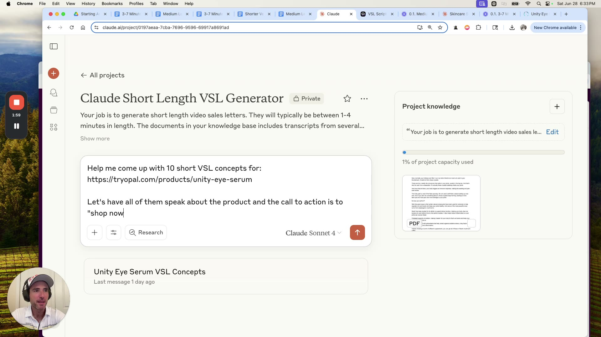
*The first prompt in the eye-serum run, typed into the project. [v1 02:00]*

**3. Concept picked, then a hook fix** (screen v1 04:00, 06:00)
```text
Great, let's do Concept #5 to start.
```
```text
Thanks, let's change the hook to be "here's why makeup artists can" vs "your makeup artist" since it's not like everyone has a makeup artist.

Also, I'm playing around with a new mechanism which is included in this brief I'm attaching. I'd like to see another version of this ad that keeps everything else the same but the change mentioned above, and it also modified for the UMP/UMS in the brief.
```
(The first paragraph is screen text. The second is cut off on screen after "I'm playing around with a"; the rest is from audio and captions [v1 06:46–07:21].)

**4. Five 2-minute concepts from a brief** (screen v1 11:00; audio [v1 10:00])
```text
here's a VSL Brief. Please give me 5 short VSL concepts that are 2 minutes maximum each. They don't have to come from Laura, and some of what is in the brief won't need to make it into these VSLs since they'll be short.
```
("Laura" is the name as shown on screen; the course files do not say who this is.)

**5. Use a hook from earlier and write it** (screen v1 12:00)
```text
Thanks, let's actually use this hook I came up with earlier.
Concept 2: The Expensive Cream Mistake
"The number one mistake women make with anti-aging creams isn't the amount - it's not understanding what's really happening to your skin. That $200 eye cream? It's targeting the wrong problem entirely."

Go ahead and write it now.
```

**6. CTA variants** (screen v1 13:00–14:00)
```text
Okay thanks, let's do another version where the CTA is to click the ad and save up to 57% but we don't reveal the prices.
```
```text
Thanks, and one more version, for this one, let's have the CTA be to go watch the presentation that Dr. Schilling has put together that explains everything. For this one let's not talk about the product specifically, let's instead tease a breakthrough.
```

**7. Existing VSL to a 2-minute book-a-call cut (Airbnb)** (screen v2 02:00; audio [v2 00:31])
```text
Please make a 2 minute version of this with the CTA to book a call still.
```

**8. Five short VSLs from a brief plus chosen hooks (Airbnb)** (screen v2 04:00, 09:00; audio [v2 03:13])
```text
here's the brief for an air bnb coaching program. Let's do 5 short VSLs that are 2 minutes each. The CTA in each will be to book a call. These 5 minute [sic] VSLs will be going mostly to problem aware people so let's focus most on them.

Here are the hooks I want to use:
Most people work 40 years to afford retirement - but this strategy works in 40 weeks.
Most people think real estate investing requires six figures - this couple started with $3,000.
I realized something was wrong when I asked permission to take my own birthday off.
Stop chasing shiny objects and start building real assets.
What if your rent payment could be generating income for YOU instead?
```

**9. Hook edit instruction (Airbnb)** (screen v2 10:00; captions [v2 09:47–10:17])
```text
I like this hook but let's do it like this:
What if your rent payment could be generating income for you instead of lining someone else's pocket.
```

**10. 90-second video ad outline to a longer VSL (blood sugar), verbatim from the supplied history** (doc "4. Claude Conversation History")
```text
Here's a brief for a blood sugar supplement offer. Please come up with an outline for a 1 minute and 30 video ad. It will go to the longer VSL, so the CTA of this video ad will be to get people to go watch the full presentation. Let's also make the ad fairly educational while still having lots of curiosity and some promises. Let's use the following as the opening hook: Stop drinking coffee until you see what it's really doing to your blood sugar...
```

**11. Edit format used on the outline, then "write it" (blood sugar)** (same doc)
```text
Great job, here are the edits I want to make:

SOLUTION TEASE (55-75 seconds)
That's why I spent months researching an ancient Himalayan rice preparation ritual that actually repairs these cellular glucose doors in just 30 seconds a day.

Let's say:

SOLUTION TEASE (55-75 seconds) That's why I spent months researching an ancient Himalayan rice ritual that actually repairs these cellular glucose doors in just 30 seconds a day.

And instead of:
[old paragraph]

Let's say:
[new paragraph]
```
```text
Cool go ahead and write the ad please
```

**12. New hook, same body (blood sugar)** (same doc)
```text
Okay great, let's do another version of this ad with a new hook. The hook will be: Why your sleep apnea is making diabetes impossible to control. The rest of the ad from this point on can basically stay the same:
[paste of the rest of the outline]
```

**13. Perplexity deep-research hook prompt (financial newsletter)** (screen v4 01:00; the visible text ends where the screen cuts off)
```text
I want you to leverage social media signals, blogs, and other websites to come up with as many different hook-driven statements and questions as you can for a financial newsletter promotion. We are targeting people who are mostly problem aware and solution aware. This can be based on sentiment, what people believe about the markets, investing, healthcare and big pharma, and so on.
I've uploaded a copy of the script but your job is NOT to only come up with hooks from the script, rather it is to find tons of different hooks that create curiosity and keep people glued to a shorter video ad that gets people to click a link and go watch the full presentation.
Note that for these statements, they can come from a UGC person, a spokesperson of the brand, etc. You don't need to come up with "who" the speaker is though for all of the statements, I'm mostly interested in pure hooks and curiosity
Here are examples of good hooks and curiosity statements from the skincare space for inspiration:
Stop using hyaluronic acid until you watch this.
The truth about collagen supplements is that they might help your body produce more collagen, but they can't fix THIS specific problem with your skin...
Do you know what happens when your skin loses its 'Velcro effect'...
Most women don't realize this separation is happening beneath their skin...
You need to see this microscopic view of what's happening to your skin cells right now.
[the list may continue off-screen]
```

**14. Perplexity refocus** (screen v4 04:00; ending from audio [v4 03:39])
```text
Thanks, these are okay. The one thing is: they really are focused on the FDA and like diseases and things like that. I think we want them to be more focused on the investment opportunity as well. So it's not about some new cure. It's about how new technologies or changes in healthcare or this FDA decision [or whatever else] are creating a once-in-a-generation opportunity.
```

**15. Ten short concepts from a script (financial)** (screen v4 06:00; audio [v4 05:35–06:26])
```text
here's a script for a financial VSL. Right now I want to write a series of 2 minute long VSL ads that sell the click [so that someone watches, is hooked, and the call to action is to go watch the full presentation.] Please give me 10 short two-minute VSL concepts right now.
```
(Bracketed words are from audio; Whisper and captions differ slightly.)

**16. Pick, tighten, vary (financial)** (screen v4 08:00, 13:00; audio)
```text
Let's start with Concept #3 please.
```
```text
Let's make it more teasing. [Tease] the opportunity, genetic royalties, the FDA decision, etc. Let's not [give away] so much. So just teasing what happened, the FDA and the opportunity, the consequences.
```
(Second prompt is reconstructed from audio [v4 08:45–09:24]; the exact words are not clear.)
```text
Cool. Let's do one with a newscaster voice over
```
```text
Now let's write another one with a hook about: Don't buy any Big Pharma stocks until you see this.
```
(Last prompt is from audio [v4 11:01–11:16]; the exact wording is uncertain.)

## Screenshots
Thirteen kept frames are embedded in the sections above: Claude short-VSL project (v1 01:00), ten-concepts prompt (v1 02:00), eye-serum concept list (v1 03:00), expensive-cream hook swap (v1 12:00), Airbnb 2-minute cut (v2 02:00), Airbnb prompt with five hooks (v2 09:00), blood-sugar outline (v3 01:00) and edit prompt (v3 03:00), the hooks document below, financial Perplexity prompt (v4 01:00), refocus prompt (v4 04:00), ten concepts (v4 07:00) and revised concept 3 (v4 10:00).

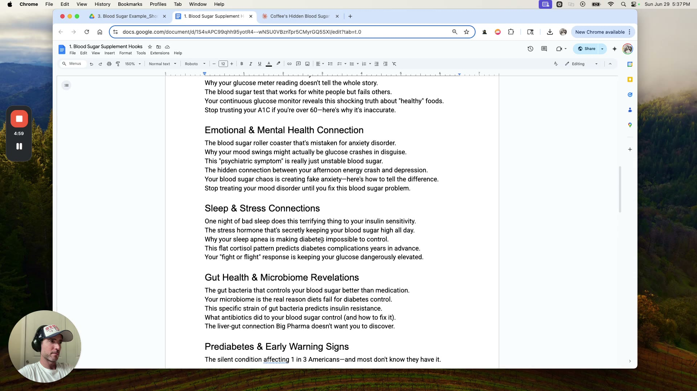
*The hooks document ("1. Blood Sugar Supplement Hooks"): themed groups such as "Emotional & Mental Health Connection" and "Sleep & Stress Connections"; the sleep-apnea hook is from this list. [v3 05:00]*

## How to apply
- [ ] Decide destination and CTA per ad before drafting: shop now, click-to-save, watch the presentation, or book a call.
- [ ] Put the awareness level and the maximum length in the prompt, and say which brief parts may be dropped.
- [ ] Generate hooks from real language (reviews, comments, forums) and, if used, deep research; discard "generic" ones. Hook method: [4.10](04-10-using-ai-to-generate-endless-good-hooks.md).
- [ ] Run one concept; edit in plain language ("change X to Y", "refocus on Z").
- [ ] Produce variants that change one lever each (hook, CTA, product-vs-tease, mechanism) and name them so tests are readable (derived; see [creative testing system](../../../../frameworks/creative-testing-system.md)).
- [ ] Check that the mechanism answers the promise made in the hook.
- [ ] Strip every number, person, quote and deadline that is not in your verified inputs; mark placeholders [like this].
- [ ] For health, finance and income offers, run a compliance review before launch.
- [ ] Save prompts, outputs and edit instructions together.

### Compliance flags for the example outputs (derived)
| Example claim in the files | Risk | What to do |
|---|---|---|
| "repairs these cellular glucose doors in 30 seconds", "virtually no diabetes", "reduce dependence on medications" (blood sugar) | Disease/treatment claims need substantiation; Meta health-ad rules | Copy the "educational tease + single mechanism" structure only |
| "Before it's taken down" (blood sugar CTA) | False urgency | Use only true deadlines |
| Peter Thiel / Mark Cuban invested; "leaked memo"; "former Big Pharma insider"; "10x, 20x"; "1,000% or more"; "dump immediately" (financial) | Fabricated endorsements and sources; return promises; securities-advice tone; misleading "news" format | Do not reuse; have counsel review any financial promo |
| Invented students and numbers ($3,200/month, quit job, "85% success rate") (Airbnb) | Earnings claims need substantiation and disclaimers; fake testimonials | Use real, documented results with a typical-results disclosure |
| "clinically proven", invented testimonials "Elizabeth", "Carol" (eye serum draft) | Unsupported proof | Use only proof supplied in the brief |

## Related
- Module neighbours: [7.3 3-7 Minute VSL](07-03-3-7-minute-vsl.md) (written in parallel; may not exist yet) · earlier VSL theory: [4.9 Short VSLs](04-09-short-vsls-structures-and-examples.md), [4.8 Medium VSLs](04-08-medium-vsls-structures-and-examples.md), [4.7 Long-form financial VSLs](04-07-long-form-financial-vsl-examples-and-break-downs.md), [4.11 VSLs in feed vs on landing pages](04-11-vsls-on-landing-pages-vs-vsls-as-in-feed-ads.md)
- Briefs behind the examples: [5.2 Brief generator (eye serum)](05-02-the-brief-generator-with-claude-project-unity-eye-serum-exam.md), [5.3 Airbnb arbitrage brief](05-03-airbnb-arbitrage-example.md); mechanisms: [3.3 UMP evaluation (Airbnb)](03-03-ump-evaluation-prompt-and-process-airbnb-arbitrage.md)
- Evolve: [hooks](../../../evolve/copywriting/concepts/hooks.md) · [open loops](../../../evolve/copywriting/concepts/open-loops.md) · [AI in copywriting](../../../evolve/copywriting/concepts/ai-in-copywriting.md) · [unique mechanism](../../../evolve/copywriting/concepts/unique-mechanism.md)
- Method difference: this lesson judges outputs by the instructor's taste and edits ("you're still sort of the conductor") and shows no performance data. Evolve's [How to guarantee you get better at copywriting](../../../evolve/copywriting/lessons/03-how-to-guarantee-you-get-better-at-copywriting.md) says to rank copy by results, not taste. Treat the picks here as hypotheses to test.

## Sources and limitations
- Transcripts (machine, Whisper large-v3-turbo; platform captions used to check wording): [video 1, eye serum](<../../../../../raw/stefan-georgi/rmbc-ii/_transcripts/Stefan Georgi - RMBC II (1)/07-62 VSL SECTION II- VSL Creation Examples/04-[4] Short VSL.txt>) · [video 2, Airbnb](<../../../../../raw/stefan-georgi/rmbc-ii/_transcripts/Stefan Georgi - RMBC II (1)/07-62 VSL SECTION II- VSL Creation Examples/04-[4] Short VSL video2.txt>) · [video 3, blood sugar](<../../../../../raw/stefan-georgi/rmbc-ii/_transcripts/Stefan Georgi - RMBC II (1)/07-62 VSL SECTION II- VSL Creation Examples/04-[4] Short VSL video3.txt>) · [video 4, financial](<../../../../../raw/stefan-georgi/rmbc-ii/_transcripts/Stefan Georgi - RMBC II (1)/07-62 VSL SECTION II- VSL Creation Examples/04-[4] Short VSL video4.txt>)
- Documents: [04-1 Claude Conversations and Prompts](<../../../../../raw/stefan-georgi/rmbc-ii/_extracted/Stefan Georgi - RMBC II (1)/07-62 VSL SECTION II- VSL Creation Examples/04-1 Claude Conversations and Prompts.docx.md>) (two share links only). Zip examples under `_extracted/_unzipped/07-62 VSL SECTION II- VSL Creation Examples/04-2..04-4`: Airbnb (hooks, brief, long book-a-call VSL, 9-minute VSL, two Claude short-VSL docs), blood sugar (hooks, brief with big idea, short scripts, Claude history), financial (complete brief, full VSL script, four short scripts, conversation link).
- Video lengths: 15:06 + 11:09 + 6:47 + 17:01 = 50:03. `video3._converted` is a re-encode of `video3` and was skipped. Video order: main file = eye serum, video2 = Airbnb, video3 = blood sugar, video4 = financial (matching the numbered caption files 04-1 to 04-4).
- Transcription errors fixed: "rice" (Whisper: "race"), "cellular glucose doors" (Whisper: "stores"), "Dermal-Epidermal Junction", "Unity Eye Serum". "Dr. Schilling" and "Laura" come from captions and screen text; their roles are not explained in this lesson. The spoken "Peter Thiel invested $2 million/billion" is "$2 billion" in the document.
- Garbled passages (not quoted): [v1 13:54–14:45] outline read-out; [v2 06:37–07:42] interrupted by a doorbell; [v4 08:45–09:24] exact teasing instruction. Bracketed words in prompts are reconstructions.
- Frames were grabbed from MEGA at chosen timestamps (nearest keyframe, so times are approximate); talking-head frames were skipped.
- Dollar figures, student names, investor names and percentages in the scripts are model output built from brief inputs, not verified facts. Offer terms (62% vs 57% off) differ between runs.
- The five Airbnb "From Brief" scripts, the 2-minute Airbnb cut, the blood-sugar scripts and the four financial short scripts were read in full. The long Airbnb book-a-call VSL, the 9-minute Airbnb outline, the financial full VSL script and the briefs were read for structure and key sections only.
- Not in the course files: the full Claude Project instruction, the contents of the linked Claude share chats, and any performance data for these ads.
