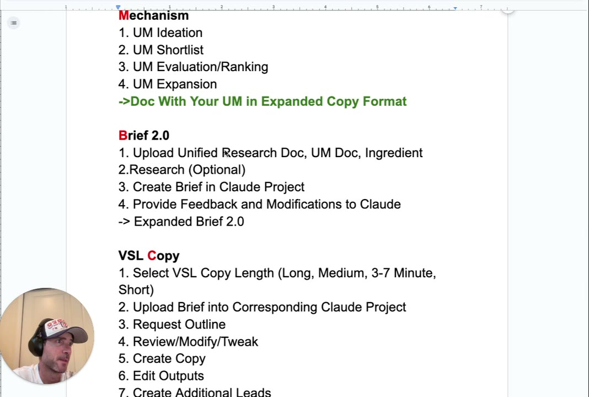

# 8.1 RMBC II Mid-Course Recap
> A 15-minute zoom-out that maps everything taught so far (research, mechanism, brief, VSL copy) onto one four-stage pipeline with a named output at each stage, stresses that the process is a feedback loop rather than a one-way pipe, and previews the remaining modules (advertorials to bonuses).

## 🤖 Agent use
- **Use when:** you need the end-to-end RMBC sequence in one place, need to know which document each stage must produce before the next stage can start, or need to route a task to the right earlier lesson.
- **Inputs → outputs:** a product/offer and the target length (long, medium, 3-7 min, short) → the ordered chain: Unified Research Document → UM document in expanded copy format → Expanded Brief 2.0 → VSL(s) in several lengths with multiple leads and hooks.
- **Rules:**
  - **DO** run stages in order and do not start a stage without the previous stage's output: research doc, then mechanism doc, then brief, then copy [05:28–06:47; recap doc "Zooming Out Even More"].
  - **DO** treat the brief as non-optional: "this is essential, essential for RMBC II... you really need to go through all of these things, at least parts of them, because this is really how we have the document we need to do everything" [03:25–03:53].
  - **DO** treat market awareness as a cross-format input, "not just for VSLs... but also all the ads, everything else we're doing" [01:00–01:31].
  - **DO** iterate with the model: "It's not just a static process. It's not just a one-way, you put stuff in, you get outputs, you're good. One of the biggest parts of it is the feedback" [07:29].
  - **DO** act as copy chief inside the project in real time and explain why: "I basically copy chief it in the Claude project in real time" [08:27].
  - **DO** put extra effort into hooks and big ideas on short formats: "a lot of it can stay the same but it's really about the hooks and big ideas" [08:57].
  - **IF** the model hits a limit or stalls **THEN** switch tools: "Claude stopped working, so I switched and used Gemini" [07:58].
  - **IF** a section of the output is weak (example: the ingredient section of the blood-sugar VSL) **THEN** say so and expand it in the same project [08:27].
  - **IF** no strong big idea or hook exists in the brief **THEN** ideate it with Claude in the project first, then bring it into the brief (blood-sugar doctor version) [07:58–08:27].
  - **DON'T** assume "VSL" means only long scripts. In RMBC II it includes "two-minute VSLs that are really just like Meta ads. The line blurs" [14:08–14:45].
  - **DON'T** read his claim that this beats most copywriters as a guarantee. It is an unproven instructor claim (see Key ideas) [09:56].
- **See also:** [1.1 Course overview](01-01-welcome-to-rmbc-ii-and-in-depth-course-overview.md) · [2.4 Unified research process](02-04-unified-research-process.md) · [3.5 Claude Project for unique mechanisms](03-05-creating-a-claude-project-for-unique-mechanisms.md) · [5.1 Old brief vs new brief](05-01-the-old-brief-vs-the-new-brief-overview.md) · [6.1 Claude VSL projects setup](06-01-claude-vsl-projects-setup-overview.md) · [7.1 Long form VSL](07-01-long-form-vsl.md) · [Evolve: market awareness levels](../../../evolve/start-here/concepts/market-awareness-levels.md)

## Key ideas

### 1. What has been covered, in course order [00:00–05:28]
Table built from the speech and the recap document ("What We've Covered So Far").

| Course block | What it contained | Lessons |
|---|---|---|
| 1. Overview of copy and how it is applied in 2025 | The A-to-B journey (prospect to customer), platform-specific copy, fundamentals of direct-response copy; "some of what I'm saying here might be repeated in that video" [00:30] | [1.1](01-01-welcome-to-rmbc-ii-and-in-depth-course-overview.md), [1.2](01-02-foundational-knowledge-and-the-state-of-dtc-marketing-in-202.md) |
| 2. Deep research (R) | Product/market awareness (changes the instructor's label from "market awareness" mid-sentence [01:00]), competitor research, psychographic research, unified research document, ingredient research when relevant | [2.1](02-01-product-market-awareness.md), [2.2](02-02-competitor-research-walkthrough-and-examples.md), [2.3](02-03-psychographic-research.md), [2.4](02-04-unified-research-process.md), [2.5](02-05-ingredient-deep-research.md) |
| 3. Unique mechanisms (M) | Overview, UM ideation with LLMs, evaluation, expansion in Claude, Claude project setup for unique mechanisms | [3.1](03-01-unique-mechanisms-overview.md), [3.2](03-02-ump-ideation-with-llms.md), [3.3](03-03-ump-evaluation-prompt-and-process-airbnb-arbitrage.md), [3.4](03-04-ideation-validation-and-expansion-walkthrough-eye-serum-exam.md), [3.5](03-05-creating-a-claude-project-for-unique-mechanisms.md) |
| VSL Copy Part I (understanding structures) | Breakdowns (long, medium, short), hooks, ADHD hook video ads, in-feed vs on-page VSLs. "Mostly passive... understanding the theory, structure" [04:27] | [4.1](04-01-vsls-section-overview.md) to [4.11](04-11-vsls-on-landing-pages-vs-vsls-as-in-feed-ads.md) |
| Brief 2.0 (B) | Old vs new brief, the brief generator (Claude project), brief generation examples | [5.1](05-01-the-old-brief-vs-the-new-brief-overview.md) to [5.5](05-05-financial-promo-example.md) |
| VSL Copy Part II (C) | Setting up Claude project "recipes" for long, medium, 3-7 minute and short VSLs; creation walkthroughs and examples for all four lengths | [6.1](06-01-claude-vsl-projects-setup-overview.md), [7.1](07-01-long-form-vsl.md) to [7.4](07-04-short-vsl.md) |

Instructor commentary:
- Part I was placed before the brief on purpose: "I thought it was important for you to understand, okay, what does VSL copy look like? What are the parts? What are the pieces?" It includes "older trainings... whatever, six months ago" plus "new stuff for short form" [02:29–02:55]. He calls this "almost like an intermezzo" [02:29].
- ADHD hook video ads sit "really in that three to seven minute VSL range, but they're kind of different" and he put them in Part I because "it was worthwhile" [02:55–03:25].
- Unique-mechanism ideation: "It really is a good prompt. I did it yesterday for something I'm doing as a side project for a [Copy Accelerator] Pro member who hired me to do a VSL. I got several really good mechanisms, including one that was instantly my favorite. I ran it through the different LLMs along with a couple other really good options, and they all picked the one that I thought was the best... great confirmation" [02:00–02:29]. (Instructor anecdote; one case. "CA Pro" is as heard in the audio and captions; the full name is not stated in the lesson.) See [3.3](03-03-ump-evaluation-prompt-and-process-airbnb-arbitrage.md).

### 2. Which example offers were run at which length (his recollection) [04:27–05:28]
- Long form: after the financial example in the brief section ("like that financial one"), "we did Unity serum. We did the blood sugar one. We did the Airbnb arbitrage one" [04:27–04:56]. ([5.2](05-02-the-brief-generator-with-claude-project-unity-eye-serum-exam.md), [5.3](05-03-airbnb-arbitrage-example.md), [5.5](05-05-financial-promo-example.md).) He also says some VSLs were created inside the brief section itself [04:27].
- Medium: "I think for medium, I did blood sugar, Unity, I think also Airbnb arbitrage." Hedged.
- 3-7 minute: "I just did two of them. I think it was blood sugar and Unity." Hedged.
- Short: "all four of them" [04:56].
- Hook generation was also shown; "I can include the conversation links" (the links are not in the course files) [05:28].
- Agent note: his counts are from memory ("I think"). Check [7.1](07-01-long-form-vsl.md) to [7.4](07-04-short-vsl.md) for the actual runs.

### 3. The pipeline and its outputs [05:28–07:29; recap doc]
Each stage ends in a named document. The on-screen version is color-coded; the recap document gives the steps verbatim (see Prompts / templates).

| Stage | Steps | Output (the thing the next stage needs) | Lessons |
|---|---|---|---|
| R: Research | 1 product/market awareness deep research; 2 competitor deep research; 3 psychographic research; 4 optional ingredient research | Unified Research Document | module 2 |
| M: Mechanism | 1 UM ideation; 2 UM shortlist; 3 UM evaluation/ranking; 4 UM expansion | "Doc with your UM in expanded copy format" | module 3 |
| B: Brief 2.0 | 1 upload unified research doc, UM doc, ingredient research (optional); 2 create brief in the Claude project; 3 give feedback and modifications | Expanded Brief 2.0 | module 5 |
| C: VSL copy | 1 select length; 2 upload brief into the matching Claude project; 3 request outline; 4 review/modify/tweak; 5 create copy; 6 edit outputs; 7 create additional leads | Finished VSL(s) of varying lengths and with multiple leads and hooks | modules 6-7 |


*The "Zooming Out Even More" section as shown in the course Google Doc: each stage has a numbered step list and a colored output line (here "Doc With Your UM in Expanded Copy Format"). [06:36]*

- At the end he repeats the chain in one breath: "create a unified research document, create a doc with your unique mechanism in expanded copy format, create expanded brief 2.0, and create finished VSL, or VSLs with multiple leads and hooks" [14:08].
- Note a numbering slip in the recap doc: Brief 2.0 step "1. Upload Unified Research Doc, UM Doc, Ingredient 2.Research (Optional)" is a formatting glitch (the list continues "3. Create Brief", "4. Provide Feedback"); the logical steps are the three above (derived).

### 4. Feedback is the process [07:29–09:26]
- "The VSL examples are really helpful. I would really watch all of them because each one is different... especially starting with the long form because that's usually the foundational ones" [07:29].
- Cases visible in the examples (as he lists them) [07:58–08:57]:
  - Tool switching: Claude stopped working, so Gemini was used.
  - Blood-sugar long form: an earlier everyday-spokesperson "hero's journey" version existed; they chose a doctor-specific version, found there was "no big idea or hook", ideated one with Claude in the project, brought it to the brief, wrote, found the ingredient section "really weak", and expanded it.
  - He edits inside the project "in real time" and explains why, "to make everything stronger".
  - Short VSLs: little changes; "it's really about the hooks and big ideas". Hook generation was shown for Airbnb arbitrage and the financial offer. "For that one the Perplexity process didn't work super well, but then we figured out a different way" [08:57]. See [4.10 hooks with AI](04-10-using-ai-to-generate-endless-good-hooks.md) and [7.4](07-04-short-vsl.md).
- Mindset instruction: "feel like a scientist and an experimenter... It doesn't mean you need to mess up all my projects or processes necessarily, but it really means communicating with projects... giving feedback, trying different things... and then using your best judgment and the compass you have" [09:26]. Same advice as [6.1](06-01-claude-vsl-projects-setup-overview.md): experiment, but do not over-tweak the setup.

### 5. The quality claim and the copywriter aside [09:56–12:37]
- Claim (instructor, no evidence shown): "if you actually are following these processes closely... the copy that you get is going to be better than what 99% of copywriters would write on their own. Even experienced ones" [09:56]; also "what you write will be better than pretty much anybody [except a handful]... as good as what most people I just mentioned are going to write on most of their days" [12:07].
- Why he says it: much copy he has seen from people who "act like they're experts" is "mid to really bad. Sometimes good too... basic things get missed" [10:30].
- Named as consistently great but hard to hire or no longer writing (names as heard; spellings from captions, uncertain): Mario Castelli, Luke ("Millis"/"Middles"; the captions disagree), Dan Ferrari, Chris Orzechowski ("Chris Z'Dodd" in the captions), Chris Wright, Jason Strachan, Steve Earle, Kate Vidaluch/Vidalucci [10:30–12:07]. These are the instructor's opinions; he adds "people fall off". He also says he no longer works with freelance copywriters "really anymore".
- Purpose of the aside (derived): a reassurance to avoid overwhelm: "if you start getting overwhelmed... don't worry about it. Accept what you've got" [12:37]. For business owners: joining "CA Pro", where he will "look at your copy and help you modify it even more" [12:37]. (A sales mention; not part of the method.)
- Agent note: do not repeat "better than 99% of copywriters" in client-facing text.

### 6. Where the course goes next [12:37–14:08; recap doc "Where We're Going Next?"]
| Next block | Instructor note | Final lesson page |
|---|---|---|
| Advertorials | listed first | [9.1](09-01-advertorials-overview-and-examples.md), [9.2](09-02-claude-project-for-advertorials.md) |
| PDPs | | [10.1](10-01-pdp-overviews-and-claude-processes-for-writing-new-ones.md), [10.2](10-02-in-depth-case-studies-dr-clean-and-calvin-tran.md) |
| Funnel structure selection | "how do you know what length copy to use, which assets to deploy"; he planned to place it before ads "because you're basically always going to have an ad in front of the funnel", or maybe after [13:11] | [13.1](13-01-hidden-factors-for-optimal-funnel-structure.md) (in the final course it comes after ads) |
| Ads | native, Google, Meta and others | [12.1 Meta](12-01-meta-ads.md), [12.2](12-02-native-ads.md), [12.3](12-03-google-ads.md), [12.4](12-04-tiktok-ads.md) |
| Upsells | "frankly isn't going to be overly complicated... really like Claude projects and putting some different upsells in" [13:40] | [14.1](14-01-upsells-overview.md) to [14.3](14-03-claude-projects-for-upsells.md) |
| Emails | retention, sales, new customers, campaign sequences | [15.1](15-01-1-1-abandon-cart-sequences.md) to [15.5](15-05-claude-project-for-writing-email-sequences.md) |
| Additional platforms and bonuses | | [16.x](16-01-cro-with-4080-marketing.md) |
- Checkouts (module 11, [11.1](11-01-checkouts-walkthrough-part-1.md)) are not mentioned in the recap. Funnel structure was moved after ads in the final order (module 13 after module 12).
- He ends: "Got your RMBC... I'll see you in the advertorial section" [14:45].

## Steps / framework
**The recap as an execution checklist (derived from the recap doc and speech).**
1. Research: awareness, competitors, psychographics (+ ingredients if relevant) → merge into the unified research doc. [Module 2]
2. Mechanism: ideate, shortlist, evaluate/rank (ask multiple LLMs), expand into the copy-format doc. [Module 3]
3. Brief: upload research doc, UM doc and ingredient doc to the brief generator project; get the 25-field brief; revise by chat. [Module 5]
4. Copy: pick the length; upload the brief to the matching project ([6.1](06-01-claude-vsl-projects-setup-overview.md)); ask for outline and estimated length; review and tweak; write; edit; make additional leads and hooks. [Modules 6-7]
5. At every step: give feedback to the model, switch models when needed, add missing big ideas or weak sections before moving on. [07:29–08:57]

## Examples
- **Blood-sugar long-form run as a feedback-loop case (as summarised by the instructor)**: doctor version chosen → missing big idea/hook → ideate in Claude project → brief → draft → ingredient section weak → expand. Source for the full run is the blood-sugar lessons ([5.4](05-04-blood-sugar-supplement-example.md), [7.1](07-01-long-form-vsl.md)). [07:58–08:27]
- **Hook generation limit**: Perplexity-based hook research "didn't work super well" for the financial offer; a different method was used. Details are not in this lesson. [08:57]

## Prompts / templates (verbatim)
Text of the course document "RMBC II: Mid-Course Recap" (Google Doc, section "Zooming Out Even More, Here Our The Steps of the Process" [sic]):

```
Research
1. Product/Market Awareness Deep Research
2. Competitor Deep Research
3. Psychographic Research
4. Optional - Ingredient Research
-> Create Unified Research Document

Mechanism
1. UM Ideation
2. UM Shortlist
3. UM Evaluation/Ranking
4. UM Expansion
->Create Doc With Your UM in Expanded Copy Format

Brief 2.0
1. Upload Unified Research Doc, UM Doc, Ingredient Research (Optional)
3. Create Brief in Claude Project
4. Provide Feedback and Modifications to Claude
-> Create Expanded Brief 2.0

VSL Copy
1. Select VSL Copy Length (Long, Medium, 3-7 Minute, Short)
2. Upload Brief into Corresponding Claude Project
3. Request Outline
4. Review/Modify/Tweak
5. Create Copy
6. Edit Outputs
7. Create Additional Leads
-> Create Finished VSL(s) of Varying Lengths & With Multiple Leads and Hooks

Zooming Out Even More
R
M
B
C
```
(Numbering and the "Ingredient 2.Research" line break are as in the source file; shown here with the ingredient line joined and the numbering gap in Brief 2.0 kept.)

The same document's overview ("What We've Covered So Far") and "Where We're Going Next?" lists are reproduced in the tables above: Advertorials, PDPs, Funnel Structure Selection, Ads, Upsells, "Emails - Different Type", Additional Platforms, Bonuses.

## Screenshots
One frame embedded (06:36). The other frames sampled show the same Google Doc scrolled (00:00-06:00: "What We've Covered So Far" list). Their text is in the extracted document and not repeated.

## How to apply
- [ ] Before starting a project, confirm which of the four outputs you already have (unified research doc, UM doc, brief, copy) and start at the first missing one.
- [ ] Name each artifact exactly as the recap does so agents and humans can find it: Unified Research Document; UM doc in expanded copy format; Expanded Brief 2.0; Finished VSL(s).
- [ ] After the first draft, review as copy chief in the project: list weak sections (ingredients, proof, lead), give specific feedback, regenerate.
- [ ] When the brief lacks a big idea or hook, generate options in the project before writing.
- [ ] For short ads, test several hooks and big ideas on the same body (derived from [08:57]).
- [ ] Do not repeat the instructor's "better than 99% of copywriters" claim or compare yourself to named copywriters in outputs.
- [ ] Use the "where next" table to route advertorial, PDP, ad, upsell and email tasks to their modules.

## Related
- [1.1 Welcome and course overview](01-01-welcome-to-rmbc-ii-and-in-depth-course-overview.md) (first statement of RMBC and the module plan)
- [4.1 VSL section overview](04-01-vsls-section-overview.md), [5.1 Old vs new brief](05-01-the-old-brief-vs-the-new-brief-overview.md), [6.1 Claude VSL projects](06-01-claude-vsl-projects-setup-overview.md)
- Evolve: [market awareness levels](../../../evolve/start-here/concepts/market-awareness-levels.md), [product overview and mechanism](../../../evolve/start-here/concepts/product-overview-and-mechanism.md), [research doc](../../../evolve/start-here/concepts/research-doc.md) (same research-before-writing principle; Evolve's research doc is a different template from the RMBC "Unified Research Document"); [AI in copywriting](../../../evolve/copywriting/concepts/ai-in-copywriting.md).

## Sources and limitations
- Transcript is machine-generated; names of copywriters are uncertain even in the captions (listed with variants). The file "01-[1] ... ._converted" is a duplicate encode and was not used.
- The lesson contains no new prompts, templates or data beyond the recap document; it is a map. Claims about project runs at each length are the instructor's recollection ("I think") and were not verified against modules 6-7 here.
- The "99% of copywriters" statement and the CA Pro mention are instructor claims or promotion without supporting data in the lesson.
- Screenshots: frames were sampled every few minutes; only the pipeline view was kept because the rest duplicates the extracted document text.
