# 9.1 Advertorials Overview and Examples
> An advertorial is a pre-sell page that does the educating and emotional selling a cold click cannot get from a product page. This lesson walks 11 live examples (Meta and native), shows which ad-to-page journeys pay and why, and shows how to swipe a winning advertorial's structure with Claude.

## 🤖 Agent use
- **Use when:** choosing what page sits between an ad and a PDP/VSL; deciding advertorial length and angle from the ad that feeds it; tearing down a competitor advertorial section by section; swiping an advertorial structure for our product (before using the dedicated Claude Project in [9.2](09-02-claude-project-for-advertorials.md)).
- **Inputs → outputs:** the traffic source (Meta static / Meta video / native), what the ad already reveals, the price point, the destination (PDP, VSL, checkout hybrid), a reference advertorial URL or text → a funnel decision (advertorial yes/no, length, interstitial vs full story, one advertorial per ad pain point) and a section-by-section outline to write against.
- **Rules:**
  - **DO** state the four jobs of an advertorial before writing one: "do the legwork of selling a product or service", "sell the click" (to a VSL, PDP etc.), compliance (interstitial), and congruence between ad and landing page. [00:00; v2 00:00; doc *1. Advertorial Overview*]
  - **DO** build every advertorial from three ingredients: educational (about the unique mechanism and/or product), personal/emotional, curiosity-driven. [11:01–11:35; doc]
  - **DON'T** send a cold, short or curiosity-led ad straight to a short PDP or checkout hybrid when the product needs belief. Predicted result: "Your CPA is going to be way too high. Your AOV is going to be way too low… you will lose money every day and never be able to scale." [07:45]
  - **DO** put a long advertorial between a static/curiosity ad and a short PDP. Claimed result (instructor claim, no data shown): CPA "way lower", AOV "way higher", provided the copy matches the right demographic, awareness level and pain points. [30:35–32:32]
  - **IF** a 1-2 minute video ad already revealed the problem, product and mechanism **THEN** use a shorter, graphics-heavy advertorial that names the product early; do not reuse the long "grandma story" page. [36:42–38:00; 44:14–45:09]
  - **IF** traffic is native (news-site feeds) **THEN** insert an article-style advertorial: the problems are "compliance and congruence", and for PDP destinations also CPA and AOV. [v2 10:37–13:40]
  - **IF** the native ad is about one pain point and the product solves many **THEN** write one advertorial per pain point (oven, bedsheet, hair) that ends with "it cleans other stuff too" rather than rebuilding the PDP. [v2 26:07–27:24]
  - **IF** the destination is a long VSL **THEN** keep the advertorial short and image-led and let the VSL educate. [v2 31:23–33:26]
  - **DO** treat length as a test variable: "These are guidelines, not like golden rules. Something could be 150 words, something could be 2,500." [19:00–19:33; v2 22:46–23:44]
  - **DON'T** copy claims, personas or fake proof from the examples. Several shown pages use invented protagonists, "reviewed by a nurse", "Harvard"/"Nobel Prize" research, deepfaked celebrity doctors, "reverse hearing loss" and fake scarcity. Reuse the structural beat only; substantiate our own claims. [see Compliance flags]
- **See also:** [9.2 Claude Project for Advertorials](09-02-claude-project-for-advertorials.md) · [1.2 Foundational knowledge and funnel congruence](01-02-foundational-knowledge-and-the-state-of-dtc-marketing-in-202.md) · [4.11 VSLs on landing pages vs in-feed](04-11-vsls-on-landing-pages-vs-vsls-as-in-feed-ads.md) · [3.1 Unique mechanisms overview](03-01-unique-mechanisms-overview.md) · [Evolve: awareness vs page type](../../../evolve/start-here/concepts/market-awareness-levels.md)

## Key ideas

### 1. The four purposes, three elements, three lengths [00:00–00:31; 11:01–11:35; v2 00:00–01:07]
- Stefan's opening agenda: purpose, common elements, common lengths "and why for those lengths", then Meta examples, then native examples done "in kind of real time because I think it's helpful". [00:00–00:31]
- **Purposes** (doc and v2 recap): do the legwork of selling the product/service; sell the click (to a VSL, PDP, etc.); compliance (the page is an "interstitial", "an in-between page"); maintain congruence between ad and landing page. [v2 00:00–00:33]
- **Common elements:** educational (about the UM and/or product), personal (emotional), curiosity-driven. On the Clarifion story page he narrates the order: personal and emotional first, curiosity, then education about the mechanism of the problem and the product. [11:01–11:35]
- **Common lengths** (doc): 200-500 words short; 500-1,000 medium; 1,000-2,000 long. The Clarifion long advertorial #1 is about 2,900 words by our count of the pasted text (derived), above the stated "long" band, which fits his "guidelines, not golden rules". [doc *3. Claude Process Example*; 19:00]
- Why people read these at all: "people go on [Meta/Instagram] to talk with friends, but it's also to consume content and news"; people share "articles, opinions, news", so an article-shaped page matches the mode they are in. [12:12–12:47]

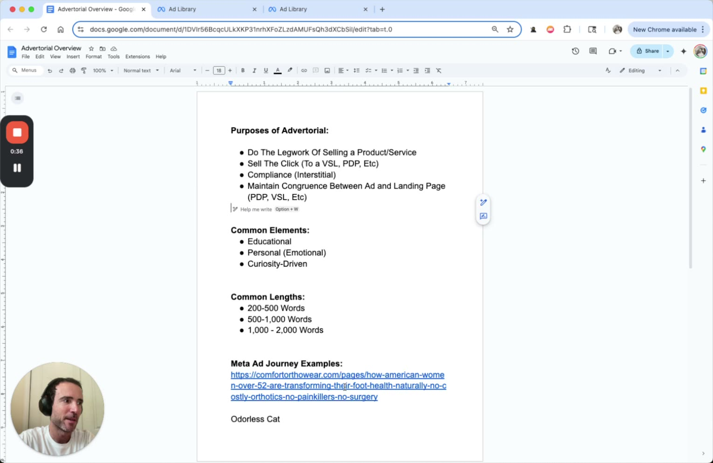
*The lesson's anchor doc: four purposes, three common elements, three length bands, and the example list (Comfort Orthowear, Odorless Cat, Earth Breeze). [00:36]*

### 2. Why ad → short PDP fails, and why ad → long advertorial → short PDP wins [02:32–10:30; 30:35–33:42]
- Test case: Clarifion ODRx (plug-in UV-C air deodoriser for cat urine smell). The Meta ad says "2 Years of Cat Pee Smell… GONE IN DAYS!" and a static with "Most cat owners don't use this to eliminate their cat pee smell, but did you know…". [00:31–01:51; frame 10:36]
- The destination he would get without the advertorial is a short, feature-and-FAQ product page plus a one-page "PDP-checkout hybrid". Consumer view: "You got this smelly cat just peeing everywhere… are you really convinced that it works? Probably not." [02:32–05:08]
- Mechanics he gives: you would still make sales, but "you may need to spend $400, $500 on Meta in order to get people to actually click and purchase"; "even spending $45 is a lot", and larger bundles run to "over $200", so most buy one unit. [05:08–06:46] (Figures are his illustrations, not account data.)
- His diagnosis, repeated verbatim in the doc and again for native-to-PDP: **"Prospects are not educated enough. They don't believe it works. They don't know enough about the product. Plus the pain point doesn't feel urgent enough."** [09:41; doc *2. Meta Example*]
- The fix chain: **Static ad → LONG advertorial → short PDP.** Benefits claimed: lower CPA, higher AOV ("order more… every room"), and simplified testing. [30:35–33:42; doc]
- AOV mechanism he points at inside the story: the protagonist buys "a few more… one in every room" and "six more since I noticed they had sold out"; "smart people order more". The PDP/checkout hybrid then offers multi-unit bundles. [18:33; 21:08–21:37; 32:06–32:32]
- Testing mechanism: keep the basic PDP constant; "you're just testing ads and advertorials… it's easier to just put up tons of advertorials that go to this page… Everyone's got to test tons of ads. That's just the state of marketing 2025." [32:32–33:42]
- Caveat he states himself: the CPA/AOV benefit is "true, assuming that the copy is good", the market and awareness level are right, research is done and the product and UMP make sense. [31:34–32:06]

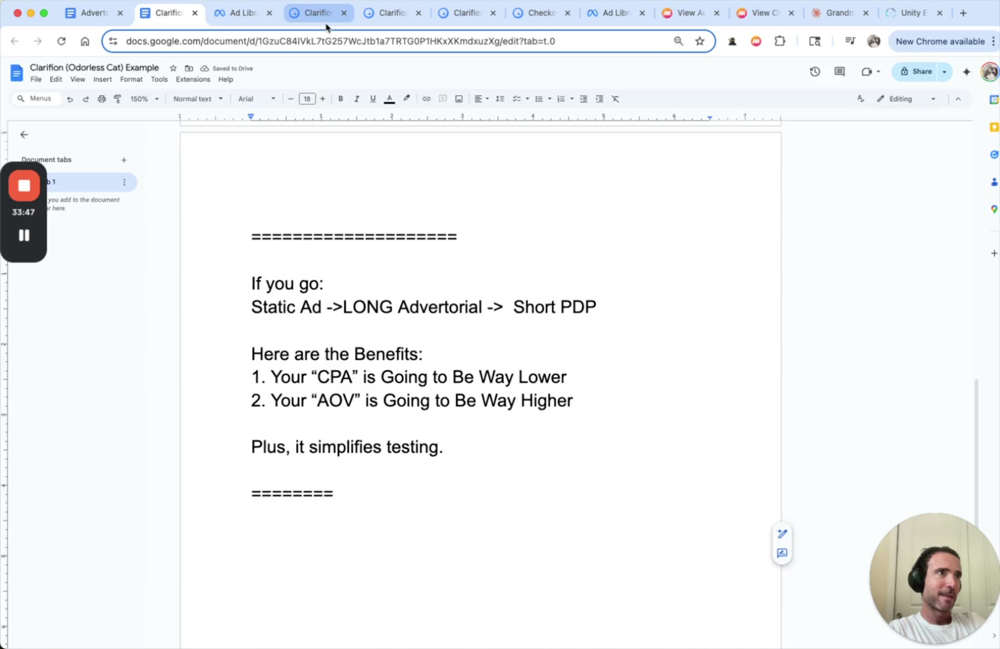
*The funnel claim in one frame: static ad → long advertorial → short PDP, with CPA down, AOV up, and simpler testing. [33:48]*

### 3. Meta example 1, Clarifion long advertorial #1: section by section [10:30–27:50]
Journey: static cat-photo ad → ~2,900-word story advertorial → short PDP/checkout hybrid. Audience: elderly cat owners. Stefan's own take: "I think it's kind of a weird advertorial, but I know they've been writing this for a while, so seems like it's working well enough." [14:41; 00:31]

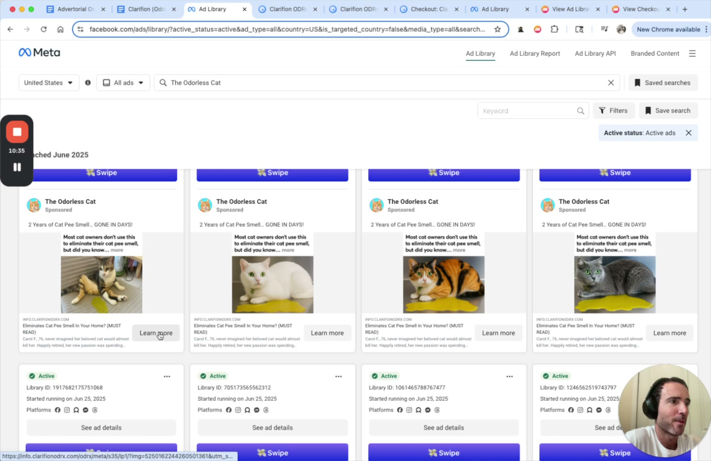
*Four static variants (different cats, same "2 Years of Cat Pee Smell… GONE IN DAYS!" hook and the "Carol F., 76…" link description) all point at the same long advertorial. Testing ads, holding the page. [10:36]*

| # | Section | What happens (from the page text in the doc) | Job it does | Cite |
|---|---|---|---|---|
| 1 | Headline + dateline | "How This Grandma Effortlessly Eliminated Her Cat Pee Smell from Her Home in Just 30 Minutes", dated June 4th, 2025; first line "Carol F., 76, never imagined the cat pee smell soaked into her rug would almost kill her." | Curiosity + named, aged protagonist matching the audience | [10:30–11:35] |
| 2 | Normal life set-up | Retired, reads a book a week, hosts a book club with her cat | Relatable "before" | [11:01–12:47] |
| 3 | Crisis scene | At the book club: sharp sour smell, skull-splitting headache, chest tightness, collapse; friends "almost called 911" | Dramatised pain + public embarrassment | [12:47–13:48] |
| 4 | Doctor / expert validation | Doctor asks "do you have a cat?", names ammonia from cat urine, risk of pneumonia | Authority and a named cause | [13:48–14:41] |
| 5 | Problem education (UMP of the problem) | 66% of Americans own pets; odorants stay in the air weeks; uric acid crystals release ammonia; "olfactory fatigue / nose blindness"; asthma-risk claim | Amplifies fear, explains why cleaning does not fix it | [14:41–16:39] |
| 6 | Failed solutions | $600 cleaning service; air fresheners "only temporarily masked" the smell; choice between spending a fortune or giving up the cat | Raises stakes, eliminates alternatives | [16:39–17:08] |
| 7 | Turning point (friend as guide) | Friend Lisa arrives with the device. Stefan: "there's like a Sherpa appears if we go back to the structure. In this case, it's a friend." | Solution discovery via trusted peer | [17:08–18:33; 20:33–21:08] |
| 8 | Transformation + AOV nudge | Plugged in that evening; fresh air; ordered several, "one in every room" and "six more since… they had sold out a couple times" | Social-proof story and quantity cue | [18:06–19:00] |
| 9 | Product explanation | UV-C "Molecular-Neutralization Technology™", filter-free, 24/7, "1/5th the size of some traditional air purifiers"; borrowed credibility from NYC water treatment and hospital UV use | Feature/benefit plus credibility by analogy | [21:37–23:02] |
| 10 | Future-pacing outcomes | After two weeks and a month: social life, energy, sleep improve; she orders six more as gifts | Expands benefit beyond the problem | [23:02–24:19] |
| 11 | Scarcity + social proof | "completely sold-out their inventory twice", "64,317 new customers last year", three social-media-style comments (Stefan: "This one is clearly AI"; the page itself footnotes that "The reviews above are fictitious and were instead founded on experiences shared by Clarifion ODRx customers") | Demand proof | [24:46–25:14; doc] |
| 12 | "I tested it myself" | Week 1 / 2 / 3 diary by a reviewer-narrator | Second voice, future pacing | [25:14–25:45] |
| 13 | Final thoughts + price | Compares to $2,500 purifiers and costly services; $44.97 regular price "seemed a little high" until results; up to 72% off bundle "while supplies last" | Price justification, discount framing | [25:45–26:44] |
| 14 | Update box + CTA | "Update: June 30, 2025 … inventory is now dwindling … Internet Only Promotion"; "CHECK AVAILABILITY" buttons | Dated urgency, soft CTA to the PDP | [26:44–27:50] |

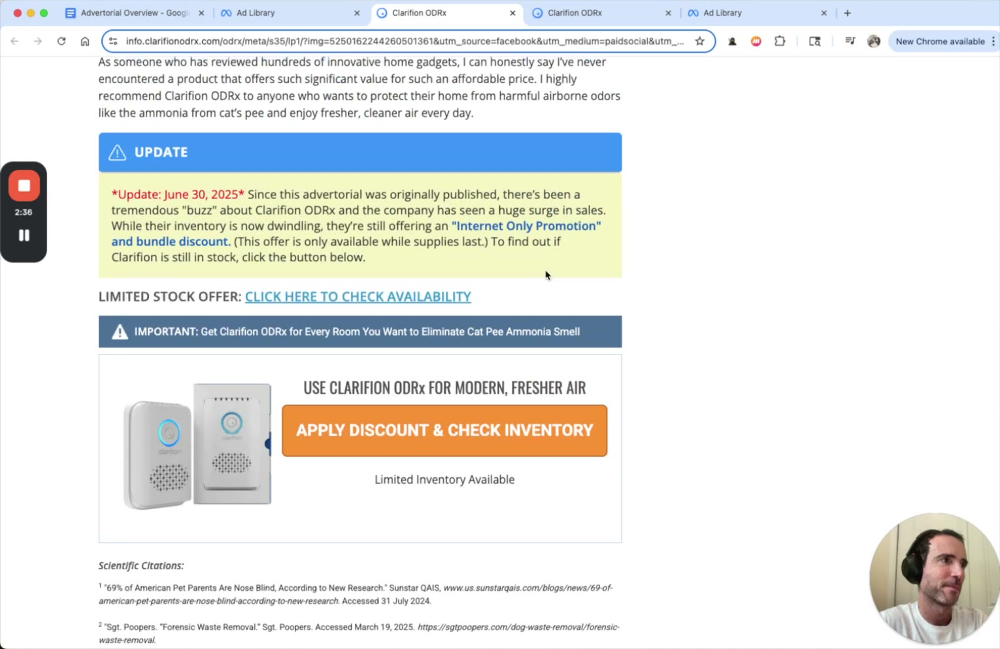
*Bottom of advertorial #1: "Update: June 30, 2025" box with "Internet Only Promotion", "Limited Stock Offer: click here to check availability", then a product card with "Apply Discount & Check Inventory / Limited Inventory Available". The CTA language is soft ("check availability"), not "buy now". [02:36 on the recording clock]*

- Stefan's own read of what the whole page is doing: calls out "a very specific market, which is kind of elderly people, elderly cat owners"; "dramatically amplifying and intensifying the problem… it's doing all these things you're scared of as an older lady"; the story is "this hook"; then "educate on the unique mechanism of the problem"; then solution. [19:33–20:33]
- He criticises its logic: the headline says it "would almost kill her" yet the doctor says "luckily it wasn't something more serious"; "So does it make sense fully? No." Yet "seems like it's working". [20:03]
- He notes the page does carry an advertorial/advertisement label at the top and, "kind of funny", display ads of its own. [27:15]

### 4. Meta example 2, Clarifion advertorial #2 (video-ad traffic) [34:53–45:09]
- Same brand, different ad, different page. The video ad (about 1:13 in the Ad Library frame) already "amplif[ies] the pain point", "talk[s] about the product", "reveal[s] how it works", and shows benefits for "kids and family", targeting a younger demo than the grandma story. [36:42; frame 36:48]
- So the lander is a different, shorter, "a lot more graphically heavy" advertorial and names the device immediately: "we are talking about the device right away. Why? Because we have introduced the product already." [37:13–37:48]
- Stefan: "the reason for this format is because there are video ads in front of it, typically one to two minutes long, that are already revealing the product, talking about the problem and… how it fixes it… you don't need the same advertorial where it's like 'oh grandma's story'." [44:14–45:09; doc *2. Meta Example*]
- You could test the grandma page against the video ad "but probably not" because it would repeat the pain amplification. [36:42]

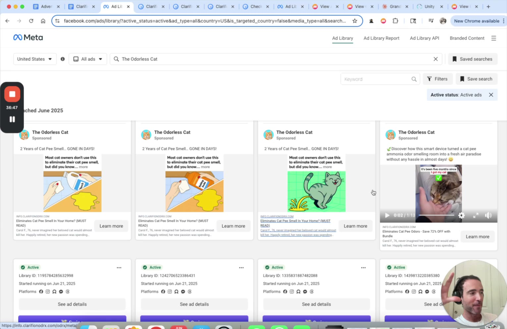
*Static illustration ads and a video ad running side by side. Different ad types send people to different advertorials. [36:48]*

| # | Section (advertorial #2) | What happens | Cite |
|---|---|---|---|
| 1 | Hook paragraph | "If your home reeks of cat pee or you're struggling to breathe, suffering headaches, or feeling dizzy, this science-driven solution is a lifesaver. Here's why." | [37:13] |
| 2 | Pain amplification | Acid-in-the-nostrils symptoms; cat urine "packs more ammonia than dog pee"; nose blindness "until you have guests over"; cats stressed and mark more | [38:20–39:13] |
| 3 | Root cause (UMP of the problem) | Uric acid crystals, microscopic and invisible; "You think you can just clean the litter box… Nope. You need to directly clean your home's air." | [39:36–40:34] |
| 4 | Solution reveal | "a remarkable new solution"; "Who would've thought a deodorizer would get hailed as a miracle solution… in 2025?" | [40:34] |
| 5 | Proof claim and reality check | "15,000 five-star reviews online"; Stefan checks Trustpilot and finds 356, "some of them look like they might be fake" | [40:34–41:09] |
| 6 | Features/benefits and studies | UV light, product graphics, "game-changing benefits", references to studies | [41:09–41:37] |
| 7 | Friend/peer proof + bundle push | "I got this from my friend Samantha. I'm so happy I got six"; "recommend using more than just one… in each room. Clarifion bundle is a must" | [41:37–42:14] |
| 8 | Close | "unbeatable price", guarantee, "reviewed by a nurse, allegedly", "Supplies are low", free delivery, "check availability" | [42:14–42:48] |
| 9 | Persistent sidebar + sticky bar | "Recommended: 4.68, 100+ Verified Reviews", bullets, "30-Day Satisfaction Guarantee", green bar "GET UP TO 72% OFF Today! Apply Discount & Check Availability" | frame 38:00 (visible on screen) |

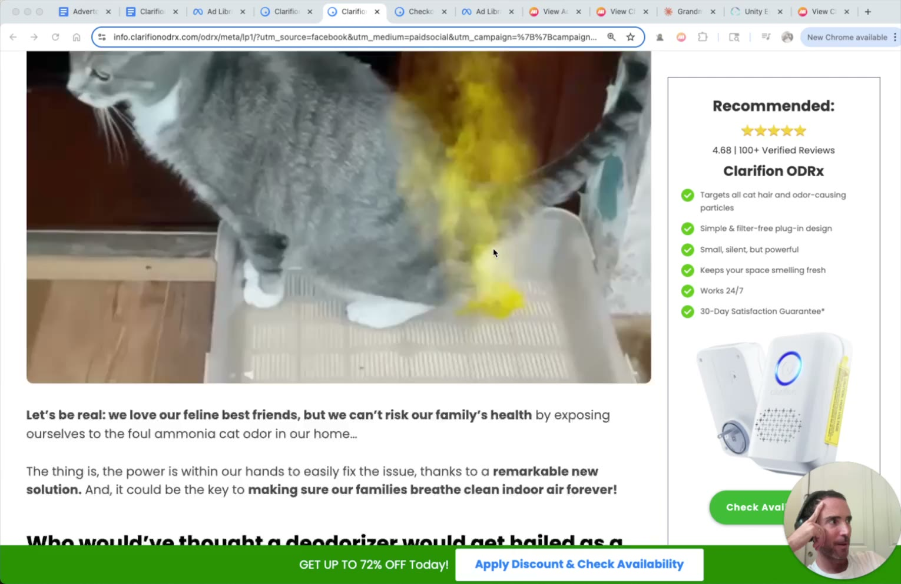
*Advertorial #2 mid-page: heavy product/problem graphics, a persistent right-hand "Recommended" box and a sticky bottom CTA bar. [38:00]*

### 5. Meta example 3, Comfort Orthowear: video ad → brand "advertorial" → plain Shopify PDP [45:09–49:32]
- The page title is "How American women over 52 are transforming their foot health naturally: no costly orthotics, no painkillers, no surgery". Stefan: "it is an advertorial… They don't say advertorial up here. They should, for compliance… I guess it's not an advertorial because they're saying it from the brand." [47:58]
- Structure as he reads it: the problem ("for millions of Americans foot pain is a part of aging; traditional shoes don't work; that's why we created this shoe"); why traditional footwear/orthotics fail; why the brand's shoe is a better solution; social proof ("that's what everyone's using"); "why is this for you?" with a spokesperson doctor; three reasons it works; what it does; get it here; customer reviews; limited-time sale; guarantee; comfort; FAQ. [47:58–48:30; doc srt]
- It is short because the traffic is a roughly two-minute video ad covering "what it does, the features, the benefits… social proof". After it comes "a really basic Shopify product page". [49:00]
- **The "dirty secret":** "unless you're a really big brand… these pages [plain Shopify PDPs] don't convert… Shopify isn't a gajillion dollar company because of these pages. Shopify's a gajillion dollar company because of pages like this that go in front of it." (instructor claim, no data) [46:57–47:58]

### 6. Meta example 4, Earth Breeze: senior-discount interstitial [49:32–52:55]
- Brand sells natural laundry/dishwasher sheets. A very short, aware ad (product shown, "shop now") can go straight to a PDP because the video already sells. [49:32–50:41]
- A second ad goes to an "interstitial" page: "Senior Summer Sales Special. Up to 52% off for seniors and free gifts. Dear Valued Senior…", with harsh chemicals, "cancer-causing chemicals, things in your bloodstream", fixed incomes and arthritis-friendly sheets. Then a button to "the actual classic e-com product page", with carousel, benefits, selection package, free gifts, subscription default ("sneaky continuity") and a buy-once option with no savings. [50:41–51:50]
- His judgment: "is this enough to get somebody to spend money on these laundry sheets, especially on potentially a subscription? Maybe not. Maybe it's okay, but maybe your metrics are going to be better" with the discount-for-seniors page first. [52:25–52:55] This is an interstitial doing segment-specific framing, not a full story.
- Also named, not shown: a **top-5 / "number one will surprise you"** comparison advertorial, "pretty short", which "people don't run as much, but they kind of should", deferred to the native video. [52:55–53:27]

### 7. Native: why the problem is different [v2 01:07–03:54; 10:37–13:40; 29:20–29:52]
- Native ads live "on news sites… weather.com", local news; he searches "Tampa Bay news" and opens weather.com's "sponsored content" widget. [v2 01:07–02:42]
- On native the issue "is not even necessarily conversions" or AOV; "the problems are compliance and congruence. Generally." Solved by **Ad → advertorial (interstitial page) → VSL lander.** [v2 10:37–11:24; doc *4. Native Ads*]
- **Native → PDP** has the Meta CPA/AOV problems plus a congruence problem. Doc's two examples:
  - Example #1 (topic mismatch): ad about an oven cleaner goes to a PDP for an all-purpose cleaner: "I clicked on what looked like an article about a miracle oven cleaner, now I'm on a product page about an all purpose cleaner, I feel bait-and-switched."
  - Example #2 (experience mismatch): ad about a $99 hearing aid goes to a $99 hearing-aid PDP and still fails: "I clicked on what looked like an article and now I'm on a product page. I wanted to consume content, not shop for hearing aids." [doc *4. Native Ads*; v2 29:20]
- Congruent chain: "read an article, advertorial, consume news, consume content, go to product page" vs "read an article, product page… doesn't make as much sense." [v2 29:20–29:52]
- Compliance levels: native "tend[s] to be more aggressive"; Meta runs aggressive stuff "but it's usually more cloaked… Native, the compliance standards tend to be lower." He guesses (instructor guess) that major local-news sites carry "higher quality, overall compliant" advertisers such as Gundry-type brands. [v2 16:11–16:42; 30:42–31:23]

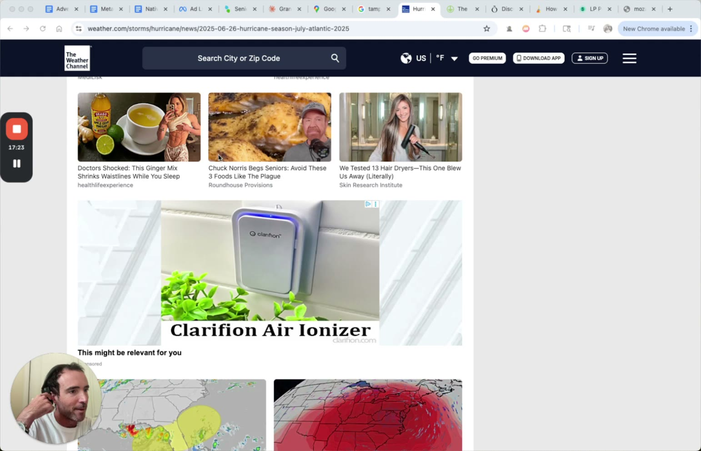
*Native feed on a weather news page: sponsored headline/thumbnail tiles under the article, plus a retargeting banner for the same cat-odor brand. The ad must feel like "more articles". [v2 17:24]*

### 8. Native examples, section by section [v2 03:54–33:26]
Seven pages are covered. Per-page notes follow; a comparison table is in "Structured units".

**8.1 "Endocrinologist… 57 second trick" (pink-salt weight-loss, deepfake of a real doctor) [v2 03:54–09:06]**
- Structure read from the page: promise-led opener ("we've always been told to follow a calorie deficit diet… only half the truth"); named, real-world expert; the "trick" teased but not explained ("the article is not really educating, it's more like teasing… they don't address the root cause"); pharma-conspiracy line; viral-social-proof numbers; one long testimonial; "watch this step-by-step video here"; "please share this video" close; disclaimer "individual results may vary". Medium-length bucket. [v2 03:54–10:05]
- Stefan labels it "super black hat… deep fakes… what a lot of the black hat people are doing" (Clickbank-style funnels, "competing against people mostly in Brazil… running full-on deep fake stuff"), refuses to save it ("I don't want to teach off of super black hat stuff") and notes it is not actually compliant either. [v2 06:41–09:06]
- **Agent rule:** do not copy. It impersonates a real, named person and invents quotes and results; copying the mechanism here would mean copying the deception. Take only the teaser-then-watch-video shape, which the lung example (8.7) shows without impersonation.

**8.2 "Top Otolaryngologists: This Is The Best Way To Reverse Hearing Loss" → PDP [v2 12:22–16:42]**
- Pre-click: the headline plus "read this article before you do anything else"; the page sits on a "Self-Care Tips" health-article skin, with rating box, author byline ("Dr." with credentials), sidebar product card with "50% OFF" and "Check availability". [frame 12:24]
- Stefan bets "any amount of money" it goes to a PDP, not a VSL, and it does. [v2 12:55]
- Sections (his narration): doctor claims patient experience ("I've helped all these patients"); hearing loss ruining your life; personal breakthrough discovery; the "real cause" (UMP, "I'm going to educate you"); a solution with a big promise; special ingredients combined; what the product does with a special extract; social proof; future pacing; "supplies are low, demand is high… not available anywhere else"; recommended by experts; "you can save even more"; guarantee; emotional close ("think about your children and grandchildren"); final social proof. "It's almost like a mini sales letter." [v2 15:04–16:11]
- Mapped to the three elements: curiosity (headline promise) + personal story/connection + education (real cause). [v2 15:04]

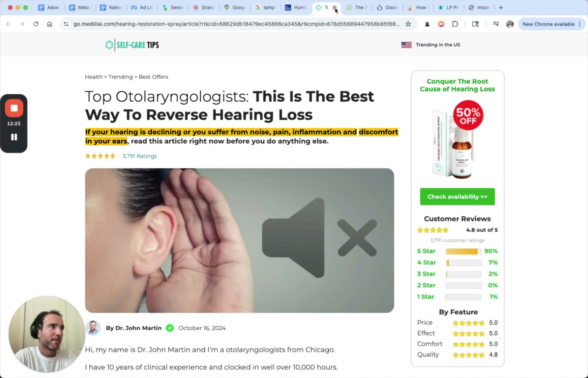
*Article skin, doctor persona byline and rating box above the fold. The headline claim ("reverse hearing loss") is a disease claim needing substantiation; copy only the layout. [v2 12:24]*

**8.3 Grounding bedsheet: "The 7-in-1 sleep breakthrough that's revolutionizing rest" → PDP [v2 16:42–20:32]**
- Native tile hook was "Why are so many older adults switching to grounded sleep?". Page: "Do you lie awake for hours… You're not alone." → "What if there's a way to change it?" → the product → seven benefits (fall asleep faster, etc.) → "what makes it effective / how does it work", "here's the science". [v2 16:42–18:01]
- Format is a **listicle**, "more educational than anything", a format a native reader is "into". The PDP is clean and "looks like a real brand", but at $99 for a single bed set "I might need to be more pre-sold". He suggests testing a more emotional or science-led version. [v2 18:46–20:32]

**8.4 Women's hair-loss supplement: "Discover the Sneaky Deficiency Silently Robbing Women Over 55 of their Thick Hair (Doctors Say 91% Are Affected)" [v2 20:32–23:44]**
- Opens first-person: "The morning I realized I was losing my hair, I cried." Very long, "feels more like a sales letter than an advertorial". Stefan thinks the design/format is not native ("off-centered headline… looks better on mobile"), "my guess is this is not working super well", while adding "I could be wrong". Then a "decent PDP" for a hair supplement. [v2 21:23–22:46; frame 21:24]
- Takeaway: a long-form sales letter dressed as a page is not the same as an article-format advertorial; format and congruence matter, not just copy. [v2 21:23]

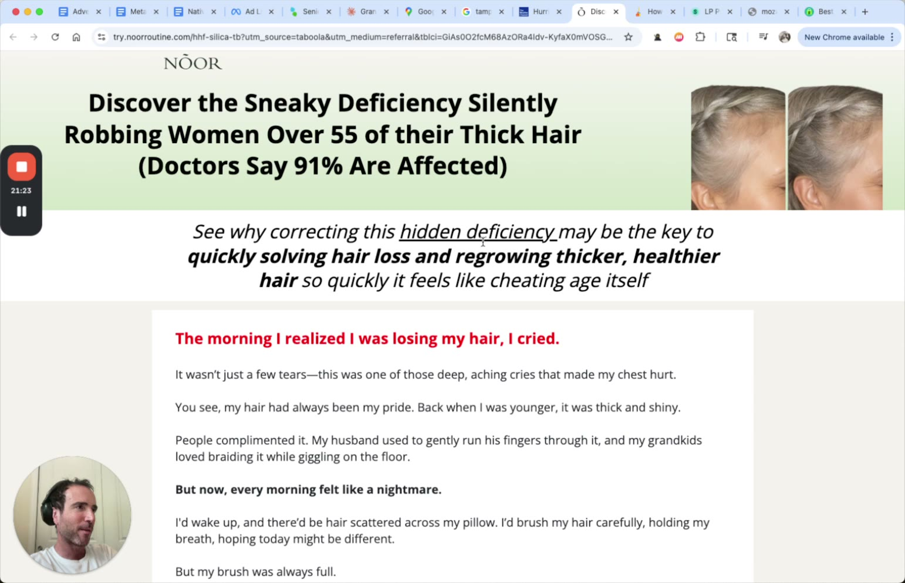
*"The morning I realized I was losing my hair, I cried." Emotional first-person opener on a sales-letter style layout; "91% are affected" is an unsubstantiated stat in the headline, so copy only the opener's emotion and structure. [v2 21:24]*

**8.5 Oven cleaner: "How I Revived 20-Year-Old Greasy Stained Oven In Just Seconds… Without Any Scrubbing!" → all-purpose cleaner PDP [v2 23:44–27:24]**
- Header carries "Advertisement – Sponsored by [brand]"; byline and date; before/after oven photo up top; "personal story, what it is, how it works", educating. [frame 24:36; v2 24:26]
- The ad creative was about cleaning an oven, the advertorial is about reviving an oven, and the PDP sells an "all-in-one solution for every stain". "Rather than having to change my landing page every time, I can just do an advertorial that talks about greasy ovens and how this cleans it. And then, by the time you get here, you've seen how, oh, it cleans other stuff too. So now it doesn't feel weird that I'm not seeing a thing about ovens. That is the congruence thing." [v2 26:54–27:24]
- Awareness note: the reader has to be "problem aware enough that they've got a messed up oven". [v2 24:57]

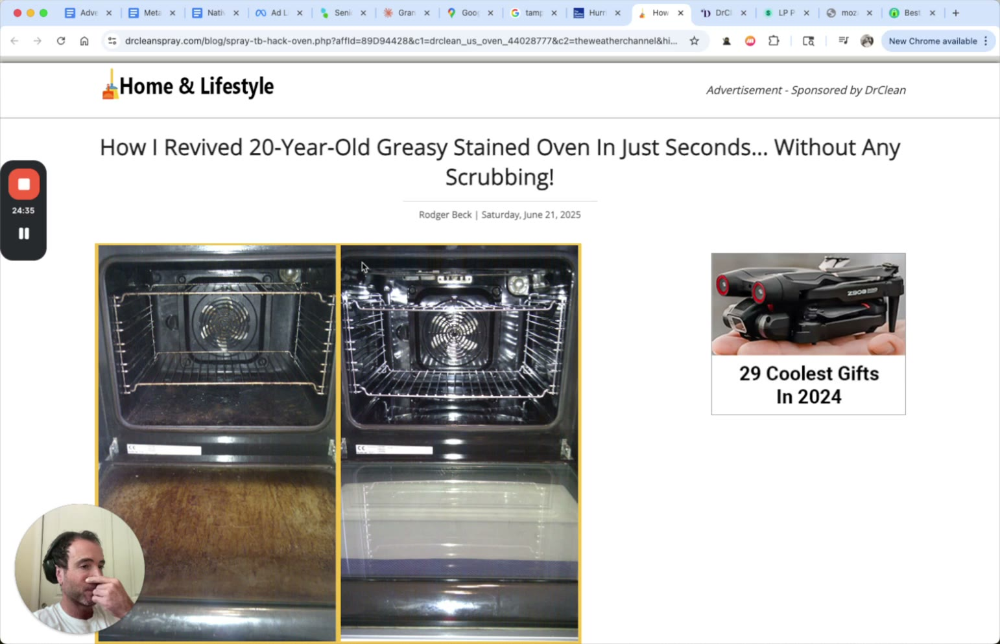
*"Advertisement - Sponsored by" label, byline/date, and a hero before/after pair. A pain-point-specific advertorial in front of a general PDP. [v2 24:36]*

**8.6 Hearing aids under $100: "The Germans have done it again…" (Senior Vitality Magazine) → PDP [v2 27:24–29:52]**
- Page is labelled "Advertorial" with "TRENDING", a magazine badge, a "Posted by" byline and "last updated" date; hero photo of two smiling men holding a tiny device. Content "educate[s] you why they're so cool, why they're really good, [$99], who can benefit, how do I use it", then scarcity, social proof, CTA to the PDP ("first wireless charging hearing aids for less than $100"). [v2 28:02–28:44; frame 28:06]
- His point: $99 still "isn't cheap" so pre-sell; and the journey (news → news-like page → product) is congruent. [v2 28:44–29:52]

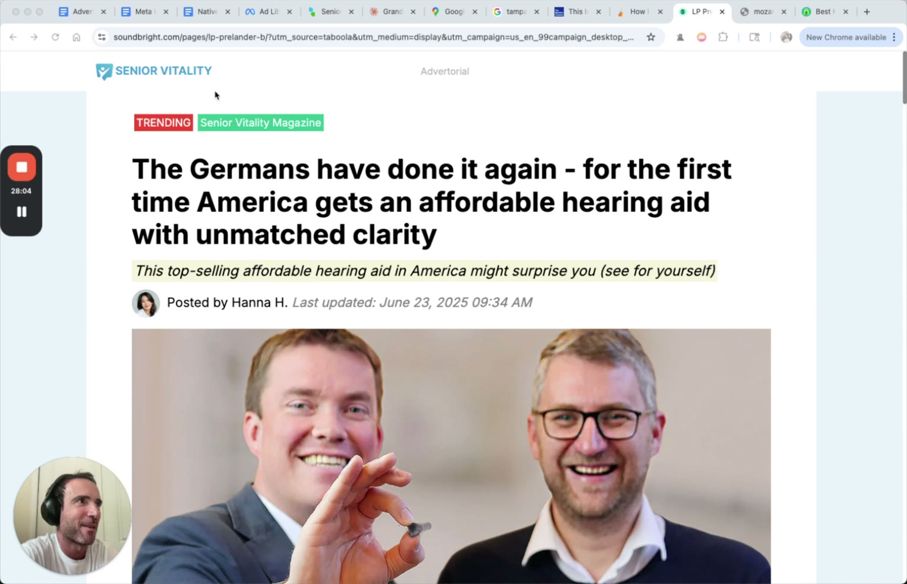
*Explicit "Advertorial" label at top, magazine masthead, "Trending" tag and byline. Label placement is the compliance feature Stefan values. [v2 28:06]*

**8.7 Lung/mucus: short bridge → VSL [v2 31:23–33:26]**
- Image-heavy, little copy: a lead question ("Have you felt like your breathing isn't as clear and strong as it used to be?"), a "discovery" paragraph, a "½ teaspoon of THIS" tease, "Click here to watch (see how it works)", and a green Watch Now button into the VSL. [v2 31:23–32:47; frame 32:18]
- Rule he states: for VSL destinations a short advertorial is enough: "they're hoping the VSLs will be so good, I don't need to educate them more than that… If they're interested in this, they'll be interested in this." For PDP destinations, longer. [v2 32:15–33:26]
- Compliance flag: the on-page claims credit "Harvard scientists" and "Nobel-Prize-winning research" with no sources. Take the bridge shape, not the claims.

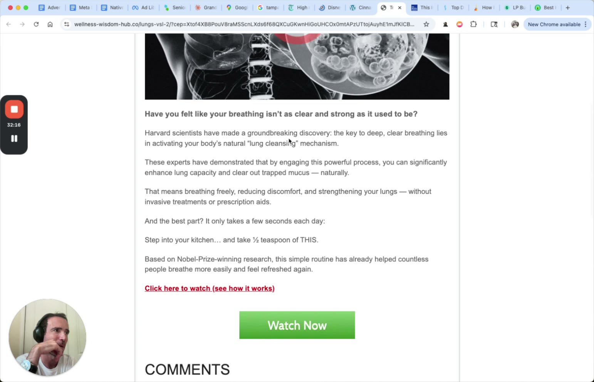
*The short VSL-bridge type: tease, link, button. Educating is left to the video. [v2 32:18]*

### 9. Swiping an advertorial structure with Claude [27:50–30:35; doc *3. Claude Process Example*]
- Stefan pastes the full Clarifion page text into a fresh Claude chat ("you can do this in the Claude project for advertorials, or you can just do it right here") and asks for a "detailed outline of the structure". [27:50–28:31]
- Claude's labelled structure (read off screen by Stefan): headline and hook, problem introduction and dramatization, crisis escalation, expert validation, problem magnification, failed solutions, solution discovery, transformation story, product explanation, social proof, reviewer credibility, cost analysis, urgency and scarcity. Claude's own overview line in the doc: "Problem → Agitation → Solution → Proof → Urgency → Action". It also lists "red flags": fictitious-testimonial disclaimer, unproven health claims, false scarcity. [28:31–29:09; doc]
- Second prompt: write one "that follows the same structure" for a skincare product. Claude fetches the product page, then writes a ~full advertorial headlined "How This 52-Year-Old Mother of Three Erased 15 Years from Her Eyes in Just 8 Weeks" (protagonist "Sarah M., 52", dated June 30th, 2025), and lists "Structure Maintained" (13 items) and "Key Adaptations for Beauty/Skincare" (career-impact instead of health crisis; age-appropriate protagonist; DEJ science instead of ammonia; dermatologist instead of medical doctor; clinical percentages from the product page). [29:09–30:35; doc]
- Stefan: "I'm not going to even go through this whole thing because that's not the point… This is more about overall advertorials… you're just perfectly swiping this advertorial. So if we liked it, we're going to swipe it for our product, our brand." [29:44–30:35]
- The generated advertorial text itself is only a Claude artifact link in the doc and is not included in the course files. [doc]

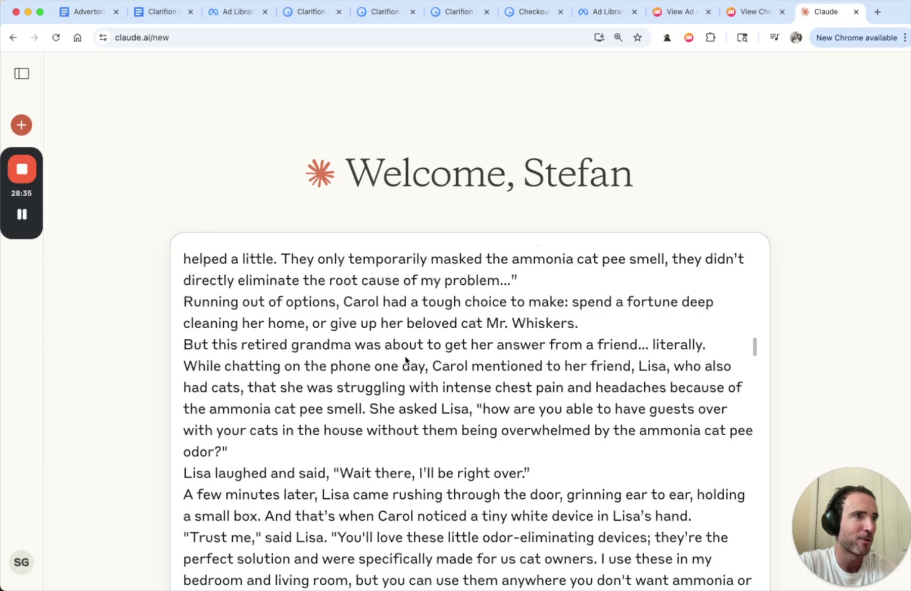
*The swipe step: full competitor/example advertorial text pasted into a new Claude chat, followed by the "detailed outline of the structure" request. [28:36]*

### 10. Where this differs from the Evolve courses
- **Page-selection logic.** Evolve picks the page by market awareness: unaware/problem-aware ads go to an advertorial or listicle, tested at least two pages against the control LP in the 3-2-2-2 structure ([Evolve L121, 23:20–25:50](../../../evolve/start-here/lessons/121-how-to-deal-with-roller-coaster-performance.md); [Evolve L95, 04:46](../../../evolve/start-here/lessons/095-how-to-test-landing-pages-3-2-2-2.md); [awareness x page matrix](../../../evolve/start-here/concepts/market-awareness-levels.md)). Stefan picks it by unit economics (CPA up and AOV down with a short PDP), by what the ad already revealed, and, on native, by compliance and congruence. Same answer in most cases, different diagnostic. Use Stefan's for "do I need a pre-sell and how long", Evolve's for "which pages to split-test" (derived).
- **What gets tested.** Evolve: run a control LP against an advertorial/listicle per creative batch. Stefan: hold one basic PDP constant and mass-produce ads and advertorials in front of it. [32:32–33:42]
- **A spend winner that does not scale.** [Evolve copywriting L50](../../../evolve/copywriting/lessons/50-how-to-iterate-on-spend-winners.md) (12:15–13:14) says the usual cause is conversion rate, not CTR, so fix the post-click page with an advertorial/listicle. This agrees with Stefan's CPA argument.
- **Copying.** Stefan's swipe step has Claude rewrite a competitor's page for our product "following the same structure". This KB's rule is "copy the mechanism, not the asset" ([AGENTS.md](../../../../../../AGENTS.md)): reuse section order and beats, never the protagonist, anecdote, claims or numbers. Where Evolve writes a bridge between hook and page ([bridges](../../../evolve/copywriting/concepts/bridges.md)), Stefan's examples show the bridge as the advertorial's first screen (derived).
- Shared concept page: [Native advertising](../../../../concepts/native-advertising.md).

### 11. Compliance flags on the examples (record, do not copy)
| Example | Flag | Instruction for agents |
|---|---|---|
| Clarifion advertorial #1 | Invented protagonist "Carol F., 76" and "reviews" the page itself calls fictitious; "almost kill her" and lung-damage/asthma claims presented as medical fact; "64,317 new customers", "sold out twice"; "I tested it myself" reviewer-narrator | Use only real customer stories with permission (or clearly labelled composites/dramatisations), real review counts, substantiated health statements and real stock levels |
| Clarifion advertorial #2 | "15,000 five-star reviews" vs 356 on Trustpilot (Stefan's own check [40:34–41:09]); "reviewed by a nurse, allegedly"; "supplies are low" | Never state review counts we cannot show; no unverifiable endorsements |
| Dr. Casey Means pink-salt page | Deepfake and invented quotes attributed to a real person; pharma-conspiracy framing; rapid weight-loss claims | Never use a real person's name, likeness or invented quotes. Do not build this format |
| Hearing spray, bedsheet, hair, lung pages | "Reverse hearing loss", "91% are affected", "Harvard scientists", "Nobel-Prize-winning research", sleep/supplement claims, unverified "doctor" bylines | Disease and efficacy claims need substantiation and may break Meta/FTC and native-network policies; use only claims our brief supports |
| Earth Breeze senior page | "cancer-causing chemicals", "things in your bloodstream"; subscription default ("sneaky continuity") | Substantiate chemical claims; make subscription terms obvious |
| All native pages | Stefan: "I'm saying the claims are too aggressive… definitely not compliant still with claims" (paraphrase of [v2 13:40; 14:34]) | Treat native compliance standards as "lower", not "none"; label the page "Advertorial"/"Advertisement" |

## Steps / framework

### A. Pick the journey (derived from the lesson's rules)
| Traffic and ad | What the ad already did | Destination | Advertorial to build | Source |
|---|---|---|---|---|
| Meta static/curiosity ad ("but did you know…") | Teased only | Short PDP / checkout hybrid | LONG story advertorial: emotional, curiosity, then mechanism and product; push multi-unit | [07:45; 30:35] |
| Meta 1-2 min video ad | Showed problem, product, mechanism, sometimes proof | Short PDP | Shorter, graphics-heavy advertorial that names the product early; re-amplify, social proof, offer | [36:42–38:00; 44:14] |
| Meta aware ad with audience-specific offer | Showed product | PDP | Interstitial/offer page for the segment (e.g. senior discount) | [50:41–52:55] |
| Native ad to long VSL | Teased a topic | VSL lander | SHORT bridge/teaser page (image-led, "watch now") | [v2 31:23–33:26] |
| Native ad to PDP | Teased a topic | PDP | LONG educational advertorial matched to the ad's pain point; one per pain point | [v2 12:22–16:42; 26:07] |
| Native ad to a high-price PDP ($99+) | Teased | PDP | Educational article/listicle to pre-sell | [v2 19:19–20:32; 28:44] |

### B. Advertorial section skeleton (derived from the examples above; adapt, do not copy beats verbatim)
1. Headline + dateline/byline in article style; matches the ad's pain point and avatar (congruence).
2. Personal, emotional opening (protagonist or author voice) with a curiosity gap.
3. Escalation (what the problem is costing them) and why obvious fixes fail.
4. Education: the real cause (unique mechanism of the problem), per [3.1](03-01-unique-mechanisms-overview.md).
5. Discovery / turning point (peer, expert, accident) and the product reveal with its mechanism.
6. Proof: real reviews, tests, experts (substantiated).
7. Future pacing and, where it fits, multi-unit logic (one per room).
8. Price justification vs alternatives; offer; honest urgency.
9. Close with a soft CTA to the PDP or VSL ("check availability", "watch now").
10. Compliance elements: "Advertorial/Advertisement" label, disclaimers, citations.

### C. Swipe-and-adapt workflow (from [27:50–30:35])
1. Find a live advertorial that fits our traffic source and product class (Meta Ad Library, native widgets on news sites).
2. Paste its full text into Claude (or the Claude Project from [9.2](09-02-claude-project-for-advertorials.md)) and ask for a detailed structure outline (prompt 1 below).
3. Review the outline for section order and beats; strip anything that is a claim or a story detail.
4. Ask Claude to write for our product with the same structure (prompt 2). Give it our brief, research, mechanism and real proof, not just a product URL (derived: the lesson's one-line demo skips the brief).
5. Check the draft against the compliance flags; replace invented people, numbers and endorsements.
6. Test: many ads and advertorials in front of one stable PDP. [32:32–33:42]

## Examples
See the section-by-section breakdowns above: Clarifion #1 and #2 (sections 3-4), Comfort Orthowear (5), Earth Breeze (6), seven native pages (8), Claude swipe of Clarifion for an eye serum (9).

## Structured units

### Ad teardowns (advertorial journeys shown)
| Brand / product (niche) | Format | Hook / opening | What works | What fails | Fix suggested | Principle | Source |
|---|---|---|---|---|---|---|---|
| Clarifion ODRx (pet odor device) | Meta static → ~2,900-word story advertorial → short PDP/checkout hybrid | "How This Grandma Effortlessly Eliminated Her Cat Pee Smell… in Just 30 Minutes" | Specific older avatar; escalating fear; friend-as-guide; multi-unit cues; long copy in front of a basic page | Internal logic ("almost kill her" vs "luckily not serious"); AI-looking proof | None given; "seems like it's working well enough" | Education + emotion + curiosity before the PDP | [10:30–27:50] |
| Clarifion ODRx | Meta video (1:13) → shorter product-forward advertorial → PDP | "If your home reeks of cat pee… this science-driven solution is a lifesaver. Here's why" | Product named at once; re-amplifies pain after a video that already explained | Review-count claim unsupported (356 on Trustpilot vs "15,000") | — | Length follows what the ad already revealed | [36:42–45:09] |
| Comfort Orthowear (foot comfort shoes) | Meta 2-min video → short brand page → basic Shopify PDP | "How American women over 52 are transforming their foot health naturally…" | Short because the video does the selling; spokesperson, reasons, FAQ | Not labelled advertorial (compliance) | Add "advertorial" label | Pre-sell then plain PDP | [45:09–49:32] |
| Earth Breeze (laundry sheets) | Meta ad → senior-discount interstitial → PDP | "Senior Summer Sales Special. Up to 52% off for seniors…" | Segment-specific offer framing; free gifts | Thin on education; "maybe not" enough for a subscription | More pre-sell before the PDP | Interstitial as offer framing | [49:32–52:55] |
| Pink-salt trick (weight loss) | Native → short article → deepfake VSL | "Endocrinologist struggling to lose weight, try this 57 second trick…" | Teaser format congruent with native | Deepfake, invented quotes, not compliant | Do not build | Teaser → watch video | [v2 03:54–09:06] |
| Hearing restoration spray | Native → long advertorial → PDP | "Top Otolaryngologists: This Is The Best Way To Reverse Hearing Loss" | Article skin, doctor persona, full mini sales letter | Disease-reversal claim; PDP "pretty basic" | Substantiate claims | Education before PDP | [v2 12:22–16:42] |
| Grounding bedsheet (sleep) | Native → listicle → clean PDP | "The 7-in-1 sleep breakthrough that's revolutionizing rest" | Educational; listicle suits native readers | $99 item needs more emotion/science | Test an emotional or science-heavy version | Pre-sell high price | [v2 16:42–20:32] |
| Women's hair supplement | Native → very long first-person page → PDP | "The morning I realized I was losing my hair, I cried." | Emotional opening | Reads as a sales letter, not native format; "91% affected" unsupported | Native-style layout; test length | Format must feel native | [v2 20:32–23:44] |
| Oven/all-purpose cleaner | Native → oven-story advertorial → all-purpose PDP | "How I Revived 20-Year-Old Greasy Stained Oven In Just Seconds… Without Any Scrubbing!" | Ad and advertorial pain point match; breadth of the PDP explained in the body; "Advertisement" label | PDP itself is not about ovens | None needed | One advertorial per pain point | [v2 23:44–27:24] |
| Affordable hearing aids | Native → magazine-style "Advertorial" → PDP | "The Germans have done it again - for the first time America gets an affordable hearing aid with unmatched clarity" | Labelled; congruent news-to-news journey; pre-sells $99 | Aggressive "first/unmatched" framing | Substantiate | Congruent journey | [v2 27:24–29:52] |
| Lung-cleansing routine | Native → short image-led bridge → VSL | "Breathing issues. This will remove all mucus in your lungs." | Minimal bridge; VSL does the education | "Harvard"/"Nobel" claims unsourced | Source or drop | Short page for VSL traffic | [v2 31:23–33:26] |

### Hooks (native tile headlines read aloud on weather.com; copy the mechanism, not the line)
| Hook (verbatim or near) | Heuristic(s) | Emotion / zone | Self targeted | Why it works | Source |
|---|---|---|---|---|---|
| "Top doctor: if you eat eggs every day, this is what happens" | — | — | — | Not stated | [v2 02:42] |
| "Why are so many older adults switching to grounded sleep?" | — | — | Older adults (in the headline) | Led to the sleep listicle | [v2 03:15; 17:23] |
| "Shoppers say this thin hairspray is a lifesaver" | — | — | — | Not stated | [v2 03:15] |
| "Few know this oven cleaning trick. No scrubbing" | — | — | — | Led to a pain-point-matched advertorial | [v2 03:15; 26:07] |
| "These are the Rolls-Royce of hearing aids under $100" | — | — | — | Led to the Senior Vitality advertorial | [v2 03:15; 27:24] |
| "Costco shoppers say this wrinkle cream is actually worth it" | — | — | — | Not stated | [v2 03:15] |
| "Endocrinologist struggling to lose weight? Try this 57 second trick at home every morning" | — | — | — | Not stated; flagged black hat | [v2 03:54] |
| "COPD? Simple Trick For Clearing Mucus. Do This Before Bed!" (ad title inside the saved link) | — | — | — | Led to the short VSL bridge | doc *4. Native Ads* |

### Templates
| Template | Use for | Example fill | Source |
|---|---|---|---|
| Tease ad → long advertorial → short PDP | Meta statics, native | Static "…but did you know" → story page → basic PDP | [07:45–33:42] |
| Video ad → short, product-forward advertorial → PDP | Meta video traffic | 1:13 video → "this science-driven solution is a lifesaver. Here's why" | [36:42–45:09] |
| Ad → interstitial offer page → PDP | Segment discount (seniors etc.) | "Senior Summer Sales Special" | [50:41–52:55] |
| Native ad → pain-point advertorial → general PDP | One product, many pain points | Oven story → all-purpose cleaner | [v2 26:07–27:24] |
| Native ad → short tease page → VSL | VSL traffic | Question + discovery + "watch now" | [v2 32:15–33:26] |

### Rules of thumb
- **DO** write down what the ad already revealed before choosing advertorial length. [44:14–45:09]
- **DON'T** judge an advertorial by whether it "makes sense fully". Stefan's own read is that the best-known page here does not, and still runs. Judge by data. [20:03]
- **IF** the product is a one-time $45 item **THEN** raise AOV in the story (more units, rooms, gifts). [18:33; 21:08]
- **IF** the native reader faces a $99 price **THEN** pre-sell with education before the PDP. [v2 19:55; 28:44]
- **IF** unsure what length to use **THEN** test several: "All the big brands I know doing like sort of D2C stuff who run advertorials are testing tons of advertorials, different lengths, different formats." (instructor claim) [v2 23:14–23:44]
- **DO** label the page "Advertorial" or "Advertisement". [27:15; 47:58; v2 28:06]

## Prompts / templates (verbatim)
Both prompts are from *3. Claude Process Example_Quick Advertorial Swipe.docx* and shown in the video at [27:50–30:35]. Run them in the Claude Project from [9.2](09-02-claude-project-for-advertorials.md) or in a plain chat.

**Prompt 1: structure outline** (the full advertorial text follows the colon)
```
Here's an advertorial I just read. Can you please go through it and then create a detailed outline of the structure:

[paste full advertorial text]
```

**Prompt 2: swipe for our product**
```
Perfect, thanks this was great. Let's write an advertorial for opal beauty that follows the same structure. Specifically for our Unity Eye Serum:

[product page URL]
```
Notes (derived): replace the brand/product and add the brief, research and real proof. In the lesson Claude fetched the product page itself and built from that. The generated draft is not in the course files.

**Claude's reply to prompt 2, "Structure Maintained" list as shown in the doc**
```
- Compelling headline with specific results promise
- Personal story (Sarah, 52, marketing executive)
- Crisis/problem escalation (missed promotion due to aging appearance)
- Expert validation (dermatologist explaining DEJ science)
- Failed solutions (expensive treatments that didn't work)
- Solution discovery (through trusted sister)
- Transformation story with specific timeline
- Product explanation with scientific backing
- Social proof and testimonials
- Personal testing account (week-by-week results)
- Value proposition and cost comparison
- Urgency and scarcity elements
- Strong call-to-action
```
Reuse the outline; treat the persona, timeline and statistics as invented.

## Screenshots
All 13 kept frames are embedded inline above (7 from video 1, 6 from video 2). Files are named `v1-...` (video 1) and `v2-...` (video 2) in `knowledge-base/wiki/assets/stefan-georgi/rmbc-ii/09-01-advertorials-overview-and-examples/`.

## How to apply
- [ ] For each ad we run, write down what it already tells the viewer (problem, product, mechanism, proof) before drafting the page.
- [ ] Choose the journey from table A; set the first draft length from it (short bridge, medium, long).
- [ ] Pull 2-3 live advertorials in our category (Meta Ad Library; native widgets) and run prompt 1 on each; save the outlines.
- [ ] Build one advertorial per ad pain point; end by showing how the product covers the other pain points (oven → "cleans other stuff too").
- [ ] Run prompt 2 with our real brief, mechanism and verified proof; remove invented protagonists, stats and endorsements.
- [ ] Add the "Advertorial"/"Advertisement" label, disclaimers and citations.
- [ ] Keep the PDP stable; test several ads and advertorials in front of it; log CPA, AOV and conversion by advertorial.
- [ ] Add multi-unit logic (bundles, "one per room") only where the use case supports it.

## Related
- Next: [9.2 Claude Project for Advertorials](09-02-claude-project-for-advertorials.md) (the reusable project for writing advertorials of any length; written in parallel)
- Funnel context: [1.1 Course overview](01-01-welcome-to-rmbc-ii-and-in-depth-course-overview.md) · [1.2 Foundational knowledge and congruence](01-02-foundational-knowledge-and-the-state-of-dtc-marketing-in-202.md) · [4.11 VSLs on landing pages vs in-feed](04-11-vsls-on-landing-pages-vs-vsls-as-in-feed-ads.md)
- Research inputs: [2.1 Product-market awareness](02-01-product-market-awareness.md) · [3.1 Unique mechanisms overview](03-01-unique-mechanisms-overview.md)
- Evolve: [Market awareness levels](../../../evolve/start-here/concepts/market-awareness-levels.md) · [L121 congruent funnels](../../../evolve/start-here/lessons/121-how-to-deal-with-roller-coaster-performance.md) · [L95 test landing pages](../../../evolve/start-here/lessons/095-how-to-test-landing-pages-3-2-2-2.md) · [Copywriting L50 spend winners](../../../evolve/copywriting/lessons/50-how-to-iterate-on-spend-winners.md) · [Bridges](../../../evolve/copywriting/concepts/bridges.md)
- Shared: [Native advertising](../../../../concepts/native-advertising.md) · [Landing page psychology audit](../../../../frameworks/landing-page-psychology-audit.md)

## Sources and limitations
- Transcripts (Whisper large-v3-turbo; video 1 covered to 53:27 of 53:33, video 2 to 33:26 of 33:52): [video 1](<../../../../../raw/stefan-georgi/rmbc-ii/_transcripts/Stefan Georgi - RMBC II (1)/09-ADVERTORIALS/01-[1] Advertorials Overview and Examples.txt>) · [video 2](<../../../../../raw/stefan-georgi/rmbc-ii/_transcripts/Stefan Georgi - RMBC II (1)/09-ADVERTORIALS/01-[1] Advertorials Overview and Examples video2.txt>). Platform captions exist for video 1 only (`01-11 Advertorial Overview  Meta Examples.srt`); video 2 has none, so native-page names rely on on-screen text.
- Documents: four docx files in the zip (*1. Advertorial Overview*, *2. Meta Example_Clarifion (Odorless Cat) Example*, *3. Claude Process Example_Quick Advertorial Swipe*, *4. Native Ads Advertorial Overview*). Docs 2 and 4 are short notes and links (markuphero.com screenshot shares, live landing pages); the linked pages and screenshot sets are not in the course files. Doc 3 holds the full text of Clarifion advertorial #1, the two prompts and a partial Claude reply; the generated Unity Eye Serum advertorial is only a Claude artifact link, not included.
- Mishearings fixed with the captions or screen text: "Carol F76" to "Carol F., 76"; "Clarifying Odorex/Ode Rx" to "Clarifion ODRx"; "cappy/cat free smell" to "cat pee smell"; "abertorial" to "advertorial"; "Unity Pi Serum" to "Unity Eye Serum". The spokesperson's surname appears as "Rappapat" in the captions and is unverified. Garbled passages at [06:13–06:46] (bundle prices) and [v2 15:35] ("half the market of marketing experts recommend") are paraphrased, not quoted.
- Screen content (headlines, ratings, sidebar elements) was read from extracted frames and reflects the recording date (June-July 2025). All pages are third-party and live pages change; the claims on them are the pages' or instructor's, not verified by us.
- Frame clock: the frame grabbed at 02:36 shows the end of advertorial #1, earlier than the transcript discusses that page; other frames match the transcript clock.
- "$400, $500 on Meta", "lower CPA / higher AOV" and "big brands test tons of advertorials" are instructor claims with no data in the lesson. Word lengths (including ~2,900 for advertorial #1) are our count (derived).
- Not included in the course files: the screenshot decks behind the markuphero links, the rendered Unity Eye Serum advertorial, the Comfort Orthowear/Earth Breeze ad copy, and performance numbers for any page shown.
