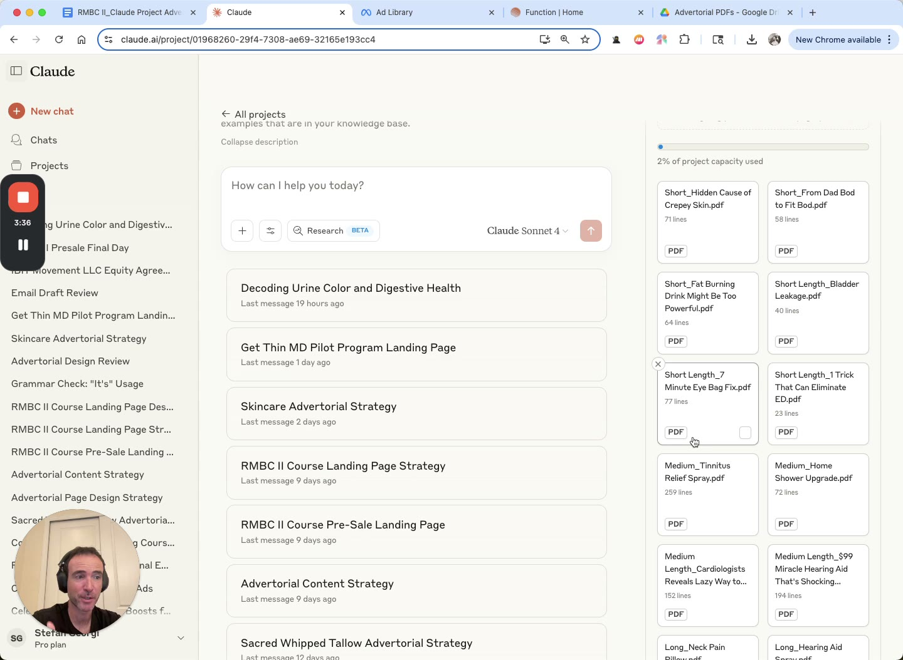
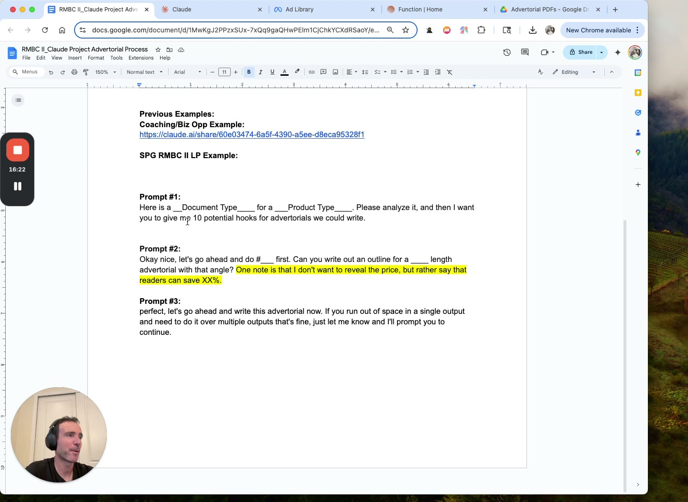
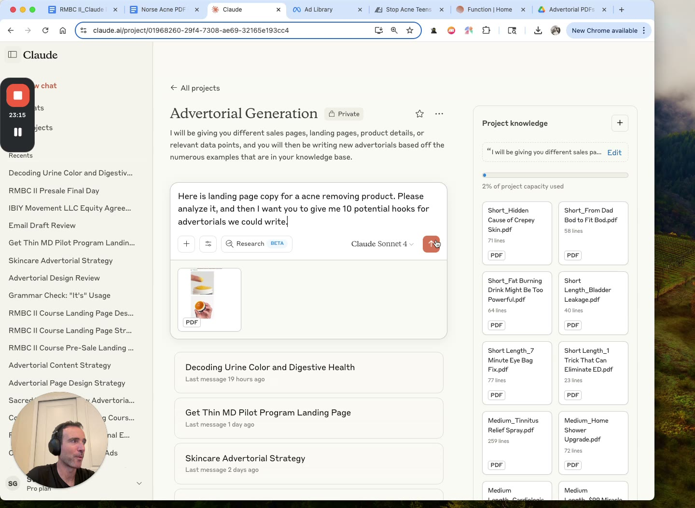
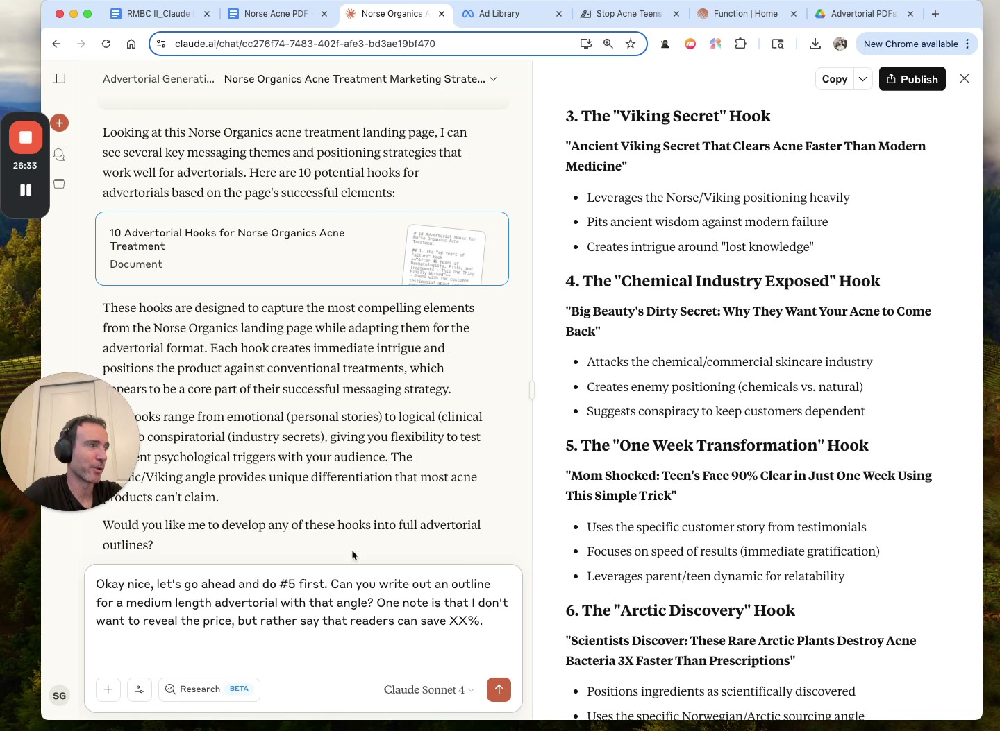
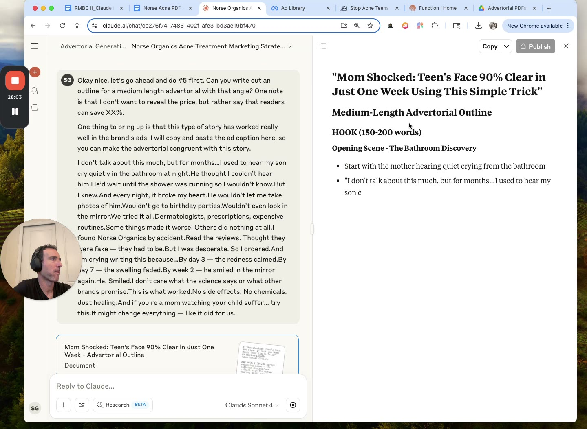
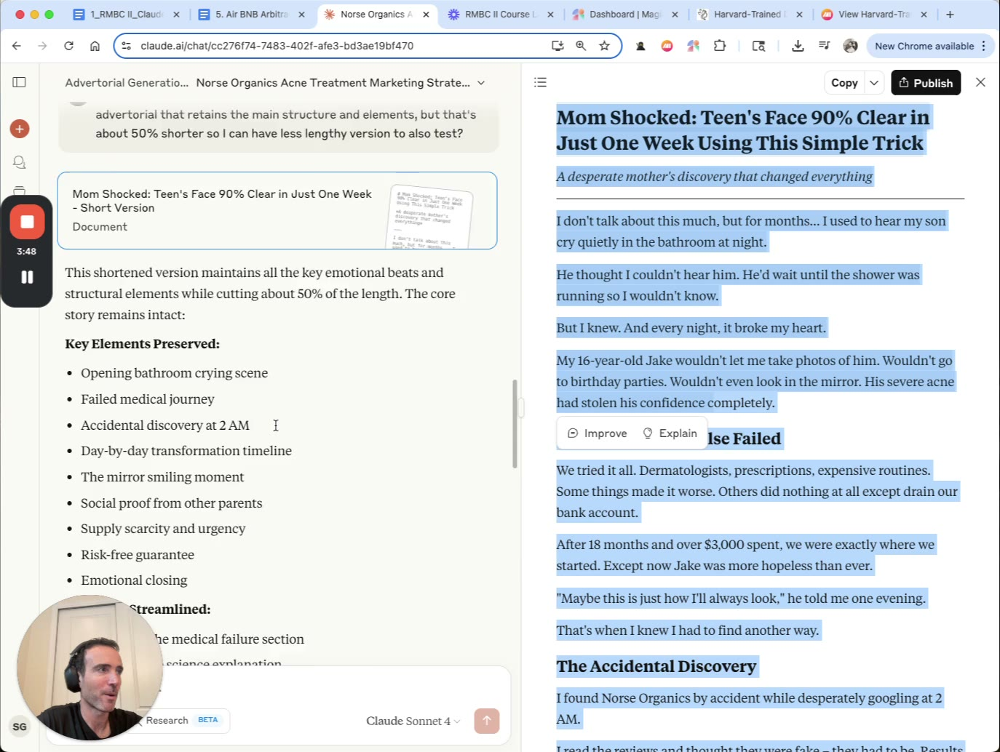
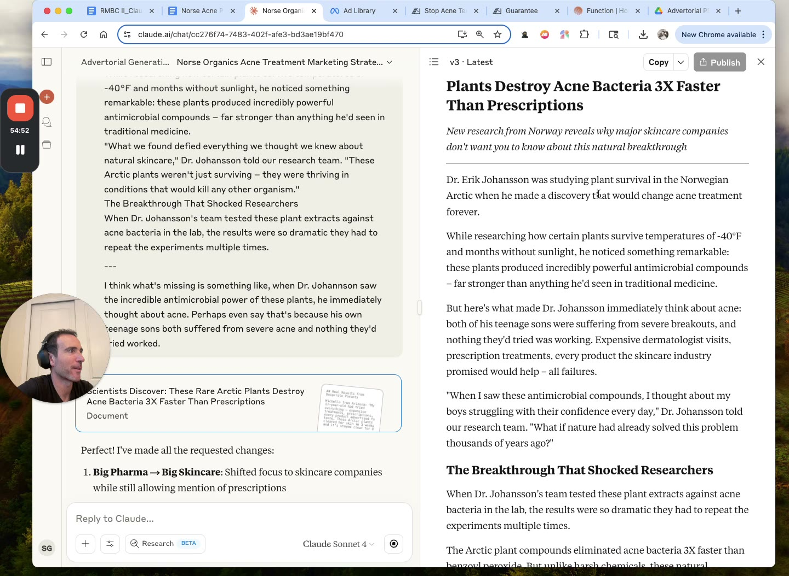
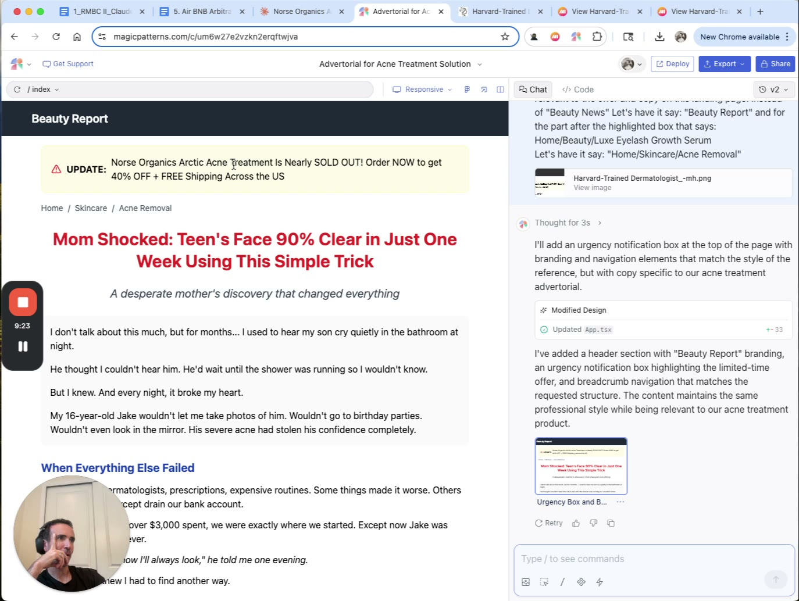
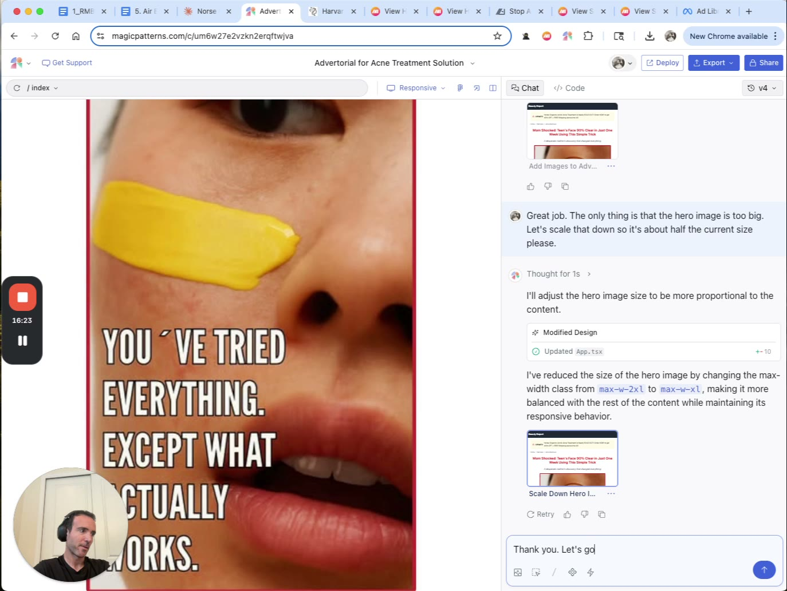

# 9.2 Claude Project For Advertorials
> Build one Claude Project whose knowledge base is 14 real advertorials of mixed length and niche, then run a three-prompt loop (10 hooks, outline, full draft) plus short "boss" edits to get unlimited advertorials; a second video turns the copy into a live, deployed page with Magic Patterns.

## 🤖 Agent use
- **Use when:** you must produce advertorial copy (short lead-in, medium, or long) for a product/offer, set up the Claude Project that does it, or ship a draft as a hosted page for testing.
- **Inputs → outputs:** a landing page, sales page, PDF, VSL script or brief (any niche), plus optional real ad copy and the target audience → 10 advertorial hooks → an outline in a chosen length → a full advertorial, then shorter/edited variants. Then (video 2) copy + design screenshot → deployed page.
- **Rules:**
  - **DO** make the Project's instructions say: input = sales pages / landing pages / product details / data points; task = "analyze the structure of the various advertorial examples", synthesize, "use your judgement" to write new ones. Verbatim in [Prompts / templates](#prompts--templates-verbatim). [01:33–02:29]
  - **DO** fill the knowledge base with real advertorials in short, medium and long lengths, across different niches. Save a copy (Google Doc / PDF) of each because live pages get taken down. [03:00–04:35]
  - **DO** let structure and syntax be the thing the model learns, not the topic: "the content is not as important as the structure or like the syntax". [05:52–06:23]
  - **DON'T** load a pile of advertorials from your own niche. If you sell a diet program, do not upload a bunch of weight-loss advertorials; make the model "work harder" by pulling from varied categories. [12:14–12:46]
  - **DO** run the loop in order: Prompt 1 (document in, 10 hooks out) then Prompt 2 (pick a hook number, ask for an outline of a stated length) then Prompt 3 (write it). [16:23–17:54]
  - **DO** ask for the outline first to check the structure is a point-by-point flow "instead of zigs and zags". [27:01–27:45]
  - **DO** tell the model not to reveal the price; say readers "can save XX%". Skip that sentence if you do want the price shown. [17:28]
  - **DO** paste in the best-performing ad copy/caption from the brand (a story already winning in ads) so the advertorial is congruent with the ad. [26:24; 22:58]
  - **DO** produce a second, shorter version to test ("about 50% shorter") and keep the same headline and story beats. [41:19–44:02]
  - **DO** audit every claim the model pulls in against the source page (he checks "95%" and the guarantee length). [30:24–30:55; 49:51]
  - **DO** add a congruence fix when a story step makes a reader ask "why would he do that?" (why would a plant researcher test acne bacteria?). [50:27–52:41]
  - **DON'T** publish model-written testimonials, doctors, studies or numbers. They are "placeholder" copy: "to be compliant, you would obviously want to put real testimonials". [38:01]
  - **IF** you want a page, **THEN** give Magic Patterns the copy plus a screenshot of a design to imitate, and tell it not to reuse the screenshot image. [v2 03:21–04:40]
  - **IF** you update a deployed page, **THEN** hit Deploy, then "Publish new version"; changes are not live until you do. [v2 33:10]
- **See also:** [09-01 Advertorials overview and examples](09-01-advertorials-overview-and-examples.md) · [03-05 Creating a Claude Project for unique mechanisms](03-05-creating-a-claude-project-for-unique-mechanisms.md) · [05-02 The brief generator with Claude Project](05-02-the-brief-generator-with-claude-project-unity-eye-serum-exam.md) · [Hero image and copy congruence](../../../../concepts/hero-image-copy-congruence.md) · [Evolve: AI in copywriting](../../../evolve/copywriting/concepts/ai-in-copywriting.md)

## Key ideas

### The Project: purpose and name [00:00–03:00]
- Stefan's Project is named "Advertorial Generation" (screen). He says you could call it "the advertorial generator or whatever". He uses it often "when I'm needing advertorials". The garbled name he mentions at [00:29] is a mishearing in both transcript and captions, so no brand is named here. [00:00–00:29]
- "This works for any niche or category, and I'll prove that to you." The knowledge base is health-heavy, but the structure transfers. [00:29–01:00]
- He will not explain "what is an advertorial" here (covered elsewhere in RMBC II; see [09-01](09-01-advertorials-overview-and-examples.md)). The goal: "what you need to set one up and then show you it in real time". [01:00–01:33]
- Setup is the standard Claude flow: Projects, New project, name it, add a description of what you are trying to achieve, then the instructions. In this Project the instructions are "the exact same thing as the description. That's not always the case, but it's the case in this one". [01:33–02:29]
- Screen: the model selector reads Claude Sonnet 4 throughout the session. The Project panel shows "2% of project capacity used" with the 14 PDFs loaded.


*The "Advertorial Generation" Project: description text on the left, 14 uploaded advertorial PDFs (short/medium/long, with line counts) in Project knowledge on the right. Capacity used: 2%. [03:36]*

### The knowledge base is the product [03:00–05:52]
- "As of all Claude projects, the key is really the knowledge base." [03:00]
- He found advertorials on the internet, created a Google Doc per advertorial, and linked the original if still live. He also saved a screenshot or copy "because there's a chance that the advertorial will get taken down". Example: the "Cardiologists reveal lazy way to lose weight" page was no longer active when he checked it live. [03:32–04:35]
- Length buckets are the file-name prefixes: Short, Medium, Long (the three lengths are covered in other advertorial modules). [03:32]
- He mixes product types: a device (hearing aid), a non-consumable (neck pillow), a service lead-gen page (home shower remodel). He thought he had a "lead gen advertorial" and a listicle in the folder but they were not uploaded; he says it should not matter. [04:35–05:52]
- File inventory is in [Structured units](#structured-units).
- The Drive swipe folder he links is not in the course files; the 14 PDFs are. The swipe-folder URL appears in the process doc (see Prompts / templates).

### Structure and syntax beat topic [05:52–11:45]
- Claim: "this has been true... with large language models and AI... the content is not as important as the structure or like the syntax" (he defines syntax as "the arrangement of words and phrases to create well-formed sentences"). [05:52–06:23]
- Worked abstraction from the short ED advertorial in the folder. He lists its parts: [06:23–07:30]
  1. a big curiosity hook headline
  2. a statistic about people suffering from the pain point
  3. a line dimensionalizing the pain point
  4. a line saying experts found a simple at-home solution
  5. a call to action to watch a video, explaining why you may not have heard of it before
- Then he applies the same skeleton to a florist (his riff, "not the perfect headline"): "the one game-changing app or website that delivers custom bouquets... within 24 hours"; stat ("one of the 30 million guys... who plans to order flowers for his wife this month"); pain (frustrating, overwhelming, crazy prices, delay, relationship tension); "one florist finally developed a revolutionary on-demand floral arrangement service"; CTA: "see how it works here, and why big companies like 1-800-Flowers hate that this service exists". [08:01–10:16]
- The skill he is teaching: "being able to abstract out". Don't reject an example because the category is "too aggressive" or unlike yours: "What's the structure, what's the syntax?" [10:16–11:15]
- Methodology: for advertorials "we just want to give it several samples or examples, let it sort of pull from those for references and then use its judgment". He contrasts this with Projects where you swipe one explicit structure (e.g. VSLs). [11:15–11:45]
- He gives away all the PDFs and says: "Try what I do first and then try your own version." Variety is good. [11:45–12:46]

### Building an endless swipe file [12:46–16:23]
- Method: pick random cities, open local-news sites, scroll to the "From around the web" widgets; click through advertorial after advertorial (he finds skincare ones, "Harvard" ones, a crepey-skin one). He expects to swipe one for his own beauty brand. [12:46–14:24]
- Save as a Google Doc via select-all/copy-paste, or screenshot. [14:24]
- Because ad targeting follows your browsing, use incognito or a different browser to get served different advertorials (he had clicked hearing-aid ones and then saw only those). [14:51]
- Save everything interesting (Evernote, Google Doc, Notepad). Prefer copy/paste or screenshot to bare links. Tool named: Markup Hero (full-page scrolling capture). LLM vision can read screenshots, and he takes "dozens" a day. [15:22–15:51]
- Finding advertorials gets its own module (see [09-01](09-01-advertorials-overview-and-examples.md)).

### The three-prompt loop [16:23–17:54]
- The prompts are "pretty simple": 1 = give the document, ask for 10 hooks; 2 = pick one, ask for an outline of N length; 3 = write it. Hook training lives elsewhere; "for now, let's let Claude do the magic". [16:23–17:28]
- His real-use examples of Prompt 1: landing page copy for a skincare product; a PDF for a new consumer device; a VSL script for an Airbnb arbitrage coaching program. [16:23–17:28]
- Prompt 3 is "to be honest with you, not needed": Claude continues when it runs out of space if you tell it to. [17:54]
- The price note in Prompt 2 is highlighted in the doc because it is optional. [17:28]


*The process doc he copies from: Prompt #1, #2 (price-note sentence highlighted) and #3, plus the "Coaching/Biz Opp Example" Claude share link. [16:24]*

### Live demo, step 1: 10 hooks from the Norse Organics page [17:54–25:51]
- Source: a competitor ad he saw that day for Norse Organics (acne; "1,100 results" in the ad library; testing many statics, only lately more video). He notes it is a teen-acne positioning, copy around "Your little boy deserves acne-free skin", reused across a huge number of ads, so "clearly a big winner for them"; he will return to it in the Meta ads module. [17:54–20:54]
- He copies the entire landing page, makes a Google Doc, exports it as a PDF ("Norse Acne PDF"), and attaches it to the chat; if the file were too large for Claude he would "do something else". The page is image-heavy (61 pages in our extraction; most pages have no text layer). [20:54–21:50]
- He types a variant of Prompt 1: "Here is landing page copy for a acne removing product. Please analyze it, and then I want you to give me 10 potential hooks for advertorials we could write." (screen). He says he doesn't need more product detail than that. [21:50–22:27]


*Prompt 1 typed inside the Project with the Norse landing page attached as a PDF. Sonnet 4 selected. [23:18]*

- Guidance on choosing: he would start from the angle already proven in the brand's ads and keep the advertorial congruent with it. "This clearly was a really winning piece of ad." [22:27–22:58; 24:35–25:51]
- Hooks Claude returned (his read-out plus screen). Listed numbering is partial in the audio; the screen shows #3 to #6. [23:42–24:35]

| # | Hook name | Headline (screen) | Notes |
|---|---|---|---|
| 1 | 40 Years of Failure | not read out | uses the "40 years of dermatologists" review on the page |
| 2 | The Hidden Acne Truth | not read out | |
| 3 | The "Viking Secret" Hook | "Ancient Viking Secret That Clears Acne Faster Than Modern Medicine" | leverages the Norse/Viking positioning; he calls it "clearly very congruent with what they actually do" |
| 4 | The "Chemical Industry Exposed" Hook | "Big Beauty's Dirty Secret: Why They Want Your Acne to Come Back" | enemy positioning, chemicals vs natural |
| 5 | The "One Week Transformation" Hook | "Mom Shocked: Teen's Face 90% Clear in Just One Week Using This Simple Trick" | built on a customer story from the page |
| 6 | The "Arctic Discovery" Hook | "Scientists Discover: These Rare Arctic Plants Destroy Acne Bacteria 3X Faster Than Prescriptions" | ingredient-as-discovery |
| 7+ | Ingredient exposure, "Perforous Band" (Whisper garble), "Axonal Discovery" (garble), Clinical Trial | not read out | he lists the names only; 7-10 are not legible in audio or screen |


*Claude's 10-hook artifact (hooks 3-6 visible, each with 3 bullet rationales) and Prompt 2 typed into the reply box. [26:36]*

### Live demo, step 2: outline, then full draft [25:51–40:48]
- He picks #5 and asks for a medium-length outline. Before sending he adds a second paragraph: the same story already "worked really well in the brand's ads", and he pastes the ad caption so the advertorial matches it. [25:51–27:01]
- Why an outline first: to check the structure, i.e. "it zigs and zags instead of being a point-by-point advertorial". "It's almost always fine." [27:01–27:45]
- The outline (read out) in order: [27:45–30:24]
  1. Hook (150-200 words): opening scene, the mother hears her son crying in the bathroom, shower running to mask it; connect with parents ("if you're a parent, you know that sound").
  2. The devastating impact: social isolation, no party photos, avoiding mirrors, helplessness.
  3. The failed medical journey: dermatologists, prescriptions, expensive routines, treatments that made it worse, financial cost, desperation.
  4. Transition: "I was running out of hope when I stumbled across something unexpected."
  5. The discovery: found the brand by accident late at night; skepticism; research the company; Norwegian wild-harvested approach vs chemicals; decide to try; anxious waiting.
  6. The science, briefly: why most treatments fail (treat symptoms not cause), clogged pores and bacteria cycle, why Arctic plants differ, clinical data "95% success rate", no side effects.
  7. The transformation timeline: day one / two / three / seven, then the emotional breakthrough, return to normal teenage life, mother's relief.
  8. Testimonials from other parents: speed of results, emotional transformation, skeptic-to-believer.
  9. Urgency and scarcity: why this might not last; harvest windows, media attention, big-beauty pushback, special reader pricing; 60-day money-back guarantee; "over 50,000 customers"; clinical safety; call to action; close.
- On the day-by-day timeline: "very common in landing pages, PDPs, and advertorials... it gives them a timeline that they can envision... It feels realistic, but it's still fast." [29:58]
- He checks the claim in the outline: "Let me check on that 95% real quick here. Is there 95 anywhere on this? Yeah, it was... it's taking it from their claims on their page." [30:24–30:55]
- Then Prompt 3 (short form on screen/audio): "perfect, let's go ahead and write this advertorial now". [30:55]


*Prompt 2 as sent, including the pasted ad caption (the "I don't talk about this much, but for months..." story), and the first lines of the outline artifact. [28:06]*

- The draft he reads: first-person mother, 16-year-old son "Jacob" (Jake) crying quietly in the bathroom; failed treatments (18 months, "$3,000 spent", $200 dermatologist visits, benzoyl peroxide burn, antibiotics side effects); discovery at 2 a.m. while googling; a review from "a mother from Texas"; "put a band-aid on a broken pipe"; three-step routine twice a day; day 1, 2, 3, 7, 10 (smiles in the mirror); three weeks later "90% clear"; supply scarcity, "big beauty companies"; written parent testimonials; 60-day guarantee; "50,000 families", "96%" within 30 days; "up to 40%" reader discount; emotional close "give me my son back". [31:43–40:48]
- His comments on the draft:
  - "It's great copy. So good." but "if you're thinking this is pretty long, it is, but the copy's very good." [31:43; 35:42]
  - On the placeholder testimonials: he would use "visual pictures and something like this" (screenshots like the brand's site) so the copy does not go so long; "to be compliant, you would obviously want to put real testimonials, pictures of people, testimonials". [37:37–38:01]
  - A "little bit overdramatic" closing line; copy-polishing "in other modules". [40:22]
  - He would not name the brand in the body at first ("I don't know that we need to name the brand here"), then decides to leave it. [28:54]
- Boss rule: "with AI, you're still the boss for now. So when you see something long... it's good, but it's too long. It's like, I told you to do a shorter version." [44:02]

### Live demo, step 3: shorter version, then a second angle [40:48–1:00:03]
- Follow-up prompt: "this is great, really nice job. Can you now do another version of this advertorial that retains the main structure and elements, but that's about 50% shorter so I can have a less lengthy version to also test." [40:48–41:19; on-screen text matches]
- The short version keeps the same headline and the beats: bathroom scene, failed treatments, 2 a.m. discovery, "most acne treatments only attack surface symptoms", routine, day 3/7/10, mirror smile, 90% at three weeks, parent testimonials, guarantee, 40% off. [41:54–44:02]
- Why two lengths: "sometimes... for sure, one's going to be better. We just want to test options." [41:19–41:54]
- Second angle (#6, Arctic Discovery), prompt spoken at [44:37–45:53]: shorter version, target "frustrated parents of kids with acne", "incorporate this discovery". (Whisper wording; exact typed text is not visible.)


*In video 2, the shortened Norse advertorial in Claude (artifact: "Mom Shocked... Short Version"), with Claude's "Key Elements Preserved" list. [v2 03:48]*

- Problems he spots in the Arctic draft (this is the review checklist he actually applied) [45:53–54:55]:
  1. **Enemy wording.** The draft attacked "Big Pharma". He tells Claude to talk about "big skin care companies" instead, while still allowed to reference prescriptions. "I don't want the whole [thing] focused on anti Big Pharma." [49:51–50:27]
  2. **Length.** "Let's go about 20% shorter." He says "about" so the model can land on 24-26%. [50:27]
  3. **Guarantee.** The model wrote 90 days; the page says 60. He checks the page: "again, this is attention to detail". [49:05–49:51]
  4. **Fact flags.** On "enough for a full 60-day treatment cycle" he says "I don't know if that's true. I would double check that." [49:05]
  5. **Congruence gap.** Nothing explained why the researcher would test the plants on acne bacteria. He calls the habit "attention to detail" and "entering a dissociative state, meaning you're sort of disconnecting from the copy... if you were a third party reading it, what objection would you have?" [51:22–52:41]
- His fix, typed as feedback (screen at 54:52): "I think what's missing is something like, when Dr. Johansson saw the incredible antimicrobial power of these plants, he immediately thought about acne. Perhaps even say that's because his own teenage sons both suffered from severe acne and nothing they'd tried worked." Claude also reports "Big Pharma to Big Skincare" and the other changes. [52:10–54:55]
- Made-up story caveat: "this one's sort of like a made-up story. You can figure out ways when you're doing these to ensure anything that you have is congruent, truthful... or, you know, it's an editorial, so you can kind of not, but you'd have to say, hey, this is like a sort of made-up story or composite story". [53:09] (derived: for our brands treat this as a hard stop; do not write an invented doctor, quotes, studies or stats as fact.)
- He then hand-edits the transition himself (moves the quote up, rewrites the "thought about my boys... thousands of dollars on prescription and over-the-counter treatments, yet breakouts kept getting worse" lines) and says that is "probably the only part that really needs to be edited". [56:13–1:00:03] The audio is mostly silent typing for ~3 minutes; the final text is in the course doc 4.1 (below).


*Arctic Discovery advertorial after his feedback. His pasted note is visible at left; the artifact now has the "Dr. Johansson immediately thought about acne" bridge paragraph and the "-40°F" research opener. [54:54]*

### Video 2: from copy to a live page with Magic Patterns [v2 00:00–36:55]
- Context: this is a bonus "for the pre-sale people only" in RMBC II (he mentions a ~50/50 split between two-pay and paid-in-full buyers and an honor-system "don't share" request). [v2 00:00–02:55]
- Tool: magicpatterns.com ("no code, no design... vibe design"). He says better "vibe coding" platforms exist (Lovable, Replit) and he has built "some really powerful things" with Lovable. A free account covers "one or two advertorials"; pricing is "pretty reasonable". [v2 00:00–03:21]
- Input 1: the short Mom advertorial copy from the Project. Input 2: a full-page screenshot of a design he likes (taken with Markup Hero), here a Harvard-dermatologist-style native advertorial. [v2 03:21–04:40]
- Initial prompt (spoken, near-verbatim): "We're going to create a new advertorial. You can model off the design and the screenshot attached. Please do not include the screenshot image in the new advertorial. It's being provided as a design reference only. Here's the copy." followed by the pasted copy. [v2 03:21–04:40]
- It takes about two minutes ("chain prompting" of design plus code) and returns a responsive page. [v2 05:15]
- Iteration, one change at a time (all by chat): [v2 06:10–19:23]
  - add an urgency box on top like the screenshot, with the offer copy
  - swap "Beauty News" for "Beauty Report", and the breadcrumb for "Home/Skincare/Acne Removal"
  - upload before/after, hero and product images (pulled from the brand's ads/site for demonstration only) and place them under the headline and at the product placeholders
  - "the hero image is too big. Let's scale that down so it's about half the current size please."
  - CTA button: make it green, link it to the brand site; add a footer (privacy policy, contact us, terms); "this button should not be hyperlinked" where needed
- Review features: Responsive preview and "inspect" for mobile; Share gives a preview link; Export offers GitHub, zip, copy code, Figma; Deploy. [v2 15:46–17:36]


*Magic Patterns v2: top bar "Beauty Report", urgency box, breadcrumb "Home / Skincare / Acne Removal", red headline and the advertorial body. The right panel shows the follow-up prompt that attached the reference screenshot. [v2 09:24]*


*Fixing an oversized hero image by chat ("scale that down so it's about half"); Claude-style change log "Updated App.tsx". Deploy / Export / Share buttons top right. [v2 16:24]*

- Deploy to your own domain (he uses an unrelated domain he already owned, only as a demo): [v2 20:37–25:34]
  1. Magic Patterns > Deploy shows: edit your DNS, "add the following A record, remove all other A records".
  2. In the registrar (GoDaddy in the demo) open DNS for the domain, edit the A record value to the one shown, save.
  3. Back in Magic Patterns confirm; status shows "Pending" and then publishes (it took about two minutes).
- Make it look trustworthy: the default tab title ("UI Update CTA Button Footer") and generic globe favicon look untrustworthy. In Deploy settings set the default title and description, a social preview image (1200 x 630), and a favicon (32 x 32), then "Save defaults" and redeploy. He generates the images in ChatGPT. [v2 23:39–29:41]
- Footer links: he pastes the real privacy policy, terms of service and guarantee URLs from the brand's site, and changes "contact us" to "guarantee". Updates need Deploy > "Publish new version" > Confirm; links update after a few minutes. [v2 30:12–33:44]
- Tracking: asking the tool to add a Meta pixel did not work ("it couldn't do it"). His developer edited the code file instead: import `useEffect` from React on line 2, then add a `useEffect` block before `return` (after the app function) containing the Facebook pixel snippet and the Hyros pixel snippet. If you already deploy on a site that carries pixels, tracking is already handled. Hand the instruction to a media buyer or developer. [v2 33:44–36:27] The snippet shown on screen is not reproduced here.
- Close: "This is a live thing. I could send traffic to this right now"; he would use a different domain and add pixels; "you could test a bunch of designs". [v2 36:27–36:55]
- Caution (derived): his demo advertorial re-used a brand's real images and the brand's policy links; for our brands use our own assets and policies, and make the destination domain congruent with the ad.

## Steps / framework
1. Create a Claude Project ("Advertorial Generation"). Description = instructions (text below). [01:33–02:29]
2. Upload 12-20 real advertorials as PDFs/docs: short (lead-in to a video), medium, long; mix niches and product types (consumable, device, service). Don't over-weight your own niche. [03:00–05:52; 12:14]
3. Per task: attach the offer source (landing page/PDF/VSL/brief) and run Prompt 1 for 10 hooks. [16:23]
4. Pick the hook that matches what already wins in the brand's ads; paste the winning ad caption/story into Prompt 2; ask for an outline in a stated length (short/medium/long); price note optional. [25:51–27:01]
5. Review the outline for flow; check every number against the source page. [27:45–30:55]
6. Run Prompt 3, then read as an outsider ("dissociative state"): flag unsupported claims, enemy wording, guarantee mismatches, missing "why" links. [31:43; 49:05–52:41]
7. Ask for a second, shorter version for the test pair ("about 50% shorter"). [41:19]
8. Replace placeholder testimonials, doctors and stats with real, substantiated ones, or cut them. [38:01; 49:05]
9. Build the page (video 2): copy + design screenshot into Magic Patterns, iterate by chat, set title/favicon/social image, link real policy URLs, deploy, add pixels via a developer. [v2 03:21–36:27]

## Examples

### Example A: Norse Organics, "Mom Shocked" angle (customer-story hook)
- Source: the brand's landing page (PDF, 61 pp) plus its winning ad caption. Output: a medium and a ~50% short advertorial, first person, with a day 1 / 2 / 3 / 7 / 10 results timeline. Timestamps in Key ideas. [25:51–44:02]
- Structure to copy: private scene, specific shame and avoidance behaviors, failed expensive treatments with money figures, accidental discovery at night, skepticism, one-paragraph mechanism ("surface symptoms vs real cause"), timeline of results, other parents, scarcity reason, risk-free guarantee, direct-to-reader close.

### Example B: Norse Organics, "Arctic Discovery" angle (research-discovery hook)
- Course doc 4.1 "Norse Advertorial #2 Example (Rare Arctic Plants with SPG Edits)" is the final edited text. Headline: "Scientists Discover: These Rare Arctic Plants Destroy Acne Bacteria 3X Faster Than Prescriptions"; subhead: "New research from Norway reveals why major skincare companies don't want you to know about this natural breakthrough". Section order (doc headings): researcher story > "The Breakthrough That Shocked Researchers" > "Why Your Teen's Acne Keeps Coming Back" > "Real Results from Desperate Parents" > "The Supply Problem & Industry Pushback" > "Clinical Proof" > "Limited Access for Families" > 60-day guarantee > CTA "[CLAIM YOUR ARCTIC DISCOVERY SYSTEM – 45% OFF TODAY ONLY]" > closing quote. Doc 4.1.
- **Compliance flags:** the researcher ("Dr. Erik Johansson"), his sons, the "3X faster than benzoyl peroxide" comparison, the "87%" and "92%" figures, "Zero reported side effects", and the "Michelle from Arizona" and "David from Texas" quotes are model-generated: none appears in the Norse landing-page PDF we have (checked by text search). The page does carry "95% were cured of acne" ("In clinical studies"), "Acne-free in 60 days or money back", "50,000", and a mostly-40% discount with one "SAVE 45%" banner. The first draft's "96% report... within 30 days" is also not on the page. Stefan calls the story "made-up" or "composite" [53:09] and the testimonials placeholders [38:01]. Copy the structure, not the content. An invented expert, invented trial results and fake testimonials are not publishable under FTC/Meta rules, and "destroys acne bacteria", "permanently" and "clinical proof" claims need substantiation.

### Example C: The Airbnb arbitrage (biz-opp) use of the same Project
- Process doc 3 lists share links for an "Airbnb Arbitrage Landing Page Claude Conversation History", an "RMBC II Presale Landing Page" conversation, and a "Norse Acne Treatment Advertorial" conversation. Doc 5 is the hypothetical brief ("The Arbitrage Advantage", $3,329 pay in full or 4 x $997, 8 modules, weekly coaching, resource vault; the lead instructor is "[Insert Fictional Instructor Name]"; the promise "Build a six-figure rental business in under a year without owning any property"). The share-link conversations themselves are not included in the course files. Treat the income promise as a course example flagged for substantiation. [16:54–17:28 for Stefan's mention]

### Example D: What the short lead-in advertorials look like (knowledge-base samples)
- The Short files are mostly a headline, one or two paragraphs, and a button to a video. See [Structured units](#structured-units).

## Structured units

### Knowledge-base files uploaded to the Project (14 PDFs)
Word counts are from our text extraction (they include page furniture and disclaimers), so they are approximate; the length labels are the course's file-name prefixes. Descriptions are limited to what the extracted text shows.

| File (length label) | Words (approx.) | Niche / product type | Opening / hook seen in text | Structure notes |
|---|---|---|---|---|
| Short Length_1 Trick That Can Eliminate ED | 217 | men's health; supplement-like | "1 Trick That Can Eliminate ED in Less than Half Hour! (Do This Before Bed!)" | headline; stat (30 million US men); shame/marriage agitation; "researchers in the US" at-home treatment; "Watch this video to understand why it may have been kept hidden"; button to video; disclaimer footer |
| Short Length_Bladder Leakage | 369 | urology | "If You Have Bladder Leakage Do This Immediately (Genius!)" | byline "Urology Research Group News", views/likes counter; stat (25 million US); "simple 3-step stretch"; "before we're forced to take it down"; button; "THIS IS AN ADVERTORIAL" disclaimer |
| Short_Fat Burning Drink Might Be Too Powerful | 429 | weight loss | "Warning: This Fat-Burning Hack May Be Too Powerful" | "Breaking Report", 185,622 views; 5-second "island loophole" ritual; "over 215,000 Americans"; Hollywood/athlete authority; "before it gets taken down by the health industry"; related-links footer |
| Short Length_7 Minute Eye Bag Fix | 511 | skincare, eyes | "'My Eye Bags AND Wrinkles Disappeared!' The 7-Minute Eye Bag Fix A-List Stars Swear By" | first-person writer, age 39; "celebrity skincare expert" quote that mainstream advice is useless; lymph/circulation mechanism; 3 verified-purchase quotes with ages; CTA button |
| Short_From Dad Bod to Fit Bod | 575 | men's weight/energy | "From Dad Bod to Fit: Here's What Changed" | pain stack (energy, bloating, joints); "after 40 your metabolism slows"; named real-world doctor as the discoverer (do not copy a real person's name or endorsement); free video; benefits recap; CTA |
| Short_Hidden Cause of Crepey Skin | 550 | skincare, aging | "Harvard Dermatologist Reveals: The Hidden Cause of Crepey Skin (Not Collagen Loss)" | expert quote; mechanism "failing fibroblasts" as "interior designers" analogy; "free online tutorial"; "millions of views"; one testimonial; Watch Now |
| Medium_Home Shower Upgrade | 662 | home services; lead-gen (HomeBuddy) | "No More Long Shower Renovations... Try This Instead." | "1 day" speed promise; image-click CTAs for a free quote; Q&A subheads (what is it, options, cost, how to start); "click the year you were born" quiz CTA; a testimonial; steps list |
| Medium Length_$99 Miracle Hearing Aid That's Shocking Experts | 1,105 | hearing aid (device) | "This $99 'miracle hearing aid' is shocking experts... and the thousands of Americans who wear them" | tech-publication style; award badge; named product (Oricle); price in headline |
| Medium Length_Cardiologists Reveals Lazy Way to Lose Weight | 1,285 | weight loss | "Cardiologists Reveal: Eliminate Belly Fat with This Simple Bedtime Trick (Watch Now!)" | "lazy way" framing; research-delay credibility line; leads to a viral video |
| Medium_Tinnitus Relief Spray | 1,881 | tinnitus / ear (spray) | "Relieve Tinnitus and Ear Pain Naturally – Fast Results in As Little As One Week" | stat (15% of adults); "clinical testing period of over 10 years"; product introduced as a new treatment |
| Long_Neck Pain Pillow | 1,838 | neck pain (pillow, device) | "Doctor Amazed: This is The Best Thing You Can Do For Neck Pain In 2025" | first-person spine surgeon; fear escalation (herniated disc); "ultimate pillow hunt" comparing product types; discovery via his wife watching QVC; named product (Nuzzle) with "Nanocoil Fibers" mechanism; results claims |
| Long_Grow Thicker Eye Lashes | 1,585 | lash serum | "Harvard-Trained Dermatologist: 'This Is the Safest and Fastest Way To Grow Thicker, Longer Lashes'" | "UPDATE... selling out FAST, up to 60% OFF" banner; first-person doctor; "I've tried EVERYTHING" empathy; emotional toll section; competitor-style comparison; usage steps; clinical-claim footnote |
| Long_Hearing Aid Spray | 4,088 | hearing (spray) | "Top Otolaryngologists: This Is The Best Way To Reverse Hearing Loss" | first-person otolaryngologist; "root cause" mechanism (cochlear cells, earwax, cotton swabs); long education then solution; rating widget |
| Long Length_Tested 17 Anti-Aging Creams | 2,767 | skincare, vitamin C serum (named product) | "We Tested 17 Anti-Aging Creams - Only 1 Delivered Jaw-Dropping Results" | review-site framing; "They want you to spend hundreds"; 5-reasons list; origin story ("about 2 years to perfect"); personal test diary; testimonial cards |

Course-labeled lengths do not map to tight word counts (Medium Tinnitus is longer than Long Neck Pillow); treat them as sample-set labels (derived). The Norse PDF (doc 4) is a landing page, not a knowledge-base file; it was attached per chat.

### Rewrites (before to after), advertorial edits made on screen
| Before | After | What changed (verb / visual / promise / self / intensity) | Source |
|---|---|---|---|
| Arctic draft: "Big Pharma doesn't want you to know" | "major skincare companies don't want you to know about this natural breakthrough" | enemy swapped to match the product's category (skincare); prescriptions still mentioned | [49:51–50:27]; doc 4.1 subhead |
| Researcher finds plants, then tests acne bacteria (no reason) | researcher's two teenage sons have severe acne and nothing worked; quote "What if nature had already solved this problem thousands of years ago?" | adds motive and emotional stake (congruence) | [50:27–52:41; 54:52]; doc 4.1 |
| Medium "Mom Shocked" draft | ~50% shorter version, same headline and beats | cuts medical-failure detail and science explanation; keeps scene, timeline, guarantee | [41:19–44:02] |
| Long testimonial section (written) | screenshot-style testimonials/pictures | shorter, more credible format | [37:37–38:01] |
| Arctic draft at full length | "about 20% shorter" | length trim with a deliberately loose target ("about", so 24% or 26% is fine) | [50:27] |

### Angles (Norse acne, from the 10-hook output)
| Angle | Core desire / pain | Heuristic(s) | Best format | Example line | Source |
|---|---|---|---|---|---|
| Customer story: "Mom Shocked" | parent's helplessness; teen's lost confidence | emotional story, speed of results (derived) | first-person advertorial, medium or short | "Mom Shocked: Teen's Face 90% Clear in Just One Week Using This Simple Trick" | [27:45–31:43]; screen 26:36 |
| Scientific discovery | skepticism after failed treatments; wants proof | authority and novelty (derived) | third-person "news" advertorial | "Scientists Discover: These Rare Arctic Plants Destroy Acne Bacteria 3X Faster Than Prescriptions" (invented stat) | [44:37–54:55]; doc 4.1 |
| Viking/ancient secret | trust in natural, tradition | mystery, lost knowledge | native advertorial | "Ancient Viking Secret That Clears Acne Faster Than Modern Medicine" | screen 26:36 |
| Industry exposed | resentment of big skincare | enemy positioning | exposé advertorial | "Big Beauty's Dirty Secret: Why They Want Your Acne to Come Back" | screen 26:36 |

## Prompts / templates (verbatim)

### 1. Claude Project description and instructions (verbatim, process doc 1)
Paste the same text into both the Project description and the Project instructions. [01:33–02:29]

```text
I will be giving you different sales pages, landing pages, product details, or relevant data points, and you will then be writing new advertorials based off the numerous examples that are in your knowledge base. What you'll want to do is analyze the structure of the various advertorial examples, and then synthesize that knowledge and use that same knowledge, along with your judgement, to produce new advertorials.
```

The same doc also carries (as headings, in this order): "Advertorial Swipe Folder:" with a Google Drive folder link (`https://drive.google.com/drive/folders/1FnTTAUNK7twAGXQXor22-XBjYDWydbEb?usp=sharing`), "Claude Project Instructions:" (the text above), "Live Examples:" (empty in our extraction), "Previous Examples:", "Coaching/Biz Opp Example:" (a Claude share link), "SPG RMBC II LP Example:" (empty in our extraction), then Prompts 1-3. The Drive folder and the share-link chats are not in the course files; the 14 PDFs are.

### 2. Knowledge files the Project uses
The 14 advertorial PDFs inventoried under [Structured units](#structured-units): 6 short, 4 medium, 4 long. Nothing else is uploaded: no brief, no research doc, no style guide, no prompt file. Per-task inputs (landing page, PDF, VSL script, ad caption) are attached in the chat, not the Project. [03:00–05:52; 16:23–17:28] (The Project screen shows 14 PDF cards, "2% of project capacity used".)

### 3. The three-prompt sequence (verbatim, process doc 1)
Prompt #1, hooks:

```text
Here is a __Document Type____ for a ___Product Type____. Please analyze it, and then I want you to give me 10 potential hooks for advertorials we could write.
```

Prompt #2, outline (the highlighted sentence in the doc is the optional price note):

```text
Okay nice, let's go ahead and do #___ first. Can you write out an outline for a ____ length advertorial with that angle? One note is that I don't want to reveal the price, but rather say that readers can save XX%.
```

Prompt #3, full draft:

```text
perfect, let's go ahead and write this advertorial now. If you run out of space in a single output and need to do it over multiple outputs that's fine, just let me know and I'll prompt you to continue.
```

Spoken fill-ins: Document Type = landing page copy, a PDF with details, a video sales letter script; Product Type = skincare product, new consumer device, Airbnb arbitrage coaching program; length = short / medium / long. [16:23–17:28]

### 4. Prompts as actually typed in the demo (screen and audio)
Prompt 1 as typed [23:18, screen]:

```text
Here is landing page copy for a acne removing product. Please analyze it, and then I want you to give me 10 potential hooks for advertorials we could write.
```
(Norse landing-page PDF attached to the message.)

Prompt 2 as typed [26:36 and 28:06, screen]. The first paragraph is the template; the second paragraph is added to make the advertorial congruent with the brand's winning ad:

```text
Okay nice, let's go ahead and do #5 first. Can you write out an outline for a medium length advertorial with that angle? One note is that I don't want to reveal the price, but rather say that readers can save XX%.

One thing to bring up is that this type of story has worked really well in the brand's ads. I will copy and paste the ad caption here, so you can make the advertorial congruent with this story.

[PASTE THE BRAND'S WINNING AD CAPTION / STORY HERE]
```
The pasted caption on screen is the brand's own first-person Meta ad copy ("I don't talk about this much, but for months..." mother hears her son crying in the bathroom; day 3 redness calmed; day 7 swelling faded; week 2 smiled in the mirror; "No side effects. No chemicals."). It is recorded here only as a beat list; do not reuse its lines.

Prompt 3 as typed [30:55]:

```text
perfect, let's go ahead and write this advertorial now
```

Shorter-version request, spoken then confirmed on screen [40:48–41:19; the screen in video 2 at 03:48 shows the request text "about 50% shorter so I can have less lengthy version to also test"]:

```text
this is great, really nice job. Can you now do another version of this advertorial that retains the main structure and elements, but that's about 50% shorter so I can have a less lengthy version to also test.
```

Second-angle request, spoken (Whisper text, cleaned only for punctuation) [44:37–45:53]:

```text
Great job. Now let's do hook number six, the arctic discovery. For this let's keep it shorter, the short version of the advertorial you just did. Still have the target audience be parents of kids. Frustrated parents of kids with acne, but incorporate this discovery.
```
(He then simplifies the audience to "kids with acne".)

Review feedback, spoken [49:51–52:41] (reconstructed from audio; the typed text may differ):

```text
Great job. A few things.
1. Instead of speaking specifically about Big Pharma, let's talk about big skin care companies instead. We can still also reference prescriptions, but I don't want the whole [piece] focused on anti Big Pharma.
2. Next, let's make this about 20% shorter.
3. Third, it's a 60 day guarantee. [fix the guarantee length]
4. Fourth, I want a little more congruency between discovering these plants and the decision to test them against acne bacteria.
```

Congruence note, as typed [52:10; screen 54:52]:

```text
I think what's missing is something like, when Dr. Johansson saw the incredible antimicrobial power of these plants, he immediately thought about acne. Perhaps even say that's because his own teenage sons both suffered from severe acne and nothing they'd tried worked.
```
(The doctor, sons and the quote that follows are invented by the model. Substitute a real, documented source or remove the persona.)

### 5. Review checklist applied to model output (derived from the demo, [30:24–54:55])
```text
- Every statistic and quote: is it on the source page / documented? If not, cut it or bracket it [VERIFY].
- Guarantee length, discount, "what's in the system", ingredient claims: match the live offer exactly.
- Enemy/villain: does it match our category (skincare vs pharma)? Is it needed at all?
- Story logic: for each step ask "why would he/she do that?"; add the missing motive.
- Length: if too long, ask for a shorter version rather than editing by hand; ask for "about" N% shorter.
- Testimonials and doctors: replace placeholders with real, permissioned ones or remove.
- Price: hide it and say "save XX%" unless the offer requires showing price.
```

### 6. Magic Patterns prompts (video 2)
Initial prompt, spoken near-verbatim [v2 03:21–04:40]:

```text
We're going to create a new advertorial. You can model off the design and the screenshot attached. Please do not include the screenshot image in the new advertorial. It's being provided as a design reference only. Here's the copy.

[PASTE ADVERTORIAL COPY HERE]
```
(Attach a full-page screenshot of the design to imitate.)

Follow-up edits (screen and audio, light cleanup):

```text
Great job. Let's add an urgency box to the top similar to what's in the screenshot, with copy relevant to the offer and copy on this landing page. Instead of "Beauty News" let's have it say: "Beauty Report". And for the part after the highlighted box that says: Home/Beauty/Luxe Eyelash Growth Serum, let's have it say: "Home/Skincare/Acne Removal"
```
[v2 07:02–09:33; screen v2 09:24; a screenshot of the box is attached to that message]

```text
Great job. Let's add the hero image under the headline and sub header. Add the product image where those placeholders are.
```
[v2 13:07–14:47; spoken, partly garbled]

```text
Great job. The only thing is that the hero image is too big. Let's scale that down so it's about half the current size please.
```
[v2 15:46; screen v2 16:24]

```text
Have the green CTA button link to [BRAND URL]. Where those circles are, [add the images]. Third, at the bottom, add a footer with a privacy policy, contact us and terms of service.
```
[v2 18:37–19:23; spoken, heavily garbled; treat as a paraphrase]

```text
For privacy policy, let's have it linked to [URL]. For terms of service, let's have it linked to [URL]. And for contact us, let's change that to say guarantee instead, have that linked to [URL].
```
[v2 31:20–32:03; his tip: "sometimes it gets weird, so you might have to say it again"]

## Screenshots
All frames are from the screen share; the speaker overlay is a small webcam inset.
- Project knowledge panel with the PDFs:  [03:36]
- Process doc with Prompts #1-3:  [16:24]
- Prompt 1 with the Norse PDF attached:  [23:18]
- 10-hook artifact and Prompt 2:  [26:36]
- Outline starting:  [28:06]
- Edited Arctic Discovery version:  [54:54]
- Video 2: short version in Claude [v2 03:48]; Magic Patterns urgency box [v2 09:24]; hero resize [v2 16:24] (embedded in Key ideas above).
- Skipped: DNS/registrar screens and the pixel-code doc (account-specific details and code with tracking IDs).

## How to apply
- [ ] Create a Claude Project; paste the instructions verbatim into description and instructions.
- [ ] Collect 12-20 real advertorials (short, medium, long) from local-news "from around the web" widgets, using incognito/different browsers to vary niches; save each as PDF/doc with the original link.
- [ ] Do not stack your own niche in the knowledge base; keep it varied.
- [ ] Per product: attach the landing page/PDF/brief; run Prompt 1 for 10 hooks.
- [ ] Choose the hook that matches what already wins in the brand's ads; paste that ad story into Prompt 2; ask for a medium (or other) length outline; keep the "save XX%" price note.
- [ ] Approve the outline; run Prompt 3; say "continue" if cut off.
- [ ] Run the review checklist (claims, guarantee, enemy, story logic, length); generate a ~50% shorter variant for the A/B.
- [ ] Replace every model-invented doctor, study, statistic and testimonial with real, substantiated, permissioned material or delete it. Add required disclosures.
- [ ] If hosting: Magic Patterns (or our own page builder) with copy plus a design screenshot; set title, favicon, 1200x630 social image; link our real privacy/terms/guarantee pages; add pixels through a developer or media buyer; publish a new version after each change.
- [ ] Log which hook/length/design ran, to feed testing and iteration (derived).

## Related
- [09-01 Advertorials overview and examples](09-01-advertorials-overview-and-examples.md) (what advertorials are, short vs long, where to find them)
- [03-05 Creating a Claude Project for unique mechanisms](03-05-creating-a-claude-project-for-unique-mechanisms.md) (same Project pattern with a different knowledge base)
- [05-02 The brief generator with Claude Project](05-02-the-brief-generator-with-claude-project-unity-eye-serum-exam.md) (the brief that should feed Prompt 1 for our own brands)
- [04-11 VSLs on landing pages vs in-feed](04-11-vsls-on-landing-pages-vs-vsls-as-in-feed-ads.md) (several short advertorials end in "watch the video")
- [Hero image and copy congruence](../../../../concepts/hero-image-copy-congruence.md) (related congruence idea: ad to landing page match)
- [Evolve: AI in copywriting](../../../evolve/copywriting/concepts/ai-in-copywriting.md), [Evolve: hooks](../../../evolve/copywriting/concepts/hooks.md)

## Sources and limitations
- Transcripts (Whisper, machine-generated): [video 1](<../../../../../raw/stefan-georgi/rmbc-ii/_transcripts/Stefan Georgi - RMBC II (1)/09-ADVERTORIALS/02-[2] Claude Project For Advertorials.txt>) (60:31) and [video 2](<../../../../../raw/stefan-georgi/rmbc-ii/_transcripts/Stefan Georgi - RMBC II (1)/09-ADVERTORIALS/02-[2] Claude Project For Advertorials video2.txt>) (37:14). Platform captions exist only for video 1 (the `.srt` "02-21 ... Core Training"); video 2 has none, so spellings in video 2 rely on screen text.
- Documents: all under `_extracted/_unzipped/09-ADVERTORIALS/02-2 Claude Project for Advertorials-20250708T094503Z-1-001/2. Claude Project for Advertorials/`: process doc 1, 14 PDFs in "2. Advertorial PDFs", 3 (share links), 4 (Norse Acne PDF, 61 pp, mostly images with no text layer), 4.1 (Norse Advertorial #2), 5 (Airbnb brief).
- The extracted process doc dropped the "Live Examples" and "SPG RMBC II LP Example" links (empty in our text). The Drive swipe folder and the Claude share-link conversations are URLs only, not included in the course files. Model shown on screen: Claude Sonnet 4. The full text of the "Mom Shocked" drafts exists only in the video (read aloud); the final Arctic Discovery text is doc 4.1.
- Video 1 [57:00–1:00:03] is mostly silent typing; the hand edit is described, not transcribed. Garbled by Whisper: the Project name phrase at [00:29], hook names "Perforous Band" and "Axonal Discovery", and "Marco Piro" (a favicon example, v2 [26:27]); hook items 7-10 were not legible.
- Whisper mis-hearings corrected using screen text or captions: "Claude" (heard as "Cloud" or "quad"), "Norse" (heard as "North"), "Dr. Erik Johansson" (heard "Erica"/"Eric"; the screen shows Erik).
- Video 2 is a bonus for RMBC II presale buyers with an honor-system "don't share" request. It uses the Norse Organics brand's images and policy links only as a demo. [v2 00:00–03:21; v2 36:27]
- Health and skincare claims in this lesson (clearing acne in a week, "destroys acne bacteria 3X faster", 95% clinical success, and the swipe PDFs' claims for hearing, tinnitus, ED, bladder, fat loss) are course examples and are not substantiated here. They would need documented substantiation and could violate Meta and FTC rules (invented expert, fake-news framing, fake scarcity, "big pharma" conspiracy, disease-treatment claims). Copy the structure; never the claims. Several swipes carry a small "THIS IS AN ADVERTORIAL" disclaimer; follow platform labeling rules for ours.
- Not verified: how this lesson compares with Evolve on advertorial writing; no Evolve advertorial page was checked for disagreement.
