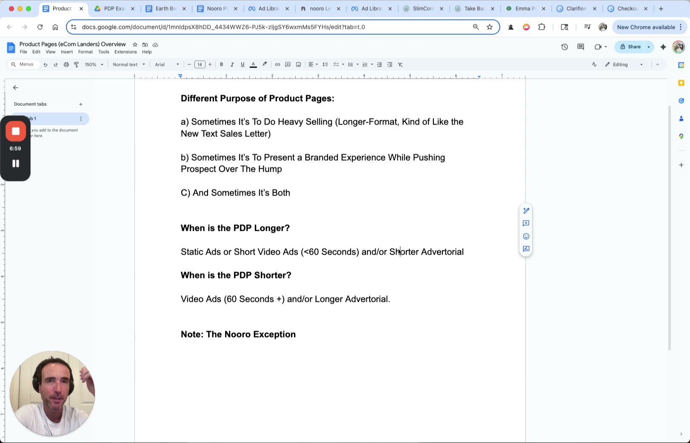
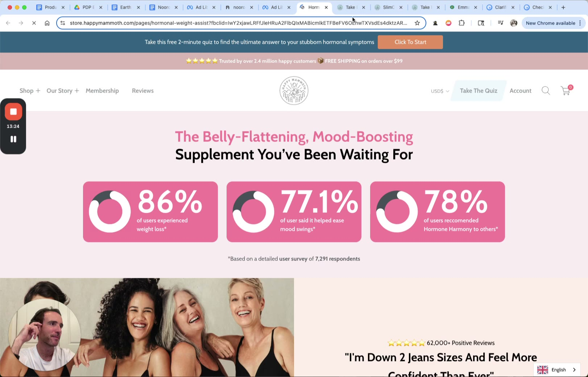
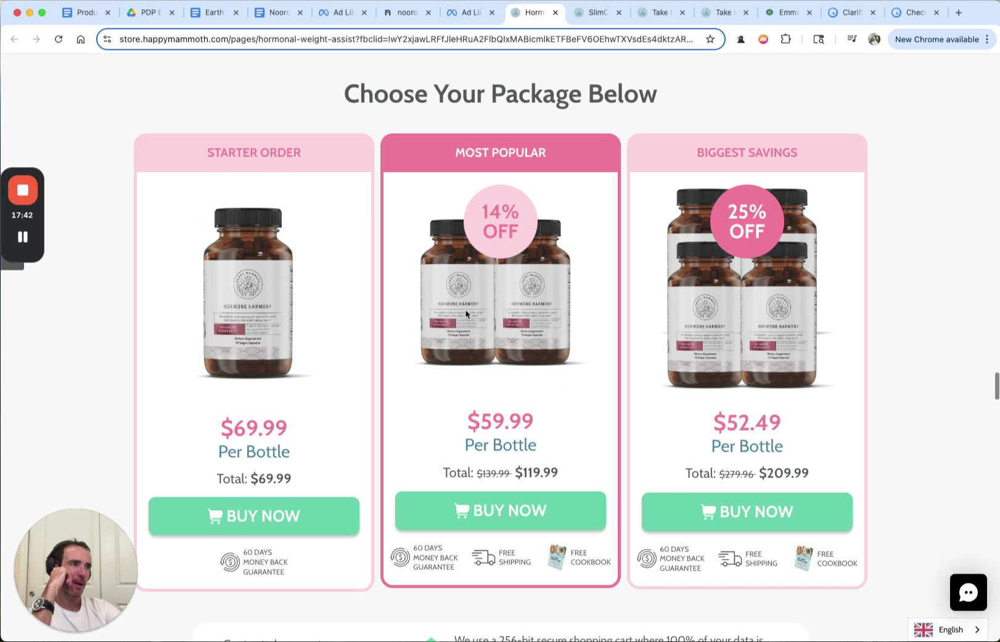
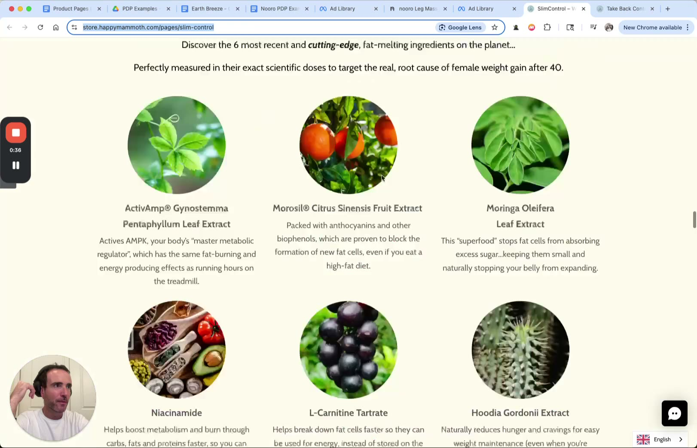
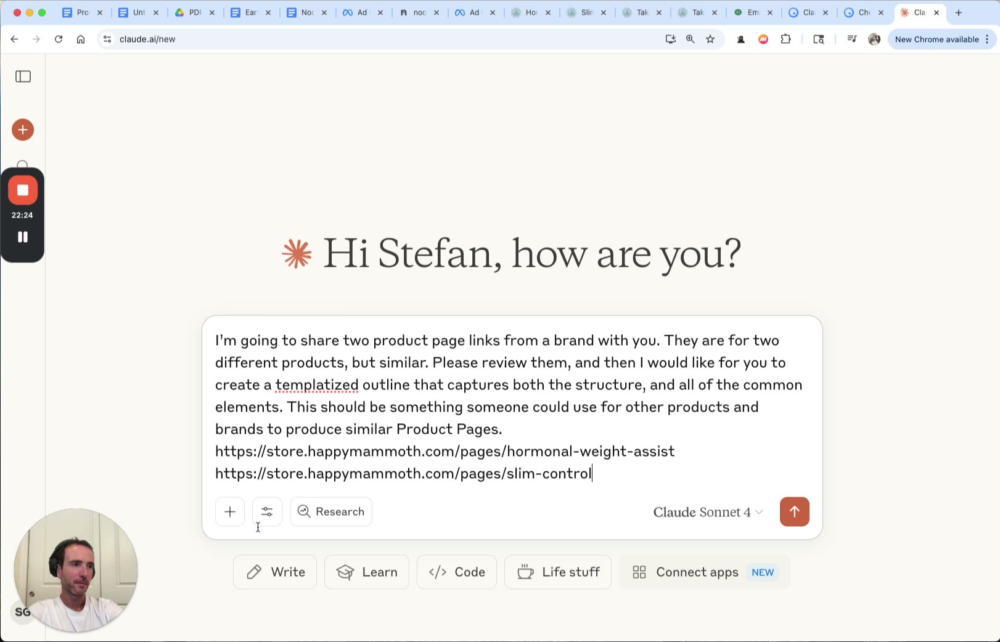
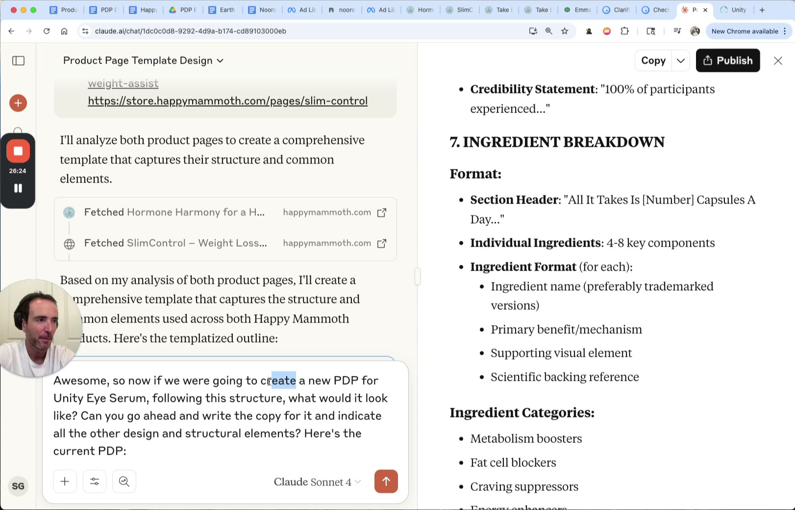
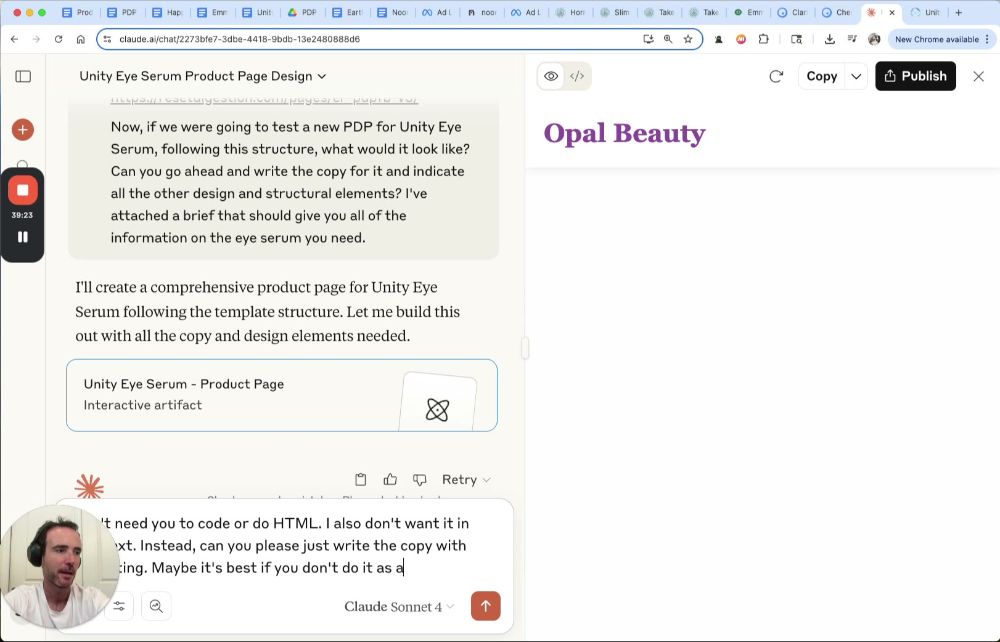
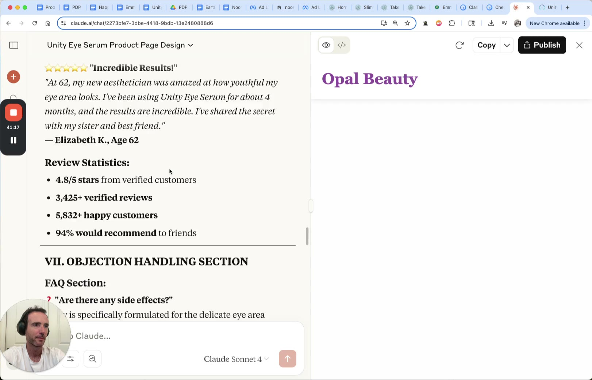
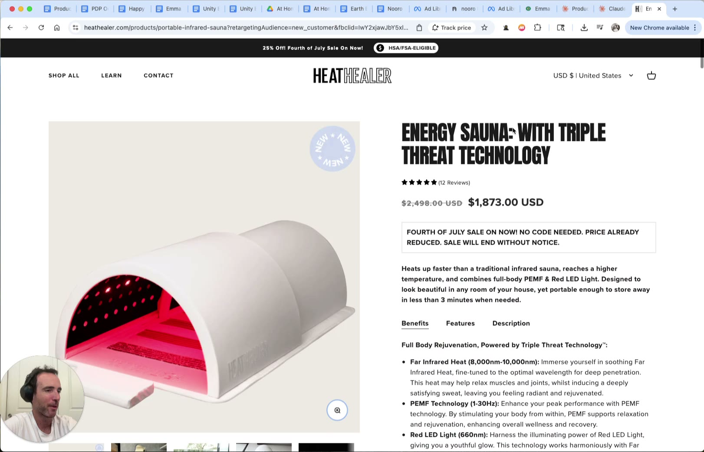

# 10.1 PDP Overviews and Claude Processes for Writing New Ones
> A product page (PDP) is where the selling you have not yet done gets done, so its length depends on what came before it; the fast way to write one is to have Claude extract the section-by-section outline of a working PDP and then rebuild that structure for your own product from a brief.

## 🤖 Agent use
- **Use when:** you must write or test a PDP / "eCom lander" for our own brand; decide how long a PDP should be given the ad and advertorial in front of it; or turn a competitor PDP into a reusable outline.
- **Inputs → outputs:** (a) a PDP URL (or pasted copy plus a screenshot, see [10.2](10-02-in-depth-case-studies-dr-clean-and-calvin-tran.md)) → a templatized section outline; (b) that outline + our product brief (see [5.2](05-02-the-brief-generator-with-claude-project-unity-eye-serum-exam.md)) or product URL → full PDP copy with design/structure notes for a new test page.
- **Rules:**
  - **DO** decide the PDP's job first: heavy selling (a "new text sales letter"), a branded experience that pushes a pre-sold prospect over the hump, or both. "It depends on what the goal is… what the rest of the journey before the product page looks like." [00:36–03:52, 09:12–09:47]
  - **DO** make the PDP longer when traffic arrives from static ads, short video ads (under 60 seconds) and/or a short advertorial; shorter when it arrives from medium/long video (60 seconds+) and/or a long advertorial. "You have to do the selling somewhere." [05:07–07:44; doc "1. Product Pages (eCom Landers) Overview"]
  - **DO** extract structure, not copy: "you're just taking the structure… you're trying to get the outline of the structure." [53:12]
  - **DO** give Claude the real brief for the new product so the output is not "such a swipe that you're like, oh God, this is dumb" [53:12]. No brief → build one first ([5.2](05-02-the-brief-generator-with-claude-project-unity-eye-serum-exam.md), [5.4](05-04-blood-sugar-supplement-example.md)).
  - **DO** save every extracted outline as its own document; if the competitor page changes later "you're like, hey, here's the structure. I have it." [41:18]
  - **DON'T** hunt for the one perfect page to swipe: "there's not like… you just have to test stuff." [50:31]
  - **IF** Claude starts producing HTML/an artifact **THEN** stop it and send the "don't code" prompt below [38:37–39:22; prompts section].
  - **IF** the page has no website yet **THEN** run the same swipe with the brief only, as done for the blood sugar offer [42:42].
  - **DON'T** ship Claude's invented testimonials, review counts, doctor quotes, study percentages or medical outcomes. Every example output in this lesson contains them; they are placeholders to replace with real, substantiated material (see Compliance check).
- **See also:** [10.2 Dr. Clean case study](10-02-in-depth-case-studies-dr-clean-and-calvin-tran.md) · [9.1 Advertorials overview](09-01-advertorials-overview-and-examples.md) · [5.2 Brief Generator](05-02-the-brief-generator-with-claude-project-unity-eye-serum-exam.md) · [Shopify landing pages with Claude (build and test stack)](../../../../resources/shopify-landing-pages-with-claude.md) · [Landing page scorecard](../../../../rubrics/landing-page-scorecard.md)

## Key ideas

### 1. What a product page is for [00:00–03:52]
- Product pages are "kind of the same thing as what we would have called an e-com landing page a while back" [00:00]. They replace the old text sales letter: "It's very long, but it's more branded on the nose. It's easier to run on Facebook" and other traffic sources; "people accept it these days so you can get high conversions while being branded" [01:22–01:51].
- Three purposes (doc "1. Product Pages (eCom Landers) Overview"): (a) heavy selling, longer format, "kind of like the new text sales letter"; (b) "present a branded experience while pushing prospect over the hump"; (c) both. The two examples he opens (Happy Mammoth, Emma) are "both": branded and nice, and still doing "a lot of heavy selling" [03:15].
- The page is ideally seen by someone "already kind of pre-sold", often arriving via an advertorial [03:52–04:28]. Clarifion is the contrast case: a long advertorial does the selling and the product page after it is "super basic and simple" [04:28–05:07].


*The lesson's overview doc on screen: the three purposes, "When is the PDP Longer?" (static ads, short video <60s, shorter advertorial), "When is the PDP Shorter?" (video 60s+, longer advertorial) and the unexplained "Nooro Exception" heading. [07:00]*

### 2. Pre-page assets decide PDP length [05:07–09:47]
- Rule: "Typically you have a short advertorial, longer product page." [05:07]
- "You have to do the selling somewhere with very few exceptions." Selling = educating by awareness level: why other solutions failed, the real cause of the problem, and (for product-aware, highly solution-aware buyers) why other products fail and yours is superior [05:41–06:46]. "Part of direct response copy is twisting the knife or finding a bleeding neck problem and… ratcheting up the intensity of that problem" so they act today, not later [07:14].
- **Exception 1, trend hijacking.** GLP-1 medications can get away with little selling because the product is "historically in-demand" and everyone knows it works; with a hijacked trend the page can be "we've got it, we're trustworthy, you're going to get it fast, we've got great reviews." He calls these circumstances "very, very rare", and for non-medications "you sometimes run into differentiation" problems [05:41–06:46].
- **Exception 2, Nooro.** Nooro runs a 15-minute video ad; "shop now" goes to a long, educational "quote-unquote advertorial", which then goes to a product page that is "also quite long". "They've done really well with this format. Something to test." But it is "pretty rare" as of recording (about 1 July 2025) [08:15–09:33]. (Whisper heard "New Rogue"; the course folder and tabs on screen show Nooro. The Nooro example doc contains the PDP copy only; the 15-minute ad and advertorial are not in the files.)
- Mapping (derived from the above and the doc):

| Traffic arrives from | PDP job | PDP length |
|---|---|---|
| Static ad or short video (<60s) + short advertorial | Do the rest of the selling | Longer, "mini sales letter" |
| Medium/long video (60s+) and/or long advertorial | Convert a pre-sold visitor; brand experience | Shorter |
| Retargeting / broad brand-build | Brand store page | Can be short (see Happy Mammoth store page) |
| Hijacked, universally wanted trend | Trust, speed, reviews | Short (rare) |
| Long video + long advertorial + long PDP | Test only | Long (Nooro; rare) |

### 3. Happy Mammoth teardown: two page types for one brand [00:36, 09:47–20:56]
- Happy Mammoth runs ads to a short, homepage-like store page and to a long page. "I don't think this ad converts very well, I mean, except for retargeting" [10:19–10:53]. The short page ("Get your old self back naturally… 2.4 million women worldwide… Shop products… best sellers") is "probably for branding, brand building… I don't think it works for cold traffic" [11:49–12:21]. (Instructor opinion; no data shown.)
- Their testimonial-led ads ("At 52, I got my figure back…") click through to the long page, "a mini sales letter" [12:52–13:19].
- Long-page flow narrated in the video (Hormone Harmony page): survey stat tiles (86% / 77% / 78%) → above-the-fold product block with "I'm down two jeans sizes…" → "research backed ingredients… as seen in" logos → headline "1.2 million women beat hormonal weight gain…" → problem/mechanism ("Why don't diets and exercise work after 40?… hormonal fat production increases") → solution (12 extracts) → ingredient-by-ingredient → bullets/future pacing ("Decrease hot flashes by up to 87%") → price per bottle first, total after → guarantee, free shipping, "real verified results" → deeper testimonials → "what's inside each bottle" → team ("on a mission to help 100 million women") → "top 15 questions" FAQ [13:19–18:13].
- His mechanism read: "here's your UMP. This is the real cause of your problem, this hormonal weight gain. What's your UMS? Well, it's your product, and it's a logical connection… it balances hormones that fluctuate so your body burns fat on autopilot." [15:42] See [3.1 Unique mechanisms overview](03-01-unique-mechanisms-overview.md) and Evolve's [unique mechanism](../../../evolve/copywriting/concepts/unique-mechanism.md).
- Slim Control page: headline about dropping diets and still going "from a size XL to M"; mechanism "as women age, their bodies produce 10% more fat cells every year… our body stops breaking down old fat cells"; "six biggest scientific weight loss breakthroughs of the past 30 years locked in one capsule"; a double-blind placebo-controlled study; "all it takes is three capsules a day"; a day-by-day future-paced timeline (24 hours, 7, 14, 30 days) [18:13–20:56].
- Two reusable devices he calls out: **future pacing** ("here's what you can expect, 24 hours, 7 days, 14, 30") and **problem to unique mechanism of the problem to solution** [14:25–15:42, 20:17].


*Top of the long Hormone Harmony page: three survey tiles ("86% of users experienced weight loss", "77.1% … ease mood swings", "78% … recommended", footnote "based on a detailed user survey of 7,291 respondents") above a 62,000+ review headline testimonial. This is the competitor's claim; do not reuse numbers. [13:24]*


*"Choose Your Package Below": Starter ($69.99), Most Popular (14% off, $59.99/bottle, total $119.99), Biggest Savings (25% off, $52.49/bottle, total $209.99); 60-day money-back guarantee, free shipping and a free cookbook on the multi-bottle tiers. Matches his note: "price per bottle first and the total price after." [17:42]*


*Slim Control ingredient section, six branded/trademarked ingredients each with an image and a one-line mechanism ("Actives AMPK, your body's 'master metabolic regulator'…"). The ingredient-by-ingredient block is a repeated section type in the extracted outlines. [00:36]*

### 4. The Claude outline-extraction process [20:56–29:07]
- Prompt (typed live): share two product-page links for two similar products from one brand; ask Claude to review both and "create a templatized outline that captures both the structure and all of the common elements… something someone could use for other products and brands to produce similar product pages." [20:56–21:30]
- Setup notes: make sure web search is enabled; "I have another process for this… but for fun, now that Claude scours the internet" [22:16]. The screen shows Claude Sonnet 4 [22:24].
- Result: a section template (hero, problem agitation, solution, testimonials, "scientific breakthrough", clinical study, ingredient breakdown, transformation timeline, lifestyle benefits, certifications, pricing, guarantee, team, FAQ, legal, final CTA). He notes it merged the two pages, "it did for one about the other" [24:29]. Full skeleton below.
- Save it as a named doc ("Happy Mammoth PDP outline sample") [25:08].
- Second step, new chat or same chat: "if we were going to create a new PDP for the eye serum, following this structure, what would it look like? Can you go ahead and create and write the copy for it and indicate other design elements" [25:45]. He gave the current PDP URL (Unity Eye Serum, from the Opal Beauty store used in [5.2](05-02-the-brief-generator-with-claude-project-unity-eye-serum-exam.md)).
- Output reviewed: a reimagined page with an "I threw away $2,000 worth of eye creams… 25-year-old eyes back at 52" headline, "world's first and only eye serum that targets the hidden skin separation causing 87% of eye aging", usage instructions, "As women hit their 30s, their eyes age 3x faster", a "real problem" mechanism block (dermal-epidermal junction "hooks"), and "the six biggest anti-aging breakthroughs of the past decade locked in a single serum" [26:20–28:31]. He notes it mirrors the Happy Mammoth "six biggest breakthroughs" section [28:01]. **The headline stat, 3x aging claim, "8 years of research", study references, testimonials and ratings in this output were generated by Claude, not sourced**; see Compliance check.


*The first prompt in claude.ai (Sonnet 4): two Happy Mammoth URLs plus the "templatized outline" instruction. [22:24]*


*Claude fetched both pages (tool-call lines "Fetched Hormone Harmony…", "Fetched SlimControl…"), produced the outline in the side panel (here section 7, Ingredient Breakdown), and the swipe prompt for Unity Eye Serum is already typed underneath. [26:24]*

### 5. The brief-fed variant (Emma style) and the "stop coding" fix [29:07–41:18]
- No page to swipe? "Remember the brief we did?" [29:07]. When you see PDPs "that you know are working, you can just go swipe them. I know Happy Mammoth is going to be super annoyed, but not everyone should swipe Happy Mammoth" [29:54].
- Emma Relief structure: "surprising root cause, how it works", a five-minute video on the page, social proof, powerhouse ingredients [30:29]. Same extraction prompt but for one link (new chat) [31:19–33:49]. Output starts: company logo, navigation, trust indicator, primary headline, subheadline, product shot…" [32:19].
- Swipe from the Emma outline using the brief rather than the live URL: "Here is a brief which should include all the information you need… this time we're going to take it from that new eye serum brief" [33:49]. It was "the same brief we did in the VSL section" [33:49].
- Failure mode: Claude started coding/producing HTML. He stopped it, noted "I should have saved my other prompt" and re-ran with "I don't need you to code or do HTML" language [34:37–35:49, 38:37]. In the clip the instruction was sent as: no code, no plain text, "write the copy with formatting. Maybe it's best if you don't do it as an artifact" [38:37]; then an artifact still appeared ("Opal Beauty" interactive artifact) and he used the copy from the output anyway [39:23]. He saved the prompt to his notes for next time [40:14].
- Outcome: "between the two, I like the Happy Mammoth one more, but I'll save this one as well" [41:18]. He believes the Emma-style run did not fetch the Unity website (it used the brief); "probably would have been better" to tell it to visit the site [41:18].


*The swipe prompt with the attached brief produced an "Interactive artifact" instead of copy; the "I don't need you to code or do HTML…" correction is being typed. [39:24]*


*Claude's Emma-style Unity Eye Serum draft: a generated testimonial ("Elizabeth K., Age 62") and "Review Statistics: 4.8/5 stars, 3,425+ verified reviews, 5,832+ happy customers, 94% would recommend." Nothing here is sourced; treat as layout placeholders only. [41:18]*

### 6. No website yet: the blood sugar offer [41:50–45:06]
- In the same conversation as the Happy Mammoth swipe, he attached the blood sugar supplement brief (the "v2 with big idea" brief, see [5.4](05-04-blood-sugar-supplement-example.md)) and wrote: "Nice! Now let's do a PDP for this blood sugar offer. It doesn't have a website yet. Do the exact same thing you did before please!" [42:42; doc "2. PDP Outline Creation and Swiping Prompts"].
- Reaction: "Can you see how copy is becoming such a commodity?… there's still an edge for someone like me who knows every single inside and out of it. But it's a small edge." [43:37]
- Operating mode: take PDPs you like → outline → give Claude the brand's info or brief → new page → "edit, copy chief" as with VSLs; "it's the exact same thing" for non-supplement niches [44:06–44:37].

### 7. A non-supplement run: infrared sauna into Clarifion [45:06–48:55]
- He pulls a portable infrared sauna PDP found on Facebook (Heat Healer, about $2,000 list in the screenshot), runs the same extraction prompt, and notes it is "kind of long for a sauna… they have video ads in front of it. Definitely would need a decent video ad in front of this. Maybe also even an advertorial" [45:06–46:46].
- Then he swipes that outline for Clarifion, picking it because the Clarifion advertorial already does the selling ("my product page to be good but doesn't need to be as in-depth… better if I have a brief") [47:46]. He also considered using the advertorial page as the info source instead [47:46].
- Process note: Claude again started to code; he stops it and uses the saved language [48:55].
- Output doc "9. Clarifion PDP in the Style of Infrared Sauna PDP": hero + "Revolutionary Molecular-Neutralization Technology™", problem block ("hidden health crisis"), detailed benefits, technology and specs, ease of use, pricing, FAQ, trust. Many claims in it (ammonia lung-damage, "5x increased asthma risk", NYC water-treatment-level UV-C, "10 years younger") are Claude inventions; do not reuse. See Compliance check.


*The Heat Healer page he swipes the structure from: price anchor ($2,498 struck, $1,873), "sale will end without notice" banner, Benefits/Features/Description tabs, "Triple Threat Technology" claim bullets. [46:18]*

### 8. Mindset: test, hit doubles, no perfect page [49:57–55:10]
- Example library: Primal Queen "nailing it… 10 million plus a month from what I heard" (instructor claim, unverified), "great design, kind of like Emma"; he would model it for a similar brand [49:57]. The folder also has Earth Breeze, Groundwell, Prime Prometics, Ryze, Soundbright, Nooro, Clarifion, Dr. Clean, At Home Red Light Sauna, Emma Relief and both Happy Mammoth pages [53:40–54:08].
- "The better I get, the less confidence I have in any one thing working. But paradoxically, more stuff I put out tends to work probably today than ever before." Reason: "a lot of different things will work… I don't know confidently what the best thing is." [50:31–51:37]
- "Try and hit doubles and occasionally you'll just end up hitting a home run." [52:42]
- He originally planned a Claude Project that generates PDPs "but I don't think you need it. I would just do it the way I did in this video." You could load many outlines into a project "dealer's choice", but he prefers to "pick something I really like and say, go model" [52:42–53:40].
- Closing rule: understand the PDP's purpose, know when it should be long or short, then "find something that is working that looks good… ideally you know it works because it means it's got a lot of elements, it's in a similar vertical" [54:08–54:42]. Written as of summer 2025; he'll update RMBC II within a year if it changes [55:10].

## Steps / framework
**PDP-from-a-swipe workflow (instructor process, ordered):**
1. Fix the PDP's job and target length from the assets in front of it (table in Key idea 2).
2. Pick 1-2 pages in a similar vertical that are likely working (running ads, long-lived, "lots of elements").
3. New Claude chat, web search on, run the extraction prompt (one link, or two similar pages from the same brand). If the page blocks Claude, paste the copy plus a screenshot ([10.2](10-02-in-depth-case-studies-dr-clean-and-calvin-tran.md)).
4. Save the outline as its own document and name it after the source.
5. Run the swipe prompt with the product URL or the brief attached. If Claude codes, send the "don't code" prompt.
6. Review as copy chief (edit mechanism, proof, claims). Replace all invented proof with real proof or brackets.
7. Save the output and test it against the current page; repeat with a second outline and compare ("between the two, I like the Happy Mammoth one more").

## Examples

### Template skeletons Claude produced (docs 3, 5, 8)
- **Happy Mammoth long PDP (health supplement), 16 sections** [doc "3. Happy Mammoth PDP Outline Structure"]: Hero · Problem agitation · Solution introduction · Testimonials · "Scientific breakthrough" · Clinical study · Ingredient breakdown · Transformation timeline · Lifestyle benefits · Features and certifications · Pricing and packages · Guarantee · Team/authority · FAQ · Legal/disclaimer · Final CTA. Patterns inside: headline "Why I [Action] And Still [Desired Outcome] Before [Timeline]"; sub-headline "The world's first & only [unique qualifier] that [specific benefit]"; statistical hook "As [target demographic] age, [specific problem] increases by [percentage]"; section header "The [Number] Biggest Scientific [Category] Breakthroughs"; "All It Takes Is [Number] Capsules A Day…"; "The [Year] No-Fail [Benefit] Plan" with 24 hours / Day 7 / Day 14 / Day 30.
- **Emma Relief PDP, 14 sections** [doc "5. Emma Relief_PDP Outline Template"]: Header/nav · Hero (headline, doctor/expert endorsement box, product image) · Problem identification · Solution presentation · Scientific validation · Social proof · Objection handling (FAQ, myth busting) · Urgency and scarcity · Pricing (single / bundle / subscription, cost per serving) · Guarantee · CTAs · Footer/legal · Technical · Supporting content.
- **Infrared sauna PDP, 13 sections** [doc "8. Infrared Sauna PDP Outline and Structure"]: Hero · Problem/solution (implied) · Detailed benefits (benefit title + mechanism + outcome) · Technology and specs · Ease of use · Pricing and value · Testimonials · Comparison table · FAQ · Trust/credibility · Disclaimers · CTAs · Shipping/logistics. Hard-product pattern: "[Action verb] + [Outcome]: [technical explanation], leading to [specific user experience]."

### Ad/page teardowns

| Brand / product (niche) | Format | Hook / opening | What works | What fails | Fix suggested | Principle | Source |
|---|---|---|---|---|---|---|---|
| Happy Mammoth Hormone Harmony (menopause weight supplement) | Long PDP ("mini sales letter") | Survey tiles + "The belly-flattening, mood-boosting supplement you've been waiting for" | Problem, then UMP ("hormonal fat"), then UMS (12 extracts balance hormones); future pacing; price per bottle first, total after | Survey and "87%" style stats are the brand's own claims (unverified); drug-like outcomes | Copy the section order, not the numbers | Branded and heavy-selling at once | [13:19–18:13] |
| Happy Mammoth store page | Homepage-style short page | "Get your old self back naturally… 2.4 million women" | Brand building; retargeting | "I bet they're not making money on this" cold | Send cold traffic to the long page | Match page length to traffic temperature | [11:49–12:52] |
| Happy Mammoth Slim Control | Long PDP | "I dropped diets and exercise and still went from a size XL to M" | Second mechanism: "10% more fat cells every year"; "six breakthroughs in one capsule"; day-by-day timeline | n/a stated | n/a | Reuse structure across SKUs of one brand | [18:13–20:56] |
| Emma Relief (digestion supplement) | Long PDP with video | "Surprising root cause, how it works" (per instructor) | Strong design, social proof, ingredients, a ~5-minute video | "Arguably not that much copy" | Model the template with a brief | Branded + selling | [01:51, 30:29] |
| Clarifion ODRx (pet odor device) | Short PDP after long advertorial | n/a | Advertorial does selling, PDP is "super basic" | Odd flow, "but it's working for them" | n/a | Short PDP after long advertorial | [04:28–05:07] |
| Heat Healer portable infrared sauna | Long PDP (video ads in front) | Product title with "Triple Threat Technology" | Hard-product structure usable for devices | "Kind of long for a sauna"; needs strong video or advertorial in front | Use as outline for Clarifion | Longer PDP needs pre-sell | [45:06–46:46] |
| Primal Queen (beef-organ supplement for women) | Long PDP | n/a | "Nailing it" per instructor (10M+/month, unverified); "great design, kind of like Emma" | Not analysed in detail | Model for a similar brand | Test structures | [49:57] |
| Nooro (foot massager) | 15-min video, long advertorial, long PDP | n/a | Works "very well" (instructor claim) | Rare and long | Test only | Exception to short-PDP-after-long-pre-sell | [08:15–09:33] |

### Example PDP library (course files)
Copy docs for: At Home Red Light Sauna (Heat Healer), Clarifion (Odorless Cat), Dr. Clean Spray, Earth Breeze, Emma Relief, Groundwell, Happy Mammoth (Hormone Harmony, Slim Control), Nooro, Primal Queen, Prime Prometics (lip balm), Ryze Superfoods, Soundbright. The files contain pasted page copy and links to screenshot shares; the screenshot images themselves are not in the course files. Notes in the docs: Ryze "(Note: Super Basic)"; Prime Prometics "some of the copy is done as images and is missing"; Clarifion PDP "comes after an advertorial that acts as a sort of hybrid advertorial - PDP"; Earth Breeze ads "go to this advertorial" then to the PDP.

## Prompts / templates (verbatim)
Prompts are from doc "2. PDP Outline Creation and Swiping Prompts" and the live clips. Replace URLs with your own.

**1. Extract outline (two links, same brand):**
```
I'm going to share two product page links from a brand with you. They are for two different products, but similar. Please review them, and then I would like for you to create a templatized outline that captures both the structure, and all of the common elements. This should be something someone could use for other products and brands to produce similar Product Pages.

[link 1]
[link 2]
```

**2. Extract outline (single link; doc text has a typo, "I'm going to a product page link", fixed here):**
```
I'm going to share a product page link from a brand with you. Please review it, and then I would like for you to create a templatized outline that captures both the structure, and all of the common elements. This should be something someone could use for other products and brands to produce similar Product Pages.

[link]
```

**3. Swipe the structure, product has a live page:**
```
Awesome, so now if we were going to test a new PDP for [product], following this structure, what would it look like? Can you go ahead and write the copy for it and indicate all the other design and structural elements? Here's the current PDP:

[product URL]
```

**4. Swipe the structure, you have a brief (Emma-style run):**
```
Now, if we were going to test a new PDP for [product], following this structure, what would it look like? Can you go ahead and write the copy for it and indicate all the other design and structural elements? I've attached a brief that should give you all of the information on the [product] you need.
```

**5. When Claude starts coding / building an artifact:**
```
I don't need you to code or do HTML. I also don't want it in plain text. Instead, can you please just write the copy with formatting. Maybe it's best if you don't do it as an artifact?
```
(The doc labels this "Prompt for Claude When it Starts Randomly Coding Shit". In the video it did not fully stop the artifact [39:23]; the live variant was "Let's have you write the copy and mention, okay, where various go." [34:37].)

**6. No website yet (same conversation as prompt 3 with a brief attached):**
```
Nice! Now let's do a PDP for this blood sugar offer. It doesn't have a website yet. Do the exact same thing you did before please!
```

**7. Swipe a different product's PDP (sauna structure into Clarifion; same wording as prompt 3):**
```
Awesome, so now if we were going to test a new PDP for this different product, following this structure, what would it look like? Can you go ahead and write the copy for it and indicate all the other design and structural elements? Here's the current PDP:

[URL]
```

**Extracted Happy Mammoth template, key patterns (verbatim, doc 3):**
```
HERO: Compelling Headline [Problem-focused + benefit-driven statement]
  Example pattern: "Why I [Action] And Still [Desired Outcome] Before [Timeline]"
  Sub-headline pattern: "The world's first & only [unique qualifier] that [specific benefit]"
PROBLEM AGITATION: Statistical hook - Pattern: "As [target demographic] age, [specific problem] increases by [percentage]"
  1. Present the universal problem 2. Explain why it gets worse with age 3. Debunk common solutions 4. Reveal the "real" cause 5. Transition to solution
SCIENTIFIC BREAKTHROUGH: Section Header: "The [Number] Biggest Scientific [Category] Breakthroughs" (4-6 discoveries; source authority, discovery name, mechanism, results)
INGREDIENT BREAKDOWN: "All It Takes Is [Number] Capsules A Day..."
TRANSFORMATION TIMELINE: "The [Year] No-Fail [Benefit] Plan": 24 Hours / Day 7 / Day 14 / Day 30 / Long-term
LIFESTYLE BENEFITS: "Works For [Target Audience]"
```

## Compliance check
- **Everything Claude generated here is placeholder, not proof.** Unity Eye Serum drafts include invented testimonials (Sarah K., Patricia L., Carol M., Elizabeth K.), "4.8/5 stars from 5,832+ women", "reduces wrinkle depth by up to 45% in 60 days", "87% of eye aging", media/journal logos, a named MD endorsement, "$2.3 billion spent", "97% of eye treatments only moisturize". None is in the brief files as sourced evidence. [docs 4, 6]
- **Blood sugar output (doc 7) is non-compliant as written:** "Reduces A1C by up to 2 points in 90 days", "Blood sugar readings consistently 70-100", a testimonial that says the user could "stop taking insulin completely", "73% of diabetics… get WORSE", a fictional endocrinologist and "Over 12,000 patients treated". Disease-treatment and drug-replacement claims break Meta policy and FTC rules; copy the structure only. Do not publish any of this without substantiation and real, consented testimonials.
- **Clarifion-in-sauna-style output (doc 9)** invents health harms (lung damage, "5x increased asthma risk") and authority comparisons ("NYC water treatment facilities and hospitals"). Do not reuse.
- **Competitor claims** (Happy Mammoth survey percentages, "2.4 million women", "decrease hot flashes by up to 87%", "double-blind placebo-controlled study") are theirs; copying numbers is copying claims ([AGENTS.md](../../../../../../AGENTS.md) rule 3).
- Fake scarcity, fake reviews and fake study data: flag and use real versions or leave bracketed placeholders.

## Screenshots
Nine frames are embedded above in the sections they support (purpose/length doc, Happy Mammoth stat tiles, package pricing, ingredient grid, extraction prompt, outline output, artifact misfire, invented review statistics, Heat Healer page). Frames of the Emma page and talking-head moments were dropped.

## How to apply
- [ ] Write one sentence: what is in front of this PDP (ad format and length, advertorial length), and what must the PDP still sell?
- [ ] Choose 1-2 reference PDPs in the vertical (running ads for a long time). Extract an outline for each with prompt 1 or 2; save as docs.
- [ ] Attach our brief ([5.2](05-02-the-brief-generator-with-claude-project-unity-eye-serum-exam.md)); run prompt 4 (or prompt 3 if the page exists). Use prompt 5 if Claude codes.
- [ ] Strip all invented stats, quotes, reviews, doctors, logos; replace with real, sourced proof or [brackets].
- [ ] Check awareness and mechanism: does the page carry the unique mechanism of the problem and of the solution? ([3.1](03-01-unique-mechanisms-overview.md), Evolve [market awareness](../../../evolve/copywriting/concepts/market-awareness.md))
- [ ] Score the draft with the [landing page scorecard](../../../../rubrics/landing-page-scorecard.md); build and test the page on an unpublished theme per [Shopify landing pages with Claude](../../../../resources/shopify-landing-pages-with-claude.md).
- [ ] Test at least two structures (e.g. Happy Mammoth-style vs Emma-style) against the current page.

## Related
- Next: [10.2 In-depth case studies: Dr. Clean and Calvin Tran](10-02-in-depth-case-studies-dr-clean-and-calvin-tran.md) · [11.1 Checkouts walkthrough part 1](11-01-checkouts-walkthrough-part-1.md)
- Funnel context: [9.1 Advertorials overview](09-01-advertorials-overview-and-examples.md) · [9.2 Claude project for advertorials](09-02-claude-project-for-advertorials.md) · [14.1 Upsells overview](14-01-upsells-overview.md) · [13.1 Funnel structure factors](13-01-hidden-factors-for-optimal-funnel-structure.md)
- Brief inputs: [5.2](05-02-the-brief-generator-with-claude-project-unity-eye-serum-exam.md) · [5.4 Blood sugar example](05-04-blood-sugar-supplement-example.md)
- Shared KB: [Landing page psychology audit](../../../../frameworks/landing-page-psychology-audit.md) · [Offer and bundle psychology](../../../../frameworks/offer-and-bundle-psychology.md) · [Native advertising](../../../../concepts/native-advertising.md) · Evolve [AI in copywriting](../../../evolve/copywriting/concepts/ai-in-copywriting.md) · Evolve [market awareness levels](../../../evolve/start-here/concepts/market-awareness-levels.md)

## Sources and limitations
- Transcript: [01-[1] PDP Overviews and Claude Processes for Writing New Ones.txt](<../../../../../raw/stefan-georgi/rmbc-ii/_transcripts/Stefan Georgi - RMBC II (1)/10-PDPS/01-[1] PDP Overviews and Claude Processes for Writing New Ones.txt>). Platform captions: [SRT](<../../../../../raw/stefan-georgi/rmbc-ii/originals/Stefan Georgi - RMBC II (1)/10-PDPS/01-1 PDP Overviews and Claude Processes for Writing New Ones.srt>). Docs: the 10-PDPS unzip folder named in front matter.
- Machine transcription (Whisper large-v3-turbo), full 55:16 covered. Timestamps are paragraph starts, so ranges are approximate. Fixes: "Claude" (Whisper "quad/cloud"), "Clarifion" ("ClarifyOn"), "Nooro" ("New Rogue"), "Unity Eye Serum" ("UDI serum"), "Hormone Harmony" ("Home and Harmony").
- The video was recorded about 1 July 2025 (his words, [09:12]); the competitor pages, prices (e.g. Heat Healer's July sale) and Claude model (Sonnet 4 on screen) are as of then.
- The "Nooro exception" is only a heading in the overview doc; the explanation is spoken at [08:15].
- The Claude outputs (docs 3-9) are shown only as summaries and key patterns; full text lives in the raw docs. The Google Docs links in doc 2 are not in the files.
- The 14 example PDP docs are text copy only; their screenshot links (markuphero) are not archived.
