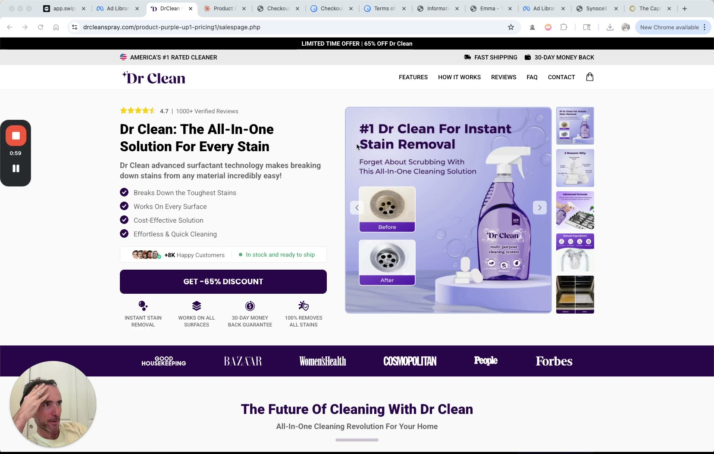
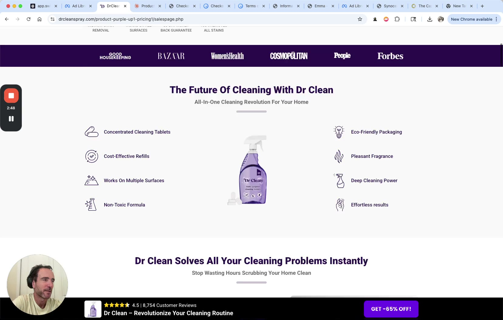
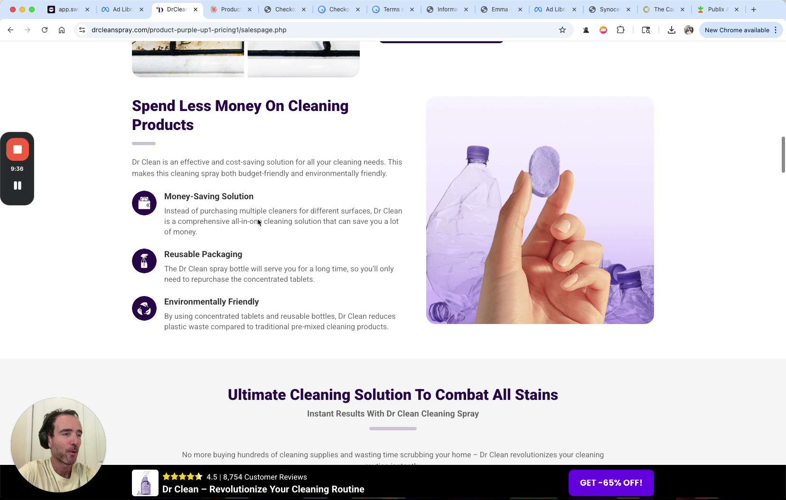
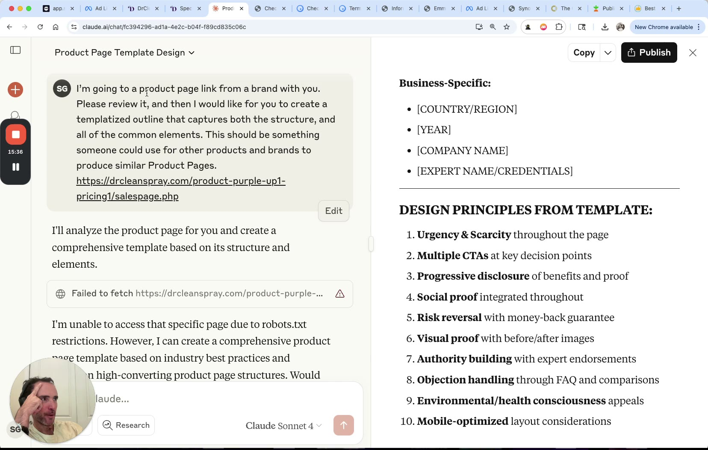
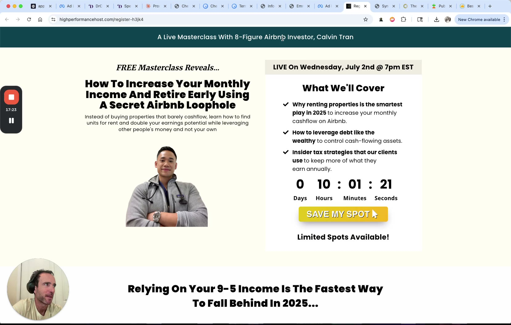
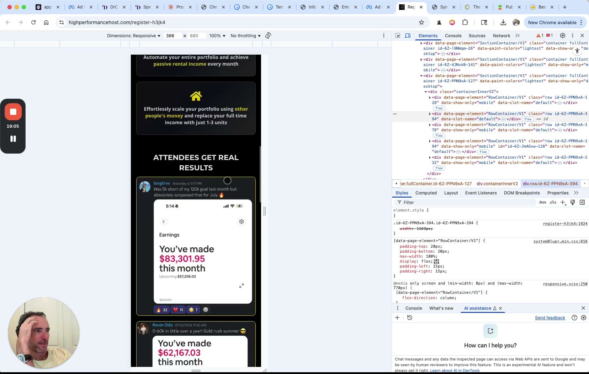

# 10.2 In-Depth Case Studies - Dr. Clean and Calvin Tran
> A section-by-section read of one "classic" e-com/direct-response hybrid product page (Dr. Clean) and one short webinar-registration page (Calvin Tran), showing which elements to copy, where the copy leaves money on the table (no explicit price comparison), why mobile is what you must review, and how to template a page Claude cannot fetch.

## 🤖 Agent use
- **Use when:** you need a template for a physical-product PDP with a clean, branded look and direct-response sales elements; you are auditing a PDP for missed copy opportunities; or you are building a free-training / webinar registration page.
- **Inputs → outputs:** a PDP (URL or pasted copy + above-the-fold screenshot) → a 20-section templatized outline with [BRACKETED] variables (see Prompts); a registration page URL → short-page pattern for a "show up live" offer.
- **Rules:**
  - **DO** use this template for physical products (and neutra/supplements): it is "really sexy and really nice… a really classic template" and "a really nice hybrid of e-com… clean… looks e-commercey, but has all these direct response elements." [00:26, 02:59]
  - **DO** review every page on mobile first. "Probably these days, most sales come from mobile… overwhelmingly. Like 80%, 70% to 90%… In some cases, 100%" (instructor claim, check your own data). [18:30]
  - **DO** keep a sticky CTA bar, especially on mobile: "when I'm ready to buy, it's always here" rather than adding button after button. [06:12–06:41]
  - **DO** make the CTA label match the offer headline. Dr. Clean's button says "Get -65% discount", not "buy now", "which is congruent with this up here" (the "65% off" banner). [03:28]
  - **DO** put the price comparison on the page when the price looks high next to grocery cleaners: "One bottle replaces six single bottles and you're going to save money." [10:05–10:41]
  - **DO** test a phone number in the header when you do not run affiliate traffic. [01:25–02:28, 14:58]
  - **DON'T** put a phone number up if affiliates send you traffic: "your affiliate doesn't want you to have a phone number… somebody… calls customer service, sells the person, the affiliate doesn't get any money." [01:57–02:28]
  - **DON'T** write "money-saving solution" copy without numbers: "That's like not good copy… show, don't tell." [08:29–10:05]
  - **IF** Claude cannot fetch the page (robots.txt) **THEN** paste the page copy as plain text and attach one or more screenshots of the above-the-fold area. [15:35–16:35]
  - **DON'T** judge a registration page by its desktop view if nearly all traffic is mobile: "Nobody's ever seen this page besides me." [19:01]
- **See also:** [10.1 PDP overviews and Claude processes](10-01-pdp-overviews-and-claude-processes-for-writing-new-ones.md) · [11.1 Checkouts part 1 (Dr. Clean checkout)](11-01-checkouts-walkthrough-part-1.md) · [9.1 Advertorials](09-01-advertorials-overview-and-examples.md) · [Landing page scorecard](../../../../rubrics/landing-page-scorecard.md) · [Shopify landing pages with Claude](../../../../resources/shopify-landing-pages-with-claude.md)

## Key ideas

### 1. Why this lesson exists [00:00–00:54]
- He recorded the first PDP video, felt good about it, then while shooting checkouts and upsells with the same brands decided to "take a little more time to talk about some of the interesting page elements." He picks the Dr. Clean page because "it's a really clean lander", and adds a webinar registration page because the first pass "was a little too fast and flippant." [00:00–00:54]
- Note: he got to this page from a native ad (see [9.1](09-01-advertorials-overview-and-examples.md), [12.2 Native ads](12-02-native-ads.md)); the course link is the clean URL, but the live traffic came through an affiliate [01:25–01:57].

### 2. Dr. Clean, top to bottom (desktop) [00:54–14:58]
- **Header stack.** Black announcement bar "LIMITED TIME OFFER | 65% OFF Dr Clean" (urgency plus savings), then a trust strip "America's #1 rated cleaner · Fast shipping · 30-day money back", then nav (Features, How it works, Reviews, FAQ, Contact, cart). The nav items scroll to sections of the same page, "a very common element for nice e-com-ish product pages" [00:54–02:59].
- **Phone number.** None in the header. Reasoning: this page was reached from native traffic that is affiliate-run; affiliates do not want a phone line. A non-affiliate brand "might have to test it; it could help conversion rate." A number does appear in the footer [01:25–02:28, 14:58].
- **Hero.** "4.7 | 1000+ verified reviews", headline "Dr. Clean: The All-In-One Solution For Every Stain", sub-head "advanced surfactant technology makes breaking down stains from any material incredibly easy", four check bullets (breaks down toughest stains / works on every surface / cost-effective solution / effortless & quick cleaning), "+8K happy customers" with "in stock and ready to ship", a CTA "Get -65% discount", four icon claims, and a before/after hero carousel [02:59–03:58].
- **Repetition is on purpose.** Works on all surfaces, instant stain removal and guarantee repeat in the hero, icon row and later sections; "it might be a little bit repetitive, right? But that's okay… key value propositions that are going to be repeated consistently." [05:06]
- **Credibility layer.** Press-style logo strip (Good Housekeeping, Bazaar, Women's Health, Cosmopolitan, People, Forbes), a chemist/cleaning-product-tester testimonial, 5-star testimonials. He doubts the logos' basis: "Did they write articles about them? Were there ads that showed up on them through native advertising? Not completely clear. But this is all for credibility." [04:34–05:41]
- **Features grid ("The Future of Cleaning with Dr. Clean").** Eight items: concentrated cleaning tablets, eco-friendly packaging, cost-effective refills, pleasant fragrance, works on multiple surfaces, deep cleaning power, non-toxic formula, effortless results. A **sticky bottom bar** (rating, product name, "Get -65% off!") stays on screen while scrolling [05:41–06:41].
- **Problem/solution blocks.** "Dr. Clean solves all your cleaning problems instantly. Stop wasting hours scrubbing your home": three blocks (targets all challenges; quickly and easily removes stains; spend less money on cleaning products) [06:12–08:29].
- **How it works.** "Remove any stain in three easy steps": prepare the spray (tablet dissolved in water in the bottle), spray, wipe. He admits he missed on repeat views that the product is refillable tablets: "I didn't notice that… even just skimming" [07:21–07:55, 11:10–11:44]. Lesson: the key mechanism (tablet-plus-reusable-bottle) was under-communicated.
- **Social proof, comparison, reviews.** "Let the results speak for themselves" testimonials; "One cleaning spray to get rid of all stains" icon bar; "The Gold-Standard Cleaning Solution: No other cleaning product compares" comparison table; more reviews loaded from Trustpilot and a "bestconsumersreview.com" page: "It's like a random affiliate page… so who is actually going to check that out? Hardly anybody… but it looks good." A "Jessica Reynolds" tester testimonial: "Probably not real." [11:44–13:08] (instructor opinion; neither claim verified in the files)
- **Close.** FAQs, "Buy with confidence, 100% risk-free" guarantee, footer repeating the key points: "It's repetitive, but it's really hitting a lot of points." [13:08–13:47]


*Top of the Dr. Clean page: announcement bar, "#1 rated / fast shipping / 30-day money back" strip, nav, 4.7-star review line, headline and sub-head, four check bullets, "+8K happy customers · in stock", "GET -65% DISCOUNT" button, icon row and before/after carousel; press logos start below. [01:00]*


*"The Future of Cleaning with Dr. Clean": the eight-feature grid around the product shot, then "Dr. Clean Solves All Your Cleaning Problems Instantly". The black bar at the bottom (4.5 stars, 8,754 reviews, "GET -65% OFF!") is the sticky CTA. [02:48]*

### 3. The biggest miss: no price comparison [07:21–11:10, 13:47–14:58]
- Context from the checkout module ([11.1](11-01-checkouts-walkthrough-part-1.md)): he first thought $19.95 for one bottle was "outrageously expensive" next to grocery all-purpose cleaners (about $4.99-$5.99 at Instacart/Target/Publix [08:56]). Revisiting the PDP he realised "the single bottle comes with like six tablets… technically, it's actually like six bottles for $19.99. So it's actually cheaper than a cleaner. But they don't make that clear." [09:05–09:33]
- Math he states at the 3-bottle level: roughly 12 cleaners for about $34, "less than $3 a cleaner" (he says $34 then "I just worked $36, but whatever") [13:47–14:23].
- Why it matters: the 65% discount exists "because there is a sticker shock", and "it shouldn't be. It's actually a great value. The problem is they don't explain it very well." [14:23–14:58]
- Fix he prescribes: put on the PDP or checkout "one bottle replaces six single bottles… three bottles replaces 15 bottles and you're going to save money", plus a pricing row in the comparison table. "It makes it way easier for me to justify the cost." [10:05–10:41, 12:19]
- Copy critique of the "Spend less money on cleaning products" block: generic claims ("Dr. Clean is an effective and cost-saving solution… budget-friendly and environmentally friendly") say nothing a skimmer can verify. Show the per-use price instead [08:29–10:05].


*The "Spend Less Money On Cleaning Products" block he criticises: "Money-Saving Solution / Reusable Packaging / Environmentally Friendly" with no per-bottle price or comparison. The tablet photo is the only hint of the real value (six bottles of cleaner per tablet pack). [09:36]*

### 4. Using Claude when a page blocks it [15:35–16:35]
- First attempt: Claude replied it could not access the page because of robots.txt, and offered to (1) build a generic template from best practice or (2) analyse pasted sections (doc "3. Claude Convo History for Dr. Clean Template").
- Fix: paste the page's copy as plain text (Ctrl/Cmd+Shift+V) and attach an above-the-fold screenshot. "Claude kind of knew what the copy was… and then it created the template." You can also attach several screenshots [15:35–16:35].
- Output: "High-Converting Product Page Template", 20 sections with variables. A skeleton is under Prompts.


*Claude's "Failed to fetch… robots.txt" notice under the extraction prompt, with the finished template in the side panel (the "Key template variables" list and "Design principles from template", item 1 "Urgency & Scarcity throughout the page" through item 10 "Mobile-optimized layout"). [15:36]*

### 5. Calvin Tran: a short registration page, and why mobile decides [16:35–21:38]
- Different job: "a landing page and not a product page." Offer: free live virtual workshop on Airbnb investing; the only goal is a signup and a show-up [16:35–17:19, 21:05].
- **Desktop** view: header "A live masterclass with 8-figure Airbnb investor, Calvin Tran", "FREE masterclass reveals… how to increase your monthly income and retire early using a secret Airbnb loophole", "Live on Wednesday, July 2nd @ 7pm EST", "What we'll cover" bullets, a countdown, "Save my spot" button and "Limited spots available!" [17:19; read from the screenshot].
- **Mobile** (Chrome inspect, 366px wide): no CTA visible above the fold in the emulator (maybe visible on a real phone; a sticky CTA exists). The mobile page is a different, tighter script: "seven-figure" (not eight-figure) Airbnb investor; "How I built my seven-figure Airbnb portfolio without owning any property or using my own money"; "Avoid risking your own capital"; "Spots limited, act fast"; bio "former medical professional turned seven-figure Airbnb investor… hundreds of other professionals"; six mechanism bullets (find high-profit deals in any market using "my 75-55 rule", secure funding at zero percent interest, automate the portfolio, passive income, scale using other people's money, replace your full-time income with one to three units); then "Attendees get real results" with earnings screenshots [17:19–20:30; transcript says "75-55"; screen text not captured].
- Conclusion: "If you're trying to emulate what Calvin does… on desktop… you're probably going to miss out", because roughly 85% of people (his estimate) only see the mobile page [20:30]. "Why is it short? Because all you're trying to do is go watch this live virtual workshop… it's free, and you sign up (first name, last name, email, phone number)". Then they text and email to maximise show-up and close on the webinar [20:30–21:05].
- Follow-on: the high-ticket webinar bonus in module 16 with "Dylan" (surname unclear: captions say "Bandness", Whisper "Vannis") covers webinar process and best practices [21:05–21:38]. Not part of this lesson's files.


*Desktop registration page: two-column hero with the hook headline, "What we'll cover" bullets, a live countdown and a yellow "SAVE MY SPOT" button; below it the "Relying on your 9-5 income is the fastest way to fall behind in 2025" problem section. [17:24]*


*The same URL in Chrome's mobile emulator (366px): dark theme, stacked benefit cards ("Effortlessly scale your portfolio using other people's money…") and an "Attendees get real results" section of earnings screenshots. The earnings figures are the advertiser's claims; do not reuse. [19:06]*

## Steps / framework
**Auditing a PDP with the Dr. Clean lens (derived from the lesson):**
1. Header: urgency/savings bar, trust strip, in-page nav, phone (only if not affiliate traffic).
2. Hero: rating + review count, headline "[Product]: The [Superlative] Solution For [Main Problem]", mechanism sub-head, four benefit bullets, customer count + stock, CTA that echoes the offer.
3. Trust layer: press logos only if real, testimonials, before/after.
4. Feature grid (8) → three problem/solution blocks → how it works (3 steps).
5. Check: is the price justified in numbers on the page (per-use, per-bottle, versus category)?
6. Comparison table, reviews, FAQ, guarantee, final CTA with scarcity only if true.
7. Sticky CTA on mobile.
8. Review on mobile first; screenshot it.

## Examples

### Ad/page teardowns

| Brand / product (niche) | Format | Hook / opening | What works | What fails | Fix suggested | Principle | Source |
|---|---|---|---|---|---|---|---|
| Dr. Clean (all-purpose cleaning tablets and spray) | Long e-com/DR hybrid PDP | "Dr. Clean: The All-In-One Solution For Every Stain" with "65% OFF" bar | Clean look plus DR elements; CTA copy matches offer; sticky CTA; repeated value props; before/afters; comparison table | Price looks high ($19.95 single) vs $5 cleaners; "spend less money" copy is generic; refillable-tablet mechanism easy to miss; no phone (affiliate reason) | Explicit "one bottle = six cleaners" and per-cleaner price comparison; test phone number if non-affiliate | Show, do not tell the value | [00:54–14:58] |
| Calvin Tran (live Airbnb masterclass registration) | Short registration LP (desktop vs mobile versions) | "A live masterclass with 8-figure (desktop) / seven-figure (mobile) Airbnb investor" | Short; one action (sign up); countdown; scarcity of live date; social proof; mobile-specific script | Desktop page is rarely seen; no CTA above fold in the emulator | Judge on mobile; follow up by SMS/email to lift show-up | One page, one job | [16:35–21:38] |

### Claims to treat with care (record, do not copy)
- "America's #1 rated cleaner", "4.7 / 1000+ verified reviews", "+8K happy customers", the press-logo strip, "up to 65% off" and a "scarcity/stock" frame. The instructor himself calls some bits "totally bullshit, but it looks good" and doubts the tester persona [12:19–13:08].
- Calvin Tran: "seven-figure / eight-figure Airbnb investor", earnings screenshots, "zero percent interest funding", "replace your full-time income". Biz-opp earnings and funding claims need substantiation and typical-results disclosures (FTC income-claims rules; Meta business-opportunity policy). Copy the single-goal registration structure only.

## Prompts / templates (verbatim)

**Extraction prompt (same as [10.1](10-01-pdp-overviews-and-claude-processes-for-writing-new-ones.md); doc "3. Claude Convo History"):**
```
I'm going to share a product page link from a brand with you. Please review it, and then I would like for you to create a templatized outline that captures both the structure, and all of the common elements. This should be something someone could use for other products and brands to produce similar Product Pages.

[product page URL]
```
(The document text reads "I'm going to a product page link"; typo fixed.)

**Fallback when Claude cannot fetch the page** (the user's follow-up in the doc, after pasting the page copy and attaching an above-the-fold screenshot):
```
okay here's the copy attached. And here's a screenshot of the above the fold.
```

**Dr. Clean template skeleton Claude produced, 20 sections (doc "2. Dr. Clean PDP Template", condensed with its bracketed patterns):**
```
1. TOP ANNOUNCEMENT BAR: [URGENCY MESSAGE] | [DISCOUNT PERCENTAGE] OFF [PRODUCT NAME]
2. HEADER: trust badges row ([AUTHORITY CLAIM] e.g. "America's #1 Rated [Product Category]", [SHIPPING BENEFIT], [GUARANTEE]); nav (FEATURES, HOW IT WORKS, REVIEWS, FAQ, CONTACT); star rating + review count
3. HERO: [PRODUCT NAME]: The [SUPERLATIVE] Solution For [MAIN PROBLEM]
   Subheadline: [PRODUCT NAME] [UNIQUE TECHNOLOGY/METHOD] makes [SOLVING PROBLEM] incredibly easy!
   4 checkmark benefits: [PRIMARY] [VERSATILITY] [COST] [EASE]; "+[X]K Happy Customers"; "In stock and ready to ship"; CTA: Get -[X]% Discount
4. TRUST INDICATORS ROW (4 icons)
5. MEDIA GALLERY (product shots, before/after, usage, lifestyle)
6. FEATURES: "The Future Of [CATEGORY] With [PRODUCT NAME]" - 8-feature grid (icon + name + description)
7. PROBLEM/SOLUTION: "[PRODUCT NAME] Solves All Your [PROBLEM CATEGORY] Instantly / Stop [CURRENT FRUSTRATING BEHAVIOR]" - 3 blocks (core problem, efficiency, cost)
8. HOW IT WORKS: "Ultimate [Product Category] To Combat All [Problems] / Instant Results With [Product Name]" - 4 mechanism explanations
9. STEP-BY-STEP: "[Solve Problem] With [Product Name] In [X] Easy Steps"
10. SCROLLING TESTIMONIAL BANNER
11. CUSTOMER TESTIMONIALS: "Let The Results Speak For Themselves / Discover Why People Are Choosing [Product Name]" (3-4 with photo, name, 2-4 sentences, stars)
12. BENEFIT HIGHLIGHTS BAR (6)
13. COMPARISON TABLE: "The Gold-Standard [Product Category] / No Other [Product Category] Compares"
14. DETAILED REVIEWS (rating, count, distribution, % recommend, 4-6 reviews)
15. AUTHORITY/EXPERT ENDORSEMENT: "[Product] was rated as the most effective [Product Category] of [Year]" - [Credible Publication/Organization]
16. FAQ
17. RISK REVERSAL: "Buy With Confidence - It's 100% Risk-Free!"
18. FINAL CTA: "[Country/Region]'s #1 Rated [Product Category] UP TO [X]% OFF FOR A LIMITED TIME ONLY!" + "This limited-time deal is in high demand and stock keeps selling out."
19. FOOTER   20. REVIEW POPUP/MODAL
```
Agent note: items 2 (authority claim), 15 (rated most effective of [Year]) and 18 (scarcity) are slots for **true** statements only. If there is no real rating, award or stock constraint, delete the slot.

**Price-comparison block to add (derived from the lesson, fill with real numbers):**
```
One [bottle/kit] = [N] [units]. That's $[price per unit] each vs $[category price] at [store].
[3-pack] = [N] units, $[total], $[per unit] each.
```

## Screenshots
Six frames embedded in the sections above: Dr. Clean hero, feature grid and sticky CTA, money-saving block, the Claude template run, and the Calvin Tran desktop and mobile registration pages. Talking-head and duplicate scroll frames were dropped.

## How to apply
- [ ] Open the PDP we are auditing on a phone-width viewport first; list every above-the-fold element.
- [ ] Add a CTA bar that stays visible on mobile and whose label matches the headline offer.
- [ ] Compute the per-use or per-unit price and put it on the page next to the category comparison.
- [ ] Decide phone number: yes if no affiliates; no if affiliates sell on the page.
- [ ] If Claude cannot fetch a competitor page: paste text plus a screenshot, then use the Dr. Clean-style template skeleton.
- [ ] Remove all unverified authority lines (press logos, "#1 rated", expert quotes) until we have a real source.
- [ ] For webinar/lead pages: one CTA, one field set, mobile-specific copy, then SMS/email reminders.

## Related
- Previous: [10.1 PDP overviews](10-01-pdp-overviews-and-claude-processes-for-writing-new-ones.md) · Next: [11.1 Checkouts walkthrough part 1](11-01-checkouts-walkthrough-part-1.md) (Dr. Clean checkout, price discussion) · [11.2 Checkouts part 2](11-02-checkouts-walkthrough-part-2.md)
- Traffic into this page: [12.2 Native ads](12-02-native-ads.md) · [9.1 Advertorials](09-01-advertorials-overview-and-examples.md)
- Upsell follow-on (same brand): [14.2 Upsells case studies](14-02-upsells-case-studies.md)
- Shared KB: [Landing page psychology audit](../../../../frameworks/landing-page-psychology-audit.md) · [Landing page scorecard](../../../../rubrics/landing-page-scorecard.md) · Evolve [comparisons](../../../evolve/copywriting/concepts/comparisons.md) · Evolve [show, don't tell](../../../evolve/copywriting/concepts/show-dont-tell.md) · [Shopify landing pages with Claude](../../../../resources/shopify-landing-pages-with-claude.md)

## Sources and limitations
- Transcript: [02-[2] In-Depth Case Studies - Dr. Clean and Calvin Tran.txt](<../../../../../raw/stefan-georgi/rmbc-ii/_transcripts/Stefan Georgi - RMBC II (1)/10-PDPS/02-[2] In-Depth Case Studies - Dr. Clean and Calvin Tran.txt>); platform captions: [SRT](<../../../../../raw/stefan-georgi/rmbc-ii/originals/Stefan Georgi - RMBC II (1)/10-PDPS/02-2 In-Depth Case Studies - Dr Clean and Calvin Tran.srt>). Docs: the 10-PDPS "02-2" unzip folder.
- Machine transcription (Whisper large-v3-turbo), full 21:53 covered; timestamps are paragraph starts. Fixes: "Dr. Clean" ("doctor clean"), "Claude" ("quad"), "Calvin Tran" (Whisper "Calvin Chan" once), "Dylan Bandness" per captions (Whisper "Dylan Vannis"; surname not confirmed).
- Claims about mobile share (70-100%), the affiliate/phone-number mechanism and the authenticity of Dr. Clean's reviewer personas are instructor statements without data in the files. The single-bottle "six tablets" equivalence is his reading of the page ("I think the single bottle comes with like six tablets" [09:33]); the tablet count per pack is not stated in the extracted page copy.
- The "Calvin Tran" 75-55 rule is quoted from audio only. Part of the desktop page was not captured.
- The Dr. Clean template doc is a Claude output built from pasted page copy; its testimonial/authority slots are generic, not data from Dr. Clean.
