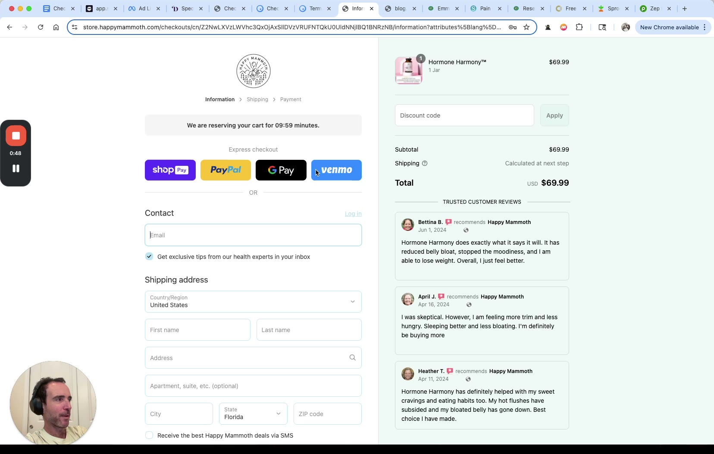
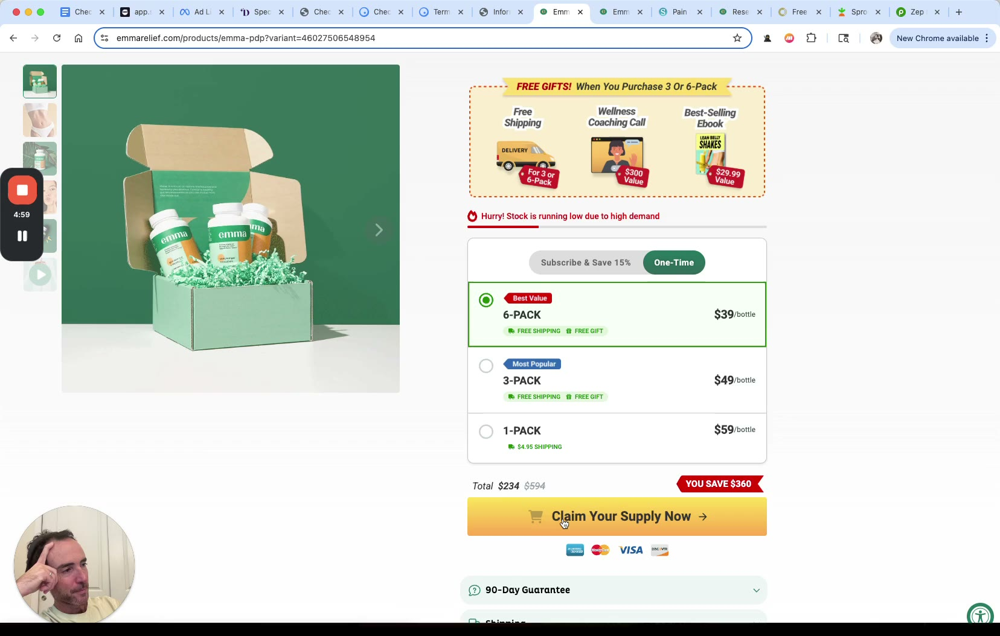
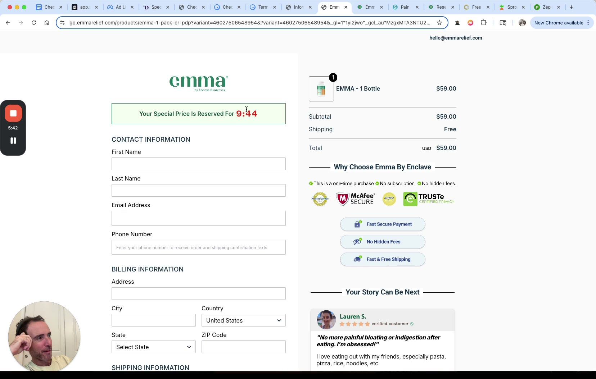
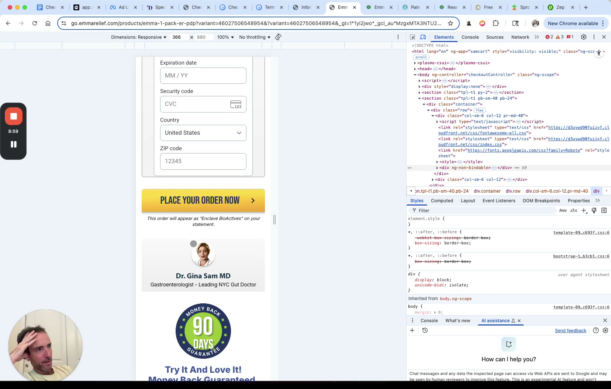
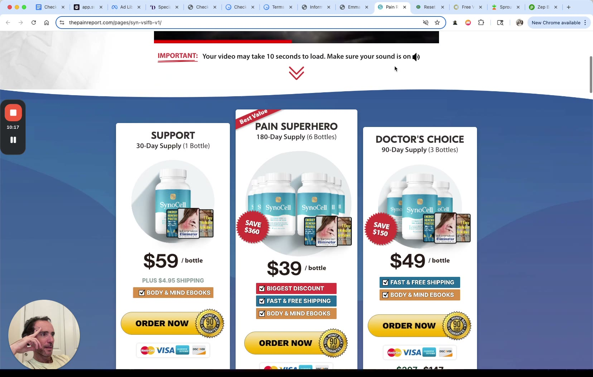
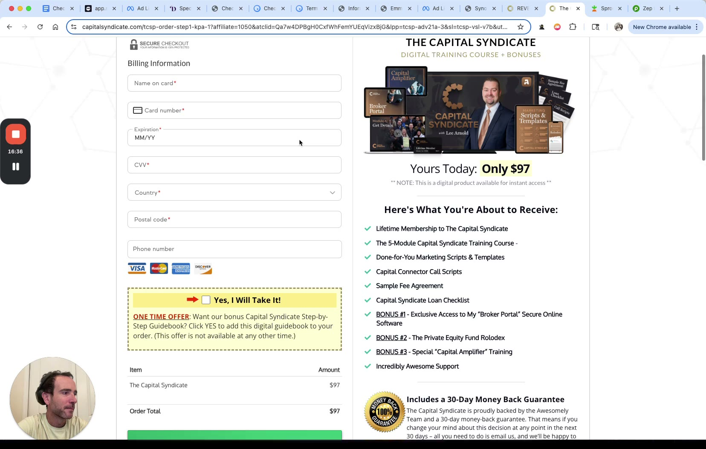
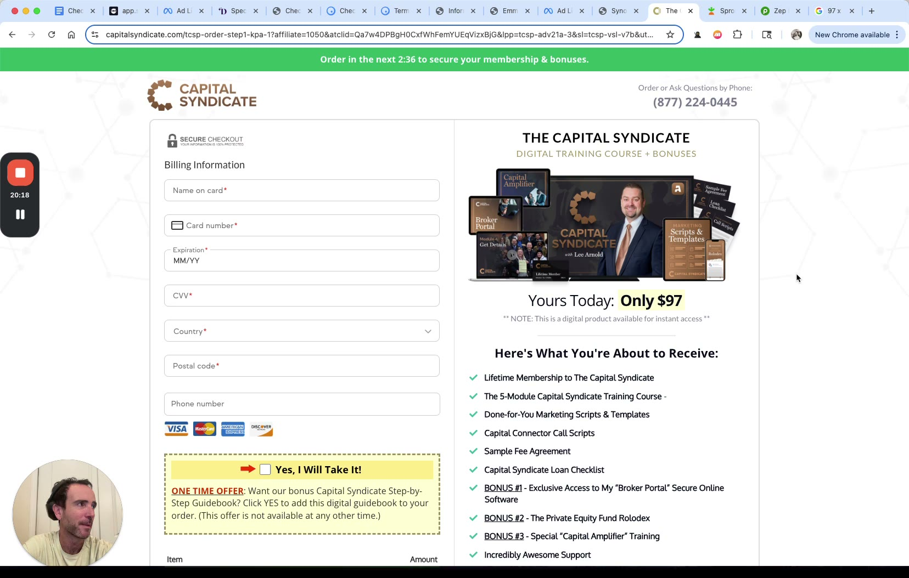

# 11.2 Checkouts Walkthrough (Part 2)
> Four more live checkouts (Happy Mammoth, Emma, SynoCell, Capital Syndicate) show the same toolkit (timer, testimonials, guarantee, "no subscription" line, phone number) and one hard rule: an order bump can raise pre-upsell AOV while lowering total funnel AOV, so test it against your upsell.

## 🤖 Agent use
- **Use when:** building or auditing a checkout for a supplement, physical product or digital offer; deciding whether to add an order bump; writing checkout reassurance copy; or choosing whether to put a phone number and testimonial dates on the checkout.
- **Inputs → outputs:** the offer, price ladder, upsell(s), guarantee and traffic source → a checkout spec (elements, order, microcopy) and a test list; competitor checkouts → teardown rows below.
- **Rules:**
  - **DO** put "one-time purchase, no subscription, no hidden fees" on the checkout if it is true: Emma does ("This is a one-time purchase · No subscription · No hidden fees"). "I don't know why other brands aren't doing this. That alone, if you're a brand, probably pays for RMBC 100 times over." (instructor claim) [05:49]
  - **DO** write the button as a claim of the offer: "Claim your supply now", not "buy now". "What is on this button actually does really matter… add to cart, buy now, try risk-free, claim your supply now… these things actually do make a difference." [04:47]
  - **DO** keep testimonials on the checkout; they "push you over the edge… further validate the purchase". [01:13, 05:49]
  - **DO** keep testimonials current. Happy Mammoth's checkout reviews are all from 2024; "get some from 2025 so I'm not like, oh, is this old, are people still buying this?" Undated testimonials last longer, dated ones need regular updates. [01:13–01:44, 22:02]
  - **DO** test a phone number in the checkout header when you do not run affiliates. "If affiliates are running to your page they don't want a phone number here… the call center will sell them… the affiliate… didn't get paid." [13:34–14:07]
  - **DO** test an in-checkout quantity toggle (1 / 3 / 6) so buyers can see the per-bottle saving and raise AOV. [07:04]
  - **DO** put the strongest reassurance (guarantee, doctor/spokesperson, "no subscription") above the button on mobile; he would bet "probably like a 10% lift at least" (instructor bet, untested). [08:56–09:27]
  - **DON'T** assume an order bump helps. It can lower total AOV if it cannibalises a bigger upsell. Run the math (below) and A/B it. [16:30–19:32]
  - **DON'T** hide a subscription. "You don't really want to hide it from consumers. Many people have done that, made lots of money, but super shady and not sustainable long term… but you also don't want to hammer them." [21:35]
  - **DON'T** assume "risk-free trial" language converts: people are "really burned" on subscriptions; he suspects it "probably doesn't work as well" and says it is still worth testing. [03:45–04:19]
  - **IF** you run an advertorial to a VSL to a digital offer **THEN** add instant-access wording ("digital product available for instant access") so buyers do not expect shipping. [12:52]
- **See also:** [11.1 Checkouts part 1](11-01-checkouts-walkthrough-part-1.md) · [14.1 Upsells overview](14-01-upsells-overview.md) · [14.2 Upsells case studies](14-02-upsells-case-studies.md) · [10.1 PDP overviews](10-01-pdp-overviews-and-claude-processes-for-writing-new-ones.md) · [Offer and bundle psychology](../../../../frameworks/offer-and-bundle-psychology.md)

## Key ideas

### 1. Happy Mammoth: classic Shopify checkout [00:00–03:00]
- Happy Mammoth's flow: "classic Shopify checkout", a countdown timer for scarcity, all the Shop options (Shop Pay, PayPal, Google Pay, Venmo), a two-step flow (information, then continue to shipping and payment), then testimonials in the sidebar. "Why are these here? It helps to push you over the edge… 'oh man, $69', but then 'hey, it really works.'" [00:29–01:13]
- Shipping options: overnight, two to three days; a payment step with card and address. He uses a throwaway test address, then goes back to buy later to see the upsells [02:25–02:54].
- Improvement: all sidebar testimonials are dated 2024. "If you think about the average person's experience… even though they saw an ad, they're like, maybe this brand's not around anymore." Refresh with 2025 reviews [01:13–01:55]. He notes (with a laugh) that Shop's saved details had linked a stranger's phone number to the test address [02:54].


*Happy Mammoth, step 1: "We are reserving your cart for 09:59 minutes", Express checkout (Shop Pay, PayPal, Google Pay, Venmo), contact and shipping fields, and a right-hand order summary (Hormone Harmony, 1 jar, $69.99) with a "Trusted customer reviews" stack dated Jun/Apr 2024. [00:48]*

### 2. Emma: risk-free ad, one-time order, custom checkout [03:09–10:00]
- **Ad-to-advertorial finding.** Some of Emma's new ads go to an advertorial and push a "risk-free" one-bottle trial. He first suspected a one-bottle subscription test but "it's not actually for a subscription." The "risk-free" framing is probably for retargeting; he assumes it works less well because "people are really burned on subscriptions. That's one of your big takeaways for today." [03:09–04:19] (see [9.1 Advertorials](09-01-advertorials-overview-and-examples.md))
- **PDP selector.** Subscribe & save 15% vs one-time (default one-time in his run), 6-pack "Best Value" ($39/bottle), 3-pack "Most Popular" ($49/bottle), 1-pack ($59/bottle + $4.95 shipping), free gifts for 3 or 6 packs, "Total $234 (was $594), You save $360", button "Claim your supply now". "What's the take rate, 50% probably?" (guess) [04:19–05:18]
- **Custom checkout, not Shopify**, but it looks like one: a "Your special price is reserved for 9:44" timer, contact/billing/shipping form, order summary, "Why choose Emma by Enclave" block with trust badges and "This is a one-time purchase · No subscription · No hidden fees", "Your story can be next" testimonial stack, then place-order, "Try and love it" money-back block, a spokesperson doctor, and an SMS opt-in consent line. He asks whether they actually use the SMS for marketing, which "technically they need to disclose" [05:18–06:54].
- **Tests he would run:** a quantity toggle in the checkout (1 / 3 / 6, showing per-bottle price) for AOV [07:04–07:35]; moving guarantee / doctor / "no subscription" above the place-order button on mobile ("I don't believe the doctor adds that much… the guarantee is important, and reminding me there's no subscription") [08:56–09:27].
- **Phone number.** Emma shows an email, not a phone number. "I don't know if they've tested this… but why would you not let people call in? Anyone who's on the fence." Exception: affiliates [13:34–14:37].
- **Mobile.** On a Dr. Clean-type checkout (the transcript does not name it, but the "crazy amount of money for a cleaner" remark places it) the form is not above the fold on mobile, which he attributes to price shock; he normally prefers the form first [07:35–08:56]. The mobile Emma view puts the reassurance below the button [08:56].


*Emma product page: "FREE GIFTS when you purchase 3 or 6-pack" (free shipping, wellness coaching call, ebook), a stock-low bar, Subscribe & Save 15% / One-Time toggle (One-Time selected), 6-pack $39/bottle "Best Value", 3-pack $49/bottle "Most Popular", 1-pack $59/bottle, "Total $234 / $594 / YOU SAVE $360" and the "Claim Your Supply Now" button. [05:00]*


*Emma checkout, desktop: reserved-price timer (9:44), form, order summary for one bottle at $59 with free shipping, "This is a one-time purchase · No subscription · No hidden fees", security badges (Authorize.Net, McAfee Secure, TRUSTe) and the first verified-customer testimonial. [05:42]*


*Emma checkout on mobile (366px emulation): card fields, "Place your order now", a statement-descriptor line, the spokesperson doctor card and the 90-day guarantee seal, all below the fold. This is the block he would test moving up. [09:00]*

### 3. SynoCell / The Pain Report: same template, different brand [10:07–12:01]
- The Pain Report's VSL page ("syn-vslfb-v1" in the course link) offers three packages: "Support" 30-day (1 bottle, $59 + $4.95 shipping), "Pain Superhero" 180-day (6 bottles, $39/bottle, "Best value / Biggest discount", fast free shipping, Body & Mind ebooks), and "Doctor's Choice" 90-day (3 bottles, $49/bottle, free shipping). Six is in the middle; "pretty classic pricing"; each has the 90-day guarantee. He likes the package names ("Support, Pain Hero, Doctor's Choice… interesting titles") [10:07–10:44].
- He then notices the checkout is "basically the exact same template as Emma" and decides they are the same company ("Conscious… Enclave… probably Emma"; a guess from the page branding). He skips the walkthrough because it is the same checkout, so "probably the same thing instead of optimizations in the works" [11:00–12:01]. (Caption spelling "Sino cell"; the page shows "SynoCell".)


*VSL-page pricing cards: Support (30-day, $59/bottle + $4.95), Pain Superhero (180-day, 6 bottles, $39/bottle, "Best Value" ribbon, "Save $360"), Doctor's Choice (90-day, 3 bottles, $49/bottle, "Save $150"), each with a 90-day guarantee seal. [10:18]*

### 4. Capital Syndicate: digital offer, two-step checkout, order bump [12:01–20:12]
- **Funnel:** Meta ad, advertorial, VSL, "add to cart / click here to get started". Product: Capital Syndicate digital training and bonuses with Lee Arnold (scripts and templates, Capital Amplifier, broker portal). Page note: "digital product available for instant access"; he thinks they say this to head off "am I getting things in the mail?" [12:01–13:07]
- **Phone number** at the top ("Order or ask questions by phone"): "good"; this brand does run affiliates (URL has an affiliate parameter), which cuts against his earlier affiliate logic, so he does not resolve why a phone is shown [13:07–14:07] (derived observation).
- **Urgency timer:** "Order in the next 7:36 to secure your membership & bonuses." [from frame; discussed 15:07]
- **Step 1:** first name, last name, email, Continue (a low-friction first step), SSL and certification badges [15:07–15:36].
- **Step 2:** billing (name on card, card number, expiry, CVV, country, postal, phone), the price ($97), "Here's what you're about to receive" stack (lifetime membership, 5-module course, done-for-you marketing scripts and templates, call scripts, sample fee agreement, loan checklist, three bonuses), a 30-day guarantee, consent to be contacted by text/call, "Words from fellow students", and an FAQ on the checkout including "Is this a subscription or a one-time payment?" with a one-time answer [15:36–16:31].
- **Offer bump:** an unchecked "Yes, I will take it!" box for a Step-by-Step Guidebook at $27 ("One time offer… not available at any other time") on top of the $97 offer [16:31–17:09].
- **Offer-stack:** he likes the stack for a digital product, adds "it would be better if there were pictures of people" and repeats the phone number and timer points. On mobile: phone number at top, bump and stack below, FAQs; he again wants a clear "one-time purchase" line [19:32–20:52].


*The advertorial step before the VSL: video thumbnail with "WARNING: This video contains unconventional information…", headline link "Tap Into This $72 Trillion Wealth Transfer With Little More Than a Special Piece of Paper", and a long financial disclaimer footer (not self-reported earnings, results not typical). [12:36]*


*Step 2: billing fields, yellow-boxed "ONE TIME OFFER: Want our bonus Capital Syndicate Step-by-Step Guidebook?" with unchecked box, item and total at $97, and the right-hand "Here's What You're About to Receive" stack and 30-day guarantee. [16:36]*


*The same checkout page after a countdown: green "Order in the next 2:36…" banner, phone number top right, billing and bump left, product image, price and bonuses right. [20:18]*

### 5. Order-bump math: why the bump can lower funnel AOV [16:31–19:32]
- Claim: bumps raise pre-upsell AOV, "but sometimes you'll find that when you do these, they actually hurt your overall final AOV. So it's important to test this." Reason: a buyer who already added something may decline your bigger upsell (feel they "already bought something extra") [16:31–17:42].
- His worked example (hypothetical numbers):
  - Bump $27 taken by 40%: 0.40 x $27 = **$10.80** per order.
  - Upsell $97 taken by 20% (no bump): 0.20 x $97 = **$19.40** per order.
  - With the bump, only 7% take the upsell: 0.07 x $97 = **$6.79**.
  - Bump + upsell = $10.80 + $6.79 = **$17.59** < $19.40. [17:42–19:04]
- He states the shortfall as "$1.40 more"; the numbers he gives actually yield $1.81 more without the bump ($19.40 - $17.59). Use the arithmetic here, not the spoken figure.
- Conclusion: "The good thing about these offer bumps is that your conversion rate's high. The bad thing is it could actually make your AOV lower. Depending on what's in your upsells… you may want to reconsider." [19:32] Decide by measured revenue per order across the full funnel, not bump take rate alone ([14.1](14-01-upsells-overview.md), [14.2](14-02-upsells-case-studies.md)).

### 6. Subscription visibility and testimonial dates [20:52–22:20]
- Switch Emma to Subscribe & save 15%: the "no subscription" line disappears, since it now is one; the recurring terms are shown but "not a huge, really noticeable thing", with no "oh my God, it's a subscription" alarm. His line: do not hide it, do not hammer it [20:52–21:35].
- Dated vs undated testimonials: Emma's have no dates, so they age better; Happy Mammoth's carry 2024 dates. "I actually like dates, but then you kind of need to update your testimonials pretty regularly." [21:35–22:20]
- Close: "we will then go and do upsells… see you in the upsell module." [22:02]
- Side claim: he says big brands "almost always have plenty of things they could be doing" to raise revenue, and that he sees it in a paid community ("CA Pro" per captions) with "70 plus businesses all doing between three and 300 million a year" (instructor claim) [14:07–14:40].

## Steps / framework
**Checkout spec (assembled from the examples; derived):**
1. Header: logo, phone/email (phone only if no affiliates), reserved-price timer (only if real).
2. Form: 1-step or 2-step; express pay options; address autocomplete.
3. Order summary: product, quantity, shipping, total, savings; quantity toggle test.
4. Reassurance block next to the button: guarantee, "one-time purchase · no subscription · no hidden fees", payment/security badges, spokesperson/doctor (if real), statement descriptor line.
5. Social proof: 2-4 testimonials, dated only if refreshed regularly.
6. Offer stack for digital products: "Here's what you're about to receive" list, bonuses, instant-access note.
7. FAQ on checkout: "Is this a subscription or a one-time payment?"
8. Bump (if any): opt-in, low price relative to the main offer, measured against total AOV with the upsell.
9. Button: "Claim your supply now" style.
10. Mobile pass: move guarantee/no-subscription above the button; test.

## Examples

### Ad/page teardowns

| Brand / product (niche) | Format | Hook / opening | What works | What fails | Fix suggested | Principle | Source |
|---|---|---|---|---|---|---|---|
| Happy Mammoth Hormone Harmony (supplement) | Shopify 2-step checkout | Reserved-cart timer, express pay | Timer, express pay, sidebar testimonials, trusted-reviews widget | All reviews dated 2024; no savings shown | Add 2025 reviews; test undated or refreshed dates | Fresh proof | [00:29–03:00] |
| Emma Relief (digestion supplement) | Custom checkout (Shopify-like) | "Your special price is reserved for 9:44" | "One-time purchase · No subscription · No hidden fees"; testimonials; doctor; guarantee; "Claim your supply now" | Phone number missing; reassurance below the mobile button; no quantity toggle | Move guarantee and no-subscription up; add 1/3/6 toggle; test phone | Remove subscription fear; AOV on checkout | [04:47–09:27] |
| SynoCell / The Pain Report (pain supplement) | VSL page packages then Emma-like checkout | Package names "Support / Pain Superhero / Doctor's Choice" | 1-6-3 ladder with 6 in the middle; guarantee on each | Same template (no new optimization seen) | n/a | Package naming and ladder | [10:07–12:01] |
| Capital Syndicate (financial-education course) | Meta ad, advertorial, VSL, 2-step checkout | "Order in the next 7:36 to secure your membership and bonuses" | Phone number; 2-step with low-friction step 1; offer stack and bonuses; 30-day guarantee; on-checkout FAQ; $27 guidebook bump | No people photos; bump may cut total AOV; income-style claims on the VSL | Test bump vs none; add photos | Digital offer needs the stack and "instant access" | [12:01–20:52] |

### Order bump vs upsell worked example
| Scenario | Bump take | Upsell take | Bump $ per order | Upsell $ per order | Total per order |
|---|---|---|---|---|---|
| No bump | 0% | 20% | $0.00 | 0.20 x $97 = $19.40 | $19.40 |
| With $27 bump | 40% | 7% | 0.40 x $27 = $10.80 | 0.07 x $97 = $6.79 | $17.59 |
(Hypothetical rates from the video [17:42–19:04]; compute with your own take rates.)

## Prompts / templates (verbatim)
No Claude prompts in this part. Copy blocks seen on screen (use only if true):
```
Button: "Claim your supply now"  (his example of a button that "does really matter")
Trust block: "This is a one-time purchase. No subscription. No hidden fees."
Timer: "Your special price is reserved for [m:ss]"  /  "Order in the next [m:ss] to secure your membership & bonuses."
Digital-product note: "NOTE: This is a digital product available for instant access"
Bump: "ONE TIME OFFER: Want our bonus [item]? Click YES to add this digital [item] to your order. (This offer is not available at any other time.)"
Checkout FAQ: "Is this a subscription or a one-time payment?"
Header phone (only without affiliates): "Order or ask questions by phone: [number]"
```

## Compliance check
- Timers and stock bars ("Hurry! Stock is running low", reserved-price countdowns) must reflect real inventory or a real price window. The video shows Emma's page with a stock bar and a reserved-price timer and treats "fake scarcity" as common but not recommended ([11.1](11-01-checkouts-walkthrough-part-1.md) [04:04]).
- SMS opt-ins: he notes SMS check-in consent "technically they need to disclose" marketing use [06:24]. Use explicit TCPA-style consent language.
- Capital Syndicate is a financial-education/income-opportunity offer ("$72 Trillion Wealth Transfer", loans/fund access). Record the structure; do not copy its claims, and note its disclaimer footer on the advertorial.
- Spokesperson doctors and "verified customer" labels must be real and disclosed as such. Never add a doctor card without a real, consenting professional.
- Subscription disclosure: show recurring terms plainly (negative-option rules in the US make hidden recurring billing a legal risk).

## Screenshots
Eight frames embedded above (Happy Mammoth checkout, Emma product page, Emma desktop and mobile checkouts, SynoCell packages, Capital Syndicate advertorial and two checkout states). One extra frame with a typed email address was excluded.

## How to apply
- [ ] Add "one-time purchase · no subscription · no hidden fees" next to the button (if true).
- [ ] Rewrite the button to a claim-the-offer label and A/B test it against "Complete order".
- [ ] Refresh checkout testimonials with current-year reviews or remove dates.
- [ ] Decide phone number by traffic source: affiliate traffic no; own traffic test yes.
- [ ] Build an in-checkout 1/3/6 toggle test (per-bottle price visible).
- [ ] Move guarantee and no-subscription lines above the mobile button; test for 4+ weeks.
- [ ] For any bump: set a total-funnel AOV test (bump on/off) with the planned upsell before rollout ([14.1](14-01-upsells-overview.md)).
- [ ] If the checkout is off-Shopify (like Emma's), confirm tracking: Meta pixel events and click IDs must survive the custom checkout ([Shopify landing pages with Claude](../../../../resources/shopify-landing-pages-with-claude.md): "Shopify Web Pixels don't fire there, and click IDs/UTMs can be lost before checkout").

## Related
- Previous: [11.1 Checkouts walkthrough part 1](11-01-checkouts-walkthrough-part-1.md) · Next: [14.1 Upsells overview](14-01-upsells-overview.md)
- Funnel and PDP: [10.1 PDP overviews](10-01-pdp-overviews-and-claude-processes-for-writing-new-ones.md) · [10.2 Dr. Clean case study](10-02-in-depth-case-studies-dr-clean-and-calvin-tran.md) · [13.1 Funnel structure factors](13-01-hidden-factors-for-optimal-funnel-structure.md) · [9.1 Advertorials](09-01-advertorials-overview-and-examples.md)
- Shared KB: [Offer and bundle psychology](../../../../frameworks/offer-and-bundle-psychology.md) · [Risk reduction hooks](../../../../concepts/risk-reduction-hooks.md) · [Landing page scorecard](../../../../rubrics/landing-page-scorecard.md)

## Sources and limitations
- Transcript: [02-[2] Checkouts Walkthrough (Part 2).txt](<../../../../../raw/stefan-georgi/rmbc-ii/_transcripts/Stefan Georgi - RMBC II (1)/11-CHECKOUTS/02-[2] Checkouts Walkthrough (Part 2).txt>) (22:20; same text is mis-filed under Part 1). Platform captions: [SRT](<../../../../../raw/stefan-georgi/rmbc-ii/originals/Stefan Georgi - RMBC II (1)/11-CHECKOUTS/02-12 Checkouts Walkthrough Part 2.srt>) (22:19). Links doc: [Checkout Examples - Links](<../../../../../raw/stefan-georgi/rmbc-ii/_extracted/Stefan Georgi - RMBC II (1)/11-CHECKOUTS/01-1 Checkout Examples - Links.docx.md>).
- Machine transcription (Whisper large-v3-turbo); timestamps are paragraph starts. Fixes: "SynoCell" (Whisper/captions "Sino cell/Sinocell"; the page shows SynoCell), "RMBC" (Whisper "RMDC"), "Clarifion" (Whisper "clarify on").
- Clarifion's checkout is addressed only at the start (he declines to buy); the main Clarifion discussion is in [11.1](11-01-checkouts-walkthrough-part-1.md).
- The "mobile, form not above the fold" remark at [07:35] is not tied by name to a brand in the audio; it is attributed here to the cleaner checkout from context. The company-ownership link between Emma and SynoCell is his guess.
- Bump arithmetic: his spoken "$1.40" difference does not match his own figures; corrected above.
- Competitor prices and copy are as of early July 2025 and are not verified.
