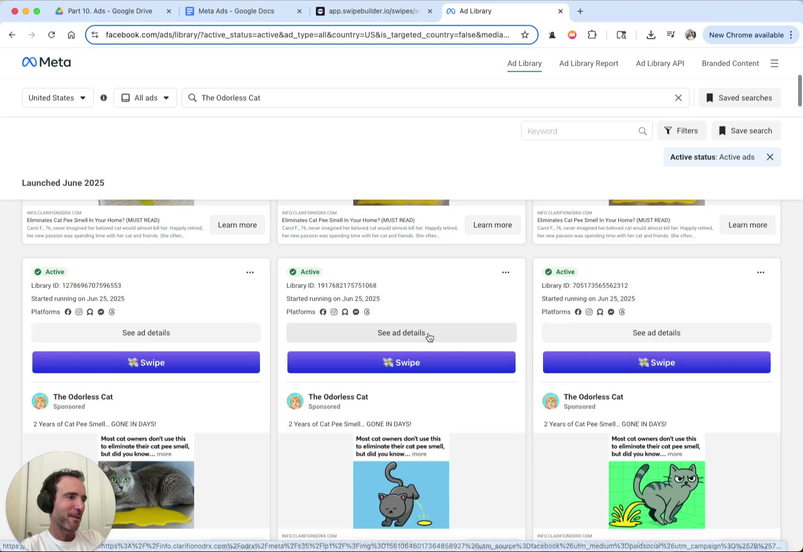
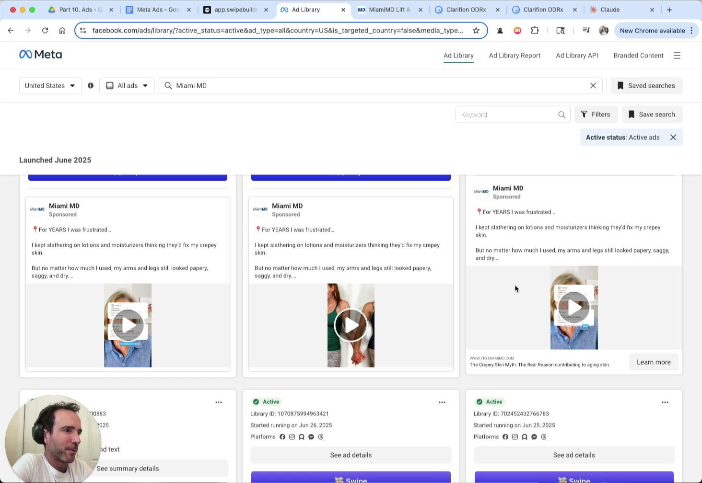
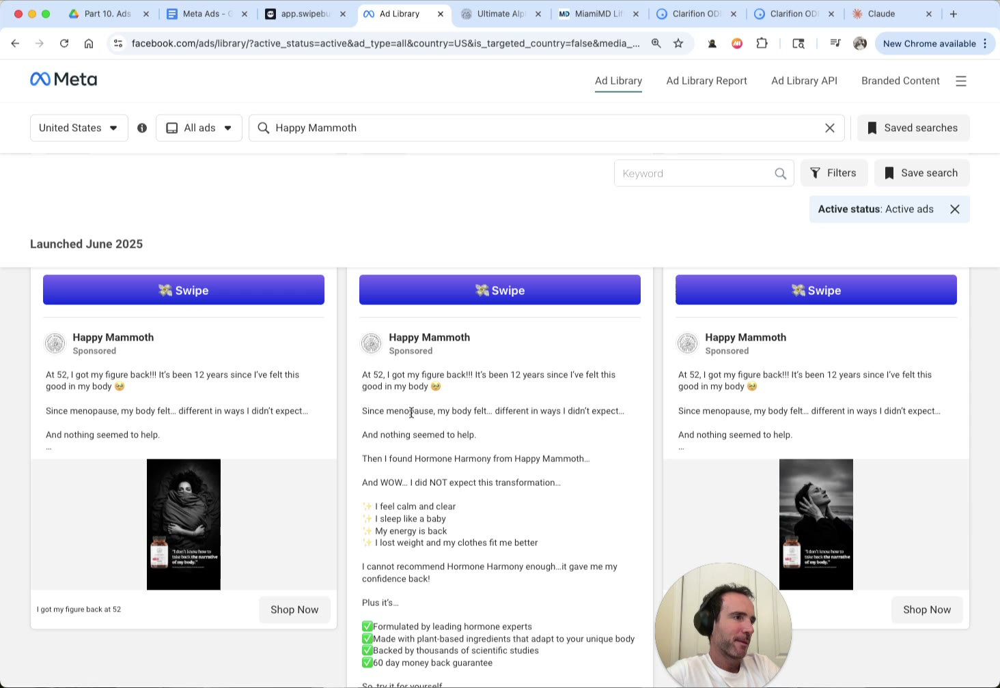
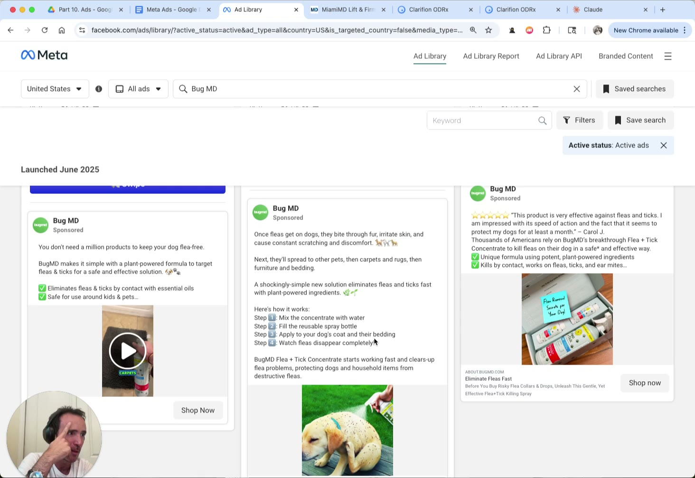
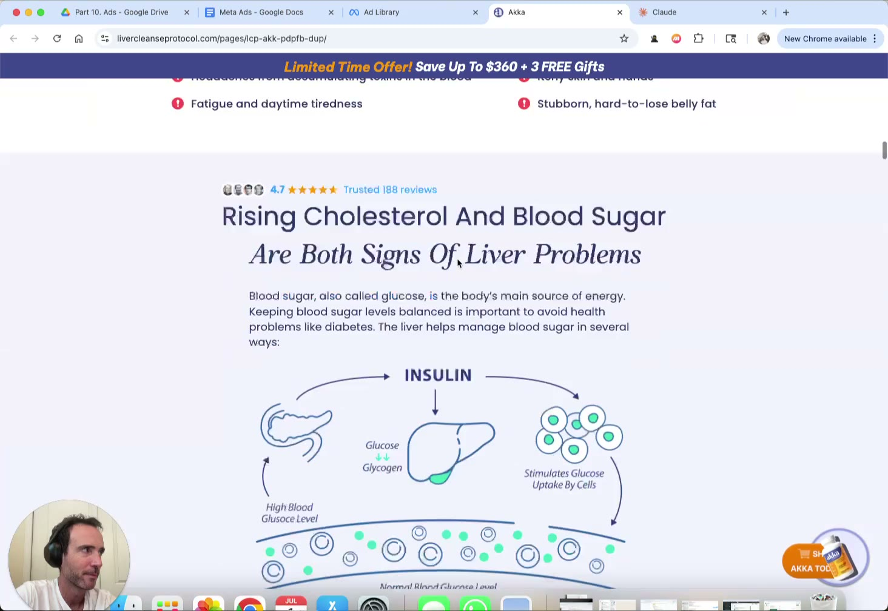
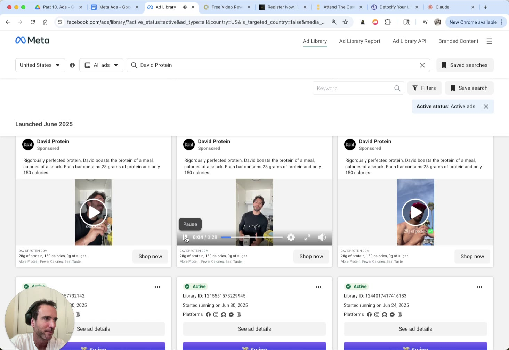

# 12.1 Meta Ads
> Before writing any Meta ad, answer five questions (objective, awareness level, destination, format, what the winners have in common); then write short captions that sell the click, and expect most of the winning to come from testing hooks, images and thumbnails against an otherwise unchanged ad.

## 🤖 Agent use
- **Use when:** writing or briefing a Meta (Facebook/Instagram) ad caption or static; deciding what an ad is supposed to do given the page it points to; reading a competitor's Ad Library to reverse-engineer its funnel; setting up a Claude Project that writes ad captions.
- **Inputs → outputs:** product, offer, target awareness level, destination page type (advertorial / VSL / long PDP / short PDP / registration page), format (ultra-short to long video, static), hooks (if any), and swipe captions → a map "ad → objective → awareness → destination → format", a set of captions in the swipe style, and a list of what to test (hook, image, thumbnail, caption length).
- **Rules:**
  - **DO** define the ad's supporting assets and journey first: "an ad will never exist in a vacuum". [00:01:02] The overview doc states it as "You can't talk about ads without assets." and "You can't get around testing".
  - **DO** decide "sell the click" vs "sell the solution" before writing. If an advertorial or long page will do the selling, the ad only has to earn the click ("it's a lot easier to sell the click than it is to sell the prospect"). [00:03:22]
  - **DO** test creative, not only copy: "same copy, different images will often have very different results". [00:06:36]
  - **DO** test the video hook (first ~3-10 seconds) and thumbnail while the rest of the video stays fixed; "that will have a massive difference on conversion rate". [00:12:30]
  - **DO** match page length to ad length. Short caption + static -> long PDP/advertorial does the selling; long video ad -> short product page. [00:32:42] [00:23:32]
  - **DO** keep the call to action on screen after a video ad ends, so viewers do not just keep scrolling. [00:34:38]
  - **DON'T** send a blind VSL to traffic that has already seen the product. "A blind VSL is basically never going to talk to product aware or most aware." Showing the product moves the viewer to product-aware at least, so send them to a product page. [00:39:15-00:39:43]
  - **DON'T** use social proof/testimonial-heavy make-money ads: for biz-op "you can't use as much social proof with make money stuff for FTC reasons". [00:43:19] (Stefan's remark; verify with counsel before running.)
  - **IF** the caption is a first draft and you have no hooks yet **THEN** add hooks to the caption project before generating; the caption project is more dialed in with hooks. [v2 00:01:12] [v2 00:04:00]
  - **IF** the same hook/caption keeps appearing in a competitor's Ad Library for a long period **THEN** treat it as a probable winner to study for structure (instructor inference, not proof). [00:21:50]
- **See also:** [02.1 Product/Market Awareness](02-01-product-market-awareness.md) · [04.9 Short VSLs](04-09-short-vsls-structures-and-examples.md) · [09.1 Advertorials](09-01-advertorials-overview-and-examples.md) · [10.1 PDPs](10-01-pdp-overviews-and-claude-processes-for-writing-new-ones.md) · [12.2 Native Ads](12-02-native-ads.md) · [Evolve: campaign structure 3:2:2](../../../evolve/start-here/frameworks/campaign-structure-322.md)

## Key ideas

### 1. Two overarching rules: assets and testing [00:00:00-00:06:36]
- The lesson is about "different types and formats, copy examples" for Meta. Many earlier examples were already Meta ads: the short and medium VSLs are "really like an ad that's going to run in Meta", and the advertorial and PDP lessons showed ad -> page journeys (Happy Mammoth is repeated here). [00:00:00-00:01:02]
- **Rule 1, "You can't talk about ads without assets."** For any ad, identify supporting assets, purpose/objective and journey. [00:01:02]
- **Rule 2, "You can't get around testing."** The Odorless Cat static ads show it: identical copy, many images. [00:02:15] [00:06:36]
- Closing note: "Understanding the purpose is more important, I think, in a way than the copy. Like, you'll write a copy, I think, from RMBC." [00:56:19]

### 2. The five-question ad diagnosis (overview doc) [00:03:22-00:56:19]
The lesson doc "Meta Ads Overview and Core Training" is a question list Stefan fills in for each ad he pulls up. Use it as a pre-writing checklist (see Prompts / templates).
1. **Objective:** acquire new customers, generate leads, sell the solution, sell the click, or raise brand/product awareness.
2. **Product/market awareness:** unaware, problem aware, solution aware, product aware, most aware (definitions are quoted in the doc; see [02.1](02-01-product-market-awareness.md) and [Evolve market-awareness levels](../../../evolve/start-here/concepts/market-awareness-levels.md)).
3. **Where do we send people:** advertorial, VSL, long PDP, short PDP, brand building and awareness, registration/signup page.
4. **Format:** ultra-short video, short video, medium video, long video, static.
5. **Commonalities across winners:** curiosity, **visuals** (bold and underlined in the doc), education, emotional, social proof (UGC/testimonials), "???".
- "Sell the prospect" vs "sell the click": in the Odorless Cat ad "we're not trying to sell this cat pee device. We're trying to sell the click to the advertorial." [00:03:22]. Later he relabels the video version as selling the solution: "you're always going to sell the click when you sell the solution". [00:10:23]

### 3. Odorless Cat (Clarifion ODRx): static vs video, same funnel logic [00:02:15-00:15:28]
- **Statics:** same caption ("2 Years of Cat Pee Smell... GONE IN DAYS!" and "Most cat owners don't use this to eliminate their cat pee smell, but did you know...") over multiple cartoon/photo images (grey cat on yellow puddle, cartoon cats on blue and green backgrounds). Objective: sell the click to a long advertorial (the "sweet Carol, she's 76" story). There is "no long caption"; the image catches the eye and the click is the only goal. [00:02:15-00:04:45] [00:07:11]
  - Awareness: "problem aware... maybe also solution aware"; the "most cat owners don't use this" line implies people use some other solution. [00:04:45-00:05:22]
  - Stefan says he still thinks one of the images "is probably the winning image" (he does not say which, and shows no data); the point is that they test images with copy held constant. [00:04:05] [00:06:36]
- **Videos:** same caption ("Discover how the smart device turned a cat pee ammonia odor smelling room into a fresh air paradise..."), different video hooks, same music, different thumbnails. Some go to the same advertorial; others to a product page "still long, but actually less copy... more about the product". [00:07:11-00:08:41]
  - Video ad structure he reads out [00:13:05-00:14:13]: hook ("It's been five months/years since I got my cat. All he does is pee on my shoes, my bed...") -> failed solutions ("I would scrub, spray clean, and nothing really worked") -> the product ("plugged in this little piece of magic") -> what it means (no more cleaning, no lingering smells) -> a specific story beat (a kid cranky at home after a move; three units placed near the litter box, living room, bathroom; smell gone "within an hour") -> mechanism ("powered by UVC molecular neutralization technology") -> metaphor ("an invisible shield constantly breaking down odors") -> CTA.
  - A hook he points out: "I have three cats, my home doesn't smell like it at all, here's how." (curiosity). [00:11:54]
  - Awareness for the video: starts problem/solution aware, ends product and "frankly most aware by the time the ad's done", so it goes to a "different, more product-aware advertorial". [00:10:23-00:10:55]
- **Pattern for short video ads:** "the hook, the first five to ten seconds, three to ten seconds, is different. The rest of that works. You're really testing hooks." [00:11:54-00:12:30] (Cross-reference: the short-VSL blood-sugar example, hooks like "here's what coffee does to your blood sugar". [00:11:54])
- Structure analysis was done earlier in the short-VSL Claude Project; "I'm not going to repeat it all". [00:14:43-00:15:28] See [04.9](04-09-short-vsls-structures-and-examples.md).


*Ad Library view of The Odorless Cat: identical caption "2 Years of Cat Pee Smell... GONE IN DAYS!" and image headline across three images. Shows the "same copy, different images" test. [00:02:24]*

### 4. Miami MD: medium in-feed VSLs, same caption, hook/thumbnail testing [00:16:19-00:24:07]
- Caption read at [00:16:19]: "The truth about sagging skin. Think that's just a natural part of aging. Dr. [J], of Miami... is sharing her groundbreaking at-home method..." -> "Check out the free guide". It points to a text sales letter, "pretty rare even for Miami MD", probably a test of a new angle in a static. [00:16:54-00:18:19]
- Most Miami MD ads share one caption ("For YEARS I was frustrated...") four or more times with identical video and different thumbnails; the in-feed VSLs run about 12-14 minutes. "It's really just thumbnails." [00:17:33-00:19:58]
- Clicking "Learn more" leads to a quiz, then a medium/short product page "not incredible design compared to their competitors... but the selling happens in these video ads". [00:21:09]
- **Repetition as a signal:** scrolling the library back to late June, the same hooks appear again and again; "so you can tell that a hook's a big winner and then they'll also be throwing in other hooks". [00:21:50]
- **Cost reality check:** Stefan says media buying has become expensive: "our skincare brand, we put $600,000 into it, and it's working now". (instructor claim) [00:22:53] Brands like this have a video production team and large ad spend behind constant testing. [00:22:21]
- Profile: acquire new customers; sell the solution and the click; problem/solution-aware skincare buyers (maybe product-aware of similar products, not this one); destination = short/medium product page; because the page is short, long videos do the selling. Commonalities: curiosity, education, visual elements, social proof. [00:23:32-00:24:34]
- Stefan saves the caption to build the caption project: "let's go and save this caption just to have it". [00:19:58]


*Miami MD Ad Library results: three ads with the same "For YEARS I was frustrated..." caption, different thumbnails. Links to the medium in-feed VSL structure. [00:18:48]*

### 5. Happy Mammoth: statics for the already-aware, long PDP [00:24:34-00:30:00]
- Men's ad: "Your T is low and your estrogen is high, my doctor said. So I decided to tackle both." with a month-by-month result narrative (month one: strength, thinning hair, brain fog; month two: "man boobs disappeared", less bloating). [00:24:34-00:25:48]
  - Awareness: "most aware, at least product aware"; the ad is also brand-building. [00:25:48-00:26:22]
  - Destination: a homepage/bundle page "trying to sell the click... and the bundle"; Stefan guesses CPA is poor for cold traffic at that price point, but "could be wrong, but that's my guess". [00:27:02-00:27:34]
- Women's ad: "At 52, I got my figure back!!!..." with a negative-feeling black-and-white image but "uplifting" copy; goes to "a pretty long landing page". [00:28:41-00:29:10] High price, but "they've built enough brand equity". [00:29:10]
- Captions use emojis, short result lists and a trust-badge block (expert-formulated, plant-based, studies, 60-day guarantee). See the caption table below.


*Happy Mammoth statics: black-and-white emotional image with the product bottle and a long first-person caption ("At 52, I got my figure back!!!"). [00:28:48]*

### 6. Nooro (old account): same caption, different video lengths [00:29:59-00:31:24]
- Stefan opens an old Nooro Ad Library ("Neuro" in the captions; the doc spells "Nooro (Old)"). Same caption, but videos of 15, 16, 4 and 2 minutes, plus some statics. "Some people need a 15 minute video. Some people are like, this is too long. Four minute video works for them." Their "sweet spot seemed to be like the 15 minute mark". [00:30:37]
- He guesses Nooro now runs from non-brand accounts; he does not know. [00:29:59]

### 7. BugMD: static + short video, one landing-page template [00:31:24-00:36:49]
- Five images share one caption (flea problem escalation -> "shockingly simple new solution" -> 4-step "Here's how it works" -> product name). Short caption -> long product page. [00:31:24-00:32:42]
- A "two ads / five ads use this creative and text" label in the Ad Library tells you "an ad's good or bad". [00:31:24] (Stefan's heuristic.)
- Everything points to one PDP/landing page; video is the main format, "pretty short" and pre-sells; statics tested more lately. "Everyone wants statics to work because... it's easier to test stuff. It's faster. There's no video production even if you're using AI. But typically [video wins]." [00:35:23-00:36:02]
- Other products (spiders, bed bugs) reuse the same landing-page template: "they've got sort of a template that kind of works". [00:36:49]


*BugMD Ad Library: the four-step "Here's how it works" caption (Step 1-4 with number emojis), plus a testimonial-led caption and a short-copy variant. [00:32:24]*

### 8. AKKA and Emma: long PDPs and VSLs for aware buyers [00:36:49-00:40:17]
- AKKA statics: audience "probably product aware, most aware"; "really nice, long landing page". Same pattern for Emma and Happy Mammoth: "do you start to notice the commonalities?" [00:37:37]
- AKKA also runs video: "Watch what liver flushes do to your belly" -> curiosity, "more of that ADHD hook ad" -> goes to an actual VSL; "long VSL to another VSL, four-minute video to another VSL". [00:38:37]
- **Why a VSL after a product reveal?** Stefan's rule: showing the product moves the viewer to product-aware or most-aware, so a blind VSL ("this weird liver trick") no longer fits; ads that show the product go to a product page. Ads that do not reveal it "are selling the click" to a VSL. [00:39:15-00:40:17]


*AKKA's long page opened from the Ad Library: "Rising Cholesterol And Blood Sugar Are Both Signs Of Liver Problems", with an insulin/liver diagram and review count. Illustrates a long PDP for aware buyers. [00:37:48]*

### 9. Biz-op lead gen: Ryan Pineda and Calvin Tran [00:40:17-00:52:19]
- **Ryan Pineda** (real estate masterclass): objective is lead gen ("register for your free spot"). Ads launched the same day with different hooks, wardrobe, backgrounds and scripts ("shit tons of hooks"). Education-led with curiosity and visuals; "You educate, you tease a better way, call to action, sign up for my masterclass." Landing page "very short... I need to be pre-sold. But my commitment is attending a masterclass." Videos short, not 10-20 min. [00:40:59-00:44:33]
- **Calvin Tran** (Airbnb strategy workshop; the lesson doc also lists "Calvin Tran" as an Ad Library to review): emotional, reel-like short videos (he walks, music, edits, captions; some 10-11 s), lifestyle proof, "register for this workshop". Caption length is being tested (short to very long). Page is a "nice clean" registration page, a bit longer. [00:45:33-00:48:20]
  - Stefan suggests testing this reel-style creative in other niches: "a lot of people aren't doing this frankly". [00:46:05]
  - A second Calvin Tran ad, "a stupid-simple 'side hustle'..." goes to a short advertorial -> a VSL: ad (1 min) -> advertorial -> video click -> VSL. "Different than a webinar model." [00:49:05-00:51:50]
- Lesson: "You could sell the same product or service using five different funnel formats. And so much of it is just testing." [00:52:19]
- Flag: income/wealth-transfer claims ("$6.1 billion will change hands every day for the next 8 years", "152 years old") in the Calvin caption are unsubstantiated course examples. Do not reuse them.

### 10. David Protein: UGC volume, AI voiceover, frequency builds awareness [00:52:19-00:56:19]
- Lots of statics and many UGC videos by one creator, many hooks, "social proof, real feeling people", sometimes an AI voiceover; positioning as pain-point or educational. [00:53:15]
- Landing pages are "kind of weird", a basic PDP; ads are short. Stefan's hypothesis: awareness is built by frequency. "Very rarely do people buy the first thing they see an ad for... you see their ads enough, you become aware, you watch one, one of these messages just resonates with you, you click, you're like, fuck it, I'm going to order one." It is not retargeting but "an example of increased brand and product awareness" through frequency. [00:54:10-00:55:48] (Stefan's guess: "I really would guess". Not verified.)


*David Protein: three UGC video ads with an identical short caption ("Rigorously perfected protein... 28 grams of protein and only 150 calories") and different creators/hooks. [00:53:24]*

### 11. Meta ad caption Claude Project (video 2 + 2 docs) [v2 00:00:00-00:04:00]
- Stefan promised a "recipe" project: "hey, here's a bunch of caption ads... so that you can create new caption ads... as simple as that". [00:55:48] The build is shown in video 2 (about five minutes, "a pretty fast one"). [v2 00:00:00]
- Setup: one-paragraph project instruction (doc "Claude Captions Generator Setup") + a knowledge file of 10 real captions ("Meta Ad Captions for Claude Projects"). [v2 00:00:00]
- He is lukewarm about its importance: "can you just have Gemini and other places write captions? They're going to be fine... I don't use this personally"; "the ad captions are important, but they're not crazy". [v2 00:00:32]
- **Test run 1:** asks for captions for the (eye serum) product with "benefits plus a CTA to save 57% off", then a link. Output opens with a first-person caption ("I thought my eye bags were permanent. Tried everything...") and a "real problem wasn't what I thought, it wasn't dryness or aging" turn. The audio of the output is too garbled to quote further. [v2 00:00:32-00:02:04]
- **Test run 2:** "can you do some really short ones that are just a few lines and sell the click" (as transcribed: "sell the come on"). Claude is slow; he pauses the recording. [v2 00:02:04]
- Close: "That's really all you need for captions... you'll just test a bunch of stuff. There's like no other way to do this besides testing." He adds one Calvin Tran caption to the project and says hooks would make results "more dialed in". [v2 00:03:26-00:04:00]

## Steps / framework

### A. Ad-library teardown loop (as Stefan runs it) [00:16:19-00:56:19]
1. Open the Meta Ad Library, US, "All ads", filter "Active". Search a brand (doc lists Ad Library links for Miami MD, Happy Mammoth, Nooro (Old), The Odorless Cat, Bug MD, Akka Superbiotics, Ryan Pineda, Calvin Tran, Capital Syndicate by Awesome REI, David Protein).
2. Group ads by shared caption and shared creative; note what is held constant and what varies (image, hook, thumbnail, video length, caption length).
3. Read the caption; watch at least one video; click through; note page type and length.
4. Fill the five questions (objective, awareness, destination, format, commonalities).
5. Save the caption into the swipe/caption knowledge file (Stefan saves captions to a Google Doc and the swipe tool as he goes). [00:21:09] [00:49:05]

### B. Funnel-fit map (derived from the lesson's examples)

| Ad type | Objective | Awareness | Destination | Source |
|---|---|---|---|---|
| Static, short/no caption (Odorless Cat) | Sell the click | Problem (and solution) aware | Long advertorial | [00:03:22-00:07:11] |
| Short video, hook-tested (Odorless Cat) | Sell the solution + click | Problem -> product/most aware by end | More product-aware advertorial or product page | [00:10:23-00:10:55] |
| 12-15 min in-feed VSL (Miami MD, Nooro old) | Sell the solution | Problem/solution aware | Short/medium PDP after quiz | [00:23:32] |
| Static results story (Happy Mammoth) | Sell + brand awareness | Product/most aware | Long PDP or bundle homepage | [00:25:48-00:27:34] |
| Static + short video (BugMD) | Sell | Problem aware | One long landing-page template | [00:35:23] |
| Curiosity video w/ product reveal (AKKA) | Sell | Product/most aware | Product/long page | [00:39:15] |
| Curiosity video, product hidden (AKKA 4-min) | Sell the click | Problem/solution aware | VSL | [00:38:37-00:40:17] |
| Educational masterclass reel (Ryan Pineda, Calvin Tran) | Generate leads | Solution aware | Short registration page | [00:40:59-00:48:20] |
| Short advertorial -> VSL (Calvin Tran side hustle) | Sell/lead | Solution aware | Advertorial then VSL | [00:49:05-00:51:50] |
| UGC volume + frequency (David Protein) | Sell + build awareness | Problem -> product aware over time | Basic PDP | [00:53:15-00:55:48] |

## Examples

### Caption library (the 10 swipe captions in the knowledge-file doc)
Source: doc "01-2 Meta Ad Captions for Claude Projects". Structure notes are mine (derived); quoted openers are verbatim.

| # | Brand / product (niche) | Opening line (verbatim) | Structure (derived) | Also in video |
|---|---|---|---|---|
| 1 | Miami MD (skincare, in-feed VSL) | "📍For YEARS I was frustrated…" | First-person failed-solutions list -> "it was never really about dryness" reframe -> named mechanism (NMFs) -> expert's free video -> "turn up your volume / go full screen" video-watching instructions | [00:18:19] |
| 2 | Happy Mammoth Hormone Harmony (supplement, static) | "At 52, I got my figure back!!! It's been 12 years since I've felt this good in my body 🥹" | Transformation headline -> before state -> "Then I found..." -> checkmark benefits -> trust block -> link | [00:28:41] |
| 3 | Nooro 3-in-1 Leg Massager (device) | "Edema, Swollen legs and stiffness in your feet?" | Symptom call-out -> "stop ignoring" fear -> authority (named physical therapist) -> time commitment (15 min/day) -> outcome window (14 days) -> shipping + checks | [00:29:59] |
| 4 | BugMD flea + tick concentrate | "Once fleas get on dogs, they bite through fur, irritate skin..." | Problem escalation -> "shockingly simple new solution" -> 4 numbered steps -> product line | [00:32:06] |
| 5 | BugMD bed bug spray | "BugMD delivers on its promise to kill pests instantly..." (testimonial, attributed to "Sheri C.") | Testimonial first -> "Why thousands trust" checklist -> guarantee with fine print footnote | [00:36:49] |
| 6 | AKKA (liver supplement, sale) | "✨SUMMER DETOX SALE✨ Get up to 50% OFF our Top-Selling AKKA!" | Sale header -> "why do thousands take AKKA daily?" -> long testimonial with BP/weight numbers -> guarantee/urgency/price emoji lines | [00:37:37] |
| 7 | Cashflow 2.0 Masterclass (real estate lead gen) | "💰 👀 Looking for passive income in real estate but you can't afford to buy rentals?" | 2-line problem + 1-line promise + free-registration link (the shortest lead-gen format) | [00:40:59] |
| 8 | Calvin Tran side hustle (biz-op, advertorial/VSL) | "There's a stupid-simple 'side hustle' that's starting to go viral among middle-class Americans." | Intrigue + "not X, not Y" exclusions -> origin ("152 years old", "Idaho farm boy") -> big number -> mainstream-media-hides-it -> "watch while you still can" | [00:49:05] |
| 9 | Emma (gut supplement, short) | "See how Emma powerfully helps:" | Three check-marked benefits + "Discover EMMA Now!" (ultra-short) | [00:37:37] |
| 10 | Emma (sale) | "💩 Up to 60% OFF - The "Finally, a Normal Poop!" SALE 💩" | Sale header -> diagnostic question ("more than 12 seconds") -> counter-intuitive fiber claim -> highway/traffic-jam metaphor -> 5 symptom checks -> named expert + testimonial | [00:37:37] |

Flags: captions 3, 5, 6, 8, 9 and 10 contain health, income or testimonial claims (e.g. "14 days", a stated blood-pressure change, a named doctor, a "152 years old" strategy, "$6.1 billion will change hands every day"). These are third-party examples shown without substantiation. Copy the structure (symptom -> authority -> time -> outcome window; testimonial -> checklist -> guarantee), never the claims, names or numbers. Do not invent testimonials, counts or expert endorsements.

## Structured units

### Hooks (as spoken or shown in the lesson)

| Hook (verbatim or near) | Heuristic(s) | Emotion / zone | Self targeted | Why it works | Source |
|---|---|---|---|---|---|
| "Most cat owners don't use this to eliminate their cat pee smell, but did you know..." (image headline) | Curiosity / information gap (instructor: curiosity) | — | — | Implies a hidden better solution; sold only as a click to the advertorial | [00:02:15] |
| "2 Years of Cat Pee Smell... GONE IN DAYS!" (caption/headline in Ad Library) | Time compression (derived) | — | — | Shows a specific long pain and a fast result | [00:02:24] frame |
| "I have three cats, my home doesn't smell like it at all, here's how." | Curiosity (instructor) | — | — | Proof-by-situation + open loop | [00:11:54] |
| "It's been five months/years since I got my cat. All he does is pee on my shoes, my bed..." | Problem call-out (derived) | Frustration | Actual self | Concrete scenes, then "nothing worked" | [00:13:05] |
| "For YEARS I was frustrated..." | Failed-solutions story (derived) | Frustration | Actual self | Repeated across ads as the control caption | [00:18:19] |
| "The truth about sagging skin. Think that's just a natural part of aging." | Myth-bust / reframe (derived) | — | — | Challenges a belief, then offers an expert's free guide | [00:16:19] |
| "Your T is low and your estrogen is high, my doctor said. So I decided to tackle both." | Authority (doctor) + curiosity (derived) | — | Men with hormone concerns | Specific diagnosis in first person | [00:24:34] |
| "At 52, I got my figure back!!!" | Transformation (derived) | Relief/hope | Ideal self (derived) | Age + result in the first line | [00:28:41] |
| "Watch what liver flushes do to your belly." | Curiosity (instructor: "ADHD hook") | — | — | Visual + open loop, product not shown yet | [00:38:37] |
| "Let's go ahead and generate 10 to 20K a month on Airbnb without owning any property." | Specific outcome + "without" (derived) | Aspiration | Ideal self | Number + no-ownership objection removed | [00:45:33] |
| "There's a stupid-simple 'side hustle' that's starting to go viral among middle-class Americans." | Intrigue + social proof (derived) | — | — | Frames as trend; claims unverified | [00:49:05] |

### Ad teardowns

| Brand / product (niche) | Format | Hook / opening | What works | What fails | Fix suggested | Principle | Source |
|---|---|---|---|---|---|---|---|
| The Odorless Cat / Clarifion ODRx (pet odor) | Static x many, then short video | "Most cat owners don't use this..." / "five years since I got my cat" | Constant copy, varied image/hook isolates what earns the click; page matches awareness | Not stated | — | Sell the click; test images and hooks | [00:02:15-00:15:28] |
| Miami MD (skincare) | In-feed 12-14 min VSL + rare static/TSL | "For YEARS I was frustrated..." | Same caption/video, thumbnail tests; long video carries the sale to a short page | Stefan dislikes one text-sales-letter ad ("pretty bad copy") | Not stated | Repeat winning hooks; vary thumbnails | [00:16:19-00:24:07] |
| Happy Mammoth (hormone supplements) | Static + long caption | "Your T is low..." / "At 52, I got my figure back" | Strong results narrative, packaging, brand equity | CPA doubtful on cold traffic at this price (Stefan's guess) | Not stated | Statics suit already-aware buyers | [00:24:34-00:29:10] |
| Nooro (old) (devices/health) | Video, many lengths | Same caption, lengths 2/4/15/16 min | Length is a tested variable; ~15 min best (as observed) | — | — | Test length, not only hook | [00:29:59-00:31:24] |
| BugMD (pest control) | Static + short video | Escalation story + steps | One page template reused; short caption + long page | Return-fee fine print (shown in the caption doc) | — | Page template reuse; CTA held on screen | [00:31:24-00:36:49] |
| AKKA (liver supplement) | Static + curiosity video | "Watch what liver flushes do to your belly" | Curiosity hook to VSL; product reveal -> PDP | — | — | Awareness shifts when product is shown | [00:36:49-00:40:17] |
| Ryan Pineda (real-estate masterclass) | Short talking-head videos | "If you want passive income from real estate..." | Many hooks and wardrobe/background changes; education + teaser | Social proof limited for FTC reasons | — | Lead-gen ads educate, tease, CTA | [00:40:59-00:44:33] |
| Calvin Tran (Airbnb workshop; side-hustle VSL) | Reel-style short + long/short captions; ad -> advertorial -> VSL | "generate 10 to 20K a month on Airbnb..." | Lifestyle proof, captions on video, caption-length testing | Unsubstantiated income claims | Not stated | Test reel-style for other niches | [00:45:33-00:51:50] |
| David Protein (food) | UGC statics/videos, AI voiceover | Many creator hooks | Volume of hooks, real-feeling people; frequency builds awareness | Basic PDP ("kind of weird") | — | Frequency + hook volume | [00:53:15-00:55:48] |

### Templates (derived from the swipe captions)

| Template | Use for | Example fill | Source |
|---|---|---|---|
| "[Problem call-out question]? / Stop ignoring [early sign]. / [Authority] designed [product] using [N] technologies. / All it takes is [time]. / Within [N] days you'll [outcome] / [CTA]" | Device or supplement with a named expert (only if the expert and results are real) | Nooro caption | caption doc #3 |
| "[Problem escalation] -> A [adjective] new solution [verb] [outcome]. Here's how it works: Step 1... Step 4... [Product] starts working fast..." | Simple-use products with a how-to | BugMD flea caption | caption doc #4 |
| "[Testimonial]. Why [N] people trust [product]: ✅ ... ✅ ... [guarantee]" | Social-proof-led captions | BugMD bed bug caption | caption doc #5 |
| "[SALE header] / [Diagnostic question] / [counter-intuitive claim] / [metaphor] / [symptom checks] / [expert + testimonial]" | Sale caption with education | Emma sale caption | caption doc #10 |

## Prompts / templates (verbatim)

**Claude Project instruction for the Meta captions generator** (doc "01-1 Claude Captions Generator Setup", complete text):
```text
I'm going to give you several examples of meta ad captions in your knowledge base. You'll use these and other knowledge you have about meta ad captions to generate new ad captions based on instructions I put in your chat interface.
```
Knowledge file: the 10 captions listed above (doc "01-2 Meta Ad Captions for Claude Projects").

**Chat prompts used in the demo** (reconstructed from speech, v2; wording is as transcribed, not on-screen text):
```text
Can you do some ad captions for [eye serum product]? Benefits plus a CTA to save 57% off. And then I can run my link.

Great, thank you. Now can you do some really short ones that are just a few lines and sell the click.
```
(The product is transcribed "community eye serum"; likely a mishearing of the course's recurring eye-serum example. Unverified.)

**Five-question overview checklist** (doc "01-1 Meta Ads Overview and Core Training", condensed; the doc lists the options in each section):
```text
Meta ad analysis
Overarching: You can't talk about ads without assets. You can't get around testing.
1. What is the Objective? Acquire new customers / Generate new leads / Sell the solution / Sell the click / Increase brand and product awareness
2. What is the Product/Market Awareness Level? Unaware / Problem aware / Solution aware / Product aware / Most aware
3. Where do we send people? Advertorial / VSL / long PDP / short PDP / Brand building and awareness / Registration-signup page
4. What is the Format? Ultra short video / Short video / Medium video / Long video / Static
5. Commonalities? Curiosity / Visuals / Education / Emotional / Social proof (UGC, testimonials, etc.) / ???
```

**Agent prompt to add (derived, not from the course):** "For the ad below, fill the five questions, name what is held constant across its variants and what varies, and propose 3 hook tests for the first 3-10 seconds with the rest unchanged."

## Screenshots
Six frames are embedded above: Odorless Cat static tests [02:24], Miami MD same-caption ads [18:48], Happy Mammoth static [28:48], BugMD captions [32:24], AKKA long PDP [37:48], David Protein UGC [53:24]. Not captured: Ryan Pineda and Calvin Tran frames were mid-video playback without informative text (one sampled frame showed only video footage).

## How to apply
- [ ] For each Meta ad (ours or a competitor's), fill objective, awareness, destination, format, commonalities before writing or critiquing.
- [ ] If the destination page sells (advertorial, long PDP), write a short caption and put the effort into image/hook variants; if the page is short, put the selling in a longer video.
- [ ] Keep the caption fixed and vary one creative element per test (image, hook, thumbnail, video length); log which element moved results.
- [ ] Match awareness to destination: product visible in the ad -> product page; product hidden -> advertorial/VSL.
- [ ] Add 8-10 real swipe captions from your niche to a caption knowledge file; add your hooks; then generate captions and edit them.
- [ ] Strip every unverified claim, name, number and testimonial from swipes before reuse. Use only proof we have.
- [ ] Keep the CTA on screen for a few seconds after a video ends.

## Related
- [02.1 Product/Market Awareness](02-01-product-market-awareness.md) and [Evolve: market-awareness levels](../../../evolve/start-here/concepts/market-awareness-levels.md)
- [04.8 Medium VSLs](04-08-medium-vsls-structures-and-examples.md) · [04.9 Short VSLs](04-09-short-vsls-structures-and-examples.md) · [04.11 VSLs on landing pages vs in-feed ads](04-11-vsls-on-landing-pages-vs-vsls-as-in-feed-ads.md)
- [09.1 Advertorials](09-01-advertorials-overview-and-examples.md) · [10.1 PDPs](10-01-pdp-overviews-and-claude-processes-for-writing-new-ones.md) · [12.2 Native Ads](12-02-native-ads.md) · [12.3 Google Ads](12-03-google-ads.md) · [12.4 TikTok Ads](12-04-tiktok-ads.md)
- Evolve, Meta account and testing: [Campaign structure 3:2:2](../../../evolve/start-here/frameworks/campaign-structure-322.md) · [Ad definitions](../../../evolve/start-here/concepts/ad-definitions.md) · [Marksman/Sniper testing](../../../evolve/start-here/concepts/marksman-sniper-testing.md) · [Rewrite losers and iterate](../../../evolve/start-here/frameworks/rewrite-losers-and-iterate.md) · [Hooks](../../../evolve/copywriting/concepts/hooks.md)
- Shared: [Creative testing system](../../../../frameworks/creative-testing-system.md) · [Iteration vs variation](../../../../concepts/iteration-vs-variation.md) · [Competitor ad teardown playbook](../../../../playbooks/competitor-ad-teardown.md)
- **Where Stefan and Evolve differ or are silent:** (1) Stefan gives no campaign structure, budgets or kill rules; use Evolve's 3:2:2 ([campaign structure](../../../evolve/start-here/frameworks/campaign-structure-322.md)) for account setup. (2) Evolve's 3:2:2 holds the same two primary texts across the three ads of a concept, which matches Stefan's "same caption, varied creative" pattern; Stefan adds caption-length tests (Calvin Tran) and treats captions as lower leverage ("important, but not crazy" [v2 00:00:32]), whereas Evolve's copy pages weight hooks heavily. (3) Stefan reads Ad Library longevity and repeated creative as a winner signal; Evolve defines winners from your own account data ([winning-ad labels](../../../evolve/start-here/concepts/winning-ad-labels.md)); treat library repetition as a hint, not proof (derived).

## Sources and limitations
- Transcripts: [01-[1] Meta Ads.txt](<../../../../../raw/stefan-georgi/rmbc-ii/_transcripts/Stefan Georgi - RMBC II (1)/12-ADS/01-[1] Meta Ads.txt>) (56:42) · [01-[1] Meta Ads video2.txt](<../../../../../raw/stefan-georgi/rmbc-ii/_transcripts/Stefan Georgi - RMBC II (1)/12-ADS/01-[1] Meta Ads video2.txt>) (5:04). The `video2._converted` file is a duplicate re-encode and was skipped.
- Docs: [Overview and Core Training](<../../../../../raw/stefan-georgi/rmbc-ii/_extracted/Stefan Georgi - RMBC II (1)/12-ADS/01-1 Meta Ads Overview and Core Training.docx.md>) · [Captions Generator Setup](<../../../../../raw/stefan-georgi/rmbc-ii/_extracted/Stefan Georgi - RMBC II (1)/12-ADS/01-1 Claude Captions Generator Setup.docx.md>) · [Captions swipe doc](<../../../../../raw/stefan-georgi/rmbc-ii/_extracted/Stefan Georgi - RMBC II (1)/12-ADS/01-2 Meta Ad Captions for Claude Projects.docx.md>)
- Machine transcription. Mishearings fixed using the platform captions and screen text: "Neuro" = Nooro (doc: "Nooro (Old)"); "quad/cloud project" = Claude project; "Clarifying Odor X" = Clarifion ODRx (screen); "swipe order" = the swipe tool shown in the browser tab. The five-months vs five-years line in the cat video is inconsistent in the transcript. The Claude output read aloud in video 2 is too garbled to quote.
- Long stretches of the main video are Stefan playing ad videos without narration (e.g. 00:08:41-00:10:23, 00:40:17-00:43:19); their audio is only partly transcribed.
- The ad examples are third-party ads seen in June-July 2025; spend, results and conversion rates were not shown, and "winner" status is Stefan's inference. The reference to Capital Syndicate by Awesome REI is only a link in the doc, not discussed. Links in the doc (Ad Library, captions' tracking URLs) were not followed.
- The $600,000 skincare-brand investment is an instructor claim. Health, supplement and biz-op examples contain claims that would need substantiation or would breach Meta/FTC rules; use structures only.
