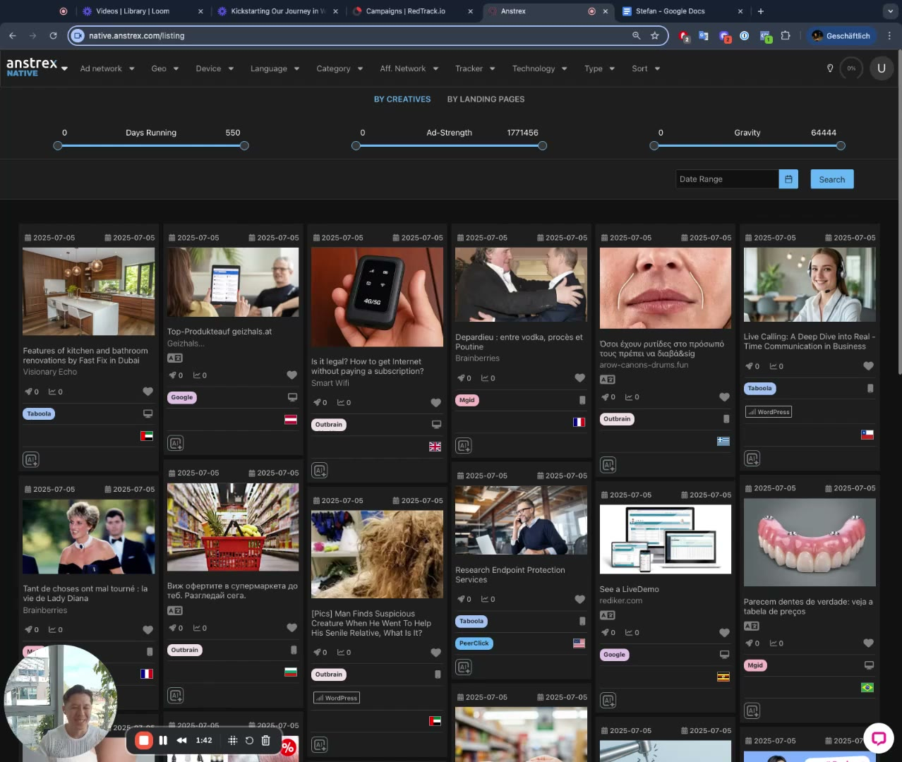
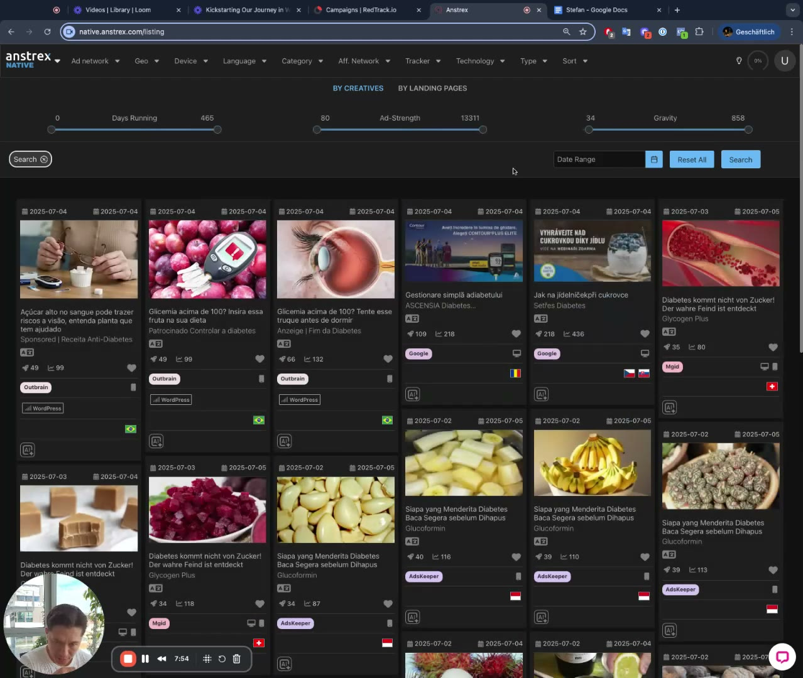
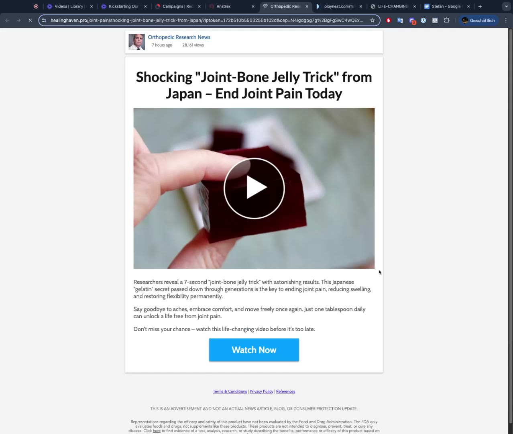
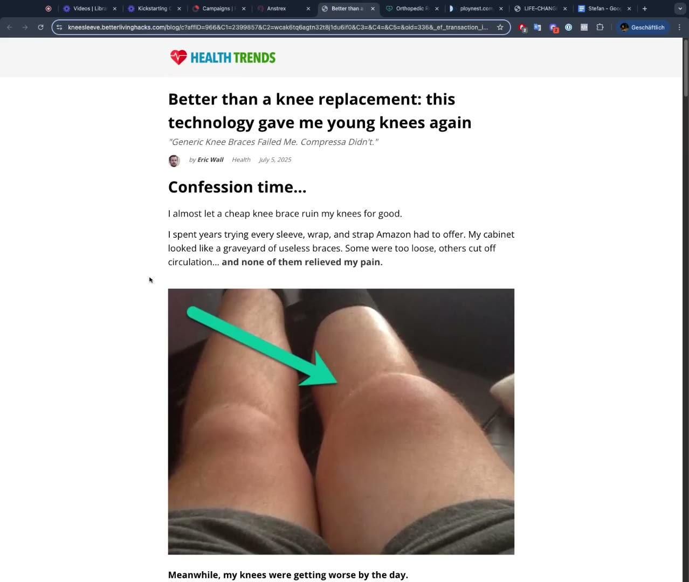
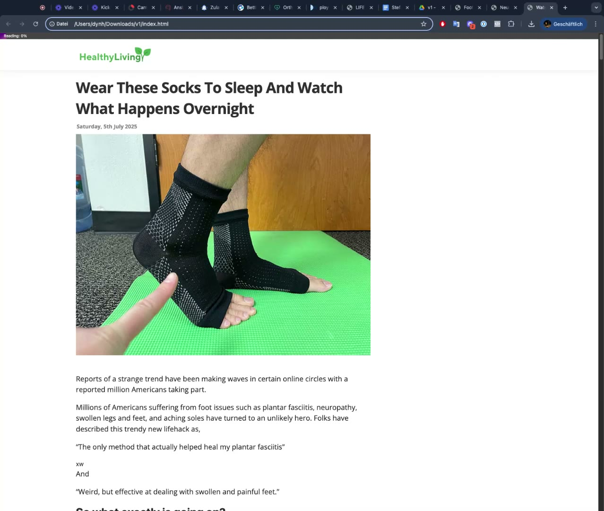
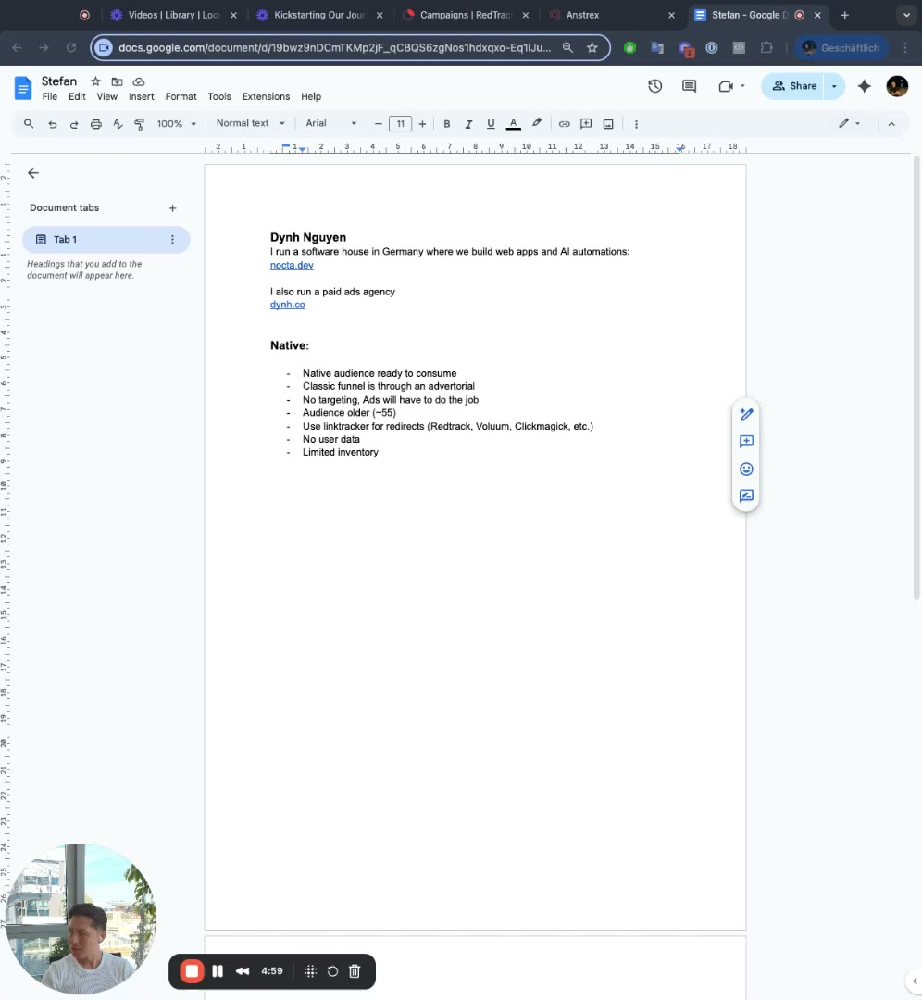

# 12.2 Native Ads
> A guest media buyer explains how native traffic (Taboola, Outbrain, MGID and similar) works, which funnels fit its older audience, how to ad-spy with Anstrex, and which landing-page click-through targets to hold; the lesson ships five saved landing pages (VSL jump pages, ecom mid/long-form advertorials, a solar lead-gen page) to swipe for structure.

## 🤖 Agent use
- **Use when:** planning or writing native ads and the pages behind them (jump page -> VSL, advertorial -> product page, advertorial -> lead form); judging whether an offer fits a ~55+ native audience; setting up native ad spying; reading native metrics (CPM, CTR, CPC, landing-page CTR).
- **Inputs → outputs:** offer + vertical (health VSL, ecom gadget, lead gen), geo, creative angle, page type -> a funnel (ad -> page -> next step), ad image/headline angle with the right "customer words", a landing-page CTR target, a tracker/redirect plan and a publisher-hygiene list.
- **Rules (guest unless marked):**
  - **DO** let the ad do the targeting: native "cannot do like a proper targeting" because the networks hold almost no user data (a visitor is mostly tagged by the content category). [v2 04:01-04:32]
  - **DO** write for an older audience (about 55+, often homeowners) and check offer fit first; a 30-day handstand course "won't work", a blood-sugar VSL "would work very, very well". [v2 02:28] [v2 04:32-05:33]
  - **DO** send the ad to an advertorial or jump page, not straight to a product page, "for 99% of offers"; the exception is a commoditised product whose buyers already know the solution (guest example: Ozempic). [v2 03:01-03:31]
  - **DO** chase high CPM that comes from high CTR and low CPC, not from expensive clicks: "high CPMs with high CTRs and low CPCs". [v2 09:02-09:32] [v3 31:40]
  - **DO** use a link tracker (RedTrack, Voluum, ClickMagick per the doc) for redirects and real 50/50 split tests per publisher. [v2 05:33-07:04] [doc]
  - **DO** spy on ads about twice a week in more than one tool, to build a feel for patterns and customer wording. [v3 00:41-03:43]
  - **DO** copy the customer's words from winning ads (guest examples: "bionic", "bone-to-bone" knee sleeves; "itchy" for skincare), so the ad reads as "a user talking to a user". [v3 03:13-03:43] [v3 15:40-16:11] [v3 28:36]
  - **DO** aim for landing-page CTR of 40-50% on a short jump page, roughly 30% on lead-gen pages and about 25-30% on mid/long-form advertorials; delay the CTA button on long pages so traffic is pre-qualified. [v3 13:05] [v3 21:05] [v3 25:27] [v3 32:13]
  - **DO** ask the network rep for category benchmarks (CPM, CTR, CPC, CPA by device) and a starting publisher list of about 100-150. [v3 30:35-31:01] [v3 32:43]
  - **DON'T** rip an ad or page one-to-one. The guest is "not a big fan of... ad spying, rip and then run ads one-to-one"; use spying to understand the market. [v3 00:00]
  - **DON'T** copy the swipe pages' unverifiable proof (invented "Olympic sprinter", "1,168,778 pairs sold", expert quotes, same-day countdown timers). The guest notes timers set to the current date "most... bigger native traffic sources don't allow that anymore". [v3 19:00] That is fabricated scarcity; our repo rule is never to invent proof or scarcity. (derived)
  - **IF** you run in the US on Taboola **THEN** pause mail-placement traffic (Yahoo Mail, AT&T Mail), block push and gaming publishers at the start, and begin with the classic below-article format. [v3 29:04-30:06] [v3 32:13]
- **See also:** [12.1 Meta Ads](12-01-meta-ads.md) · [09.1 Advertorials](09-01-advertorials-overview-and-examples.md) · [04.11 VSLs on landing pages vs in-feed](04-11-vsls-on-landing-pages-vs-vsls-as-in-feed-ads.md) · [Native advertising (shared concept)](../../../../concepts/native-advertising.md) · [10.1 PDPs](10-01-pdp-overviews-and-claude-processes-for-writing-new-ones.md)

## Key ideas

### 1. What the landing-page zip is [v1 00:00-01:34]
- Stefan (video 1, about two minutes): the guest "kindly included" saved landing pages as zip files. Download, unzip, and every page has "all the files where you could rip it, all the images"; double-click `index.html` to open the swipe in a browser. [v1 00:00-00:32]
- Use: "for people who know how to swipe... who want to feed it to a no code thing". Links on the saved pages "aren't going to work", but they are for "taking the structure". [v1 00:32-01:34]
- Stefan flags the diabetes VSL: "pretty aggressive". [v1 01:03] The five folders are: ecom longform (Socks), ecom midform (Socks), leadgen (solar), vsl (diabetes v1) and vsl (diabetes v2). See "Examples".

### 2. Why native works: intent, not interruption [v2 00:31-03:01]
- "Native is a very powerful traffic source because... users arrive with a certain intent and time." Unlike Meta or TikTok "you're not trying to pull users out of their fast scrolling habit"; readers click because they want to read an editorial. "No one opens their favorite online magazine if they only have 15 seconds before their cab arrives. But they will open Instagram 100%." [v2 00:31-01:31]
- Room to sell: short jump page + VSL, or short/mid/long advertorials. [v2 01:31-01:59]
- Guest claim: a split test of the same vertical as a "top five" page on Google Search vs an advertorial funnel on native showed "AOV is way higher on native". [v2 01:59-02:28] (guest claim; no data shown)
- Audience and placements: "around 55 plus, homeowners... high quality traffic coming from high tier publishers like CNN, Yahoo, MSN". [v2 02:28-03:01]

### 3. Funnel and offer fit [v2 03:01-05:33]
- Classic journey: ad -> advertorial -> lead form or product page. [v2 03:01]
- Only fits when the offer resonates with an older audience. Check before building. [v2 04:32-05:33]
- Doc keywords by vertical (see doc block below): ecommerce/knee sleeves -> "bionic"; VSL/diabetes -> "blood / Endocrinologist"; lead gen -> "medicare".

### 4. Link trackers, redirects, real split tests [v2 05:33-07:37]
- Guest claim: Meta/Google/TikTok "most likely... will ban your account" if you use many redirects over a few months; native does the opposite, "the classic funnel that the marketers are using", with trackers such as RedTrack, Voluum, "Ketaro" (as transcribed, probably Keitaro) or ClickMagick (doc: Redtrack, Voluum, Clickmagick). [v2 05:33-06:37] Verify against the platform's current rules before adopting any redirect setup on Meta (derived).
- **True split tests:** a Meta test in a separate campaign has "a similar audience, but not the same exact audience". On native a tracker splits each publisher's clicks: "one publisher, let's say CNN, sends 100 clicks, 50 go to that page and 50 to the other". [v2 06:37-07:04]
- **Use native as a lab:** test angles and landing pages for an offer on native, then "port the offer plus the angle to another traffic source" because you already have landing-page CTR and conversion data. [v2 07:04-07:37]

### 5. Inventory, CPM and CTR logic [v2 07:37-10:54]
- Limited inventory vs Meta/Google; "put your budget 200k a day... it's quite rare that you would spend that 100k even in a big geo like the US". A weight-loss offer in January with strong CTR is the kind of alignment needed. [v2 07:37-08:35]
- **Reversed CPM logic:** on other sources you want low CPMs; on native "you want to have high CPMs" because that means higher spend potential, but only when driven by "high CTR and low CPCs", which is "the golden formula". [v2 09:02-10:00]
- **Transparency:** with little user data you can break down performance by publisher in the tracker or traffic source and "increase the bid on that publisher in particular or not"; the guest contrasts this with Meta/YouTube where performance can swing on opaque audience pockets. [v2 10:00-10:54]

### 6. Ad spying with Anstrex [v3 00:00-03:43]
- No official native ad library exists. Tools named: AdPlexity and Anstrex ("my go-to tool is still Anstrex"); tools "won't cover every single ad"; use "a few ad spying tools, not only one". [v3 00:41-01:11]
- Subscription "$100 a month or so" (guest unsure). [v3 01:40]
- Key filters: **gravity** (momentum: many clicks/impressions in the last few days) and **ad strength** (same signal without the time window). High ad strength + low gravity = once-strong ad; use ad strength to review a competitor's last year, gravity to see what they run now. [v3 01:40-02:43]
- Do it "almost two times a week to really train that muscle". [v3 02:43-03:13]
- Read for **words**: how users describe the problem; e.g. "itchy" for skincare. "You always want to create the feeling of a user talking to a user instead of a business talking to a user." [v3 03:13-03:43]


*Anstrex Native listing: filters for ad network, geo, device, language, category, affiliate network, tracker, technology, type; sliders for days running, ad strength and gravity; cards show creative, headline, network (Taboola, Outbrain, MGID) and geo. [v3 01:42]*

### 7. Health VSL funnels [v3 04:14-07:21; 12:06-14:10]
- Categories "taking a big portion of the auction": diabetes/blood sugar, vision, weight loss, prostate, toenail fungus. [v3 04:14-04:48]
- **Ad:** "a weird image of household products, which would indicate something like 'do this morning routine every day and see you shedding pounds'" (guest paraphrase) with the sense that you can do it at home with things you already own. [v3 04:48-05:20]
- **Why it works (guest):** curiosity; "the best creatives are essentially organic images" -> high CTR -> high CPM -> still profitable at target CPA. Offers pay about "100 250 dollars" per sale (guest claim). [v3 05:54-06:24]
- **Funnel:** ad -> jump page (4-5 paragraphs) -> VSL of about 40 minutes you "cannot really click through"; a quick add-to-cart appears around minute 30 and fades; then the full video must be watched. [v3 06:24-07:21]
- **Jump page job:** "pre-qualifying the user"; target "a 50% landing page CTR, 40 to 50% because it's really just like a short page". Page = play-button image + 3-5 paragraphs. [v3 12:06-13:39]
- **Find them:** search Anstrex by product/problem (e.g. "diabetes"), filter by gravity, open the advertisement; multiple traffic sources inside "native": higher tier Taboola, Outbrain, MGID; then RevContent and smaller ones (AdsKeeper in the screenshot, Newsmax). [v3 07:21-08:59]
- Same pattern applies to other VSL verticals (survival, make-money-online), but "for that audience those health VSLs work very well". [v3 13:39-14:10]


*Diabetes/blood sugar search across languages: creatives are food and body images (banana, beetroot, garlic, a glucose meter on fruit) with curiosity headlines. Tag shows network and geo. [v3 07:54]*


*A short jump page for a joint-pain VSL: news-style masthead, play-button image, three short paragraphs, "Watch Now" button, and an "advertisement, not an actual news article" notice. The headline's claims are unverified; copy the structure only. [v3 12:06]*

### 8. Ecom gadget funnel (knee sleeves, socks, acupressure) [v3 14:10-23:38]
- Winning categories: "health gadgets, particularly insoles, knee sleeves, acupressure clips, weight loss devices". [v3 14:10-14:45]
- Ad pattern: for knee sleeves the product image appears directly in the ad and a "keyword" such as "bionic" is repeated; other ads show odd images (fruit wrapped on a knee) with "the seven minute trick or daily ritual". [v3 15:40-16:42]
- **Advertorial (mid-form):** story the reader can relate to, price mention, "horror scenario", then quick progress (relief "within four weeks or 30 days"), CTA, testimonials, final offer, a timer. "These pages have never changed really throughout the years." [v3 17:12-19:00]
- Many pages redirect traffic that lacks user data/timestamp/click ID (bot/ad-review traffic), so a saved page is needed to inspect them. [v3 19:00-20:33]
- **Long-form advertorial:** reading progress bar, aggressive headlines ("neuropathy, doctor shocked, wear these socks one night and see..."), a story, then use-case "life hacks" (a senior running a marathon, pregnancy swelling), a strong CTA, then testimonials/Facebook-style comment screenshots with a timer. [v3 21:05-23:06]
- **Rules:** place CTAs late on mid/long pages "to send pre-qualified traffic"; aim for about 25% landing-page CTR. "On native, they will read the whole page"; use that. [v3 21:05] [v3 23:38]


*"Health Trends" advertorial: "Better than a knee replacement: this technology gave me young knees again", "Confession time..." first-person story, an arrowed swelling photo. The byline, date and claims are unverified. [v3 17:18]*


*The saved long-form socks advertorial ("Wear These Socks To Sleep And Watch What Happens Overnight") with a "Reading: 0%" progress bar, local `index.html` path and a "Healthy Living" masthead. [v3 21:06]*

### 9. Lead-gen funnel (solar, Medicare, bathroom remodeling) [v3 23:38-26:00]
- Short/mid-form pages are enough "because people obviously don't need to be convinced to pay something at that very moment, they just need to be convinced to fill out the data". [v3 23:38-24:07]
- Solar (the guest says solar in Germany is also a big vertical right now): about five paragraphs, optional calculator, then a country/state map: click your state/county and "see if you are eligible" (the CTA). Landing-page CTR target about 30%; CTA can sit early. [v3 24:07-25:59]

### 10. Learning from affiliates, searching by tracker parameters [v3 25:59-29:04]
- Affiliates "work on their own budgets, they are very result driven"; "I know not a single affiliate running on native without a link tracker". Spy on them regularly and soften what is not brand-safe. [v3 25:59-27:00]
- Find them by searching Anstrex's "creative URL chains" for tracker URL parameters; remove the gravity filter and search, e.g., ClickBank's `hop=`. [v3 10:59-12:38] [v3 27:00-28:07]
- Doc parameter list: `hop=`, `voluumdata=`, `rdt=`, `sub1=`, `rtcd=`, `campaign_id=`. Also named aloud: click ID, `sub1=`, `clickid=`, `token=`, `campaign_id=`. [doc] [v3 28:07]
- Promised "I will provide a list of those"; only the six-item list in the doc exists in the files.

### 11. Traffic hygiene and benchmarks [v3 29:04-32:43]
- **US mail traffic:** many networks add Yahoo/AT&T mail inventory to increase volume. In the US these "are completely different ad formats"; on Taboola pause mail campaigns and run them separately, "essentially like Google Demand Gen Gmail inbox traffic". Start with the classic below-article format and block "mail traffic, gaming, push, publisher". [v3 29:04-30:06]
- **Rep benchmarks:** native reps will give benchmarks by category/device for CPM, CTR, CPC, CPA and "the best publishers", e.g. "150 publishers". Start with a 100-150 publisher list so you know where CPM needs to land. [v3 30:06-31:01] [v3 32:43]
- **Recap (guest):** (1) scroll-stopping, "clicky" ad with a link to the product/service; (2) compensate high CPMs with high CTR and low CPC; (3) jump page 40-50% landing-page CTR; (4) long-form around 30% [note: he said ~25% earlier, v3 21:05]; (5) avoid mail, push, gaming at first; (6) get benchmarks; (7) start with a 100-150 publisher list. [v3 31:40-32:43]
- Promised "reference metrics for the different funnel parts", "my best lead-gen pages" and "longer pages... we can maybe even upload those": none of these are included in the course files beyond the five saved landing pages. [v3 30:06] [v3 25:27] [v3 18:30]

## Steps / framework

### Native funnel map (from the guest)
| Vertical | Ad creative | Page 1 | Page 2 | Landing-page CTR goal | Source |
|---|---|---|---|---|---|
| Health VSL (diabetes, vision, weight loss, prostate, nail fungus) | Odd/organic image with curiosity headline | Jump page, 3-5 paragraphs + play image | ~40 min VSL, add-to-cart ~30:00 | 40-50% | [v3 04:14-07:21] [v3 13:05] |
| Ecom gadget (knee sleeves, socks, insoles, clips) | Product or odd-trick image; keyword like "bionic" | Mid-form story advertorial | Product page / checkout | ~25% (long-form ~30%) | [v3 14:10-21:05] [v3 32:13] |
| Lead gen (solar, Medicare, bath remodel) | Offer/benefit image | Short advertorial, ~5 paragraphs, state map or zip check | Form | ~30% | [v3 24:07-25:59] |

### Ad-spy routine (twice a week) [v3 00:41-03:43]
1. Open two or three tools (Anstrex first). Pick geo/network/category.
2. Sort by gravity for "what competitors do now"; sort by ad strength for "what worked last year".
3. Search by product/problem and by tracker parameter (`hop=`, etc.).
4. Screenshot the ad, headline, network and landing page; open the page (via "Visit page" or the downloaded copy).
5. Note the customer words, image type, page length, CTA position, timer/proof elements.
6. Write the mechanism (what makes it click), not a copy of the asset.

## Examples

### The five saved landing pages (original HTML parsed to text)
Note: the `_extracted` markdown for these pages is near empty (23-35 words each); the details below come from the original `index.html` files.

| Folder | Headline (verbatim) | Structure | Notes |
|---|---|---|---|
| ecom longform (Socks) v1 | "Watch What Happens Overnight When Wearing These Game-Changing Socks To Sleep" | Strange-trend hook + two customer quotes -> "millions of Americans" -> "omni-compression" military/medical-grade origin story -> one feature (wear at night, toe opening, massage) -> 8 "Life Hack" use cases (seniors, athlete, pregnancy, travel, diabetic neuropathy, plantar fasciitis, after surgery, varicose veins) -> reviews -> author's first-person trial (dad, wife, sister, self) -> price -> "UPDATE" (sales count, guarantee, 50% off) -> CTA -> 9 comments -> disclosures | About 3,900 words of extracted text. Brand and sales numbers are unverified. |
| ecom midform (Socks) v10 | "Neuropathy Doctors Shocked: Wear These Socks Just One Night While Sleeping And See What Happens" | Same product, "Japanese medicine / bandages" origin story instead of military -> same use cases 1-8 -> reviews -> price -> news/offer -> CTA -> comments -> disclosures | About 3,050 words; no first-person trial section. Origin stories differ between the two versions: a test of mechanism/origin framing for the same product. |
| leadgen (solar) | "Solar Program Helps Homeowners Save $1,000's in Electricity Costs" ("New Program Gives [region] Homeowners Solar Panels and Backup for $0...") | Advertorial with analyst byline -> "Congress Extends Solar Incentives" -> why now -> "Will these programs work for me?" -> 3-step eligibility -> state selector / zip check -> "as reviewed by" -> ad disclosure | About 430 words. A foreign region name was left in the template; a reminder to check geo variables. |
| vsl (diabetes v1) | "1 Blood Sugar 'Trick' Keeps Blood Sugar Normal - Try It Tonight" (page title "Reverse Diabetes") | Video page: "ADVERTISEMENT", presenter name, "4 days ago, 56,859 views", short copy, "Watch Now" x2, disclaimer | About 210 words; the embedded video file is missing (404). |
| vsl (diabetes v2) | "Balance Blood Sugar And Burn Unwanted Belly Fat While You Sleep?" | Same layout: channel name, "1,019,186 views", husband's story, "reduced his fasting blood sugar levels by 80 points literally overnight", "clinically proven", "over 63,800 people already", "Watch Now", FDA/supplement disclaimer | About 200 words. View counts, results and "clinically proven" are unverifiable and would not pass Meta/FTC substantiation. |

Flag all: aggressive disease claims (reverse diabetes, curing plantar fasciitis), invented authorities and sales counts, and fake date/timer elements. Reuse the layout logic only.

### Native ad/page hooks and headlines seen

| Hook / headline (verbatim or near) | Heuristic(s) | Emotion / zone | Self targeted | Why it works (guest unless marked) | Source |
|---|---|---|---|---|---|
| "Shocking 'Joint-Bone Jelly Trick' from Japan – End Joint Pain Today" (page headline, on screen) | Foreign secret + curiosity (derived) | Hope | Actual self (pain) | Pairs with an odd food image on the ad | [v3 12:06] frame |
| "Better than a knee replacement: this technology gave me young knees again" (on screen) | Comparison to a bigger fix (derived) | Hope/relief | Ideal self (derived) | First-person "confession" story | [v3 17:18] frame |
| "Neuropathy doctors shocked: wear these socks one night..." | Authority-shock + time compression (derived) | Surprise | — | "Quite aggressive headlines" used for health gadgets | [v3 21:35] |
| "the seven minute trick or daily ritual would help you get rid of back pain or knee pain" (guest paraphrase) | Short time + ritual | Hope | — | Plain, odd, curious | [v3 16:42] |
| "bone-to-bone, bionic knee sleeves" | Keyword (customer language) | — | — | Words that "just make people convert" | [v3 15:40] [v3 28:36] |
| "Doctor/endocrinologist" + "blood sugar" (doc keywords for diabetes VSLs) | Authority | — | — | Vertical keywords | [doc] |

### Ad teardowns

| Brand / product (niche) | Format | Hook / opening | What works | What fails | Fix suggested | Principle | Source |
|---|---|---|---|---|---|---|---|
| Unnamed knee-sleeve offer (ecom, health gadget) | Native image ad -> mid-form advertorial | Product image + "bionic"/"bone-to-bone" keywords | Customer words; story page; relief timeline; long page for older readers | Same-day timers disallowed by bigger networks (guest) | Use a real offer end date, or none | Pre-sell on page; high-CTR ad | [v3 14:45-19:00] |
| Unnamed joint-pain jelly VSL (health) | Native ad -> jump page -> VSL | Odd food image; "Joint-Bone Jelly Trick" | Short page pre-qualifies; "Watch Now" | Unverifiable claim; "advertisement" notice small | Substantiate or drop claim | Jump page CTR 40-50% | [v3 12:06-13:39] |
| Socks long-form (ecom) | Advertorial | "Watch What Happens Overnight..." | Reading bar; 8 use-case scenarios; first-person test; social comments | Made-up proof elements | Use real customer and test data | Long page for readers; late CTA | [v3 21:05-23:38] |
| Solar program (lead gen) | Short advertorial + state map | "Solar Program Helps Homeowners Save $1,000's" | Short; map CTA; early CTA | Template placeholders; claim "$0" | Verify program eligibility and region | Lead gen needs data capture, not conviction | [v3 24:07-25:59] |

## Prompts / templates (verbatim)

No Claude prompts are given in this lesson. The guest's own notes doc ("02-1 Native Ads Training Info", complete text):
```text
Dynh Nguyen
I run a software house in Germany where we build web apps and AI automations: nocta.dev
I also run a paid ads agency: dynh.co

Native:
- Native audience ready to consume
- Classic funnel is through an advertorial
- No targeting, Ads will have to do the job
- Audience older (~55)
- Use linktracker for redirects (Redtrack, Voluum, Clickmagick, etc.)
- No user data
- Limited inventory

Content:
- Anstrex: Gravity vs. Ad strength
  - ecomm / knee sleeves => bionic
  - VSL / Diabetes => blood / Endocrinologist
  - leadgen => medicare
- hop=
- voluumdata=
- rdt=
- sub1=
- rtcd=
- campaign_id=
```
(The `02-[2] Native Ads.pdf` is a one-page screenshot of the same guest name/URL block with platform navigation; no further content.)

**Native ad/page brief (derived, not from the course):**
```text
Offer: [product]  Vertical: [health VSL | ecom gadget | lead gen]  Geo: [country]
Audience: [~55+, homeowner?]  Customer words from research: [exact phrases, no invented quotes]
Ad: image idea (organic, curious, on-offer), headline (customer words), one angle
Page 1: [jump page 3-5 paragraphs | mid-form story | state/zip lead-gen page]; CTA position; landing-page CTR target [40-50 | ~25-30 | ~30]
Page 2: [VSL | product page | form]
Proof allowed: [only real, substantiated items]
Tracker: [tool], split plan per publisher
Hygiene: pause mail/push/gaming; publisher list size; benchmarks from rep
```

## Screenshots
Five frames from video 3 are embedded above (Anstrex listing [01:42], diabetes search [07:54], jump page [12:06], knee-sleeve advertorial [17:18], long-form socks page [21:06]). A sixth, the guest's outline doc from video 2 at [v2 05:00], is below.


*The guest's Google Doc ("Native: native audience ready to consume; classic funnel is through an advertorial; no targeting; audience older (~55); use linktracker for redirects; no user data; limited inventory"). Matches the doc quoted above. [v2 05:00]*

Frames were not sampled from video 1 (a two-minute screen demo of the zip folder).

## How to apply
- [ ] Check offer fit for a 55+ audience before building native assets.
- [ ] Choose the funnel by vertical (jump page + VSL, story advertorial + product page, short advertorial + form) and set the matching landing-page CTR target.
- [ ] Spy twice a week on Anstrex (and one more tool); sort by gravity (now) and ad strength (history); record customer words and image styles.
- [ ] Search tracker parameters (`hop=`, `voluumdata=`, `rdt=`, `sub1=`, `rtcd=`, `campaign_id=`) to find affiliate funnels worth studying.
- [ ] Set up a link tracker and split each publisher's clicks 50/50 across page variants; compare landing-page CTR and conversion by publisher.
- [ ] Optimise ads for high CTR and low CPC; accept higher CPMs when they come from clicks, not expensive clicks.
- [ ] Ask the network rep for category benchmarks and a 100-150 publisher starting list; pause mail/push/gaming placements in the US at launch.
- [ ] Use the saved pages for structure (section order, CTA position), not for claims, names or counts. Replace invented proof and same-day timers with real, substantiated elements.
- [ ] Run native winners as a test lab; port angle + offer to Meta once data supports it. See [12.1 Meta Ads](12-01-meta-ads.md).

## Related
- [12.1 Meta Ads](12-01-meta-ads.md) (ad-to-page awareness mapping, sell the click) · [12.3 Google Ads](12-03-google-ads.md) · [13.1 Hidden factors for funnel structure](13-01-hidden-factors-for-optimal-funnel-structure.md)
- [09.1 Advertorials overview and examples](09-01-advertorials-overview-and-examples.md) · [04.11 VSLs on landing pages vs in-feed](04-11-vsls-on-landing-pages-vs-vsls-as-in-feed-ads.md) · [04.8 Medium VSLs](04-08-medium-vsls-structures-and-examples.md)
- Shared: [Native advertising concept](../../../../concepts/native-advertising.md) (states that the KB had no native buying course; this lesson adds the buyer-side material) · [Landing-page psychology audit](../../../../frameworks/landing-page-psychology-audit.md) · [Creative testing system](../../../../frameworks/creative-testing-system.md)
- Evolve (Meta-centred, no native-network material found): [Market-awareness levels](../../../evolve/start-here/concepts/market-awareness-levels.md) · [Ad definitions](../../../evolve/start-here/concepts/ad-definitions.md) · [Click-based attribution](../../../evolve/start-here/concepts/click-based-attribution.md)
- **Contradictions and fit notes:** (1) The guest's "redirects get you banned on Meta/Google/TikTok" is a platform claim; Evolve's Meta lessons build around click-based attribution and do not use tracker redirects, so do not import native redirect practice into Meta without checking policy (derived). (2) The guest says the landing-page CTR target for long-form is about 25% in one place and about 30% in another; treat 25-30% as a range. (3) Evolve and Stefan's Meta lesson emphasise 3-10 second hooks and creative variants; the native guest instead emphasises odd organic images, customer wording and page CTR, because native has no targeting and little data.

## Sources and limitations
- Transcripts: [Native Ads (Stefan, 2:04)](<../../../../../raw/stefan-georgi/rmbc-ii/_transcripts/Stefan Georgi - RMBC II (1)/12-ADS/02-[2] Native Ads.txt>) · [video2 (11:12)](<../../../../../raw/stefan-georgi/rmbc-ii/_transcripts/Stefan Georgi - RMBC II (1)/12-ADS/02-[2] Native Ads video2.txt>) · [video3 (33:15)](<../../../../../raw/stefan-georgi/rmbc-ii/_transcripts/Stefan Georgi - RMBC II (1)/12-ADS/02-[2] Native Ads video3.txt>). The two `_converted` files are re-encodes and were skipped.
- Docs: [Native Ads Training Info](<../../../../../raw/stefan-georgi/rmbc-ii/_extracted/Stefan Georgi - RMBC II (1)/12-ADS/02-1 Native Ads Training Info.docx.md>) · [Native Ads PDF](<../../../../../raw/stefan-georgi/rmbc-ii/_extracted/Stefan Georgi - RMBC II (1)/12-ADS/02-[2] Native Ads.pdf.md>) · saved pages under `knowledge-base/raw/stefan-georgi/rmbc-ii/originals/_unzipped/12-ADS/02-Landing Page Layouts-20250708T095845Z-1-001/Landing Page Layouts/` (page text parsed from HTML; images in the zip not reviewed).
- Machine transcription (Whisper). The guest's first name appears as "Dean" (audio) and "Din" (Stefan) but "Dynh Nguyen" in the doc and on the screen; the page uses the doc spelling. Fixes: "Anstracts" = Anstrex; "Ketaro" = Keitaro (not shown on screen; unverified); "Legion" = lead gen; "ref content" = RevContent; "ads keep it" = AdsKeeper (on screen); "cook bottle" is likely a Coke bottle (a Coca-Cola creative is visible at v3 09:24); "landing page CDR/CTA" read as CTR.
- All figures (CTR targets, payouts, CPMs, AOV claims, "top three campaign worldwide in terms of spend") are the guest's claims, with no screenshots of data. His agency details are in the doc.
- Gaps: v3 timestamps jump between 00:12:38-00:13:05, 00:19:00-00:20:33 and 00:09:58-00:10:59 where he navigates pages silently. Promised lists (UTM list, best lead-gen pages, funnel reference metrics) are not in the files beyond the doc and the five saved pages. Screenshots were captured from videos 2 and 3 only.
