# 12.3 Google Ads
> A guest Google Ads buyer walks through the five Google campaign types (Search, Shopping, Display, Demand Gen, Performance Max), maps each to a Schwartz awareness stage, and shows how to write the ad for each, so copywriters know which Google format a given message belongs in.

## 🤖 Agent use
- **Use when:** choosing a Google campaign type for an offer; writing Google search ad text, Demand Gen image/video ad copy, shopping-feed titles, or deciding which winning assets to push into Performance Max; teardown of a competitor's Google ads using the live SERP, the YouTube feed or Adbeat.
- **Inputs → outputs:** offer (physical product vs info product/service), awareness stage of the audience, keyword group or audience type, competitor ads seen on the live SERP/feed -> campaign-type choice, one ad per keyword tier or audience, asset list (headlines, descriptions, image sizes, thumbnails), a test queue.
- **Rules (all from guest David O'Connell unless marked):**
  - **DO** match campaign type to awareness: most-aware and product-aware = Search, Shopping, Performance Max ("high return on ad spend", "limited volume"); solution-, problem- and problem-unaware = Demand Gen, Performance Max ("very high volume"). [v1 06:08-07:01] (slide, [frame](#screenshots))
  - **DO** treat Demand Gen as the volume channel for cold traffic: since April 2025 all YouTube conversion-optimised video and the full Google Display Network inventory run inside it. [v1 03:41-04:35] [v3 00:57-01:52]
  - **DO** segment paid search ads by keyword intent tier (brand / product-aware / solution-aware / problem-aware) and write one message per tier. [v2 04:21-08:15] [v2 08:15-09:42]
  - **DO** "give them what they're looking for": "if they came to you and they're looking for bananas, give them bananas. Don't offer them strawberries." [v2 09:42]
  - **DO** research every keyword group by typing a sample query into google.com and reading the competing ads side by side before writing; then differentiate (offer, speed, authority, risk reversal). [v2 09:42-10:40] [v2 11:42-14:59]
  - **DO** in Demand Gen "interrupt": the audience is not searching, so the image, video hook or headline must stop the scroll. [v3 09:46-10:44]
  - **DO** put big, bright text in Demand Gen images (organic-YouTube-thumbnail style), keep some no-text variants because some Display placements reject text-heavy images, and upload every image size. [v3 11:42-13:35]
  - **DO** fill all five headline and five description slots with curiosity or specificity lines ("Stop yo-yo dieting for good", not "Try our plan"). [v3 13:35] (derived from slide: "vs.")
  - **DO** start with one asset type (video or image) in Demand Gen, whichever you are stronger at, then add the other. [v3 08:52-09:46]
  - **DO** build Performance Max from proven winners ported from other campaign types, add targeting signals and the shopping feed; "don't start with performance max ads as your first ad type". [v5 05:52-06:51]
  - **DO** (physical products) load the product feed into Performance Max as well as running standard Shopping; Shopping-only gives "good ROAS, but very low volume". [v4 08:41-09:40] [v5 01:30-02:27]
  - **DON'T** load weak headlines or descriptions: "low performing ones... will get some traffic and it will lower your" results. [v3 05:48-06:19]
  - **DON'T** copy the ad: use it to see the market. Copy the mechanism (offer shape, intrigue, proof type), never competitor lines, characters or claims. (derived, repo rule)
  - **DON'T** reuse the course's supplement, firearm-law-lead-magnet or before/after-style examples without substantiation and a platform-policy check; the guest says before/after is allowed on Google where Meta blocks it, but gives no policy citation (instructor claim). [v3 31:26]
  - **IF** you sell info products or services **THEN** Google Shopping is not available (physical products only, landing page approved); workaround offered: sell a physical product and give the info product as a bonus. [v4 02:30-03:27] Check Merchant Center policy before relying on it (derived).
  - **IF** your landing page is a VSL **THEN** it "isn't automatically approved" for Shopping; make price and the option to buy front and center. [v4 02:30]
- **See also:** [12.1 Meta Ads](12-01-meta-ads.md) · [12.2 Native Ads](12-02-native-ads.md) · [02.1 Product-Market Awareness](02-01-product-market-awareness.md) · [Market awareness (Evolve Copywriting)](../../../evolve/copywriting/concepts/market-awareness.md) · [Native advertising (shared concept)](../../../../concepts/native-advertising.md)

## Key ideas

### 1. Why Google, and what changed in 2025 [v1 00:01-05:33]
- Speaker: "David O'Connell here... psychology of Google Ads for direct response advertisers"; founder/CEO of O'Connell Digital Media Group; "a little over 20 years" on Google Ads, started in 2003 when clicks "for highly competitive terms" cost "about 10 cents each". [v1 00:01-00:55] (self-reported background)
- Reach: Google Ads "will reach over 90% of all internet users worldwide"; "very common to come to Google and acquire 50, 100, 200, 300 or more customers a day" if you use the ad types right. [v1 00:55-01:47] (instructor claim, no data shown)
- Costs rose over 20 years "but the effectiveness of them has not declined". [v1 00:55] (instructor claim)
- Five campaign types: Search (text plus extensions, SERP and search partners), Shopping ("click to buy now", Google Shopping/SERP/Images/Maps/partners), Display (responsive image and text, Google Display Network), Demand Generation (image/text/video on YouTube, Discover, Gmail and now GDN), Performance Max (all of the above, Google's AI picks ad and audience). [v1 01:47-05:33] (slide: "Bonus: By using all the ad types, you can deliver targeted messages to prospects at every stage of awareness.")
- April 2025 shift (twice stated): Google phased out standalone YouTube "conversion" video campaigns, which now run as Demand Gen; and Demand Gen can also serve across the Google Display Network, so "what was traditionally considered YouTube and traditionally considered display have both been rolled up under demand gen". [v1 03:41-04:35] [v1 08:25] [v3 00:57-01:52]

### 2. Campaign type by awareness stage [v1 05:33-07:54]
- Most-aware and product-aware customers "already know about you... you just have to show up and look good": lean on Search, Shopping, Performance Max. "Very high return on ad spend channels", but "limited volume". [v1 06:08]
- For more cold volume go "further up" to solution-, problem- and even problem-unaware: Demand Gen or Performance Max, "very, very high volume" because of the 90% reach. [v1 07:01]
- Uses "Eugene Schwartz terminology". [v1 06:08] Same ladder as [02.1 Product-Market Awareness](02-01-product-market-awareness.md) and the [Evolve market-awareness concept](../../../evolve/copywriting/concepts/market-awareness.md); the new part here is the mapping from stage to Google campaign type.

### 3. Where the money goes: spend by campaign type [v1 07:01-09:54]
- The guest looked back "across a few ad accounts" since the April 2025 change, "about five billion dollars in spend" (instructor claim, accounts not named). [v1 07:01-07:54]
- Average share of spend: Demand Gen 58%, Performance Max 27%, Search 11%, standard Shopping 4%. [v1 07:54-08:25] (slide: "As of April '25, all video (incl youtube) and most display ad spend has been absorbed into Demand Gen. Most shopping feed spend is categorized under Performance Max.")
- Within Demand Gen "probably about half of this for most advertisers is video. Half of this is image", varying by account; some advertisers "dominate all of this with images". [v1 08:25-08:56]
- For physical products "about half of the performance max volume" is Shopping placements, which is why standard Shopping looks small. Search and Shopping are "lower volume... very high return on ad spend", subsidising account ROAS. [v1 08:56-09:54]

### 4. Paid Search [v2 00:01-18:14]
- **Context:** people "tell you what they're searching for", so they self-segment by awareness stage. Ads show at top or bottom of google.com results and on search partners (AOL, Ask.com). [v2 00:31-01:26]
- **Format:** 30-character headlines (up to 15) and 90-character descriptions (up to 4); "you don't have to use all of them, but we definitely recommend using multiple"; add extensions (sitelinks, callouts, call). Extensions take "a lot more real estate" and lift click-through. [v2 01:26-03:19]
- **Brand example (Ray-Ban):** "Ray-Ban official site" headline, a 50% off offer plus sitelinks to men's styles, Ray-Ban Meta glasses and a collection; the ad "very clearly gives the user what they're looking for". [v2 02:21-04:21]
- **Keyword intent tiers** (slide: "Search Keyword Intent"; Ray-Ban examples) [v2 04:21-08:45]:
  - Brand tier (most aware): "ray-ban", "ray-ban wayfarer sale", "ray-ban coupon code". Strategy: leverage brand loyalty and pricing, show you are the official source and give an offer.
  - Tier 1, product aware (knows product, unsure it fits): "ray ban vs maui jim", "are ray bans worth it", "ray ban for small faces", "ray ban reviews". Strategy: proof, fit and style guides, testimonials, guarantees and risk reversal.
  - Tier 2, solution aware (category searchers): "best sunglasses for driving", "polarized sunglasses", "stylish sunglasses for men". Strategy: "educate and introduce Ray-Ban as the superior option".
  - Tier 3, problem aware (symptom searchers): "eye strain outdoors", "glare while driving", "squinting in sunlight". Strategy: empathise, agitate, introduce the product. Guest admits sunglasses is a poor fit for this tier, "not a lot of search volume".
  - Problem-unaware: "We don't target that a lot in search" (people are not searching); use top-of-funnel campaign types. [v2 08:15]
- **How to create effective paid search ads** (slide, verbatim in the checklist below) [v2 08:15-11:42]: segment by search intent; write to each keyword group's awareness stage; give them what they asked for; you're "always going to be served side by side against your competition" so study the SERP; dynamic keyword insertion; strong CTAs because higher CTR means higher position and lower CPC; keep testing.
- **Dynamic keyword insertion:** advertising workout plans, a search for "10-minute workout plans" can trigger a headline "10-minute workout plans"; "at-home workout plans" triggers that one. Only if your product is relevant to the query. [v2 09:42-10:40]

### 5. Demand Generation [v3 00:00-32:37]
- **Why it matters:** "this is where the volume is for direct response advertisers"; hundreds of cold-traffic customers a day usually come through Demand Gen now. [v3 00:00-00:57] (instructor claim)
- **Where it shows:** YouTube (video or image, in-feed), Gmail, Discover (native to Android) and the Google Display Network (thousands of sites). [v3 02:23-03:23] (slide adds: "Most Demand Gen Traffic will be from mobile devices (80%+)"; the speaker says only "most demand gen traffic is going to be from mobile devices" [v3 04:49].)
- **Who sees it:** typically top-of-funnel solution- or problem-aware cold traffic; retargeting is possible, then write for a highly aware audience. Targeting types that "often do well": in-market audiences (behavioural, e.g. fitness buyers), custom segments (people who searched a keyword, e.g. recent "sunglasses" searchers), customer lookalikes (customer list or pixel), placement targeting (specific sites or YouTube channels, good for contextual, e.g. bodybuilding sites for workout plans), demographics. Caveat: large share of users fall in "unknown" demographics because many Google users are not logged in; Google has more behavioural and content data than personal data. [v3 02:23-04:49]
- **Format:** images or videos in multiple dimensions, up to five 40-character headlines, up to five 90-character descriptions; Google mixes and matches. [v3 04:49-06:19]
- **Formats on the network:** the same upload can render as a Discover card, a YouTube-feed image, a Gmail text line that expands to image plus headlines, or a GDN native/text/small-image unit; the ad must "fit in perfectly and look native". [v3 06:19-08:52]
- **Effective Demand Gen ads** (slide, verbatim in the checklist below) [v3 08:52-14:30]:
  - Identify the audience and its awareness stage (usually solution or problem aware).
  - Lead with video or image: "very hard for advertisers to make great video assets and great image assets and optimize them all" at once; pick the one you are stronger at, win with it, then add the other; run both to maximise volume.
  - "You have to interrupt": these are people "going through their email or... surfing the web or... watching videos on YouTube", not searching. "You have to stop them from scrolling... be disruptive." [v3 09:46-10:44]
  - In-feed inventory on Discover and the YouTube feed often does not autoplay, so a video's thumbnail decides whether the hook is ever seen. [v3 11:42]
  - Big text in images usually performs better; some GDN sites will not allow images with text, so run text and no-text sets: no-text gets more reach, text gets better performance; "going where the data shows". [v3 12:38]
  - Upload square, widescreen and tall images (and all video shapes) to access more inventory. [v3 12:38-13:35]
  - Curiosity or specificity headlines; always test and iterate: a lukewarm launch can turn into "really low CPAs" after iterating, and then "the volume can really explode" ("hockey stick"). [v3 13:35-14:30] (instructor claim)
- **Video bridging:** the guest does not teach video-ad writing here ("other modules in this course"); see [04.10 hooks with AI](04-10-using-ai-to-generate-endless-good-hooks.md) and [12.1 Meta Ads](12-01-meta-ads.md) for hook work. [v3 10:44]

### 6. Demand Gen teardowns [v3 14:30-32:37]
The guest pairs each ad with a critique (details in Structured units). Recurring lessons:
- Quiz or "60-second" offers with a concrete payoff plus a CTA headline outperform generic "what it is" copy. [v3 14:30-15:05] [v3 24:44]
- Weak creative fixes: stronger thumbnail with a direct message; big bright text; a face, a celebrity, drama or intrigue instead of a spoon of powder or a bag of product. [v3 15:05-16:03] [v3 21:54-23:48]
- Asset hygiene is part of copy: single square image leaves blank bars, an unedited brand-name/headline field that reads "AG1 office_site" on screen (a placement or tracking label leaking into the ad; the guest says it "isn't a great look"), a text-only campaign with no images so Google "put their headline right in the middle of a blank background". [v3 18:07-19:03] [v3 22:51]
- Compare your ad to the organic video that appears right under it: the organic thumbnail "has faces, bright colors... drama... intrigue", you are competing with that, not with other ads. [v3 19:03-20:57]
- Ad spying: use Adbeat for Display ads; "ads at high volume running consistently over time" usually mean high performance. [v3 27:36-28:30]

### 7. Shopping ads [v4 00:00-12:37]
- **Purpose:** "high-intent, bottom-of-funnel buyers"; shows on Google results (top, side, Shopping tab), search partners, and (via Performance Max) YouTube, Gmail, Discover and GDN. [v4 00:30-01:31]
- **Triggering:** Google matches the query to your product feed, "not via traditional keyword targeting, but it does rely heavily on keywords"; put the wanted keywords throughout your product copy "similar to... an SEO strategy". Over 70% of shopping traffic is mobile. [v4 01:00-01:31] (slide: "70%+")
- **Format:** product listing ad = image + price + merchant name, generated dynamically from your product feed (a "large spreadsheet"). Reviews/star ratings show if third-party review data exists. [v4 01:31-02:30] [v4 06:45-07:43]
- **Eligibility:** physical products only; landing page must be "explicitly approved"; product, price and buy option "front and center". A VSL-only page is not approved as is. [v4 02:30-03:27] (slide: "not for services or info products")
- **Behaviour:** buyers "make a decision here based on how the product looks and the price"; "it's kind of like trying to get on the shelf at Walmart". [v4 05:16-06:12]
- **Setup and tips** (slide) [v4 06:12-07:43]: Merchant Center account first; optimise product titles for search relevance; high-quality images; price competitively; negative keywords; promotions and ratings; study the competing grid and differentiate (price tier, lifestyle vs white-background image).
- **Revenue share:** shopping "about 15 to 20% of the revenue from a well-optimized physical product ad Google account" (instructor claim). [v4 08:41]
- **Tests listed:** real-life vs white-background vs coloured-background product photos ("a bright yellow or a bright green or a bright red... jump much more off the page"); simple title vs keyword-rich vs spec details ("Ray-Ban Aviators" vs "Polarized Ray-Ban Aviators" vs "Best Aviators of 2025"; the middle one "can often work well", the "best of" one can sometimes "drive much higher click rates and much more purchases"); marketing-focused description, then "stuff all the relevant keywords in at the end". [v4 09:40-10:38] (the keyword-stuffing tip may collide with Merchant Center text policies; verify before using, derived)
- **Feed in other placements:** an example on a news/entertainment site shows individual products with a discount inside a display unit; clicking opens the product page. [v4 11:34-12:33]

### 8. Performance Max [v5 00:01-07:06]
- **Share:** about 27% of spend on average (same chart), "second largest campaign type behind demand generation", drives top and bottom of funnel. [v5 00:01-01:00]
- **Where:** Search, GDN, YouTube, Gmail, Maps, Discover and Shopping (with a feed). "Highly recommend if you sell a physical product to include your product feed... you will always see a big boost" (instructor claim). On physical-product accounts about half of the PMax spend goes to shopping placements. [v5 01:30-02:27]
- **Who sees it:** Google analyses past conversions, builds predictive models, uses live signals (search queries, browsing, app usage, location, time of day, video watch history). Targeting signals are suggestions. Over 70% mobile. [v5 02:27-03:27] (slide)
- **Assets accepted:** up to 15 images, 5 videos, 5 headlines (30 characters), 5 long headlines (90), 5 descriptions (up to 90), business name, logo, CTA text, optional product feed, automatic sitelinks and extensions. More proven assets means better results, but quantity of weak ads "will dilute your results". [v5 03:27-05:21]
- **How to create:** take winning assets from existing Search, Shopping and Demand Gen campaigns, upload as many winners as possible, set signals, add the shopping feed, "let this run"; do not start here. [v5 05:52-06:51]
- **Inconsistent number:** the closing line says advertisers see "27% more volume by taking this strategy". The same 27% was earlier the PMax share of spend; no uplift data is shown, so treat as unsupported (instructor claim). [v5 06:51]

## Steps / framework

### Choose the Google campaign type (derived from slides)
1. State the audience's awareness stage (see [02.1](02-01-product-market-awareness.md)).
2. Most aware or product aware, or the offer is a physical product with a feed: Search + Shopping, then Performance Max. High ROAS, limited volume.
3. Solution, problem or problem unaware and you need volume: Demand Gen, then Performance Max. Start with image or video, not both.
4. Info product or service: skip Shopping; use Search, Demand Gen, then Performance Max. [v4 02:30]
5. Order of operations stated by the guest: run the other types, find the winners, then build Performance Max from them. [v5 05:52]

### Write a paid search ad (guest's method, steps 1-6; step 7 derived)
1. List keyword groups by tier (brand / product-aware / solution-aware / problem-aware). [v2 04:21]
2. For each group, type one example query into google.com and read every sponsored result. [v2 09:42] [v2 11:42]
3. Note what each competitor offers (price, speed, authority, risk reversal, free trial). [v2 12:12-14:10]
4. Write headlines (30 chars) and descriptions (90 chars) that answer exactly that query, plus a differentiator the SERP lacks. [v2 13:12-14:59]
5. Add strong CTA and extensions. [v2 10:40]
6. Use dynamic keyword insertion where the product is relevant to the query. [v2 09:42]
7. Review CTR and CPC per ad; keep winners, rewrite losers. (derived) [v2 11:11]

### Write a Demand Gen ad
1. Pick one audience and its stage (cold, solution/problem aware). [v3 08:52]
2. Pick one asset type to lead with. [v3 09:46]
3. Create a scroll-stopper: a thumbnail or image with big bright text, a face or intrigue. [v3 10:44-12:38]
4. Make no-text variants for restricted placements. [v3 12:38]
5. Upload all sizes; fill all five headlines and five descriptions with curiosity or specificity. [v3 13:35]
6. Check the ad against the organic videos/thumbnails that sit next to it in the feed. [v3 19:03-20:57]
7. Iterate on the winner. [v3 13:35-14:30]

## Examples

### Paid Search teardowns the guest ran live (SERP screenshots)
- **"guitar lessons"** (solution-aware category search): four sponsored ads: in-home teachers (named teachers), a school brand ("join the band"), a marketplace ("private lessons from $20/hr" and "as low as $15/hr" in the same ad, which the guest calls confusing), a retailer ("Get a Free Guitar Lesson", in store). His differentiators for a seller of digital lessons: "Instant Online Guitar Lessons (start learning from home now!)", "Get your first lesson free", "Learn from (professional musician name)", "You'll learn in 30 days or you won't pay" (risk reversal; none of the four ads had one). [v2 11:42-14:59] (slide annotation, verbatim; the musician-name line is a pattern: only with a real, licensed endorsement, derived)
- **"best greens powders of 2025"**: sponsored results were an advertorial/affiliate "18 Best Greens Powders of 2025... I tested 18 greens", a publisher "Best & Worst Picks" list, and AG1 pitching "best protein, green powder of 2025". Guest's read: the less-branded, review-style ads sit higher and "seem to be more impartial". [v2 15:31-16:59] (guest observation)
- **"workout plans"** (vShred): "three body types, three different diets... Do this one simple quiz to reveal your body type", teaching that one-size plans fail. The guest calls it "a really good paid search": gives the searcher the plan, adds education and an attention hook. [v2 16:59-17:58]

### Performance Max and Shopping pair: SERP with product grid [v4 04:21-05:16] [v4 11:34]
- Sunglasses query: Shopping grid shows images, names, prices ("Ray-Ban polarized aviators for $4,500", others at $11 and $45); gap to exploit: a $100-200 aviator tier. [v4 07:43]
- Greens query: price spread from $38 to $79 per tub in the grid, "a sampling of the whole market". [v4 11:34]

## Structured units

### Hooks and headlines (as spoken or shown)

| Hook (verbatim or near) | Heuristic(s) | Emotion / zone | Self targeted | Why it works | Source |
|---|---|---|---|---|---|
| "Do this one simple quiz to reveal your body type, best diet & workout" / "60 Seconds quiz will tell you your body type & best diet" (vShred, YouTube feed) | Low-effort micro-commitment + personalisation (derived) | Curiosity | — | Small cost (60 seconds) for a personal answer; matches someone already watching workout content | [v3 14:30-15:05] |
| "Three body types, three different diets. Find your best diet and training." (vShred, search) | Contrarian: one-size plans fail (guest: "not every workout plan is going to work for you") | Curiosity / doubt | — | Gives the searcher the plan they asked for and adds a reason to click | [v2 16:59-17:58] |
| "Military-made workout plan. Build your soldier strength with our results-driven 30-day training program." | Authority by association + time-bound result (derived) | Aspiration | — | Credibility cue (armed forces), a timeframe, big bright image text | [v3 16:03-17:35] |
| "Too many people try to learn with YouTube videos. And guess what?" (Guitar Tricks, video hook) | Interrupt + pattern break against the viewer's current action (guest: "allows you to interrupt") | Doubt | Actual self (derived) | Speaks to a person who is on YouTube searching for guitar lessons and questions what they are doing | [v3 23:48] |
| "Master guitar fast with fun, easy online lessons from Guitar Tricks" | Speed + ease promise (derived) | — | — | Guest: "much more compelling copy" than a plain "learn guitar" label | [v3 24:44] |
| "Learn guitar with songs you love" (image headline) | Desire framing (play songs, not drills) | Desire | Ideal self (derived) | Guest: "I'd rather play songs I love than songs that I hate" | [v3 24:44] |
| "Superhuman memory in 31 days. Reprogram your brain to stop forgetting the things that matter. Achieve next level memory." | Specific outcome + timeframe (derived) | Frustration / aspiration | Actual self (derived) | Guest rates the copy strong for cold traffic; the image is the weak part | [v3 25:38-26:36] |
| "Six things you didn't know would happen when the police arrived" (USCCA, Display image) | Curiosity / knowledge gap; survival instinct (guest) | Fear / unease | — | "Creates enough intrigue that it's going to drive a click"; police lights grab attention | [v3 28:30-29:59] |
| "Confirm you are carrying legally" / "Traveling with a gun? View the updated gun laws in your state" | Doubt + lead magnet (map) | Unease | — | Implies you may be doing it wrong; resolved by a free guide | [v3 29:02] |
| "One quiz will reveal your body type's best diet" (egg before/after image) | Contrarian visual (fat egg eats salad, ripped egg eats burgers) | Curiosity | — | Guest: "kind of contrarian... the right diet type might let me get ripped eating burgers and pizza" | [v3 30:29-31:26] |
| "Stop yo-yo dieting for good" vs "Try our plan" (specificity example) | Curiosity or specificity | — | — | The first names a pain and an end state; the second names nothing | [v3 13:35] |

### Ad teardowns (every ad the guest critiques)

| Brand / product (niche) | Format | Hook / opening | What works | What fails | Fix suggested | Principle | Source |
|---|---|---|---|---|---|---|---|
| vShred (fitness) | Demand Gen video/image in YouTube feed | "60 Seconds quiz will tell you your body type & best diet" | 60-second ask, clear payoff, matches workout-video viewer, good video behind it | Thumbnail "isn't that strong" | "A much more direct message", stronger attention grab in the thumbnail | Thumbnail decides if the video hook is seen | [v3 14:30-16:03] |
| 30-day military workout plan (fitness) | Demand Gen image in YouTube feed | "Military-made workout plan..." | Credibility, 30 days, big bright text that "stands out in the feed" like an organic thumbnail | Odd image text ("according to the weight") | None stated beyond keep big text | Big bright text | [v3 16:03-17:35] |
| AG1 (greens powder) | Demand Gen image, YouTube feed | "AG1 office_site - 50% off for one week only" | Making an offer is right for product-aware traffic | Square image only, so blank side bars; brand/headline field shows "office_site"; offer wording ambiguous; product-on-grey pouch next to an organic "AG1 vs IM8" thumbnail with faces, colour, drama and celebrities | Upload every image size, clean the brand field, "50% off for a limited time", faces/colour/intrigue | The ad competes with the organic video beside it | [v3 17:35-20:57] |
| AG1 (second ad) | Text-only Demand Gen | Headline centred on blank background | Headline copy | No images or videos uploaded, so Google could not serve imagery | Provide image and video assets | Use all asset slots | [v3 22:51] |
| "Top 5 Best Greens Powders 2025" / "50+ Greens Powder Tested 2025" (greens) | Demand Gen image, YouTube feed on mobile | "Looking for the best Morning Kick alternative?" | Headline and descriptions suit a solution-aware buyer comparing options | Image is a spoon of green powder | Big text, celebrities, a face ("a person's face is going to draw more attention") | Attention beats product shot | [v3 21:54-22:51] |
| Guitar Tricks (guitar lessons) | Demand Gen video, autoplay | "Too many people try to learn with YouTube videos. And guess what?" | Interrupts a YouTube viewer, positions itself as the solution | None stated | — | Interrupt | [v3 23:48-24:44] |
| Simply Guitar (guitar lessons) | Demand Gen image | Image: "Learn guitar with songs you love"; headlines "Simply Guitar, Learn Guitar, Guitar App for Beginners" | Prominent in-image headline, bright purple and yellow, relevant person | Headlines "just saying what it is"; could be "a lot louder" | Stronger headline copy and louder creative | Specific headline beats label | [v3 24:44-25:38] |
| Memory-training course A (advertiser name not confirmed) | Demand Gen image | "Superhuman memory in 31 days..." | Copy | Presenter photo means little to cold traffic; message not in the image | Move the headline message into a brighter image | Image must carry the promise | [v3 25:38-26:36] |
| Memory-training course B | Demand Gen image | "Brain exercises for memory, sharpened memory" | Bright colours | Cartoon of bike riders doing handstands unrelated to the product; weak headline | Not stated | Relevance | [v3 26:36-27:36] |
| U.S. Concealed Carry Association (firearm-law lead magnet) | GDN image and text ads, via Adbeat | "Six things you didn't know would happen when the police arrived"; "Traveling with a gun?" | Intrigue, flashing police lights, problem-aware and even unaware angles; click goes to a free map lead magnet | Not critiqued | — | Intrigue + lead magnet | [v3 28:30-29:59] |
| vShred (display) | GDN images, text, video via Adbeat | "1 quiz will reveal your body type's best diet" | Text-heavy image; egg before/after concept | "All after images" in some ads | Add real before/afters (guest) | Visual contrast | [v3 30:29-32:25] |
| Ray-Ban (brand search) | Search ad with extensions | "Ray-Ban official site" + 50% off offer + sitelinks | Matches the brand query, takes more SERP space | n/a | n/a | Give them what they asked for | [v2 02:21-04:21] |
| Greens-powder search (affiliate/publisher/AG1) | Search ads to advertorials | "18 Best Greens Powders of 2025... I tested 18 greens so you don't have to" | Review framing, impartial feel | n/a | n/a | Match a "best of" query with a "best of" page | [v2 15:31-16:59] |

### Rewrites (before -> after)

| Before | After | What changed (verb / visual / promise / self / intensity) | Source |
|---|---|---|---|
| "50% off for one week only" | "50% off for a limited time" (guest's suggestion) | Clearer meaning (guest's reading: "50% off my first week or... a limited time"). Keep it truthful: say it only if the promo is really time-limited. (derived) | [v3 19:03] |
| "Try our plan" | "Stop yo-yo dieting for good" | Names a pain and an end state (specificity/curiosity) | [v3 13:35] |
| Guitar-lesson search: competitors' "at home", "private lessons $20/hr", "free first lesson in store" | "Instant Online Guitar Lessons (start learning from home now!)", "Get your first lesson free", "Learn from (professional musician name)", "You'll learn in 30 days or you won't pay" | Adds speed, zero-cost trial, authority, risk reversal; none of the four competitors offered all of these | [v2 13:12-14:59] |
| Shopping title "Ray-Ban Aviators" | "Polarized Ray-Ban Aviators", or "Best Aviators of 2025" (tests) | Adds keyword/spec detail or a "best of" frame; test all three | [v4 10:38] |
| Product on white background | Same product on bright yellow/green/red | Visual contrast in the Shopping grid | [v4 09:40] |

## Prompts / templates (verbatim)
No LLM prompts, Claude Project instructions or documents are included in the course files for this lesson (the folder holds five videos and their captions only). The slide checklists below are transcribed from the screenshots, with spec limits as shown on the slides. Re-check limits in the Google Ads UI, since they change.

```text
HOW TO CREATE EFFECTIVE PAID SEARCH ADS (slide, v2 ~08:48)
- Segment your ads according to the intent of the search query
- Write ads that speak specifically to each keyword group's stage of market awareness
- Give them what they're looking for! (they just asked for it)
- You will be side by side against competition ... study them and differentiate yourself for success. (example)
- Dynamic keyword insertion can be a powerful tool (ex, {10 minute} workout plans; {at home} workout plans)
- Use strong CTAs as often as possible (higher CTR = higher position in SERPs)
- Test, learn, and always keep iterating!
```

```text
SEARCH KEYWORD INTENT (slide, v2 ~04:24; Ray-Ban example)
Brand Tier | Most Aware | Direct brand intent | ray ban, ray ban wayfarer sale, ray ban coupon code | Leverage Brand Loyalty & Pricing
Tier 1 - Product Aware | Knows your product but unsure if it's right | Branded comparisons & qualifiers | ray ban vs maui jim, are ray bans worth it, ray ban for small faces, ray ban reviews | Differentiate: Proof, Fit, Style Guides, Testimonials
Tier 2 - Solution Aware | Looking for types of solutions | Category searchers | best sunglasses for driving, polarized sunglasses, stylish sunglasses for men | Educate + Introduce Ray-Ban as the superior option
Tier 3 - Problem Aware | Feels a problem but not solution-aware | Symptom searchers | eye strain outdoors, glare while driving, squinting in sunlight | Empathize, Agitate, and Introduce Sunglasses as Solution
```

```text
DIFFERENT CAMPAIGN TYPES FOR DIFFERENT BUSINESS OBJECTIVES (slide, v1 ~06:06)
Most Aware       | Search, Shopping, Pmax | High ROAS, limited volume
Product Aware    | Search, Shopping, Pmax | High ROAS, limited volume
Solution Aware   | Demand Gen, Pmax       | Very high volume
Problem Aware    | Demand Gen, Pmax       | Very high volume
Problem Unaware  | Demand Gen, Pmax       | Very high volume
```

```text
DEMAND GEN ADS (slide, v3 ~05:00)
Where: YouTube, Gmail, Discover, Google Display Network
Who: In Market Audiences (example: Fitness Buyers); Custom Segments - people who searched specific keyword(s) or visited urls; Customer Lookalike segments; Placement Targeting - specific youtube channels or websites; Demographics audiences. Most Demand Gen traffic will be from mobile devices (80%+)
Format: Display image(s) or video(s) - multiple dimensions; 40 character text headlines (up to 5); 90 character text descriptions (up to 5)
*As of April 2025, Demand Gen now includes all youtube "conversion action" ads + GDN inventory
```

```text
CREATING EFFECTIVE DEMAND GEN ADS (slide, v3 ~09:00)
- Identify your target audience and their stage of market awareness (usually solution or problem aware)
- Decide whether to lead with video or image assets (eventually both)
- You must interrupt! Stop them in their tracks w your image or video hook.
- A lot of "in-feed" videos don't auto-play, so make sure you have great thumbnails (organic youtube style)
- Test using big text in your images (also like youtube thumbnails), but beware inventory limits.
- For images, upload multiple asset sizes (i.e. square, wide screen, etc) to maximize inventory reach
- Aim to fill all 5 headline & description slots
- Use curiosity or specificity headlines ("Stop yo-yo dieting for good" vs. "Try our plan")
- Always be testing, analyzing, and iterating on your top performing ads
```

```text
GOOGLE SHOPPING AD BASICS (slide, v4 ~01:42)
Shopping Ads are designed to reach high-intent bottom-of-funnel buyers
Where: Google Search Results (top, side, or Shopping tab); Google Search Partners (AOL, Ask.com); YouTube, Gmail, Discover, GDN (via Performance Max)
Who: triggered when Google matches a user's search to your product feed - not via traditional keyword targeting. Most Shopping traffic comes from mobile devices (70%+)
Format: Product Listing Ads (image + price + merchant name); served dynamically based on your product feed
IMPORTANT: Only physical products can run on Google Shopping and your landing page must be explicitly approved for Google shopping (not for services or info products). Your product, price, and the option to buy must be front and center to receive approval.

CREATING EFFECTIVE SHOPPING ADS (slide, v4 ~06:18)
- The focus is on product and price for these ads
- You will use the Google merchant center to set these up
- Optimize Product Titles for Search Relevance
- Use High-Quality Product Images
- Price Competitively
- Use Negative Keywords
- Use Promotions and Ratings
- Look at what your competition is doing and differentiate yourself
- Combine with Performance Max to multiply results
```

```text
PERFORMANCE MAX ADS (slide, v5 ~03:36)
Who sees the ads?
- Google analyzes past conversions to find patterns in user behavior, demographics, and intent signals.
- It builds predictive models and predicts who's most likely to convert next.
- Google also uses live data such as search queries, browsing behavior, app usage, location, time of day, video watch history
- You can assign targeting signals as a suggestion.
Most Performance Max traffic comes from mobile devices (70%+)
What is the ad format?
- Up to 15 image assets; up to 5 videos; up to 5 headlines (30 characters); up to 5 long headlines (90 characters); up to 5 descriptions (up to 90 characters)
- Business name, logo, and call-to-action text
- Optional product feed (for Shopping placements) - highly recommended
- Automatically includes sitelinks and other extensions
```

### Working worksheet (derived, not from the course)
Use it to apply the lesson; fill every cell from real research, never from invention.

```text
OFFER: ______  PRODUCT TYPE: physical / info / service   FEED READY: Y/N
SEARCH: KEYWORD GROUP | TIER (brand/product/solution/problem) | SAMPLE QUERY | WHAT 3-4 COMPETITOR ADS OFFER | OUR DIFFERENTIATOR (speed, price, proof, authority, risk reversal) | HEADLINES (30c) | DESCRIPTIONS (90c) | CTA
DEMAND GEN: AUDIENCE TYPE | STAGE | LEAD ASSET (image/video) | HOOK/THUMBNAIL IDEA | IMAGE SIZES DONE (square, wide, tall) | NO-TEXT VARIANT Y/N | 5 HEADLINES (40c) | 5 DESCRIPTIONS (90c) | FEED-NEIGHBOUR CHECK (what organic content sits beside it)
PMAX: WINNERS PORTED FROM (campaign/asset) | SIGNALS | FEED Y/N
```

## Screenshots
Slides were presented on screen by the guest; frames are from the MEGA video.

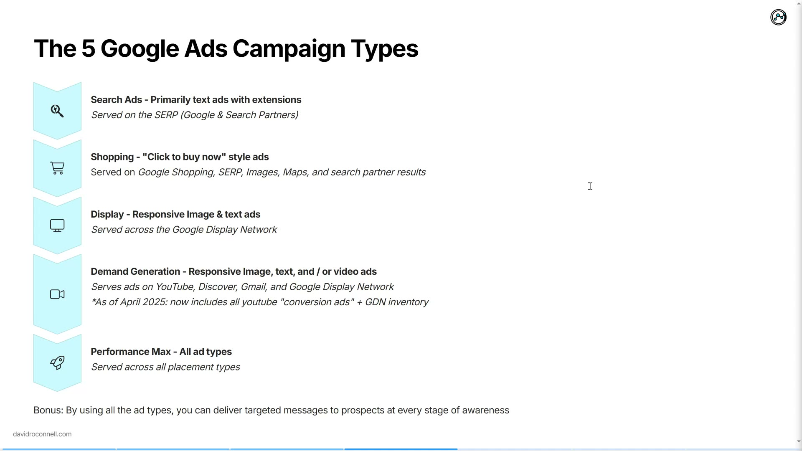
*The five types, where each serves, and the April 2025 note that Demand Gen now includes YouTube conversion ads and GDN inventory. [v1 04:00]*

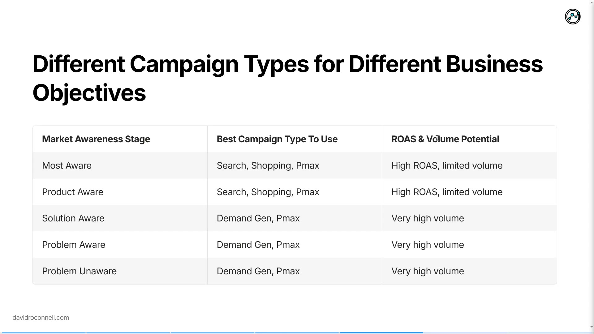
*Most/product aware -> Search, Shopping, Pmax (high ROAS, limited volume); solution/problem/unaware -> Demand Gen, Pmax (very high volume). [v1 06:06]*

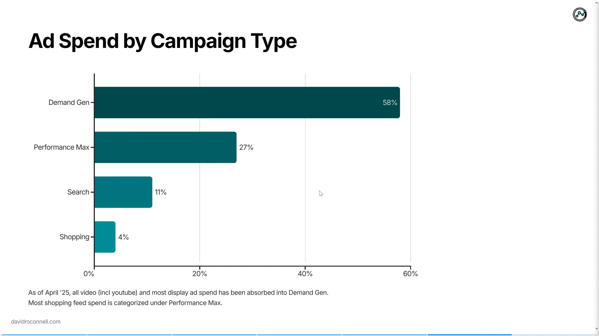
*Demand Gen 58%, Performance Max 27%, Search 11%, Shopping 4%; footnote on what rolled into Demand Gen and Pmax. Sample and accounts not shown. [v1 08:00]*

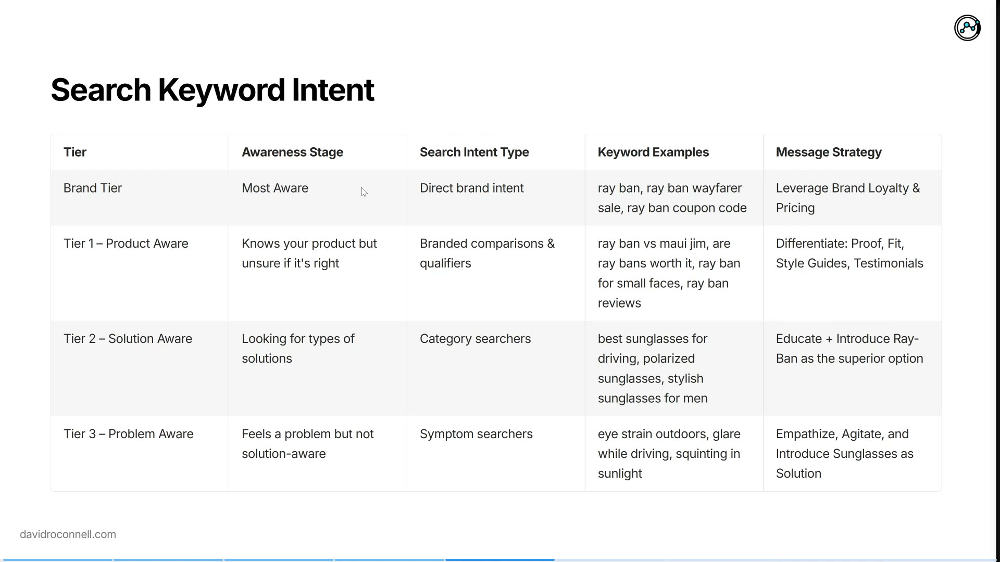
*Brand and three awareness tiers with Ray-Ban keywords and the message strategy for each. [v2 04:24]*

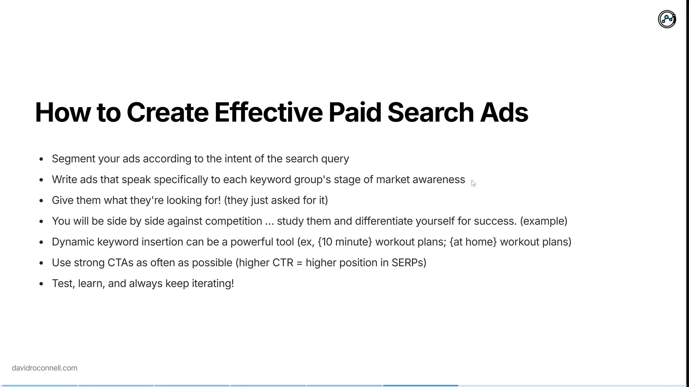
*The seven-rule paid-search checklist, including dynamic keyword insertion. [v2 08:48]*

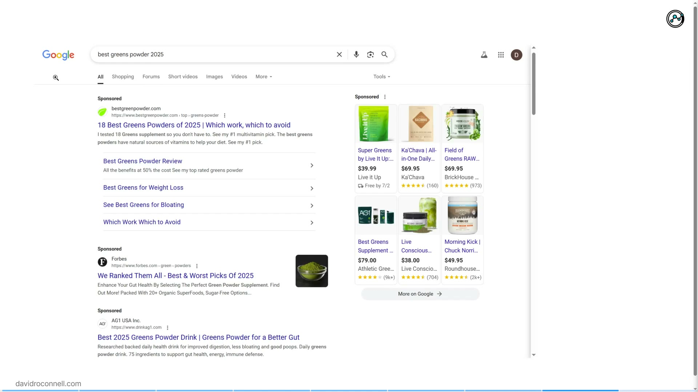
*"best greens powder 2025": three text ads (two advertorial-style) on the left, a Shopping product grid with prices and star ratings on the right. [v2 17:00]*

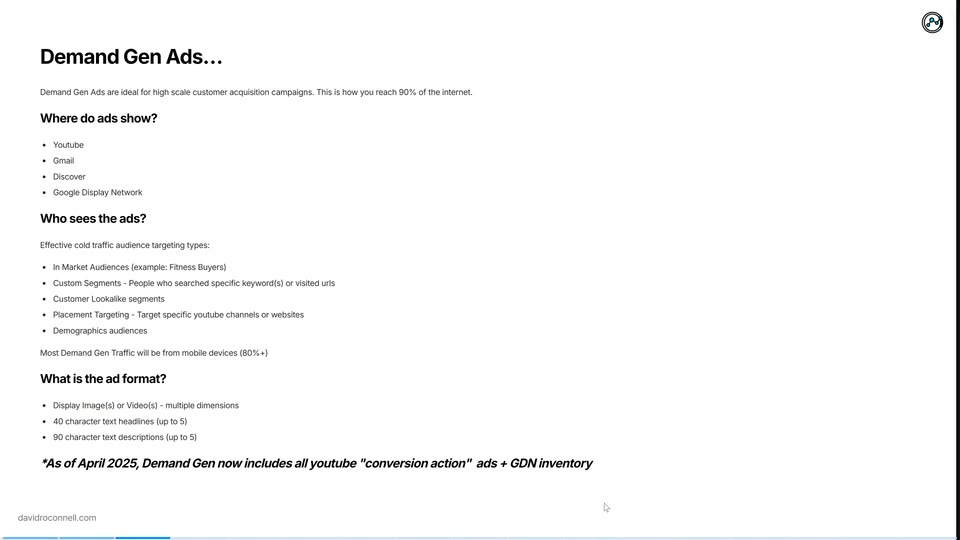
*Placement, targeting types, 40/90-character limits (up to five each) and the 80%+ mobile note. [v3 05:00]*

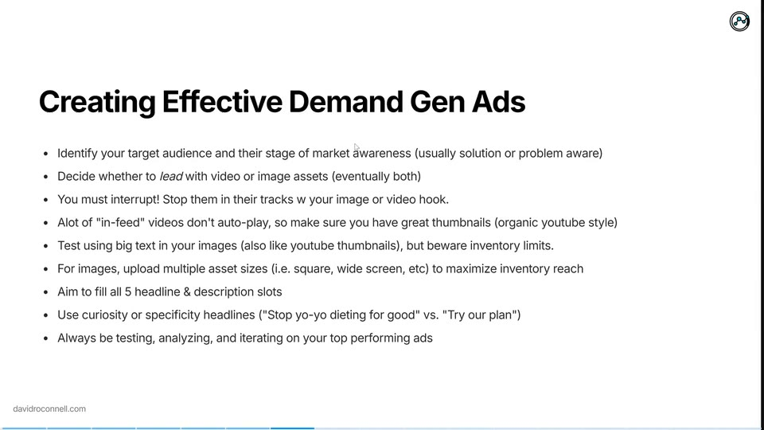
*Nine-point Demand Gen checklist: interrupt, thumbnails, big text, all sizes, curiosity/specificity headlines. [v3 09:00]*

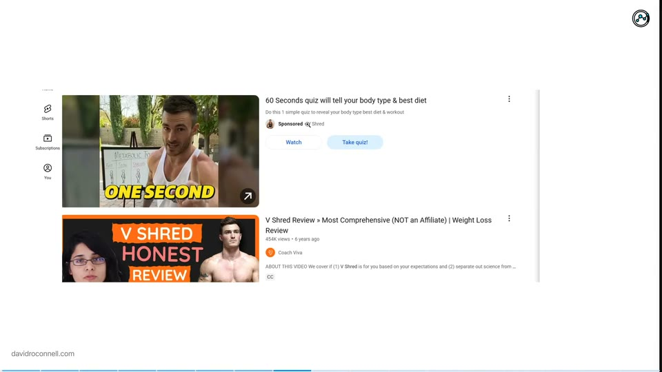
*Sponsored feed item with a quiz CTA ("Take quiz!") above organic review videos; the guest says the thumbnail could be stronger. [v3 15:00]*

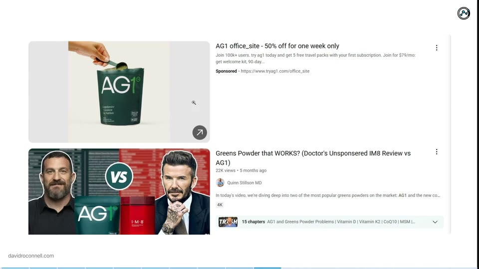
*A product-on-grey square ad ("office_site - 50% off for one week only") beside a face-led organic comparison thumbnail; shows why the ad must compete with organic content. [v3 18:12]*

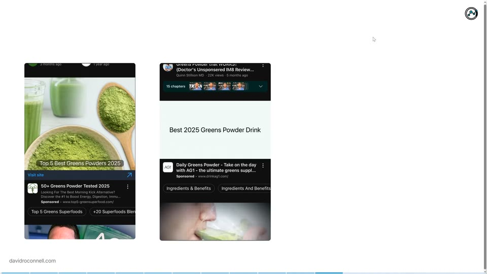
*Left: "Top 5 Best Greens Powders 2025" image ad; right: a headline-only ad on a blank background. [v3 22:00]*

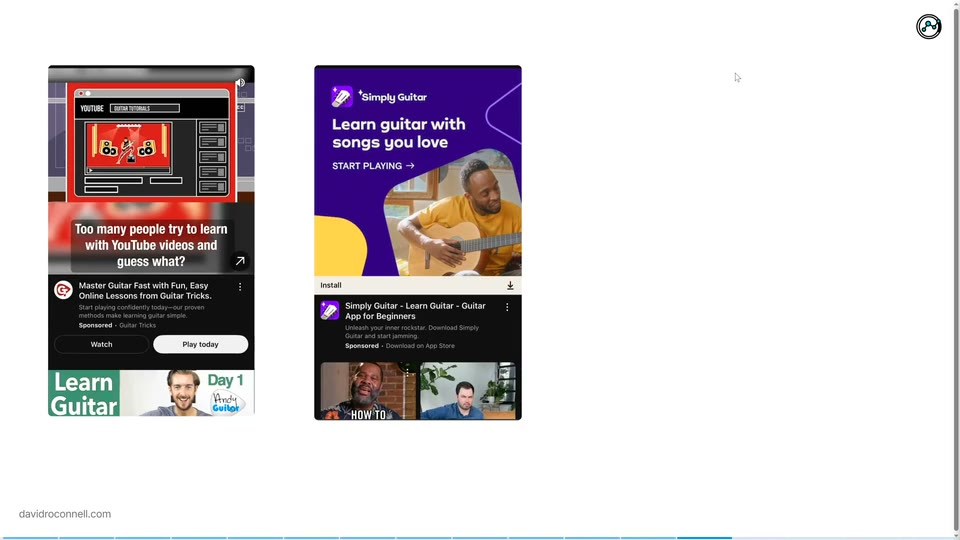
*Left: autoplay video hook "Too many people try to learn with YouTube videos and guess what?"; right: static "Learn guitar with songs you love". [v3 24:00]*

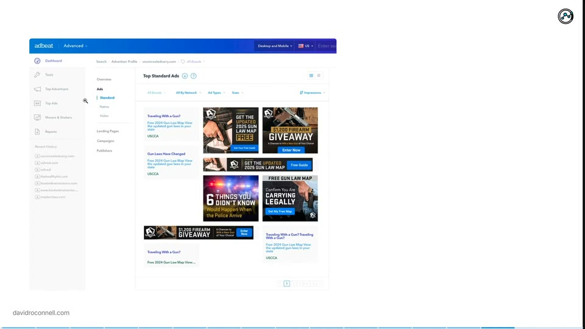
*Adbeat top standard ads for a firearm-law membership advertiser: "Get the updated 2025 gun law map", "6 things you didn't know would happen when the police arrived", giveaway banners. Copy the research method, not the claims. [v3 28:24]*

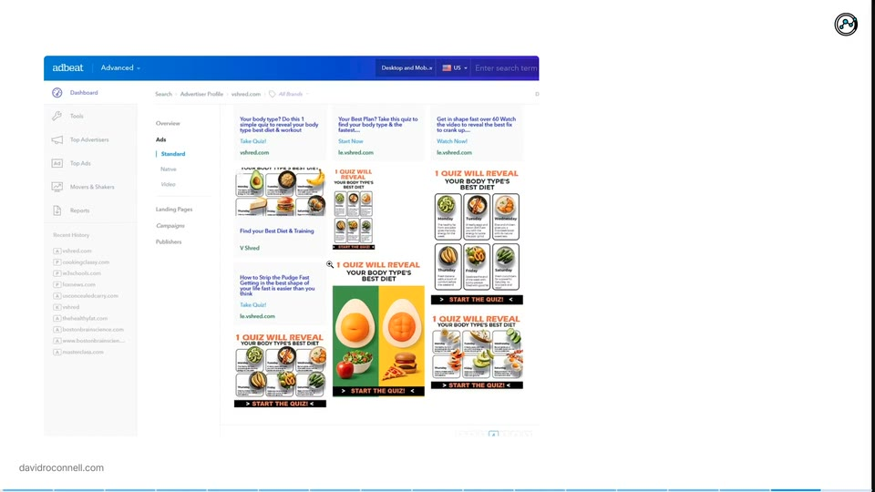
*Quiz-led text ads and "1 quiz will reveal your body type's best diet" images, including the egg before/after concept. [v3 30:36]*

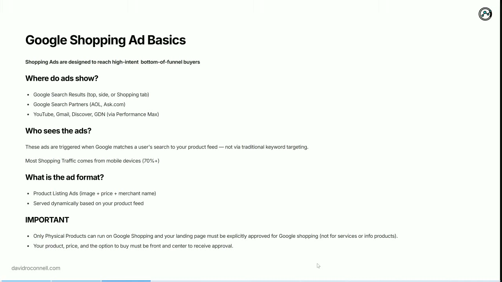
*Where and how shopping ads show, product listing ad format, physical-products-only and landing-page approval rules. [v4 01:42]*

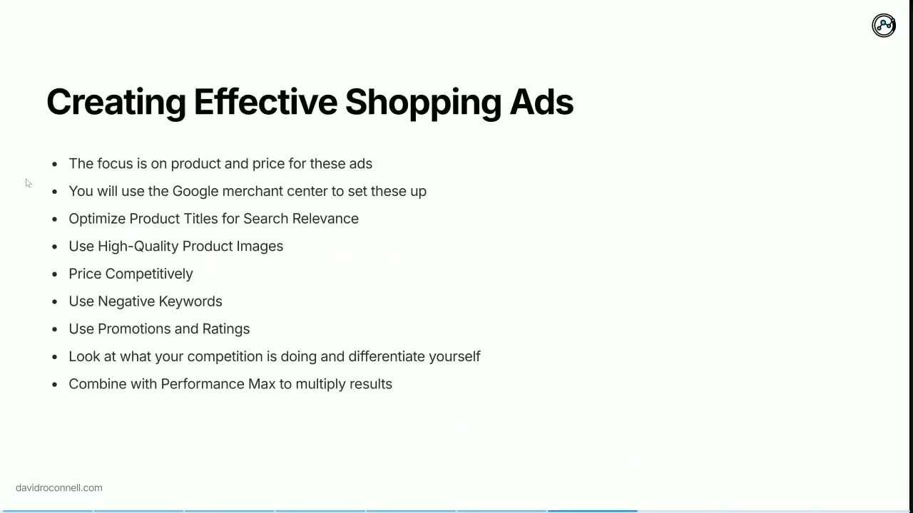
*Nine tips from Merchant Center set-up to combining with Performance Max. [v4 06:18]*

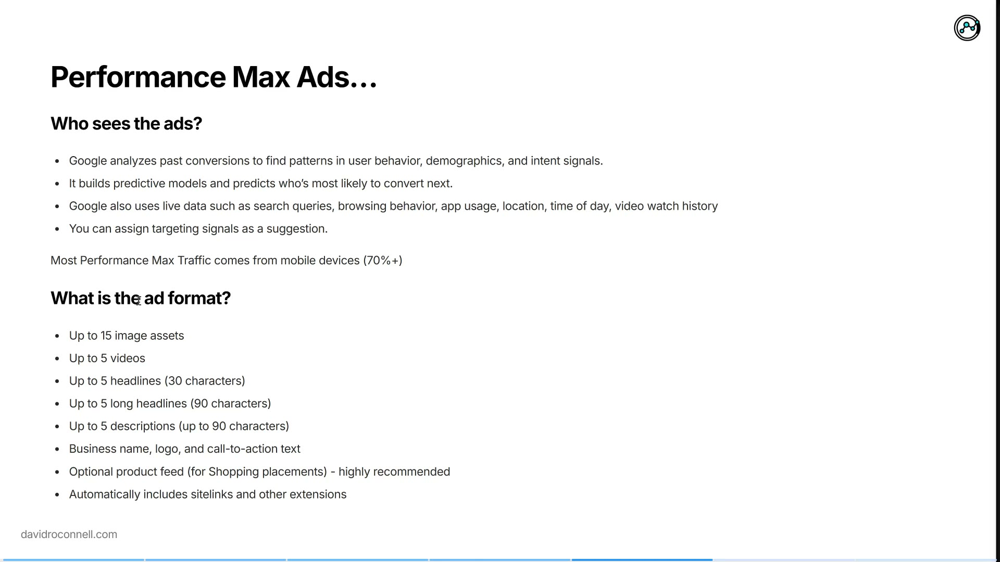
*Signals Google uses and the asset limits (15 images, 5 videos, 5 headlines, 5 long headlines, 5 descriptions). [v5 03:36]*

## How to apply
- [ ] Write the offer type (physical/info/service) and awareness stage before choosing a campaign type; use the table above.
- [ ] For each paid-search keyword group, type a sample query into google.com, log what 3-4 competing ads offer, and write the ad around what the SERP lacks (speed, free first step, authority, risk reversal) using only claims we can substantiate.
- [ ] Write one headline set per tier: brand = official/price/offer; product-aware = proof, fit, guarantee; solution-aware = educate and introduce; problem-aware = empathise, agitate, introduce.
- [ ] For Demand Gen, pick one lead format, build the scroll-stopper (big text, face, intrigue), upload all sizes, make a no-text variant, fill all five headlines and descriptions.
- [ ] Open the YouTube feed or Discover on mobile and check that your ad is not out-shone by the organic thumbnail next to it.
- [ ] Use Adbeat or the live SERP to pull competitor patterns; log mechanism, offer shape and proof type, never lines or claims.
- [ ] Physical product: set up Merchant Center, feed titles, ratings, and test white vs coloured backgrounds and three title styles; then add the feed to Performance Max.
- [ ] Build Performance Max last, from winners only; add signals and feed.
- [ ] Before using before/afters, firearm, supplement or health claims, check Google Ads and Merchant Center policy and our substantiation rules.

## Related
- [12.1 Meta Ads](12-01-meta-ads.md): same awareness-to-format reasoning on Meta; the guest says Google allows before/afters in categories Meta blocks.
- [12.2 Native Ads](12-02-native-ads.md): another cold-traffic, interruption-led channel; compare CTR and thumbnail logic.
- [02.1 Product-Market Awareness](02-01-product-market-awareness.md), [04.10 hooks with AI](04-10-using-ai-to-generate-endless-good-hooks.md)
- [Market awareness (Evolve Copywriting)](../../../evolve/copywriting/concepts/market-awareness.md), [Market awareness levels (Evolve Start Here)](../../../evolve/start-here/concepts/market-awareness-levels.md), [Hooks (Evolve Copywriting)](../../../evolve/copywriting/concepts/hooks.md)
- [Risk-reduction hooks](../../../../concepts/risk-reduction-hooks.md): the "learn in 30 days or you won't pay" move.
- [Native advertising](../../../../concepts/native-advertising.md), [Creative testing system](../../../../frameworks/creative-testing-system.md)

## Sources and limitations
- Transcripts (machine-generated, Whisper large-v3-turbo): [v1 Google Ads.txt](<../../../../../raw/stefan-georgi/rmbc-ii/_transcripts/Stefan Georgi - RMBC II (1)/12-ADS/03-[3] Google Ads.txt>) (10:23, intro) · [video2 paid search](<../../../../../raw/stefan-georgi/rmbc-ii/_transcripts/Stefan Georgi - RMBC II (1)/12-ADS/03- [3] Google Ads video2.txt>) (18:14) · [video3 demand gen](<../../../../../raw/stefan-georgi/rmbc-ii/_transcripts/Stefan Georgi - RMBC II (1)/12-ADS/03-[3] Google Ads video3.txt>) (32:37) · [video4 shopping](<../../../../../raw/stefan-georgi/rmbc-ii/_transcripts/Stefan Georgi - RMBC II (1)/12-ADS/03-[3] Google Ads video4.txt>) (12:37) · [video5 performance max](<../../../../../raw/stefan-georgi/rmbc-ii/_transcripts/Stefan Georgi - RMBC II (1)/12-ADS/03-[3] Google Ads video5.txt>) (7:06). Total 1:20:56.
- Video mapping: the platform caption files are named 03-1 Intro, 03-2 Paid Search, 03-3 Demand Gen Display Video, 03-4 Shopping Ads, 03-5 Performance Max; they match the content order of the five videos (main, video2, video3, video4, video5). The lesson has no documents, PDFs or zips; no `_extracted` file exists for 03.
- Mishearings noted: "performance facts" in video 4 = Performance Max; "search feed ads" in the intro = shopping feed ads (video 5 states half of Performance Max physical-product spend is Shopping); "ManGen" = Demand Gen; "vShrimp"/"Meat Shred"/"BeShred" = vShred (captions "V-Shred"); the AG1 text reads "office_site" on screen (heard as "Office Site"); "Jim Quick" (memory advertiser, as transcribed) could not be confirmed against the captions, so that advertiser is not named in this page; "Quinn" = the channel "Quinn Stillson MD" in the AG1 vs IM8 comparison (read from the screenshot). Video 4's transcript ends on a partial sentence ("for that problem").
- Slide vs speech differences: Demand Gen mobile share is "80%+" on the slide but only "most" in speech; the Shopping and PMax slides say 70%+ and the speaker repeats "over 70%".
- Unsupported guest numbers (instructor claims): reach of 90% of internet users, 50-300+ customers a day, about $5B sample spend and the 58/27/11/4 split (accounts and period not shown), Shopping at 15-20% of revenue, "27% more volume" from Performance Max (conflicts with the 27% spend share said earlier), "10 cents" clicks in 2003, before/afters being allowed on Google for categories Meta bans (verify with current Google Ads policy).
- Policy flags: firearm-law, supplement and fitness before/after examples are other advertisers' ads shown as course examples; they may need substantiation or may breach Google/Meta/FTC rules. The "learn from (professional musician name)" idea needs a real, licensed endorsement; the "30 days or you won't pay" guarantee needs a real policy.
- Screenshots: 17 frames kept. The video 3 and video 4 frames are lower resolution (960 and 1280 px wide). Not captured: Ray-Ban search and shopping SERP slides (video 2 around 03:00 and video 4 around 04:30), the Fabletics/ShoeDazzle placement slide, the Gmail/GDN placement slides, the Performance Max placements graphic, and the ad-creative slides for the military workout and memory-training ads. The guitar search SERP frame was skipped because it shows a user avatar. The first MEGA frame request for videos 4 and 5 failed with an API error (parallel calls) and was retried successfully.
- Not included in the course files: Google Ads account set-up steps, bidding strategy, budgets, tracking/conversion set-up, negative keyword lists, Merchant Center feed templates, headline swipe files, or any Claude/LLM prompt for Google ads. The guest gives each campaign type a short overview and points to "other modules" for video-ad writing.
