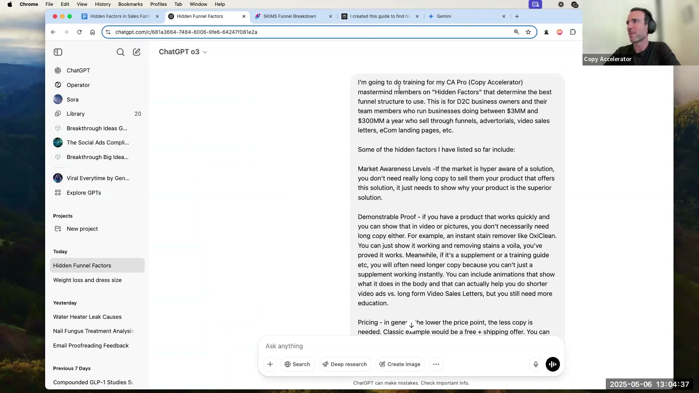
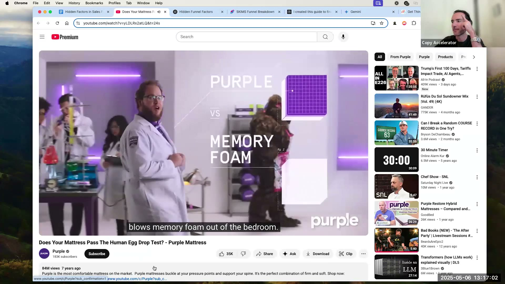
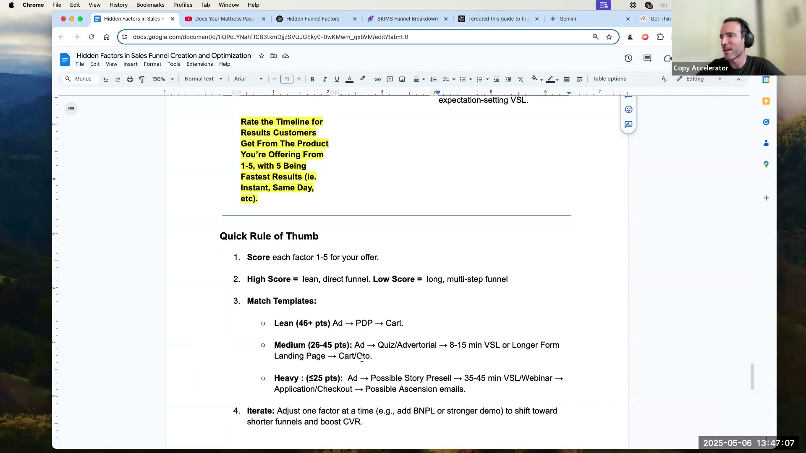
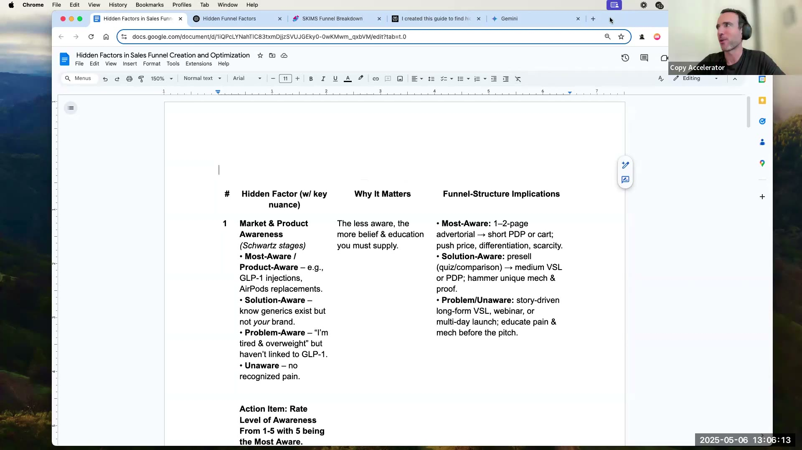
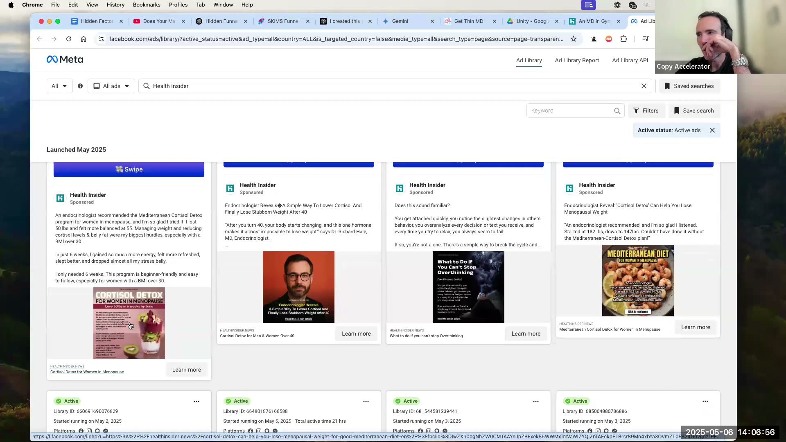

# 13.1 Hidden Factors for Optimal Funnel Structure
> Score your offer 1-5 on 15 "hidden factors" (awareness, demonstrability, price, traffic temperature, brand, risk and so on), add the scores, and the total tells you how lean (ad → PDP → cart) or how heavy (story pre-sell → 35-45 min VSL → application) your funnel should be. It is a starting rule of thumb for deciding which pages to build and test, not a law.

## 🤖 Agent use
- **Use when:** choosing or auditing the page chain between an ad and the checkout (PDP only, quiz/advertorial + VSL, mini-VSL ad + PDP, webinar/application), deciding whether a pre-sell is worth building, or explaining why a competitor's funnel is long or short.
- **Inputs → outputs:** the offer, price, traffic source/temperature, proof assets, regulatory category, device split, current funnel metrics → a 15-row score sheet, a total, the matching funnel band, and "change one factor at a time" levers that would shorten the funnel.
- **Rules:**
  - **DO** score every factor 1-5 with the scale direction in the sheet below. Higher = less copy needed. "Remember, the higher the rating, the less copy you need to add." [10:17]
  - **DO** add the 15 scores and map the total: **46+ lean, 26-45 medium, 25 or less heavy** (doc, "Quick Rule of Thumb"). [08:21; 43:51]
  - **DO** combine factors rather than reading one alone: "even if they have a short attention span, but you're selling something that's $2,000 and you have no trust… you're still going to probably need longer funnels." [39:20]
  - **DO** raise demonstrability before adding copy: a strong demo or an animation that shows the mechanism lets a supplement or gadget get away with 1-10 minute in-feed mini-VSLs instead of long pages. [11:46–12:44]
  - **DO** keep the pre-sell strong enough to carry a buyer through friction at checkout (BNPL approval, configurators). "It's actually not just about the checkout page… pre-selling enough that when they get to the checkout… they'll suffer through it." [38:50]
  - **DO** change one factor at a time when iterating (add BNPL, add a stronger demo) and re-test. (Doc, step 4.)
  - **DON'T** treat the total as a "golden rule". "It doesn't mean you're not going to test things." [48:27] When asked why odd funnels (a 25-minute VSL into an advertorial) work: "you just got to test… seven or eight out of 10 [copycats] would not [win]." [1:08:00–1:08:55]
  - **DON'T** assume a high price forces long copy: with real demonstrable superiority ("how do you sell a multi-thousand dollar mattress… through e-commerce and actually blow it up?") a short funnel can work. [15:40]
  - **DON'T** copy the Purple, GetThin or Health Insider executions or any health claim shown. Copy the structure only. See compliance flags below.
  - **IF** your market is highly aware of the solution and believes it works **THEN** skip the VSL and pre-sell; show price, trust and why you are the better source (the GetThin pattern: static ad → short lander → questionnaire). [03:02–07:24]
  - **IF** the pain is not urgent (anti-aging, "be a millionaire in five years") **THEN** find "an immediate pain point that is symptomatic of the long-term one" and lead with it. [31:13–32:46]
  - **IF** the funnel converts poorly **THEN** diagnose in this order: step conversion rates against benchmarks, then ad metrics (CPM/CPC), then AOV. [48:59–53:03]
- **See also:** [9.1 Advertorials overview](09-01-advertorials-overview-and-examples.md) · [11.2 Checkouts part 2](11-02-checkouts-walkthrough-part-2.md) · [14.1 Upsells overview](14-01-upsells-overview.md) · [4.11 VSLs on landing pages vs in-feed ads](04-11-vsls-on-landing-pages-vs-vsls-as-in-feed-ads.md) · [Evolve: market awareness levels (page-type matrix)](../../../evolve/start-here/concepts/market-awareness-levels.md)

## Key ideas

### Where the list came from, and how it was built [00:00–02:30]
- He started with "a few hidden factors" (his "original three"), asked ChatGPT (it "sort of knows my world" through memory) for more, then edited the output. He did not paste it raw: "I'm not just sort of like, here's what ChatGPT told me." [00:00–01:32]
- ChatGPT also generated a scoring rubric. He **inverted it** (his version: 5 = least copy needed) because ChatGPT "had it sort of in a weird way". [01:32; 07:24]
- Research on case studies came from three deep-research runs: ChatGPT, Perplexity and Gemini. Gemini reportedly went through "362 websites"; it stalled during the call, so its output is not in the course files. [01:32–02:30; 46:46]
- The first factor he had on his own list before ChatGPT was demonstrable proof. [10:17]
- Why the list exists: "there can still be confusion about what sort of funnel you need… it kind of depends on what you're selling and what the state of the market [is]." [02:30–03:02]


*The seed prompt on screen: audience (D2C owners and teams doing $3MM-$300MM a year selling through funnels, advertorials, VSLs, e-com landing pages), then his first factors (market awareness, demonstrable proof, pricing). Reproduced in the Prompts section. [01:30]*

### 1. Market and product awareness [03:02–08:21]
- Uses Schwartz stages. For GLP-1: **most/product aware** = knows telemedicine companies sell it and wants it; **solution aware** = knows GLP-1 exists, not that telemedicine offers it; **problem aware** = "tired of overweight" but hasn't linked it to GLP-1; **unaware** = "your friend is an alcoholic before you have an intervention." He generally would not market to unaware people. [03:02–04:55]
- His telemedicine brand GetThin runs "little static ads" to a minimal lander (headline, short copy, social proof, doctor credential) into a medical questionnaire. "No advertorial, no VSL, just static ad." [04:55–06:29]
- Why it works: about a year and a half earlier "people were really aware" that GLP-1 existed; they only asked "where do I find them, what's the price, can I trust the person I'm buying from?" [06:29–07:24]
- Rule: "if your market is hyper aware of a solution… and they believe that the solution works, then there's just no reason to have long-form copy." [07:24]
- Instructor claims (unverified): 600-plus patients lost 9.6 pounds on average in 30 days; GetThin did "20 million last year", "40, 50 million this year", being prepared for a sale "over $100 million". [03:02; 05:57–06:29] (Health claims: see compliance flags.)
- Link: [Evolve awareness x page matrix](../../../evolve/start-here/concepts/market-awareness-levels.md) and [Evolve market awareness](../../../evolve/copywriting/concepts/market-awareness.md) cover the same idea from the testing side.

### 2. Demonstrable proof / visual "wow" [10:17–15:40]
- If you can show quickly that it works, "you just don't need a bunch of copy." Examples: teeth whitening with a time-lapse, **OxiClean** (spray, stain gone), an instant wrinkle remover. [10:17–11:46]
- Supplements and gadgets cannot show instant results, but a **mechanism animation** does "a similar purpose" (enzymes into the gut; a baby-bottle suction animation his wife found convincing). He ties this to why in-feed ads that act as "mini VSLs one to eight minutes long, maybe ten" are common. [11:46–12:44]
- Purple mattress "human egg drop test" (about 86 million views per the instructor; the page in the frame shows 84M): drop eggs on a mattress, normal foam breaks them, Purple does not. Used as proof that high price does not always require long copy. [12:44–15:40]


*The demonstrable-proof example he plays: Purple versus memory foam in a lab-coat egg-drop demo. Doc row 2 links this video. [13:54]*

### 3. Price point and perceived spend [16:12–17:39]
- Lower ticket needs less justification; higher ticket more. He disagrees with ChatGPT's "less than $50 equals micro lander or two-step opt-in" ("I think that's silly"), prefers "less than $9" (the doc says <$9 "free+S&H"). [16:12]
- Free-plus-shipping book, free trial or webinar opt-in: "you're not selling whatever you're going to sell in the webinar… the barrier to commitment is pretty low." [16:42]
- Above that, VSLs "often work" but: "I'm more than $10, so I need a VSL. And it's like, well, maybe… rate each of the ones." [16:42–17:39]

### 4. Traffic temperature and source [17:39–19:12]
- Colder traffic needs more copy and more steps (advertorial, VSL). A warm email list can go to a "pretty short landing page, product page." [18:11–18:42]

### 5. Brand equity and credibility reserve [19:12–21:44]
- Known brand or celebrity founder/endorser = shorter funnel. Coca-Cola does not need a VSL. [19:12]
- He recalls "black hat free trial" funnels that put a celebrity (he names Jennifer Aniston) on a landing page and claimed endorsement. He calls it black hat. Do not do this: fake endorsements are deceptive. [20:12]
- Genuine celebrity VSLs exist (Golden Hippo, Agora's financial VSLs with a name known to "a 50 plus conservative demo"), so "it doesn't mean you would never do a VSL." [20:12]
- Brand-building lets you get "lazier" over time: well-known brands lean on UGC, short ads and PDPs; "the more aware of your brand the market is… the less copy is required." He contrasts this with aggressive ClickBank VSLs (a member did "60 million for Q1" and was "number one vendor on ClickBank"; instructor claim). [21:12–21:44]

### 6. Perceived risk and required risk reversal [21:44–24:16]
- Less risk, less copy: a $5-shipping free book needs little; an unknown brand with few reviews "the more risky you are." [21:44–23:18]
- Risk = cost times "what if it fails?". Reduce with social proof, longer testimonials, ingredients for supplements, guarantee and FAQ. [23:18–24:16]

### 7. Regulatory and compliance load [24:16–25:23]
- Regulated spaces add mandatory steps. Telemedicine: terms pages plus an eligibility quiz. Investments: know-your-customer steps. "If you don't have to have any of that stuff, you're a five." [25:23]

### 8. Offer complexity and choice overload [25:23–27:51]
- Bundles raise AOV but add "decision paralysis". One unit, one price = 5. Day/night serum bundles add friction. [25:23–27:51]
- Fix for hyper-personalised offers: interactive quizzes that recommend a bundle. He cites Il Makiage as a quiz success and Eric Santiago (head of growth at the time; now an Opal partner) who helped take it "from like 60 million to like a couple hundred million" (instructor claim). He says a quiz training is a future topic. [26:54–27:51]
- Rule: complexity means "you need more funnel assets. It doesn't mean you have a longer VSL necessarily." [27:51]

### 9. Customer LTV versus CAC flexibility [27:51–30:14]
- If LTV is central, you can afford more touchpoints: mini classes, nurture emails, non-sales webinars; "once they buy, that LTV is going to be so good." [28:51–29:24]
- Low-ticket/free-plus-shipping/$9.99: "self-liquidate", aim for ROAS or break-even on day one, one-click upsells, monetise data on the back end. [29:24] Scoring: 5 = LTV matters least. See [14.1](14-01-upsells-overview.md).

### 10. Urgency of the problem [30:14–33:45]
- Acute pain (migraines) sells with less copy than aspirational anti-aging; "energy is hard to sell" in supplements. [30:14–31:13]
- For low-urgency products, "what you really need is an immediate pain point that is symptomatic of the long-term one": joints hurting after 45, struggling to lose weight; then pile on the secondary benefits (energy, libido) but focus on one thing. [31:13–32:46]
- Biz-op example: "be a millionaire in five years" is a "shitty value prop"; the real pain is broke, in debt, stuck in a nine-to-five. Book funnel is short; a $3,000-$5,000 coaching program needs "a pretty involved funnel". [32:46–33:45]

### 11. Competitive saturation [33:45–36:18]
- Blue ocean plus believable proof = shorter copy. Crowded markets (biz op, FBA, weight-loss supplements, Agora-style finance, "make money with AI") need differentiation, unique mechanism, comparison charts, teardowns of competitors, "loads of social proof", prospect connection. [33:45–35:16]
- ChatGPT's examples used market sophistication (an "Alkaline" ClickBank example). He doubts the "same-day shop-ability" half of the factor name and just calls it "competitive saturation." [35:16–36:18]
- Link: [Evolve unique mechanism](../../../evolve/copywriting/concepts/unique-mechanism.md); [3.1 Unique mechanisms overview](03-01-unique-mechanisms-overview.md).

### 12. Buying context: device and attention window [36:18–40:19]
- Platform-specific, not just cold or warm: TikTok mobile behaves differently from desktop. The doc line: "80% of TikTok traffic buys (or bounces) in <30s on mobile." The transcript and captions both read "8%", the doc reads "80 %"; treat as an unverified ChatGPT figure. [36:18–36:49]
- Score 5 = lowest attention span and mobile (short funnel). 70-plus-year-olds on desktop who sit through a 30-minute VSL = 1 or 2. [36:49]
- Practical read: use "what percentage of my traffic and buyers and customers are mobile?", not just the platform. [39:20]
- For a free guide on TikTok, mostly mobile: "just a short… put your name and get this stuff, testimony, what works, credibility." [40:19]

### 13. Payment friction and financing [36:49–38:50]
- 5 = free with no card (an opt-in "can convert 50 to 70%", instructor claim) or very easy checkout; BNPL approval, configurable or personalised purchases add friction. [37:49–38:50]

### 14. Community and social-proof assets [40:50–42:22]
- Lots of legit social proof (UGC, reviews, a 100,000-plus community) lets you spend less time on credibility. "The average e-com lander is pretty minimalistic copy, a bunch of reviews, a social proof. That's it." Without it, you need credibility narrative and case studies. [40:50–42:22]

### 15. Time to result / visible progress [42:22–43:51]
- Fast visible wins need less copy. Slow-result products (supplements, devices) use milestone expectations ("week one, week four, week eight, week twelve"), which is future pacing. "Not to me the most important one in this list," kept because of the scoring system. [42:22–43:51]

### Scoring and the funnel bands [43:51–46:15]
- Highest score = least copy. He edited the bands live. [43:51–45:15]


*The "Quick Rule of Thumb" on screen after his edit: score each factor, high = lean, low = multi-step, then match templates (Lean 46+, Medium 26-45, Heavy 25 or less) and iterate one factor at a time. [44:00]*


*The 15-row table format: factor with nuance, why it matters, funnel-structure implications, and a highlighted "Rate ... From 1-5" action item (row 1 shown). [03:06]*

### Q&A highlights [46:46–1:12:15]
- **Bottleneck diagnosis** (instructor's reasoning, no data supplied): [48:59–53:03]
  1. Start from the goal (e.g. positive ROAS on day zero) and back into the AOV, CPA and CPM that goal needs.
  2. Check landing-page → checkout rate and checkout → purchase rate against benchmarks. Low page click-through = copy problem; use heat maps and VSL watch-time curves to find the drop-off.
  3. Check ad metrics at the same time (CPM, CPC). Test mentally: "if I cut the cost per click in half and all the metrics stay the same, do I have a winner?"
  4. If everything is decent, find "an extra $20 or $40" of AOV: "we just need to make more money with every sale. If we make more money with every sale, we can scale this thing." [53:03] (See [14.1](14-01-upsells-overview.md).)
- **AOV x CVR rule (an attendee's heuristic, ~350):** e.g. $200 AOV x 1.75% = 350; $50 AOV needs ~7%; $10 needs ~35%; $350 needs ~1%. Instructor: "I wouldn't make that my Bible metric", agency owners "make up shit to be thought leaders", the product probably breaks at low AOV unless the back end carries revenue. He prefers tracking **effective CPA** and building a halo. [53:39–56:43; 54:13]
- **Long VSL to a solution-aware market** (GetThin or a magnesium brand)? GetThin tested 7-minute VSLs over about 18 months: some "20% worse", "neck and neck", never worth the effort. For a commodity like magnesium he would still start with an **advertorial + e-com lander + video ads**, not a VSL. [57:20–1:00:01]
- **His own default (Opal Beauty skincare, being rebranded):** video ads (30 seconds to a couple of minutes) → PDP → checkout, "kind of like Emma Relief… a little bit more copied than the average e-com page because we have less social proof to start", testing shorter landers as proof accumulates; advertorial added if needed. [1:00:01–1:01:32]
- **Health Insider-style statistic advertorials:** he does not usually like leading with statistics ("I don't care about the general. The specific is me") but would test swiping this style: image/infographic ads → article-style page is congruent, "I bet they get a really high click-through rate." [1:01:32–1:04:50] Later: stats may work better in female-heavy markets ("you're not alone, girl") than male; his belief may be outdated. [1:09:59–1:11:07]
- **Golden Hippo / VShred multiple brands and spokespeople:** different authority figures resonate with different segments, and a repeated spokesperson causes fatigue; "I wouldn't really be trying to do that until I'm pretty large." [1:04:50–1:07:27]
- **Tracking:** Hyros for overall sales tracking, RedTrack specifically for Meta; an attendee uses Triple Whale. [1:09:25]


*Ad Library view of the "Health Insider" style he reviews: infographic/portrait images with testimonial-style primary text sending to an article page. Structure only; the claims are weight-loss and cortisol claims that would need substantiation. [1:03:48]*

## Steps / framework
**Funnel Selection Matrix (derived workflow from the lesson and doc):**
1. Fill the 15-row sheet below. Score each row 1-5 using the direction in the "5 means" column.
2. Sum (range 15-75).
3. Map the total to a band and starting chain.
4. Check rows scoring 1-2: those are the reasons the funnel is long. Ask which one can be raised (add BNPL, add a demo/animation, add UGC, add a guarantee) before adding more pages.
5. Build and test the chain. Treat the band as a hypothesis ("test everything").
6. Re-score after each change and after each batch of new proof.

| Total | Band | Starting chain (from doc) |
|---|---|---|
| 46+ | Lean | Ad → PDP → Cart |
| 26-45 | Medium, structure #1 | Static ad or 30-60 second video ad → Quiz/Advertorial → 8-15 min VSL or longer-form landing page → Cart/OTO |
| 26-45 | Medium, structure #2 | 3-10 min in-feed video ad (mini VSL) → Optional quiz/advertorial (test) → PDP landing page → Cart/OTO |
| 25 or less | Heavy | Ad → possible story presell → 35-45 min VSL/webinar → application/checkout → possible ascension emails |

- The PDF copy labels structure #2 as "Long (26-45 pts)"; the docx and the on-screen doc say Medium. Treat it as Medium. [44:29–45:15]
- He notes structure #2 "is actually a structure a lot of people in here run" and that a static or very short ad can also go straight to PDP → cart → upsells if the scores are high. [45:15]

## Examples
- **GetThin (telemedicine GLP-1):** static ads → minimal lander → questionnaire → clinician review. Awareness and belief are high (prescription medicine, "zero doubt that they work" [58:53]); regulatory load adds the quiz step [25:23]. Mapping to scores is (derived). [03:02–06:29]
- **Purple mattress egg-drop video:** high price, high demonstrability, long-form not required. [12:44–15:40]
- **OxiClean / teeth whitener / instant wrinkle remover:** instant visual payoff → "15-45 second video ad + short lander" (doc row 2). [10:17–11:46]
- **Supplement with mechanism animation:** 1-10 minute in-feed mini VSL → short page. [11:46–12:44]
- **Biz-op or coaching at $1k-$3k:** long webinar, application call, or multi-email indoctrination (doc row 3). [33:45]
- **Opal Beauty skincare:** video ads → PDP (with extra copy while social proof is thin) → checkout. [1:00:01–1:01:32]
- **Free-plus-shipping book / webinar opt-in:** micro-lander; very low price, risk, friction. [16:42; 22:47; 37:49]

## Structured units

### Factor scoring sheet (verbatim action items from the doc, with source rows)
| # | Factor | "Rate ... from 1-5" scale (5 means) | Low score (1-2) implies | High score (4-5) implies | Source |
|---|---|---|---|---|---|
| 1 | Market and product awareness | 5 = most aware | Problem/unaware: story-driven long-form VSL, webinar or multi-day launch | Most aware: 1-2-page advertorial → short PDP or cart; push price, differentiation, scarcity | [03:02–08:21] |
| 2 | Demonstrable proof / visual wow | 5 = most demonstrable | Longer copy, animations, science sections, extended guarantee | 15-45 s video ad + short lander | [10:17–15:40] |
| 3 | Price point and perceived spend | 5 = lowest price | $1k-$3k: long webinar, application call, multi-email indoctrination | <$9 free+S&H: micro-lander or two-step opt-in; mid ticket ($10-$497) VSL + order-form bump | [16:12] |
| 4 | Traffic temperature and source | 5 = warmest | Cold: multi-step warm-up (quiz, advertorial, VSL) | Warm/retarget: straight to cart or short-form video | [17:39] |
| 5 | Brand equity / credibility reserve | 5 = highest | Unknown: authority stack, earned-media presell, founder-story VSL | High equity: UGC-style video + concise PDP | [19:12] |
| 6 | Perceived risk and required risk reversal | 5 = lowest perceived risk | High risk: longer testimonials, ingredient science, guarantee and FAQ | Low risk: impulse-style single-page checkout | [21:44] |
| 7 | Regulatory / compliance load | 5 = lowest load | Add eligibility quiz, KYC screens, extra TOS pages | No gatekeeping needed | [24:16] |
| 8 | Offer complexity / choice overload | 5 = least complex | Interactive quiz/configurator, step-by-step cart | Single SKU → direct-to-buy | [25:23] |
| 9 | Customer LTV vs CAC flexibility | 5 = LTV "least important" | High LTV: nurture webinar/mini-class funnels → nurture emails | Low LTV: tight ROAS-first lander, one-click upsells | [27:51] |
| 10 | Urgency of problem | 5 = most urgent | Low urgency: narrative VSL, transformation roadmap | High urgency: "Get relief in 5 min" headline, SMS checkout, no fluff | [30:14] |
| 11 | Competitive saturation | 5 = least saturated | Crowded: comparison charts, competitor tear-down presell, differentiation, unique mechanism, loads of social proof | Blue ocean: curiosity hook + fast CTA | [33:45] |
| 12 | Buying context (device and attention window) | 5 = lowest attention span and mobile | Desktop/work: in-depth letter, interactive calculator | Mobile scrollers: punchy vertical video, accordion sections | [36:18] |
| 13 | Payment friction and financing | 5 = least friction (free or very easy checkout) | High friction (wire, financing apps): gated application funnel with trust copy | BNPL/Apple Pay: shorter checkout, more upsells | [36:49] |
| 14 | Community and social-proof assets | 5 = most social proof / strongest community | Sparse: longer credibility narrative, case studies | Rich: carousel lander heavy on UGC | [40:50] |
| 15 | Time to result / visibility of progress | 5 = fastest results (instant, same day) | Slow/invisible: milestone timeline graphic, expectation-setting VSL | Fast/visible: demo-first hero video, GIFs, "watch it work" loop | [42:22] |

### Rules of thumb
- **DO** read the scale direction per row; rows 6, 7, 8, 9, 11, 12 are phrased differently (5 = low risk, low load, simple offer, LTV least important, least saturated, shortest attention).
- **DO** treat rows 9 and 13 as the ones that change the upsell/ascension plan, not just page length ([14.1](14-01-upsells-overview.md)).
- **IF** total is high but conversion is poor **THEN** check the funnel-step rates and ad metrics before adding pages. [48:59–53:03]
- **IF** rows 1 and 5 are low and rows 2, 14, 15 can be raised **THEN** raise those assets (demo, UGC, expectations timeline) before building a longer funnel. (derived)

### Templates (from the doc)
| Template | Use for | Source |
|---|---|---|
| Ad → PDP → Cart | Lean (46+) | doc, Quick Rule of Thumb |
| Static ad / 30-60 s video ad → Quiz/Advertorial → 8-15 min VSL or longer-form landing page → Cart/OTO | Medium #1 | doc; [44:29] |
| 3-10 min in-feed video ad (mini VSL) → optional quiz/advertorial (test) → PDP landing page → Cart/OTO | Medium #2 | doc; [44:29] |
| Ad → possible story presell → 35-45 min VSL/webinar → application/checkout → possible ascension emails | Heavy (25 or less) | doc |

## Prompts / templates (verbatim)

**1. Seed prompt shown on screen (ChatGPT o3, visible portion only; the screen cuts off after "Pricing"; the rest of the prompt is not in the course files):**
```text
I'm going to do training for my CA Pro (Copy Accelerator) mastermind members on "Hidden Factors" that determine the best funnel structure to use. This is for D2C business owners and their team members who run businesses doing between $3MM and $300MM a year who sell through funnels, advertorials, video sales letters, eCom landing pages, etc.

Some of the hidden factors I have listed so far include:

Market Awareness Levels -If the market is hyper aware of a solution, you don't need really long copy to sell them your product that offers this solution, it just needs to show why your product is the superior solution.

Demonstrable Proof - if you have a product that works quickly and you can show that in video or pictures, you don't necessarily need long copy either. For example, an instant stain remover like OxiClean. You can just show it working and removing stains a voila, you've proved it works. Meanwhile, if it's a supplement or a training guide etc, you will often need longer copy because you can't just a supplement working instantly. You can include animations that show what it does in the body and that can actually help you do shorter video ads vs. long form Video Sales Letters, but you still need more education.

Pricing - in general, the lower the price point, the less copy is needed. Classic example would be a free + shipping offer. You can
```
(Screen text, [01:30]. Fixes: none; typo "a voila" is on screen.)

**2. The doc's rule of thumb (verbatim, from the docx):**
```text
Quick Rule of Thumb
1. Score each factor 1-5 for your offer.
2. High Score = lean, direct funnel. Low Score = long, multi-step funnel
3. Match Templates:
   - Lean (46+ pts) Ad → PDP → Cart.
   - Medium (26-45 pts) Structure #1: Static Ad or 30-60 Second Video Ad→ Quiz/Advertorial → 8-15 min VSL or Longer Form Landing Page → Cart/Oto.
   - Medium (26-45 pts) Structure #2: 3-10 In Feed Video Ad (Mini VSL) → Optional Quiz/Advertorial (test) → PDP Landing Page → Cart/Oto.
   - Heavy : (≤25 pts): Ad → Possible Story Presell → 35-45 min VSL/Webinar → Application/Checkout → Possible Ascension emails.
4. Iterate: Adjust one factor at a time (e.g., add BNPL or stronger demo) to shift toward shorter funnels and boost CVR.
```

**3. Per-factor "Action Item" lines (verbatim from the docx/PDF):**
```text
1  Rate Level of Awareness From 1-5 with 5 being the Most Aware.
2  Rate Demonstrability of Product Efficacy From 1-5 with 5 Being The Most Demonstrable
3  Rate price point from 1-5, with 5 Being the Lowest Price Point and 1 Being the Highest
4  Rate the Level of Warmness of Your Primary Traffic Source From 1-5, with 5 Being Warmest.
5  Rate Brand Equity/Credibility Reserve from 1-5 with 5 Being Highest Brand Equity or Credibility Reserve
6  Rate Perceived Risk With Your Offer From 1-5, with 5 Being the Lowest Level of Perceived Risk
7  Rate Regulatory/Compliance Load For Your Offer From 1-5, with 5 Being Lowest
8  Rate Your Offer Complexity From 1-5, with 5 Being the Least complex
9  Rate How Important LTV is For Your Offer On a Scale From 1-5, with 5 Being "Least Important"
10 Rate Urgency of Market's Problem From 1-5, with 5 Being Most Urgent
11 Rate Competitive Saturation Of Your Market From 1-5, with 5 Being The Least Saturated.
12 Rate Buying Context & Device Attention Window From 1-5, with 5 Being Lowest Attention Span (and Mobile)
13 Rate Payment Friction From 1-5, with 5 Being Least Friction (ie. Free or very easy checkout)
14 Rate Community and Social Proof Assets for Your Offer From 1-5, with 5 Being The Most Social Proof/Strongest Community
15 Rate the Timeline for Results Customers Get From The Product You're Offering From 1-5, with 5 Being Fastest Results (ie. Instant, Same Day, etc).
```

**4. Agent scoring prompt (derived, not from the course; built from the above):**
```text
Score this offer on the 15 Hidden Factors using the scale directions below (5 = least copy needed). For each factor give: score, one-line evidence from the product/offer facts I supplied, and "UNKNOWN - need: <fact>" if the facts are missing (do not guess). Then sum, map to Lean (46+), Medium (26-45) or Heavy (<=25), propose the matching chain, list the three lowest-scoring factors, and for each name one lever that could raise it and the test to run. Do not invent proof, stats or compliance clearances.
[paste the 15 action-item lines]
[paste offer, price, traffic source, proof assets, category, device split]
```

## Screenshots
Embedded above: seed prompt [01:30], table row 1 [03:06], Purple egg drop [13:54], rule-of-thumb bands [44:00], Health Insider Ad Library [1:03:48]. Not kept: the instructor's talking-head frames and a stalled Gemini screen.

## How to apply
- [ ] Fill the 15-row sheet for the offer. Write the evidence next to each score; mark unknowns instead of guessing.
- [ ] Sum and pick the band. Write the chain as a hypothesis and the test that would falsify it.
- [ ] List rows scoring 1-2. For each, decide whether a cheaper lever (demo, animation, UGC, guarantee, BNPL, milestone timeline) can raise it before building a longer funnel.
- [ ] Check congruence: whatever page type the band implies must match what the ad promised ([9.1](09-01-advertorials-overview-and-examples.md)).
- [ ] Build the upsell and checkout plan from rows 3, 9, 13 ([11.2](11-02-checkouts-walkthrough-part-2.md), [14.1](14-01-upsells-overview.md)).
- [ ] Pull funnel-step rates and ad metrics before blaming copy. Benchmark them. Look at AOV last.
- [ ] Re-score after each change. Change one factor at a time.

## Related
- [Evolve: market awareness levels (page-type matrix)](../../../evolve/start-here/concepts/market-awareness-levels.md) · [Evolve: market awareness](../../../evolve/copywriting/concepts/market-awareness.md) · [Evolve: show, don't tell](../../../evolve/copywriting/concepts/show-dont-tell.md)
- [Offer and bundle psychology](../../../../frameworks/offer-and-bundle-psychology.md) · [Creative testing system](../../../../frameworks/creative-testing-system.md)
- RMBC II: [9.1 Advertorials](09-01-advertorials-overview-and-examples.md) · [10.1 PDPs](10-01-pdp-overviews-and-claude-processes-for-writing-new-ones.md) · [11.1 Checkouts part 1](11-01-checkouts-walkthrough-part-1.md) · [11.2 Checkouts part 2](11-02-checkouts-walkthrough-part-2.md) · [4.11 VSLs on landing pages vs in-feed](04-11-vsls-on-landing-pages-vs-vsls-as-in-feed-ads.md) · [14.1 Upsells overview](14-01-upsells-overview.md) · [14.2 Upsell case studies](14-02-upsells-case-studies.md)
- Disagreement/overlap: this rubric picks page length by 15 scored factors. [9.1](09-01-advertorials-overview-and-examples.md) picks a pre-sell by unit economics, congruence and compliance, and Evolve picks pages by awareness and split-tests them. They agree that awareness and risk drive length. This lesson's own caveat is that the score is a starting hypothesis and "you just got to test."

## Sources and limitations
- Transcript: [01-[1] Hidden Factors for Optimal Funnel Structure.txt](<../../../../../raw/stefan-georgi/rmbc-ii/_transcripts/Stefan Georgi - RMBC II (1)/13-THE 15 FACTORS THAT DETERMINE YOUR FUNNEL STRUCTURE/01-[1] Hidden Factors for Optimal Funnel Structure.txt>). Platform captions (.srt) checked for names and numbers.
- Documents: the PDF (`The Funnel Selection Matrix...pdf`, 5 pages) and the docx (`CA Pro_Hidden Factors in Sales Funnel Creation and Optimization`). The `_extracted` markdown of the docx dropped the 15-row table; I parsed the original docx. `Deep Research on Case Studies.docx` contains only two links (ChatGPT and Perplexity deep research). Their contents and the Gemini output are not in the course files.
- Fixes: the ASR writes "ChatDBT/chat gpt" for ChatGPT, "El Makiage"/"real maquillage" for Il Makiage, "triple well" for Triple Whale, "VShred"/"Gundry" correctly. "RedTrack" and "Hyros" confirmed by captions. The "8%" TikTok stat reads "8%" in both ASR and captions but "80 %" in the doc.
- Doc versions differ: the PDF and docx are the post-call versions. The on-screen version at [08:30] shows a shorter 3-band rule; the later version adds "Structure #1/#2".
- The screen shows only the first lines of his ChatGPT prompt; ChatGPT's full original answer is not in the course files.
- Revenue, patient-outcome, ClickBank and Il Makiage numbers are instructor claims, not verified.
- **Compliance flags:** GLP-1/weight-loss results (9.6 lb in 30 days), "cortisol detox" ads, supplement and anti-aging claims, and "black hat" celebrity-endorsement free-trial pages would need substantiation or break Meta/FTC rules. Copy the funnel logic, never the claims or fake endorsements.
- Recorded as a live Q&A for his Copy Accelerator members (screen clock 2025-05-06); several tangents (Gemini stall, tracking tools) are marginal.
