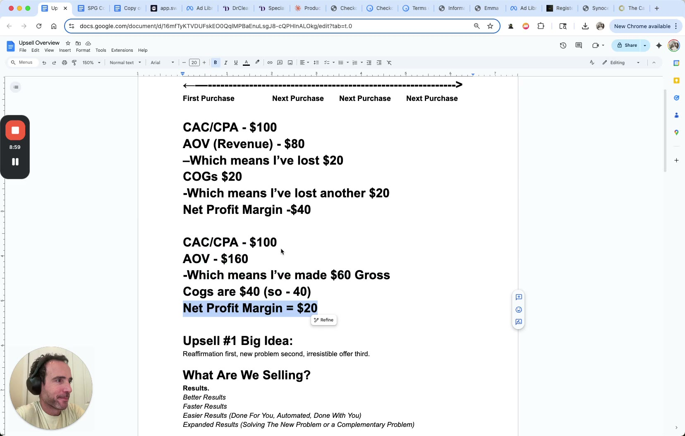
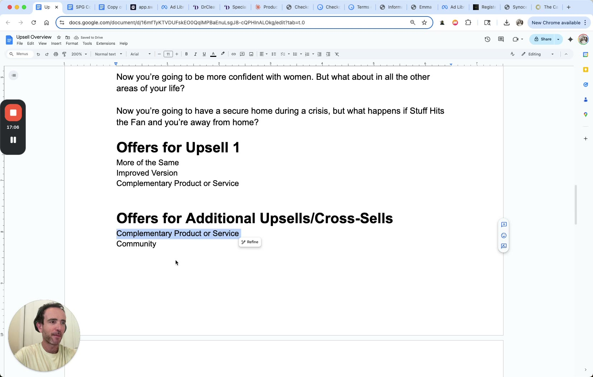

# 14.1 Upsells Overview
> Upsells are the second customer journey, and the easiest sale you will ever make: the buyer is already in buyer mode. A small AOV lift is the difference between losing about $40 per customer and making $20, so upsell #1 should reaffirm the purchase, name a new or expanded problem (or "more of the same"), then make an irresistible offer.

## 🤖 Agent use
- **Use when:** planning the post-purchase sequence for a funnel (upsell #1, additional upsells, cross-sells), choosing what each upsell should sell, or justifying upsells with unit economics before writing them.
- **Inputs → outputs:** product, price, COGS, CAC/CPA, subscription or one-time model, what the buyer just got and what result they will get → (1) a CAC/AOV/COGS margin check, (2) an upsell #1 type (more of the same, improved version, or new-problem complement), (3) a list of follow-on upsell/cross-sell types, each with the problem it names. Scripts come from [14.3](14-03-claude-projects-for-upsells.md).
- **Rules:**
  - **DO** write upsell #1 in this order: reaffirmation first, new or expanded problem second, irresistible offer third. (Doc, "Upsell #1 Big Idea"; v2 [00:34])
  - **DO** run the CAC/AOV/COGS arithmetic first. If the first order loses money, upsells (AOV) are "one of the most obvious things you could do." [v1 11:14]
  - **DO** sell results, savings or holism, not "more stuff": better, faster, easier (done-for-you, automated, done-with-you) or expanded results; savings; solving the whole problem. [v2 11:22]
  - **DO** default upsell #1 to "more of the same" for one-time buyers when it makes sense (supplements). [v2 09:15]
  - **IF** the buyer is on a subscription **THEN** do not sell more of the same product; go to a new problem. "I want you on subscription." [v2 09:47]
  - **IF** the product is a big durable purchase (his example: a $2,000 sauna) **THEN** do not sell a second one; sell complementary optimisation (cold plunge, biohacking). [v2 09:47–10:52]
  - **DON'T** assume "more of the same" is the best script. "It works, but it's not always the best." [v2 02:01]
  - **DON'T** copy the dating, weight-loss, "magic bracelet makes you rich", survival-prep or hearing-aid claims verbatim. They are structure examples; they involve health/finance claims that need substantiation and could break Meta/FTC rules.
  - **DO** put community (membership) and done-for-you/done-with-you in later upsells, not upsell #1. [v2 16:19–17:16]
  - **IF** you pay up to your break-even CPA and have rebills/LTV **THEN** that is a legitimate model ("going negative to acquire customers is actually a totally fine model if you know what you're doing"), but if cash is limited raise AOV first. [v1 10:43–11:14]
- **See also:** [14.2 Upsells case studies](14-02-upsells-case-studies.md) · [14.3 Claude Projects for upsells](14-03-claude-projects-for-upsells.md) · [11.2 Checkouts part 2 (order-bump math)](11-02-checkouts-walkthrough-part-2.md) · [13.1 Hidden factors for funnel structure](13-01-hidden-factors-for-optimal-funnel-structure.md) · [16.3 Funnel economics with SPG](16-03-funnel-economics-with-spg.md) · [Offer and bundle psychology](../../../../frameworks/offer-and-bundle-psychology.md)

## Key ideas

### Journey two starts at the moment of purchase [v1 00:00–02:22]
- Everything before this module covered "journey one": getting someone from not-a-customer to a paying customer (ad → VSL → checkout, ad → advertorial → VSL, etc.). Journey two is "how do we keep them buying… a customer for life", and the first, most obvious tool is upsells. Email sequences, promotions and bonuses follow later in the course. [v1 00:00–01:12]
- "When is the number one time that you're likely to get them to buy again? It is moments after they just bought. They're already in buyer mode… they pulled out their credit card… It's never going to be easier than it is right then and there." [v1 01:46]

### Brand versus aggressive-offer time horizons [v1 02:22–04:27]
- With a good brand and relationship, repeat purchases can come over a long horizon. With aggressive ClickBank-style offers that build no relationship, "all their money is being made" at the first purchase plus upsells and the email list; later purchases are unlikely. [v1 03:18–03:56]
- Either way you still have to contend with CAC/CPA, AOV and margin. [v1 04:27]

### The CAC / AOV / COGS arithmetic [v1 04:27–11:14]
He builds three scenarios on the doc ("Basic Funnel Economics for Why Upsells Are Important"). He says he will do a separate funnel-economics training and mentions a YouTube video he may include. [v1 08:25; 11:57]

| Scenario | CAC/CPA | AOV (revenue) | COGS | Net per customer | Reading |
|---|---|---|---|---|---|
| A. No upsells | $100 | $80 | $20 | 80 - 100 - 20 = **-$40** | Lose $20 on revenue, $20 more on COGS. [v1 05:04–06:20] |
| B. AOV up to $160 | $100 | $160 | $40 | 160 - 100 - 40 = **+$20** | "Huge difference between negative 40 and 20"; he says on the recording this is "the difference between an eight-figure business and… a business that fails or takes a really long time to scale." (his words; instructor claim) [v1 06:56–08:25] |
| C. Spend the gain on CAC | $120 | $160 | $40 | 160 - 120 - 40 = **$0** | Break even, but able to bid up and "get double the customers… maybe 1.3x", i.e. more customers. [v1 08:58] |

- His spoken line at [v1 06:56] ("I've lost $20") is a misstatement. The doc and the on-screen version at [v1 09:00] both end at net profit margin = $20. "Net profit margin" here means dollars of contribution per customer, not a percentage. The COGS rise from $20 to $40 is assumed to scale with the larger order (derived reading of the example).


*The finished arithmetic on screen (with the first-purchase / next-purchase timeline on top): the $160 AOV scenario ends at net profit margin = $20. [09:00]*

- When breaking even on the first order matters less: subscriptions and brands with repeat purchases, "I don't care if I break even here… because I'm going to make money here, here, here." In subscription, "if you keep someone on retention, they buy here, break even… there's no CAC" on later cycles. [v1 09:40–10:43]
- When it matters more: you do not have the cash to run at a loss. "One of the most obvious things you could do is get your AOV up… the most obvious way to do that is through upsells." [v1 11:14]
- Case from his own businesses (instructor claims): Opal Beauty took "more than" $600,000 of investment and "in the last month" became profitable every day; the subscription take rate was high but rebills were bad because "our products were not good enough", so he rebuilt the products. He says GLP-1 telemedicine is nearly impossible for a new entrant because of similar rebill economics. [v1 11:57–12:57]

### Upsell #1: reaffirm, new problem, offer [v2 00:34–02:53]
- Big idea from the doc: "Reaffirmation first, new or expanded problem second, irresistible offer third." Baseline script: "Hey you just got this product, great job. But what if you're getting results, you run out, and the product is either out of stock or costs a lot more money?" [doc; v2 00:34–02:01]
- He calls that baseline ("more of the same") "very standard… it's fine. It works, but I'm not going to say it's not the best." [v2 01:20–02:53]

### New problems versus expanded problems [v2 02:53–08:45]
- **New problem:** solving the first problem creates a fresh one. [v2 02:53–06:09]
- **Expanded problem:** adjacent to the initial pain; "you're sort of expanding outward." [v2 06:43–07:47; v2 10:52]
- **More of the same:** you do not introduce a new problem; you protect the result ("what if you get great results and now you can't get more of them"). People buy more of the same. [v2 06:09–06:43]
- Dating coaching aside: the same offers end up "actually about confidence and… mindset", not about women; "nobody stays in dating long term." [v2 07:47–09:15]

### When upsell #1 should be "more of the same" [v2 09:15–11:22]
- Typically upsell #1, when it makes sense, is more of the same; sometimes new problem, sometimes upsell #1 is more of the same and then **cross-sells** sell other things. [v2 09:15]
- **Not** for: subscriptions (selling six more months to a three-month subscriber kills the subscription), big durable products (a $2,000 sauna; "who's the best person to sell a Rolex to? the guy who already has 10"; but "this guy or gal doesn't have a sauna yet… selling them a second sauna, you could test it, but it might not be the best thing"). [v2 09:47–10:52]
- For those, go to new problem; later upsells sell expanded-problem solutions. [v2 10:52]

### What you are really selling [v2 11:22–17:16]
- **Results:** better, faster, easier (done for you, automated, done with you), expanded (solving the new or a complementary problem). [doc; v2 11:22]
- **Savings:** "save even more money today (and get even better results)", especially upsell #1. [doc; v2 11:22–12:05]
- **Holism:** "You just solved part of the problem, now solve the entire problem (or at least another big, urgent pain point)." Mostly for the expanded-problem upsells. [doc; v2 11:22]
- **Improved version of what they just bought:** a guide → a product that does the work; a $99 hearing aid → a 10x better $149 version ("Upgrade your order"); a step-by-step marketing blueprint → an implementation team does it for you, or templates/scripts so it is faster and easier. Seen "a lot… especially with devices" and as the common ascension step for info and make-money-agency offers. [doc; v2 12:41–16:19]
- **Offers for upsell #1:** more of the same, improved version, complementary product or service. **Additional upsells/cross-sells:** complementary product or service, improved version or done-for-you/done-with-you, community ("Hey, join this membership community… You won't be alone."). [doc; v2 16:19–17:16]
- The doc also notes: "Longer video upsells still work (even after a long VSL)" and "basically everything that worked 5 years ago still works" (named in the doc: OLOF, Jay D's Credit Secrets Training). Neither is explained in the audio. [doc, Note]


*The finished offer-type lists after he added "Improved Version" to upsell #1 and the "/Cross-Sells" label to the second heading. [v2 17:06]*

## Steps / framework
**Upsell planning sequence (derived from the lesson):**
1. Compute the first-order margin: AOV - CAC - COGS. If negative, plan upsells to move it positive or accept a funded loss only with rebill/LTV evidence.
2. Choose the upsell #1 type: more of the same (one-time consumable), improved version (devices, info), or new-problem complement (subscription, durable product).
3. Write the script in the fixed order: reaffirm → problem (run-out, new, or expanded) → offer, with the savings or results promise.
4. List additional upsells/cross-sells: complementary product/service for the expanded problem, improved version or done-for-you/with-you, community.
5. Test each on revenue per order across the whole funnel, not take rate alone ([11.2](11-02-checkouts-walkthrough-part-2.md) shows how a high-take-rate order bump can lower total AOV when it cannibalises the upsell).

## Examples
- **Run-out hook (more of the same):** see Prompts for the verbatim script. [doc; v2 01:20–02:01]
- **Detox weight loss guide → detox powder "that does all the work for you"** (improved version, easier results). [doc; v2 12:41–13:36] (Weight-loss claim category.)
- **$99 hearing aid → "10x better" $149 version.** The doc says $99; the captions read "$10" and the ASR "$9 / $1.49". Use the doc. [doc; v2 13:36]
- **Marketing blueprint → implementation team or templates/scripts.** Sabri Suby's Sell Like Crazy flow is the named example ("Sabrasubi does it"). Case study in [14.2](14-02-upsells-case-studies.md). [v2 14:10–15:47]
- **Sauna ($2,000) → cold plunge / optimisation / biohacking add-on** rather than a second sauna. [v2 09:47–10:52]
- **Bracelet seller's upsell** (recalled from a guy "in Pro briefly"): after the "magic bracelet that makes you rich", the new problem is freeloaders. "In an evil way, pretty brilliant." Do not copy: income claims and fear manipulation. [v2 04:24–04:56]

## Structured units

### Upsell bridges (instructor's "new problem" and "expanded problem" lists)
| Type | What they just solved | Bridge line | Product he implies | Source |
|---|---|---|---|---|
| New | Dating confidence (men) | "Now you know how to get girls to go on dates with you. How do you not screw it up?" | Coaching/course on inner game and dating | doc; [v2 02:53; 07:47] |
| New | Attracting the right man | "Now you know how to attract the right man. But how do you keep him?" | Relationship coaching | doc; [v2 03:27] |
| New | Weight loss | "Now you're going to be skinny. What about stretch marks / saggy skin?" | Sculpting/toning cream or gut fitness program | doc; [v2 03:27] |
| New | Weight loss | "Now you're going to be skinny. But what about a six pack?" | Fast six-pack program | doc; [v2 03:27–04:24] |
| New | Wealth | "Now you're going to be rich. How do you avoid freeloaders?" | Protect-your-money offer | doc; [v2 04:24] |
| New | Crisis food supply | "Now you're going to have plenty of food during a crisis. How do you protect it?" | Home-security/stay-off-radar guide | doc; [v2 04:56] |
| Expanded | Knee pain | "Now you've fixed your knee pain. What about your back pain?" | Back pain device, supplement or stretches | doc; [v2 06:43–07:47] |
| Expanded | Under-eye/eye serum | "Now you're going to have younger looking eyes, but what about the rest of your face?" | Serum/cream for rest of the face | doc; [v2 07:17] |
| Expanded | Confidence with women | "...But what about in all the other areas of your life?" | Coaching/course | doc; [v2 07:17] |
| Expanded | Secure home in a crisis | "...what happens if Stuff Hits the Fan and you're away from home?" | Guide for surviving on the road / fortified shelter | doc; [v2 07:17–07:47] |
| More of the same | Any consumable | "Hey you just got this product, great job. But what if you're getting results, you run out, and the product is either out of stock or costs a lot more money?" | Additional supply at a saving | doc; [v2 01:20] |

(Flag: the weight-loss, pain, eye, dating, wealth and crisis examples are course illustrations. Applying them to real products needs substantiated claims and platform-compliant wording.)

### Rules of thumb
- **DO** order upsells: #1 more of the same (or improved version/new problem when more-of-same does not fit); later expanded problems, improved/done-for-you, community. [v2 09:15–17:16]
- **DON'T** sell more of the same on a subscription or a big durable purchase. [v2 09:47–10:52]
- **IF** results are fast and the buyer may run out **THEN** stress savings and continuity in upsell #1. [v2 11:22–12:41]
- **IF** the buyer bought information **THEN** the upsell can be implementation (templates, team, call). [v2 15:07–15:47]
- **IF** first-order margin is negative and cash is limited **THEN** raise AOV before scaling spend. [v1 11:14]

## Prompts / templates (verbatim)
No Claude prompt in this lesson. Prompt-driven upsell work is in [14.3 Claude Projects for upsells](14-03-claude-projects-for-upsells.md).

**Upsell #1 big idea and more-of-the-same script (verbatim from the doc):**
```text
Upsell #1 Big Idea:
Reaffirmation first, new or expanded problem second, irresistible offer third.

"Hey you just got this product, great job. But what if you're getting results, you run out, and the product is either out of stock or costs a lot more money?"
```

**What are we selling (verbatim):**
```text
Results.
Better Results
Faster Results
Easier Results (Done For You, Automated, Done With You)
Expanded Results (Solving The New Problem or a Complementary Problem)

Savings:
Save even more money today (and get even better results).

Holism:
You just solved part of the problem, now solve the entire problem (or at least another big, urgent pain point).
```

**Improved-version examples (verbatim):**
```text
You just bought this detox weight loss guide - now buy the detox powder that does all the work for you.
You just bought this great $99 hearing aid, now get the version that's 10x better for $149 (Upgrade your order).
You just bought this step-by-step marketing blueprint, let my implementation team do all the work of setting it up for you. OR… Now let me give you all the scripts and templates etc so it's faster and easier.
```

**Economics worksheet (derived structure from the doc's three blocks; fill in your own numbers):**
```text
First purchase:  CAC/CPA = ___   AOV (revenue) = ___   COGS = ___   Net = AOV - CAC - COGS = ___
With upsells:    CAC/CPA = ___   AOV = ___            COGS = ___   Net = ___
Spend the gain:  CAC/CPA = ___ (raised)               AOV = ___   COGS = ___   Net = ___ (target ~0 if later purchases/rebills pay back)
```

## Screenshots
Two kept: the CAC/AOV/COGS arithmetic [09:00] and the final offer-type lists [v2 17:06]. Frames were sampled from the screen share every few minutes; the rest repeat the doc text.

## How to apply
- [ ] Work out first-order margin (AOV - CAC - COGS). Decide whether upsells are required to scale.
- [ ] Decide if the buyer is one-time or subscription, and whether the product is consumable or durable. Pick upsell #1 type from that.
- [ ] Write upsell #1 in the order reaffirm → new/expanded problem (or run-out) → offer. Include a savings or results promise.
- [ ] List 2-3 follow-on offers: complementary product, improved/done-for-you version, community.
- [ ] Bracket every health, income or crisis claim as unverified until substantiated; use the lesson's structures, not its claims.
- [ ] Test the full-funnel revenue per order for each added step (upsell and order bump together).

## Related
- Next: [14.2 Upsells case studies](14-02-upsells-case-studies.md) · [14.3 Claude Projects for upsells](14-03-claude-projects-for-upsells.md)
- Earlier journey: [9.1 Advertorials overview and examples](09-01-advertorials-overview-and-examples.md) (ad-to-page journeys) · [11.1 Checkouts part 1](11-01-checkouts-walkthrough-part-1.md) · [11.2 Checkouts part 2](11-02-checkouts-walkthrough-part-2.md) (order bump vs upsell math)
- [13.1 Hidden factors for optimal funnel structure](13-01-hidden-factors-for-optimal-funnel-structure.md): factors 9 (LTV) and 13 (payment friction) change the upsell plan.
- [16.3 Funnel economics with SPG](16-03-funnel-economics-with-spg.md): the fuller funnel-economics session he promises here.
- [Offer and bundle psychology](../../../../frameworks/offer-and-bundle-psychology.md)

## Sources and limitations
- Transcripts: [v1 Upsells Overview](<../../../../../raw/stefan-georgi/rmbc-ii/_transcripts/Stefan Georgi - RMBC II (1)/14-UPSELLS/01-[1] Upsells Overview.txt>) (13:30) · [v2 Upsells Overview video2](<../../../../../raw/stefan-georgi/rmbc-ii/_transcripts/Stefan Georgi - RMBC II (1)/14-UPSELLS/01-[1] Upsells Overview video2.txt>) (17:39). Doc: [01-1 Upsell Overview.docx.md](<../../../../../raw/stefan-georgi/rmbc-ii/_extracted/Stefan Georgi - RMBC II (1)/14-UPSELLS/01-1 Upsell Overview.docx.md>). Captions are titled "Part 1 Basic Funnel Economics and Why Upsells Are Important" and "Part 2 Purpose and Common Types of Upsells".
- ASR fixes: "Lobo CPA" at [v1 08:58] is a riff on the Lambo joke at [v1 08:25] and is read as "$20 more CPA headroom"; "$1.49" is $149 and "$9/$10 hearing aid" is $99 in the doc; "sell one"/"upsellers" = upsell(s); "Sabrasubi" = Sabri Suby; "BSL" = VSL.
- Spoken arithmetic at [v1 06:56] is garbled; this page uses the doc and the finished on-screen figures.
- The promised live shopping of real upsell flows is in later videos ([14.2](14-02-upsells-case-studies.md)), not in this lesson. The "recap video" and funnel-economics video he mentions are not in this lesson's files ([16.3](16-03-funnel-economics-with-spg.md) may cover it).
- Revenue, profitability and "eight-figure vs fail" statements are instructor claims, not verified.
