# 14.2 Upsells Case Studies
> Stefan Georgi buys through six live funnels (Dr. Clean, David, Happy Mammoth, Emma/Synocell, Capital Syndicate, Sabri Suby's Sell Like Crazy), screenshots every post-purchase page, and shows which upsell moves (more of the same, expanded problem, done-for-you) and which formats (pop-up, short page, 10-15 minute video) each business uses, then reverse-engineers a long upsell script with Claude.

Video map used for citations (the unsuffixed file is v1):

| Cite | Video | Case | Length |
|---|---|---|---|
| v1 | `02-[2] Upsells Case Studies` | Stem Cell Restore / Genesis recap, then Dr. Clean | 22:59 |
| v2 | `… video2` | David (protein bars) | 4:52 |
| v3 | `… video3` | Happy Mammoth (Hormone Harmony) | 8:42 |
| v4 | `… video4` | Emma and Synocell video upsells | 23:19 |
| v5 | `… video5` | Capital Syndicate (info / biz-op) | 15:26 |
| v6 | `… video6` | Sabri Suby "Sell Like Crazy" upsell, live call with Copy Accelerator Pro members | 37:45 |

## 🤖 Agent use
- **Use when:** planning or auditing the post-purchase flow of a DTC brand (pop-up, upsell 1, upsell 2+, downsell, confirmation page); choosing what upsell 1 should sell; deciding between a short page and a 10-15 minute video upsell; or turning a swipe into a Claude Project prompt ([14.3](14-03-claude-projects-for-upsells.md)).
- **Inputs → outputs:** the front-end product and what the buyer just bought, its price points, AOV and margin, one or more swipe upsells (link + screenshot + full copy/transcript) → a flow plan (which upsell, in which order, in which format) and a written upsell script or page copy that models a swipe's structure, not its claims.
- **Rules:**
  - **DO** build upsell 1 as three beats in this order: reaffirm the purchase, then a new or expanded problem, then the irresistible offer. [v6 02:17-03:16; v4 04:59 doc on screen]
  - **DO** decide what you are selling before writing: better, faster, easier (done for you / automated / done with you) or complementary results. [v6 03:16; 27:25; v4 05:03; v5 06:29]
  - **IF** the product is a consumable (supplement, cleaner, skincare) **THEN** default upsell 1 to more of the same (a stock-up pack at a deeper discount). "Almost all of these did more of the same, which is interesting because it works." [v4 22:27]
  - **IF** the front end is an info product, book or coaching **THEN** do not sell more of the same. Sell done-for-you, templates, faster or easier results. [v5 06:56; v6 27:25]
  - **IF** the audience is direct-response (supplement VSL funnels) **THEN** use a 10-15 minute (even 18 minute) video upsell that re-educates on the mechanism, adds a scary consequence of stopping, and closes with a one-time stock-up deal. [v4 05:03-05:32; 14:42]
  - **DO** say within the first seconds that the order is being prepared, that they are in the right place, and not to hit back (copied in every video swipe below). [v6 11:19; Upsells - Copy Accelerator.pdf p.5]
  - **DON'T** spend another 1,000 words reaffirming on upsell 2, 3, 4. Get more direct; if they took upsell 1, the reaffirmation becomes "you really mean business / you're an action-taker". [v6 34:03-36:49]
  - **DON'T** blame the front-end product when you introduce the next offer. The product "is God's gift"; the new problem is time, effort, consistency or implementation. [v6 17:31-18:01; 22:17-22:44]
  - **DO** put the per-unit saving and what each unit replaces on the page. Dr. Clean's weakness: "they're really depending on people doing the math for themselves in their head." [v1 06:59]
  - **DO** test how many upsells to run and in what order: "How many upsells can you do? Test it. Find out." [v1 16:55; 15:46]
  - **DO** save link, screenshot and copy of every funnel page you study, because pages change. [v1 10:15]
  - **DON'T** copy the claims. Several swipes carry unsubstantiated health claims, invented scarcity, or fabricated proof (see "Claims check"). Copy the structure; use our verified facts. (derived)
- **See also:** [14.1 Upsells overview](14-01-upsells-overview.md) · [14.3 Claude Projects for upsells](14-03-claude-projects-for-upsells.md) · [10.2 Dr. Clean PDP case study](10-02-in-depth-case-studies-dr-clean-and-calvin-tran.md) · [16.3 Funnel economics with SPG](16-03-funnel-economics-with-spg.md) · [Offer and bundle psychology](../../../../frameworks/offer-and-bundle-psychology.md)

## Key ideas

### 1. The big idea: reaffirm, new problem, offer; what are we really selling? [v6 02:17-03:44; v4 04:59]
- The one-line rule on the "Upsell Overview" doc, shown on screen in v4 at 4:59: "Reaffirmation first, new or expanded problem second, irresistible offer third." Example framing from the doc: "Hey you just got this product, great job. But what if you're getting results, you run out, and the product is either out of stock or costs a lot more money?" (same text as the Upsell Overview .docx; see [14.1](14-01-upsells-overview.md)).
- Why reaffirm first: from Jay DeBolt's Credit Secrets upsell training (credited by Stefan), a buyer who lands on a new page is confused and asks "where am I in the process?" Answer it, and make them feel good about the decision, before talking about anything new. [v6 02:17-02:48]
- What people really buy on an upsell is results: better, faster, easier (done for you / automated / done with you) and expanded or complementary results. Stefan adds "easier" to his older "better/faster" list; faster is "almost implied" but easier is distinct. [v6 03:16; 27:25-27:51]
- The doc on screen (v4 at 4:59) lists the full menu: Better, Faster, Easier (Done For You, Automated, Done With You), Expanded Results (solving the new problem or a complementary problem), Savings ("Save even more money today (and get even better results)"), and Holism ("You just solved part of the problem, now solve the entire problem").
- Complementary example in his words: this thing solves knee pain, "what about your back?" [v6 03:44]. New-problem example from a Pro member (a manifestation bracelet): once you manifest wealth, people come out of the woodwork to take your money, so the next product protects you. "There's always that logical connection." [v6 04:14-05:13]
- Dating example for info products: you taught how to get dates; the new problem is how to keep her interested or find a long-term partner. [v6 05:13-05:41]
- Typical upsell 1 offers are "just a couple of things": more of the same, or a complementary product or service, depending on physical vs info. [v6 06:13]

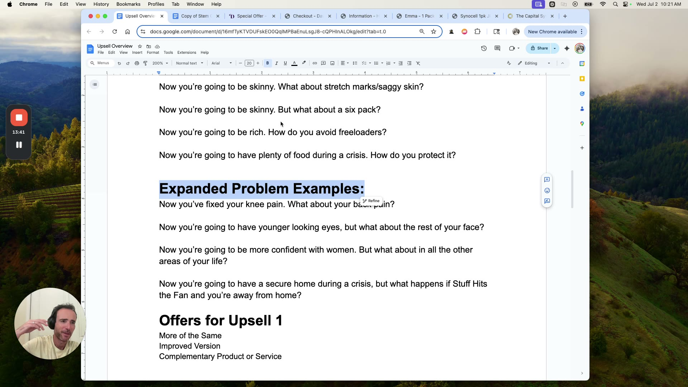
*The Upsell Overview doc on screen: "Expanded Problem Examples" (knee to back pain, eyes to whole face, confidence with women to other life areas) and the three "Offers for Upsell 1". [v1 13:42]*

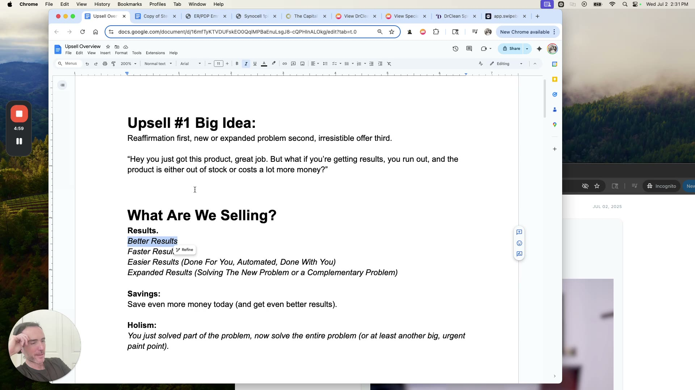
*"Upsell #1 Big Idea" and "What Are We Selling?" (Results, Savings, Holism). [v4 05:00]*

### 2. Dr. Clean: a branded e-com flow of "buy more" then "what about your...?" [v1 05:47-22:56]
- Flow, in order (links/copy in `Copy of 1. Dr Clean Upsell Flow Links.docx`): product page, checkout (a "sketchy little warranty" add-on is noted at [05:47]), immediate post-checkout pop-up, upsell 1 (tablet stock-up), upsell 2 (dishwasher), upsell 3 (toilet), upsell 4 (washer), confirmation page with a link to an affiliate page.
- **Pop-up (immediately after checkout).** "Only 15 left at this price. Special limited offer. Buy more Dr Clean and save." Two tiers (12x at $2.08 each = $25.00, 6x at $2.50 each = $15.00). Stefan's critique: if the page said how many bottles each tablet replaces and how much that saves versus individual bottles, "way more likely to do this." [v1 06:26-06:59]
- **Upsell 1 = more of the same.** Headline "Stock Up On Dr Clean Tablets, Add More & Save Up to 85%" with four tiers (24x $1.32, 18x $1.65, 12x $2.08, 6x $2.50), countdown timer, "Never Run Out Of Your Favorite All-In-One Cleaner." Stefan reads the angle as "never run out again, get it now at a good price" and expects it "probably converts decently, even though it's sort of weak." What is missing: "compared to a high-end eco cleaner from Sprouts is like $9. This is $1.32 for better ingredients." [v1 08:25-09:34]
- It stays on-brand: "It's branded. It's clean. If you go into a user customer experience, they're not going to see this and be really mad." Template for a basic e-com page: switching to an "epic sales letter" might do better, but you balance "branded congruent experience versus get that AOV up and make sales." [v1 10:15-11:02; 12:22-12:51]
- **Upsell 2-4 = expanded / complementary problem.** "What about your dishwasher?" (hidden bacteria, black mold), "What about your toilet?" (no scrubbing), "What about your washer?" (mold and mildew). "It's very templatized," which makes each additional upsell easy to build. [v1 11:52-18:44]
- The dishwasher page is the best problem framing but under-sells the problem: "I kind of wish they would explain a little bit about the problem... how gross your dishwasher is." He would test a "gross them out" section on pages 2 and 4. [v1 12:51; 18:44]
- Order is a test variable: the toilet upsell is "brilliant" because a home has many toilets and one dishwasher; "I would test the order of these for sure." [v1 15:17-15:46]
- Why so many upsells: AOV and margins on a low-priced cleaner are small, so "they're trying to do everything they can to get the AOV up." Stefan was "50-50" that a fourth existed. [v1 16:55]
- Ideas he lists for further upsells: car, pet/furniture and fabric, shower/tile/wood, pool (niche), windows, carpet ("a really obvious one"). "What's nice about a cleaning product is there's endless surfaces." [v1 19:32-20:09]
- **Confirmation page.** Asks for notification opt-in ("a sneaky way to get you to do notifications, which means they can pop more sales to you") and links to a "42 Life Hacks" affiliate page (42 different affiliate offers; the link opens an article with a "Learn More" button into a different brand's offer). Why smart: congruent enough that people won't complain; commissions raise revenue per customer. [v1 20:09-22:20]

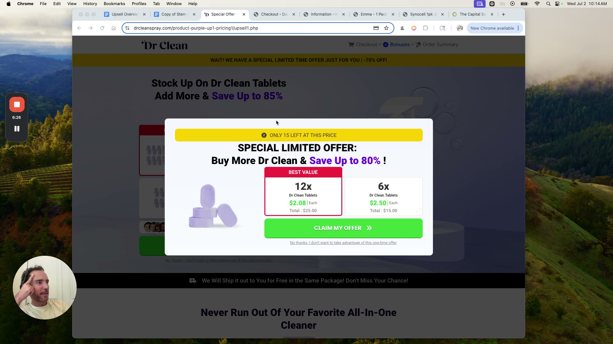
*Pop-up shown right after checkout over the upsell 1 page: "Only 15 left at this price", two pack sizes, "Claim my offer", underlined decline link. [v1 06:27]*

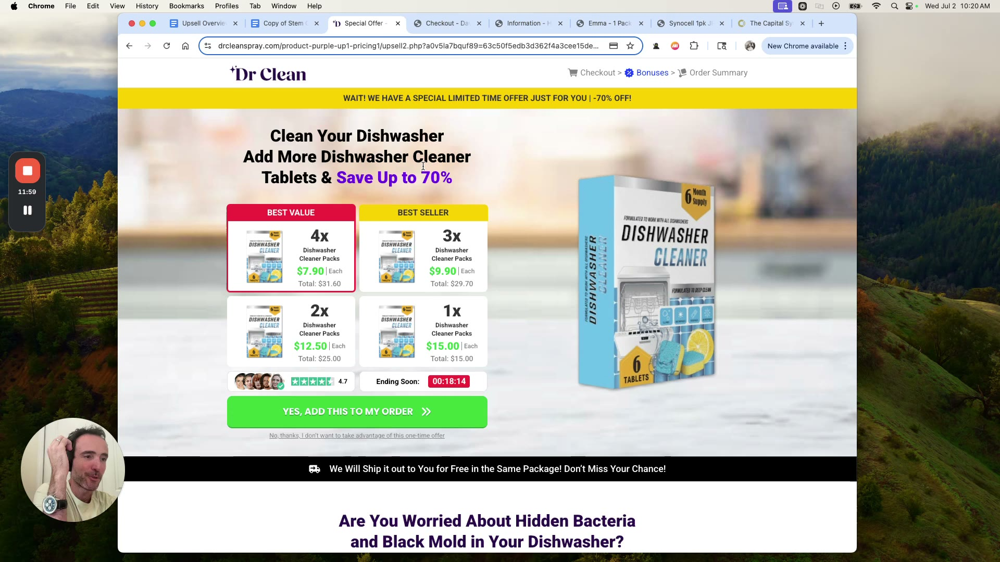
*Upsell 2 anatomy: yellow "WAIT" banner, breadcrumb (Checkout > Bonuses > Order Summary), "Clean Your Dishwasher / Add More ... & Save Up to 70%", four quantity tiers, rating row, countdown, green CTA and small decline link, free-shipping bar. [v1 12:00]*

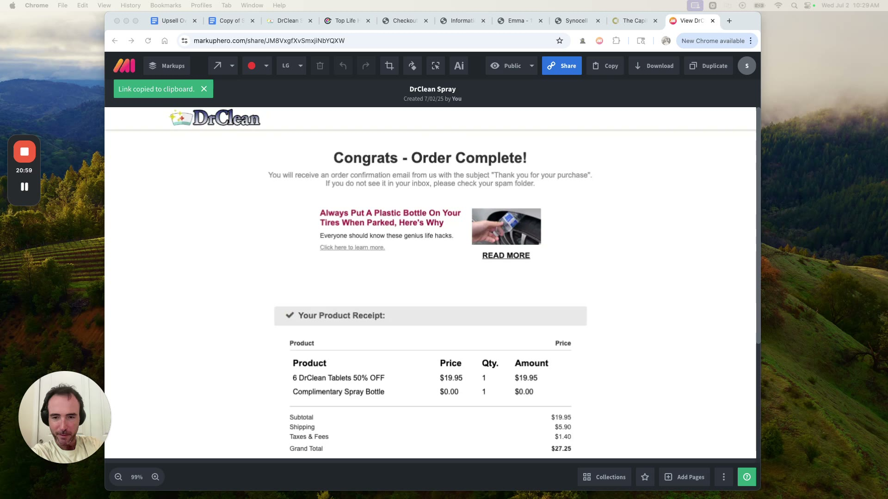
*Confirmation page: "Congrats - Order Complete!", an editorial-style tile above the receipt that leads to the affiliate page. [v1 21:00]*

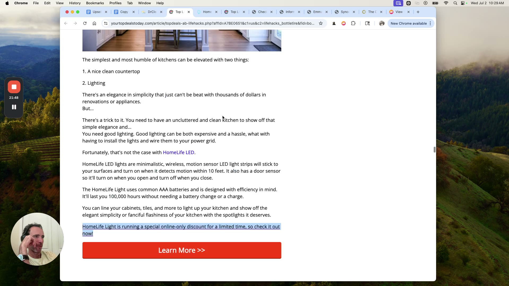
*Third-party article page behind the confirmation tile: a "life hack" article ending in a "Learn More" button for another brand's offer. [v1 21:48]*

### 3. Stem Cell Restore / Genesis: expanded problem in a long cross-sell [v1 00:00-05:47]
- Stefan opens with an upsell he wrote for "a more aggressive offer back in the day." The front end was Stem Cell Restore (subscription); the first upsell after it, "Genesis", could not be more of the same because the product was already on subscription. So it targets "the 300 trillion cells in your body that aren't stem cells" (headline and body from `Stem Cell Restore Upsell - Genesis` swipe: "Your Other 300 Trillion Cells Need Love Too"). [v1 00:33-01:40]
- He classifies it: a "new problem" or "expanded problem" ("you did your stem cells, what about the rest of your cells?"), selling "better results... faster results and expanded results." [v1 02:17-05:11]
- Self-critique on tone: "I hate to use a more aggressive example"; "copy was aggressive... I probably had some aggressive stuff in there I won't write today." He keeps it because "long copy still does 100% work." [v1 01:07; 02:17; 04:38]
- Claim flag: the headline in the swipe says "Nobel Prize-winning discovery" (the document spells it "Noble"). Do not copy; see Claims check.

### 4. David (protein bars): pure branded e-com, no classic upsell [v2 00:00-04:52]
- Upsells here are cart mechanics rather than pages: a checkout free-shipping bar ("you are one item away... $31.00 away from free shipping, $70.00") that suggests a $35 hat; an "Add another flavor to your order before it's too late" module (three flavors at $39, with review counts); a post-purchase page "The window is short. Your flavor line-up doesn't have to be. Add an extra carton below" with no discount; a confirmation page that repeats "add another carton before your order ships out," shows an "hour left to edit your order" window, a "where did you hear about us" survey (event, cable, influencer, podcast, Facebook far down) and a partner-discount link. [v2 00:00-04:17]
- Stefan's read: "about as pure e-com as you can get"; they are a big enough brand not to discount. The model works because of ad budget: "People who come into e-com who don't have any idea what they're doing go, why can't we copy David? You can if you have $75 million." The $725M valuation he cites is his recollection (instructor claim, unverified). [v2 01:02-02:42]
- (derived) For a small DTC brand, copy the free-shipping progress bar, the add-another-variant module and the post-purchase edit window; they cost no discount.

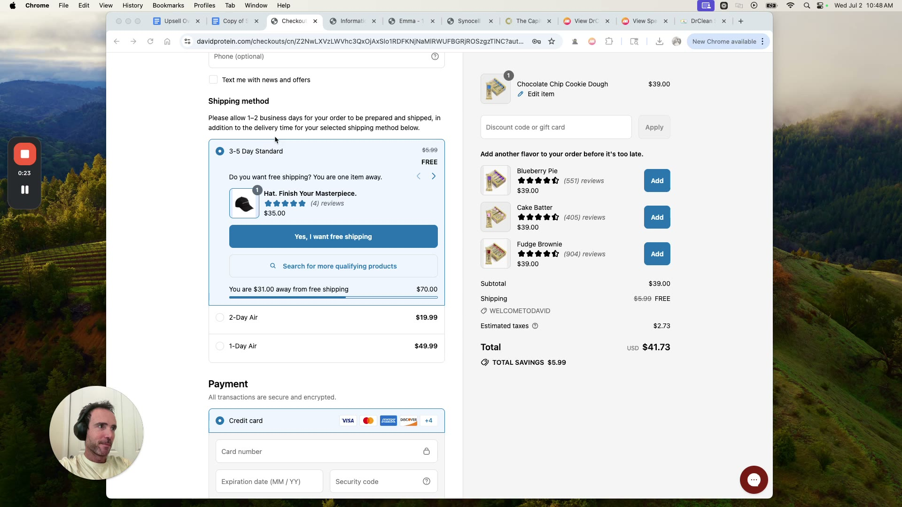
*Checkout: free-shipping progress bar with a $35 hat suggestion ("$31.00 away from free shipping"), and "Add another flavor to your order before it's too late". [v2 00:24]*

### 5. Happy Mammoth: a templated Shopify post-purchase flow with a real take rate [v3 00:00-08:42]
- Setup: post-purchase upsells on Shopify, "really what most of these Shopify upsells that are using direct response but staying on Shopify tend to look like... what ours look like with Opal Beauty. It's kind of annoying, but they surprisingly enough get a decent take rate." Shopify limits you to about two or three. You cannot link to a post-purchase page later, so he takes screenshots and saves the copy. [v3 00:33-01:10; 02:57-03:44]
- Upsell 1 (more of the same, "Surprise! Here's a one-time $20 OFF offer"): get 2 extra bottles of Hormone Harmony at $49.99 each (was $69.99), subtotal $99.98 (vs $139.98), countdown (6:30), "Due to high demand, Hormone Harmony was out of stock 9 times already... Many women had run out and experienced nasty hormonal symptoms all over again." Stefan: "What if you run out and you can't get it again? Pretty classic, simple, straightforward." The quantity is auto-selected to 2 rather than offering a slider. [v3 01:10-02:57; 05:21]
- Placeholder left live: the product blurb still reads "Include a short, benefit-driven description of what your product does and how it can improve your customer's life." Stefan: "I wonder if they realize that that's going on... I wonder if I should try and tell them, but then there are no funnel hacking their stuff." (Check app placeholder text before launch. Derived.) [v3 01:40]
- Visual density: "product heavy, visually heavy because everyone's on mobile." [v3 02:21]
- Flow variant: if he had bought three or six bottles, "it's absolutely possible that they would have given me a different offer for a higher quantity... depends on the flow." [v3 03:44-04:48]
- Upsell 2 (cross-sell, Complete Belly Reset): "Turbocharge Your Results With Complete Belly Reset" with a 10-minute hold on "only 174 bottles at this price". Stefan's framing: "You just bought weight loss. We're selling more weight loss... better results, faster results." [v3 04:48-06:07]
- He then stops: "one more upsell and then go to the confirmation page because I think they're kind of conservative." On the thank-you page you can add more of what you bought and change quantities, "which is really valuable." [v3 07:11; 08:13]
- A testimonial that carries the "out of stock" mechanism: a customer wrote that she waited, ran out, and was "literally sitting on the edge of my seat waiting"; "this testimony actually does a lot of heavy lifting." Stefan's reasoning: there is a reason (stock-out) behind the offer. [v3 07:11-08:13] (Only quote real customer language like this; never invent it.)

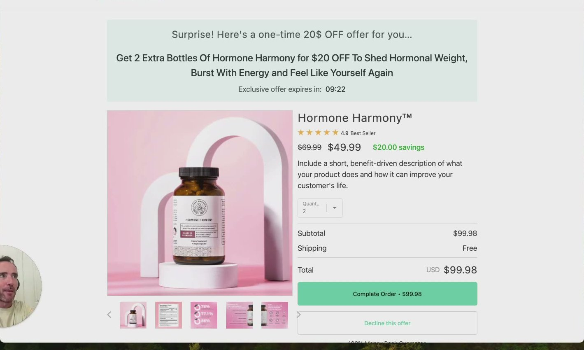
*Post-purchase upsell 1: "Surprise! Here's a one-time 20$ OFF offer", quantity pre-set to 2, $99.98 total, countdown, decline button. The product description is an unfilled template placeholder. [v3 01:12]*

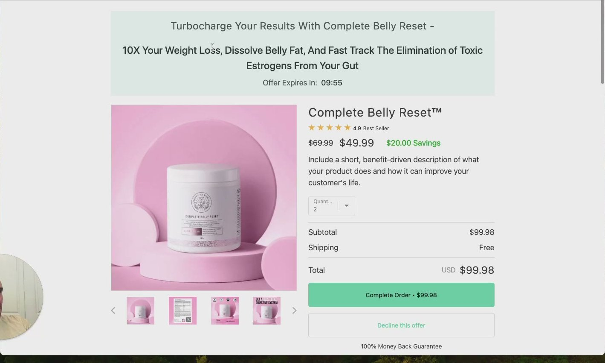
*Upsell 2, a cross-sell: same layout and same $20-off price structure for Complete Belly Reset. [v3 05:00]*

### 6. Emma and Synocell: the "stock up" video upsell template [v4 00:00-23:19]
- Same company owns both brands, so the two flows share one format: a long video under a "WAIT! Your order is not complete yet" header, with the pack options visible right away. Stefan answers the common question (timer or product options straight away?): "They do" show the options. [v4 00:39-01:12; screenshot below]
- The page text, from the screen: "IMPORTANT: Do NOT close this window nor click the Back button. Clicking back button can result in your order being double-billed." Then "WAIT! Your Order Is Not Complete Yet / Please Watch This Important Message Below Now", the video, "DO THIS FIRST: Please watch this important update from [doctor] right now. Your order and access link to your bonuses will appear here at the end of the video." Below: three packs (Starter 90-day / 3 bottles, Doctor's Choice 180-day / 6, Gut Superhero 270-day / 9 bottles, best value, "For Today Only Save EXTRA $15"). [v4 00:45 screenshot]
- Length: the Emma video is about 9 minutes and Synocell 12 minutes. [v4 13:22] "This is like the template... that I see working the best for people like CA Pro who do video upsells, for example. Which is anywhere from 10 to 15 minutes, even 18 minutes long." [v4 05:03]
- The recipe in his words: "hey, you did a great job. I'm going to tell you how to get the best results. Because to get the best results, you need to keep taking it... It kind of quickly re-educates them on the UMP... here's the problem, here's what's going on... Emma solves this, but you got to keep taking it. And then the scary consequence... your gut's going to have parasites laying eggs in it... And we created a special deal where you're going to save money." [v4 05:03-05:32] (UMP = unique mechanism of the problem; see [3.1](03-01-unique-mechanisms-overview.md).)
- Not novel on purpose: "This is a very good, very classic clean stock up template... it's nothing novel here. It's what everyone does." Use the word "smart" several times ("smart people save more") and add scarcity ("this page only, today only"). [v4 08:58; 10:34]
- Why a long video after a long VSL is fine: Emma's own VSL is "like 50 minutes long or something like that", with 5 to 30 minute video ads, so buyers are not "tired of watching videos" (his words: "I don't think so"). From his Copy Accelerator Pro experience it "probably is going to work best", unless you are super-branded e-com where a video makes no sense. [v4 14:42]
- The Synocell script's three stated reasons to stock up (script on page, `Copy of Synocell Upsell 1 Script.docx`): (1) restoring cartilage takes time and consistency, so running out interrupts the process; (2) it is a foundation for long-term joint health; (3) this page offers an exclusive, deeply discounted price that expires when you leave ("customers share stories of regret when they run out"). Stefan's read: "better results... and you're going to save money. That's really it. The long video just increases your AOV and chances of people actually buying bigger packages." [v4 18:30-20:47]
- Also in the Synocell script: future pacing ("Imagine how good it's going to feel, waking up with ease, feeling limber"), "doubling your dose" for faster results, ingredient scarcity ("rare, hard to source ingredients"). [v4 18:30-20:47]
- Beats that appear only in the document (not discussed in the video): a "gift this to loved ones" section, "the cost of joint problems", and the repeated "once you leave this page this deal will expire."
- The Emma script (`Copy of Emma Upsell 1 Script.docx`) runs: congratulate and stay on the page; recap the promise; re-explain the mechanism (parasites burrowing; a "bald tire" analogy); healing takes months and stopping risks re-infection; customers regret not buying more; "a smart way to stock up"; a "Friends and Family Discount"; supply-chain delay scarcity; 90-day guarantee; "pennies per day" (95 cents a day); repeated "you'll never see this offer again"; CTA. (Claims flagged below.)
- Capturing swipes: Swipe Builder transcribes the video on the page, then he pastes the transcript into a Poe chat to reformat it and uses find-and-replace to swap the product name so it can be loaded into a Claude Project. [v4 01:12; 09:34; 15:51-17:57] (Whisper wrote "SinoSell"/"SinoCell" for Synocell; the Poe screenshot shows a third spelling, so check swipe spellings.)
- One upsell may be enough: "I'm surprised they only do one upsell and they're not doing cross-sells." He wanted to pay $147 to see whether a cross-sell follows upsell 1 but could not. "People often look for cross-sell examples, but I really think you can generally do [more of the same first]." (sentence cut off in the recording) [v4 11:08; 21:31-22:27]

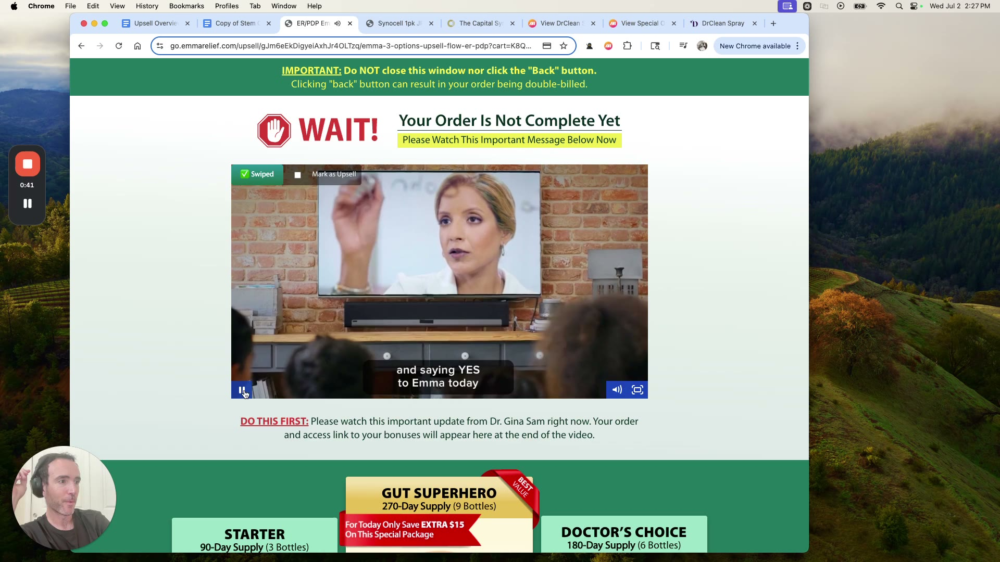
*Emma upsell 1: double-billing warning bar, "WAIT! Your Order Is Not Complete Yet", doctor video, "DO THIS FIRST" note, three pack tiers visible under the video. The "Swiped / Mark as Upsell" buttons over the video are Swipe Builder's overlay. [v4 00:45]*

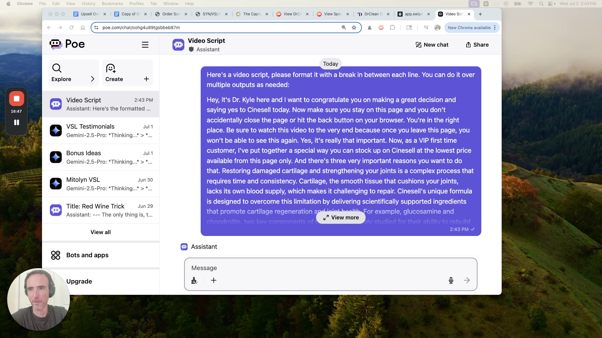
*The Poe "Video Script" chat: "Here's a video script, please format it with a break in between each line. You can do it over multiple outputs as needed:" followed by the pasted transcript. [v4 16:48]*

### 7. Capital Syndicate: info/biz-op video upsell, downsell, final upgrade [v5 00:00-15:26]
- Format: a video upsell page (OTO1) with an exit pop that forces a decline decision: "You must confirm you're permanently passing on your chance to get the private money brokerage website system and 30-minute coaching call... by checking on the I decline link below. I acknowledge this is my only chance... a savings over 80 percent, yours today for just $297." [v5 00:38]
- What it sells: an automated website system plus a 30-minute coach call to "close your first deal." Stefan's lens: better, faster, easier ("done for you"), plus savings. "Especially for info products, you don't sell them more of what you just got"; for biz-op, coaching and marketing it is "easier results". Improved version = "better hearing aid"; done for you = "we're going to help you close your first deal." [v5 06:29-07:40]
- He notes the call is only 30 minutes, "so I think there's a little bit of a disconnect" with the coach-heavy positioning. [v5 06:29]
- Offer stack recap near the end: "here's a value stack, you're going to get this, this, this and this. It should cost this much but it's not going to cost this much... it's going to cost this really low price." The price went straight to $297 (a $997 anchor then a cut was possible: "you'll often see that"). Continuity is revealed late: "if you like it, we'll keep your website going for $97." Stefan: "sneaky continuity" but "not unreasonable"; "I don't think this funnel's like crushing it, but... copy's not bad." [v5 07:40; 09:48-10:49]
- Downsell: decline OTO1 and the next page asks "Wait a minute... are you sure?" It drops the coaching call and offers the website system for $147 (modal on screen: "Last Chance! This is Your Only Chance to Save $150... $997 value... Yours Today for Just $147 ... a savings of over 85%"), and drops the continuity. Stefan had not been showing downsells: "nothing's changed with downsells... 'Wait, I really think you should try this. So I'm going to give you an even bigger discount. Now you have no reason to say no.'" [v5 11:32-12:12; 14:56]
- OTO3 "one final upgrade" is a new problem: you now have the system, "now the problem is you": accountability (Slack-style) and a "fast action plan to close your first deal in 45 days or less" = new problem plus faster and easier results. [v5 12:12-13:49]
- Decline-link copy on screen (confirmshaming style): "No thanks, I'm gonna pass on this generous one-time-offer for Website System. I have plenty of time & I'm in no rush to get results." [v5 12:27]
- Claim flag: the copy on screen at 8:00 says the bonus calls go to members who "virtually GUARANTEE SUCCESS". That is an outcome guarantee in a financial/biz-op context. Do not reuse.

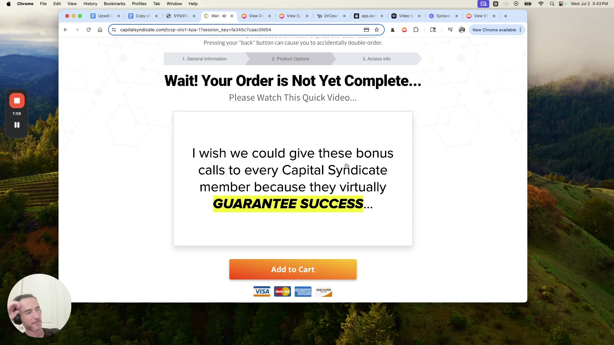
*OTO1: three-step progress tabs (General Information / Product Options / Access Info), "Wait! Your Order is Not Yet Complete... Please Watch This Quick Video...", video, one orange "Add to Cart", double-order warning. [v5 08:00]*

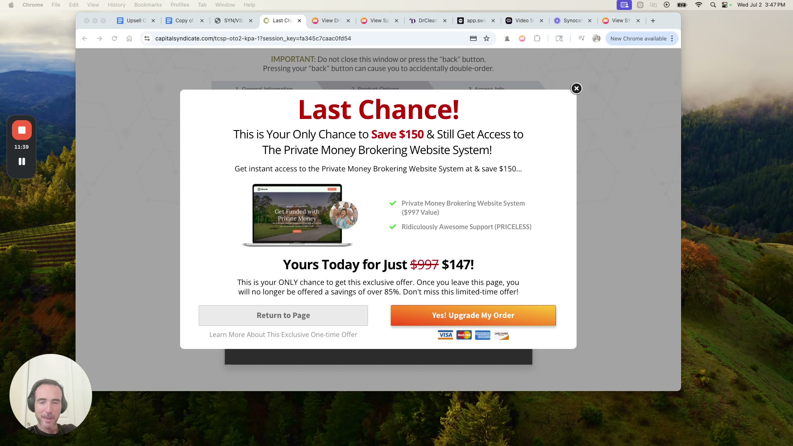
*Downsell page with "Last Chance!" modal: $997 crossed out to $147, "Return to Page" vs "Yes! Upgrade My Order". [v5 11:39]*

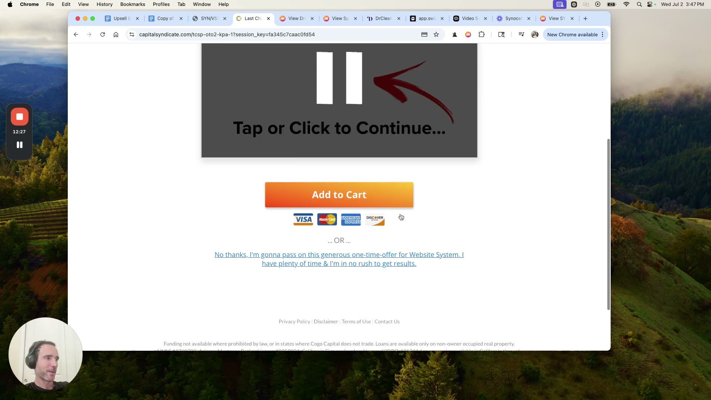
*Under the single CTA: the "... OR ..." decline link wording. [v5 12:27]*

### 8. Sabri Suby "Sell Like Crazy" upsell: reaffirmation, then "the problem is you" [v6 00:00-37:45]
- Context: a live call with Copy Accelerator Pro members (Stefan shares links, docs and a Claude process). He points them to Jay DeBolt's Credit Secrets upsell training and other trainings in the members' area. Video format: "really making a solid difference." [v6 00:00-00:55; 07:11]
- Case: the buyer just bought the book (free-plus-shipping or low-ticket front end). The upsell is a long video; the script is "5,259 words long" per Stefan (the formatted doc is about 5,300). Production is high, "most people aren't going to have that level of production." [v6 08:33-09:39; 25:01]
- **Beat 1, celebrate and reorient (first ~5 min of script):** "You just made the smartest decision of your life... a decision that you remember for the rest of your life." "In the next half an hour our team will be sending you a copy... it's critically important that you watch this short video until the very end." [v6 09:09-11:50]
- **Beat 2, long future pacing:** "stop for a moment and feel the tension just dissolve from your shoulders, back and neck." At [14:42] he counts "585 words" in and the pitch has not started. Reasoning: "people have a pretty high amount of tolerance for being told they're awesome in private." [v6 12:18-14:42]
- **Beat 3, address the skeptic with social proof:** "thousands of five-star reviews and the countless people who've used the selling system." [v6 15:12-15:41]
- **Beat 4, introduce doubt after the highs:** "Or is it?... Maybe this was all just a dream." A fear of losing the transformation (stress, empty inbox). "Now we don't want to shit on what they just bought": the cause is not the book. [v6 16:08-17:31]
- **Beat 5, tease the real threat, delay the reveal:** "That thing is you." Stefan: it works for physical and digital ("if you don't use XYZ product consistently... because you're busy or you get lazy"). A stat is used (a New York Times article says "only 36% of nonfiction books sold ever get completed", then "the real number's probably closer to 90%"). For a physical product find a comparable stat (unopened Amazon packages, unused supplements): "you can swipe this structurally very similarly." (Use only a stat you can source.) [v6 18:01-19:58]
- **Beat 6, a relatable audience question:** "Who in here has bought a book that you never completed?" [v6 19:58-20:28]
- **Beat 7, the new problem is human nature / implementation:** "The book is great... it's not a magic pill." He warns of the common mistake: an upsell that says "we left out two really important ingredients" makes buyers think "why didn't you just put them in the initial product?" So: "this thing is God's gift... everything I said is true... that's not the problem. This is the problem." [v6 20:54-22:44]
- **Beat 8, the founder's struggle to build the new offer:** "only 10% of people who bought my book would get the intended results", he emailed buyers, two causes (no time, too much work), "this hit me like a sack of wet bricks", "I wish that I could just do this for you", "that's when the light bulb went off", team in a room. Stefan ties this to the VSL "struggle to build a new product" beat. [v6 23:07-27:25]
- **Beat 9, the offer is done-for-you (easier):** "better results, faster because they're doing it for you, and then it's easier because they're doing it for you." [v6 27:25-28:22]
- **Beat 10, hype every component:** opt-in page ("proprietary", "$50 million of traffic"), HVCO mock-up, copy templates, design files, one-click ClickFunnels install or HTML, a seven-part email follow-up. Lesson: "you really hype up each section of what you're selling" instead of "you get a high-converting opt-in page." [v6 28:52-30:51]
- **Beat 11, proof, price anchor, guarantee, CTA:** testimonials; agency price $10,000 versus $297 ("less than 81 cents a day" in the script); 30-day guarantee; "only available on this page"; "This button is your key." The jump from a low-priced book to $297 is part of why the script is 5,000+ words. [v6 31:10-33:03]
- Q&A, upsell 2 to 4: "Do you keep reaffirming the decision?" Stefan: "I typically don't, not as much... you get more direct." A Pro member adds that after the first upsell the reaffirmation becomes "wow, you really mean business... you're one of the 15 percent... part of a club"; in financial offers an extra-year upsell was followed by a roughly $2,000 "inner circle" product. Stefan: it needs "custom pathing"; showing percentages is "super interesting" if done right. [v6 34:03-37:17]

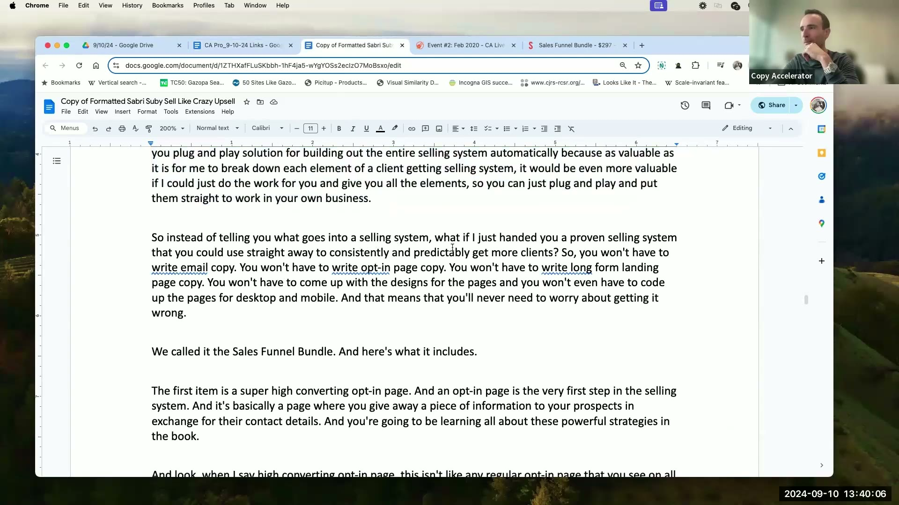
*The formatted Sabri Suby upsell script at the "We called it the Sales Funnel Bundle. And here's what it includes." turn into the offer (Stefan's CA Pro call recording). [v6 28:27]*

## Steps / framework

### A. Flow audit procedure (what Stefan does with every funnel) [v1 00:00-11:02; v4 09:34]
1. Buy through the funnel yourself (derived: with a card and details you control); pages that rely on the previous click often cannot be re-opened (incognito or a second visit will not show the post-purchase pages). [v1 11:02; v3 02:57]
2. For every page, save three things: the link, a screenshot (Stefan uses a markup/screenshot sharing tool) and the full copy in a doc. "What if they change this page or the link goes down? You still have the copy." [v1 10:15]
3. If the upsell is a video, grab the transcript (Swipe Builder), reformat it with a chat assistant, swap the product name, and keep it as a Claude Project document. [v4 09:34; 15:51-17:57]
4. Label each page: format (pop-up, short page, video), upsell type (more of the same, improved version, done for you, complementary), problem type (new, expanded, none), price tiers, timer, scarcity line, decline wording.
5. Note what the page does not do (Dr. Clean: no price comparison; no "gross them out" problem section) and mark it as a test idea. [v1 06:59; 12:51; 18:44]
6. Log the order of upsells and whether a later upsell appears only after a "yes". [v4 21:31]

### B. Stock-up video upsell blueprint (derived from Emma, Synocell, the Gut Harmony sample and the Claude outline below)
Use for consumables where upsell 1 is more of the same. Length 6-16 minutes (the Claude Project instructions in [14.3](14-03-claude-projects-for-upsells.md) say the same).
1. **Header copy:** WAIT, order not complete, do not hit Back.
2. **Greeting and congratulation:** spokesperson thanks them for saying yes; stay on this page; you are in the right place; watch to the end because the offer disappears.
3. **Reaffirm and future-pace:** what changes now that they bought (what they will feel and do).
4. **Customer proof:** short customer stories from real customers (placeholders for before/after images in the FitSpresso edit).
5. **The turn:** "second most important decision" and "the most important decision is made on this page"; the only thing between them and the result is using it consistently (FitSpresso edit).
6. **Why it takes time (re-educate on the mechanism):** the problem took years; stopping early restarts it (Emma: eggs reawaken; Synocell: cartilage rebuild; FitSpresso: fat-cell rhythm).
7. **Scary consequence of running out:** interruption of progress, price jump, out-of-stock (only if true for us).
8. **Offer:** named pack (Transformation Pack, Restoration Kit), what to expect month by month, 3-step "how it works" recap.
9. **Price anchor and per-unit price:** retail per unit vs upsell per unit and the total, plus a per-day or "versus alternative" comparison.
10. **Guarantee and risk reversal.**
11. **Urgency/scarcity:** one-time, this page only (only true constraints).
12. **CTA and the decline line.**
(Stefan's note on length: "Mine was a little bit longer than 10 minutes, but I think this [Emma] would be a good template that couldn't steer you wrong." [v4 08:58])

### C. Info-product upsell blueprint (Sabri Suby, Capital Syndicate) [v6 08:33-33:03; v5 06:29-13:49]
Reaffirm at length, social proof, doubt, "the problem is you", product-is-great reassurance, founder struggle to build the done-for-you offer, component-by-component hype, value anchor, guarantee, one CTA. Then (OTO2) downsell to a smaller package at a lower price and (OTO3) a final upgrade that solves the next problem (accountability).

### D. Choosing what upsell 1 sells [v6 03:16; Upsells - Copy Accelerator.pdf p.1-4]
- Physical/consumable: more of the same (buy 3 bottles, offer 6 more is "usually works better than selling them 3 more"), or an adjacent product (Dr. Clean cleaners, Happy Mammoth cross-sell).
- Info/book/coaching: done-for-you, templates, advanced version, physical version, a results-faster product.
- Order of work from the Copy Accelerator PDF (document attribution below): product selection, then price (test on upsell 1; most people price upsells too low), then format ("formatting is probably more important than copy"; video with no text below it, force them to watch, "11-15 minutes"). Upsell 1 "accounts for 80% of your upsell AOV"; aim for a "20% - 45% conversion rate (a lot of this depends on the price)"; "AOV matters more than conversion rate on upsells."

## Examples

### Pack math, side by side
| Case | Numbers on the page | Per-unit logic | Source |
|---|---|---|---|
| Dr. Clean upsell 1 tiers | 24x $1.32 each ($31.60 total), 18x $1.65 ($29.70), 12x $2.08 ($25.00), 6x $2.50 ($15.00) | Page shows per-tablet price only; Stefan wants a saved-per-bottle comparison against the all-in-one cleaners it replaces | `Copy of 2. Dr. Clean Upsell 1 Copy.docx`; [v1 06:59; 09:34] |
| Dr. Clean upsells 2-4 | 4x $7.90 / 3x $9.90 / 2x $12.50 / 1x $15.00 (dishwasher); toilet and washer 4x $9.75 / 3x $11.50 / 2x $13.25 / 1x $15.00 | Four tiers per page, "best value" on the biggest, "best seller" on the second | `Copy of 3. / 4. / 5. Dr. Clean Upsell 2 / 3 / 4 Copy.docx` |
| Happy Mammoth upsell 1 | 2 bottles at $49.99 (was $69.99) = $99.98, subtotal compares $139.98 | Fixed quantity of 2; no slider | `Copy of 2. Happy Mammoth Hormone Harmony Upsell 1.docx`; [v3 05:21] |
| FitSpresso edited (Stefan) | retail "$149 PER bottle" x 6 = $894; offer $29 per bottle = $174; framed against one month of an injectable weight-loss drug | Anchor to a high-priced alternative; show per-bottle and total | `FitSpresso New Upsell 1_Stefan.docx` |
| Capital Syndicate | $297 (OTO1), $147 (downsell), $97 hidden continuity | Downsell drops the coaching call | [v5 09:48-12:12] |
| Sell Like Crazy bundle | $297 vs "$10,000" agency price, "less than 81 cents a day" | Anchor to agency fee, then per-day | `Formatted Sabri Suby Sell Like Crazy Upsell.docx` |

## Structured units

### Ad teardowns (post-purchase pages and flows)
| Brand / product (niche) | Format | Hook / opening | What works | What fails | Fix suggested | Principle | Source |
|---|---|---|---|---|---|---|---|
| Dr. Clean tablets (home cleaning) | Pop-up right after checkout, then 4 pages | "Only 15 left at this price. Special limited offer. Buy more Dr Clean and save." | Instant, branded, no re-education needed; congruent journey | No explicit per-bottle savings; relies on the buyer doing math | Add "each tablet replaces a $X bottle, you save $Y" | More of the same plus savings | [v1 06:26-09:34] |
| Dr. Clean upsells 2-4 (dishwasher, toilet, washer) | Page with 4 quantity tiers, countdown, 4 reviews, free-shipping bar | "Clean Your Dishwasher / Add More ... & Save Up to 70%" | Templatized and logical; expands the problem; problem question as H2 | Little problem explanation; unclear order | "Gross them out" section; test order of upsells | Expanded problem plus complementary products | [v1 11:52-19:32] |
| Dr. Clean confirmation page (home cleaning) | Order complete + affiliate hub | "Always put a plastic bottle on your tires when parked. Here's why everyone should know this" | Adds commission revenue without breaking brand feel | Leaves the brand experience | Test whether only to show to non-upsell buyers (derived) | Monetize the thank-you page | [v1 20:09-22:20] |
| David (protein bars, branded e-com) | Checkout bar, post-purchase page, confirmation edit window | "The window is short. Your flavor line-up doesn't have to be." | Zero discount needed; progress bar to free shipping | Works because of ad budget, not because of copy | Copy the mechanics only | AOV tools without a sales letter | [v2 00:00-04:17] |
| Happy Mammoth Hormone Harmony / Complete Belly Reset (women's supplements) | Shopify post-purchase page x2 | "Surprise! Here's a one-time $20 OFF offer for you" | Two pages, fixed offers, mobile-first visuals; testimonial explains the out-of-stock reason | Unfilled template text; health claims | Fill in the product blurb; keep claims compliant | More of the same, then better/faster | [v3 01:10-08:13] |
| Emma (gut supplement) | Video upsell, 3 pack tiers visible | "WAIT! Your Order Is Not Complete Yet" | Re-educates on the mechanism; scary consequence of stopping; stock-up deal | Invented-sounding "friends and family" frame and supply-chain scarcity (flag) | Use real constraints only | Stock up for results (more of the same) | [v4 00:39-05:32] |
| Synocell (joint supplement) | Video upsell | "as a VIP first-time customer... stock up... at the lowest price available from this page only" | Three clear reasons to stock up; future pacing; double dose for faster results | Study citations unverified (flag) | Cite only real studies | More of the same, better and faster | [v4 18:30-20:47] |
| Capital Syndicate (private-money brokering, biz-op) | Video OTO1 + exit pop, downsell, OTO3 | "Wait! Your Order is Not Yet Complete... Please Watch This Quick Video..." | Done-for-you offer, exit pop forces a decision, downsell and final upgrade | Hidden continuity ($97), 30-minute coach call vs coach positioning, "virtually GUARANTEE SUCCESS" (flag) | Disclose continuity at the offer | Done for you; new problem = accountability | [v5 00:38-13:49] |
| Sell Like Crazy (book / marketing) | 5,000+ word video | "Boom, you just did it. You just made the smartest decision of your life" | Reaffirmation, doubt, "the problem is you", founder struggle, component hype | Very long reaffirmation (585 words before any pitch) | Shorten for second upsells | Done for you / easier | [v6 08:33-33:03] |
| Stem Cell Restore "Genesis" (anti-aging supplement) | Long cross-sell, written page | "Use This Nobel Prize-Winning Discovery... Not Just Your Adult Repair Stem Cells" | Expanded problem ("other 300 trillion cells") on a subscription product | Aggressive, unsupported claims (flag) | Do not copy the claim; keep "what about the rest" structure | Expanded problem | [v1 00:33-05:11] |

### Rewrites (before → after): Claude's first draft vs Stefan's edited FitSpresso upsell
Source: `Claude Upsell Process_9-10-24.docx` (draft) vs `FitSpresso New Upsell 1_Stefan.docx` (edited). Provenance of the named customers, figures and studies in both documents is not stated in the files (Claude's draft names are model-generated). Treat all as unverified proof. Do not reuse.
| Before (Claude draft) | After (Stefan's edit) | What changed (verb / visual / promise / self / intensity) | Source |
|---|---|---|---|
| "Dr. Hoffman here..." | "Hey it's Kristi here... on behalf of myself, Dr. Hoffman, and everyone at FitSpresso" | Self: a named team member introduces, with the doctor named as co-sponsor | both docs |
| Three named customers with one-line results | Three named customers plus "-Before/After-" image slots, a food detail (pasta, tiramisu) and a "THIS CLOSE to dropping $1,600 a month on Ozempic" story | Visual proof slots, specificity, a competing-solution anchor | both docs |
| "complete transformation within the first few days" | "By FINALLY making weight loss completely effortless (and even kind of fun)" and a list of body areas | Promise reworded; intensity and specificity raised | both docs |
| A "secret discovery" story (Hollywood stars, Harvard study) and a research-failure story | Removed; replaced by "Here's The Truth: Fully Restoring Your Body's Natural Fat-Burning Rhythm Takes Time" | Verb/structure: no new product to position, since it is more of the same (Stefan's correction to Claude, see prompts) | both docs |
| Pack priced at "$414 retail, $234 today, $660 less than retail" (numbers do not reconcile: 414 - 234 = 180) | "$149 PER bottle... $894... $29 per bottle... $174" and an alternative-drug comparison | Price: consistent per-unit anchor | both docs |
| 180-day, email support@ guarantee | "100% Money Back Lifetime Guarantee" with call or email | Risk reversal strengthened | both docs |
| First week "2-3 pounds"; month list placed late | "2-5 pounds"; month list placed before the offer under "what you can reasonably expect" | Position and intensity | both docs |
| Timer "ONLY AVAILABLE FOR THE NEXT 09:46", 3/6/12-month selector, decline sentence | Scarcity in the script: customers "saying YES... inventory plummeted... 3-6 months to restock" | Scarcity moved into the script (must be true to reuse) | both docs |

### Templates
| Template | Use for | Example fill | Source |
|---|---|---|---|
| "WAIT... YOUR ORDER IS NOT COMPLETE! DO NOT hit the "Back" button as it can cause multiple charges to your card" | Video-upsell page header | Used verbatim across FitSpresso, Unity Eye Serum and Gut Harmony examples | `FitSpresso New Upsell 1_Stefan.docx` |
| "While We Prepare Your Order To Be Shipped Out... Please Watch The Video Below For Important Details On How To Get The Absolute BEST Results With [Product]" | Subhead under the header | Same | same |
| "Hey it's [Name] here... on behalf of myself and everyone at [Brand]... we want to congratulate you on making [one of the most important decisions]" | Video opener | Dr. Kyle / Synocell: "I want to congratulate you on making a great decision and saying yes to Synocell today." | Synocell script |
| "Now make sure you stay on this page and you don't accidentally close the page or hit the back button on your browser. You're in the right place." | Re-orientation (Jay DeBolt's "where am I?") | Emma and Synocell scripts | scripts; [v6 02:17] |
| "As a VIP first-time customer, I've put together a special way you can stock up on [Product] at the lowest price available from this page only. And there's three very important reasons you want to do that." | Stock-up setup | Synocell | Synocell script |
| "Now you've [result they just bought]. What about [adjacent problem]?" | Expanded problem line | "Now you've fixed your knee pain. What about your back pain?" | Upsell Overview doc on screen [v1 13:42] |
| "Are You Worried About [hidden problem] in Your [Surface]?" / "Does Your [X] Stink From...?" | Problem H2 on short upsell pages | Dishwasher, washer pages | Dr. Clean docs |
| "No thanks, I understand that if I don't [keep using it], it might struggle to... I'm willing to take that risk so please remove it from my order." | Decline link | FitSpresso draft | `Claude Upsell Process_9-10-24.docx` |
| "That button is your key to [outcome]. So hit that button right now." | Closing CTA | Sell Like Crazy, FitSpresso | docs; [v6 33:03] |

### Rules of thumb
- **DO** open with where they are and what is happening to their order. [v6 02:17]
- **DO** make the second and later upsells shorter and more direct. [v6 34:31]
- **DON'T** introduce a new product or discovery story when the offer is more of the same. [`Claude Upsell Process_9-10-24.docx`, Stefan's correction to Claude; FitSpresso edit]
- **IF** the only supplier constraint is made-up, **THEN** drop the scarcity line. Use a real inventory, batch or timer rule. (derived)
- **DO** pick the next offer by its logical connection to what they just bought: "there's always that logical connection." [v6 04:44]

## Prompts / templates (verbatim)
These come from `Claude Upsell Process_9-10-24.docx` (a one-off Claude chat Stefan ran the day before the Copy Accelerator Pro call; "SPG" = Stefan). The RejuvaKnee swipe attached to prompt 1 and the "Fitspresso Inputs for Upsell" PDF attached to prompt 2 are not included in the course files. For the standing Claude Project instructions and the example prompts for Unity Eye Serum, Lumessa and the Airbnb/permissionless-income upsell, see [14.3](14-03-claude-projects-for-upsells.md).

**Prompt 1, analyze a swipe into a structure outline** (attach the upsell swipe):
```text
Here is a video script for an upsell in the health space.I want you to analyze it and then create an outline for the structure of the script.
```

**Claude's outline of the swipe (output, 12 steps, reproduced as the structure model):**
```text
1. Introduction
   - Congratulate the customer on their initial purchase
   - Emphasize the importance of their decision
2. Set the Stage
   - Highlight the customer's current situation (struggling with knee pain)
   - Present the potential future (pain-free life)
3. Social Proof
   - Share success stories of other customers
4. Present the Problem
   - Explain why consistent use is crucial for long-term results
   - Highlight the challenge of healing cartilage over time
5. Introduce the Solution
   - Present the RejuvaKnee Red Light Pro as a breakthrough
   - Explain the science behind red light therapy
6. Describe the Product
   - Detail the three-step process of how it works
   - Emphasize its convenience and ease of use
7. Create Urgency
   - Position this as a limited-time offer
   - Stress the importance of making a decision now
8. Address Objections
   - Provide a money-back guarantee
   - Compare the cost to alternatives (e.g., $250,000 machines)
9. Present the Offer
   - Reveal the discounted price
   - Offer multiple package options (1, 2, or 3 devices)
10. Call to Action
   - Encourage immediate action
   - Reiterate the benefits and guarantee
11. Final Push
   - Remind of the limited-time nature of the offer
   - Restate the potential negative outcomes of not upgrading
12. Closing
   - Provide a "no thanks" option
   - Reinforce the risk of not taking action
```

**Prompt 2, write the new upsell from the outline, section by section** (attach the product inputs; the input PDF itself is not in the files):
```text
Perfect thank you. Now we're going to be writing a new upsell script a different product. I want you to closely model off the Rejuvaknee Upsell as far as structure and length. Also in style and tone. We're going to do this through multiple outputs which means you can go section-by-section and when you write each section, just ask me to tell you to continue. Do not try to condense things, good video scripts are often quite long. Here's the information you should need to do this:

[attach: Fitspresso Inputs for Upsell (pdf)]

Please get started with the very first section. Whenever you run out of space just ask me to continue and I'll tell you to keep going.
```

**Between sections:** the whole continuation prompt is `yes please continue` (Claude ends each section with "Shall I continue with the next section?"). [doc, passim]

**Prompt 3, redirect when the offer is more of the same** (after Claude wrote a "secret discovery" story):
```text
So here's where you need to be a little bit more creative, since in this case we're selling more Fitspresso. So we don't need to position and then intro a new product, since what we're doing here is selling them "more of the same."
```

**Prompt 4, add an expectations timeline:**
```text
This is great. One thing I'd like to add is maybe a section where it's like "here's what you can expect during your journey with Fitspresso: Your First Week, Your First Month, Your Second Month, Your Third Month, Your Fourth Month, Your Fifth Month, and then Your Sixth Month. - and for each of those we paint a picture of their transformation improving and life getting better and better.
```
(Compliance note: Claude's resulting month-by-month weight-loss numbers are not backed by any evidence. Replace with facts and ranges we can substantiate, or remove them.)

**Prompt 5, format a swiped transcript in Poe** (shown on screen) [v4 15:51-16:53]:
```text
Here's a video script, please format it with a break in between each line. You can do it over multiple outputs as needed:

[paste raw transcript]
```
(Stefan, v4 16:53: "I'm just using the little chat assistant... it's like basically so fast and easy.")

**Instruction lines from the 14.3 Claude Project that echo this process** (full instructions in 14.3): "analyze the structure of the various upsell examples, and then synthesize that knowledge", "Please don't try to rush or condense anything", "whenever you run out of space just prompt me and I'll tell you to continue."

### Page copy kept from Dr. Clean (structure only)
```text
[Banner] WAIT! WE HAVE A SPECIAL LIMITED TIME OFFER JUST FOR YOU | -70% OFF!
[Breadcrumb] Checkout > Bonuses > Order Summary
[H1] Clean Your [Surface] / Add More [Product] & Save Up to 70%
[Tiers x4] Best value (4x) | Best seller (3x) | 2x | 1x  with "$ each" and "Total"
[Social/timer row] 4.7 rating | Ending Soon: 00:15:30
[CTA] YES, ADD THIS TO MY ORDER
[Decline] No, thanks, I don't want to take advantage of this one-time offer
[Shipping bar] We Will Ship it out to You for Free in the Same Package! Don't Miss Your Chance!
[Problem H2] Are You Worried About [hidden problem] in Your [Surface]?
[3 benefit icons] Deep Cleaning Power | Safeguards Health | Extends [Appliance] Lifespan
[H2] Choose Dr Clean For [Outcome]  + 5 check bullets
[Stock] Only 15 Items Left in Stock!   (page claim; use only if true)
[Reviews] 8K+ Happy Customers Worldwide + 4 reviews   (page claim; use only real reviews)
[Repeat tier block + CTA + decline]
```
(Source: `Copy of 3. Dr. Clean Upsell 2 Copy.docx`; slots in brackets are our own placeholders.)

## Claims check (read before copying any swipe)
- **Health and weight loss:** FitSpresso edit compares itself to injectable weight-loss drugs ("We have managed to beat the multi-billion dollar drug companies behind drugs like Ozempic"), says "WITHOUT any dangerous side effects", and promises 30-35 pounds in six months. Hormone Harmony / Complete Belly Reset pages say "10X Your Weight Loss", "Toxic Estrogens" and "Obliterates bloating". Synocell and Unity Eye Serum drafts cite study names and percentages. Emma's script says it fights parasites and "archaea". Each of these needs substantiation or removal for Meta/FTC compliance.
- **Invented or unverified proof:** the FitSpresso, Gut Harmony, Unity Eye Serum and Airbnb example documents contain named customers, ratings and journal citations of unstated provenance (the Unity Eye Serum, Gut Harmony and Airbnb ones are model-generated). Never publish them. Use real customer language only.
- **Scarcity and "friends and family":** "inventory levels have plummeted", "3-6 months to restock", "friends and family discount" and "10,000 bottles a month" are copy devices in the swipes. Use constraints that are true for our brand, or none.
- **Biz-op / finance:** Capital Syndicate "virtually GUARANTEE SUCCESS" and the Sabri Suby result screenshots (leads per dollar, euro revenue) are claims about outcomes. Treat as examples of structure only.
- **Instructor's own flags:** he calls Stem Cell Restore "aggressive" and says he would not write some of it today. [v1 02:17]

## Screenshots
Embedded inline above (15 kept of 32 grabbed). Frames not kept: talking-head or login screens, duplicate toilet and washer pages (identical layout to the dishwasher page), incognito blank page, and the CA Pro links doc. The v6 video is a different capture (Zoom on a CA Pro call, dated 2024-09-10), so the Sabri script and Claude process segments are not shown as live pages.

## How to apply
- [ ] Map our post-purchase flow on one sheet: pop-up, upsell 1, upsell 2, downsell, confirmation page, edit window. Mark which exist.
- [ ] Choose upsell 1 type: more of the same (consumable), improved version, done for you (info), or complementary. Write the sentence "They just bought X; the next logical thing is Y because Z."
- [ ] For physical products, write per-unit price, saving vs singles and the day/cup/use comparison before drafting.
- [ ] Draft the video upsell with the blueprint (B above): header, congratulate, re-educate on the mechanism, consequence of stopping, offer, guarantee, CTA.
- [ ] Remove or replace every claim from the "Claims check" list; mark unverified facts in brackets.
- [ ] For upsell 2+, write a shorter version with a direct opener; do not assume they bought upsell 1.
- [ ] Add a downsell with a lower price and a smaller package; keep the same page layout (Capital Syndicate model).
- [ ] Test: number of upsells, their order, price, and video vs short page. Track take rate and AOV. (Copy Accelerator PDF targets are 20-45% take rate; unproven for our brands.)
- [ ] Confirmation page: check what we can add without losing brand feel (edit window, add-another-variant, partner offers).

## Related
- Previous: [14.1 Upsells overview](14-01-upsells-overview.md) · Next: [14.3 Claude Projects for upsells](14-03-claude-projects-for-upsells.md)
- [10.2 Dr. Clean PDP case study](10-02-in-depth-case-studies-dr-clean-and-calvin-tran.md) (same brand's front end) · [11.1 Checkouts walkthrough](11-01-checkouts-walkthrough-part-1.md) (AOV tools in checkout) · [16.3 Funnel economics with SPG](16-03-funnel-economics-with-spg.md) · [3.1 Unique mechanisms overview](03-01-unique-mechanisms-overview.md) (UMP/UMS) · [4.4 VSL background stories and mechanisms](04-04-vsl-background-stories-and-unique-mechanisms.md) (struggle-to-build beat)
- Shared KB: [Offer and bundle psychology](../../../../frameworks/offer-and-bundle-psychology.md) · Evolve: [AI in copywriting](../../../evolve/copywriting/concepts/ai-in-copywriting.md) (no Evolve page covers upsells)

## Sources and limitations
- Transcripts (machine, Whisper large-v3-turbo): [v1 `02-[2] Upsells Case Studies.txt`](<../../../../../raw/stefan-georgi/rmbc-ii/_transcripts/Stefan Georgi - RMBC II (1)/14-UPSELLS/02-[2] Upsells Case Studies.txt>) · [v2](<../../../../../raw/stefan-georgi/rmbc-ii/_transcripts/Stefan Georgi - RMBC II (1)/14-UPSELLS/02-[2] Upsells Case Studies video2.txt>) · [v3](<../../../../../raw/stefan-georgi/rmbc-ii/_transcripts/Stefan Georgi - RMBC II (1)/14-UPSELLS/02-[2] Upsells Case Studies video3.txt>) · [v4](<../../../../../raw/stefan-georgi/rmbc-ii/_transcripts/Stefan Georgi - RMBC II (1)/14-UPSELLS/02-[2] Upsells Case Studies video4.txt>) · [v5](<../../../../../raw/stefan-georgi/rmbc-ii/_transcripts/Stefan Georgi - RMBC II (1)/14-UPSELLS/02-[2] Upsells Case Studies video5.txt>) · [v6](<../../../../../raw/stefan-georgi/rmbc-ii/_transcripts/Stefan Georgi - RMBC II (1)/14-UPSELLS/02-[2] Upsells Case Studies video6.txt>)
- Platform captions (`02-2` to `02-7 *.srt`) are the same recordings split by case study, and were used to check names (Sabri Suby, Synocell, Stem Cell Restore, Jay DeBolt). Whisper wrote "Sabra Subi", "SinoCell/SinoSell", "StemSell", "Sully Crazy", "Noble" and "AOB" (AOV); this page uses the corrected names.
- Documents: Dr. Clean links + 4 upsell page copies; Happy Mammoth upsell 1-2 copies and links; Emma and Synocell scripts (about 1,700 and 2,000 words); Capital Syndicate links only (no page copy in the files); `CA Pro_9-10-24 Links` (big idea, what are we selling, links); `Claude Upsell Process_9-10-24`; `FitSpresso New Upsell 1_Stefan`; `Formatted Sabri Suby Sell Like Crazy Upsell` (about 5,300 words); `Upsells - Copy Accelerator.pdf` (6 pages; the CA Pro links doc lists it as "CA Pro Previous Doc from Justin G", the PDF itself names no author, so attribute it to the Copy Accelerator document, not Stefan; the "42% / 12% / 8% / 15%" product-selection figures on its p.3 are given without explanation).
- Gaps: the audio of the upsell videos Stefan plays (Emma, Synocell, Capital Syndicate, Sabri Suby sample) is not in the transcripts, so those videos are covered from the written scripts and his comments. v6 ends at 37:45 mid-Q&A. The FitSpresso/Claude walkthrough that Stefan says he would show ("the physical version" and "the Claude process") is covered from the documents only. Prices, ratings and review text on swiped pages reflect the date recorded (July 2025 screenshots; Sabri call recorded 2024-09-10) and are not independently verified. Stats such as the $725M valuation, Emma's 50-minute VSL and "5,259 words" are instructor statements. Order-confirmation numbers and personal details were cropped or avoided in screenshots.
