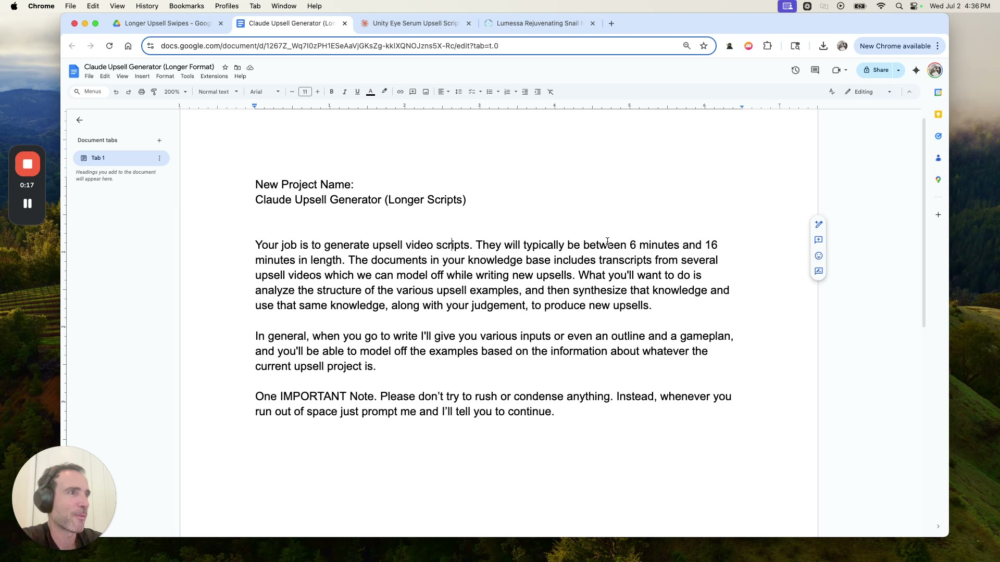
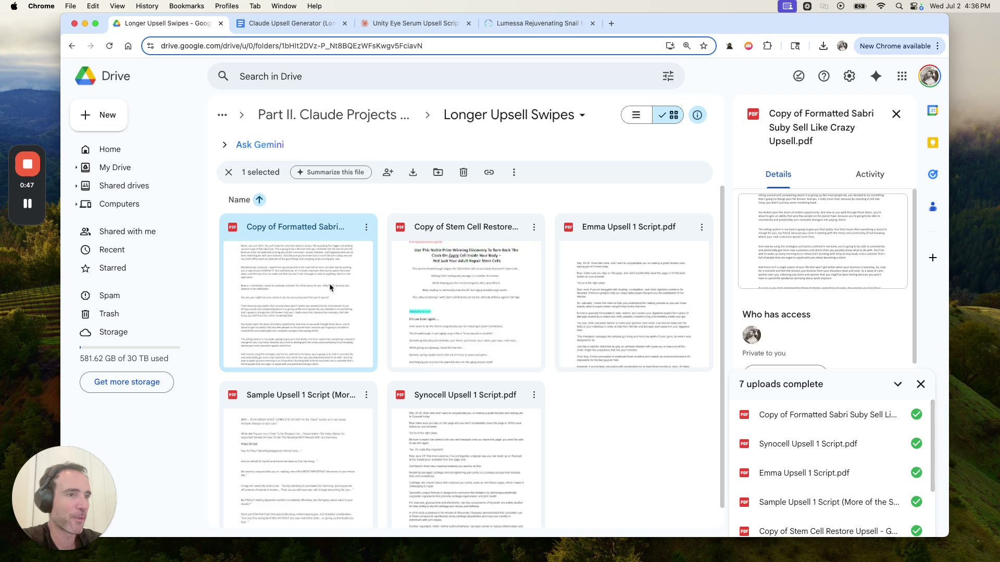
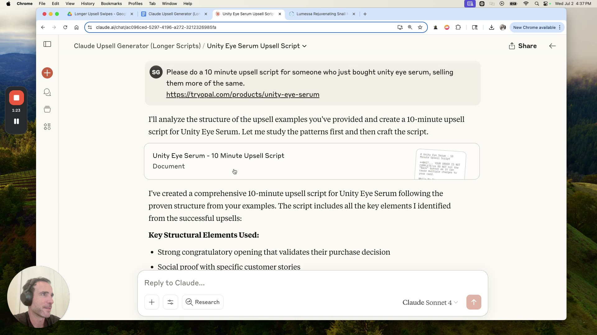
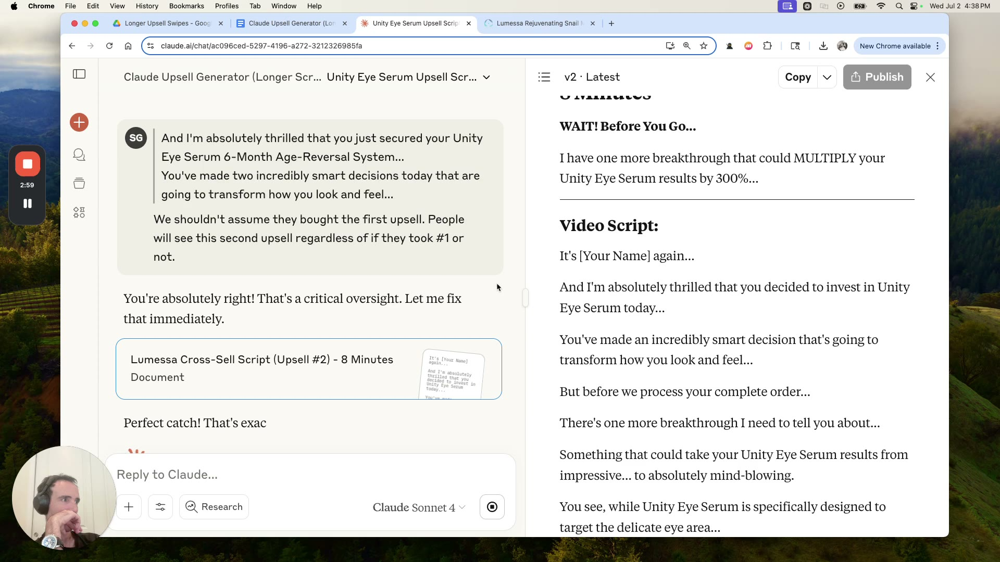
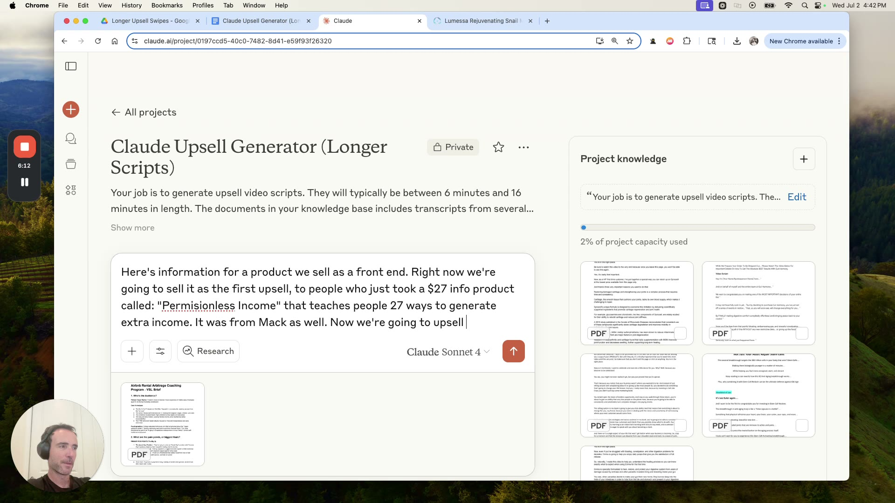
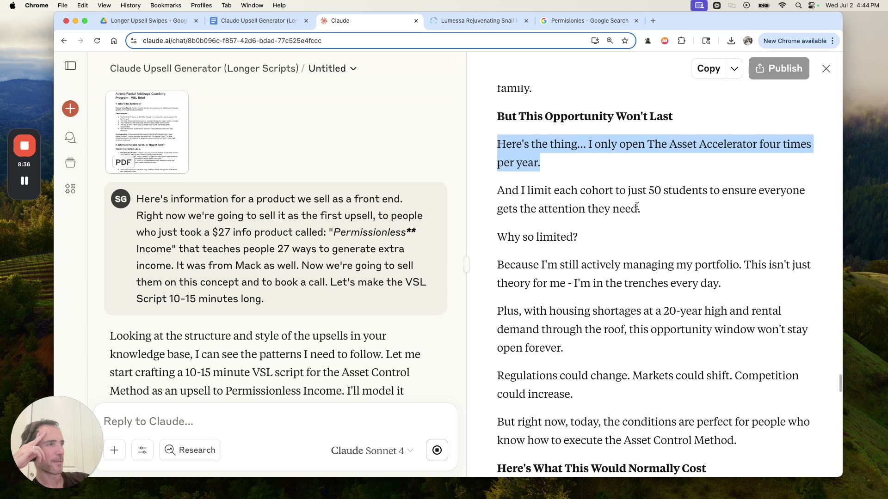

# 14.3 Claude Projects for Upsells
> Stefan Georgi builds a Claude Project that writes 6-16 minute upsell video scripts from five swipe PDFs and a short instruction block, then runs three examples (more-of-the-same for an eye serum, a cross-sell for a snail-mucin serum, and a call-booking upsell for an info product) and shows how to steer the drafts with specific feedback.

## 🤖 Agent use
- **Use when:** writing a first draft of a long (6-16 minute) upsell video script, a stock-up upsell, a cross-sell as upsell #2, or a call-booking upsell; or setting up the reusable Claude Project that does this for our brands.
- **Inputs → outputs:** project instructions + five swipe documents in project knowledge; per run: the product (link or brief), what the buyer just bought, upsell type (more of the same / cross-sell / call), upsell number and target length → a section-by-section script (written across several "continue" turns) that models the swipes' structure. Output is a draft, not final copy.
- **Rules:**
  - **DO** put the instruction block below in the Project instructions and the five swipes (as PDFs) in project knowledge. [00:00-00:59]
  - **DO** tell the model to model structure, length, style and tone of a named swipe, and to go section by section without condensing ("whenever you run out of space just prompt me and I'll tell you to continue"). [doc `1. Claude Upsell Generator`; 00:00-00:29]
  - **DO** give the product by landing-page link for physical products; for info products attach the brief. If we already have the unified research document or brief, add it. [01:01; 03:09-03:41; 05:12]
  - **DON'T** let the script assume the buyer took the previous upsell. "We shouldn't assume they bought the first upsell. We'll see this second upsell regardless of if they took number one or not." [02:38]
  - **DON'T** accept lines that insult logic ("most people don't realize your eyes are just one part of your face") or make the viewer feel bad ("make them feel like shit"). Ask for a more empathetic version that still persuades. [02:38-04:11; doc `3.1`]
  - **IF** the upsell is for a call, **THEN** sell the call, not the price: "instead of talking about the price, you should really be selling them on booking a call." [08:17-09:07]
  - **DO** read and edit every draft. "It's doing 99% of the work for you, so just use your brain." [10:44]
  - **DON'T** publish the model's invented proof (named testimonials, study citations, ratings, fixed scarcity numbers). See Claims check. (derived)
  - **IF** you need short on-page upsells (Dr. Clean / Happy Mammoth style) **THEN** build a second Project from those page copies. "You need to be empowered at this point in RMBC II to create your new projects." [01:31-02:01]
- **See also:** [14.2 Upsells case studies](14-02-upsells-case-studies.md) (the swipes and the manual Claude process) · [14.1 Upsells overview](14-01-upsells-overview.md) · [6.1 Claude VSL projects setup](06-01-claude-vsl-projects-setup-overview.md) · [5.3 Airbnb arbitrage brief example](05-03-airbnb-arbitrage-example.md) · [5.2 Brief generator with Claude Project](05-02-the-brief-generator-with-claude-project-unity-eye-serum-exam.md)

## Key ideas

### 1. Same recipe as the VSL projects: instructions + swipes [00:00-00:59]
- "We're going to create a Claude Project, same thing we did for VSLs. This one's going to be for upsells." The job: "generate upsell video scripts. They'll typically be between 6 and 16 minutes in length." The knowledge base holds transcripts of upsell videos to model off; the model should analyze the structure, synthesize it and "use your judgment to produce new upsells." [00:00-00:29]
- Five swipes are loaded (shown in the Drive folder "Longer Upsell Swipes"): (1) the Emma upsell, (2) the Synocell upsell (both from [14.2](14-02-upsells-case-studies.md)), (3) "Sample Upsell 1 (More of the Same)", a digestive-supplement script Stefan had Gemini write by taking an upsell he wrote for a client and re-creating it "for a new product in a different niche, so it's like a gut thing", (4) the Sabri Suby Sell Like Crazy upsell ("an info product... really good upsell, great format") and (5) the Stem Cell Restore / Genesis cross-sell ("just because what the hell, even though it's a cross-sell"). [00:29-00:59; screenshot at 00:47]
- Honest caveat about swipe 5: copy is "kind of aggressive, forgive me, wrote it a long time ago before I had my more ethical come to Jesus." [00:59]
- Setup is "literally just put the instructions in here, copy and paste them... and all those five PDFs." [00:59-01:01] The screenshot at 6:12 shows the Project page: the instruction snippet ("Your job is to generate upsell video scripts..."), "2% of project capacity used", the model selector reading "Claude Sonnet 4".


*The instruction block as written in a Google Doc: project name "Claude Upsell Generator (Longer Scripts)", the job, the "one IMPORTANT note" about not rushing or condensing. [00:17]*


*The five swipe PDFs uploaded to the Project: Sabri Suby, Stem Cell Restore, Emma, Sample Upsell 1 (More of the Same), Synocell. [00:47]*

### 2. Example 1: Unity Eye Serum, 10 minutes, more of the same [01:01-02:01]
- Prompt: "Please do a 10 minute upsell script for someone who just bought unity eye serum, selling them more of the same." plus the product link. "And they wrote like a script. It's pretty solid." [01:01-01:31]
- The first draft kept the opening ("WAIT... YOUR ORDER IS NOT COMPLETE!") and listed its own "Key Structural Elements Used" before the document (screenshot at 1:23). Stefan then pushed it toward the Emma/Synocell structure (feedback prompt below). The restructured output (`2. Unity Eye Serum More of the Same.docx`, marked "unedited") follows the Synocell script almost beat for beat: three reasons to stock up, doubling the dose, ingredient scarcity, "loved ones" gift, "cost of eye aging", "available only right now", guarantee, CTA. [doc `2.`]
- Claude filled the template with ingredient numbers and citations that no brief supplied (e.g., a named collagen-increase percentage, "a 2019 study", journals). Treat these as hallucinated until verified. [doc `2.`]


*Inside the Project chat: the prompt, a "Unity Eye Serum - 10 Minute Upsell Script" document, and Claude's list of "Key Structural Elements Used" (congratulatory opening, social proof with specific customer stories...). [01:23]*

### 3. Example 2: Lumessa cross-sell as upsell #2 (8 minutes) and how to steer it [02:01-04:11]
- Prompt (conversation history, `3.1`): "Awesome, good job! Now let's do an 8 minute cross-sell (it will be upsell #2) selling this product: [link]". Claude searched the web for the product page, then wrote the script; the history shows its stated strategy (logical bridge, educational hook, USP of "96% pure" snail mucin, synergy positioning, timeline, social proof, urgency and scarcity, strong close). [doc `3.1`]
- **Feedback 1 (logic error about the funnel):** Claude wrote that the buyer had "just secured your Unity Eye Serum 6-Month Age-Reversal System... made two incredibly smart decisions." Stefan: "We shouldn't assume they bought the first upsell. People will see this second upsell regardless of if they took #1 or not." Claude fixed it to "I'm absolutely thrilled that you decided to invest in Unity Eye Serum today". [02:38; doc `3.1`; screenshot at 2:59]
- **Feedback 2 (statement that insults the viewer's logic):** "What most people don't realize is that your eyes are just one part of your face..." Stefan: "I'm pretty sure most people do realize that their eyes are just one part of their face." Claude replaced it with the contrast idea: "When one area of your face looks dramatically younger, it can actually highlight aging in other areas..." [03:09; doc `3.1`]
- **Feedback 3 (tone):** Stefan asked for an empathetic variant: "A lot of women end up realizing that the one downside is that it highlights other areas of their face that don't look so young... Things like that so we're still being persuasive but not calling out any specific woman who watches and assuming things about her." Claude produced "Here's What Many Women Tell Us:" with a hair-and-outfit analogy instead of a "restored vintage car with a dented body" one. [doc `3.1`; 03:41-04:11 for the earlier "vintage car" line]
- Stefan's own view of the draft: "I would edit some of this copy"; the negative contrast "for direct response, it kind of makes sense, but I don't know if I would... modify that." He also suggests attaching "the unified research doc" so the script uses real research. "You should have some judgment by this point of RMBC II to be able to modify it." [03:09-04:11]
- The final Lumessa document keeps these structure beats: "WAIT! Before You Go..." hook ("MULTIPLY your Unity Eye Serum results by 300%"), the bridge, the "What Many Women Tell Us" turn, product introduction with a "snail mucin sounds unusual" objection, five-compound list, a week-by-week timeline, a "complete facial rejuvenation" benefit list, price and "only on this page", reasons for the discount, testimonials, regret-vs-future close, guarantee, button copy. [doc `3.`]


*Stefan's feedback quoting the offending lines and the rule ("We shouldn't assume they bought the first upsell"), Claude's fix in the Lumessa document (v2). Model shown: Claude Sonnet 4. [02:59]*

### 4. Example 3: call-booking upsell for an info product (Airbnb / "Permissionless Income") [04:11-10:44]
- Context: the front end is a $27 info product ("Permissionless Income") that teaches 27 ways to earn extra income; the upsell sells a call with the founder. Stefan attaches the Airbnb arbitrage brief he already built (screenshot shows the brief "Airbnb Rental Arbitrage Coaching Program - VSL Brief" attached to the prompt) and asks for a 10-15 minute VSL script. [04:11-05:56]
- The saved document (`4. Airbnb Example (Unedited from Claude Project)`, apparently the call-focused rewrite: derived, because it has no program price section) is a 12-14 minute script with a "Wait page" header, congratulation and a "$27 guide is not enough" turn, "The Hidden Truth About Why 95% of Side Hustles Fail", an "Asset Gap" frame (income wealth vs asset wealth), a "system is rigged" section, a founder story ("burnt-out corporate slave"), the named "Asset Control Method", a results section, "Why this works when everything else fails", an 8-week "Asset Accelerator" coaching program, bonuses, student results, "Your Two Paths Forward", scarcity (4 cohorts a year, 50 students), then a free personalized strategy call with fit qualification, call testimonials, "first 50 people" scarcity counter, final urgency, and a decline line ("No thanks, I'll stick with income-based side hustles"). [doc `4.`; 06:31-09:49]
- Stefan's edit instruction: the first draft moved into program pricing ("I'm not sure why I was telling the prices"; the screenshot at 8:36 shows a "Here's What This Would Normally Cost" section); he wanted the script to sell the booked call instead. "...instead of talking about the price, you should really be selling them on booking a call with [the founder] and see if it's [the founder] and his team to get a personalized action plan that's theirs regardless of whether they're a good fit or not." Claude rewrote it around the free call ("personalized Asset Control Blueprint... for free", "here's what we'll do during this call", fit assessment). [08:17-09:49]
- What he reads from the script: use the outline step ("what I should do is have an outline somewhere to the VSL first"); depending on the front end, "if they already shared the story you know you might not do too much of that." [06:31; 07:42]
- Closing rule: "Use your brain and common sense." "I see a copy that has used AI and then didn't read it over... then you're just being lazy... it's doing 99% of the work for you." And: "when people say AI doesn't make you dumb [sic], it should make you smarter because it frees you to actually think." [10:44]
- He ends by inviting experimentation with "other downsells, cross-sells, whatever you want." [10:44-11:17]


*Project page: instruction snippet, "2% of project capacity used", swipe PDFs under Project knowledge, and the new prompt being typed with the Airbnb brief attached. [06:12]*

## Steps / framework
1. **Create the Project.** Name: "Claude Upsell Generator (Longer Scripts)". Paste the instructions (below) into Project instructions. [doc `1.`; 00:17]
2. **Load five swipes** as PDFs: Emma, Synocell, Sample Upsell 1 (More of the Same), Sabri Suby, Stem Cell Restore. Add more of our own wins later. [00:29-00:59]
3. **Run an upsell:** state the length, who just bought what, the upsell type (more of the same / cross-sell / done-for-you / call), the upsell number, and give a product link or brief. [01:01; 02:01; 05:12]
4. **If using a model-written outline:** ask for an outline of the VSL first, then the full script across "continue" turns (his remark at 06:31).
5. **Review with the funnel in mind:** does the opener assume a prior purchase? Does any sentence make an obviously false claim about the viewer? Is the tone empathetic? Do the proof and numbers come from our brief? [02:38-04:11]
6. **Give feedback by quoting the line and saying why it is wrong**, then ask for a revised variant (as in the three Lumessa feedback turns).
7. **Hand-edit** and run compliance checks before it goes to production. [10:44]

## Examples

### Three runs compared
| Run | Product / inputs | Type and length | What Stefan changed | Source |
|---|---|---|---|---|
| Unity Eye Serum | Landing page link | More of the same, 10 min | Asked to model more heavily on Emma/Synocell | doc `2.`; [01:01-01:31] |
| Lumessa | Product page link; assumes Unity Eye Serum was bought | Cross-sell as upsell #2, 8 min | Three rounds: don't assume upsell 1; fix a false logic line; empathetic tone | doc `3.1`; [02:01-04:11] |
| Permissionless Income to call | Airbnb arbitrage brief; $27 front end | Call-booking VSL, 10-15 min | Rewrite to sell the call instead of price | [05:12-09:49] |

## Structured units

### Angles (as used in the three examples)
| Angle | Core desire / pain | Heuristic(s) | Best format | Example line | Source |
|---|---|---|---|---|---|
| Don't let your progress stop (stock up) | Keep results going; fear of running out | Loss aversion, one-time offer (derived) | 6-16 minute video upsell | "Running out of Unity Eye Serum too soon could interrupt this critical rebuilding process" | doc `2.` |
| Your best result highlights the rest (expanded problem) | A uniformly younger face | Contrast, holism (derived) | Cross-sell as upsell #2 | "When one area of your face looks dramatically younger, it can actually highlight aging in other areas" | doc `3.1` (v3 text) |
| From income to assets, with a free blueprint call | Escape the 9-to-5; a plan that fits my market | Qualifying and personalization (derived) | 10-15 minute call-booking VSL | "I give you a personalized Asset Control Blueprint... for free" | doc `4.` |

### Rewrites (before → after) from the Lumessa conversation
| Before | After | What changed (verb / visual / promise / self / intensity) | Source |
|---|---|---|---|
| "I'm absolutely thrilled that you just secured your Unity Eye Serum 6-Month Age-Reversal System... You've made two incredibly smart decisions today" | "I'm absolutely thrilled that you decided to invest in Unity Eye Serum today... You've made an incredibly smart decision" | Funnel logic: no assumed upsell 1 | doc `3.1` |
| "What most people don't realize is that your eyes are just one part of your face... You need to address aging on your ENTIRE face" | "What many people discover after seeing amazing results around their eyes is this... When one area of your face looks dramatically younger, it can actually highlight aging in other areas" | Claim made credible (observation, not a "most people don't realize") | doc `3.1`; [03:09] |
| Contrast copy with a "restored vintage car with a dented body" analogy | "Here's What Many Women Tell Us:" with a hair-and-outfit analogy, "some of them mention... fine lines around their mouth... uneven texture on their cheeks" | Self: empathy, no assumption about the viewer; intensity reduced | doc `3.1`; [03:41] |
| First draft that quoted program prices ("Here's What This Would Normally Cost", screenshot at 8:36) | Script that sells the free "personalized Asset Control Blueprint" call | Offer: call-first, not price-first | [08:17-09:49] |

### Templates
| Template | Use for | Example fill | Source |
|---|---|---|---|
| "Please do a [N] minute upsell script for someone who just bought [product], selling them [more of the same]. [product link]" | First draft of a more-of-the-same upsell | Unity Eye Serum, 10 minutes | doc `2.` |
| "Now let's do an [N] minute cross-sell (it will be upsell #[n]) selling this product: [link]" | Cross-sell as a later upsell | Lumessa, 8 minutes | doc `3.1` |
| "[quoted line]. [why it is wrong or how it should feel]." | Feedback turn | "We shouldn't assume they bought the first upsell. People will see this second upsell regardless of if they took #1 or not." | doc `3.1` |

### Rules of thumb
- **DO** keep upsells 6-16 minutes. [00:00]
- **DO** use real swipes as the knowledge base, not generic advice. [00:29-00:59]
- **DON'T** copy the model's testimonials, studies, scarcity numbers or invented founder stories. (derived)
- **IF** a draft states something nobody believes, **THEN** quote it back and ask for a logical version. [03:09]

## Prompts / templates (verbatim)

### Project name and instructions (`1. Claude Upsell Generator (Longer Format).docx`; seen on screen at 0:17)
```text
Claude Upsell Generator (Longer Scripts)

Your job is to generate upsell video scripts. They will typically be between 6 minutes and 16 minutes in length. The documents in your knowledge base includes transcripts from several upsell videos which we can model off while writing new upsells. What you'll want to do is analyze the structure of the various upsell examples, and then synthesize that knowledge and use that same knowledge, along with your judgement, to produce new upsells.

In general, when you go to write I'll give you various inputs or even an outline and a gameplan, and you'll be able to model off the examples based on the information about whatever the current upsell project is.

One IMPORTANT Note. Please don't try to rush or condense anything. Instead, whenever you run out of space just prompt me and I'll tell you to continue.
```

### Run 1: Unity Eye Serum (`2. Unity Eye Serum More of the Same.docx`)
```text
Please do a 10 minute upsell script for someone who just bought unity eye serum, selling them more of the same.
https://tryopal.com/products/unity-eye-serum
```
Feedback prompt (verbatim):
```text
Thanks. And going back to the Unity Eye Serum - 10 Minute Upsell Script. I liked it, but let's model more heavily off of the Emma and Synocell structure.
```

### Run 2: Lumessa cross-sell (`3.1. Claude Conversation History for Lumessa Cross Sell.docx`)
```text
Awesome, good job! Now let's do an 8 minute cross-sell (it will be upsell #2) selling this product:
https://tryopal.com/products/lumessa
```
Feedback 1:
```text
"And I'm absolutely thrilled that you just secured your Unity Eye Serum 6-Month Age-Reversal System...
You've made two incredibly smart decisions today that are going to transform how you look and feel…"

We shouldn't assume they bought the first upsell. People will see this second upsell regardless of if they took #1 or not.
```
Feedback 2:
```text
"What most people don't realize is that your eyes are just one part of your face...
And if you want to look truly youthful and radiant...
You need to address aging on your ENTIRE face with the same level of precision and power."

This doesn't make sense. I'm pretty sure most people do realize that their eyes are just one part of their face.
```
Feedback 3:
```text
Thanks. Now one more thing, I'd like to see a version of this where the tone is a little more empathetic. Instead of making them feel like shit "your eyes will look good but the rest of you will look old!" let's show more empathy. "A lot of women end up realizing that the one downside is that it highlights other areas of their face that don't look so young. For some of them it might be fine lines around their mouth, or rough uneven texture on their cheeks." Things like that so we're still being persuasive but not calling out any specific woman who watches and assuming things about her.
```

### Run 3: Airbnb / call-booking upsell (read from the screen at 8:36; also typed on screen at 6:12 and described at 5:12-5:56)
```text
Here's information for a product we sell as a front end. Right now we're going to sell it as the first upsell, to people who just took a $27 info product called: "Permissionless Income" that teaches people 27 ways to generate extra income. It was from Mack as well. Now we're going to sell them on this concept and to book a call. Let's make the VSL Script 10-15 minutes long.
```
(Attachment: the "Airbnb Rental Arbitrage Coaching Program - VSL Brief" PDF, built in [5.3](05-03-airbnb-arbitrage-example.md). The on-screen text has stray markdown asterisks after "Permissionless"; the typo Stefan fights with at 5:56-6:31 is the spelling of that word.) Claude's reply begins: "Looking at the structure and style of the upsells in your knowledge base, I can see the patterns I need to follow. Let me start crafting a 10-15 minute VSL script for the Asset Control Method as an upsell to Permissionless Income." (screenshot below)


*The full prompt with the brief attached, Claude's opening line, and the draft in the side panel (the "But This Opportunity Won't Last" section; a later heading, "Here's What This Would Normally Cost", shows the first draft still contained price talk before the call rewrite). [08:36]*

## Claims check (read before using any of the three outputs)
- **Unity Eye Serum:** named collagen and hydration percentages, "a 2019 study", journal citations, "up to 10 times thinner" skin, and cosmetic procedure cost ranges ($2,000-$8,000) were not supplied in the prompt. Verify each against a real source or delete.
- **Lumessa:** "MULTIPLY your results by 300%", "96% pure snail mucin", "$150+/$300+" comparisons, "takes 3-4 months to produce more", three named customer testimonials, and a "Korean glass skin" timeline are unverified: Claude searched the product page, so some figures may come from it, but the testimonials, the 300% line, the scarcity line and the discount story were written by the model. Check every number against our real product page and replace the rest with verified facts.
- **Airbnb example:** the founder's story (35-year-old logistics manager in Austin), "15-unit portfolio generating over $12,000 per month", "$2.3 million" in assets, "95% of side hustles fail", "30% of people I tell they're not ready", student results (named people, income figures), the "$500 normally" call fee, "first 50 people" counter and "four cohorts a year" are fabricated by the model for a hypothetical. Biz-op income claims also need earnings disclaimers. Never reuse.
- The doc is labelled "Unedited from Claude Project": it shows what the Project produces before human review.

## Screenshots
Six frames embedded (0:17, 0:47, 1:23, 2:59, 6:12 and 8:36). Not kept: nothing else informative (the other frame candidates were the same chat UI).

## How to apply
- [ ] Create a Claude Project "Upsell Generator" with the instruction block above and 3-5 swipes (our best upsell if we have one; Emma, Synocell, Sabri Suby only if we may store them for modeling).
- [ ] For each product: collect the product link or brief, price per unit, the guarantee, the real inventory constraints, and real customer language.
- [ ] Run "more of the same" for upsell 1 and a cross-sell for upsell 2 with a different prompt; tell the model the second upsell cannot assume the first.
- [ ] Review: remove invented proof and unverified claims; replace with our facts; adjust tone to empathetic.
- [ ] For call-based offers, rewrite so the CTA sells the call, then cut every price mention above the call.
- [ ] Log what changed and why, and feed corrections back into the Project instructions (derived).
- [ ] Build a second Project for short on-page upsells from Dr. Clean / Happy Mammoth-style copies. [01:31-02:01]

## Related
- Previous: [14.2 Upsells case studies](14-02-upsells-case-studies.md) · Up: [14.1 Upsells overview](14-01-upsells-overview.md)
- Earlier Claude Projects: [3.5 Creating a Claude Project for unique mechanisms](03-05-creating-a-claude-project-for-unique-mechanisms.md) · [9.2 Claude Project for advertorials](09-02-claude-project-for-advertorials.md) · [6.1 Claude VSL projects setup](06-01-claude-vsl-projects-setup-overview.md)
- Evolve: [AI in copywriting](../../../evolve/copywriting/concepts/ai-in-copywriting.md) (Evolve has no upsell-specific page)

## Sources and limitations
- Transcript: [03-[3] Claude Projects for Upsells.txt](<../../../../../raw/stefan-georgi/rmbc-ii/_transcripts/Stefan Georgi - RMBC II (1)/14-UPSELLS/03-[3] Claude Projects for Upsells.txt>) (full recording, last segment 11:17 of 11:24). Platform captions `03-2 Claude Upsell Project Setup and Output Examples.srt` used for wording (they confirm "Gemini" and "AI doesn't make you dumb").
- Whisper mishearings corrected: "quad/cloud project" = Claude Project; "SinoSell/sign upsell" = Synocell; "Sabre Subi" = Sabri Suby; "AMET cross-sell" = 8 minute cross-sell; "UDIs/UDI serum/Unity ISRM" = Unity Eye Serum.
- The recording starts after Stefan says he had paused the recording by mistake ("I paused it and didn't unpause it"), so the opening of the project setup is missing. Claude's outputs are paraphrased from documents and on-screen frames, not read aloud in full.
- Project instructions are shown in full (verbatim). The five swipe documents are not reproduced here: Emma, Synocell and Sabri Suby are summarized in [14.2](14-02-upsells-case-studies.md). The Sample Upsell 1 (Gut Harmony), 9 pages, is a digestive-supplement version of the same "6-Month Restoration Kit" structure used in the FitSpresso edit (retail $149/bottle, $29/bottle offer, $174 total, 100% lifetime guarantee, "inventory plummeted" scarcity) and carries the same unsubstantiated claims. The Stem Cell Restore swipe (23 pages) is the long cross-sell recapped in 14.2.
