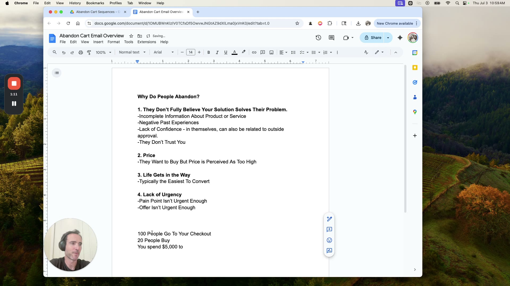
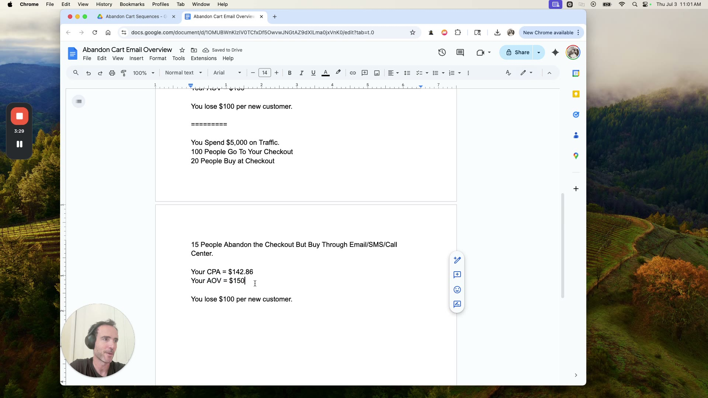

# 15.1 [1.1] Abandon Cart Sequences
> Abandoned-cart email is the fastest add-on profit lever in a funnel: recovering 15 of 100 checkout visitors turns a $100-per-customer loss into a small gross gain, and each email in the sequence is built to remove one specific reason people left (distrust, missing information, price, lost urgency, "life got in the way").

## 🤖 Agent use
- **Use when:** writing or auditing an abandoned-cart (abandoned-checkout) email sequence for an e-com product, a low-ticket info product, or a high-ticket "book a call" offer; choosing between a discount-led and an emotion-led sequence; deciding timing and discount escalation.
- **Inputs → outputs:** product facts, offer and price, guarantee, support phone number/hours, real testimonials and real customer language, margin (how deep the discount can go), CTA type (buy vs book a call) → a 7-email sequence with 2-3 subject-line options per email, a send-timing table, a discount ladder and a reason-for-abandonment tag on every email.
- **Rules:**
  - **DO** justify the sequence with funnel math before writing: 100 checkout visitors, 20 buy, $5,000 ad spend = $250 CPA; with a $150 AOV that is a $100 loss per new customer. Recovering 15 more buyers by email/SMS/call center gives 35 customers, $142.86 CPA, about +$7 gross per customer. [00:29–03:44]
  - **DO** tag every email with the abandonment reason it attacks: incomplete information, negative past experience, lack of confidence (in self or needing outside approval), no trust in you, price perceived as too high, life got in the way, lack of urgency (pain point or offer). [04:44–12:36]
  - **DO** hit hardest in the first 24 hours: "The more time between here ... the less likely they are to buy". Email 2 goes out 6 hours after email 1. [v2 05:26–06:37]
  - **DO** answer "incomplete information" with a FAQ email and restate guarantee, "no subscription / hidden fees", shipping time and price. [v2 10:04–11:38; 07:07–07:40]
  - **DO** include customer-service contact details (phone, hours) in the P.S. of most emails; it converts people with unspoken questions and surfaces objections your copy missed. [v2 04:51–05:26]
  - **DON'T** assume you know what the reader thinks. Write "Let me guess. After watching part of this, you thought, sounds too good to be true" (guess, soften) rather than "I know exactly what you're thinking". [v2 22:07–22:38]
  - **DON'T** start at the deepest discount. "I might start with like 30% off and move to 50% off or start with 25% off and move to 40% off ... Depends on margins." [v2 12:10–12:52]
  - **IF** margins allow **THEN** escalate the discount near the end: collecting $40 instead of $100 "is still better usually than collecting $0". [v2 12:52–13:23]
  - **IF** the CTA is a booked call on a high-ticket offer **THEN** do not discount; use objection crushing, scarcity/timing, peer pressure and future regret. [v2 19:38–26:12]
  - **IF** you can only run one supplement style **THEN** run the emotional + delayed-discount version, but add the phone number from email 3 onward. [v2 19:38]
  - **DON'T** copy the example claims (weight-loss numbers, "FDA-approved facilities", "clinically-proven", invented testimonials, "I never will again"). He modeled the numbers on a telemedicine GLP-1 company; for supplements these would need substantiation and break Meta/FTC rules. Copy the structure only. [v2 02:16–03:16] (derived)
- **See also:** [15.5 Claude project for email sequences](15-05-claude-project-for-writing-email-sequences.md) · [15.2 Welcome sequences](15-02-1-2-welcome-sequences.md) · [11.2 Checkouts walkthrough part 2](11-02-checkouts-walkthrough-part-2.md) · [Objection handling (Evolve)](../../../evolve/copywriting/concepts/objection-handling.md) · [Risk reduction hooks](../../../../concepts/risk-reduction-hooks.md)

## Key ideas

### 1. Funnel economics: why the sequence exists [00:29–04:44]
- The worked example: spend $5,000 on traffic, 100 people reach checkout, 20 buy. "Your CPA is $250." With AOV $150 "you lose per new customer" about $100 (the frame shows "You lose $100 per new customer"). [00:29–01:57]
- Add email recovery: 15 of those who abandoned buy through email (he also names SMS and a call center). Customers go 20 to 35; "$5,000 divided by 35 is $142.86"; AOV $150 means "you make seven dollars gross". [01:57–03:09]
- Reality check he adds: physical products still lose money after COGS and processing fees, but this is "a lot more likely to be something you can figure out and get to break even or even to scale profitably" than the first scenario. [03:09–04:13]
- Derived note: 15 recovered buyers out of the 80 who abandoned is about a 19% recovery rate; he calls it "15%" of the checkout traffic. Treat it as an illustrative target, not a benchmark. (derived)
- He points to his separate funnel-economics bonus training for the longer version ([16.3 Funnel economics with SPG](16-03-funnel-economics-with-spg.md)). [03:44–04:13]

### 2. Why people abandon: the reason map [04:44–16:56]
He shows a one-page doc ("Why Do People Abandon?"). Four buckets; each becomes an email angle:
- **They don't fully believe your solution solves their problem.** Sub-reasons: incomplete information about the product/service, negative past experience, lack of confidence (in themselves, or needing outside approval), and they don't trust you. [04:44–09:03]
  - Incomplete information: his own example is the Clarifion checkout: "I didn't trust them ... because I didn't have complete information" ([11.1 Checkouts part 1](11-01-checkouts-walkthrough-part-1.md)); or Dr. Clean's pods where one bottle looked like $20 and the refill-pod saving was unclear. [05:28–06:33]
  - Negative past experience: bought something that turned out to be a subscription, bought solutions and never used them, expect to "waste money like I always do". [06:33–07:33]
  - Lack of confidence: "I can't imagine myself actually making money doing this"; or fear of a spouse/friends saying "that's a pyramid scheme" / "you always waste money" (outside approval). [07:33–08:32]
- **Price perceived as too high.** "Perceived" matters: if the pain is urgent and the proof is airtight, people pay almost any price; true financial constraint is "typically ... almost ignore[d]" in DTC and he does not want to push people into loans. [09:03–10:04]
- **Life gets in the way.** "By far the easiest person to convert": phone call, kids home early, dog barking; the buying spell breaks and motivation decays. They still need resetting back into the frame. [10:04–11:35]
- **Lack of urgency.** Either the pain point is not a "bleeding neck" problem, or the offer has no deadline. "That's why [limited-time offers, new-customer discount, exclusive coupon] work": "this price is only guaranteed for so long". [11:35–13:05]
- His analogy: a failing bedroom air conditioner. Not urgent until it fails; then he would pay $500 extra for emergency service; and an ad at the exact moment ("Parkland, Florida ... 4th of July sale 30% off ... installed before 4 p.m.") would convert 50-50 vs a generic ad that would not. Urgency decays with time unless re-created. [13:05–16:56]
- Screenshot of the reason map: see Screenshots.

### 3. Sequence design principles [v2 00:01–13:56]
- All three samples were generated by Claude from sequences he runs for real brands, rewritten for hypothetical brands "so I didn't have to give away proprietary stuff". [v2 00:01–00:33]
- Two supplement versions for the same product ("VitalBurn Pro", a weight-loss supplement): (a) discount-focused, because price and lack of urgency are the assumed reasons; (b) emotion-led, with the first discount on day 3. Plus a coaching/"book a call" version with no discount. [v2 00:33–01:09; 14:33–15:10; 19:38–20:35]
- Timing logic: day 0 is the abandonment; a drop-off curve follows ("like this"), so email 2 is 6 hours later and the last day can carry up to three emails ("I like three emails at least" was a promo-lesson habit; in the abandon cart he says he caught that other examples have three emails on the last day). [v2 05:26–06:37; 13:56–14:33]
- Each email targets a different reason so the sequence is not the same message repeated: social proof (trust), customer story (confidence and past experience), FAQ (information), science (belief), discount increase (price), final hours (urgency). [v2 03:51–13:56]
- Discount ladders in the samples: 50% then 60% on day 6 (version 1); 40% on day 3 then 55% on day 5 (version 2). [v2 11:38–13:23; 16:55–18:58]
- "This is a really great email sequence, to be honest with you." (about version 2) [v2 18:16]

### 4. Version 1: discount-focused supplement sequence [v2 00:33–14:33]
- Opening email: motivation and future pacing ("What if I told you the next 60 seconds could shape the next 30 days of your life ..."), social proof ("joining 15,000+ others"), three testimonials, bulleted outcomes, discount code, 2-minute completion promise, shipping speed, call-center P.S.. His read: "motivating them ... some social proof ... reminding them ... some future pacing ... even like with the call center ... not making you sell more people that way". [v2 00:33–05:26]
- He notes the 50% could be "50% off the normal retail price, not 50% off the price you already saw", and you can start at 20%. [v2 01:09–01:44; 03:16–03:51]
- Social proof email 6h later: "you can also include screenshots, reviews, people on Instagram ... versus just these written testimonials"; add guarantee and "no subscription, hidden fees" lines. [v2 06:02–07:40]
- Customer story email: emotional story, then "future pacing, imagine how good you could feel", price anchor ("Others would pay $129. You can start for less than $65. I would make sure what is the actual pricing"). [v2 07:40–09:26]
- FAQ email: "one of the best ways to resolve [incomplete information] is with FAQs". [v2 10:04–11:38]
- Science email at 48 hours left: educate, "we're trying to find different angles and different reasons". [v2 11:38–12:10]
- Discount upgrade: "I never do this. I just upgrade your discount" (subject "I NEVER do this"). [v2 12:52]

### 5. Version 2: emotional sequence with delayed discount [v2 14:33–19:38]
- Starts with a first-person story and a "mirror moment" (subject options: "I get it", "That moment when you catch yourself in a photo", "are you tired of starting over?"). [v2 14:33–15:41]
- Reframes past failure: "You're not broken. You're not lazy ... You're just fighting a battle with the wrong weapons." [v2 15:10–15:41]
- Speaks directly to negative past experience and builds confidence with an authentic tone: "that's really what the emotional sequence is about". [v2 16:15–16:55]
- Risk reversal plus objection handling ("But what if it doesn't work for me?"), then a bigger discount in a 48-hour window. [v2 17:36–18:58]
- His pick: "If I was going to pick one of the two sequences, I'd probably pick the second one, but then I would put in ... the phone number, customer service stuff, at least ... starting the third email." [v2 19:38]

### 6. Coaching / "book a call" sequence: no discount [v2 19:38–26:46]
- Brief: Airbnb-arbitrage coaching ("Asset Control Method") sold via a presentation, CTA is a free strategy session. Sequence "is really overcoming objections, building urgency through scarcity and timing and reinforcing transformation". [v2 19:38–20:35]
- Email 1 recaps what they watched and asks what stopped them (skepticism, fear, timing, overwhelm). [v2 20:35–21:05]
- Email 2 "objection crushing": subject "The skepticism that keeps people poor". Phrase it as a guess: "Let me guess ... sounds too good to be true", then invert: "People who are most skeptical are often the most successful". [v2 22:07–23:06]
- Email 3 fear of failure story; email 4 market timing ("perfect timing doesn't exist, but optimal timing does") using urgency plus logic; email 5 scarcity with an explanation of why spots are limited; email 6 peer pressure (what others did while you waited); email 7 future regret. [v2 23:46–26:12]
- "Price isn't an issue in these. This is book a call." Confidence, past negative experience and urgency do the work. [v2 23:06]
- Transfer to a $97 course: "use the supplement thing, but do a discount for a course". [v2 26:46]

## Steps / framework
1. **Set the trigger and day 0.** Klaviyo/Omnisend-style abandoned-checkout flow; email 1 fires on the existing trigger. (derived: platform-specific delay is your setting.)
2. **Choose the style.** Discount-led (price/urgency assumed), emotion-led with delayed discount (confidence/past experience assumed), or no-discount objection sequence (book-a-call). [v2 00:33; 14:33; 19:38]
3. **Assign one abandonment reason per email** using the reason map; do not repeat reasons back to back.
4. **Time it.** Email 1 at trigger, email 2 at +6 hours, then roughly one email a day, final day can hold 1-3 emails (morning/afternoon/evening, or 6-8 hours apart). [v2 05:26–06:37; 13:56–14:33; 18:58]
5. **Write 2-3 subject lines plus a subhead per email** (each sample email carries "Option 1/2/3").
6. **Close every email with a P.S. support line** (phone, hours) and a repeat of the CTA.
7. **Review for compliance and truth** before any send: claims, scarcity, "last time ever" statements, testimonials.

## Examples

### Version 1: "7-Day Weight Loss Supplement Cart Abandonment Sequence" (discount-focused, 50% to 60%)
Source: `Copy of 1. Sample Abandon Cart Sequence_Supplement_Discount Focused`. Strategy line: "each email will emphasize social proof, ingredient science, and the 50% discount ... upgraded 60% discount 48 hours before deadline". Sender: "Sarah at VitalBurn Pro". Subject options below are verbatim (first two options shown).

| # | Send timing | Subject line (verbatim) | Angle | Goal |
|---|---|---|---|---|
| 1 | At trigger (day 0) | "Your VitalBurn Pro Order?" / "🔥Finish What You Started (And Save 50% Today)" | Reconnect and reminder: future pacing, 15,000+ buyers, 3 testimonials, SAVE50 | Get the click back to checkout; reassure with phone line |
| 2 | +6 hours | "You were so close, {{contact.first_name}}" / "👀 Ready to see what's possible, {{contact.first_name}}?" | Social proof plus "why trust us" checklist (guarantee, shipping, support) | Fix trust and incomplete information |
| 3 | +1 day | "Quick story" / "How Angela lost 28 pounds in 10 weeks" | Customer story + future pacing + price anchor ($129.99 competitors vs under $65) | Build confidence ("it worked for them") |
| 4 | +1 day | "Why VitalBurn Pro actually increases your energy" / "Tired of yo-yo dieting?" | FAQ: why us, how it works, results, side effects, safety, shipping, price | Resolve remaining questions |
| 5 | +1 day (48 hours left) | "48 Hours Left: Get 50% Off + Clinical-Grade Formula" / "🧪The Science Behind VitalBurn Pro (50% Off)" | Ingredient science and doses, guarantee, "48 hours" | Overcome "it won't work / burned before" |
| 6 | +1 day | "‼️I NEVER do this" / "🚨I just UPGRADED your discount (ends tomorrow)" | Discount upgrade 50% to 60% (SAVE60), "less than $2/day" | Price objection; urgency |
| 7 | Next day (final hours) | "🚨(Final Hours) Get 60% Off + Results Like These" / "⏰(Tick Tock) 60% Off VitalBurn Pro Ends Tonight" | Last chance, 3 testimonials, midnight deadline | Close |

Key lines to copy structurally (not verbatim claims):
- Email 1: "What if I told you the next 60 seconds could shape the next 30 days of your life, {{contact.first_name}}?" then "You're just one click away from joining 15,000+ others ..." and "As a bonus ... When you take action TODAY, you'll automatically save 50%".
- Email 6: "I just upgraded your discount from 50% OFF to 60% OFF. It's my final offer and it expires TOMORROW."
- P.P.S. pattern on every email: "Need help or have questions? Yes, we're REAL people and we're here to help! Call us at [phone] ([hours])". Stefan: this "is really helpful if you have that [call center]". [v2 04:19–05:26]
- Doc footer: "Total Emails: 7 | Discount Progression: 50% to 60% (upgraded on day 6) | Key Focus: Social proof, ingredient science, clinical backing, urgency | CTA: Complete order + discount code".

### Version 2: "7-Day Weight Loss Supplement Cart Sequence - Emotional Focus" (no discount until day 3)
Source: `Copy of 2. Sample Abandon Cart Sequence_Supplement_Emotion + Delayed Discount`. Strategy: "emotional connection first, building desire and urgency through stories and pain points before introducing the discount on day 3". Header note: works "for customers who need more emotional buy-in before price becomes the deciding factor".

| # | Send timing | Subject line (verbatim) | Angle | Goal |
|---|---|---|---|---|
| 1 | At trigger | "I get it, {{contact.first_name}}" / "That moment when you catch yourself in a photo" / "{{contact.first_name}}, are you tired of starting over?" | "Mirror moment" story from a customer ("Maria") and a reframe: you are not broken, you used the wrong tools | Emotional recognition; get the click back |
| 2 | +6 hours | "The real reason you can't lose weight" / "{{contact.first_name}}, can I be honest with you?" | Mechanism/education: the body works against you (age, hormones) | Past-experience objection; belief |
| 3 | +1 day | "\"I wish I'd started sooner\"" / "This email made me cry (good tears)" / "From size 18 to size 10 in 6 months" | Long testimonial story (Rebecca) plus first discount: 40% | Confidence plus first price lever |
| 4 | +1 day | "\"But what if it doesn't work for me?\"" / "You're not broken, you're just using the wrong tools" | Objection handling and emotional reassurance; risk reversal; FAQs | Remove fear and risk |
| 5 | +1 day | "{{contact.first_name}}, I'm increasing your discount" / "55% off (my biggest discount ever)" | Discount increase 40% to 55% (SAVE55) with a 48-hour window; four barriers (cost, risk, time, skepticism) | Price plus urgency |
| 6 | +1 day (24 hours left) | "24 hours left (don't let regret win)" / "The woman in the mirror is waiting" | Future-self and regret | Urgency, emotional close |
| 7 | +6-8 hours | "This is it, {{contact.first_name}}" / "No more tomorrows" | Emotional final hours, "choose her. Choose you." | Last-chance close |

- Doc footer: "Discount Introduction: Day 3 (40% off) | Discount Escalation: Day 5 (55% off) | Primary Focus: Emotional connection, storytelling, identity transformation".
- Stefan's reading of email 1: "it's emotional, negative. Maybe you're feeling the same way. So we're going to get really emotional." [v2 15:10]
- Caution (derived): email 1 invents a specific customer ("Maria") and "I got an email from one of our customers"; email 5 P.S. says "I've never offered 55% off before, and I never will again". Use only real customer stories and true scarcity.

### Version 3: "7-Day Asset Control Method Abandon Cart Sequence" (coaching, book-a-call CTA, no discounting)
Source: `Copy of 3. Sample Abandon Cart Sequence_Airbnb High Ticket_Book a Call`. Strategy: "No discounting - focus on overcoming objections, building urgency through scarcity/timing, and reinforcing transformation opportunity." Sender: a founder-persona ("Marcus 'Mack' Hayes"). CTA: book the free Asset Control Strategy Session. Hypothetical brand; it is a biz-opp example.

| # | Send timing | Subject line (verbatim, option 1) | Angle | Goal |
|---|---|---|---|---|
| 1 | Day 1 | "You were so close to your breakthrough, {{first_name}}" | Recap the presentation, ask "what stopped you?" (skepticism, fear, timing, overwhelm); "two paths" | Re-engage; name the real objection |
| 2 | Day 2 | "I know this sounds too good to be true..." (alt: "The skepticism that keeps people poor") | Objection crushing; skepticism reframed as an advantage | Trust and believability |
| 3 | Day 3 | "What if you fail? (honest answer)" | Fear-of-failure story | Confidence |
| 4 | Day 4 | "This housing crisis won't last forever" | Market-timing urgency with logic | "Do it later" objection |
| 5 | Day 5 | "Only 3 spots left this month" | Scarcity plus why spots are limited | Urgency |
| 6 | Day 6 | "While you waited, they took action" | Peer pressure: three people who booked and what happened | Social proof, fear of being left behind |
| 7 | Day 7 | "Last chance to book your call" (alt: "Don't let this haunt you") | Future regret, "final email", personal worry | Close |

- Stefan's notes: "price isn't an issue in these"; "there's a little scarcity ... the limitation on the calls"; email 6 is "peer pressure ... future pacing how valuable the call is". [v2 22:38–26:12]
- Caution (derived): this is a biz-opp example with invented proof ("$2.3 million in assets generating over $12,000 per month", "over 300 people", named students with income claims) and "only 3 spots left". Income claims need substantiation and an earnings disclaimer; scarcity must be real.

## Structured units

### Abandonment reasons to email-angle map
| Reason (his bucket) | Email angle that attacks it | Sample email |
|---|---|---|
| Incomplete information | FAQ, "why us" checklist, restate guarantee / no subscription / shipping | V1 #2, #4 |
| Negative past experience | Story of someone who also failed, "wrong tools" reframe, risk reversal | V2 #1, #2, #4 |
| Lack of confidence (self / outside approval) | Customer stories, peer pressure, community proof | V1 #3, V2 #3, V3 #3, #6 |
| They don't trust you | Social proof, real people with phone line, science | V1 #1, #2, #5 |
| Price perceived as too high | Discount (start small, escalate), price anchoring, per-day price | V1 #6, V2 #5 |
| Life got in the way | Early reminder (6h), "one click away", short completion time | V1 #1, #2 |
| Lack of urgency (pain or offer) | Deadline, last-day multi-email, scarcity, future regret | V1 #7, V2 #6-7, V3 #5, #7 |

## Prompts / templates (verbatim)
No prompt is shown in this lesson. Prompts for generating these sequences are in [15.5](15-05-claude-project-for-writing-email-sequences.md). Stefan's stated plan: "I'll create a Claude project ... we'll be able to spit out all of these different email sequences for you." [16:56]

Reusable subject/hook formulas seen in the samples (derived from the examples):
```
[Name], you were so close            -> reconnect / curiosity
Quick story                           -> customer story email
[Result] in [timeframe]: how [Name] did it (and how you can for [discount])
48 Hours Left: [Offer] + [Credibility cue]
I NEVER do this / I just UPGRADED your discount -> discount upgrade
Let me guess. After [watching/reading], you thought "[objection]"   -> guess-the-objection opener
While you waited, they took action    -> peer pressure (book-a-call)
```

## Screenshots

*The reason map at 01:12: Stefan's one-page list of why people abandon. Use it as the tagging scheme for each email.*


*The funnel math at about 03:50: before and after email recovery. "You lose $100 per new customer" is the baseline.*

## How to apply
- [ ] Compute your own baseline: checkout visitors, checkouts completed, CPA, AOV, loss or profit per new customer; then model +10/15 recovered buyers.
- [ ] Pick the style: discount-led, emotion-led with delayed discount, or no-discount objection sequence (book a call).
- [ ] Map one abandonment reason to each of the 7 emails; check no two adjacent emails use the same angle.
- [ ] Set timing: trigger, +6h, then daily; final day 1-3 emails.
- [ ] Decide the discount ladder from margin (e.g. start 20-30%, step up to 40-50% in the last 48 hours) and use unique codes.
- [ ] Add guarantee, "no subscription/hidden fees" (only if true), shipping time and a support phone line to the P.S.
- [ ] Replace every placeholder testimonial, number and "limited spots" line with real, verifiable ones; remove claims you cannot substantiate.
- [ ] Generate the draft with the [Claude email project](15-05-claude-project-for-writing-email-sequences.md), then edit for logic: "it's literally just being consistent and logical".
- [ ] Test: sequence A (discount first) vs B (emotion first, discount day 3) on cart abandoners; compare recovery rate and margin per recovered order.

## Related
- Same module: [15.2 Welcome sequences](15-02-1-2-welcome-sequences.md) · [15.3 Promotional sequences](15-03-1-3-promotional-sequences.md) · [15.4 Winback and reorder](15-04-1-4-winback-and-reorder-campaigns.md) · [15.5 Claude project for email sequences](15-05-claude-project-for-writing-email-sequences.md)
- Upstream funnel: [11.1 Checkouts part 1](11-01-checkouts-walkthrough-part-1.md) (Clarifion trust example) · [11.2 Checkouts part 2](11-02-checkouts-walkthrough-part-2.md) · [14.1 Upsells overview](14-01-upsells-overview.md)
- Shared KB: [Objection handling (Evolve Copywriting)](../../../evolve/copywriting/concepts/objection-handling.md) · [Risk reduction hooks](../../../../concepts/risk-reduction-hooks.md) · [Offer and bundle psychology](../../../../frameworks/offer-and-bundle-psychology.md)

## Sources and limitations
- Transcripts: [video 1 (17:28)](<../../../../../raw/stefan-georgi/rmbc-ii/_transcripts/Stefan Georgi - RMBC II (1)/15-EMAIL MARKETING/01-[1.1] Abandon Cart Sequences.txt>) and [video 2 (27:22)](<../../../../../raw/stefan-georgi/rmbc-ii/_transcripts/Stefan Georgi - RMBC II (1)/15-EMAIL MARKETING/01-[1.1] Abandon Cart Sequences video2.txt>). Platform captions: `01-11 Abandon Cart Overview - Economics and Consumer Psychology.srt` (video 1) and `01-12 Abandon Cart Sample Walkthroughs.srt` (video 2), under `originals/Stefan Georgi - RMBC II (1)/15-EMAIL MARKETING/`.
- Example emails: the three .docx files in `_extracted/_unzipped/15-EMAIL MARKETING/01-1 Abandon Cart Sequences-20250708T103055Z-1-001/1. Abandon Cart Sequences/` (read in full; summarized, not pasted).
- Machine transcription mishearings fixed from the docs and captions: "band of cart" = abandoned cart, "emo" = email, "Quad" = Claude, "Vital Burn" = VitalBurn Pro, "Asset Control Method" (heard as "asset control").
- Video 1 segment 00:29–01:57 is garbled in the transcript; the numbers are taken from the on-screen doc (frame at 03:29) and his later restatement.
- Subject lines in the tables are from the docs, not read aloud. The speaker reads and paraphrases about half of the emails; docs contain the full copy. Send times for V3 are "Day 1-7" in the doc, not hours.
- Everything about weight loss, income and "FDA-approved" in these samples is invented example copy. Do not reuse.
- No screenshots of the sample sequences were taken (the docs contain the text). Frames from video 2 were not sampled.
