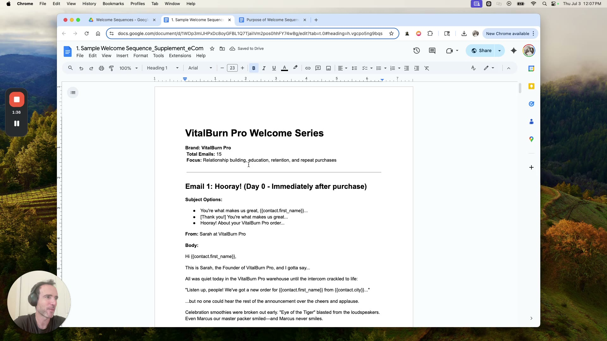

# 15.2 [1.2] Welcome Sequences
> A welcome (post-purchase) sequence has five jobs (reaffirm the decision, answer the vital questions, build a relationship and trust, turn a one-time buyer into a repeat buyer, and encourage consumption), and three samples (15-email supplement, 12-email $97 course with a sales-call CTA, 10-email high-ticket onboarding) show how to schedule them.

## 🤖 Agent use
- **Use when:** writing or auditing the email flow that fires after a first purchase (physical product, info product, or coaching); planning day-by-day timing for a 10-15 email onboarding; adding a repeat-purchase or sales-call ascension step.
- **Inputs → outputs:** product, ship/delivery timing, what is in the box, how to use it and the usual first-week results, support details, repeat-purchase offer (discount code or subscribe-and-save), real testimonials, (for info/coaching) login steps, roadmap, assignments, next-step offer → a timed sequence table (email #, send timing, subject options, angle, goal) and full copy.
- **Rules:**
  - **DO** build every welcome email around the five purposes: reaffirm decision, answer vital questions, establish relationship and trust, turn a one-time customer into a repeat customer, encourage consumption. [00:00–01:00; `1. Purpose of Welcome Sequences`]
  - **DO** make email 1 immediate and complete: thank them, "here's what to expect", warehouse/ship timing, tracking-number promise, what is in the package, support contacts, plus a "little discount code" in the P.S. [02:20–03:19]
  - **DO** answer the post-purchase questions explicitly: where does it ship from, when will I get it, will I get a tracking number, what do I do when it arrives. [02:49–03:19]
  - **DO** push consumption: "if they use stuff, they're more likely to keep using it, keep buying, keep ordering". Assignments, roadmaps and "what you should notice in week 1" are consumption emails. [10:20–10:51]
  - **DO** put a face on the brand with a short personal video from the founder or a team member (optional email at +6 hours). [03:19–03:57]
  - **DO** time the check-in to when the product actually arrives: "maybe you time this one ... depending on when they're going to get their product ... Use common sense". [06:11–06:36]
  - **DON'T** use "member" language unless it is true: "I'd be careful ... if it's not subscription, people might be a little bit wary". [04:00; 05:38]
  - **DON'T** assume the 15-email supplement flow is mandatory. "You don't have to do all these, but I like it." Cut or slow it; once past two weeks he moves to weekly. [04:28; 08:00]
  - **IF** the buyer purchased a low-ticket course and you sell a next step **THEN** you must re-sell: "you almost have to resell them on things and answer some objections as you would for an abandoned or anybody else". [13:09–13:46]
  - **IF** the personalized-roadmap claim in an email would not be true for your offer **THEN** delete it. He flags it: "I'd be careful with this. I'm probably going to delete this." [12:01–12:39]
  - **DON'T** reuse the fake pretexts in the sample copy ("I got a notification about you", "apology coupon for those who missed our last promotion", "this stuff expires in 24 hours" when it does not). Use real triggers and real deadlines. (derived)
- **See also:** [15.1 Abandon cart sequences](15-01-1-1-abandon-cart-sequences.md) · [15.4 Winback and reorder](15-04-1-4-winback-and-reorder-campaigns.md) · [15.5 Claude project for email sequences](15-05-claude-project-for-writing-email-sequences.md) · [14.1 Upsells overview](14-01-upsells-overview.md)

## Key ideas

### 1. The five purposes [00:00–01:00]
- Reaffirm decision ("great job, that was smart"), answer vital questions (when will it arrive, what to expect, how to get the best result), establish a relationship and build trust (from "an individual or a brand"), turn a one-time customer into a repeat customer, and encourage consumption (the fifth item is on the doc; he adds it while talking through the examples). [00:00–01:00; 10:20]
- The only exception to "turn into a repeat customer" is "if there's nothing else to sell them"; "even then you want to build a relationship". [01:00]
- Doc `1. Purpose of Welcome Sequences` lists exactly: Reaffirm Decision / Answer Vital Questions / Establish Relationship (and Build Trust) / Turn a One-Time Customer Into a Repeat Customer / Encouraging Consumption.

### 2. Supplement welcome series: 15 emails [01:00–09:10]
- Origin: "I just took the same welcome sequence template that my wife [Laura, per the captions] had done back in the day for ProfitFixFormula" and applied it to the VitalBurn Pro weight-loss supplement. He says it has "a little bit of feminine energy" and that you can inject a different personality. [01:00–01:45; SRT 01:43]
- Email 1 "Hooray!": founder-voice story (the order is announced over the warehouse intercom, celebration smoothies, "Eye of the Tiger", "Even Marcus our master packer smiled—and Marcus never smiles"). It reaffirms the decision, tells them where they are located, when it ships, that there is tracking, what is in the box, and offers a code. "This is a classic, but a goodie." [01:45–03:19]
- Email 2 (+6 hours): "I forgot to send you this" plus a personal video. Optional but "not bad". [03:19–03:57]
- Email 3 (+1 day): "Come see 👀": "member perks", a 15% code. [03:57–04:28]
- Email 4 (+2 days): unboxing video that also shows other products ("they might buy more stuff"). [04:28–05:05]
- Email 5 (+3 days): "Package arrived?" Reminds them of their good decision, how to check the door, additional products, take before/after measurements. [05:05–05:38]
- Email 6 (+5 days): special member offer with a private code. [05:38–06:11]
- Email 7 (+1 week): "I got a message about you ... it's been a week" and what to expect after week 1, with a 24-hour code and a short testimonial. [06:11–07:08]
- Emails 8-9 (next day each): "discount expiring", then "one last chance" (20% offer). He admits the cadence is "technically ... longer than 24 hours" but "probably okay". [07:08–08:00]
- Email 10 (+2 weeks): survey with a reward; "at this point we go to weekly because we've sort of emailed them a lot". [07:08–08:36]
- Later emails: restock/"running low" (3-4 weeks), testimonial/photo request (5 weeks), "sneaky" apology coupon (6 weeks), anniversary / subscription push (8 weeks). [08:00–09:10]
- His summary of what the emails do: "reaffirming the decision, answering vital questions, establishing a relationship ... Laura did a great job with these emails." [05:05]

### 3. $97 course with a sales-call CTA: 12 emails [09:10–15:45]
- Context: the Airbnb-arbitrage "Asset Control Method" brief reworked as a $97 course whose welcome sequence sells a free "strategy session" call (Ascension model: $27/$47/$97 course, then book a call). [09:10; 13:09–13:46]
- Email 1: "welcome to the most important investment you've ever made in your financial future. Course is ready ... Start here tonight (I might say 'immediately')". Log in, go to module 1: "it's the foundation of everything else". Join the Facebook group. [09:10–10:20]
- His analysis: personal relationship, reaffirm decision, and encourage consumption. "For all the shit biz op people get, a lot of them have really good stuff ... The problem is people don't consume it." [10:20–10:51]
- Email 2 (+6 hours): 30-day roadmap with an actual assignment and timeline; the Facebook community is "more sticky". [10:51–11:35]
- Email 3: "fast track your results", introducing the free strategy session. He wants to delete the claim that students with personalized roadmaps succeed "3x faster" and that sessions "typically run $500". [11:35–12:39]
- Emails 4-6: student success stories (believability), first-week action plan ("I'm checking in on you"), "why most people fail" ("getting a little bit more harsh ... a little bit of a strong sale ... optional"). [13:09–14:22]
- Emails 7-9: what happens on the strategy call, behind-the-scenes success story, market analysis. [14:22–15:45]
- Emails 10-12: "limited spots", "final 48 hours", "door closing / closes tonight" (scarcity and urgency). [15:45]

### 4. High-ticket coaching onboarding: 10 emails [15:45–16:56]
- "This one's really just all about consumption ... Reaffirm what they did. Establish a relationship. Consumption, consumption, consumption ... Gives them assignments, mindset." Use it for "your course, program, coaching thing, whatever, or your clients." [15:45–16:56]
- Strategy line in the doc: "Focus on immediate action, building confidence, implementation, and early wins. Emphasize exclusivity and results-focused approach."

## Steps / framework
1. **Decide the product type**: consumable e-com (repeat-purchase goal), low-ticket course (ascension goal), or high-ticket program (consumption/implementation goal).
2. **Email 1 immediately**: thanks, expectations, ship timing, tracking, package contents or login steps, support contacts, optional code.
3. **+6 hours**: personal video or portal tour (optional but recommended).
4. **Days 1-3**: unboxing/"how to use it", "your package should be here", success roadmap or first assignment.
5. **~Day 5-7**: first reorder/upsell touchpoint (member code or strategy-call pitch) and a "what you should notice in week 1" email timed to delivery.
6. **Weeks 2-8**: survey with reward, restock timing, photo/testimonial request, anniversary/subscribe-and-save push; slow to weekly.
7. **Check each email against the five purposes** and delete any that does none of them.

## Examples

### Sample 1: VitalBurn Pro Welcome Series (15 emails, supplement e-com)
Source: `Copy of 2. Sample Welcome Sequence_Supplement_eCom`. Sender: founder persona "Sarah at VitalBurn Pro". Focus line: "Relationship building, education, retention, and repeat purchases". Subject options below are the first option from each email (verbatim); the doc has 3-5 per email.

| # | Send timing | Subject (verbatim, option 1) | Angle | Goal / offer |
|---|---|---|---|---|
| 1 | Day 0, immediately after purchase | "You're what makes us great, {{contact.first_name}}..." | Funny warehouse-celebration story; where it ships from, tracking email, what is in the box | Reaffirm; answer questions; P.S. code MEMBER20 (20% next order) |
| 2 | +6 hours | "I forgot to send you this :(" | Personal video thank-you and demonstration | Put a face on the brand |
| 3 | +1 day | "Come see 👀" | Member perk: 15% code MEMBER15 | Early repeat purchase |
| 4 | +2 days | "Your package (see inside)" | Unboxing video; shows other products | Consumption readiness; cross-sell |
| 5 | +3 days | "Check the front door?" | "Package at the door"; before/after measurements; related products | Reassure; start tracking |
| 6 | +5 days | "Special member offer 🚨" | Private code MEMBER25 (48 hours) with 4-step how-to-redeem | Repeat order / stock up |
| 7 | +1 week | "Notification about you..." | Week-1 expectations (steadier energy, fewer cravings, better sleep); testimonial; 24-hour 20% code | Consumption; repeat order |
| 8 | Next day | "Time is running out" | Reminder: 20% expiring at midnight | Urgency |
| 9 | Next day | "Did you get this?" | "Last day" 20% (SAVE20), whole collection | Last chance |
| 10 | +2 weeks | "Reward for you" | 2-minute survey with a reward | Feedback and engagement |
| 11 | +3 weeks | "I have great news..." | Private 25% code | Repeat purchase |
| 12 | +4 weeks | "Notification for {{contact.first_name}}" | "Running low?" restock, 30% code RESTOCK30, 3-month supply | Reorder before run-out |
| 13 | +5 weeks | "Your pictures..." | Ask for progress photos; reward is a higher private code | Testimonials/UGC |
| 14 | +6 weeks | "Did you use this?" | "Apology coupon" 35% (SORRY35, 48 hours) | Win back non-buyers |
| 15 | +8 weeks | "Happy anniversary to you!" | 8-week mark; supply running low; Subscribe & Save at 30% off every time (every 60 days) | Subscription conversion |

Quoted lines (structure to copy):
- E1: "All was quiet today in the VitalBurn Pro warehouse until the intercom crackled to life: 'Listen up, people! We've got a new order for {{contact.first_name}} from {{contact.city}}...'". Stefan: "make sure [the shipping details are] true". [02:49]
- E6: "MEMBER25 expires in 48 hours so take advantage right now." plus a Step 1-4 redemption list and a screenshot of the discount field.
- E15: "How about your new supply MAGICALLY appearing on your doorstep EXACTLY when you need it, and getting a 30% discount EVERY single time?"; benefits: delivered every 60 days, 30% off each time, "no obligations; you can easily modify or cancel", "ensure your results aren't interrupted".
- Compliance flag (derived): "I got a notification about you" and "to those who were upset about last time" are invented pretexts; "Marcus never smiles", "customer photos" and "Maria" are placeholders. Subscription claims need clear cancellation terms.

### Sample 2: Asset Control Method $97 course welcome series (12 emails, CTA: free strategy session)
Source: `Copy of 3. Sample Welcome Series_$97 Course with CTA for Sales Call`. Sender: "Mack Hayes". Focus: "Course onboarding → Strategy session booking → Coaching program enrollment".

| # | Send timing | Subject (verbatim, option 1) | Angle | Goal |
|---|---|---|---|---|
| 1 | Immediately | "Welcome to Asset Control, {{contact.first_name}}!" | Instant access, log in, start module 1, Facebook group | Reaffirm; consumption |
| 2 | +6 hours | "Your 30-day roadmap is here" | 30-day plan and first assignment | Consumption |
| 3 | +1 day | "Want to fast-track your results?" | Introduce free strategy session (personalized roadmap) | First soft pitch |
| 4 | +2 days | "How Jessica got her first deal in 32 days" | Student success stories | Believability |
| 5 | +3 days | "Your week 1 action plan is here" | Check-in; first-week actions; "overthinking? book the session" | Consumption plus bridge |
| 6 | +5 days | "Why 80% of course buyers never succeed" | Why most people fail | Stronger sell |
| 7 | +1 day | "What to expect on your strategy session" | Agenda of the call | Reduce booking friction |
| 8 | +1 week | "How David went from $0 to $12K/month" | Behind-the-scenes transformation story | Social proof |
| 9 | +10 days | "I've been thinking about your success..." | Personal-feeling market analysis | Personalization |
| 10 | +12 days | "Strategy session spots filling up fast" (alt "Only 3 spots left this month") | Scarcity | Book the call |
| 11 | +14 days | "Final 48 hours for strategy sessions" | Deadline | Book |
| 12 | +15 days | "Calendar closing tonight" | Last call | Book |

- Stefan's critique: it "almost [has] to resell them"; emails 6 and later are "a little bit of a strong sale ... optional depending on what you're trying to do". [13:09–14:22]
- Caution (derived): "80% of course buyers never succeed", "only 3 spots", student income figures and "$500 value" are unverified placeholders.

### Sample 3: Asset Control Method high-ticket coaching welcome (10 emails, 28 days)
Source: `Copy of 4. Sample Welcome Series_Air BNB Arbitrage` (subject lines mention a "$15,000 investment"). Timeline: "28 days". Strategy: "Focus on immediate action, building confidence, implementation, and early wins."

| # | Send timing | Subject (verbatim, option 1) | Angle | Goal |
|---|---|---|---|---|
| 1 | Immediately | "Welcome to Asset Control Method, {{first_name}} - Your transformation starts now" | Welcome and future pacing | Reaffirm |
| 2 | +6-12 hours | "Your Asset Control portal walkthrough (watch this first)" | Portal deep dive | Consumption |
| 3 | Day 1 | "Your first property research assignment (due Friday)" | First market-analysis assignment | Early win |
| 4 | Day 2 | "How Sarah found her first property in 3 weeks" | Student success + mindset | Believability |
| 5 | Day 3 | "Preparing for your first coaching call with Marcus" | Call prep | Engagement |
| 6 | Day 7 | "Week 1 check-in: How's your progress, {{first_name}}?" | Accountability check-in | Implementation |
| 7 | Day 10 | "The advanced technique that 10X's your results" | Advanced strategies preview | Upsell-ready desire |
| 8 | Day 14 | "Meet your fellow Asset Control students" | Community spotlight | Stickiness |
| 9 | Day 21 | "Planning your first deal by day 30" | Month-1 results planning | Implementation |
| 10 | Day 28 | "Stuck? Here's how to get unstuck fast" | Support layers | Retention |

## Structured units

### Welcome-email types and when to use them
| Email type | Typical timing | Purpose it serves | Source |
|---|---|---|---|
| Thank-you / what to expect | Immediately | Reaffirm decision, answer vital questions | [02:20–03:19] |
| Founder video | +6 hours | Relationship and trust | [03:19–03:57] |
| Unboxing / portal tour | +1-2 days | Consumption, cross-sell exposure | [04:28–05:05; doc 4 email 2] |
| Arrival check / first assignment | +3 days | Reassure, start consumption | [05:05–05:38] |
| Member / repeat-purchase offer | +5-7 days | Repeat customer | [05:38–07:08] |
| Survey with reward | +2 weeks | Feedback, engagement | [07:08–08:36] |
| Restock | +4 weeks (before run-out) | Reorder | [08:00–08:36] |
| Photo/testimonial request | +5 weeks | Social proof / UGC | [08:36] |
| Anniversary / subscribe-and-save | +8 weeks | Subscription conversion | [08:36–09:10] |
| Success stories and strategy-session pitch (courses) | +2 days to +2 weeks | Ascension to call | [13:09–15:45] |

## Prompts / templates (verbatim)
No prompt is read in this lesson; generation prompts are in [15.5](15-05-claude-project-for-writing-email-sequences.md). Example prompt from that lesson's doc for a 10-email welcome sequence: "Now let's do a new customer welcome sequence for Unity Eye Serum. Let's have it be 10 emails. In email #3, let's introduce our Opaline Riche Creme as a great compliment to Unity Eye Serum, and give the customer a 20% off code they can use when ordering it."

Reusable email-1 skeleton (derived from sample 1):
```
Subject: [Thank you!] You're what makes us great...
From: [Founder first name] at [Brand]
- One short story showing the team's excitement about this order
- Where we ship from and how fast ("every business day")
- You'll get a separate tracking email
- What's in the box
- What to expect (tips, success stories, new launches)
- Support: phone, hours, email, "or just hit Reply"
- P.S. code [CODE] for [x]% off the next order  (only if you will honor it)
```

## Screenshots

*The 15-email welcome doc at 01:36: each email carries day, subject options and sender. Use this format when briefing an agent.*

## How to apply
- [ ] Choose the product type and the single goal of the sequence (repeat order, call booking, or consumption).
- [ ] Write email 1 to answer where/when/how, with tracking and support details that are actually true.
- [ ] Add one personal video (founder or team) at +6 hours.
- [ ] Build a week-1 expectation email timed to delivery, plus a code or next-step offer.
- [ ] Add a restock email 3-7 days before typical run-out (link to [15.4](15-04-1-4-winback-and-reorder-campaigns.md)).
- [ ] Ask for photos/testimonials and offer a reward; use them as real proof.
- [ ] Replace placeholder claims and pretexts; confirm every deadline and code is real.
- [ ] Slow to weekly after week 2 and cap the total promotional emails.

## Related
- Same module: [15.1](15-01-1-1-abandon-cart-sequences.md) · [15.3 Promotional sequences](15-03-1-3-promotional-sequences.md) · [15.4](15-04-1-4-winback-and-reorder-campaigns.md) · [15.5](15-05-claude-project-for-writing-email-sequences.md)
- Funnel context: [14.1 Upsells overview](14-01-upsells-overview.md) · [13.1 Funnel structure factors](13-01-hidden-factors-for-optimal-funnel-structure.md)
- Shared KB: [Offer and bundle psychology](../../../../frameworks/offer-and-bundle-psychology.md)

## Sources and limitations
- Transcript: [02-[1.2] Welcome Sequences.txt](<../../../../../raw/stefan-georgi/rmbc-ii/_transcripts/Stefan Georgi - RMBC II (1)/15-EMAIL MARKETING/02-[1.2] Welcome Sequences.txt>) (17:16). Captions: `02-2 Welcome Sequences Overview and Examples.srt`.
- Docs: four .docx files in `_extracted/_unzipped/15-EMAIL MARKETING/02-2 Welcome Sequences-20250708T103235Z-1-001/2. Welcome Sequences/` (read; summarized, not pasted). Sample 2 and 3 timings come from the doc headings ("1 day later", "2 days later"...); sample 3 email 7 is "1 day later" relative to email 6 as the doc states, so the cumulative day is ambiguous.
- Machine-transcription fixes using the captions: "my wife war" = wife Laura; "profit fix formula" = ProfitFixFormula; "Vital Burn" = VitalBurn Pro; "emo" = email; "Quad" = Claude; "Airbnb" arbitrage = "Asset Control Method". The spoken description of email 3 ("member perks") matches the doc; he misstates a "50% member discount" at [04:00]; the doc has 15% (MEMBER15).
- He covers the sample 3 (high-ticket) sequence in two sentences; its details come from the doc.
- Only one frame (the welcome doc) is kept; the rest of the lesson is on-screen docs whose text is in the files.
