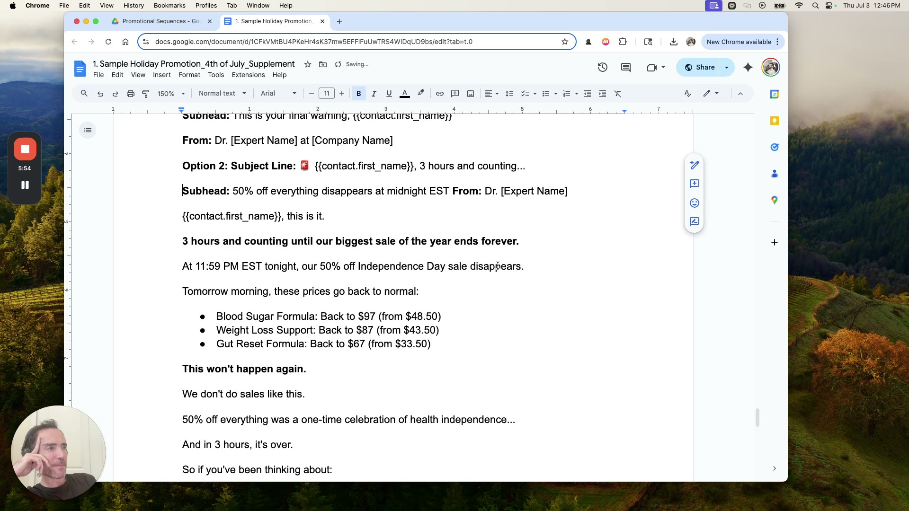

# 15.3 [1.3] Promotional Sequences
> Promo-sale email is "pretty formulaic": a reason for the sale, big savings, lots of excitement, a hard deadline, social proof and escalating last-day sends (three or more), shown as 3-6 email templates for a 72-hour holiday sale, a 6-day Black Friday preview and a 24-hour flash sale, each in a supplement and a coaching-tool version.

## 🤖 Agent use
- **Use when:** planning or writing a holiday sale, Black Friday/Cyber Monday campaign, "any-reason" 24-hour flash sale, or a promo of a tool/upsell product to existing customers or a coaching audience.
- **Inputs → outputs:** the sale reason (holiday/event/surplus stock), discount depth and code, sale duration, products and their normal prices, a real inventory/sell-through status if you will cite it, real testimonials, send-time zone, whether the audience knows the product → a dated email table (send moment, subject options, angle, goal) and full copy with a last-day cadence of at least three emails.
- **Rules:**
  - **DO** state a reason for the sale (holiday, event, surplus inventory), big savings and excitement; "typically a holiday, but it could be like National Cat Day, whatever." [01:07–02:11]
  - **DO** anchor the deadline in the first email, restate it in every email, and make the last day carry 3+ sends ("final day, day three, I like three emails at least"; 12 hours, 6 hours and 3 hours left in the sample). [03:14–05:34]
  - **DO** show the math per SKU (usual price → sale price) and combination/stock-up prices when you sell multiple SKUs; "if you had one SKU, you wouldn't do this." [02:43–03:46]
  - **DO** give a believable "why now / why stock up" reason: e.g. the shelf life lets customers stock up 90-180 days ("Your supplement stays fresh for two plus years"). [02:43]
  - **DO** run a preview/early-bird email 6 days out for a Black Friday campaign and a gratitude email on Thanksgiving ("this is great ... emotional"). [06:55–08:28]
  - **DO** re-explain the product when promoting a tool to a mixed audience: "You're selling them a bit harder in these emails because ... we're assuming they don't know what it is". [11:38–12:08; 13:24]
  - **DON'T** invent scarcity or traction. The samples say "we're down to our final cases", "347% increase in order volume", "customer reorders up 400%", "I never will again". Only cite real inventory and sales figures. (derived; the instructor says to make sure that product statements are accurate: "make sure that's accurate, obviously." [09:34])
  - **DON'T** treat spammy social lines as safe: "I don't know if I love these social lines ... they might think it's spam". [12:42]
  - **IF** the promo is a flash sale **THEN** use the real reason ("we got some extra inventory ... pass the savings on") and say stock is limited only if it is. [09:00–09:34]
  - **IF** you want a different holiday **THEN** tell Claude: "we'll do a Labor Day sequence, five emails, six emails, whatever" (Halloween, Easter). [06:17]
- **See also:** [15.5 Claude project for email sequences](15-05-claude-project-for-writing-email-sequences.md) · [15.1 Abandon cart](15-01-1-1-abandon-cart-sequences.md) · [15.4 Winback and reorder](15-04-1-4-winback-and-reorder-campaigns.md) · [Offer and bundle psychology](../../../../frameworks/offer-and-bundle-psychology.md)

## Key ideas

### 1. Promotions are formulaic and high-yield [00:00–01:40]
- "I'll be honest with you, this is going to be a fairly fast section. Not because they're not important, they can make you a ton of money, but because I really do think they're pretty formulaic." [00:00]
- (instructor claim) "I've done millions of dollars in revenue in promotional campaigns in the last six months and we did like $275,000 in a single day, $273,000 like that recently." [00:00–00:34] No evidence shown; the two numbers differ in the audio and captions.
- The package: six sample docs: supplement (4th of July, Thanksgiving/Black Friday, 24-hour flash sale) and the same three for a coaching-tool product ("Asset Finder Pro"). [00:34–01:40]

### 2. The 72-hour holiday sale: 5 emails [01:07–06:17]
- Skeleton: reason for the sale + excitement ("biggest discount of the year, only 72 hours") + benefits reminder + a deadline + coupon. [01:40–02:11]
- Doc example: "Independence Day represents freedom—and there's no greater freedom than feeling confident in your own body again." Stefan: "It's your chance to save big. Use this code. Look how much cheaper things are going to be ... It ends now. No extensions." [02:11–02:43]
- P.S. reason to act now: "Our manufacturing team says this is the perfect time to stock up for 90 to 180 days." [02:43]
- Social proof email (day 2): a customer stocking up ("I just ordered a six month supply"), then "smart customers are treating this like a health investment ... locking in these savings". [02:43–03:14]
- Final day: "50% off everything ends tonight" at 12 hours; "newly sold out ... six hours left ... once we're out, we're out" (a stock-urgency email); three hours "final warning". [03:46–05:34]
- Cross-sell the hero SKU in P.S. lines: "the blood sugar one, if that's your star product ... most people already bought. Kind of like the upsell concept". [05:34]

### 3. Black Friday / Thanksgiving: 6 emails [06:17–09:00]
- Sequence: early-bird preview (6 days before), momentum/social-proof, Thanksgiving-eve gratitude with urgency, Thanksgiving Day health focus, Black Friday morning (16 hours left), Black Friday evening (4 hours left). [06:55–09:00]
- Content he highlights: "people are fighting over TVs and gadgets. They're outdated in a year. You're investing in supplements ... that can transform how you feel every single day"; "here's the math to show you incredible savings"; "you've got six days. It's easy. It's smart." [06:55–07:25]
- Thanksgiving gratitude email: "not about supplements, not about sales; transformation"; future-pacing "what if this Black Friday purchase becomes a turning point you look back on years from now". [07:25–08:28]
- "You can hit them again later, like four hours left. And again, you can also do another email in between." [08:28–09:00]

### 4. 24-hour flash sale: 3 emails [09:00–10:38]
- Reason: "I wasn't planning on this, but we got some extra inventory. So I'm going to pass the savings on ... we're not holding back inventory for multiple days like our other sales ... When it's gone, it's gone. At midnight tomorrow the deal disappears forever." [09:00–09:34]
- Add-on for stock-up: "if you're waiting for a good deal to try something, running low, wanting to stock up, think about adding a third". Check shipping claims ("order sooner to get shipped faster ... make sure that's accurate"). [09:34]
- Hour 12 "halfway point" with testimonial; last-hour(s) email: a crossroads: "you can either skip this and regret it, or you can do it and be happy". [10:05–10:38]

### 5. Same structure for a tool/coaching product [10:38–14:25]
- Product: "Asset Finder Pro", an automated tool that finds cash-flowing rental-arbitrage properties, normally $497, sale price $248.50 (50% off), code FREEDOM50 through Sunday midnight. [10:38–11:08]
- Based on "a real use case with the CA promo group" (captioned), where an info-product seller promotes a tool to their list: "some of them are aware of this tool, but lots of people aren't ... you can't assume they know". [11:38–12:08]
- Differences: remind them what it does and what it is worth; push harder; "the tool pays for itself". [11:08–12:08]
- The campaign copy "is really not that different" from the supplement version; same Black Friday and flash-sale structure. [13:24–14:25]

## Steps / framework
1. **Pick the sale type and length**: 72-hour holiday (5 emails), 6-day Black Friday with Thanksgiving gratitude (6 emails), or 24-hour flash sale (3 emails).
2. **State the reason and discount** in one sentence and decide the code; set a time-zone-specific deadline.
3. **Email 1 (launch)**: reason, big discount, per-product usual → sale prices, mix-and-match note, code, deadline, "stock up" P.S.
4. **Email 2 (momentum)**: social proof and stock-up behavior; popular combinations; "ends tomorrow".
5. **Final day (3+ emails)**: morning "final day", afternoon scarcity/inventory (only if true), evening "3 hours".
6. **Add a holiday-tone email** where it fits (Thanksgiving gratitude, Independence/freedom).
7. **For tools/courses**: add a "what it does and why it pays for itself" block to every email.
8. **Close with a crossroads**: skip it and regret it, or take action and be happy.

## Examples

### Supplement promos (3 sequences, 3-6 emails each)
Source docs in `3. Promotional Sequences/`. Sender: "Dr. [Expert Name] at [Company Name]". Products: Blood Sugar Support Formula ($97 usual), Advanced Weight Loss Support ($87), Complete Gut Reset Formula ($67). Subject lines verbatim (first option).

**4th of July: "5-Email Sequence: 50% Off Everything"** (code FREEDOM50, 72 hours, ends Sunday July 4 11:59 PM EST)

| # | Send moment | Subject (option 1) | Angle | Goal |
|---|---|---|---|---|
| 1 | July 2, launch day | "🇺🇸 Independence Day Sale: 50% Off Everything" | Reason (freedom/health independence), 3-product list with 50% prices, mix and match, "No extensions. No exceptions." | Launch |
| 2 | July 3, reminder/social proof | "🔥 Customers are stocking up (24 hours left)" | Order volume stats, testimonials, popular bundles, shelf life | Momentum; stock-up |
| 3 | July 4 morning, final day push | "🚨 FINAL DAY: 50% Off Everything Ends Tonight" | Final day, biggest sale of the year ends tonight | Urgency |
| 4 | July 4 afternoon, inventory scarcity | "⚠️ Blood Sugar Formula Nearly Sold Out" | Hero SKU "final cases" | Scarcity |
| 5 | July 4 evening, final hours | "⏰ 3 HOURS LEFT: 50% Off Ends at Midnight" | Prices go back to normal list; "This won't happen again." | Close |

**Thanksgiving / Black Friday: "6-Email Sequence: 60% Off Everything + Free Shipping"** (code BLACKFRIDAY60, 6 days, Mon Nov 20 to Fri Nov 24)

| # | Send moment | Subject (option 1) | Angle | Goal |
|---|---|---|---|---|
| 1 | Mon Nov 20, early-bird launch | "🚨 Black Friday Preview: 60% Off Everything (Insiders Only)" | First access 6 days before everyone else; TV/gadget contrast; per-SKU math | Launch to list |
| 2 | Tue Nov 21, momentum | "📈 Early Bird response is INSANE (4 days left)" | Social proof and "records" | Momentum |
| 3 | Wed Nov 22, gratitude + urgency | "🦃 Grateful for YOU + 3 Days Left at 60% Off" | Thanksgiving reflection, transformation story | Emotional urgency |
| 4 | Thu Nov 23, Thanksgiving Day | "🙏 Thankful for Your Health Journey (2 days left)" | Gentle reminder, gratitude | Soft touch |
| 5 | Fri Nov 24, morning, peak urgency | "🖤 BLACK FRIDAY: Final 16 Hours at 60% Off" | Final 16 hours | Urgency |
| 6 | Fri Nov 24, evening, final push | "⏰ 4 HOURS LEFT: 60% Off Ends at Midnight" | "Final warning" | Close |

**24-hour flash sale: "3-Email Sequence: 40% Off Everything"** (code FLASH40, 24 hours)

| # | Send moment | Subject (option 1) | Angle | Goal |
|---|---|---|---|---|
| 1 | Hour 0, launch | "🚨 FLASH SALE: 40% Off Everything (24 Hours Only)" | "I wasn't planning to do this" + surplus inventory + spontaneous | Launch |
| 2 | Hour 12, midway | "⏰ 12 Hours Left: Flash Sale Ending Tonight" | Update, activity, testimonial | Momentum |
| 3 | Hour 22-23, final push | "🚨 2 HOURS LEFT: Flash Sale Ends at Midnight" | Last call; skip it and regret it | Close |

### Coaching-tool promos (same structure, product: "Asset Finder Pro", $497 → $248.50, 50% off)
Source: docs 4-6. Sender: "Mack at Asset Control Systems" / "Mack Hayes".
- **4th of July, 5 emails** (FREEDOM50): subject 1 "🇺🇸 Independence Day Sale: Break Free From the 9-to-5"; 2 "🔥 Asset Finder Pro flying off the shelves (24 hours left)"; 3 "🚨 FINAL DAY: 50% Off Asset Finder Pro Ends Tonight"; 4 "I'm getting slammed {{contact.first_name}} (6 hours left)"; 5 "⏰ 3 HOURS LEFT: 50% Off Asset Finder Pro".
- **Black Friday, 6 emails** (BLACKFRIDAY50): "🚨 Black Friday Preview: 50% Off Asset Finder Pro (Insiders Only)"; "📈 Early access response is INSANE (4 days left)"; "🦃 Grateful for Asset Builders Like You (3 days left)"; "🙏 Happy Thanksgiving, Asset Builder (2 days left)"; "🖤 BLACK FRIDAY: Final 16 Hours at 50% Off"; "⏰ 4 HOURS LEFT: 50% Off Asset Finder Pro".
- **24-hour flash, 3 emails**: "🚨 FLASH SALE: Asset Finder Pro 50% Off (24 Hours Only)" ("I wasn't planning this, but opportunity knocked..."); "⏰ 12 Hours Left: Asset Finder Pro Flash Sale"; "🚨 2 HOURS LEFT: Asset Finder Pro Flash Sale".
- Stefan's notes: Independence angle "break free from your nine to five" and "Here's what pisses me off: most people are stuck trading time for money" [10:38–11:38]; the flash-sale tie-in "my business partner decided why not give the community an unexpected win" [13:54]; crossroads close "Option 1: Pay $248.50 tonight, start analyzing markets tomorrow. Option 2: Pay $497 ..." (doc 5).

### Verbatim lines to model structurally (not claims)
- "This is our BIGGEST discount of the year... And we've never offered 50% off everything before. Why now? Because your health shouldn't wait for 'someday.'" (doc 1 email 1; the "never before" must be true.)
- "At 11:59 PM EST tonight, our 50% off Independence Day sale disappears. Tomorrow morning, these prices go back to normal: ... This won't happen again." (doc 1 email 5; frame at 05:54)
- "I'll be honest... I wasn't planning to do this. But I just got off a call with our warehouse manager, and we have some excess inventory that needs to move." (doc 3 email 1; only if true)
- "Perfect timing if you've been: waiting for a good deal to try our supplements / running low on your current supply / wanting to stock up but waiting for savings." (doc 3 email 1)

## Structured units

### Promo cadence templates
| Campaign | Emails | Moment sequence | Discount in sample | Source |
|---|---|---|---|---|
| Holiday 72-hour | 5 | Launch → T-24h → final-day AM → final-day PM inventory → T-3h | 50% | doc 1 |
| Black Friday week | 6 | T-6d preview → T-4d → T-3d (gratitude) → Thanksgiving Day → BF AM (16h) → BF PM (4h) | 60% + free shipping (supplement), 50% (tool) | docs 2, 5 |
| 24-hour flash | 3 | Hour 0 → Hour 12 → Hour 22-23 | 40% (supplement), 50% (tool) | docs 3, 6 |

### Compliance and truth checklist for the samples (derived)
| Sample statement | Risk | Replace with |
|---|---|---|
| "347% increase in order volume", "customer reorders up 400%" | Invented stats | A real figure from your store, or leave out |
| "We're down to our final cases ... next production run late July" | False scarcity | Real inventory level only |
| Customer quote "My A1C dropped from 8.2 to 6.4 in 3 months" | Unsubstantiated disease claim; invented testimonial | Real, permissioned testimonial reviewed for health-claim compliance |
| "Deeper than any discount we've ever offered ... than we'll probably go again" | Pricing claim | Only if true |
| "Priority processing for early orders" | Shipping promise | Only if operationally true |

## Prompts / templates (verbatim)
No prompt is read in this lesson. Generation prompts and the Claude project are in [15.5](15-05-claude-project-for-writing-email-sequences.md); the example there is "a 3 Day sale for 4th of July for Opal Beauty ... site wide (all products), and they can save 30%". Stefan's reminder to Claude: "we'll just tell Claude, hey, we'll do a, you know, Labor Day sequence, you know, five emails, six emails, whatever it is." [06:17]

## Screenshots

*At 05:54 (final email): "3 hours and counting until our biggest sale of the year ends forever", the price list that returns at midnight, and "This won't happen again". Structure to copy; the "won't happen again" claim must be true.*

## How to apply
- [ ] Write the sale reason, discount depth, code and deadline (with time zone) before drafting.
- [ ] Choose the cadence (5/6/3 emails) and decide how many sends the final day gets (3+).
- [ ] List SKUs with usual and sale prices; add 2-3 bundle prices only if you have multiple SKUs.
- [ ] Draft the "why stock up" line from a real product fact (shelf life, shipping cost, price rise).
- [ ] Source real social proof; use real inventory/sales statements only.
- [ ] Add a Thanksgiving/holiday tone email if the sale spans the holiday.
- [ ] If promoting a tool/course to a mixed audience, add a "what it does and costs normally" block.
- [ ] Prepare a post-sale "sale ended" email and segment non-buyers for later offers (derived).

## Related
- Same module: [15.1](15-01-1-1-abandon-cart-sequences.md) · [15.2](15-02-1-2-welcome-sequences.md) · [15.4](15-04-1-4-winback-and-reorder-campaigns.md) · [15.5](15-05-claude-project-for-writing-email-sequences.md)
- Funnel: [14.1 Upsells overview](14-01-upsells-overview.md) · [Offer and bundle psychology](../../../../frameworks/offer-and-bundle-psychology.md)

## Sources and limitations
- Transcript: [03-[1.3] Promotional Sequences.txt](<../../../../../raw/stefan-georgi/rmbc-ii/_transcripts/Stefan Georgi - RMBC II (1)/15-EMAIL MARKETING/03-[1.3] Promotional Sequences.txt>) (14:30). Captions: `03-3 Promotional Sequences Overview.srt`.
- Docs: six .docx files in `_extracted/_unzipped/15-EMAIL MARKETING/03-3 Promotional Sequences-20250708T103521Z-1-001/3. Promotional Sequences/` (read; subject lines from the docs; bodies summarized).
- Mishearings: "I don't have a doc for this" refers to the holiday skeleton; "Postmates" aside is irrelevant; "CA promo member" is as captioned (the group name is not expanded). The prices "$4.97" in the transcript is a mishearing of the $497 tool price shown in the doc.
- The spoken walkthrough of the first sequence reads slightly different ("50% off, Independence Day") from the doc's fuller copy; the doc is used for details.
- Only one frame was kept; the lesson is on-screen documents.
- Revenue figures ($275,000/$273,000 in a day) are instructor claims.
