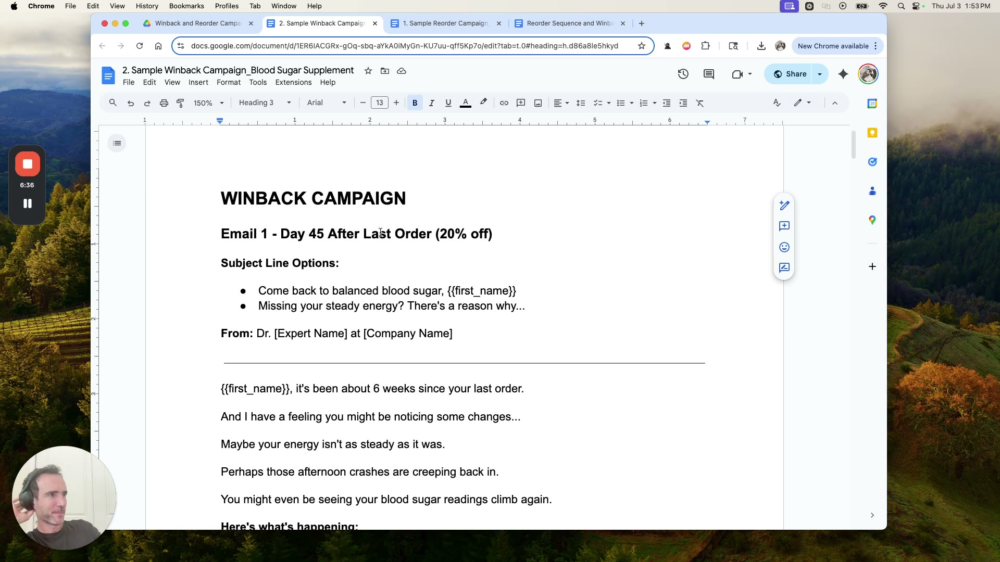

# 15.4 [1.4] Winback and Reorder Campaigns
> Reorder emails tell a customer who is making progress that they will lose it if they stop (sent 7, 3 and 1 day before run-out, then on run-out day with a 20% code), while winback emails reach lapsed buyers 10-15 days after that, naming the cost of stopping and escalating the discount (20% to 40-50%) to keep the customer.

## 🤖 Agent use
- **Use when:** building a replenishment (reorder) flow for a consumable, a winback flow for lapsed buyers, or a cancellation-recovery flow for a subscription/SaaS/biz-op product.
- **Inputs → outputs:** supply length per order (to compute run-out date), product mechanism and what "progress" looks like, real customer results, discount ladder and margin floor, cancel/lapse trigger and days since → a trigger-dated email table (email #, days relative to run-out or last order, subject, angle, goal, discount) and full copy.
- **Rules:**
  - **DO** anchor reorder timing to the estimated run-out date: "you're sending it like seven days before you think they're going to run out", then 3 days, 1 day, and the day they run out. [02:21–05:52]
  - **DO** use progress-and-loss framing: "you're making progress; you'll make even more progress if you keep going; if you don't keep going, you'll lose progress. That's really all we're doing in a reorder sequence." [00:34–01:14]
  - **DO** build the reorder case with a customer who "didn't see her best breakthrough" until later, i.e. "you were just at the point of turning the corner. Keep going." (use only real examples). [04:02–04:30]
  - **DO** give the supplement-winback "noticing something?" message: describe the feeling they may have since they stopped (less energy, afternoon crashes) and tie it to stopping; add "your body remembers" so it is not too late. [07:28–08:58]
  - **DO** use "month two is when most breakthroughs happen" for one-month buyers and adapt the month number to your product. [08:58–10:01]
  - **DO** lean on discounts for winbacks, starting around 20% and rising to 40-50%: "I'm lean[ing] for a discount for winbacks ... I might even be more aggressive ... Because otherwise, I don't want to lose them as a customer ... the longer you keep them buying, the more likely they already stay long-term." [08:58–10:32]
  - **DO** frame an SaaS/biz-op winback around identity and mindset ("don't slip back into the manual research trap", "don't become another what-if story") and add social proof from active users. [11:05–13:39]
  - **DON'T** keep the awkward invented jargon from the sample ("cellular glucose transport formula", "glucose doors slam shut"): "the name is really bothering me. So I'll change it." Use your real mechanism language. [02:21–03:21]
  - **DON'T** over-scare. He flags the day-1 reorder email "is a little bit aggressive scaring them". [04:30–05:05]
  - **DON'T** reuse the sample's medical outcome claims (A1C, fasting glucose figures, "come off insulin"). They are invented example copy and would be unsubstantiated disease claims. (derived)
  - **IF** the lapsed customer bought a one-month supply **THEN** use the "you stopped right before month 2" angle. [09:29]
  - **IF** margins are thin **THEN** step the winback discount more gradually; the principle is that collecting less is better than losing the customer. (derived from 15.1 [v2 12:52–13:23])
- **See also:** [15.2 Welcome sequences](15-02-1-2-welcome-sequences.md) · [15.1 Abandon cart](15-01-1-1-abandon-cart-sequences.md) · [15.5 Claude project for email sequences](15-05-claude-project-for-writing-email-sequences.md) · [03.1 Unique mechanisms overview](03-01-unique-mechanisms-overview.md) · [Risk reduction hooks](../../../../concepts/risk-reduction-hooks.md)

## Key ideas

### 1. Purpose: one-time buyer becomes repeat buyer [00:00–01:14]
- Three sample docs: a supplement reorder, a supplement winback, and a biz-op subscription winback. "Someone's a one-time buyer, we want them to become a multiple-time buyer." [00:00–00:34]
- "These were written by Claude, based off some other reorder sequences too." The hypothetical product is the blood-sugar supplement from the course's mechanism lessons ([03.1](03-01-unique-mechanisms-overview.md)); the odd phrasing is because Claude was fed that brief. [01:14–01:50]

### 2. Reorder sequence: four emails around run-out [01:14–05:52]
- Day 7 before run-out: "You're doing something that most people ... never do: you're actually taking consistent action." Reaffirms identity ("consistent person ... that's smart"), explains what is changing in their body, announces that they are probably a week from running out, gives a doctor-voice reason ("after 18 years of treating diabetic patients, I've learned that consistency is everything"), reorder steps. [01:14–03:21]
- Day 3 before: "Don't let your progress plateau": "You're probably down to your last few days"; "the biggest mistake I see patients make isn't starting wrong, it's stopping too soon"; the analogy "like stopping physical therapy just when your muscles are getting stronger"; "patients reorder when they have about three days left, that way their new supply arrives right when they need it". [03:21–04:30]
- Day 1 before: "Avoid a blood sugar setback": spells out what happens if they do not reorder immediately; a pattern of "life gets busy, they forget to reorder, suddenly they're back to the way they started, frustrated". He calls it "a little bit aggressive ... scaring them". [04:30–05:05]
- Day of run-out: "Last chance ... 20% off", expires at midnight: "you're about to lose the support, you don't need to, save 20%". [05:05–05:52]
- "Pretty simple" and "effective messaging" because "you were just at the point of turning the corner". [04:02–04:30]

### 3. Winback (supplement): four emails, days 45-52 [05:52–10:32]
- Timing: about 45 days after the last order, i.e. 10-15 days after the reorder window (day 30-35). [05:52–06:27]
- Email 1 (day 45, 20%): "It's been about six weeks since your last order. I have a feeling you might be noticing some changes. Maybe your energy isn't as steady... Perhaps afternoon crashes are creeping back in." + loss story + "You can restore ... faster the second time around because your body remembers". [06:27–07:28]
- He remembers this angle "all the way back in the day of my first supplement company": someone may not notice a benefit until they stop; then you tell them "you stopped taking the supplement about two weeks ago. It seems like maybe the one big change you made ... So if you want to feel good again, just get back on." [07:28–08:26]
- Email 2 (day 47, 20%): "Month 2 is when most breakthroughs happen": "you were about to have that breakthrough ... around the corner and you stopped." Works for one-month buyers; adjust the month. [08:58–10:01]
- Emails 3-4 (days 50 and 52, 40%): "I'm authorizing 40% off ... I see what happens when people miss it, don't want it to be you"; final: "your discount expires" (subjects "40% OFF because your breakthrough can't wait", "Final 40% discount expires at midnight"). [10:01–10:32]

### 4. Winback (subscription / biz-op): four emails, days 14-21 after cancellation [10:32–14:38]
- Product: the "Asset Finder Pro" tool (from [15.3](15-03-1-3-promotional-sequences.md)), repurposed as a $97/month subscription. [10:32–11:05]
- Day 14 (25% off next 3 months, $72.75/mo): "I'm worried you're falling back into old patterns": you are probably back on Zillow and spreadsheets; "$97 a month feels like a lot"; "you're slipping back into income-gap thinking"; compare the time cost: manual research 20 hours vs tool 2 hours; one missed property could cost $50,000 of potential cash flow. [11:05–12:33]
- His read: "That's a really nice email because it's like, hey, I'm looking out for you ... Are you falling back into your own mindset? ... I need to get back on this. That's good. It's a strong email." [12:33]
- Day 16 and 19: "Don't let the system pull you back in"; "I don't want you to become another 'what if' story": calling out lack of confidence ("oh I give up on everything ... don't be that person"), more active-user social proof, still 25%. [13:06–13:39]
- Day 21 (50% off for 3 months, $48.50/mo + a bonus): "My final intervention"; "Plus I'm throwing in this random bonus"; "It's less than dinner out, a tank of gas, half a cable bill"; "After tomorrow it disappears." [13:39–14:38]
- Reminder: bonuses and "less than X" reframes dimensionalize price. [14:07]

## Steps / framework
1. **Compute the run-out date**: order date + days of supply (adjust for shipping time). (derived)
2. **Reorder flow**: send at −7, −3, −1 days and on day 0; discount only on the last email (20% in sample).
3. **Winback flow**: trigger ~10-15 days after the reorder window ends without an order (e.g. day 45 after last order for a 30-day supply).
4. **Pick the message**: noticing-since-you-stopped (feeling worse), month-N breakthrough (about to turn the corner), or identity/old-habits (subscription).
5. **Discount ladder**: 20% first two emails, 40% next two (supplement); 25% ×3 then 50% + bonus (subscription).
6. **Final email**: explicit expiry; "your discount expires" and a real deadline.
7. **Review claims** against your substantiation file; replace disease and income examples.

## Examples

### Reorder campaign (blood-sugar supplement, 4 emails)
Source: `Copy of 1. Sample Reorder Campaign_Blood Sugar Supplement`. Sender: "Dr. [Expert Name] at [Company Name]". Support line (placeholder) in each P.S.

| # | Send timing | Subject (verbatim) | Angle | Goal / offer |
|---|---|---|---|---|
| 1 | Day 7 before run-out | "Time for your reorder, {{first_name}}" / "Keep your blood sugar progress going, {{first_name}}" | Consistency praise, mechanism-in-progress, 3 reorder steps, example customer | Reorder early, no gap |
| 2 | Day 3 before run-out | "Don't let your progress plateau, {{first_name}}" / "Your cellular glucose doors need continuous support" | "Stopping too soon" + physical-therapy analogy + stories of breakthroughs arriving later | Reorder now |
| 3 | Day 1 before run-out | "URGENT: Avoid a blood sugar setback" / "⚠️ Don't let your glucose doors slam shut, {{first_name}}" | Consequence of stopping; breakdown timeline; phone ordering available | Immediate reorder |
| 4 | Day of run-out | "Your last chance to maintain steady blood sugar + 20% OFF" / "⚠️ 20% OFF your reorder (expires tonight)" | "You've probably taken your last dose ... 20% for 12 hours (TRANSPORT20)" | Last-chance reorder |

Verbatim anchor lines:
- "You're doing something that most people with blood sugar concerns never do, {{first_name}}: You're actually taking consistent action."
- "The biggest mistake I see patients make isn't starting wrong—it's stopping too soon."
- "It's like stopping physical therapy just when your muscles are getting stronger."
- "I don't want cost to be a barrier to your continued health. So for the next 12 hours only, I'm offering you 20% OFF."

### Winback campaign (blood-sugar supplement, 4 emails)
Source: `Copy of 2. Sample Winback Campaign_Blood Sugar Supplement`.

| # | Send timing | Subject (verbatim) | Angle | Offer |
|---|---|---|---|---|
| 1 | Day 45 after last order | "Come back to balanced blood sugar, {{first_name}}" / "Missing your steady energy? There's a reason why..." | "You might be noticing changes"; body remembers; story of someone who stopped | 20% (RESTART20) |
| 2 | Day 47 | "Month 2 is when most breakthroughs happen" / "You may have stopped right before your biggest breakthrough" | You stopped right before month 2 | 20% still active |
| 3 | Day 50 | "We're practically giving it away..." / "40% OFF because your breakthrough can't wait" | Discount raised ("I just authorized"); cost of missing the breakthrough month | 40% (BREAKTHROUGH40) |
| 4 | Day 52 | "Final 40% discount expires at midnight" / "Your breakthrough month expires in 12 hours" | Last chance | 40%, 12 hours |

### Subscription winback (Airbnb-arbitrage SaaS, "Asset Finder Pro", 4 emails)
Source: `Copy of 3. Sample Winback Series_BizOpp Subscription`. Sender: "Mack at Asset Control Systems". Price: $97/month.

| # | Send timing | Subject (verbatim) | Angle | Offer |
|---|---|---|---|---|
| 1 | Day 14 after cancellation | "I'm worried you're falling back into old patterns, {{first_name}}" / "Don't slip back into the manual research trap, {{first_name}}" | Concern for them; the old manual process; time-cost math | 25% off next 3 months ($72.75/mo, COMEBACK25) |
| 2 | Day 16 | "Don't let the system pull you back in, {{first_name}}" / "The manual research trap is designed to keep you broke" | Mindset and active-user wins | 25% still active |
| 3 | Day 19 | "I don't want you to become another 'what if' story" / "Three weeks of manual research = zero properties secured" | Regret and identity; "what if I hadn't tried to save $97/month?" | 25% expires soon |
| 4 | Day 21 | "Last chance to save you from the manual research trap" / "Final intervention: 50% off + bonuses to get you back on track" | "My final intervention"; "less than dinner out" | 50% off 3 months ($48.50/mo, LASTCHANCE50) + a bonus; expires midnight tomorrow |

## Structured units

### Winback and reorder message patterns
| Pattern | When | Core line (verbatim or near) | Source |
|---|---|---|---|
| Progress-loss | Reorder, before run-out | "You're making progress ... if you don't keep going, you'll lose progress." | [00:34–01:14] |
| Turning-the-corner | Reorder / winback | "You were just around the corner and you stopped" | [04:02; 09:29] |
| Noticing-since-stopping | Winback day 45 | "You stopped about two weeks ago ... maybe that's why" | [07:28–08:26] |
| Body remembers | Winback | "Your body remembers ... you can restore it faster the second time around" | [06:27–07:28] |
| Old-habits warning | Subscription winback | "I'm worried you're falling back into old patterns" | [11:05–12:33] |
| What-if regret | Subscription winback | "Don't become another what-if story" | [13:06–13:39] |
| Price dimensionalizing | Final offer | "It's less than dinner out, tank of gas, half a cable bill" | [14:07] |

## Prompts / templates (verbatim)
No prompt is read in this lesson (see [15.5](15-05-claude-project-for-writing-email-sequences.md) for the project that generates these). Template (derived from the samples):
```
REORDER (anchor = run-out date)
-7d: praise consistency + what's happening now + "you're about a week from running out" + 3 reorder steps
-3d: "stopping too soon" + analogy + stories of delayed breakthroughs + reorder steps
-1d: consequence of a gap (be honest, not scary) + phone ordering
 0d: "last dose" + [x]% for 12 hours + midnight deadline

WINBACK (anchor = last order or cancellation)
 +45d / +14d: concern + what they may be noticing/doing + restart discount
 +47d / +16d: breakthrough month or system-pulling-you-back angle + discount still active
 +50d / +19d: higher discount ("I just authorized") + cost of missing it
 +52d / +21d: final discount + bonus + hard expiry
```

## Screenshots

*The winback doc at 06:36: the first email 45 days after the last order, 20% off; "it's been about 6 weeks since your last order. And I have a feeling you might be noticing some changes". Copy the timing and framing.*

## How to apply
- [ ] Add a "supply days" field and compute the run-out date per order.
- [ ] Build the four-email reorder flow (−7, −3, −1, 0); put the incentive only in the last.
- [ ] Define lapsed = 10-15 days after the reorder window; build the four-email winback.
- [ ] Choose the winback message by product: noticing-since-stopping (consumables), month-N breakthrough (programs), old habits (software/info).
- [ ] Set your discount floor by margin; use unique codes per step; keep a real expiry.
- [ ] Add a subscription-cancellation winback if you sell a subscription; offer a discount on the next 3 months, not just one.
- [ ] Remove any medical/income outcome claims you cannot substantiate.
- [ ] Measure: reorder rate by email, winback recovery rate, margin per recovered order, and customer LTV with vs without the flow.

## Related
- Same module: [15.1](15-01-1-1-abandon-cart-sequences.md) · [15.2](15-02-1-2-welcome-sequences.md) (restock and anniversary emails) · [15.3](15-03-1-3-promotional-sequences.md) · [15.5](15-05-claude-project-for-writing-email-sequences.md)
- Mechanism context: [03.1 Unique mechanisms overview](03-01-unique-mechanisms-overview.md) · [05.4 Blood sugar supplement example](05-04-blood-sugar-supplement-example.md)
- Shared KB: [Risk reduction hooks](../../../../concepts/risk-reduction-hooks.md)

## Sources and limitations
- Transcript: [04-[1.4] Winback and Reorder Campaigns.txt](<../../../../../raw/stefan-georgi/rmbc-ii/_transcripts/Stefan Georgi - RMBC II (1)/15-EMAIL MARKETING/04-[1.4] Winback and Reorder Campaigns.txt>) (14:49). Captions: `04-4 Winback and Reorder Sequences Overview.srt`.
- Docs: three .docx files in `_extracted/_unzipped/15-EMAIL MARKETING/04-4 Winback and Reorder Campaigns-20250708T103607Z-1-001/4. Winback and Reorder Campaigns/` (subject lines and discounts from the docs; bodies summarized).
- Transcript fixes: "GLUT4"/"glut four" (Whisper "glut4 transporters" is correct), "cellular glucose transport" jargon is as in the doc; "Margaret" is a placeholder customer; "authorizing 40%" in the audio corresponds to "I just authorized a 40% discount" in the doc.
- Stefan says he will "create a document" of the commonalities between reorder sequences; no such document is in the course files.
- The winback timing "10 to 15 days later" than the reorder email is his spoken framing; the doc simply says "Day 45 After Last Order". The doc uses "Day 7 Before Run-Out" for reorder email 1.
- All outcome claims (A1C values, "come off insulin", property income figures, "85% occupancy") are invented example copy.
