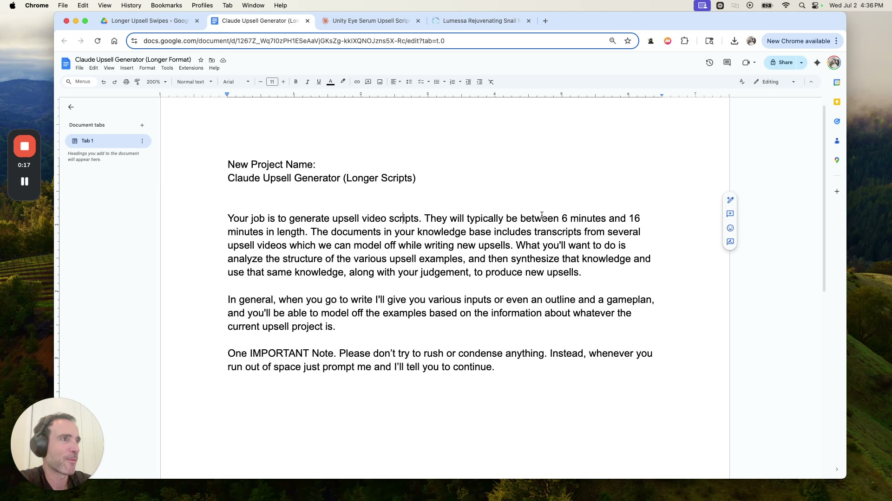
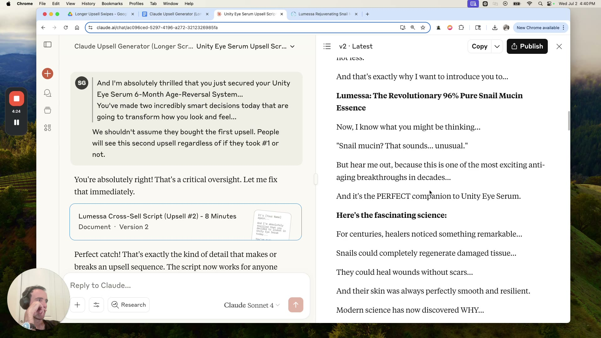

# 15.5 Claude Project for Writing Email Sequences
> A Claude Project loaded with the module's 15 sample sequences (plus one SMS sample) as knowledge-base files and a short instruction block turns "write a 7-day abandon cart for X" into outline, feedback and full copy; the lesson shows it on an eye serum (abandon cart, welcome series, 4th of July sale) and a financial newsletter, with the instructor acting as "strategist" and checking logic and facts.

## 🤖 Agent use
- **Use when:** you need a full email sequence (abandon cart, welcome, promo/holiday, reorder, winback) for an e-com, info or coaching offer; you want to set up a Claude Project (or equivalent agent with a retrieval library) that models new sequences on proven ones.
- **Inputs → outputs:** (a) project setup: the instruction block + the 15 sample sequences as project knowledge; (b) per request: sequence type, length, discount ladder/timing, product URL or brief, tone guardrails → an outline for approval → full copy with 2-3 subject options per email.
- **Rules:**
  - **DO** create a separate Claude Project for emails: name "Claude Email Sequence Generator", paste the instruction block (below), upload the sample sequences as knowledge files. [SRT 00:00–01:36; doc 1]
  - **DO** ask for an **outline first**, review it, give feedback, **then** have it written: "Can you please outline this sequence for me and then after I approve I'll have you write it." [SRT 02:10–02:43; doc 2]
  - **DO** specify the discount ladder and email numbers in the request ("20% off discount on Day 3 ... 40% off on Days 5-7"; "In email #3 introduce [product] and give a 20% off code"). [doc 2]
  - **DO** put tone rules in feedback: "empathetic and supportive ... call out pain points ... 'maybe you've experienced this' or 'some of our customers share that ___'" rather than assuming things about the prospect. [doc 2; SRT 04:01–04:32]
  - **DO** give product URLs or a brief; the project fetches them. "Because it's a Claude project, I don't need to share the [main product] link again." [SRT 08:21]
  - **DO** act as strategist/commander: "you're more like a strategist than actually writing the copy ... you just tell Claude, hey, I want this every single day." [SRT 12:30–13:01]
  - **DO** audit the output for logic, timing, pricing and facts: "it's literally just being consistent and logical"; "You need to update pricing. Pricing is off on this." [SRT 14:40; 20:16]
  - **DON'T** ship AI copy unread: "I see a copy that has used AI and then didn't read it over and use common sense ... then you're just being lazy. It's doing 99% of the work for you." [10:44 in the transcript of the mis-filed video; see below]
  - **DON'T** let outputs assume things: in the upsell demo he corrects "we shouldn't assume they bought the first upsell ... they'll see this second upsell regardless". [02:38]
  - **IF** the project's formatting or emojis annoy you **THEN** prompt for different formatting ("Claude is really being so bizarre with the formatting and also the emojis"). [SRT 19:46]
  - **IF** you do not have a website **THEN** paste a brief or sales letter into the request instead of a URL (he does this for a financial newsletter). [SRT 22:00–23:12]
  - **DON'T** reuse unverified details Claude produces for a real brand (testimonials, ages, guarantee length, "I've never offered 40% before", Big Pharma suppression claims). Verify against the brand's real facts. (derived)
- **See also:** [15.1 Abandon cart](15-01-1-1-abandon-cart-sequences.md) · [15.2 Welcome](15-02-1-2-welcome-sequences.md) · [15.3 Promotional](15-03-1-3-promotional-sequences.md) · [15.4 Winback and reorder](15-04-1-4-winback-and-reorder-campaigns.md) · [14.3 Claude projects for upsells](14-03-claude-projects-for-upsells.md) · [06.1 Claude VSL projects setup](06-01-claude-vsl-projects-setup-overview.md) · [03.5 Claude project for unique mechanisms](03-05-creating-a-claude-project-for-unique-mechanisms.md)

## Key ideas

### 0. Source warning: the recorded video in this slot is the upsell project
- The MEGA file `05-[2] Claude Project for Writing Email Sequences.mp4` (11:24) contains Stefan's **Claude Upsell Generator (Longer Scripts)** demo, not the email project. He opens: "I was recording this and I paused it and didn't unpause it ... we're going to create a Claude project ... for upsells." [00:00]
- Screen text confirms it: the first frame shows the doc "Claude Upsell Generator (Longer Format)"; the Claude tab titles are "Unity Eye Serum Upsell Script" and "Lumessa Rejuvenating Snail ...". See Screenshots.
- The platform's caption file `05-1 Claude Project Setup and Example Outputs.srt` (about 25:57) is the real email-project walkthrough. This page cites it as `[SRT mm:ss]`. Our transcript of the MEGA file is cited as plain `[mm:ss]` and used only for the upsell demo and the general AI-use advice, which also appears in [14.3](14-03-claude-projects-for-upsells.md).
- The email project's instructions, example prompts, conversation histories and outputs are in the zip documents (cited by file name). Cross-check the SRT against the docs: the doc text matches what is read aloud.

### 1. Setting up the email project [SRT 00:00–01:36]
- Create a new Claude Project and paste the instructions (doc 1, verbatim below): "Your job is to create various email sequences for different products and services that will range from ecom products to coaching or information products." [SRT 00:00–00:30]
- Knowledge base: "several documents ... abandoned cart emails, welcome series for new customers, special sales and promotion series, flash sales, reorder series ... win back series ... basically everything we went through in the previous part." [SRT 00:30–01:05]
- Sequences differ in style: "some focus more heavily on discounting, while some focus more on emotion." The request names the type; the project "select[s] from relevant examples, synthesizing across several of them when necessary". [SRT 01:05–01:36]
- The 15 sample sequences are provided as PDFs (folder `9. Email Sequences PDFs for Claude Projects`): the same sequences summarized in [15.1](15-01-1-1-abandon-cart-sequences.md), [15.2](15-02-1-2-welcome-sequences.md), [15.3](15-03-1-3-promotional-sequences.md) and [15.4](15-04-1-4-winback-and-reorder-campaigns.md), plus one SMS sample (see Examples).

### 2. Demo A: 7-day abandon cart for the eye serum [SRT 01:36–07:20]
- Prompt (doc 2 prompt 1) uses the product page URL, a 7-day length, 20% on day 3 and 40% on days 5-7, and asks for an outline first. [SRT 01:36–02:43]
- He starts over once because the link was missing, then adds a single tone note for email 1 (empathetic, supportive, avoid assuming). [SRT 03:20–05:36]
- His read of the output: email 1 reconnects with "maybe you've tried countless eye creams ... some of our customers say ..." then science, testimonials, guarantee. Email 2 educates ("why your eyes might age faster ... here's why ours works better"); email 3 introduces 20%; email 4 handles objections; email 5 raises the discount and urgency. "It's still right, it's pretty cool." [SRT 05:36–06:47]
- Output saved as a Google Doc (doc 3 is the exported copy).

### 3. Demo B: 10-email welcome series with cross-sells [SRT 07:20–16:15]
- Request: 10 emails, introduce a second product in email 3 with a 20% code, a third product in email 7, and a store-wide 20% code in email 10; ask for an outline first. [SRT 07:20–08:52]
- Review of the outline: the shipping timing was "a little too fast", so he asks for a rewording ("will be shipping soon if it hasn't already"); renames a code; notices "a one-week check-in on day 5 doesn't make sense, it's too early", moves it to email 5 (day 10) and asks for four new options for a day-5 email; he picks Option D (ingredient spotlight). [SRT 09:23–12:30; doc 4]
- Final copy reviewed for logic: the "perfect partner" email was set for day 3 "I don't know if they would have it yet, so I would modify this copy". [SRT 14:09]
- His own caution: the project "is not weird ... subtle", but "the heart emoji thing is weird". [SRT 13:34]

### 4. Demo C: 3-day 4th of July sale [SRT 16:15–21:25]
- Request: "a 3 Day sale for 4th of July for Opal Beauty ... site wide (all products) ... save 30%." Claude's first outline had 3 emails; his feedback: "let's do 3 emails on Day 3" (the last day) and "don't forget about our other two SKUs" (two product links). Claude fetched the products and produced a 5-email sequence (launch, momentum, three final-day sends at 8-9 AM, 2-3 PM, 8-9 PM). [SRT 16:15–19:46; docs 6, 7]
- Fix after writing: "You need to update pricing. Pricing is off on this." [SRT 20:16]

### 5. Demo D: financial newsletter (brief instead of a site) [SRT 22:00–25:57]
- He wanted a brief he had not yet used ("I don't want to basically skew the data because it's already got a blood sugar thing in"), chose a financial newsletter brief and a sales letter. [SRT 22:00–23:12]
- Prompt: "This is the brief for a financial newsletter product. Please review and then come up with a 7 email abandon cart sequence outline. Once approved I'll have you write the sequence." Feedback: "Let's offer them an extra 25% off starting on Day 5." [doc 2; SRT 23:12–24:57]
- Output matches the brief's "conspiratorial" style ("they're trying to bury this ... cure revolution"). "This is going to match the style of the brief, right?" [SRT 24:57–25:27]
- Compliance note (derived): the sample contains anti-pharma suppression claims, named investor "facts" (e.g. a $50 million investment by a named person), FDA fast-track counts, and a personal tragedy story; all are invented and would need removal/substantiation for any real use.

### 6. The upsell Claude Project (the content of the video file) [00:00–11:17]
- Project: "generate upsell video scripts. They'll typically be between six and 16 minutes in length." Knowledge: transcripts of upsell videos; the project "analyze[s] the structure of the various upsell examples and then synthesize[s] that knowledge". [00:00]
- He added five swipes, as heard: an Emma upsell, a "sign"(sic) upsell, a gut-supplement upsell that he had Gemini generate for a new niche from a client's strong original, a "Sabre Subi"(sic) info-product upsell ("really good ... great format"), and "stem cell restore" (a cross-sell; he notes the copy is "kind of aggressive, forgive me, wrote it a long time ago before I had my more ethical come to Jesus"). [00:29–00:59]
- Demo 1: "do a 10-minute upsell script for someone who just bought Unity Eye Serum, selling them more of the same," with the product link. [00:59–01:31]
- Demo 2: a cross-sell script for a snail-mucin essence "as upsell #2" with the correction "we shouldn't assume they bought the first upsell ... we'll see this second upsell regardless". [02:01–03:09]
- His edit notes: "I would edit some of this copy"; "I don't know if I'd be so negative. For direct response it kind of makes sense"; "You should have some judgment by this point of RMBC2 to be able to modify it." [03:09–04:11]
- Demo 3: Airbnb-arbitrage brief; a first upsell after a $27 info product ("27 ways to generate extra income") that sells a book-a-call; 10-15 minute VSL script. "What I should do is have it do an outline of the VSL first." Instruct it that "instead of talking about the price, you should really be selling them on booking a call." [05:12–09:07]
- Closing advice: "use your brain and common sense ... In fact, it's amazing. When people say AI makes you dumb ... it should make you smarter because it frees you to actually think." [09:49–10:44]
- Setup text of the upsell project is verbatim in the first frame (reproduced below). Details belong to [14.3](14-03-claude-projects-for-upsells.md).

## Steps / framework
1. **Create the project**: new Claude Project "Claude Email Sequence Generator"; paste the instruction block (below).
2. **Load knowledge**: the 15 sample sequences (as PDFs/docs) + any of your own proven sequences + the SMS sample if you want text-message copy.
3. **Brief each request** with: sequence type, number of emails, which email gets which discount, product URL(s) or a pasted brief, brand/tone rules, and "outline first".
4. **Review the outline**: check timing, discount placement, product mentions, anything illogical (e.g. "one-week check-in" on day 5).
5. **Give feedback in the same chat** (rename codes, move emails, add emails, add SKUs).
6. **Approve and write**; if cut off, ask it to continue.
7. **Audit the copy**: pricing, shipping language, claims, testimonials, emojis and formatting; edit or regenerate sections.
8. **Save** the output (Google Doc) and, if it performs, add it to the project as a new example.

## Examples
The outputs below were generated by the project for an eye serum (brand "Opal Beauty", products from the instructor's own store pages) and a hypothetical financial newsletter. Subject lines are verbatim (first option).

### Output 1: Unity Eye Revive Serum, 7-Day Abandon Cart (doc 3)
Prompt: 7 days; 20% on day 3 (email 3), 40% from email 5. Sender "Sarah at Opal Beauty". Footer: "Discount Progression: 20% off (Days 2-4) → 40% off (Days 4-6)"; codes SAVE20 / SAVE40.

| # | Timing | Subject (option 1) | Angle | Goal |
|---|---|---|---|---|
| 1 | Day 0 | "Your Unity Eye Serum is waiting, {{contact.first_name}}" | Reconnect and "mirror moment"; empathetic, "some of our customers share"; DEJ mechanism; testimonials; 180-day guarantee | Return to cart |
| 2 | Day 1 | "Why your eyes might age faster (the science)" | Science and credibility; why other eye creams only work on the surface | Belief |
| 3 | Day 2 | "20% off because your confidence matters" | First discount (SAVE20) | Price |
| 4 | Day 3 | "\"But what if it doesn't work for my skin?\"" | Objection handling | Risk |
| 5 | Day 4 | "40% off Unity Eye Serum (I've never offered this much)" | Increased discount (SAVE40) + urgency | Price/urgency |
| 6 | Day 5 | "The woman in the mirror 6 months from now" | Emotional future self | Desire |
| 7 | Day 6 | "Final hours: 40% off Unity Eye Serum" | Midnight deadline | Close |

### Output 2: Unity Eye Revive Serum, 10-Email Welcome Sequence (doc 5; 30 days)
Strategy line: "Welcome & education → product complementarity → relationship building → retention".

| # | Timing | Subject (option 1) | Angle | Offer |
|---|---|---|---|---|
| 1 | Day 0 | "Welcome to Opal Beauty, {{first_name}}! 🤍" | Welcome, gratitude, timeline | none |
| 2 | Day 1 | "Your Unity Eye Serum is on its way! (First use guide)" | Unboxing and application; "shipping soon if it hasn't already" | none |
| 3 | Day 3 | "The perfect partner for your Unity Eye Serum" | Introduce second product (cream) | RICH20, 20% |
| 4 | Day 5 | "Meet the powerhouse peptides transforming your eyes" | Ingredient spotlight (picked Option D) | none |
| 5 | Day 10 | "How's your first week going with Unity?" | One-week check-in | none |
| 6 | Day 14 | "What's happening beneath your skin right now" | Science of skin renewal | none |
| 7 | Day 18 | "Meet Sarah: 6 months with Unity Eye Serum" | Customer success story | none |
| 8 | Day 21 | "The ancient secret for modern skin repair" | Introduce third product (whipped tallow) | UNITY20, 20% |
| 9 | Day 25 | "Three weeks in: the changes you might be noticing" | Milestone | none |
| 10 | Day 30 | "Happy one-month Unity-versary! 🎉" | Celebration + store-wide code | MEMBER20, 20% (valid 7 days) |

### Output 3: Opal Beauty 4th of July Sale, 5 emails (doc 7; code FREEDOM30, 30% site-wide)
| # | Timing | Subject (option 1) | Angle |
|---|---|---|---|
| 1 | July 2 (launch) | "🇺🇸 Independence Day Sale: 30% Off Everything" | Freedom theme, all 5 products at sale prices |
| 2 | July 3 (momentum) | "24 hours left: Your independence from skin concerns" | Social proof, popular combinations |
| 3A | July 4, 8-9 AM | "🚨 FINAL DAY: 30% Off Ends Tonight" | Final day, 16 hours |
| 3B | July 4, 2-3 PM | "Independence Day Special: 10 hours left" | Gift yourself |
| 3C | July 4, 8-9 PM | "⏰ 3 HOURS LEFT: Freedom Sale Ends at Midnight" | Final hours |
Footer: "Total Emails: 5 (1 launch + 1 momentum + 3 final day) | Discount: 30% off site-wide with code FREEDOM30".

### Output 4: Financial newsletter ("Bio-Genetic Profits"), 7-Email Abandon Cart (doc 8)
Prompt: brief + 7-email outline; extra 25% from email 5. Footer: "Discount Introduction: Day 5 (additional 25% off). Final Price: $36.75 (down from $299 retail, $49 charter)". Subject lines verbatim (option 1):
1 "They're trying to bury this breakthrough, {{first_name}}" (immediately) · 2 "While you hesitated, billionaires doubled down" (+6h) · 3 "Your $49 charter membership expires soon" (+1d) · 4 "Why I left Big Pharma (and risked everything)" (+1d) · 5 "I'm making this even easier for you (25% off)" (+1d) · 6 "24 hours left at $36.75 (then it's gone forever)" (+1d) · 7 "Presentation closing in 4 hours ($36.75 expires with it)" (+6-8h).
Flag: the sample's claims about Big Pharma suppressing cures, investor activity and "royalty checks" are invented; the offer is a financial-newsletter promotion with income/investment implications (FTC/SEC-type risk). Copy the structure only.

### SMS sample (knowledge file, not in the video)
`[GetThin] SMS Promo Copy For Refills.pdf` holds three-send SMS refill promos for two prescription weight-loss drugs (sends at specific US times, ALL-CAPS urgency like "FOR THE FIRST TIME EVER ... may NEVER happen again", a code, an expiry, and a call-now line; separate versions for recent buyers vs active patients). It is a real operator's copy rather than a hypothetical, and is not explained in any video. It carries heavy regulatory risk for prescription-product advertising and "never again" scarcity claims; treat it as a cadence/format reference only (send 1 launch, send 2 evening reminder, send 3 final hours).

## Structured units

### Request template components (derived from doc 2)
| Component | Example from the lesson | Why it matters |
|---|---|---|
| Sequence type and length | "a 7 day abandon cart sequence", "10 emails", "3 Day sale" | Chooses the right example set |
| Discount placement | "20% off on Day 3, 40% on Days 5-7"; "extra 25% off starting on Day 5" | Controls the ladder |
| Product/cross-sell slots | "In email #3 introduce [product] ... 20% off code" | Defines the cross-sell map |
| Source material | product URL or pasted brief / sales letter | Grounds claims |
| Approval gate | "provide an outline ... once approved I'll have you write it" | Catches logic errors early |
| Tone guardrails | "empathetic and supportive ... 'some of our customers share ___'" | Avoids presumptuous copy |

### Review checklist applied to Claude's outputs (from the walkthroughs)
| Check | Instructor example |
|---|---|
| Timing logic | One-week check-in cannot be day 5 [SRT 10:53] |
| Content logic | "Perfect partner" email on day 3 may be before delivery [SRT 14:09] |
| Pricing accuracy | "Pricing is off on this" [SRT 20:16] |
| Products complete | Add the missing two SKUs to the sale [SRT 18:25] |
| Formatting and emojis | Odd heart emojis and formatting [SRT 13:34; 19:46] |
| Assumptions about the buyer | "We shouldn't assume they bought the first upsell" [02:38] |

## Prompts / templates (verbatim)

### Project instructions: "Claude Email Sequence Generator" (doc 1, in full)
```
New Project Name:
Claude Email Sequence Generator

Your job is to create various email sequences for different products and services. These will range from eCom products, to coaching or information products.

You have several documents in your knowledge base that should provide all of the examples you need to write great sequences. You’ll see that there are several examples for:

Abandoned Cart Series

Welcome Email Series (For New Customers)

Special Sales and Promotions Series (Holiday Sales, Flash Sales, etc)

Reorder Series (For Getting A Customer to Order More of a Product Prior to Running Out)

Winback Series (For Getting a Previous Customer to Once Again Become a Customer).

You’ll also notice that some of the sequences focus more heavily on discounting, while some focus more on emotion.

What will happen is that I will give you instructions about the kind of email sequence I’m looking to have written, as well as the product or service or brand we are writing the sequence for. You’ll then select from relevant examples, synthesizing across several of them when necessary, to create a new sequence.
```

### Example prompts (doc 2, in full; the Google Doc output links in the source are omitted)
```
Example Project Prompts:

Unity Eye Serum - Abandon Cart Sequence

Prompt 1:

To start, let's do a 7 day abandon cart sequence for Unity Eye Serum. Let's introduce a 20% off discount on Day 3, and increase it to a 40% off Discount on Days 5-7. Can you please outline this sequence for me and then after I approve I'll have you write it.

https://tryopal.com/products/unity-eye-serum

Outline Feedback Prompt:

Okay great, let's go ahead and write it. One note for the tone with Email 1, and in general, let's make sure it is empathetic and supportive. We want to call out pain points, but we want to do it more like: "maybe you've experienced this." Or "Some of our customers share that ____" when talking about negatives. What we don't want to do is make it sound like we're assuming things about the prospect, ie: "Hey you hate how you look in the mirror huh"?"

==========

Unity Eye Serum - Welcome Series

Prompt:

Now let's do a new customer welcome sequence for Unity Eye Serum. Let’s have it be 10 emails.

In email #3, let’s introduce our Opaline Riche Creme as a great compliment to Unity Eye Serum, and give the customer a 20% off code they can use when ordering it.

https://tryopal.com/products/opaline

In email #7 let’s introduce our Sacred Whipped Tallow and also offer a 20% off code.

https://tryopal.com/products/sacred

In email #10 let’s give them a 20% off store wide coupon.

https://tryopal.com/

Please provide an outline of the sequence to me and once I’ve approved it, I’ll have you write it.

Claude Conversation History (for feedback I gave Claude): [Google Doc link in source]
Output: [Google Doc link in source]

==========

Unity Eye Serum - 4th of July Sale

Prompt:

Okay awesome job. Now I want to do a 3 Day sale for 4th of July for Opal Beauty. Let's make it site wide (all products), and they can save 30%. Please provide an outline.

Claude Conversation History (for feedback I gave Claude): [Google Doc link in source]
Output: [Google Doc link in source]

==========

Genetic Royalties Financial Offer Example

Prompt:

This is the brief for a financial newsletter product. Please review and then come up with a 7 email abandon cart sequence outline. Once approved I'll have you write the sequence.

Feedback prompt I gave after reviewing the outline:

Let's offer them an extra 25% off starting on Day 5.

Output: [Google Doc link in source]
```

### Feedback prompts shown in the conversation histories (verbatim)
Welcome series (doc 4):
```
Okay nice. For Email 2 let's say "will be shipping soon if it hasn't already."

For email 3: let's make the code Rich20.

For Email 4 it seems like if it's going Day 5 a "one week checkin" doesn't make sense, it's too early. Let's move that to Email 5 (day 10) and move the rest of the emails back correspondingly.

Let's also do a new Email 4 that comes out on Day 5 - please provide suggestions.
```
```
I think I like Option D the most for Email 4. Let's go ahead and write this sequence please.
```
4th of July sale (doc 6; the product URLs for the two extra SKUs follow the first line in the source):
```
Thanks but let's do 3 emails on Day 3. Also don't forget about our other two Skus as well:
```
```
Okay great, go ahead and write it please.
```

### Upsell project instructions (verbatim from the screen at 00:17 in the video file; see [14.3](14-03-claude-projects-for-upsells.md))
```
New Project Name:
Claude Upsell Generator (Longer Scripts)

Your job is to generate upsell video scripts. They will typically be between 6 minutes and 16 minutes in length. The documents in your knowledge base includes transcripts from several upsell videos which we can model off while writing new upsells. What you'll want to do is analyze the structure of the various upsell examples, and then synthesize that knowledge and use that same knowledge, along with your judgement, to produce new upsells.

In general, when you go to write I'll give you various inputs or even an outline and a gameplan, and you'll be able to model off the examples based on the information about whatever the current upsell project is.

One IMPORTANT Note. Please don't try to rush or condense anything. Instead, whenever you run out of space just prompt me and I'll tell you to continue.
```
Upsell demo prompts (spoken, so transcript wording; paraphrased in places by the machine transcript): "do a 10-minute upsell script for someone who just bought Unity Eye Serum, selling them more of the same" [00:59–01:31]; "We shouldn't assume they bought the first upsell. People will see this second upsell regardless of if they took number one or not." [02:38] (visible on screen at 04:24); and for the Airbnb-arbitrage brief: a first upsell for buyers of a $27 info product, a book-a-call goal, "Let's make the VSL script 10 to 15 minutes long." [05:12–06:31]

## Screenshots

*At 00:17 in the video file: the upsell project's instruction block (project name, 6-16 minute scripts, "analyze structure ... synthesize", and the "don't rush or condense" note). This is how he sets up a project; the email project uses the shorter block in doc 1.*


*At 04:24 in the video file: feedback in the project chat and the revised script as an artifact (v2). Model shown: Claude Sonnet 4. Same outline-then-edit loop applies to emails.*

## How to apply
- [ ] Create the "Claude Email Sequence Generator" project and paste the instruction block from this page.
- [ ] Upload the 15 sample sequences (convert the docs to PDFs/text) plus your own best sequences.
- [ ] For each request, supply: type, number of emails, discount ladder by email number, product URL(s) or brief, tone guardrails, and "outline first".
- [ ] Review outlines for timing and logic; push back on anything inconsistent before copy is written.
- [ ] Audit full copy for pricing, shipping language, claims, testimonials, emojis; remove invented facts and scarcity.
- [ ] Load real customer language from your research so the project can use real proof.
- [ ] A/B test the discount-led vs emotion-led versions of the same sequence (see [15.1](15-01-1-1-abandon-cart-sequences.md)).
- [ ] Save approved sequences back into the project's knowledge as new examples.
- [ ] Build separate projects for other formats (upsells: [14.3](14-03-claude-projects-for-upsells.md); VSLs: [06.1](06-01-claude-vsl-projects-setup-overview.md)).

## Related
- Same module: [15.1](15-01-1-1-abandon-cart-sequences.md) · [15.2](15-02-1-2-welcome-sequences.md) · [15.3](15-03-1-3-promotional-sequences.md) · [15.4](15-04-1-4-winback-and-reorder-campaigns.md)
- Other Claude projects in RMBC II: [03.5 Unique mechanisms](03-05-creating-a-claude-project-for-unique-mechanisms.md) · [05.2 Brief generator](05-02-the-brief-generator-with-claude-project-unity-eye-serum-exam.md) · [06.1 Claude VSL projects](06-01-claude-vsl-projects-setup-overview.md) · [09.2 Advertorials project](09-02-claude-project-for-advertorials.md) · [14.3 Upsells project](14-03-claude-projects-for-upsells.md)

## Sources and limitations
- Transcript of the video file: [05-[2] Claude Project for Writing Email Sequences.txt](<../../../../../raw/stefan-georgi/rmbc-ii/_transcripts/Stefan Georgi - RMBC II (1)/15-EMAIL MARKETING/05-[2] Claude Project for Writing Email Sequences.txt>) (11:24). **Its content is the upsell-project demo, not the email project.** Platform captions for the email walkthrough: [05-1 Claude Project Setup and Example Outputs.srt](<../../../../../raw/stefan-georgi/rmbc-ii/originals/Stefan Georgi - RMBC II (1)/15-EMAIL MARKETING/05-1 Claude Project Setup and Example Outputs.srt>) (about 26 minutes). No video of the email walkthrough was fetched; SRT timestamps are from the caption file and may not align with any video in our set.
- Documents: the eight .docx files and sixteen PDFs in `_extracted/_unzipped/15-EMAIL MARKETING/05-1 Claude Project Setup and Example Outputs-20250708T103649Z-1-001/1. Claude Project Setup and Example Outputs/`. The PDF folder repeats the lesson 1-4 sequences; they were not re-read line by line beyond headings, and the SMS PDF was read in full.
- SRT mishearings fixed: "emo sequences" = email sequences; "quad" = Claude; "UDI Serum" = Unity Eye (Revive) Serum; "opaline rich cream" = Opaline Riche Crème; "citric whipped aloe" = Sacred Whipped Tallow; "pitch 20" = RICH20; "Opal" brand = Opal Beauty (store pages in the prompts). The SRT's speaker comments about the second "welcome" email being "a little too fast" are paraphrased from garbled captions; the doc confirms the corrections.
- Upsell swipe names in the transcript ("sign upsell", "Sabre Subi", "Emma", "stem cell restore") are as heard; spelling not verified.
- The unity-eye-serum outputs show claims (clinical/DEJ language, 180-day guarantee, named testimonials with ages) taken from the generating model's reading of the brand's site; confirm each against the live brand before use.
- The Google Doc output links in the doc are not resolvable here; the exported outputs are the docx files cited above.
