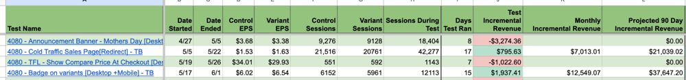
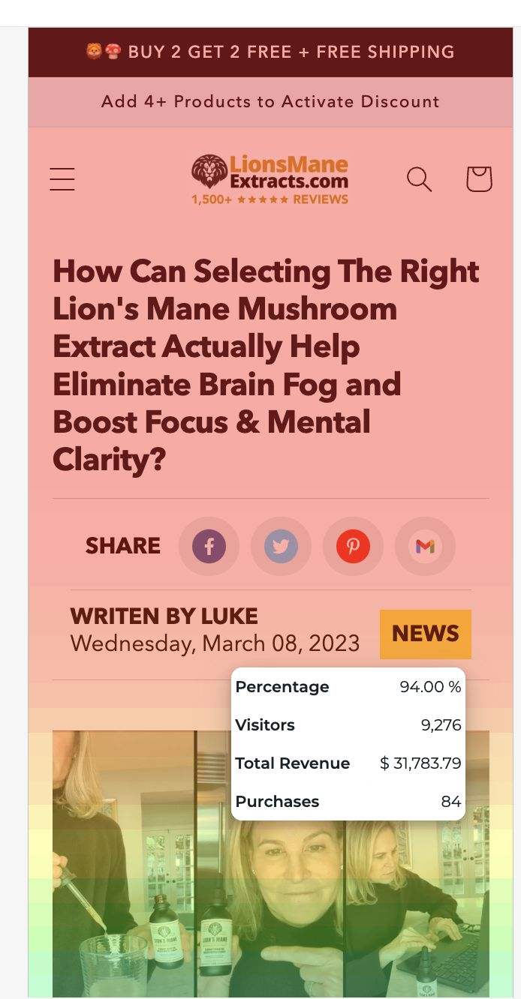
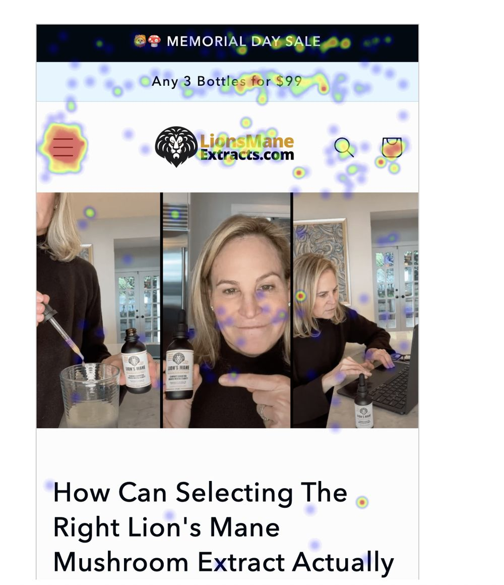
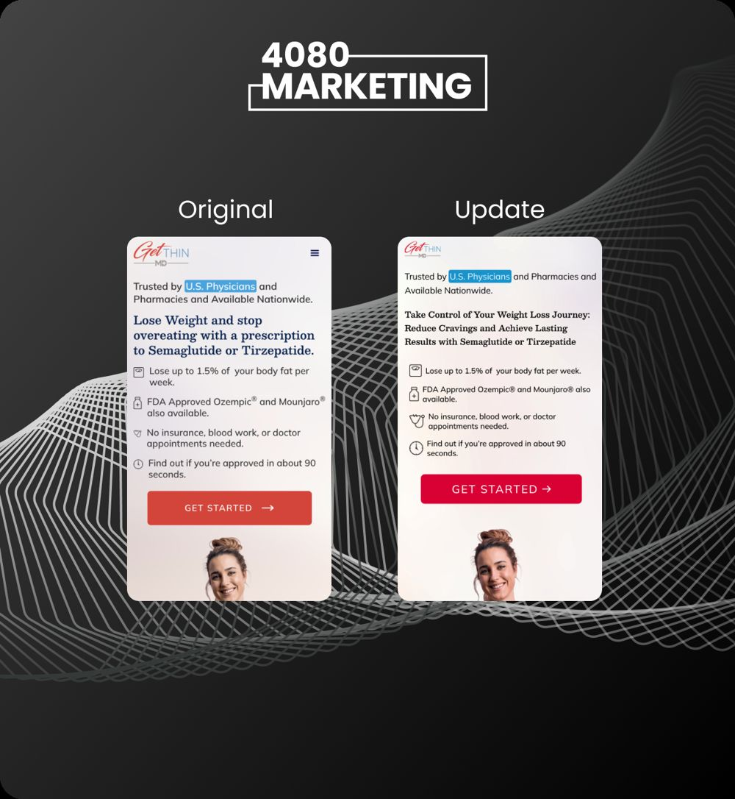
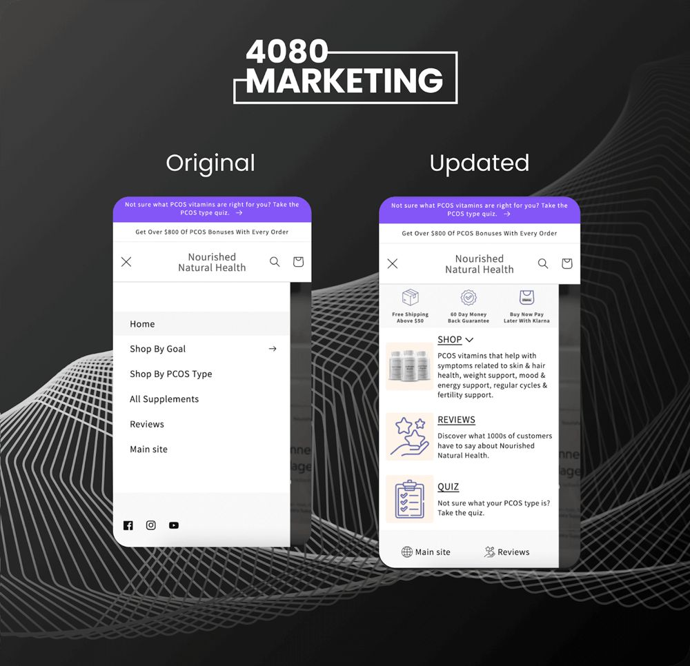
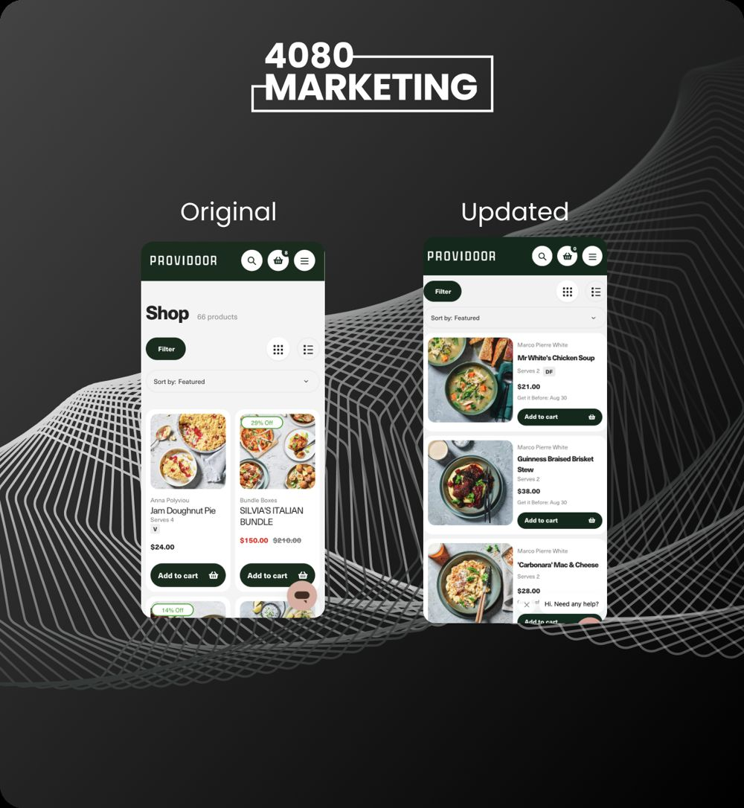
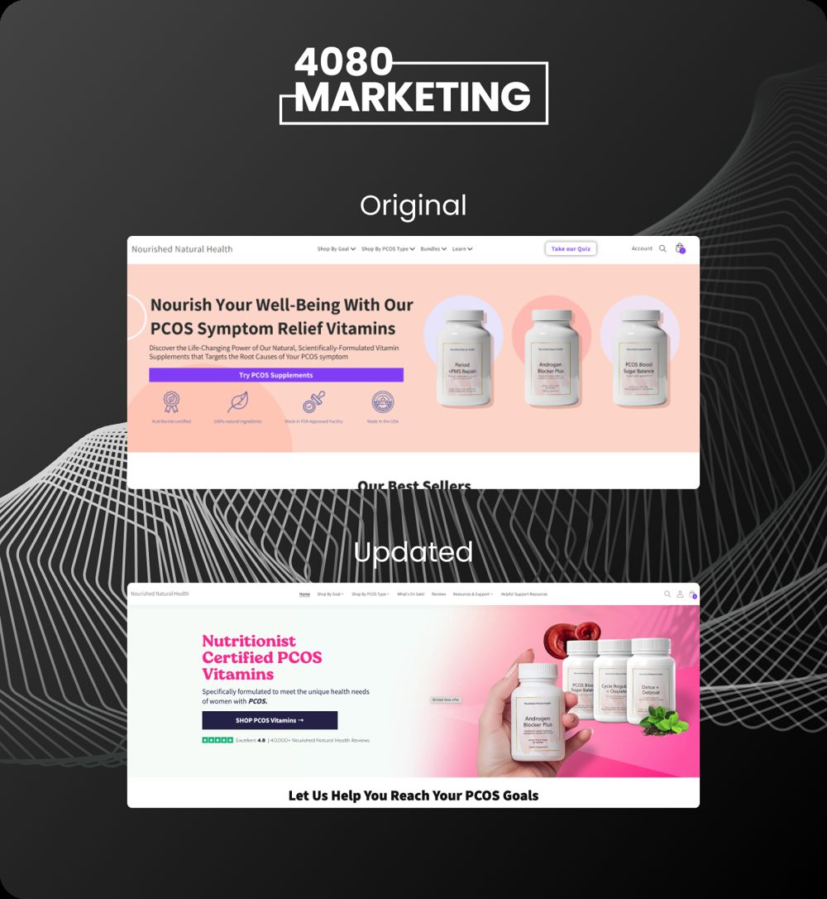
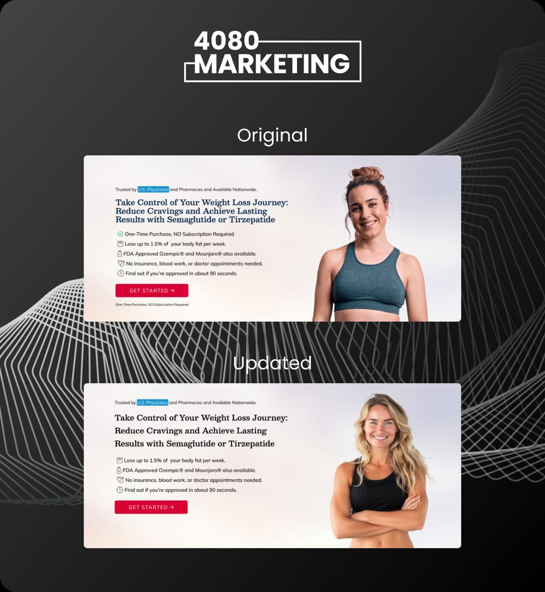
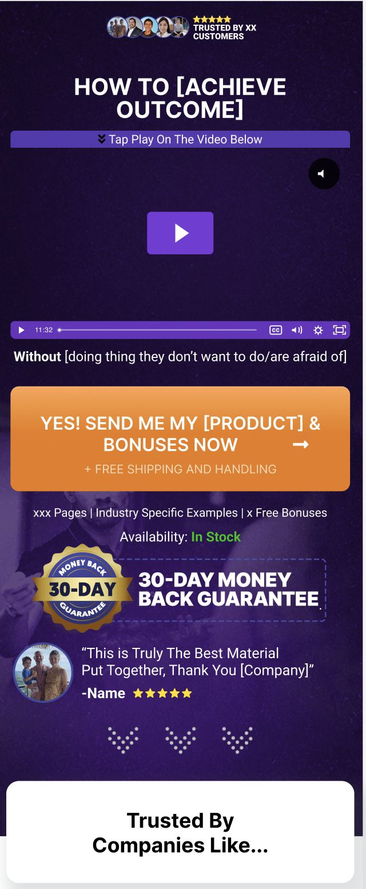
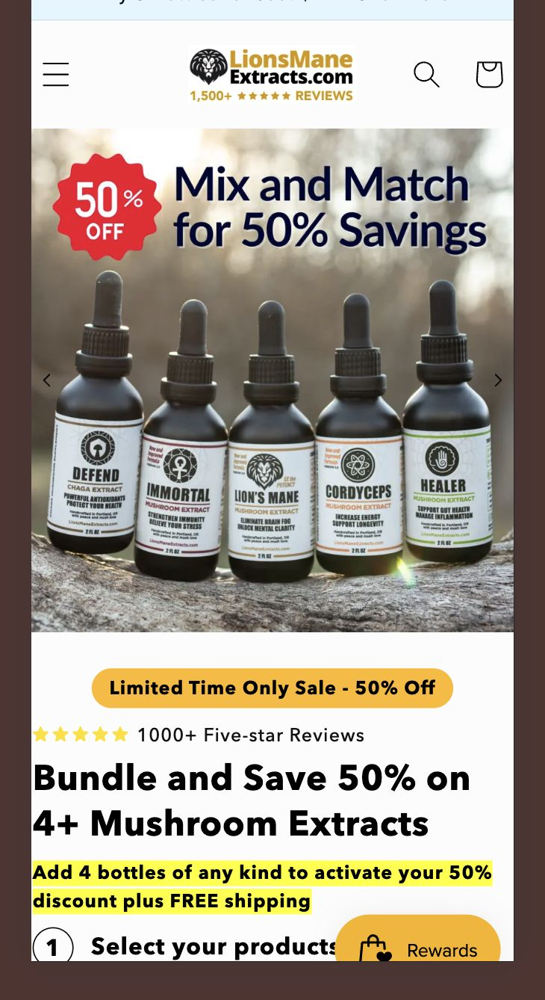

# 16.1 CRO with 4080 Marketing
> Guest session: how to run conversion-revenue split tests (inside-out prioritisation, earnings per session, incremental revenue) and a catalogue of real test results, so copy, offers and pages are judged by revenue per visitor rather than taste.

## 🤖 Agent use
- **Use when:** planning a split-test roadmap for a landing page, PDP, checkout, upsell, menu or funnel; deciding what to test first; writing a test hypothesis; reading a test result; judging whether a "best practice" should be shipped untested.
- **Inputs → outputs:** funnel map, traffic volume, current conversion rate / AOV, customer research (calls, support emails, reviews), heatmap and scroll-depth data → ranked test list (bottom of funnel first), one hypothesis per test, a pass/fail rule (7 / 14 days, probability to win), and a monthly incremental-revenue estimate.
- **Rules:**
  - **DO** optimise earnings per session (EPS = conversion rate x AOV), not conversion rate alone. "Conversion rate without AOV is meaningless." [10:25] (Exception: where backend LTV dwarfs front-end price, track conversion rate; guest's examples are a weight-loss telehealth brand and a subscription membership [11:22, 1:01:11].)
  - **DO** prioritise "inside out": test upsells, then checkout, cart, sales/landing page, product pages, collection pages, home page, banner, navigation, menu. Every visitor passes through the bottleneck points. [19:53-22:10]
  - **DO** test big changes (offer, avatar, funnel structure, above-the-fold), not button colours. "Don't do a button color test." [22:41; deck slide 38]
  - **DO** talk to customers before writing a test: call about 15 customers from the CRM, read support emails and sales-call recordings. Guest claim: this alone gets "80% plus of total gains." [27:32-29:28]
  - **DO** re-test above-the-fold winners immediately; "always, always, always iterate on your winners." [36:49, 58:44]
  - **DO** run true split tests: same time period, same traffic, random split. Two ad sets to page A and two to page B, or page A in October and page B in January, "is not a split test." [16:33]
  - **DO** let a test run at least 7 days before calling a loser and at least 14 days (one business cycle) before calling a winner; 80-85% probability to win is acceptable to the guest (Bayesian). [41:58-42:55, 1:12:55]
  - **DON'T** assume a competitor's page is working, or that good design equals high-converting design. [37:44-38:14]
  - **DON'T** ship an untested change because it is "surely better" or because legal or ops recommended it; use the test as insurance. Guest's example: SMS-consent-before-opt-in dropped revenue per visitor 22% (guest claim: ~$260k/month). [1:10:57-1:11:56]
  - **IF** a test shows -75% (or similar) **THEN** suspect broken tracking or integration, not a bad idea. [1:12:55]
  - **IF** traffic is low or the brand is new **THEN** test funnel structure, avatar, market and product, not headline variants. A 0.1% conversion on a $9 product has "something way bigger missing." [45:03-45:57]
  - **IF** the winning page was built for one ad angle **THEN** re-test the page when the ad angle changes (message congruence). [1:17:31]
  - **IF** a test is a CRO "loss" but changes the business (subscriptions, portfolio of entry points) **THEN** judge it on the business metric. [1:06:27-1:07:55]
- **See also:** [10-01 PDP overviews and Claude processes](10-01-pdp-overviews-and-claude-processes-for-writing-new-ones.md) · [11-02 Checkouts walkthrough part 2](11-02-checkouts-walkthrough-part-2.md) · [Creative testing system](../../../../frameworks/creative-testing-system.md) · [Customer research stack](../../../../frameworks/customer-research-stack.md) · [Offer and bundle psychology](../../../../frameworks/offer-and-bundle-psychology.md)

## Key ideas

### 1. "Which version won?" opener: nobody can guess [00:00-05:14]
- The guest runs a live guessing game with before/after pairs; the room guessed wrong on the headline test (most picked the numbers-and-claim V3) and one test had no winner. His conclusion: "we're really bad at guessing what's going to win. We are not the market." [02:29-05:44]
- Results shown (all "guest claim", from 4080's own clients; see the Structured units table for detail): headline V1 +6.3% [03:33], "one-time purchase, no subscription required" line +10.5% [04:04], avatar image swap +34% [04:36], second headline test flat [05:14].
- Same-test, opposite-result cases exist: he cites a test that produced a 20% increase on one brand and a 20% decrease on another (credited to a colleague named Andre in the audio). "Best practices can be general practices, but it may not be best for you." [24:09]

### 2. Conversion REVENUE optimisation vs "traditional" CRO [06:24-12:18]
- Guest's framing: "We're business owners first, marketers second, and CRO practitioners third." CRO is a tool for business metrics (profit, scale), not "this headline beat that one by 4.7%." [05:44-06:24]
- Effects of a +15% conversion rate, in his "orders of effect": revenue +15% at the same traffic, 15% more customers to sell backend to, more subscription revenue, more room for hiring and R&D, ability to push ad spend higher (scale usually pushes conversion down), higher exit multiple. [07:27-08:54]
- Traditional CRO (button colours, CTA copy, fonts) needs many sessions for small lifts (his example: "3.3% increase"). He calls it "the wrong way to handle CRO." [09:27]
- Conversion-revenue method = direct-response approach plus UX: irresistible offers, copy about the customer not the brand, hidden market segments and avatars already buying without being marketed to. Core tenet: "more concerned with driving increases faster to this metric than we are with knowing exactly why it happened." [10:25-11:22]
- Guest's preference stated twice: take a 20% EPS lift without knowing why, then work out why while collecting the lift. [11:22, 1:14:52]

### 3. The golden metric: earnings per session [11:22-14:11]
- EPS = revenue / sessions = conversion rate x AOV. Also called revenue per visitor (RPV); earnings per click is "slightly different". [12:18]
- Worked example: 3.5% conversion x $49 AOV = $1.71 EPS. [12:18; deck slide 24]
- EPS / cost per click = ROAS (site-wide EPS is lower than paid-traffic EPS, so use it as a rough check only). [12:18-13:14]
- Exception: where front-end price and LTV are far apart (the weight-loss telehealth example), optimise conversion rate because "day one cash is not as important as lifetime value." [11:22]

### 4. What a split test is, and the infrastructure [13:14-19:53]
- Send a percentage of traffic to control and the rest to the variant; compare EPS. Tools named: Convert.com, VWO, Intelligems, Optimizely, "Chameleon" (software-agnostic). Example readout: variant +34% revenue per visitor, 99% chance to win. [13:14-14:41; 18:04-18:58]
- Heatmaps: Hotjar, Lucky Orange, heatmap.com. Tagging for LTV/cohorts: Hyros or a CRM, to learn whether a variant with lower day-one EPS has higher 3-, 6-, 9-month LTV. [18:58]
- Control the variables: traffic quality, seasonality, time of week ("one variation during Black Friday and one during July"); the Olympic runners all run in the same rain or sun. [16:33-17:33]
- Split tests also remove the "conversion rate dropped as soon as we changed the site" blame game when Meta traffic quality shifts. [17:33-18:04]
- "90% of brands don't split test properly," including very large brands (guest claim). [16:33]

### 5. Incremental revenue sheet [14:41-16:33, 43:27-45:03]
- The success metric is incremental revenue, "one of the few things we can point to in business and say we improved by this much." [14:41]
- One row per test; track control and variant EPS, sessions, and "monthly incremental revenue", not the in-test revenue. [15:36]
- Monthly projection (his example): a two-week test with 12,000 sessions implies about 24,000 sessions/month; multiply the EPS difference (his example: 50 cents) by 24,000. (Derived: $0.50 x 24,000 = $12,000/month.) He dislikes 90-day or annual projections: "a lot can change in a year." [43:27-45:03]
- Losers are worth recording; he likes seeing many (red rows). [15:36]
- He offers a templated version of the sheet to attendees; the template itself is not included in the course files. [52:24]


*Deck slide 29: the sheet's columns (test name, dates, control/variant EPS, sessions, days, test incremental revenue, monthly incremental revenue, projected 90-day). Row values are illustrative of 4080's own tests. [15:36]*

### 6. Prioritise "inside out" (bottleneck analysis) [19:53-22:41]
- Order, bottom of funnel to top (ecommerce): upsells, checkout, cart, sales/landing pages, product pages, collection pages, homepage, announcement banner, navigation, menu. [20:45; deck slide 36]
- Why: everyone passes through the bottleneck, like airport security: "you could have the best check-in process... the best lounges... if your security process is slow, it doesn't matter." [22:10]
- Post-purchase upsells cannot reduce front-end conversion; checkout is often set live once and never tested. Social proof added to a checkout "where it's not been there before" can lift conversion 10, 15, 20% (guest claim). [21:15] Link to our [11-02 checkouts](11-02-checkouts-walkthrough-part-2.md).
- Same logic for call, webinar, quiz and VSL funnels: swap the collection page for the quiz, etc. [22:41]
- His priority stance: "whatever gets you testing faster is the framework that you should use" (ICE and others also fine). [19:53]

### 7. Testing philosophy [22:41-26:31]
- Bigger changes give a better chance of a significant result, good or bad; the middle yields no learning. "Losers are only losers for a week, and winners are winners for months, maybe years." [22:41]
- Priority number one: do not harm conversion rate. Internal opinions ("I like headline three better") would have shipped a loser. [22:41-23:38]
- People tell you what they think they should say when asked directly ("I want to be healthier" vs "I want to wear a dress from high school"). [24:39]

### 8. Test ideation: talk to customers first [26:31-33:56]
- Rule number one. His order of sources: phone calls, texts, customer support emails and salespeople, reviews, competitor reviews (find angles competitors miss), surveys (with an asterisk). Manual beats automated, especially at first. [28:30]
- "Go to your CRM, pick out 15 phone numbers and call the phone numbers." [27:32]
- Listen between the lines: feelings and emotion ("ten years, I'm just not able to get the weight off", not "I want to lose weight"), topical context (e.g. back-to-school time), repeated phrases. Hearing the same thing from 15 people makes it a test candidate. [30:27-31:18]
- Reviews reading exercise (lion's mane brand, reviews shown on slides). Read for signals beyond the product benefit: [31:18-33:03]
  - A reviewer who says they won't put anything in their body until carefully researched signals a cautious researcher: a safety angle, and test whether competitors' products are tested as thoroughly.
  - A reviewer aged 61 who found memory fog "emotional" and praised purity signals emotion plus purity as proof.
  - A reviewer aged 73 who noticed how much it helped only after running out: age signals an avatar/demo test.
  - A reviewer who says "I feel like words come faster" is an angle he says he would never have thought of. "You can't write better copy than your customer." [33:03]
- Older avatar implies UX care: clickable things must look clickable, legible fonts, simple one-two-three lists. [33:56-34:26] Compare [labels and customer language](../../../evolve/copywriting/concepts/labels-and-customer-language.md) and the [customer research stack](../../../../frameworks/customer-research-stack.md).

### 9. Heatmaps and scroll depth [33:56-37:44]
- heatmap.com attributes revenue to clicks (other tools do not). Example: advertorial menu had 342 clicks and 27 purchases tied to those clicks; unclickable images that attract clicks are a bug to fix. [34:26-35:15]
- Scroll depth example (guest's advertorial): 94% of visitors see above the fold, only 12% reach roughly the middle of the page, yet over half the purchases come from those 12% (purchase counts shown: 84 total, 45 at the mid-page point). Possible reason: deeper readers were more skeptical or had higher AOV (his guess). [35:15-36:49]
- Takeaway: above the fold "gets attention and gets people reading further, and then the below the fold is what converts." If you've spent months on below-the-fold, start with above-the-fold. [36:49]
- Example effort: about 10-12 above-the-fold versions in a couple of months on the telehealth brand. [36:49]


*Deck slide 46: scroll-depth overlay with visitors, revenue and purchases at the above-the-fold line (94% / 9,276 visitors / 84 purchases). [35:15]*


*Deck slide 45: click heatmap; clicks cluster on the menu and cart, none on the lead image. Use clicks on non-clickable elements as test ideas. [34:26]*

### 10. Pitfalls [37:44-40:02]
- Do not assume a competitor's page is working. Do not confuse good design with converting design ("the page looks beautiful and all it does is talk about the company"). Do not "armchair CRO" ("I like this design better"). Keeping something on brand is fine, but test it "to see how much it's going to hurt you." [37:44-39:02]
- Test types to cross with funnel stages: copy, design, offer, avatar/market segment, funnel structure, tech stack, business-level. Pairs: upsell + copy, sales page + offer, product page + design. [39:02; deck slide 50]

### 11. Test results walkthrough [52:24-1:12:55]
See the Structured units tables. Commentary worth keeping:
- **Headlines:** "there's really no good way around testing headlines other than just testing a bunch of headlines." He is "50% right" on predictions despite running "more split tests than I'm proud to say." [53:17-54:11]
- **Menu:** images beat text for scanning; remove social-media links from the menu ("don't send people back to the battlefield"); add social proof in menus, carts and checkouts so trust builds step by step; remove unneeded choices informed by heatmaps. [54:11-56:10]
- **Collection page:** the usual "2x2 beats list" rule lost; the winner added serves, delivery cut-off date and the creator-chef's name. [56:10-57:44]
- **Above the fold formula:** headline, sub-headline, call to action, social proof, product image; give "almost all the information that they need to make a purchase, generally aside from price": what it solves, who it's for, social proof, the product experience. [57:44]
- **Winner decay:** the original of the 12.3% test "was a previous winner"; the best page is "asymptotic"; a Black Friday week homepage should not be judged against everyday copy. [58:44-59:40]
- **Designers:** conversion-minded designers who say "split test the living hell out of my designs" are "lethal." [1:00:11]
- **Pretty doesn't always sell:** a plain, text-and-banner change beat a more designed page; "award-winning design" is not required. [1:00:11-1:01:11]
- **Avatar test (aspirational vs inspirational):** Stefan Georgi, the guest and a colleague debated which would win; the guest could argue both. The aspirational image won; a follow-up tested ages (late 20s/early 30s, 40s, early 60s): the youngest model gave the best lift, all three lifted. [1:02:09, 1:15:45]
- **Business-level tests as insurance:** payment processor, tech stack, compliance wording, SMS terms. [1:04:31, 1:09:31-1:11:56]


*Deck slide 52 (V1 vs control). The winning headline is "Take Control of Your Weight Loss Journey: Reduce Cravings and Achieve Lasting Results with Semaglutide or Tirzepatide." Copy the test design, not the drug claims. [53:17]*


*Deck slide 56: text-only menu with social icons (original) vs image-led menu with trust bar (free shipping above $50, 60-day money-back guarantee, buy-now-pay-later), no social links, quiz entry. +32% RPV (guest claim). [54:11]*


*Deck slide 58: 2x2 grid (original) vs list rows with serves, "get it before" date and the chef's name (updated). +10% RPV (guest claim); counter to the usual best practice. [56:10]*


*Deck slide 60: supplement homepage hero; updated version leads with "Nutritionist Certified PCOS Vitamins" plus a rating line. +12.3% RPV (guest claim). Certification and review counts would need substantiation for our own brands. [58:44]*


*Deck slide 65: same layout and copy, different model image (brunette in sports bra vs blonde with folded arms). Updated +34%. The guest calls it the "Sydney Sweeney test" (Stefan's name for it). [1:01:11]*


*Deck slide 67: the "after" template: social-proof avatar row ("TRUSTED BY XX CUSTOMERS"), "HOW TO [ACHIEVE OUTCOME]" headline, video, "Without [thing they don't want to do]" line, product-specific CTA, "xxx Pages | Industry Specific Examples | x Free Bonuses", "Availability: In Stock", 30-day guarantee badge, testimonial. Placeholders are from the deck. [1:03:46]*


*Deck slide 70: mix-and-match bundle page (select 4+ bottles for 50% off, subscribe default) tested against a PDP. [1:06:27]*

## Steps / framework

**Inside-out CRO testing loop (from the guest; "derived" tags mark my sequencing).**
1. Map the funnel and rank steps by "everyone must pass" (upsell, checkout, cart, landing page ...). [19:53-22:10]
2. Collect voice of customer: 15 calls, support emails, sales-call recordings, reviews, competitor reviews. [27:32-28:30]
3. Check heatmap clicks, scroll depth and revenue-per-click for the chosen page. [33:56-36:49]
4. Pick a test type (copy, design, offer, avatar, funnel, tech stack, business) with a big change, not a micro-change. [22:41, 39:02]
5. Launch in a testing tool at 50/50 (or 10-20% of daily traffic if running several tests at once, derived from [40:02]); no overlapping tests on the same visitors where traffic allows. [40:02-41:05]
6. Run at least 7 days (loser) / 14 days and one business cycle (winner); accept 80-85% probability to win. [41:58-42:55]
7. Turn the loser off after 7 days; keep the winner and re-test it. [1:11:56, 36:49]
8. Log monthly incremental revenue in the sheet; record why you think it won (hypothesis only; he does not require proof). [15:36, 11:22]
9. For action steps he asks attendees to get one test live by the end of next week "even if it's just a headline test. It'll take you 10 minutes." [deck slide 80]

**Price testing (guest).** Change one number in the payment processor; test roughly 10-15% above and below; e.g. $44 to $47 or $49. "It's literally free money" if conversion holds. "There are general price breaks" ($0-50 vs near $100). In info products he has often seen the opposite (conversion rises when going $39 to $49, $19 to $29, $199 to $299 upsells). (Guest claim.) [46:58-48:29]

**Team for a CRO programme.** Someone who understands impactful tests (owner/CMO type), plus a designer, a developer and a copywriter; one person can cover several. Most tests can be built in a visual editor; worst case use redirect tests. [50:03-51:54]

## Examples

All results below are the guest's own client tests (guest claim, no raw data shown). Compliance note on health and weight-loss examples: the semaglutide/tirzepatide headlines and "lose up to 1.5% of your body fat per week" style claims, and "certified" / "scientifically formulated" supplement claims, would need substantiation and may breach Meta/FTC rules for our own brands. Copy structure, never claims.

- **Telehealth headline test (three variants + control):** V1 "Take control of your weight loss journey" language beat V2 and the proof-style V3 ("lose 15% of your weight on average in the first year"); V1 won by 6.3% and created about 75-80 incremental customers per month. [02:29-03:33]
- **Food delivery homepage/collection tests** (chef-collab frozen meals): see table.
- **PCOS supplement store menu, homepage and quiz.**
- **Piano subscription business** (older learners): summer-relevance banner and beach book picture, +17% conversion, $15-20k/month incremental recurring revenue (guest claim); business doing "six to seven million dollars a year" (guest claim). [1:00:11-1:01:11]
- **Info product book funnel:** an e-commerce-styled page won, and a compliant version of the page (legal asked for it) beat the original instead of tanking conversion. [1:03:46-1:04:31]

## Structured units

### Test results (A/B tests)
| Test | Type | Variation | Result | What the guest says | Source |
|---|---|---|---|---|---|
| Telehealth weight-loss headline (V1 vs V2 vs V3 vs control) | Copy | "Take control of your weight loss journey... semaglutide" vs "say goodbye to overeating" vs "lose 15% of your weight" | V1 +6.3% (deck slide 55 says 6.4%); about 75-80 incremental customers per month | "Take control" language won; headlines are hard to predict; test volume | [03:33, 53:17] |
| Telehealth "one-time purchase, no subscription required" line | Copy | Updated adds the line (two things highlighted) | +10.5% | Bigger than the headline test | [04:04] |
| Avatar image (same brand) | Avatar | New blonde, arms-folded model vs original | +34% | Aspirational beat inspirational; Stefan, a colleague and the guest each guessed differently | [04:36, 1:02:09] |
| Avatar age ladder (follow-up) | Avatar | Late 20s/early 30s vs 40s vs early 60s models, all fit and smiling | Youngest best lift, second youngest second; all three lifted (guest recalls "I think") | Many more things to test (hair colour etc.) | [1:15:45] |
| Second headline test | Copy | Control vs variant | No winner (flat); deck slide 14 separately shows "Updated by 37%" for a frozen-meal homepage hero, not narrated in audio | Not everything moves | [05:14; deck slides 12-14] |
| PCOS supplement menu | Design | Image-led menu, trust bar, no socials, quiz | +32% revenue per visitor | Images, information architecture, remove choices, no social links | [54:11] |
| Frozen-meal collection page | Design | List rows with serves, delivery date, chef name vs 2x2 grid | +10% RPV | 2x2 usually wins; here it did not | [56:10] |
| PCOS supplement homepage above the fold | Copy + design | "Nutritionist Certified PCOS Vitamins" hero | +12.3% RPV | Customers care about "certified"; original was a prior winner | [58:44] |
| Piano book funnel summer relevance | Copy + design | Announcement banner + beach book image | +17% conversion rate | Seasonal relevance; tracked conversion rate, not EPS (membership backend) | [1:00:11] |
| Info-product book funnel page | Design + copy + business | Product-focused page with social proof, guarantee, "How to [outcome]", compliant wording | +30% RPV | Compliant version did not hurt conversion | [1:03:46] |
| Funnel front end ($49 vs $17) | Funnel + offer | $17 front-end vs $49 front-end, both break-even | Same ascension rate to membership (about 20% in his hypothetical) | At break-even, the cheaper product gets about 3x buyers and members per $1,000 ad spend | [1:05:29] |
| Mix and match vs PDP (lion's mane) | Offer | Bundle builder defaulting to subscribe-and-save | Conversion rate +2.8% (deck 2.88%); RPV -7% (deck -7.76%); subscriptions +467% | A CRO loss, a business win; credited to design and default to subscribe | [1:06:27] |
| Advertorial vs mix and match | Funnel | Advertorial entry | Flat conversion rate vs mix and match | CRO "loss" but marketing win: more entry points, funnel portfolio theory | [1:07:24] |
| Live-event VIP price ($47 vs $97) | Offer/price | $47 vs $97 | Deck: +45% conversion rate, -41% price/AOV; audio: "converted a lot better" | VIP buyers correlate with backend high-ticket sales; not true for every business | [1:08:45] |
| Webinar software (WebinarJam vs StealthSeminar) | Tech stack | Swap platform, no copy or design changes | Leads +19%, calls +38%, sales +35%, "all statistically significant" | Software can be split-tested | [1:09:31] |
| Payment processor swap | Business | New processor with better terms | ~0% change | Insurance policy; marketing, ops and finance share the result | [1:10:57] |
| SMS terms accepted before opt-in | Business | Legal-recommended consent step | RPV -22%; "would have cost this business $260,000 per month" | Test before shipping legal or ops changes | [1:10:57-1:11:56] |

### Rules of thumb
- **DO** use EPS as the golden metric; use conversion rate where LTV is far beyond front-end price. [11:22]
- **DO** wait 7 days to call a loser, 14 days to call a winner, at least one business cycle; skewed first days flip-flop. [41:58, 1:12:55]
- **DON'T** test on weekdays only if weekend traffic converts differently: "it doesn't do us any good to cherry pick." [41:58]
- **DO** test price in 10-15% steps against your economics. [47:59]
- **IF** you have a Calendly booking link, **THEN** host a booking page on your own domain so you can test its headline, social proof and FAQ. [1:16:41-1:17:31]
- **IF** you have low traffic **THEN** run tests sequentially rather than in parallel. [40:02]
- **DO** keep reasoning separate from results: ship what wins, test the "why" separately. [1:14:52]

### Templates
| Template | Use for | Fill | Source |
|---|---|---|---|
| Inside-out funnel list | Prioritising | upsells > checkout > cart > landing page > PDP > collection > home > banner > nav > menu | [20:45] |
| Test-type matrix | Choosing a test | funnel stage x {copy, design, offer, avatar, funnel structure, tech stack, business level} | [39:02] |
| Above-the-fold formula | Landing/home pages | headline, sub-headline, CTA, social proof, product image; say what it solves, who it's for, and the experience | [57:44] |
| Book-funnel page layout | Info-product pages | "HOW TO [ACHIEVE OUTCOME]" headline, avatar row + "TRUSTED BY XX CUSTOMERS", video, "Without [doing thing they don't want to do]" line, CTA with bonuses, "xxx pages / industry-specific examples / x free bonuses", availability, guarantee badge, testimonial | [1:03:46; deck slide 67] |

## Prompts / templates (verbatim)
No LLM prompts are given in this session.

Verbatim from the incremental-revenue sheet shown on screen (column headers): "Test Name | Date Started | Date Ended | Control EPS | Variant EPS | Control Sessions | Variant Sessions | Sessions During Test | Days Test Ran | Test Incremental Revenue | Monthly Incremental Revenue | Projected 90 Day Incremental Revenue". [15:36; deck slide 29] The guest tells attendees to focus on "Monthly Incremental Revenue"; the template link is not included in the course files.

Hypothesis template (derived, not from the course):
```
Page / step: <bottleneck position>
Evidence: <call count, review phrases, heatmap/scroll data>
Change (big, one lever): <copy | design | offer | avatar | funnel | tech | business>
Primary metric: EPS (or CVR if backend LTV >> front end)
Run rule: >= 7 days to kill, >= 14 days and one business cycle to ship, >= 80-85% probability to win
After result: re-test winner; log monthly incremental revenue
```

## How to apply
- [ ] Build the funnel list and mark the three steps everyone must pass (upsell, checkout, cart first).
- [ ] Call about 15 customers or read 15 support emails; list repeated phrases and emotional language.
- [ ] Add the incremental-revenue sheet columns above to the testing log.
- [ ] Pick one big test per bottleneck; avoid button-colour tests.
- [ ] For our PDPs, run offer/price (10-15%) and above-the-fold tests per [10-01](10-01-pdp-overviews-and-claude-processes-for-writing-new-ones.md); for checkouts, add social proof and test it per [11-02](11-02-checkouts-walkthrough-part-2.md).
- [ ] Re-test every above-the-fold winner.
- [ ] Mark every number from this lesson "(guest claim)" if reused in a brief.
- [ ] Do not copy health claims (weight-loss drug names, "certified", rates of body-fat loss) into our ads or pages.

## Related
- [Creative testing system](../../../../frameworks/creative-testing-system.md) (shared KB): the ad-level counterpart; this lesson covers on-site tests.
- Evolve's [iteration outcomes](../../../evolve/copywriting/concepts/iteration-outcomes.md). Consistent on "results decide". (Derived) A mild difference: Evolve's lesson 03 asks writers to explain why a winner won; this guest explicitly prioritises the lift over knowing why, then investigates after.
- [04-11 VSLs on landing pages vs in-feed](04-11-vsls-on-landing-pages-vs-vsls-as-in-feed-ads.md): the guest side-notes that 3-14 minute VSLs work in-feed even though "the video is too long" objections persist. [25:36]
- [09-01 Advertorials overview](09-01-advertorials-overview-and-examples.md) and [12-01 Meta ads](12-01-meta-ads.md): context for advertorial tests and ad-to-page congruence.
- Next session in the module: [16-02 eCom and Amazon with Eddie Maalouf](16-02-ecom-and-amazon-with-eddie-maalouf.md).

## Sources and limitations
- Transcript: [01-[1] CRO with 4080 Marketing.txt](<../../../../../raw/stefan-georgi/rmbc-ii/_transcripts/Stefan Georgi - RMBC II (1)/16-BONUSES/01-[1] CRO with 4080 Marketing.txt>); deck text: `01-4080 CRO Intensive.pptx.md`; captions: `01-Ethan Bence - Split-test wins A_B testing and everything CRO.srt`.
- Machine transcription (Whisper large-v3-turbo); last segment 1:20:38 of 1:20:46. Name spelling: the file name and deck say "Ethan Bence"; the transcript writes "Bentz" and "Benz"; the captions write other variants. Brand names follow the deck (GetThin MD, MenoLabs, Crio Bru), which differ from audio ("Get Thin", "Meadow Labs", "Creole Brew"); the NDA-protected clients are unnamed.
- Screenshots come from the deck's embedded images (extracted into the media folder), not MEGA frames, because the slides show the tests more clearly than a video frame. Slide 62 (piano landing page with a named customer testimonial) is not included.
- Slide-vs-audio differences kept visible: headline test 6.3% (audio, slide 6) vs 6.4% (slide 55); $47 vs $97 test +45% / -41% appears only on slide 74; slide 14's 37% is not narrated. The review ages mentioned while discussing heatmaps (57, 71, 63) differ from the review slides' text (61, 73); not resolved.
- All results are the guest's unverified, self-reported client numbers; sample sizes and significance are not shown. The tail of the session (Q&A, lunch announcements) is included in the timestamps.
