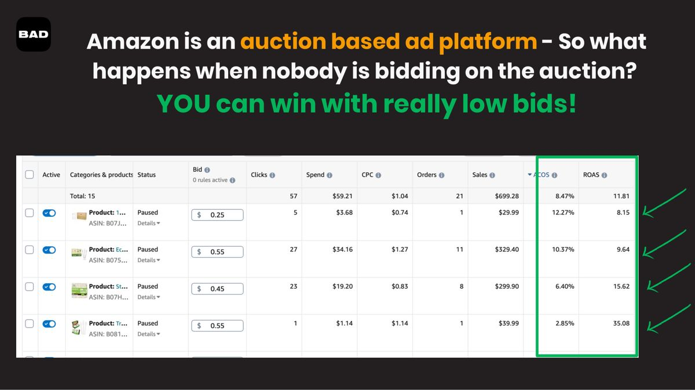
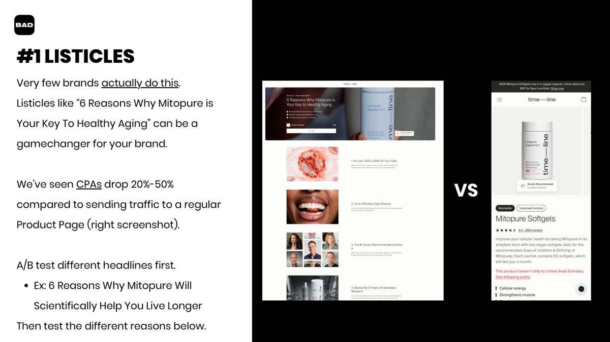
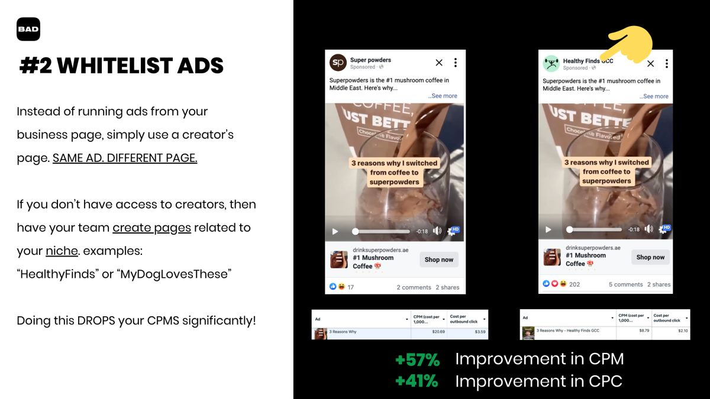
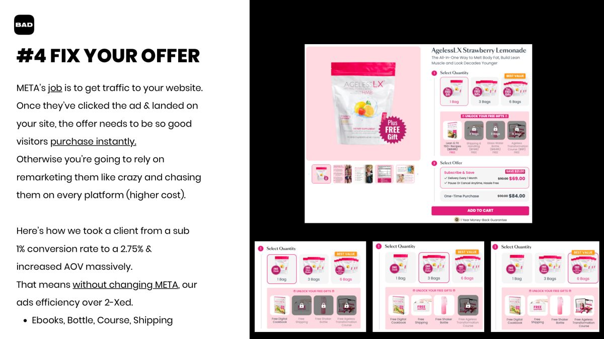

# 16.2 eCom and Amazon with Eddie Maalouf
> Guest session: a fast tour of Amazon, TikTok Shop and Meta tactics for e-commerce brands (low-bid Amazon ads, slash pricing, creator pools, listicle pages, whitelisted ads, offer flips, visitor de-anonymisation), with every result self-reported by the guest.

## 🤖 Agent use
- **Use when:** planning where to send paid traffic beyond a Shopify PDP (Amazon listing, TikTok Shop, listicle/advertorial page), deciding on creator sourcing, testing a "different page, same ad" whitelist, or flipping an offer when a Meta account stalls.
- **Inputs → outputs:** product, margin, current channels, creative volume, offer → a channel and test list (Amazon SEO and low-bid campaigns, creator pool plan, listicle headline tests, whitelisted-page test, three to four offer variants), each marked "(guest claim)" until we have our own data.
- **Rules:**
  - **DO** treat every figure in this session as a guest claim. Numbers come from the guest's agency (BAD Marketing) and his slides; no raw data is shown. [00:58-02:11]
  - **DO** copy structures, not claims: "6 Reasons Why [Product] Is Your Key To [Outcome]" listicle skeleton, the creator-page whitelist test, the free-bonus bundle. Never reuse the health claims shown ("live longer", "healthy aging"); substantiate our own. [18:33-19:33]
  - **DO** A/B test listicle headlines first, then test the individual reasons below. (Slide 26) [18:33]
  - **DO** test every campaign type and placement in a new Meta account, then shave off what fails; do not marry one structure (CBO only, ABO only, bid caps only). [20:22-21:22]
  - **DO** put the effort into what the algorithm cannot do: creative, hooks, click-through, offer. "These algorithms are running circles around me" on audience and placement testing. [21:22-22:20]
  - **DO** flip offers (free bonuses, bundles) when an account hits a wall: "We'll run four offers at the same time. One of them always booms." (guest claim) [23:18]
  - **DON'T** assume Amazon cannibalises DTC: the guest says most Amazon buyers shop only there. (guest claim) [02:41-03:40]
  - **DON'T** run slash-through pricing or "list price" manipulation without checking marketplace policy and consumer-protection rules. Flag: the guest advises "manipulating your List Price & Sale Price" (slide 13); fake reference prices can be unlawful. [09:02]
  - **DON'T** adopt visitor de-anonymisation and cold emailing of people who never opted in without legal review. The guest says it is legal in the US, "not allowed" in Europe, and he is a partner/investor in the vendor. [28:31-30:21, 33:27]
  - **IF** you source TikTok Shop creators **THEN** budget for a weekly outreach cap, nurture the creators who convert, and move the top performers to a retainer. [12:45-14:46]
  - **IF** you are on Amazon with brand-keyword volume **THEN** run brand-defense campaigns; competitors may be buying your keywords at "10 cents a click". [10:51]
- **See also:** [16-01 CRO with 4080 Marketing](16-01-cro-with-4080-marketing.md) · [09-01 Advertorials overview](09-01-advertorials-overview-and-examples.md) · [12-01 Meta ads](12-01-meta-ads.md) · [Offer and bundle psychology](../../../../frameworks/offer-and-bundle-psychology.md) · [Creative testing system](../../../../frameworks/creative-testing-system.md)

## Key ideas

### 1. Why be on Amazon (guest claims) [02:41-08:05]
- "Whatever you're doing direct to consumer on your other platforms you could probably match 50-plus [percent] of that just by being on Amazon." Slide 5 repeats "up to 50% (or more)". [02:41]
- Cannibalisation "myth": most Amazon shoppers only shop on Amazon, so an ad for your product may never convert them; "nine out of ten people that open the Amazon app transact" (guest claim). Compared with Google, where people still compare and research. [02:41-03:40]
- Customer data "myth": the guest says Amazon provides purchaser names and physical addresses (minus emails) at year end for tax reasons; you can match them to emails with third-party tools. (Guest claim; verify against Amazon's terms and privacy law before use.) [03:40-04:38]
- Amazon attribution incentive: ads to an Amazon-provided custom link can cut Amazon's fee on those orders. His example: 25% fee reduced to 8% on tracked sales. (Guest claim, illustrative numbers.) [04:38-05:33]
- Next phase he predicts: Amazon integrated with Meta catalog ads with two-day delivery, so higher Amazon rank will matter more. (Prediction, no source.) [05:33-06:31]
- Slide 5 also claims "TROAS as high as 15-25x" and that you can retarget Amazon customers. Slide 8: "+153% the average revenue growth that BAD clients have seen this year on Amazon" (supplement, men's accessory, home and kitchen brands). The audio says average revenue growth is "about 153%... when someone joins on Amazon from scratch." [07:16-08:05]

### 2. Amazon tactics [06:31-11:47]
- **SEO first, PPC second.** Organic rank has no customer acquisition cost beyond fees; he cites keywords with "30 million, 40 million a month of transaction volume" (guest claim). He offers a checklist via Instagram DM; it is not in the course files. [06:31-07:16]
- **Bundles and metrics.** Same metrics as DTC (LTV, AOV, CAC, TACOS). [07:16]
- **Main image and CTR.** First creative image matters most; "viral on TikTok, viral on YouTube" helps click-through. Amazon's logic as he describes it: keyword searched, did they click, then what share of clickers buy; high clicks with low purchases means the product does not match the keyword. [08:05-09:02]
- **Slash-through pricing.** Strategy #2: "Get that big slash through discount by manipulating your List Price & Sale Price." He says Amazon has loosened the rules; set under "Offers". Example (his words): a competitor sells at $9 with no discount; you list at $15-16 and sell at $9 "with a discount", so shoppers "feel like they're getting a better deal, a more premium product." [09:02] (Compliance flag above.)
- **Ninja low-bid campaigns.** Strategy #3: Amazon ads are an auction; where few people bid, low bids win. His slide shows bids of $0.25-$0.55 with ROAS 8.15, 9.64, 15.62 and 35.08 on four rows (total ROAS 11.81; 57 clicks, $59.21 spend, $699.28 sales). Tactic: take the suggested bid ($1) and bid half. [09:57-10:51]
- **What to target (slide 16):** competitor ASINs, your top 10 search terms (broad, phrase, exact), your own listing (brand defense), other products in your catalog (cross-sell), frequently-bought-together products. [09:57-10:51]
- **Brand defense.** Competitors pay "pennies" on your 10,000-30,000 monthly brand searches. [10:51]
- **LTV and repeat cohorts.** Strategy #4: compute repeat-purchaser share and repeat LTV versus average LTV; his example LTV:CAC 6.3x. Slide 18 asks "Do deal customers come back and buy from you again, or are they just shopping for a deal?" [10:51-11:47]
- Other bullets on slide 7: full-funnel across Search, Headline, Display, DSP and Sponsored TV; "simple video ads instead of high-production style ads"; retargeting deals; virtual bundles; social proof and UGC creatives. (Slide-only; not elaborated in audio.)

*Slide 15: Sponsored Products target table with bids of $0.25-$0.55 and ROAS 8.15 to 35.08. Guest claim; competitor product names obscured in source. [09:57]*

### 3. TikTok Shop [11:47-17:37]
- Premise: with creative volume the new bottleneck (he recalls earlier speakers running "12,000 creatives, 180 a week" for their brand; that session is not in this lesson), creators supply creative at "no cost in return for some sort of commission split". [11:47-12:45]
- Constraints: everything is transparent; outreach limits scale with volume (slide 20: most new brands still allow 1,000 outreaches weekly); creators see your 30-day sales, so zero GMV hurts recruiting. [12:45]
- Plan: build volume with email-list promotions and TikTok ads, then use automated outreach bots that filter on demographics and engagement, hand-pick approvals, send product. [12:45]
- The creator pool loop: of 100 creators, about 5 produce good money; put those on a retainer for about 10 videos a week; this raises store GMV, which lets you recruit bigger creators. Retainer example: "$1,500 a month, $2,000 a month to make you 10 videos a week". [13:41-14:46]
- Cross-use: winners and tagged organic videos are re-run as Meta ads; "they end up being our best performers across the board". He says he has never had a usage issue because he contacts creators quickly; (derived) get written ad-usage rights anyway. [13:41-14:46]
- Slide 21: "You NEED creators to post organic content... People buy from other people." BAD migrates best creators across client brands to its own first-party platform for cross-use (slide). [slide 21]
- Incentives (guest claim, may disappear): TikTok co-funds discounts (brand 10%, TikTok 10% of a 20% offer; sometimes TikTok fronts the whole 20%), and runs Google Shopping ads for TikTok Shop listings. [15:43-16:42]
- Agency perk: he says he can attach a 7.5% cash-back on a TikTok ad account via his agency account, plus 3-5% credit-card cash back for "10% back". (Guest claim; contract terms unknown; treat as a sales pitch.) [16:42]
- Spy tools: FastMoss and Kalodata show best-selling products, trends and average commission rates; "A must have in the tech stack" (slide 23). He claims TikTok leads trends by about a month (ashwagandha example). [16:42-17:37]
- Q&A: asked about a ban, he says it will not be banned. CBD cannot be on TikTok Shop; hemp can run on Meta and Amazon. [26:47-27:27]

### 4. Meta: four learnings from "8-figure" accounts [17:37-27:11]
He says BAD spends "probably $40 to $50 million a month on Meta" (guest claim). [17:37-18:33]

**#1 Listicles.** [18:33-19:33]
- Brand example: Timeline Nutrition (Mitopure), which he says received about $80 million of L'Oreal funding (guest claim). They split-tested product pages and moved to listicles ("6 Reasons Why Mitopure Is Your Key To Healthy Aging"). CPAs dropped 20-50% versus a regular product page (guest claim). Second example: "Five reasons why people are throwing out their old lashes".
- Why he thinks it works: reads as a "second layer of education" and "almost feels like a third party is talking about the product."
- Test order (slide): A/B headlines first (e.g. "6 Reasons Why Mitopure Will Scientifically Help You Live Longer"), then test each reason.
- Compliance: "Live longer" and "healthy aging" claims are structure-only references; our versions need substantiation and platform-compliant wording.

*Slide 26: numbered-reasons listicle page (left) vs standard product page (right). Claimed CPA drop 20-50%. [18:33]*

**#2 Whitelist ads.** [19:33-20:22]
- Same ad, different page: run from a creator's page or a niche page (examples "HealthyFinds", "MyDogLovesThese") instead of the brand page.
- Example (superpowders mushroom coffee): main brand page CPM almost $21 / cost per outbound click $3.59-3.60 vs "Healthy Finds" page CPM $8.79 / $2.10. Slide shows +57% CPM improvement and +41% CPC improvement. Same targeting and audience (guest claim).
- Rationale: "a VA can go use AI and fill up an entire page with content in like one hour." At $2M/month spend, "a 10% drop in CPM is pretty massive." Compliance flag (derived): a page that implies a neutral publisher while selling our product may breach Meta's transparency and FTC endorsement rules; disclose paid relationships.

*Slide 28: identical video ad from the brand page vs a "Healthy Finds" page, with CPM $20.69 vs $8.79 and cost per outbound click $3.59 vs $2.10. Guest claim. [19:33]*

**#3 Run every campaign.** [20:22-22:20]
- Slide 29: for one brand "every year we see a 40-60% growth... year to date spend: $7M"; mix of Advantage+, Shop Ads, cost caps, CBO, pure TOF, MOF, BOF and "PP". Almost every audited account "has at least 2-4 of these missing". "You can't not have a BOF. It's free money. Usually at 3+ ROAS." (Slide.)
- In the audio he adds: start broad on structures, trim the failures; some accounts run well on Advantage+, others need cost caps and CBO. Brand example: $8M (two years before) to $18M to $28M (Jan-Nov 2024), growing ~$10M a year with margins rising (guest claim). [22:20-23:18]

**#4 Fix your offer.** [23:18-24:16]
- "Meta's job is to get traffic to your website." The offer must make visitors buy instantly, or you rely on heavy remarketing at higher cost. Case: a client from "sub 1% conversion rate to 2.75% and increased AOV massively", which "over 2-Xed" ad efficiency without changing Meta. Changes: free ebooks (cookbook), free shipping, a free shaker bottle, a free course shown as unlockable gifts by quantity tier (slide 30). Add "free things to make the offer spicier by adding very little cost on the back end." [23:18]
- Offer flip protocol: when scaling stalls, run three or four cost-of-goods-viable offers at once; scale the one that wins. [23:18]

*Slide 30: quantity selector with 1/3/6 bags, "unlock your free gifts" tiers (cookbook, shipping, shaker bottle, course), subscribe-and-save versus one-time price, one-year guarantee. Claimed conversion lift from under 1% to 2.75%. [23:18]*

### 5. "Secret cheat code": visitor identity resolution [24:16-26:11]
- A software that, per filters (for example 60+ seconds on site and a viewed product), pulls the email, address and other details of anonymous visitors who did not opt in; he says its dataset has "280 million Americans". [24:16-25:14]
- Guest claim for one store (about $6-7M top line): extra $1.5M in 30 days, 144-145k new emails, 52% open rate, 4% click rate, "almost 25%" of revenue; software bill $11,500; "like 150X return". He says he invested in the company and is "the third biggest partner". [25:14-26:11]
- He also pushes the data back to Meta for lookalikes or direct targeting. [25:14]
- Q&A: about 400 cannabis companies use it; some get 70% attributed revenue from email and SMS; "In America, fully legal. In Europe, it's not allowed." [27:27]
- Agent warning (derived): this is a vendor pitch from an investor. Cold email to unopted-in contacts raises consent, privacy-law (state laws, GDPR/UK where applicable), CAN-SPAM and platform risk. Do not implement without legal sign-off. The vendor name is not stated (a QR code was shown). [25:14]

### 6. Q&A: in-housing Amazon, hijacked listings [28:31-32:08]
- Asked how to stop others selling products derived from your offer: "you're never going to be able to stop that unless you have a patent" at first, then he explains brand-controlled listings (Fiji water example: one listing, 148 sellers; the brand can restrict sellers) and that even a pending trademark "can still get some work done". The real reason you lose sales is being out-competed on Amazon, not just undercut. [28:31-30:21]
- Agency vs in-house: client in-housed Amazon to save $15-20k a month, hired three people, and was "down $700,000 in sales" in a month, then came back (guest claim). Agency value: "if I know what to pull and you don't, I can just be like click this button." [30:21-31:16]
- Cross-platform retargeting: pixels on your site via Google Tag Manager; each platform retargets its own traffic. [31:16-32:08]

## Structured units

### Offers / bundles
| Offer element | Claimed effect | Source |
|---|---|---|
| Free bonuses stacked by quantity tier (cookbook, free shipping, shaker, course) | Client conversion rate from under 1% to 2.75% and higher AOV (guest claim) | [23:18; slide 30] |
| Run 3-4 offers simultaneously on a stalled account | "One of them always booms" (guest claim) | [23:18] |
| Subscribe-and-save vs one-time on page | Shown on slide 30; no separate result | slide 30 |

### Hooks / headlines (listicle structure, copy structure only)
| Hook (verbatim or near) | Heuristic(s) | Emotion / zone | Self targeted | Why it works | Source |
|---|---|---|---|---|---|
| "6 Reasons Why Mitopure Is Your Key To Healthy Aging" | Numbered list; third-party education framing (derived) | Curiosity, hope (derived) | Health-conscious self (derived) | Guest: reads like education, not a product page; CPA -20-50% (guest claim) | [18:33; slide 26] |
| "6 Reasons Why Mitopure Will Scientifically Help You Live Longer" | Authority/science claim; needs substantiation | — | — | Suggested headline A/B test | slide 26 |
| "Five reasons why people are throwing out their old lashes for [brand]" | Replacement/switch | — | — | Second listicle example | [18:33] |

### Tests (A/B and structural)
| Test | Variation | Result (guest claim) | Source |
|---|---|---|---|
| Product page vs listicle | Same product, listicle in Meta ads | CPA -20% to -50% | [18:33] |
| Brand page vs creator-style page | Same ad, "Healthy Finds" page | CPM $20.69 to $8.79 (+57%), CPC $3.59 to $2.10 (+41%) | [19:33; slide 28] |
| Offer redesign | Free gifts and tiers | CVR sub-1% to 2.75% | [23:18] |
| Amazon low bids | Half of suggested bid | ROAS 8.15-35.08 across four rows | [09:57] |
| Amazon vs DTC | Add Amazon channel | +153% average revenue growth for BAD clients | [07:16; slide 8] |
| Visitor identity resolution | Software on site | +$1.5M in 30 days; 52% open, 4% click | [25:14] |

### Rules of thumb
- **DO** target competitor ASINs, brand terms, own listing and frequently-bought-together on Amazon with low bids. [09:57]
- **DON'T** limit a new Meta account to one structure. [20:22]
- **IF** you cannot get creators **THEN** create a niche page and run the same ad from it (test, do not assume). [19:33]
- **DO** nurture creators who convert instead of cycling through new ones. [slide 20; 13:41]
- **DO** filter ruthlessly: of 100 creators, about 5 matter. [13:41]

## Prompts / templates (verbatim)
No LLM prompts are included in this session. Slide text kept verbatim:
- Listicle: "Listicles like '6 Reasons Why Mitopure is Your Key To Healthy Aging' can be a gamechanger for your brand." / "A/B test different headlines first... Then test the different reasons below." (slide 26)
- Whitelist: "Instead of running ads from your business page, simply use a creator's page. SAME AD. DIFFERENT PAGE." (slide 28)
- Offer: "Meta's job is to get traffic to your website. Once they've clicked the ad & landed on your site, the offer needs to be so good visitors purchase instantly." (slide 30)

The "Amazon SEO checklist" he promises is not included in the course files. [07:16]

## How to apply
- [ ] Decide whether our products qualify for an Amazon listing and brand-defense campaigns; record the claim "Amazon adds 50%+ to DTC revenue" as unproven for us.
- [ ] Draft three listicle headline variants for one product using the "[N] Reasons Why [Product] ..." skeleton, with substantiated claims only; link to the advertorial work in [09-01](09-01-advertorials-overview-and-examples.md).
- [ ] Run one whitelist test (brand page vs creator or niche page) on a single ad; log CPM and cost per outbound click.
- [ ] Prepare three or four offer variants with cheap-to-fulfil free bonuses and run them side by side before changing creative.
- [ ] If testing TikTok Shop, plan the creator funnel: weekly outreach cap, approve/hold, retainer for top performers, written content-usage rights (derived).
- [ ] Do not adopt visitor de-anonymisation or reference-price manipulation without legal review.

## Related
- [16-01 CRO with 4080 Marketing](16-01-cro-with-4080-marketing.md): on-site test discipline (offers beat creative tweaks; test before shipping).
- [Offer and bundle psychology](../../../../frameworks/offer-and-bundle-psychology.md) and [12-01 Meta ads](12-01-meta-ads.md).
- (Derived) The guest's "trust the algorithm on audiences and placements, spend human effort on creative and offers" [21:22-22:20] fits RMBC's copy-first approach; his claims for it are unproven.

## Sources and limitations
- Transcript: [02-[2] eCom and Amazon with Eddie Maalouf.txt](<../../../../../raw/stefan-georgi/rmbc-ii/_transcripts/Stefan Georgi - RMBC II (1)/16-BONUSES/02-[2] eCom and Amazon with Eddie Maalouf.txt>); slide deck: `02-Copy Accelerators Ecom - 030425.pdf.md` (32 pages; page 31 has no text layer).
- Machine transcription (Whisper large-v3-turbo); last segment 32:55 of 33:18. The guest is named "Maloof" in the transcript and "Maalouf" in the file name and captions; this page uses the latter. Product names read from slides (e.g. Mitopure, Timeline) are as printed there.
- Screenshots are slide images from the PDF (extracted media), not MEGA frames. Some slide results (screenshot data in the Amazon table, listicle examples) are partly unreadable in the images.
- All performance figures (153% growth, 15-25x TROAS, CPA -20-50%, CPM -57%, $1.5M from identity resolution, 7.5% TikTok cash back) are the guest's own assertions without proof. He has commercial interests (agency, investor in the identity-resolution vendor). The visitor-data tool, the Amazon SEO checklist and the BAD audit are pitched but not detailed.
- Opening intro by the host contains gossip about the guest's agency sale; omitted as irrelevant. The earlier-speaker reference ("Jeff and Mark", "12,000 creatives") is from another session not covered here.
