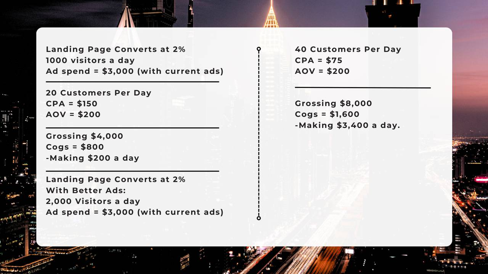
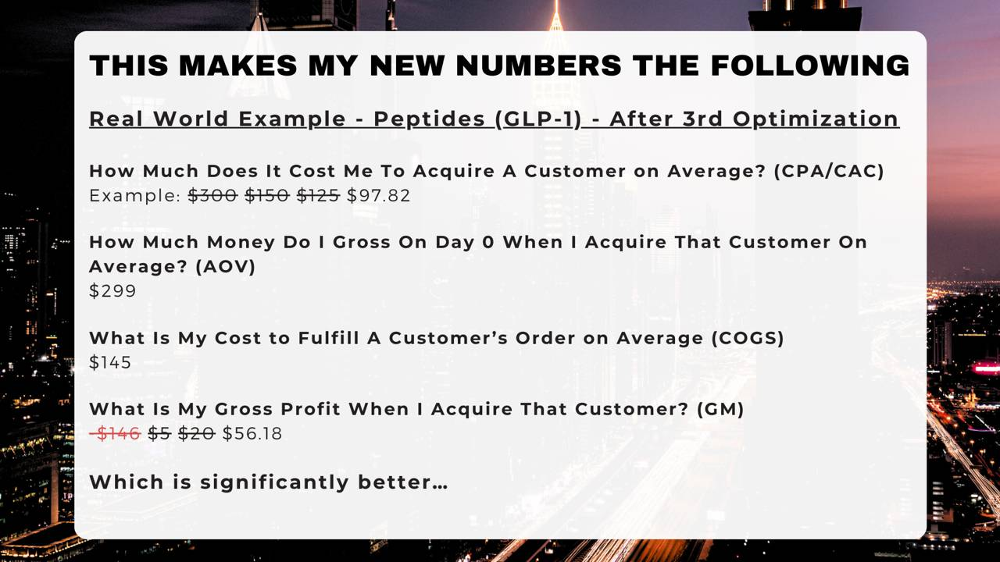
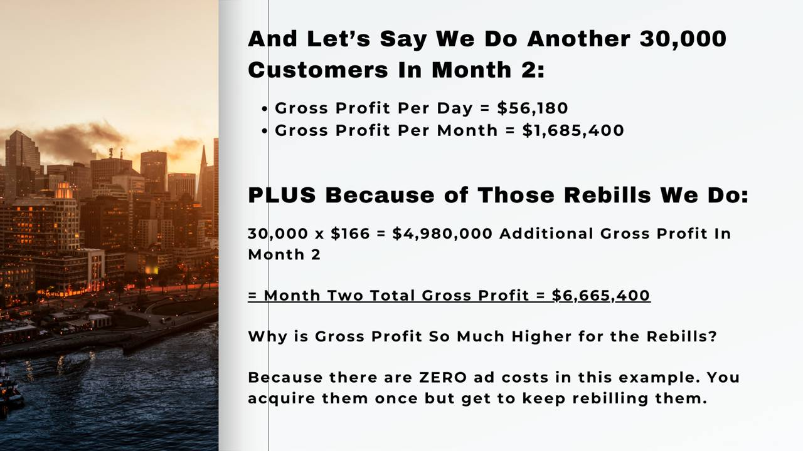
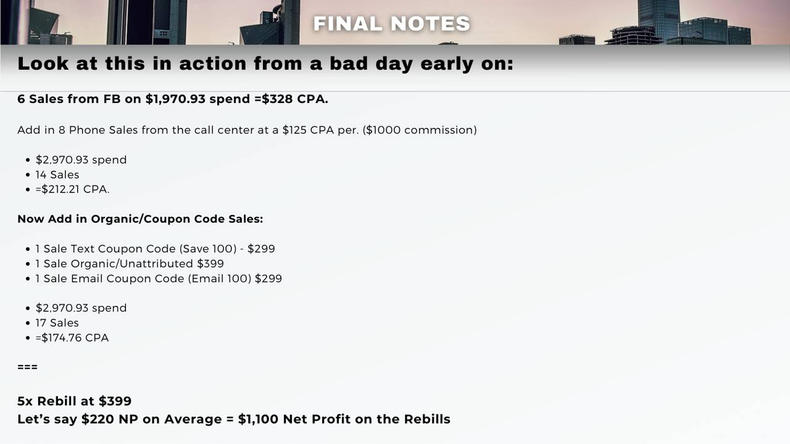

# 16.3 Funnel Economics with SPG
> Stefan Georgi's "dirty math" training: four numbers (CPA, AOV, COGS, gross profit per customer) plus LTV decide whether a funnel can scale, and every lever (better ads, higher conversion, lower COGS, higher AOV, higher LTV) is just a change to one of them, shown with a worked GLP-1 peptide funnel.

## 🤖 Agent use
- **Use when:** judging whether an offer/funnel can scale before or after writing copy; deciding what to test next (ads, landing page, flow, upsells, price, abandoned-cart recovery, rebills); sizing what a conversion lift is worth; briefing a copywriter on what a "win" is worth in dollars; deciding how much CPA a business can afford.
- **Inputs → outputs:** CPA/CAC, AOV, COGS, conversion rate, traffic and spend, abandoned-cart volume, LTV and its time window, business goal → gross profit per customer, break-even CPA, a ranked list of levers with before/after math, and a "how much are we willing to spend to acquire a customer" decision.
- **Rules:**
  - **DO** state the business goal first: maximize net profit (volume plus percentage), revenue (usually to get acquired), new customers (lead-gen/acquisition), or lifestyle (high margin, low headache). The instructor assumes net profit "generally". [01:53–03:46]
  - **DO** compute four numbers before touching copy: CPA/CAC, AOV (day-0 gross), COGS (fixed costs of selling the goods: product, fulfillment, processing fees; not staff or payroll), and gross profit per customer (AOV minus CPA minus COGS). [03:46–05:42]
  - **DO** treat "does this offer lose money on day 0?" as the fork that decides everything: offer A (+$20 per customer) and offer B (-$200 per customer) need "a very different direction". [11:33–12:37]
  - **DO** pull the five levers in this order of thought: lower CPA (better ads, higher conversion, other traffic, abandoned-cart recovery, branded search), lower COGS, raise AOV, raise LTV. [13:07–29:47]
  - **DO** get benchmarks from real operators (media buyers, friends with the same type of offer, a paid mastermind or Discord) before judging a conversion rate or CPA: "is that conversion rate good? Is the CPA high, low, average?" [32:18–33:15]
  - **DO** remember why conversion rate matters: "a higher conversion rate can mean a lower CPA, which can be more scale, more profit". CPA is the number to watch; conversion rate "is sort of just a metric to mark that that has happened". [34:41; 35:37]
  - **DO** look for friction in the flow (points of confusion, roadblocks) by comparing competitors' pages; his thesis for the peptide funnel was to simplify the flow into a quiz and "probably double conversion rates". [34:41–35:37]
  - **DO** split-test price in both directions; lower prices can raise conversion enough to scale. [26:52–28:52]
  - **DON'T** read "50% conversion lift" as a copy win until you convert it to CPA and profit per day. [36:07; 38:03]
  - **DON'T** assume LTV math is safe: his LTV example uses competitor data, a six-month window, a 50% margin and an "averaged" stick rate; he calls it "back of napkin". [43:03–43:31; 48:30]
  - **IF** day-0 gross profit is negative **THEN** you need cash or predictable rebills to fund it; he would "rather not go negative unless there's a very compelling reason" and would keep optimizing CPA even then. [49:29–51:28; PDF p45]
  - **IF** the business is small or self-funded **THEN** be careful: at -$200 per customer, $5,000 buys few sales, and "it's hard to optimize that period of time". [08:06–09:08]
  - **IF** CPA rises with scale (broader channels, small TAM) **THEN** expect it and decide the ceiling from LTV and goals, not from today's CPA. [50:30–51:28]
- **See also:** [Creative testing system](../../../../frameworks/creative-testing-system.md) · [Offer and bundle psychology](../../../../frameworks/offer-and-bundle-psychology.md) · [13.1 Hidden factors for optimal funnel structure](13-01-hidden-factors-for-optimal-funnel-structure.md) · [14.1 Upsells overview](14-01-upsells-overview.md) · [15.1 Abandon-cart sequences](15-01-1-1-abandon-cart-sequences.md) · [16.5 VSL benchmarks with Patrick Stiles](16-05-vsl-benchmarks-data-and-best-practices-with-patrick-stiles.md)

## Key ideas

### 1. The goal comes before the math [00:00–03:46]
- The training is about "the levers that can be the difference between scaling or not scaling an extremely profitable business, or a business that loses money". He says he is "not good at math" and the math is "dirty" but learnable. [00:00–00:59]
- He says this is the math "the world's best direct response marketers, CMOs and business owners are aware of" but rarely discuss publicly; he first covered it around 2018-19 in Copy Starter Pro. [00:59–01:53] (instructor claim)
- **Four goals** [01:53–03:46]:
  1. Maximize net profit (percentage and volume): "make boatloads of cash". Default for most people.
  2. Maximize revenue: only when you want to be acquired; otherwise "revenue is a vanity metric". Example: people who did "$50 million a year and took home $500,000 in profit" (instructor claim).
  3. Maximize new customers or leads: a customer/lead-generation machine you monetize on the back end.
  4. Lifestyle: high margin, low headache, "a couple hundred thousand a year pretty passively". You are in "preservation mode", testing occasionally (e.g. to raise LTV a bit). [12:37–13:07]
- Which levers you pull "really will depend on what your answer is". [03:16]

### 2. Four vital questions [03:46–05:42]
Recorded in a Google Doc, "Funnel Economics Training" (the course PDF "03-1 Offer Economics" is the same document):
1. **CPA / CAC:** average cost to acquire a customer (media spend per customer, or the CPA paid to affiliates, who "risk their money" until they make a sale). [06:12]
2. **AOV (day 0 gross):** average order value including upsells and package mix.
3. **COGS:** product, fulfillment, processing fees: "the fixed costs related to selling the goods versus other variable costs like staff and payroll". This is why the result is gross, not net, margin.
4. **Gross profit per customer (gross margin):** AOV minus CPA minus COGS. LTV is covered later.

### 3. Four offer archetypes [05:42–11:33]
| Offer | CPA | AOV | COGS | Gross profit per customer | Reading |
|---|---|---|---|---|---|
| Supplement A [05:42] | $150 | $220 | about $50 (22.7%) | +$20 | Profitable on day 0. At 100 sales/day: $2,000/day, $60,000/month. He says "close to $720,000" a year; at 1,000 sales/day he calls the lever "volume". |
| Supplement B [07:37] | $300 | $150 | $50 | -$200 | Loses $200 per customer. "Not everyone should be an offer owner"; this is realistic for a first-time physical product and you "need data to optimize". |
| Low-ticket info [09:38] | $40 | $60 | about $0 (digital) | +$20 | He says low-ticket info is "harder to scale" than physical products and people stall around "30, 40 grand" in monthly ad spend (instructor claim). |
| High-ticket phone-sales funnel [10:35] | $1,000 | $3,000 | $1,000 (closer commissions, coaches) | +$1,000 | Application, call, package. |

- The PDF repeats the COGS figure "$0 (22.7%)" on the info-product slide; that is a leftover from the supplement slides, not a real figure (derived). (PDF p6)
- The "so what": these four numbers "determine what action we take next and our focus as a CMO, marketer or offer owner". [11:33]

### 4. Lever 1: lower CPA, at the ad level [13:34–18:40]
- Worked example (his numbers): landing page converts at 2%, 1,000 visitors/day, $3,000 ad spend, AOV $200, COGS about 20%. That is 20 customers/day, CPA $150, gross $4,000, COGS $800, daily profit about $200. [13:34–15:53; PDF p13]
- "Better ads": same $3,000, double the clicks (higher click-through rate, lower CPM). 2,000 visitors, 40 customers, CPA $75, gross $8,000, COGS $1,600, daily profit $3,400. [16:33–17:41]
- Realism check from him: doubling visitors is "not impossible"; even 1,200 or 1,500 visitors matters. Path is "a lot of testing" (creative, targeting; for email, new creative on a $3,000-$5,000 list drop). [18:16–19:09]
- (Derived) $200 to $3,400 per day from a pure creative win is why the instructor ranks ad testing alongside copy work; link to [Creative testing system](../../../../frameworks/creative-testing-system.md).


*Course PDF page 13: "Landing Page Converts at 2%... With Better Ads: 2,000 visitors a day... CPA = $75... Making $3,400 a day." [14:44–17:41]*

### 5. Lever 1 (cont.): raise conversion, other traffic, other CPA reducers [19:09–22:22]
- **Better landing pages** "is where copywriting comes in really specifically": "If I have a new sales letter and it doubles conversions, okay, great." Plus A/B tests (button color, page elements). [19:09–19:36]
- **Better customer journey**: example of a quiz funnel where the quiz itself is "screwing things up"; fix it and more people reach the page and buy. [19:36–20:03]
- **Alternate traffic sources**: replace weak media buyers or agency; test other platforms (e.g. YouTube vs Facebook); recruit new affiliates at a lower CPA ($120 vs $150 if your metrics are strong enough). [20:03–21:02]
- **Branded keywords on Google**: for "Miracle Brush" (his illustrative brand), buyer-intent branded searches "usually get sales for like $20 instead of $150 or $100 or $80" (instructor claim). He says he needs to do it for the peptide company. [21:02–21:29]
- **Organic, SEO, Amazon (halo)**: lower the blended cost of acquisition. [21:29–22:22]
- **Abandoned carts and declines**: call center, texts, emails (the biggest example, section 9).

### 6. Lever 2: lower COGS [22:22–24:22]
- Fulfillment partner or manufacturer: $5 to $3 per bottle on average five bottles = $10 per order; at 1,000 sales/day that is "$10,000, $300,000 a month... found money". [22:22–22:52]
- Negotiate shipping/product rates with the current provider. [22:52]
- Merchant processing fees: 5% to 2.5% saves "$2.50 per transaction" on a $100 order; at 1,000 transactions/day he says "$2,500 a day times 30". He fumbles the total ("80, 90,000... a month, over a million dollars a year"); his own inputs give $75,000/month (derived). [23:22–23:52]
- Info products: cheaper coaches or advisors. [23:52]

### 7. Lever 3: raise AOV [24:22–28:52]
- Offer A example: AOV $220 to $250, fulfillment about +$6, so gross profit per customer goes from $20 to $44. [24:22–25:03; PDF p16]
- Tactics: the "AOV money close" (repeatedly tell people the biggest package is the most popular and the best value); add more packages (a six-bottle option on top of one- and three-bottle); an order bump at checkout (example: a $20 add-on that costs $3, or a "100 best cheat codes" info bump for $27); better upsells (20% take rate to 40% could add "$15 to $25, maybe much more" per customer); price split tests. [25:03–26:52]
- "A-B testing is king": test bumps because they can interfere with upsells. [26:22]
- **Price tests, two instructor anecdotes (instructor claim):**
  - Skincare offer doing "hundreds and hundreds of front sales a day": single-bottle price $59 to $79, other prices unchanged; AOV rose and "conversion stayed exactly the same". [27:49]
  - Blood-sugar supplement run on Facebook "for several years", "like a million a month, maybe": prices $69 / $59 per bottle (3) / $49 per bottle (6) were cut to about $39 / $34 / $29; "conversions doubled or tripled", and the higher conversion "enabled us to scale" despite lower AOV. [28:19–28:52]
- (Derived) The same test can go in opposite directions: always test up and down and measure CPA and profit, not AOV alone.

### 8. Lever 4: raise LTV [28:52–29:47; 43:03–46:14]
- Continuity or subscription, higher stick rate, email-list monetization (rent the list to affiliates, promote other funnels for a CPA, warm promos and bundles), call-center or text sales of bigger packages. [28:52–29:47]
- Questions to add: "What is the lifetime value of the customer? What is the average additional expected lifetime gross profit?" [42:35–43:03]
- Peptide inputs: competitor LTV "around $2,000"; "the margin on that for us is about 50%", so about $1,000 extra gross profit per customer; data window about six months, so "not true LTV". [43:03–43:31]
- $1,000 / 6 = about $166 per month for six months. [43:31]

### 9. Real-world case: the GLP-1 peptide funnel [30:17–42:35]
He is "CMO and equity partner" of a peptide company selling a medication class like "Ozempic, semaglutide" (instructor claim; "that I'm CMO and equity partner of"). [30:17; 21:29] Recorded as a case with a not-yet-confirmed test ("we have that going live tomorrow"). [33:46]

Baseline [30:47–31:48; PDF p18-19]:
| Metric | Value |
|---|---|
| CPA | $300 (days from $113 to over $300; "average is probably realistically closer to $200", he uses $300 for math) |
| AOV | $299 first month, then $399 on rebill |
| COGS | $145 ("higher because it's like a medication") |
| Gross profit per customer | -$146 |
| Funnel data on a given day | 964 landing-page users from Facebook, 10 conversions, 1.04% conversion rate, $3,000 spend, CPA $300 |

Optimization steps (all instructor-stated numbers; arithmetic checks are labelled derived):
1. **Benchmark first** [32:18–33:15]: ask top media buyers; learned the conversion rate "should be higher" and CPA "around $100 on average". Without benchmarks you do not know if a number is good. He calls this "one of the biggest values" of a mastermind.
2. **Diagnose** [33:15–34:41]: Google Analytics, VWO or Hotjar and heat maps to find drop-off; in this funnel users click from the landing page into a medical intake questionnaire ("HIPAA compliant") and drop off. Alternatives: new front-end copy, CRO tests (buttons, page elements, messaging, testimonial placement, design).
3. **Reduce friction** [34:41–36:07]: competitors' flow had "a lot less friction". Thesis: simplify the flow ("call it a quiz"), conversions double: 10 to 20 conversions, 2.08% conversion rate, CPA $300 to $150; gross profit per customer from -$146 to "$5" (the PDF and transcript both say $5; his own inputs give $4) (derived). [35:09–36:36; PDF p23-24]
4. **Landing-page variant tests** [37:35–38:03]: conversion to 2.5%: 24 conversions, CPA $125; he states gross profit $20 per customer (his inputs give $29: $299 - $125 - $145) (derived). At 1,000 front-ends a day he states $20k/day and $600k/month. [38:03–38:32; PDF p26-29]. Realistically 3% "with more tests". [38:32]
5. **Abandoned-cart recovery** [39:02–40:46; PDF p31-33]: 300 abandoned carts per day; call-center benchmark "pretty standard... 20%", he models 10% = 30 sales at $125 per conversion = $3,750 "spend"; plus text/email sequence at 5% = 15 sales at no CPA (total 15% of abandons, "frankly a little below the benchmarks"). Result: 24 to 69 conversions; blended CPA ($3,000 + $3,750) / 69 = $97.82; gross profit per customer $56.18; he says "ad spend plus call center commissions". "This is where call centers are so valuable" (he sold his call center, still uses it).
6. **Summary of three changes** [41:16–41:42]: improved customer journey (CRO), better landing page, remarketing to abandons via call center, text and email. He lists what he has not yet done: better ads (testing new creative to lower CPM), other ad platforms, affiliates ("I want the metrics really good before I go to affiliates"), SEO, COGS reduction (longer term), AOV (upsell an anti-nausea supplement "through the call center", price tests), LTV. [41:42–42:35]


*Course PDF page 33: CPA $300 > $150 > $125 > $97.82; gross profit per customer -$146 > $5 > $20 > $56.18. [40:17–40:46]*

### 10. Volume, rebills and compounding LTV [43:31–46:14]
Instructor's own volume assumption: 1,000 sales/day, "my short-term goal", = 30,000 customers per month.
| Month | Front-end gross profit | Rebill gross profit | Total |
|---|---|---|---|
| Month 1 | $1,685,400 (30,000 x $56.18) | $0 | $1,685,400 |
| Month 2 | $1,685,400 | 30,000 x $166 = $4,980,000 | $6,665,400 |
| Month 3 | $1,685,400 | 60,000 x $166 = $9,960,000 | $11,645,400 |
- Why rebill gross profit is higher: "there's no ad costs in the additional months". [44:26–44:55; PDF p40-41]
- At 100 sales/day: month-2 rebills $498,000, month-3 total "only" $1,164,540; at 10 sales/day: $49,800 month-2 rebills. [44:00–44:26; 45:23]
- Conditions he states: needs a high rebill rate and a high AOV; "that's why SaaS are so valuable"; "that's why Agora would and maybe still does acquire customers and go negative for months at a time". [44:26–44:55]
- "That's one way to quickly get to being a nine-figure business. That's what I'm trying to do... I could record this and things go to shit." [44:55–45:23]
- (Derived) The model is gross profit, not net: it ignores payroll, call-center commissions on rebills, refunds, chargebacks, payment-processor reserves, tax, and any COGS beyond the 50% margin already in the $166, and treats $166/month as an average of stick rate. The averaged figure vs $220 net profit on actual rebills is explained at [48:30].


*Course PDF page 40: month-2 total gross profit $6,665,400 with "ZERO ad costs" on rebills. [44:00]*

### 11. A real "bad day" and blended CPA [47:08–49:29]
From PDF p43 and the transcript [47:08–48:59]:
| Step | Sales | Spend | CPA |
|---|---|---|---|
| Facebook only | 6 | $1,970.93 | $328 |
| + 8 call-center sales at $125 ($1,000 commission) | 14 | $2,970.93 | $212.21 |
| + 3 organic/coupon-code sales (text coupon "Save 100" $299, organic $399, email coupon "Email 100" $299) | 17 | $2,970.93 | $174.76 |
- Five rebills at $399 came in; at $220 average net profit each = $1,100 ("not everybody's going to rebill, so I'm averaging that out"; he used $166 earlier). Break-even CPA about $154 ($299 - $145). He says they lost about $20 on each of 17 sales = $340, so the day netted about $760 positive. [48:08–48:59]
- Lesson: the first day with a call center or a rebill cohort, a "bad" Facebook CPA of $328 can still be a profitable day on blended numbers (derived).


*Course PDF page 43: "6 Sales from FB on $1,970.93 spend = $328 CPA... 17 Sales = $174.76 CPA... 5x Rebill at $399... $1,100 Net Profit on the Rebills". [47:08–48:30]*

### 12. How much are you willing to spend to acquire a customer? [49:29–51:28]
- "Not can you spend, but willing to spend." With rebills and LTV he could "in theory" not care that CPA is $200 or $500; first build "a foundation of rebills coming in" and have the numbers modelled, possibly by a CFO or "fractional" CFO. [49:29–50:30]
- Pro of going negative: more customers, "dominate your market". Con: you need upfront money or enough predictable rebills. [50:30; PDF p45]
- His stance: "I'd rather not go negative unless there's a very compelling reason", and even then keeps optimizing CPA because "CPAs do go up with more scale, especially when you go to broader channels (billboards vs. direct response)". [PDF p45; 50:58–51:28]
- Career angle: knowing these numbers lets a freelancer "be a consultant who can come in and find the levers and pull them" or become an equity partner. [46:42–47:08]

## Steps / framework
**Funnel economics worksheet (instructor's structure; arithmetic order is derived):**
1. Write the goal (net profit, revenue, new customers, lifestyle). [01:53]
2. Fill CPA, AOV, COGS. Compute gross profit per customer = AOV - CPA - COGS. Compute break-even CPA = AOV - COGS. [03:46; 48:30]
3. Get benchmarks (conversion rate, CPA) from operators on the same type of offer. [32:18]
4. For each lever, write the hypothesis and recompute CPA and gross profit per customer:
   - CPA down: better ads (CTR up, CPM down), conversion up (copy, flow, CRO), cheaper traffic (agencies, platforms, affiliates), recover abandons (call center, SMS, email), branded search, organic/Amazon.
   - COGS down: manufacturer, fulfillment, shipping, processing fees.
   - AOV up: money close, more packages, bump, upsell take rate, price test.
   - LTV up: continuity, stick rate, email monetization, phone/text sales.
5. Multiply by volume (100, 1,000 sales per day) to see what the change is worth per month. [38:03; 40:46]
6. Add LTV: extra expected gross profit per customer divided by months of data, times customers from earlier months. [43:31–44:55]
7. Decide the spend ceiling from goal, cash and rebill foundation; keep optimizing CPA anyway. [49:29–51:28]

## Examples
- Offer A, B, low-ticket and high-ticket archetypes (section 3).
- Better ads: $200/day to $3,400/day with the same spend (section 4).
- Peptide funnel: -$146 to +$56.18 gross profit per customer in three changes (section 9).
- Price tests: skincare $59 to $79, blood sugar down to $39 / $34 / $29 (section 7).
- Bad-day blended CPA from $328 to $174.76 (section 11).

## Structured units
**Lever menu with course-stated examples**

| Lever | Tactic | Numbers given | Cite |
|---|---|---|---|
| CPA | Better ads | 1,000 to 2,000 visitors, CPA $150 to $75 | [16:33–17:41] |
| CPA | Higher conversion | 2% to 2.5%; 1.04% to 2.08% | [37:35; 35:37] |
| CPA | Branded search | sales "for like $20 instead of $150" | [21:02] |
| CPA | Abandoned carts | 300/day; call center 10% at $125; text/email 5% | [39:02] |
| COGS | Cheaper bottle | $5 to $3, 5 bottles, 1,000/day = $300k/month | [22:22] |
| COGS | Processing fee | 5% to 2.5% | [23:22] |
| AOV | More packages, bump, upsell | $220 to $250; upsell 20% to 40% | [24:22; 26:22] |
| AOV/CVR | Price | $59 to $79 flat CVR; $69/$59/$49 to $39/$34/$29 CVR 2-3x | [27:49; 28:19] |
| LTV | Rebills | $1,000 extra per customer, $166 x 6 months | [43:31] |

## Prompts / templates (verbatim)
No LLM prompts in this lesson. The course document poses these questions verbatim (PDF p3, p37):
```
01 How Much Does It Cost Me To Acquire A Customer on Average? (CPA/CAC)
02 How Much Money Do I Gross On Day 0 When I Acquire That Customer On Average? (AOV)
03 What Is My Cost to Fulfill A Customer's Order on Average (COGS)
04 What Is My Gross Profit When I Acquire That Customer? (GM)

Two More Questions to Answer:
01 What Is The Lifetime Value Of That Customer? (LTV)
02 What Is The Average Additional Expected Lifetime Gross Profit of The Customer?

HOW MUCH ARE YOU WILLING TO SPEND TO ACQUIRE A CUSTOMER?
```
Agent worksheet (derived):
```
GOAL: [net profit | revenue | new customers | lifestyle]
CPA: $__  AOV: $__  COGS: $__
GROSS PROFIT / CUSTOMER = AOV - CPA - COGS = $__
BREAK-EVEN CPA = AOV - COGS = $__
BENCHMARK (source: __): CVR __%  CPA $__
LEVER TEST: [change] -> new CPA $__ -> new gross profit / customer $__
VOLUME CHECK: __ customers/day x gross profit = $__/day, $__/month
LTV: extra expected gross profit $__ over __ months = $__/month per customer
AMOUNT WE ARE WILLING TO SPEND (and cash/rebill foundation): __
```

## Screenshots
Four course-document pages are kept (PDF pages 13, 33, 40, 43; exported by the platform from the same Google Doc shown on screen, "Funnel Economics Training"). A video frame at 30:30 shows the Google Doc with the peptide baseline (CPA $300, AOV $299, COGS $145, GM -$146) and a webcam inset; not kept because the PDF page is cleaner.

## How to apply
- [ ] Write the goal, then compute gross profit per customer and break-even CPA.
- [ ] Mark every number as measured, benchmarked or assumed.
- [ ] Convert each proposed test (creative, flow, price, upsell) into new CPA and daily/monthly profit before prioritizing.
- [ ] Ask for abandoned-cart volume and decide whether call center, SMS, email recovery is in place.
- [ ] Ask whether there is a rebill or subscription and what the real stick rate is (use the observed rebill net profit, not an average from another company).
- [ ] If planning to go negative on day 0, confirm cash or rebill foundation and a CFO-style model.
- [ ] (Derived) Compliance: GLP-1 and "medication" funnels carry heavy FDA/FTC/platform restrictions on claims; call-center and text outreach to abandoned carts needs consent and opt-out compliance; continuity billing needs clear disclosures and easy cancellation. Do not copy any claim or channel from this example without review.

## Related
- [16.5 VSL benchmarks, data and best practices with Patrick Stiles](16-05-vsl-benchmarks-data-and-best-practices-with-patrick-stiles.md): Vidalytics conversion benchmarks to compare with your VSL funnel.
- [13.1 Hidden factors for optimal funnel structure](13-01-hidden-factors-for-optimal-funnel-structure.md): funnel structure choices behind the CPA and AOV in this math.
- [14.1 Upsells overview](14-01-upsells-overview.md), [15.1 Abandon-cart sequences](15-01-1-1-abandon-cart-sequences.md): the AOV and abandoned-cart levers in detail.
- [11.1 Checkouts walkthrough](11-01-checkouts-walkthrough-part-1.md): order bump and checkout levers.
- Evolve Start Here has a revenue-stage view of priorities: [Revenue stage focus](../../../evolve/start-here/concepts/revenue-stage-focus.md) (different framing, no disagreement noted).

## Sources and limitations
- Transcript: `03-[3] Funnel Economics with SPG.txt` (JSON duration 3,106.85 s, about 51:47). The video is a screen recording of a Google Doc (macOS menu bar shows "Wed Feb 14", year not shown) with a short webcam inset, made before the peptide test results; Stefan says he will know "in a few days" whether the quiz test worked and the outcome is not in the course files.
- Document: `03-1 Offer Economics.pdf` (45 pages, exported from the Google Doc). Treated as primary; the transcript adds spoken examples (price tests, branded search, merchant fees, bad day) that the PDF covers only partly.
- Mishearings and fixes: "Zempic/glutide" read as semaglutide-class drugs; "rebuilds" read as "rebills"; "Mosey" at 50:58 is unclear and left out; "AI marketers" at 29:24 is a course/list name left as spoken. Stefan's own arithmetic slips ("conversion rate / AOV" at 15:16; merchant-fee total at 23:52; bad-day subtraction at 48:59) are reported with derived corrections.
- PDF inconsistencies noted: gross profit per customer after optimization 1 and 2 shown as $5 and $20 (inputs give $4 and $29); page 41 labels month-3 rebills "Additional Gross Profit In Month 2"; page 6 repeats "(22.7%)" for a $0 COGS.
- Numbers are instructor claims about his own offers; not independently verifiable. No video frames kept (see Screenshots).
