# 16.4 Webinars - Live Talk (High Ticket Webinar Funnels with Dylan Vanas)
> A guest bonus on running a live, education-led webinar as a sales vehicle: the full funnel (ad, registration page, reminders, confirmation page, webinar, order page, upsell, onboarding call), the numeric benchmarks he uses, how he buys traffic, and the slide-by-slide structure of the 60-90 minute presentation that "sells before you ask".

## 🤖 Agent use
- **Use when:** planning or auditing a high-ticket, coaching, course, local-service or biz-op funnel that ends in a live or recorded webinar instead of a VSL; writing the webinar slide outline; choosing the close sequence (bridge, value stack, price drop, bonuses, financing); setting KPI targets for opt-in, show rate and close rate; comparing webinar vs VSL mechanics.
- **Inputs → outputs:** offer, price, avatar, host story, three "secrets" the offer teaches, real proof (testimonials, results) and real bonuses → a registration-to-onboarding funnel map, a KPI sheet, an ad-test plan, and a slide outline with scripted bridge, price-drop and FAQ beats.
- **Rules:**
  - **DO** treat the webinar as "education-based" where a VSL is "intrigue-based": give real teaching (the "what", not the "how") and let the offer deliver the "how". [v2 14:36–15:14; 45:13]
  - **DO** keep the registration page minimal: headline, sub-headline, date, "about the host". "Don't put a video. Don't put testimonials." If opt-in is below target, "simplify the page and just make it shorter". [v2 15:45–16:45]
  - **DO** put all the indoctrination on the confirmation page (video, calendar links, free community, testimonials, host info, social links), not on the registration page. [v2 19:25–20:28]
  - **DO** keep the order page short (timer, value stack, deliverables): "No one's getting sold by the copy on this page. They got sold by the webinar." [v2 20:57–21:25]
  - **DO** test creatives in bulk from day one: 15-20 creatives plus copy variations (50-100 variations), about $1,000 through each ad set before judging against KPIs. [v2 15:45; 31:44]
  - **DO** get the real price and call to action out "by at least an hour and 15 minutes", whatever the total length. [v2 37:34; 55:23]
  - **DO** (instructor's script) ask permission to sell ("who here is a little scared I might sell you something today? type 1") so the pitch is not a surprise. He admits he has no controlled data on this, only that it "worked better" than hiding the sale. [v2 42:11–43:14; 44:14–44:45]
  - **DON'T** put a long-form sales page behind a webinar: buyers are "either sold or not sold" before they arrive. [v2 20:57]
  - **DON'T** copy the biz-op/income claims, fabricated-sounding price-drop story, "we broke the internet" fake-outage text or fixed-timer scarcity as written. See "How to apply" compliance flags. (derived)
  - **IF** cost per registration is high **THEN** add a $17-$49 self-liquidating offer between the registration and confirmation pages to recoup ad spend (his reason: "free marketing"). [v2 18:22–19:25; slide]
  - **IF** the offer is above $1,000 **THEN** add financing (Affirm, Klarna, Afterpay) and then split pay and payment plans, each on its own checkout link. [v2 54:08–55:19]
  - **IF** the low-ticket buyers on your webinar are a "lower demographic" than your high-ticket tier **THEN** insert a qualification form (packaged as "create your account") before the call-booking page. [v2 23:59–24:25]
- **See also:** [13.1 Hidden factors for optimal funnel structure](13-01-hidden-factors-for-optimal-funnel-structure.md) · [4.6 VSL closes](04-06-vsl-closes.md) · [4.4 VSL background stories and unique mechanisms](04-04-vsl-background-stories-and-unique-mechanisms.md) · [16.3 Funnel economics with SPG](16-03-funnel-economics-with-spg.md) · [Evolve: Bridges](../../../evolve/copywriting/concepts/bridges.md) · [Evolve: Open loops](../../../evolve/copywriting/concepts/open-loops.md)

## Key ideas

### 1. What this lesson is, and what is in the files [v1 and v2]
- Two videos. **v2** (64:53) is a recorded in-room talk to a group the host calls "CA Pro" members, titled "High Ticket Webinar Funnels with Dylan Vanas" (platform captions: "Webinar Frenzy"). Everything quoted below comes from v2 unless marked v1. [v2 00:00; 01:33; 1:04:26]
- **v1** (23:45), "WEBINARS - LIVE TALK", is a slide-deck recording of Dylan's case studies. Its audio produced almost no speech: the transcript has only short repeated fragments from embedded clips (an office walk-through, 01:20-03:23) and a client's celebration video (15:44-16:40). The deck's content was read from video frames, not from narration. See limitations. [v1 01:20; 15:44]
- Framing by the host: "a webinar is basically just a VSL" in many ways, so the elements transfer to VSL people; webinars are "one of the best ways" to sell high-ticket and coaching. [v2 00:29]
- Dylan's pitch to the room: "every slide is a case study of something we're actively doing", no "hold all the value back" presentation. [v2 01:02]

### 2. Speaker background (instructor claims, none verified) [v2 01:33–11:29]
- Co-founded a PR firm ("Mindful Agency" on his slides, v1 frame 00:10), exited 2024; co-created a program called Limitless Society; says it sold out a 10,000-person arena in 2023. Lists clients and partners including a bodybuilder (Flex Lewis), a sales trainer (Andy Elliott; "number one sales training community on the Skool platform"), Jim Quick and others. [v2 01:33–02:58]
- Now runs "ROAS" (spelled "ROAS" in the captions and slide backgrounds): publishes three owned info-product brands, plus an agency for "coaches, consultants, and course creators"; co-run with "Nate", who runs the ads. [v2 02:58–03:26; 11:29]
- Backstory told as a hero's journey: dropped out, failed ventures (slides show 2014-2017 attempts, v1 frame 00:40), real-estate lead-gen agency, "I couldn't sell", partnered with a closer, built a team, 5,000+ paid students in an agency-coaching program, then a May 2022 event with 3,000 attendees (1,500 in person, 1,500 virtual) that produced "over $1.3 million" in back-room sales and "$2.1 million" total that month. [v2 04:28–07:55]
- Then his partner was arrested and disappeared, leaving a "$20,000 month office lease", "multi-six-figure payroll" and "seven figures in contracts to fulfill". "So that's how I learned to do webinars." [v2 08:24–10:00; v1 frame 04:58]
- Use: this story is the live demonstration of his own "hero's journey + reverse authority" intro beats (section 7). Record the numbers as claims.

### 3. Why webinars over VSLs [v2 12:30–15:14]
He asked the room first; answers included more value, interactivity, rapport and authenticity. His own list:
- **Retention (instructor claim):** "95% retention all the way through" to the call to action when done "the right way", versus a VSL where "20%" see the CTA (a figure another speaker gave earlier; see [16.5](16-05-vsl-benchmarks-data-and-best-practices-with-patrick-stiles.md)). Worked example: 1,000 on the webinar, about 950 see the CTA, about 800 at the end ("80% retention all the way through"). [v2 13:05–13:35]
- **Priming:** attendees block time on a calendar, so they are "actually primed", unlike the "slippery slope" of ad to page to a 45-minute VSL. [v2 13:35–14:05]
- **Live feedback:** run it live and "split test every week" with real-time chat feedback, then change the next week. They run mostly live, some recorded. [v2 14:05–14:36]
- **Format difference:** "webinars are education-based. VSLs are intrigue-based." [v2 14:36–15:14]
- **Trust:** 90 minutes to two and a half hours with the prospect builds the most trust at "absolute lowest trust ever", especially in coaching after bad COVID-era programs bought with PPC money. [v2 26:29–26:55]
- He concedes he has not run many VSLs and has only "paper napkin math", not an apples-to-apples comparison. [v2 18:22]

### 4. The webinar funnel, stage by stage [v2 15:14–25:03; slides]
Funnel order on the slide: **Traffic sources → Simple registration page → (self-liquidating offer, "SLO") → Detailed confirmation page → Webinar → Order page → Upsell/order bump → Order confirmation page (onboarding call booking)**, with the **email and SMS reminder sequence** branching off the registration page. [v2 15:14; frame 18:24]

| Stage | What he does | Numbers he gives (instructor claims unless noted) | Cite |
|---|---|---|---|
| Traffic | Test many creatives and copy variants at once | 15-20 creatives + copy = 50-100 variations; about $1,000 per ad set, then kill below-KPI | [v2 15:45] |
| Registration page | Headline, sub-headline, date, host bio. No video, testimonials or complicated forms | Opt-in KPI: **30-35% cold** (any paid), **45-50% warm** (slide says 45-55%): referrals, email list | [v2 16:17–16:45; frame 16:48] |
| Reminders | Daily emails until the event; day before: 2 emails (morning, night) + 2 SMS; day of: 3 emails + 3 SMS (morning, 1 hour before, "live now") | Calendar-add button (one-click add to Apple/Google/etc.) gave about +3% show rate vs emailing the link | [v2 16:45–17:20; 19:59] |
| "Broke the internet" text | SMS 5 minutes after start: "we broke the internet, the link didn't work, here's the new link" | "8 to 10% more people" show (claim). **Deceptive; see compliance flags.** | [v2 17:20–17:51] |
| Show-rate KPI | 20% bad, 30% good, 40% great | 1,000 registrants x 40% = 400 live | [v2 17:51–18:22] |
| Self-liquidating offer (SLO) | Between registration and confirmation page, framed as "if you want to come more prepared for this webinar" with a yes/no | Spoken example: $10 cost per lead, $100 product, 1 in 10 buy = ad spend recovered. Slide: "$17-$49 product", about 10% take rate, "roughly 20-30% liquidation" | [v2 18:22–19:25; frame 19:24] |
| Confirmation page | Confirmation video, calendar links, free community link, testimonials, host info, social links | Free community: buyers must "post that you bought" there to get access, which creates FOMO for non-buyers | [v2 19:25–20:57; frame 20:06] |
| Webinar | Live (mostly) 60-90 min to start | Close rate KPI: 1-2% "go to webinar school", 3-5% okay, 6-10% good, above 10% "really good" | [v2 21:25] |
| Order page | Timer, value stack, deliverables only | n/a | [v2 20:57; frame 21:06] |
| Upsell | Low ticket, subscription/upsell/downsell chain optional | About 20% take rate on his low-ticket upsell | [v2 23:01–23:30] |
| Order confirmation | Mandatory onboarding call booking, "skip for now" link at the bottom that says you "won't get your call" | 80-90% book a call | [v2 23:30–23:59] |
| Qualification | "Create your account" form that is really a qualification survey ("knowing your location helps us customize your experience"); qualified go to call booking, others to "Congrats, you're in" | Built because $700-product buyers were booking calls but not qualifying for the $4K coaching tier | [v2 23:59–24:25; frame 24:18] |
| Cadence | At scale, twice a week: Tue/Wed/Thu evening plus Saturday 10 a.m. PST | n/a | [v2 25:48] |

**Economics he walks through** [v2 21:55–23:01]:
| Step | Number |
|---|---|
| Registrants | 1,000 |
| Show (good case) | 400 |
| Buyers at about 10% of those present | about 40 |
| Revenue at a $1,000 offer | about $40,000 |
| Ad cost for 1,000 registrants | about $15,000 for B2B ("higher cost lead"); about $4,000 for B2C/biz-op |
| Product price range he sells on webinars | $700 to $6K; "a big range" |

(derived) Those figures imply roughly 2.7x gross revenue on ad spend for the B2B case and about 10x for the B2C case before fulfilment, refunds, payment failures and processing fees. The inputs are his claims.

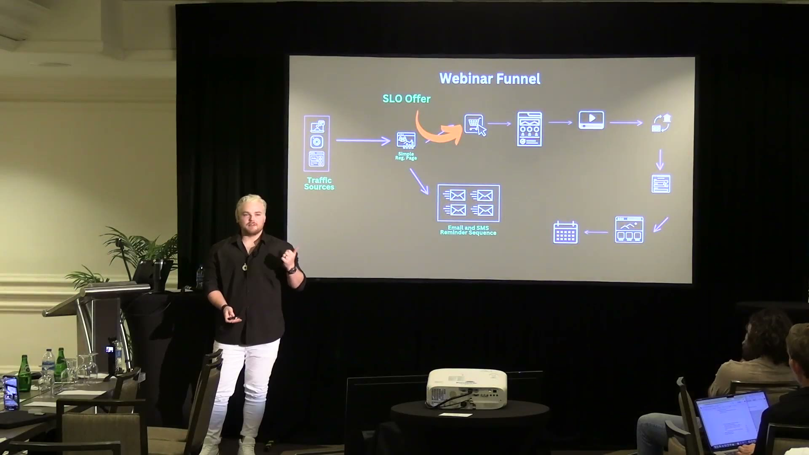
*Funnel slide with the SLO offer branching between the simple registration page and the confirmation page, plus the email/SMS reminder branch. [v2 18:24]*

### 5. Traffic [v2 26:29–36:37]
- **Ranking method ("how I feel about it" scale):** he admits there is no hard data; sources are scored on "how easy to control" and "how much effort". [v2 27:30–27:59]
- Three source types: **inbound** (organic/content/referrals), **outbound** (cold outreach, JVs, partnerships), **paid**. His verdicts: inbound is low control and high effort ("I hate inbound"); outbound is "middle control" with spoken effort called "reasonable" (the slide plots outbound at the highest-effort end, so treat that point as unclear); paid is "high control" and "good". [v2 27:59–31:44; frame 31:48]
- **Organic example (his owned offer, 5,000-10,000 registrations per week):** a creator posts a hook video, tells viewers to "comment the word cash" for a free training, ManyChat auto-DMs the free course and collects the email. It worked until the risk of a ban made organic a single point of failure, so they built paid traffic. [v2 28:35–30:06]
- **JVs/affiliates:** he credits one early affiliate with sending about "$150K worth of business at one point a month". [v2 31:11]
- **Creative testing rule:** "our opinion doesn't matter"; launch with as many creatives as possible and still test things "we don't think are going to work". [v2 31:44–32:17]
- **Case: Gary Vee x Neil Dhingra webinar (slide spelling), with Dylan's agency doing the marketing:** about $20K ad spend, "$2.75 cost per registration", 8,500 registered (2,000 organic, 6,500 from ads), Zoom capped at 3,000 for cost reasons (a 5,000 limit was about $25K/year); the room filled one minute before start and 1,400 more people tried to get in. The host reposted attendees complaining they could not enter ("when Neil says spots are limited, it's really limited"), which trained people to arrive early. (instructor claims; the brand is not his.) [v2 32:17–33:46]
- **Ad-creative quiz:** six creatives shown (two videos, four images). The answer slide re-sorts them and the winner was described as "the Netflix feeling" poster (the orange-and-white "Mastering Social Media in 2025" poster with two portrait photos, read as ad 1). Nobody in the room was sure, which is the point: "We don't know." [v2 34:17–34:55; frame 34:55]
- **Borrow authority:** a contractor-niche webinar for a host with about 2,000 followers had Andy Elliott appear in the ad with him: "under $5 leads", about $3K in ads, "like a hundred Gs" in sales (his words, instructor claim). He says the principle is "leveraging someone else's social proof" to cut cost per lead. [v2 34:55–35:35]
- **Done-for-you webinar test (insurance agent, first webinar):** slides, ads and creatives built for him; $3,600 ad spend, "17K in sales" (later said "3K into 18K"). The v1 slides add "$3,600 in ads = 377 registrants" and "5x ROAS". Caveat: "super small... proof of concept". [v2 36:04–36:37; 39:14; v1 frames 10:58, 17:59]

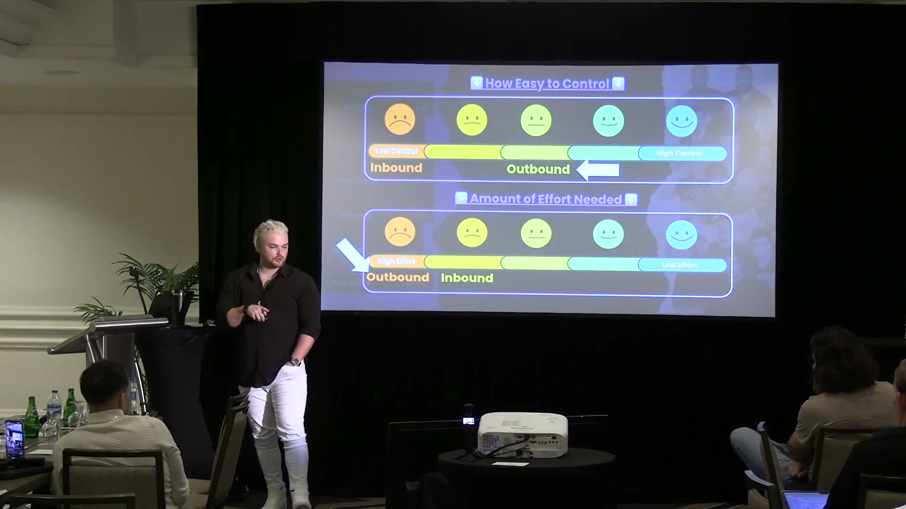
*Traffic-source scale: how easy to control vs how much effort needed, with inbound and outbound plotted. [v2 31:48]*

### 6. Webinar length and shape [v2 36:37–38:34]
- Starter webinar: **60-90 minutes**; advanced: up to **2.5 hours**. "As long as you get the key components out before an hour and 15 minutes, the longer the webinar is, the higher the close rate's going to be." (instructor claim) [v2 37:34]
- Three parts: **intro about 8 minutes, content about 30-40 minutes, close/offer about 15-30 minutes** (for an hour-long example). [v2 38:03]
- He "writes webinars" the way others write VSLs. Slide advice: split slides so slides keep changing; "the less text on the page is better", ideally pictures with a little text. [v2 40:18–40:48]

### 7. The intro (about 8 minutes) [v2 38:34–43:42]
Slide sequence, in order, as shown on his structure slide (frame 55:25) and spoken:
1. **Headline and sub-headline slide.** Example title pattern he reads: "[Name] Secrets: How to attract unlimited clients with our funnel stacking method, proven to position you as an [authority]" (transcript garbled at the end). Insurance-agent example sub-headline shown on a slide. [v2 38:34]
2. **Hero's journey.** Tell the story of building something and losing it, "find what that is for you". [v2 39:14]
3. **Reverse authority.** Not "I have this car, this jet... I'm a genius and you're not", but "I'm nobody. I can barely even cook toast... But I figured this thing out. If I can, you can too." Normally spread over multiple slides, one bullet per slide. [v2 39:44–40:18]
4. **Hook till end (open loop).** "As you stick with me to the end... I'm going to give you my Top 10 viral framework so you can start creating content that converts right away." Slide showed a mock book cover, "Top 10 Viral Video Frameworks". The freebie is dropped in chat at the end or in the follow-up email. Some people "will literally just watch the whole webinar for this bonus", and some buy "because they're waiting to get the freebie". [v2 40:48–41:19]
5. **Differentiator.** Why this is different from anything seen in the niche; his example: "this is not any more 'Merry Christmas from the [agency] post'... No more boring corporate stuff." Take the common industry speak and say "this is not that". [v2 41:19–41:42]
6. **Elephant in the room.** Tell them you will sell. Script in section 13. If you are not comfortable delivering it live, skip it: "if you mess up the delivery... you're not going to get the response, and it's going to flop." [v2 41:42–43:14]
7. **Future pace.** "Imagine six months from now when you have this..." [v2 43:14]

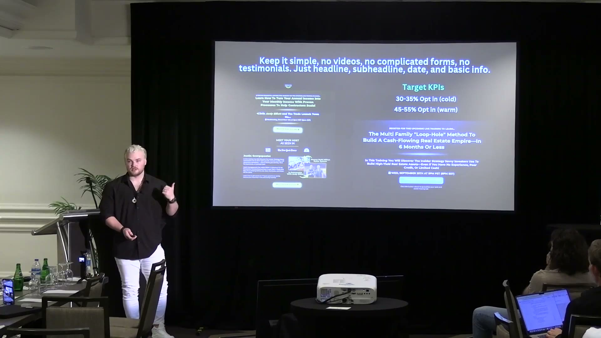
*Registration-page slide: "Keep it simple, no videos, no complicated forms, no testimonials. Just headline, subheadline, date, and basic info." and Target KPIs: 30-35% opt-in (cold), 45-55% opt-in (warm). [v2 16:48]*

### 8. The content section (about 30-40 minutes) [v2 45:13–46:38]
- **The "what, not the how".** Teach the framework, usually **3 (or 4) "secrets"**; "the how is to basically buy". This is what Russell Brunson called "the three secrets" (his attribution). [v2 45:13]
- Each secret **breaks a limiting belief and rebuilds it**. Three belief types: **external** ("it's saturated"), **internal** ("I'm not good enough"), and **mechanism** ("this won't work for me", "you could be a scammer"). [v2 46:09]
- Insurance-agent example, as shown on slides: (1) how using social media in 2025 and beyond could be "the biggest game changer for your insurance agency"; (2) how to flip the switch from consumer to creator even with limited time; (3) the way to create authentic and engaging content. [v2 45:41]
- Sprinkle proof: in the content section, show proof for the mechanism ("the same thing that Gabe used to make $3,500 last month", his example), a couple per secret; and after each value-stack item. Proof is harder to show with income claims now. [v2 56:11–56:43]
- **Recap** the three secrets at the end. [v2 46:38]
- **Seeding the offer:** the secrets are chosen to "seed the idea of what the product solves"; he does not say the answers are in the product, but the value stack later shows that "everything that they need is in the product". The aim is "packaging up a sales pitch through education". [v2 58:56–59:07; 1:00:01]
- Worked prompt from a room question (dating course): internal belief = attraction despite perceived flaws; external = "more single women than you know where to find"; mechanism = "uncovering the pickup secret" that fills your calendar. (the course example uses demeaning wording; copy the three-belief structure, not the language.) [v2 57:42–58:48]

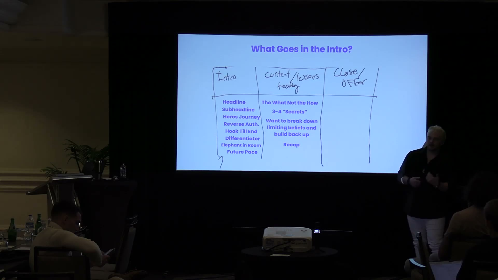
*Structure slide mid-build: Intro column complete; content column reads "The What Not the How", "3-4 Secrets", "Want to break down limiting beliefs and build back up", "Recap". [v2 46:25]*

### 9. The close (about 15-30 minutes) [v2 46:38–56:11]
"This is the most important part": a good close with everything else wrong beats a bad close with everything else right, "significantly". He dropped one client who "chickened out" at this step despite a perfect setup. [v2 46:38–47:07]

Sequence: **Bridge → Offer → Value stack → Price drop → Link drop → Bonuses → Financing and payment plans → FAQs**.
1. **Bridge slide.** Signal that teaching is over ("I'm done teaching") and ask permission. Two bridges he likes (scripts in section 13): **two options** and **information alone**; he has "four or five". Common variant he mentions: "What's holding you back from applying this? A, B, C or D?" Chat "type 1" filters out non-buyers. [v2 47:07–48:46; 50:42–51:07]
2. **Offer reveal.** "Would you be open to me sharing how you can get involved?... That's why I created [The Insurance Creators]." [v2 51:07]
3. **Value stack.** Break each item down in detail, provide proof it works, describe benefits and build the value of each item individually. "I don't always put a value stack on because sometimes it's a little cheesy and overused, but it is proven to work", so "play it safe, use a value stack". Design tip: don't use the standard "black text with red" look. [v2 51:07–52:06; frame 52:25]
4. **Price drop.** Drop the price about three times (script below). He also says not to drop 50% again; "another 25%" for the last step. [v2 52:06–53:10]
5. **Link drop.** Post the link in chat or pop the offer inside the webinar platform; "join now, start for $1,200" as the low-friction first payment. [v2 52:06; 53:30]
6. **Bonuses.** 3-5 bonuses "with real urgency and scarcity": fast-action by count ("the first three people get this, the next five get that") or by timer ("people that sign up in the next 10 minutes"); then "those bonuses are gone". [v2 53:41–54:08]
7. **Financing and payment plans.** Affirm, Klarna, Afterpay above $1,000 "will help increase conversion significantly". Mention it after the link drop: "I saw the chat... for some of you, $2,000 isn't realistic", hang on that for about 8 minutes, then offer split pay, then payment plans. Each tier is a different link/checkout. Good processing is required for the bottom two tiers. [v2 54:08–55:19]
8. **FAQs.** Pre-script objections ("how quickly will we get an ROI on this?") and answer them live. [v2 55:39]
9. **Real price and CTA done by 1:15**, then the rest of the session can be used however you like. [v2 55:19]

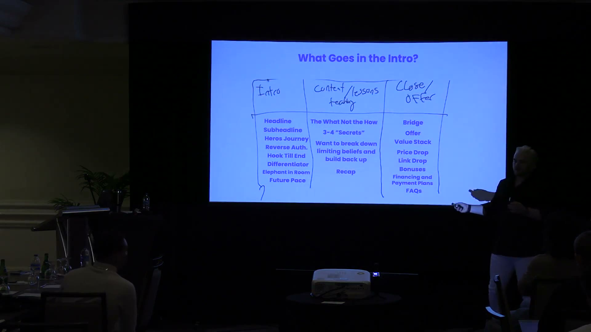
*The full three-column structure: Intro (headline to future pace), Content (what not how, secrets, recap), Close/Offer (bridge, offer, value stack, price drop, link drop, bonuses, financing and payment plans, FAQs). [v2 55:25]*

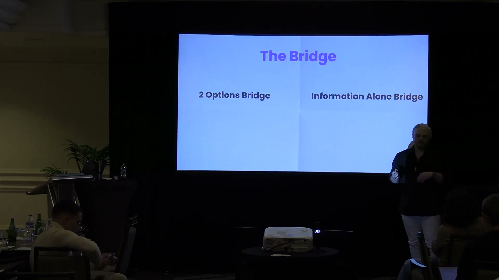
*"The Bridge": the 2 Options Bridge and the Information Alone Bridge. [v2 48:19]*

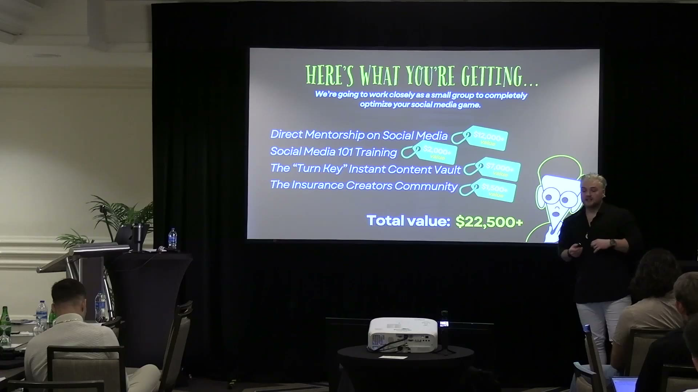
*Value stack slide from the insurance-agent webinar: four named items, each tagged with a "value" and a "Total value: $22,500+" line. The value labels are his, not independent prices. [v2 52:25]*

### 10. Live chat selling and text-in CTA (added at the end) [v2 1:02:32–1:03:24]
- Before the CTA, put up a **phone number to text** with an acronym keyword for "working with us more closely". People who are interested but dropping off can text in.
- A VA or salesperson works **inside the webinar chat** (and by text/call) closing in real time. Claimed lift: "an extra 3% to 4%" live, then another "5% the next day" from VA follow-up.

### 11. Q&A highlights [v2 25:03–25:48; 44:14–45:13; 56:11–1:03:24]
- **Good-better-best tiers** (raised by a supplement-DTC attendee): he had never used tiers in webinars, believes "a confused mind doesn't purchase", and will test it. No data. [v2 25:03]
- **Reveal the sale or not?** No long-run data. He used to not reveal; viewers said "you're just trying to sell me something", so he added the reveal and it "worked better" with fewer angry people at the pitch. [v2 44:14–45:13]
- **Does it work for non-coaching?** Done for "local dealerships" and a car-dealer B2B extended-warranty webinar to dealership owners; "We haven't really got a chance to test with many products." Also CPAs and managed-service-provider style monthly contracts: "just getting your target avatar on a thing presenting and closing". [v2 26:29; 1:01:11–1:01:40]
- **How content differs per offer:** pick three belief-breakers (internal, external, mechanism) that map to the offer; another attendee described a competitor webinar that gave the first three method steps and bridged to the offer with an "execution" linchpin; Dylan: "that works... lots of ways to structure it". [v2 57:15–1:00:01]
- **VSL crossover (room discussion):** hero's journey is common in VSLs, reverse authority "depends on the niche", open loops and future pacing apply; the VSL teaching component ties to the mechanism ("here's the real reason for your problem"), which is the equivalent of rebuilding beliefs. The "information alone" bridge is used mostly in VSL upsells ("now you have all the information"). [v2 49:20–50:42]

## Steps / framework
**A. Webinar funnel (copy this order):** (derived from sections 4-10)
1. Ads (many creatives) → 2. Minimal registration page → 3. Optional $17-$49 SLO → 4. Detailed confirmation page (video, calendar, community, proof) → 5. Reminder cadence (email + SMS, with calendar button) → 6. Live or recorded session (intro 8 min / content 30-40 / close 15-30) → 7. Simple order page → 8. Upsell → 9. Mandatory onboarding call + qualification form.

**B. Webinar slide outline:**
- Intro: headline → sub-headline → hero's journey → reverse authority → hook-till-end bonus → differentiator → elephant in the room → future pace.
- Content: "what not the how" → 3-4 secrets (each = one limiting belief: external, internal or mechanism) → proof per secret → recap.
- Close: bridge → offer reveal → value stack (proof and benefit per item) → price drop → link drop → 3-5 bonuses with real urgency → financing/payment plans → FAQs → text-in CTA and chat closers.

**C. KPI card (his targets, to be checked against your own data):**

| Metric | Bad | Good | Great |
|---|---|---|---|
| Opt-in, cold paid | below 30% | 30-35% | n/a |
| Opt-in, warm (list, referrals) | below 45% | 45-50% (slide: 45-55%) | n/a |
| Show rate | 20% | 30% | 40% |
| Close rate (of those present) | 1-2% | 6-10% | above 10% |
| Retention to CTA | n/a | 95% | n/a |

## Examples
| Case | What he says happened (instructor claims) | Cite |
|---|---|---|
| Client first webinar (voice message from the client, "Justin") | "just closed 60 grand on my first true webinar"; "$2,800 in ad spend"; "five or 600" registrants from ads plus organic joins; the client credits Nate for running the ads. The slide in v1 reads "Did $60,000 on our first webinar today". (derived) about 21x revenue on ad spend, before costs. | [v1 15:44–16:40]; v2 10:30 |
| "Justin", first webinar (contractor-niche host with a famous co-host in the ad) | "turned 3K of ads into 100K" (spoken as "100K in ads"; unclear whether revenue or pipeline); later "under $5 leads", about $3K in ads, "like a hundred Gs". This is probably the same case as the client above (the v1 slide shows his registration page with the same co-host), but the files never say so (derived). | [v2 10:47; 35:35] |
| Webinar with a celebrity co-host | $2.75 per registration, 8,500 registrants, room capped at 3,000 | [v2 32:17–33:46] |
| Insurance agent | $3,600 ad spend, 377 registrants (slide), "17K" sales, "5x ROAS" | [v2 36:04; v1 frame 10:58] |
| Real-estate biz-op webinar (v1 slides) | 906 registrations, $5.63 per registration shown, 326 participants shown | [v1 frame 16:58] |
| Event sales ads (v1 slides) | $13,670 ad spend vs $56,355.75 ticket sales (invoices screen) | [v1 frames 19:54, 23:13] |
| Sales-training company (v1 slides) | $14,120 ad spend, 1,601 registrations, 152 purchases; slide text: "Added 392 paid members into his monthly coaching... scaled to $35k MRR in the first 60 days" (the company's own claim on the slide) | [v1 frame 21:41] |
| New offer (v2 slide list) | "zero to six figures in 60 days just by selling on webinars" | [v2 10:58] |
| Own low-ticket brand | 5,000-10,000 weekly registrations; about 20% upsell take rate; 80-90% booking the onboarding call | [v2 10:00; 23:01–23:59] |

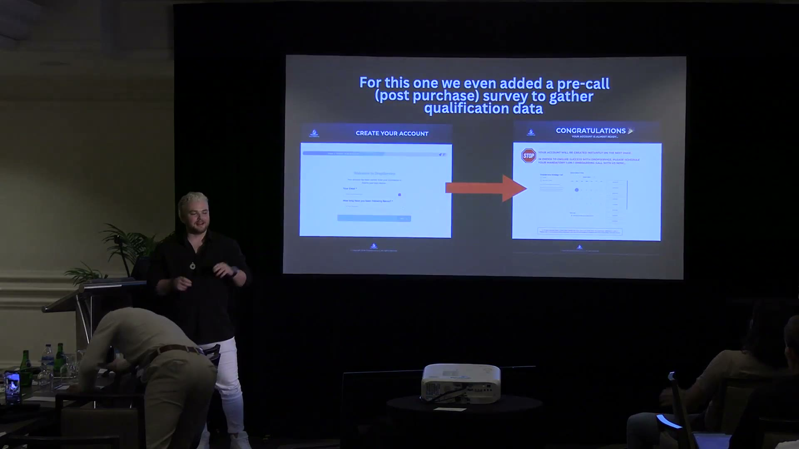
*Post-purchase flow: a "Create your account" step that collects qualification data, then a "Congratulations" page with a mandatory onboarding-call calendar. [v2 24:18]*

## Structured units

### Ad teardowns (creative test shown at [v2 34:17–34:55])
| Brand / product (niche) | Format | Hook / opening | What works | What fails | Fix suggested | Principle | Source |
|---|---|---|---|---|---|---|---|
| Social-media webinar with a famous co-host (creator education) | Image: poster | Two co-host portraits, "Mastering Social Media in 2025", date, "Learn more" | Winner: described as "the Netflix feeling" | n/a | n/a | Borrowed authority, poster look | [v2 34:55] (my reading of the slide: ad 1) |
| Same webinar | Video (selfie talking head, text overlay) | Co-host speaking to camera | Not stated | Not stated | n/a | Not stated | frame 34:55 (ad 5) |
| Same webinar | Image: text-post screenshot | "The game on social just changed. Posting to profit in 3 steps" | Not stated | Not stated | n/a | Not stated | frame 34:55 (ad 3) |
| Same webinar | Image: two-photo "Win on Social" | "The new way to win on social in 2025" | Not stated | Not stated | n/a | Not stated | frame 34:55 (ads 4 and 6) |

The speaker gave no per-ad reasoning beyond "we don't know" which wins, and the authority-borrowing takeaway. Do not infer reasons.

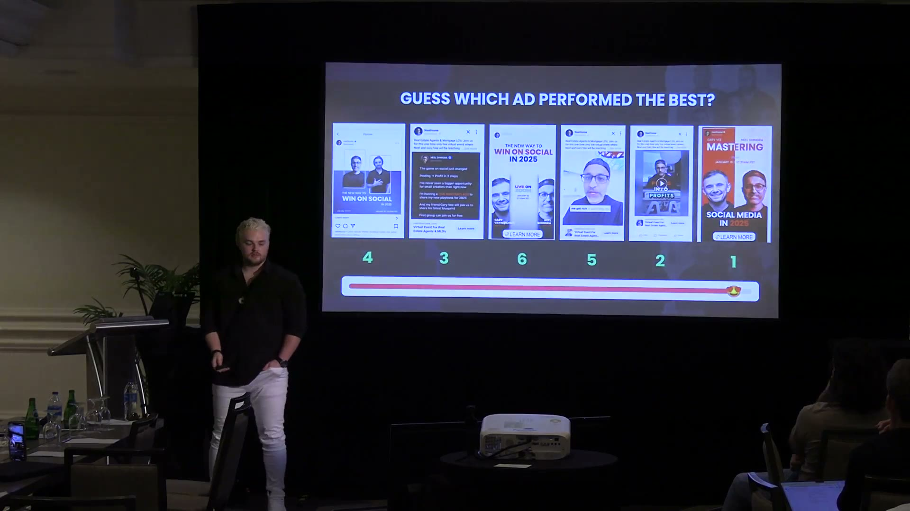
*Creative test reveal: ads re-sorted left to right (4, 3, 6, 5, 2, 1) above a "spicy meter" filled toward ad 1. The stated lesson is borrowing a famous co-host's authority. [v2 34:55]*

### Rules of thumb
- **DO** add proof inside the content section for the mechanism and at the end of each value-stack item. [v2 56:43]
- **DO** use a hidden-timer popup for a low-ticket upsell during the webinar replay; most people "probably don't even see it". [v2 23:01]
- **DON'T** use the same colour treatment as every other value stack (black text on red). [v2 51:35]
- **IF** a room question lists payment-friction ("$2,000 isn't realistic") **THEN** answer it in the pitch with the financing step, not later. [v2 54:08]
- **IF** show rate is low **THEN** check calendar-add, reminder timing (1 hour before and "live now" texts) before changing the pitch. (derived from [v2 17:20])

## Prompts / templates (verbatim)
This lesson contains no LLM prompts or Claude Project instructions. Verbatim scripts from the talk follow (light cleanup of Whisper errors; amounts verified against the platform captions).

**Elephant-in-the-room (permission to sell)** [v2 42:11–43:14]
```
All right, guys, look, I'm a big believer in no surprises, and so, you know, I just wanted to ask, like, who here is a little scared I might sell you something today? Go ahead and type one in the chat.

[chat reacts]

Well, hey, look, I got some good news for you. I'm going to sell you something here today. I'm going to give you an opportunity to join my community, but only for the people that get a ton of value from today's session. If that's fair, go ahead and say yes in the chat.
```
Instructor's reason: "we primed people, and we got them to get an agreement that they're ready to buy" and no one can say afterwards "he was just trying to sell me something". [v2 42:42]

**Two-options bridge** [v2 47:43–48:13]
```
Look, guys, you can go about your way, or you can take the information I shared with you for free today and go apply it. It might take you months, years, or you might never get there. Or option two, you can work with me and I'll share the exact system on how I was able to do X, Y and Z. Would it be okay with you guys if I shared how you could work with me? Type one in the chat.
```
"People that don't want to buy jump off." [v2 48:13]

**Information-alone bridge** [v2 48:13–49:20]
```
All right guys, we covered a lot today. Would you agree information alone is not going to save you? In fact, I don't care how many books you read, how many things you show up for, what is it that really creates the change in your life?
```
He builds "a flow of agreement". Then: "Would you be open to me sharing how you can get involved and take the next steps?" and "That's why I created [offer name]". [v2 50:42–51:07]

**Price drop** [v2 52:06–53:30] (the story numbers are his illustrative example for a stack "valued" at $22,500)
```
That's why we priced it at $6,500, and you can get started today for [first drop]. Imagine [future-pace result].

When I was sitting at home with my wife and kids, looking at my [asset] in the driveway, I thought back to when I was first getting started, and all I had wished for was a proven system I could plug into and get results. That's when my wife turned to me and said, "Let's do something crazy." Instead of $6,500, let's just charge $1,997.

But for everyone that joins today, we're going to go one step further, and give it to you for $1,497. [last drop ~25%, "today-only price"; "You can buy tomorrow if you want for two grand"] 
```
Amounts reconcile to the captions ("22,500", "6,500", "1997", "14.97", "two grand"). The Whisper transcript renders them as $19.97 and $14.97; the captions and slide ("Total value $22,500+") support $1,997 / $1,497. Flag: this is a staged story and a "value" ladder; see compliance flags.

**Financing line** [v2 54:08–54:37]
```
All right guys, I saw the chat, and I understand that for some of you, $2,000 isn't realistic. So we partnered up with a financing company. When you click the link, you'll see these options pop out. You guys can get started.
```
Then after about 8 minutes: split pay, then payment plans, each on its own link.

**Fast-action bonus patterns** [v2 53:41]
```
The first three people get [bonus A]. The next five get [bonus B].
-- or --
People that sign up in the next ten minutes get these bonuses. [Timer ends] Those bonuses are gone. Now these people that sign up get these bonuses.
```

**Text-in CTA** [v2 1:02:32]
```
Working with us more closely is something you're interested in? Here's the phone number to text right now. Just message us the word [KEYWORD] and we'll get you the info.
```

**Social comment-to-DM hook (ManyChat)** [v2 28:35–29:35]
```
Creator video: "Yo, get off your phone, we're at an event." / "Oh, sorry, I'm just making money from my phone. Comment the word CASH to get access to my free training."
Auto-DM: "Hey, I'm going to shoot the free course over to you. What's your email?"
```
(Course example for a biz-op offer; use only with verifiable claims.)

**Webinar slide skeleton (derived from the structure slide)**
```
INTRO (about 8 min): Headline | Sub-headline | Hero's journey | Reverse authority | Hook till end (bonus) | Differentiator | Elephant in the room | Future pace
CONTENT (about 30-40 min): The what, not the how | Secret 1 (external belief) | Secret 2 (internal belief) | Secret 3 (mechanism belief) | proof under each | Recap
CLOSE (about 15-30 min): Bridge | Offer reveal | Value stack (proof + benefit per item) | Price drop | Link drop | 3-5 bonuses | Financing and payment plans | FAQs | Text-in CTA
```

## Screenshots
Core slides are embedded above. Others:

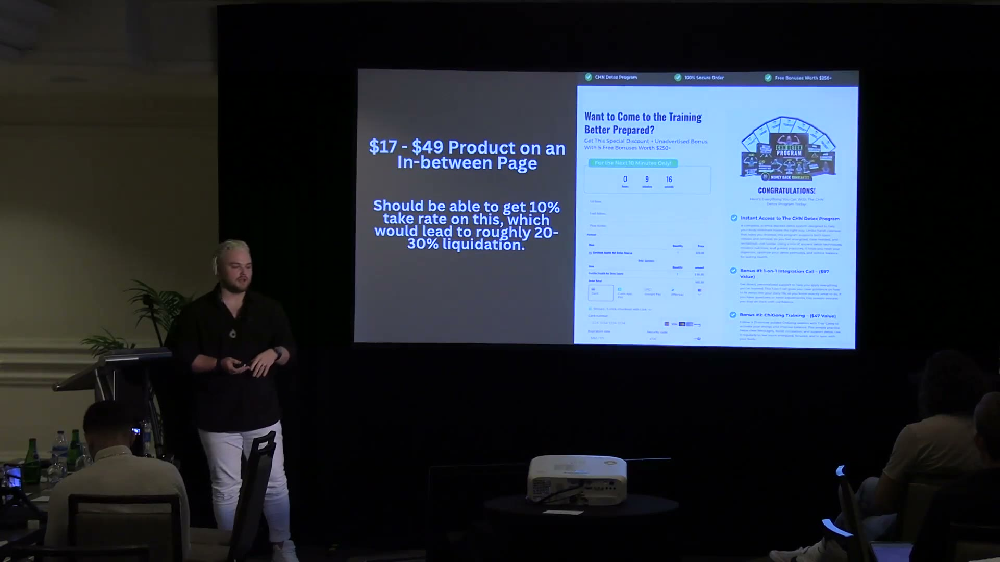
*"$17-$49 product on an in-between page. Should be able to get 10% take rate on this, which would lead to roughly 20-30% liquidation." with a countdown-timer offer page. [v2 19:24]*

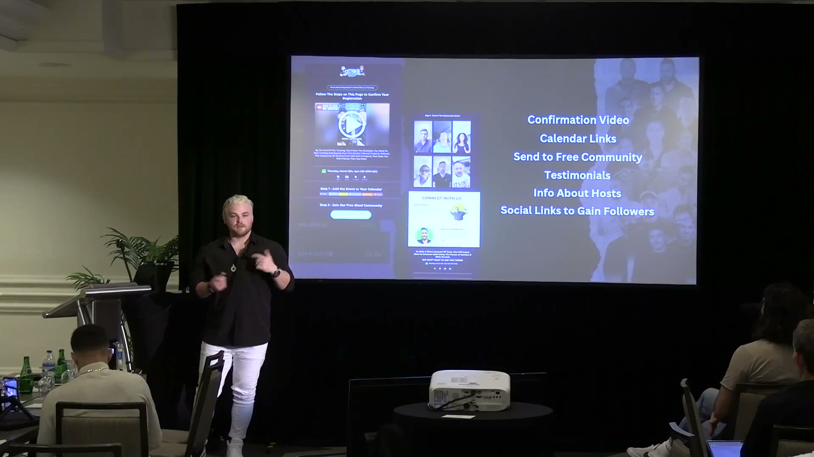
*Confirmation page layout and checklist: confirmation video, calendar links, send to free community, testimonials, info about hosts, social links to gain followers. [v2 20:06]*

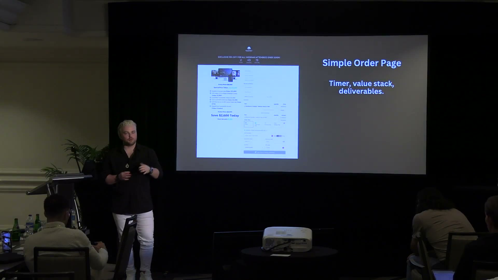
*"Simple Order Page: timer, value stack, deliverables", with a "save $2,600 today" line. [v2 21:06]*

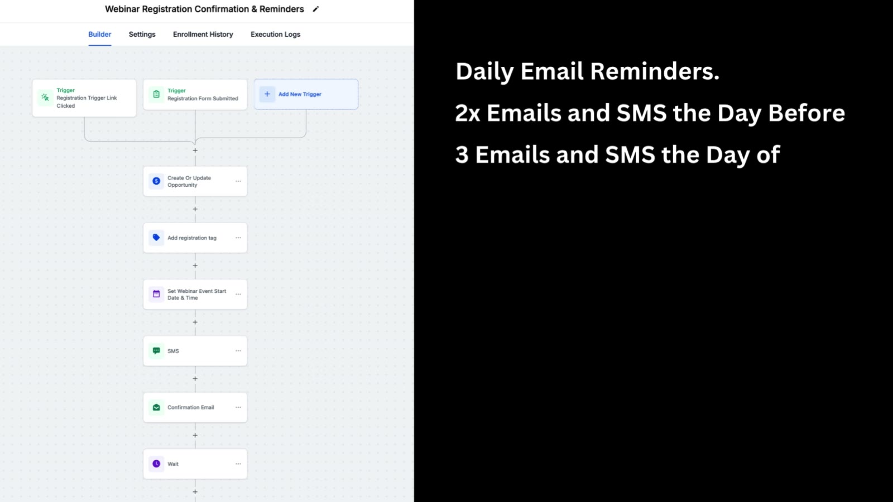
*v1 slide: automation builder screenshot with "Daily email reminders. 2x emails and SMS the day before. 3 emails and SMS the day of." [v1 frame 06:53]*

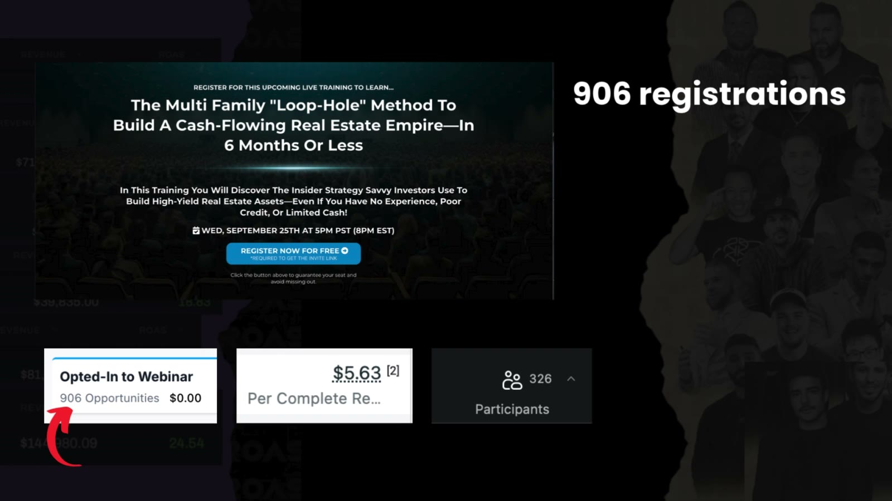
*v1 biz-op case study: registration page headline pattern, 906 registrations, $5.63 per complete registration, 326 participants. Course-slide numbers, unverified. [v1 frame 16:58]*

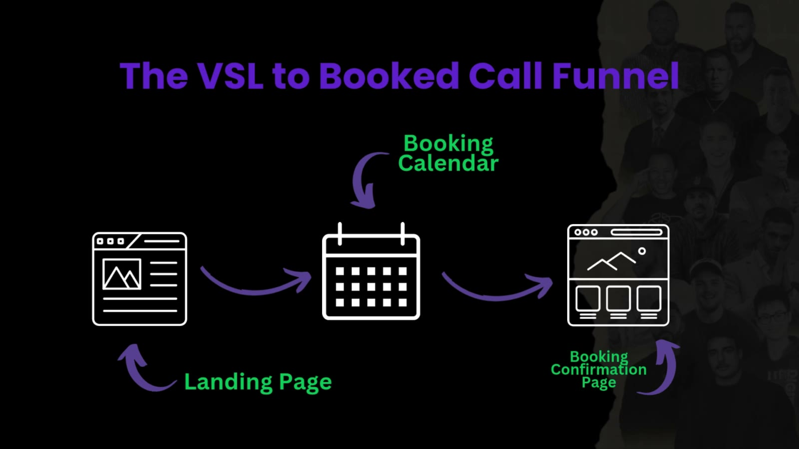
*v1 slide "The VSL to Booked Call Funnel": landing page → booking calendar → booking confirmation page. [v1 frame 22:29]*

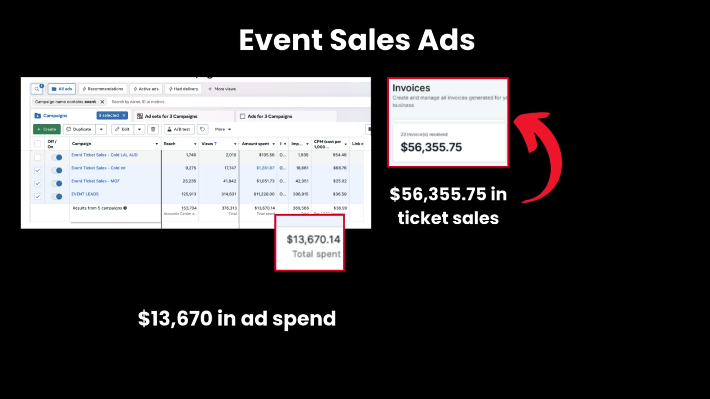
*v1 slide "Event Sales Ads": $13,670 ad spend vs $56,355.75 ticket sales on the invoices screen. Unverified. [v1 frame 23:13]*

## How to apply
- [ ] Decide whether the offer fits (instructor's cases: coaching, courses, local services, biz-op, B2B services; products "haven't really" been tested). For ecommerce physical products, treat the format as an untested idea, not a proven channel. [v2 26:29]
- [ ] Build the funnel in the order in section 4; write the registration page with only headline, sub-headline, date and host bio; put proof and video on the confirmation page.
- [ ] Set KPIs (30-35% cold opt-in, 40% show target, 6-10% close) and track your own actuals; do not assume them.
- [ ] Launch 15-20 creatives with copy variants; budget about $1,000 per ad set before judging; use partner/authority creatives only with permission.
- [ ] Add calendar-add buttons and a reminder cadence (day before and day of, email + SMS).
- [ ] Draft the slide outline: intro (8 min), content (3 secrets mapped to the three belief types), close (bridge, stack, price, link, bonuses, financing, FAQs).
- [ ] Write one proof element per secret and one per stack item from real customers only.
- [ ] Decide the free bonus you hold until the end and how it is delivered (chat drop or follow-up email).
- [ ] Add a text-in number and assign a chat closer if you have sales staff.
- [ ] **Compliance flags (derived, not from the instructor):**
  - Income, earnings and "$X in Y days" claims in biz-op/coaching promos need substantiation and typical-results disclosures (FTC Earnings Claims and Business Opportunity rules; Meta ad policy on income claims). Copy the structure, not the claims.
  - The "we broke the internet, here's the new link" SMS is a made-up outage notice; do not use it. Send an honest "we are live now" message instead.
  - Only use scarcity (limited seats, time-limited bonuses, "today-only" price) that is real and enforced; the price-drop script above uses an invented "my wife said charge less" story and a list price you may not actually charge. Reference prices must be real prices you have offered.
  - Using a famous person in the ad needs their consent (his cases are co-hosted events).
  - Financing and recurring billing need clear terms and easy cancellation.

## Related
- [13.1 Hidden factors for optimal funnel structure](13-01-hidden-factors-for-optimal-funnel-structure.md): where a webinar or application funnel fits by price point (webinar listed for $1k-$3k offers).
- [4.4 VSL background stories and unique mechanisms](04-04-vsl-background-stories-and-unique-mechanisms.md): biz-op webinar/high-ticket often skip the UMP and go straight to the UMS; the "rebuild beliefs" secrets here play the same role as a UMP.
- [4.6 VSL closes](04-06-vsl-closes.md): compare the VSL close to the webinar bridge, value stack, price drop and bonuses.
- [16.3 Funnel economics with SPG](16-03-funnel-economics-with-spg.md): use CPA/AOV/COGS math to test the 1,000 registrants → 40 buyers model.
- [11.1 Checkouts walkthrough](11-01-checkouts-walkthrough-part-1.md): order-page and bump logic.
- [16.5 VSL benchmarks, data and best practices with Patrick Stiles](16-05-vsl-benchmarks-data-and-best-practices-with-patrick-stiles.md): the VSL retention data Dylan compares against ("Patrick's talk").
- Evolve Copywriting: [Beliefs](../../../evolve/copywriting/concepts/beliefs.md), [Bridges](../../../evolve/copywriting/concepts/bridges.md), [Pitch transition](../../../evolve/copywriting/concepts/pitch-transition.md), [Objection handling](../../../evolve/copywriting/concepts/objection-handling.md), [Authority in ads](../../../evolve/copywriting/concepts/authority-in-ads.md).
- Shared KB: [Offer and bundle psychology](../../../../frameworks/offer-and-bundle-psychology.md), [Story frameworks for ads](../../../../frameworks/story-frameworks-for-ads.md).
- Disagreement check: the Evolve pages linked above were not re-read in full for this lesson, so no disagreement with them is asserted. Within this lesson, note the tension between "reverse authority" ("I'm nobody") in the intro and the speaker's long credential slides before it; treat reverse authority as a story device and let proof carry the authority. (derived)

## Sources and limitations
- v2 transcript: `04-[4] High Ticket Webinar Funnels with Dylan Vanas.txt` (3,892.95 s, 64:53), full coverage; platform captions `04-4 Dylan Vanas - Webinar Frenzy.srt` used to verify names and amounts. Timestamps here are our transcript's paragraph starts; the captions' clock runs about 5-20 seconds later in places.
- v1 transcript: `04-WEBINARS - LIVE TALK.txt` (1,424.59 s, 23:45). The speech is mostly absent: only looped fragments from an embedded "new office" clip (01:20-03:23, repetitive Whisper output) and a client's celebration clip (15:44-16:40). All other v1 content comes from slide frames sampled at about 1-3 minute intervals, so the deck's slide order and any spoken explanation are incomplete. Slide numbers are cited as `v1 frame mm:ss` and are keyframe times, not narration times. The v1 deck repeats Dylan's v2 story but includes case-study slides not in the v2 talk; whether v1 audio exists but was not captured is unknown.
- Whisper/caption fixes: "Dylan Vance" = Dylan Vanas (file name and slide); "Ed Marlett" = Ed Mylett (captions); "Neil Dinga/Dingra" = the co-host's name as spelled on the slide (Dhingra); "roads/Ryan roas" = ROAS (agency name) and "run ROAS"; "cache" = "cash"; "$19.97 / $14.97" = $1,997 / $1,497; "Ad Event" tool is likely "AddEvent" (derived; not confirmed on screen). "Iome" (Naveen Jain's company) left as spoken. The "Dillon Agency" and the "Gabe" proof example are unverified spellings.
- Numbers (revenue, ROAS, show/close rates, retention, take rates, claimed speaker background) are instructor or slide claims, none independently verified. Several are internally inconsistent (e.g. "3K into 100K" vs "$3,600 into $17K/18K"; opt-in warm "45 to 50%" spoken vs "45-55%" slide). Treat as order-of-magnitude benchmarks for his niches (coaching, biz-op, B2B services), not DTC ecom.
- The in-room host is unnamed in the files. Audience questions are unattributed. A third-party client's name appears in the v1 slides and was left out of this page.
- Frames kept: 16 informative slides from both videos (talking-head frames excluded). Frames showing personal chats or customer-identifying messages were not kept.
