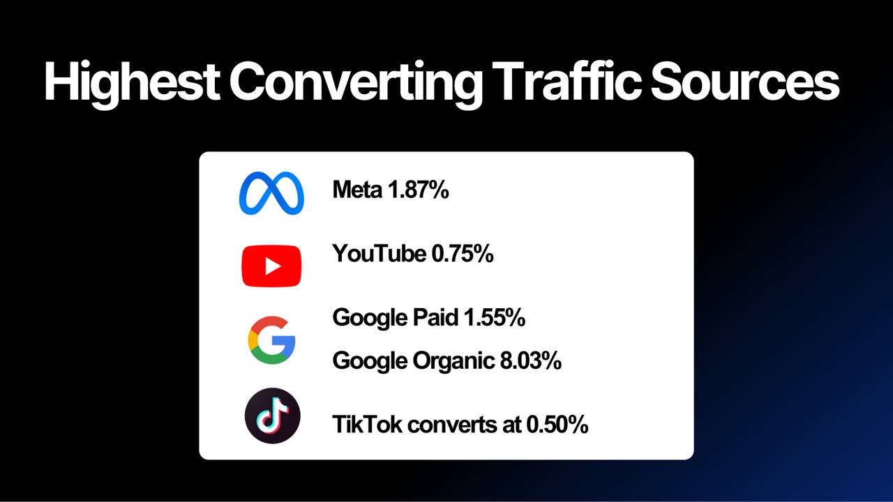
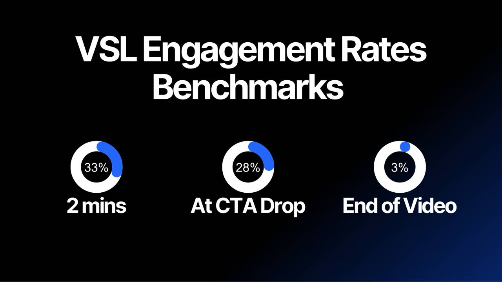
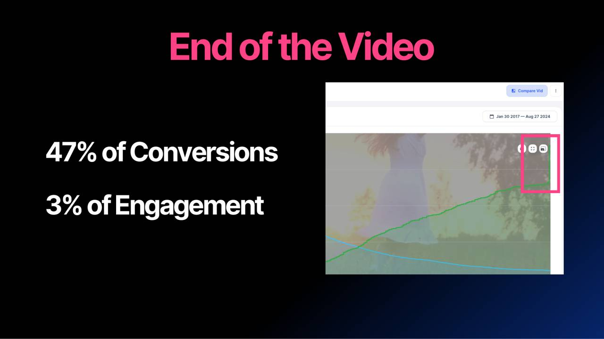
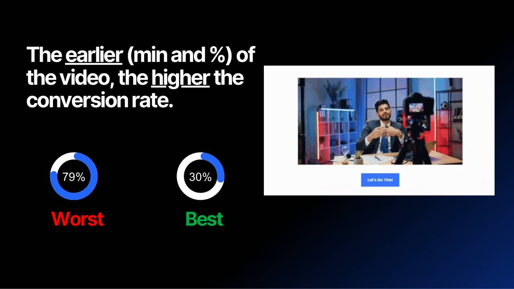
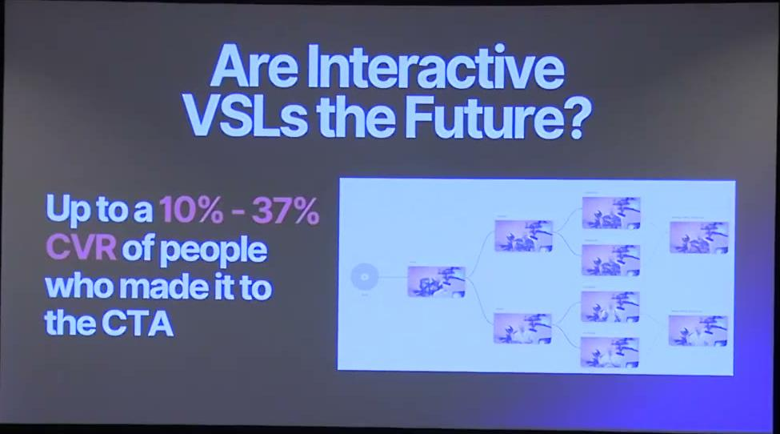

# 16.5 VSL Benchmarks, Data, and Best Practices with Patrick Stiles
> A live mastermind talk of Vidalytics platform benchmarks (conversion, engagement, unmute, length, CTA timing, devices, returning visitors, upsells) with a step-by-step "where are you, what next" playbook that tells a VSL owner which numbers to check and which player and copy changes to try first.

## 🤖 Agent use
- **Use when:** diagnosing a VSL that underperforms; choosing VSL length or CTA timing; setting video-player features; writing the first 7 seconds and the post-CTA "clincher" copy; planning tracking (tags, micro-conversions); deciding what to test first on a VSL funnel (front end, book-a-call, or upsell).
- **Inputs → outputs:** player analytics (conversion rate, engagement at 2 minutes / CTA drop / end, unmute rate, device split, returning-visitor share, conversion by watch point), traffic source, niche, funnel type → which benchmark you fall below, the ordered fix list, and copy/test instructions.
- **Rules (every figure is Patrick Stiles' platform data and a "(guest claim)"):**
  - **DO** locate yourself on the benchmarks in order: conversion rate, then engagement, then unmute rate, then when conversions happen, then length, CTA timing, upsells, devices, returning visitors. The deck is built "from the easy wins... to the stuff that's going to be a heavier lift". [01:28]
  - **DO** compare conversion to the platform average of 1.78% for all videos and about 8% for book-a-call funnels (guest claim). [04:14]
  - **DO** compare engagement to 33% at 2 minutes, about 28% at the CTA drop and 3% at the end of the video (guest claim). [19:36; slide 31]
  - **DO** make the first 7 seconds "super juicy": the average viewer unmutes at about 7 seconds, and assume they may watch the first seconds muted (guest claim). [24:04–24:30]
  - **DO** always set a video thumbnail or first frame: autoplay fails about 6.5% of the time (low-power mode, data-saving mode, obscure browsers, Instagram browser). [28:22–30:16]
  - **DO** write post-CTA "clincher" copy and stay with the buyer until the video ends: 47% of conversions come from the 3% who reach the end (guest claim). [30:44–31:14; 33:53]
  - **DO** split-test the lead (first minutes) before small player toggles: "the highest impact split test is always going to be split testing the lead of the video". [20:35–21:00]
  - **DO** put seeking bars on upsell VSLs (60% higher engagement, correlation) and show a returning visitor a shorter video with a seeking bar, early CTA and clincher copy. [43:33; 47:58–48:28]
  - **DON'T** treat the player-feature data as split-test proof: "these aren't split tests". When in doubt, follow best practice. [11:23–11:52]
  - **DON'T** over-optimize engagement alone: engagement and conversion correlate at 28% (weak but statistically significant) and the link is weakening; people watch less and buy more. [14:33–15:29; 16:00–16:27]
  - **DON'T** copy "CTA at 30 seconds" without checking AOV and LTV: a nine-figure brand does it, but the data cannot say what it does to LTV. [42:05–42:35]
  - **IF** the engagement at 2 minutes is below 33% **THEN** rework the lead (slide: "replace the first 2 minutes"); **IF** below about 28% at CTA drop **THEN** work the lead-to-CTA stretch; **IF** below 3% at the end **THEN** work the close (CTA to end). [slides 32-34]
  - **IF** the unmute rate is far below the 40% average **THEN** fix the headline/presell and the first 6-7 seconds, add captions, customize the autoplay message. [21:55–22:25; 25:00–26:25]
  - **IF** you target Brazil or Singapore **THEN** weigh engagement benchmarks less: low engagement there does not hurt conversion as much. [10:33–11:01]
- **See also:** [4.2 VSL fundamentals: classic structure](04-02-vsl-fundamentals-classic-structure.md) · [4.11 VSLs on landing pages vs in-feed](04-11-vsls-on-landing-pages-vs-vsls-as-in-feed-ads.md) · [7.1 Long-form VSL](07-01-long-form-vsl.md) · [7.2 Medium-length VSL](07-02-medium-length-vsl.md) · [7.3 3-7 minute VSL](07-03-3-7-minute-vsl.md) · [7.4 Short VSL](07-04-short-vsl.md) · [16.3 Funnel economics with SPG](16-03-funnel-economics-with-spg.md) · [13.1 Hidden factors for optimal funnel structure](13-01-hidden-factors-for-optimal-funnel-structure.md)

## Key ideas

### 1. Who is speaking and what the data is [00:00–04:14]
- Stefan Georgi introduces Patrick Stiles at a live mastermind ("Thanks, Stefan"; "I spoke about six months ago at the first or last Mastermind"). They have known each other "almost a decade", from before Vidalytics. [00:00–00:58]
- The talk is repackaged "into more of a playbook": benchmarks, "where are you", then what to do next sequentially. [00:58–01:28]
- Patrick's claim: "I would bet anybody that the stuff I'm about to show you would increase your conversion rates. I'd bet you a thousand bucks easy." The closing slide says "we've never lost" (slide 76). (guest claim) [01:28]
- Credentials (guest claim): making VSLs since 2010; founded Vidalytics "with my ex-wife"; the platform data covers 178,000 videos, about $3,000,000,000 in sales and "5,000 years of video watched" in 2024 (slides 8). He says the first version of the report "took over a year" to build and that a PhD on his team helped; the correlation is "statistically significant". [01:54; 02:53–03:22; 14:33–15:00]
- He has "personally audited over 100 split tests" of Vidalytics against other players "and every single time we've found a problem"; Vidalytics inserts its engineers into the process "to make sure the data is going to be clean". [03:22–03:49]
- Clients named on screen/spoken: Primal Health (in the room) and other Vidalytics users. [02:53]
- Name note: the transcript writes "Vitalytics"; the platform PDF is titled "State of VSL - Vidalytics". The page uses Vidalytics.

### 2. Conversion benchmarks [04:14–11:01; slides 12-19]
All figures are Vidalytics platform data where conversion tracking is detected (guest claim). Most users are health advertisers; "the vast majority of traffic on Vidalytics is paid". [04:39; 07:33–08:03]

| Cut | Figures | Cite |
|---|---|---|
| All videos | 1.78% average conversion | [04:14] / slide 12 |
| Book-a-call | about 8% ("stayed kind of flat"); slide 8.24% | [04:14] / slide 12 |
| Trend | 2023: 1.2% (slide 1.21%); all-time 1.56%; last 6 months 1.78%; 2025 so far 1.5% (two months in) | [04:14–04:39] / slide 13 |
| Niche | Biz Op 2%; Dating 0.73%; Finance 3.45%; Golf 0.54%; Health 1.61% | slide 14 (shown at [05:36]) |
| Traffic source | Meta 1.87%; Google paid 1.55%; YouTube 0.75% ("below a percent"); TikTok 0.50% ("super low"); Google organic 8.03% | [06:08–07:33] / slide 15 |
| Medium | Referral/affiliate 2.46%; paid 1.01%; organic 3.01%; email 1.51% | [07:33–08:03] / slide 16 |
| Region | USA about 4x Africa; EU about 30% higher than North America | [08:03–09:03] / slide 17 |
| Best countries | Spain 6.4%; France 3.6%; Italy 3.1% | [09:33] / slide 18 |
| Worst countries | Nigeria 0.4%; India 0.4%; South Africa 0.5% | [09:33] / slide 18 |

- Seasonality caveat: January volume "ramps up" after Dec 26; holiday weeks depress health purchases, so early-2025 rates may be lower than the trend. [05:07]
- Patrick says the average conversion trend "does seem like the trend is going up". [05:07]
- **Spoken vs slide mismatch:** at [05:36] he says "engagement rates by niche" while slide 14 (conversion by niche) is on screen. The engagement-by-niche slide is in the section below. Golf is lowest on both ("we went back and verified this number"). [05:36–06:08]
- Google organic 8.03% is probably branded-search attribution noise: a listener notes organic buyers often watched a VSL or ad earlier; Patrick agrees ("100%... the conversion window"). [06:37–07:33]
- Africa vs US: engagement is similar but conversion about one quarter; advice: geo-detect African traffic and send it to an affiliate offer that suits the market. [08:03–08:33]
- EU: "an arbitrage kind of thing": companies with European fulfillment copy tactics proven in North America. [09:03–09:33]
- Brazil and Singapore have bad engagement but are not the worst converting. [10:04–10:33]


*Slide 15 (deck PDF): Meta 1.87%, YouTube 0.75%, Google paid 1.55%, Google organic 8.03%; "TikTok converts at 0.50%". [06:37]*

### 3. Player features that correlate with higher conversion [11:01–14:33; 17:21–19:36]
- Controls on the video (rewind, volume, quality, speed) correlate with higher conversion. "Normally it's like strip away all distractions", so this surprised him. Nice-to-have, not mandatory. [11:01–11:52; slide 21]
- Video resolution (slide 22): startup resolution 270p 1.52%, 360p 0.96%, 720p 2.20%, 1080p 1.13%; max resolution 270p 2.11%, 360p 1.76%, 720p 2.04%, 1080p 2.21%. He "almost didn't share" it: "there's not a clear trend". Advice: a video that can run 1080p but a startup resolution of medium or lower so it "starts up faster" and upscales to the viewer's bandwidth. [12:25–14:09]
- **Smart autoplay**: plays with sound if the browser allows, otherwise muted; recently Instagram's in-app browser stopped even muted autoplay, forcing click-to-play. [17:21–18:39]
- **Smart pause**: pauses when the viewer leaves the tab, so they cannot "wait for your CTA to drop so they can make an up or down decision on your price" (Whisper "CTH" corrected to CTA). [18:39–19:08]
- **Focused full screen**: on mobile, uses the browser's full width so custom controls and a removed seeking bar stay consistent. [19:08–19:36]
- Patrick's note to Stefan: Stefan's team should do a "video conversion audit", a checklist run by Vidalytics, and Stefan proposes a full "everything done" variant vs the current page as a case study rather than a granular split. [53:56–54:47]

### 4. Engagement benchmarks [14:33–21:00; slides 25-34]
- Correlation between engagement and conversion: 28% in 2025 (33% previously), "weak or very weak", yet statistically significant. Meaning: people must watch before they buy, but "if I double my engagement rate, I'm not going to double my conversion rate". [14:33–15:29]
- Engagement is "on average how much of the video a person watched" and it has been falling for three years while conversion rises: viewers watch less and buy more ("maybe they're in info overload but have a higher propensity to buy"). [15:29–16:58]
- By niche (slide 27): all 19%; business 22%; dating 18%; finance 24%; golf 13%; health 12%. Spoken: "between 15 and 20-ish percent, or 25% in the case of finance". Trend 22% (2022) to 19% (2025), slide 28. [15:29–16:27]
- By traffic (slide 29): referral/affiliate 26%; email 25%; paid 21%; organic 21%; "Surprising that Organic has the worst engagement". Patrick lists order "affiliates... then email then paid and organic". [16:27–16:58]
- Three checkpoint benchmarks (slide 31): **33% at 2 minutes**; **28% at CTA drop**; **3% at end of video**. Spoken: "33% at two minutes... one of the most important metrics". A VSL he looked at the day before had 45% engagement ("those guys are crushing it"; he names Jake and Dave). In earlier data the drop between 2 minutes and the CTA drop was larger (about 35% at 2 minutes and about 22% at CTA, as he describes at [58:54]); the gap has tightened. [19:36–20:35; 58:54]
- Slides 32-34 ("Engagement Bridge Strategy"): below 33% at 2 minutes, "replace the first 2 minutes"; below 28% at CTA drop, work on the lead to the CTA; below 3% at the end, work on the close. These prescriptions appear only in the deck; Patrick in speech says to split-test leads and not to fixate on lead length ("I wouldn't necessarily focus on your lead" was said about a 45% performer). [20:07–21:00]
- How to test: pick a point (he picks 2 minutes), "set up tracking to actually fire right then so I can know how much I'm paying to get somebody to two minutes into the video". [20:35–21:00]


*Slide 31 (deck PDF): "VSL Engagement Rates Benchmarks": 33% at 2 mins, 28% at CTA drop, 3% at end of video. [19:36]*

### 5. Unmute rate and the first seconds [21:00–30:16; slides 35-41]
- Question tested: are people watching VSLs on mute? "The answer is basically no", but unmute rate is worth checking: one example (400 clicks, 18% unmuted) was a presell/headline problem, not a VSL problem (guest claim, anecdote about someone's agency VSL). [21:00–22:25]
- **Unmute timing**: best 0 s, average 7 s, worst 63 s (slide 36; video frame at 23:40 shows "How Fast Do People Unmute?"). In Vidalytics, when the viewer unmutes the video restarts so nothing is missed; so no "turn on your sound" countdown, but make the first at least 7 seconds "super juicy" because audio is not working for you yet. [24:04–24:30]
- **Unmute rate**: average 40%; top 10% = 75% (slide 37; Patrick is unsure whether the 75% is of unmutes or conversions: "I'd have to check"). [24:30–25:29]
- Actions to lift unmute (slide 38): AI captions (one click if not already burned in; he says they are "probably" accurate and does not think they can be edited in the player; hard-coded captions are fine, and they can show automatically or as an option); customize the smart-autoplay message (copy, colors, style); spice up the first 6 seconds ("a roll... live footage that they actually shot themselves, not B-roll, not text on screen"); use a video thumbnail. [25:29–27:39; 55:20–56:55]
- **Video thumbnail** (new feature): a looping segment (chosen from the VSL or uploaded) that looks like autoplay: "like a movie trailer... bam, bam, bam... something super exciting". [26:25–27:39]
- **Smart-autoplay message styles** (slide 40, "New Data - Q2 2025"; later than the talk): "Front and Center" 32% unmute; "Classy in the Corner" 27%; "Loud and in Your Face" 20%; no message 7%. In the room Patrick says the "square in the middle" version was built for a client team (Steve Weatherford's) and is "our best practice"; "Classy in the corner" is another style. [22:54–24:04]
- **Autoplay failure**: 6.4% of the time (slide 41) / "about 6.5%" (spoken); causes: low-power mode, data-saving mode, obscure browsers (and now Instagram's browser). "That's over 1/20th of your traffic." Example he saw: first frame white on a white page, no other controls, so the viewer could not know to click. Rule: always set a thumbnail. [28:22–30:16]

### 6. When do conversions happen [30:16–34:24; slides 42-47]
- Conversion tracking attributes a purchase back to how far into the video the buyer watched. In Patrick's own VSLs, the share of conversions at the very end went from 35% to now 47% (guest claim). At the same time only 3% of viewers reach the end. [30:16–31:14]
- Same pattern on another VSL (Jake and Dave's): about 3% engagement at the end and nearly half of all conversions. [31:14]
- Technical action: a **countdown timer redirect** at the end (slide 44: "Videos with it have a higher CVR"; spoken: "have the video basically count down"). [31:14–31:45]
- Psychology action (assumptive close): his newspaper-subscription anecdote: "debit or credit?" gets people reaching for the wallet even though the form had no such field. (slide 45: "Visa or Mastercard?") [31:45–32:30]
- Why those buyers wait: "FOMO... anxiety": they now have a problem of deciding whether to buy (what do I tell my wife, will it work, will I feel stupid, return policy). So write what happens after the CTA: "what's that clincher copy that's getting them over the fence". [32:30–32:55]
- **Tags** (CRM) and **micro-conversions** (ad account/marketing tool): watching most of the VSL is "as high as it can get" lead scoring; retarget those viewers and "max out the CPC or whatever the bidding threshold is". [32:55–33:53]
- Clincher copy examples (slide 47 and speech): "If you're ready to buy, then do it." "I am not going over anything new here." [33:53]


*Slide 43 (deck PDF): 47% of conversions come from the 3% of engagement at the end of the video. [30:44–31:14]*

### 7. VSL length [34:24–36:42; slides 48-53]
- Average VSL length: 36 minutes in 2025 vs 31 in 2021 (slides 48; Patrick says "2001" by mistake), about 15% longer. He had assumed VSLs were getting shorter and the data said otherwise. [34:24–34:54]
- By niche (slide 49): Biz Op 24 min; Dating 30; Golf 32; Finance 59; Health 40. [34:54]
- Conversion-optimal length (guest claim): book-a-call best 25 min / worst 60 min (they are measuring the booking, not show rate); straight-sale VSL best 20 min / worst 45 min; upsell best 20 min / worst 40 min. Slide 53: "VSL Length Sweet Spot: 15 and 35 min VSLs convert highest". Spoken: whenever a video hits about an hour, "engagements and conversions just drop off a cliff". [35:17–36:42]
- (Derived) This sits against the course's long-form VSL guidance of 25-60 minutes ([7.1](07-01-long-form-vsl.md)) and the 15-40 minute medium range; the data suggests the 45-60 minute end is the weaker range for straight sale, while health and finance niches run longer on average. Use niche averages and a test, not a rule.

### 8. When to drop the CTA [36:42–42:35; slides 54-57]
- Percentage of video at which the CTA drops: worst converting VSLs 79%; best converting 30% (slide 55; spoken "worst... 79%, best... 30%"). "The earlier in the video, the higher the conversion rate." [36:12–36:42]
- Product reveal need not coincide with the CTA drop (slide 56). A nine-figure brand dropped the CTA at 30 seconds after testing; Patrick "wasn't involved in that" test. His question: "what is their AOV and their lifetime customer value of somebody that's maybe not watching their entire video, getting fully indoctrinated?" [42:05–42:35]
- Q&A clarification: "dropping the CTA" = revealing the buy button/offer below the video; nearly always the script also says "go click it" at that point; the data is quantitative, not copy-reviewed. [52:32–52:58]
- Tension: most conversions happen at the end while the best performers drop the CTA early: "that is something to balance between the two... I don't know how to balance those necessarily". [57:27–57:54]
- Pre-call video use (book-a-call): tag leads in the CRM by how much of the pre-call video they watched and nudge ("I'm going to cancel it if you don't watch it"). Passing identity: opt-in on the previous page and pass it on the URL, or use a play gate opt-in or API. [37:42–39:50]
- Vid conditions (conditional video rules): show a different video based on device, if they have watched before, a tag (for example, reached price), or URL parameter; example: returning viewers who saw the price see more clincher copy. [39:50–40:41; 46:58]


*Slide 55 (deck PDF): "The earlier (min and %) of the video, the higher the conversion rate": 79% worst, 30% best. [36:42]*

### 9. Upsell VSLs [42:44–43:33; slides 58-61]
- Engagement front-end VSL 21% vs upsell 15% ("over a quarter less engagement"), yet upsells convert at "a much higher clip... a good take rate can be 20%". [42:44–43:04]
- Front-end VSLs are getting longer while upsells get shorter: average upsell length 36 min (2022) to 24 min (2025) (slide 60). [43:04]
- Seeking bar on upsells: 24% engagement, "60% higher" (slide 61); advice: "put seeking bars on all of your upsells". [43:04–43:33]
- Q&A: a listener who drops the CTA at the end of upsells reports a 65% conversion; Patrick: "you might actually be onto something". [56:55–57:27]
- Link to course: see [14.1 Upsells overview](14-01-upsells-overview.md).

### 10. Devices [43:33–45:25; slides 62-66]
- Straight-sale VSL converts best on desktop; book-a-call on mobile. Tablets: slightly higher engagement but 27% lower conversion (small share of traffic; "browse mode"). Mobile share of traffic: 57% (2021) to 72% (2025); Brazil is the only top-23 country with more desktop than mobile. [43:33–44:57]
- Best practice: a different video per device: vertical on mobile, landscape on desktop. [44:57–45:25]

### 11. Returning visitors [45:25–48:28; slides 67-72]
- Returning visitors: 12% of traffic in 2025, down from 17% (the previous report 13.3%); Brazil highest. They convert higher: slide says 62% higher, speech says "65% higher" (guest claim; use the slide's figure with the mismatch noted). [45:25–45:55; 47:58]
- Typical best practice: resume play (offer "continue where you were or start over"). But a looser data finding: videos that simply turn the seeking bar back on for returning viewers (the "revisit seeking bar") had a higher conversion correlation than resume play; he suggests testing that (not a split test yet). [45:55–46:58]
- Strategy for returning viewers: a shorter video, seeking bar, "getting into the close as soon as possible", CTA drop sooner, clincher copy right at the CTA. [47:58–48:28; slide 72]
- Distinction: the "rapid engage bar" is a fake seeking bar that moves fast and cannot be clicked; the returning-visitor bar is real. [53:26–53:56]

### 12. Where next: interactive VSLs [48:28–51:57; slides 74-75]
- Choose-your-own-adventure VSLs: viewer answers a question and a different pre-rendered segment plays, seamlessly. Idea: questions based on psychographics (goals, motivations, fears) and an avatar-specific unique mechanism of the problem ("if you're a woman losing weight... toxic estrogen syndrome or something"; this is a course-style illustration, not a verified claim). [48:28–49:24]
- Slides: "Up to a 10%-37% CVR of people who made it to the CTA" and "2x-10x CVR @ CTA" (not read aloud; guest claim, no sample size given). [slides 74-75; frame 49:30]
- Quiz-funnel variant: most people use 1-2 answers (gender, age) to route to different VSLs; Patrick's example "simplified down to seven in the end". He miscalculates the permutations at [51:24]: "two times four times eight, 16"; 2 x 4 x 8 is 64 (derived). [50:33–51:57]
- Personalization is the future: "AI is going to be handling a lot of this" like ad-platform algorithms (opinion). [47:28]


*Slide cropped from the live video: "Are Interactive VSLs the Future? Up to a 10% - 37% CVR of people who made it to the CTA", with a branching tree of video segments (lead, two choices, four sub-choices, three endings). [49:30]*

### 13. Q&A [51:57–1:01:48]
- **Nominal fee on a book-a-call** ($1 or $5 to raise show rate): not seen; refundable "reserve your spot... you'll get it back when you show up" idea, "you gotta test it". [54:47–55:20]
- **Can AI captions be edited?** "I don't think so", maybe download and re-upload; hard-coded captions accepted; redundant when on-screen text exists. [55:20–56:55]
- **Engagement drop between 2 minutes and CTA** (audience VSL: about 40-45% at 2 minutes, 16% at CTA at about 16 minutes): "the massive drop"; Patrick: "I'd really focus on the message between those two... the biggest leverage point". He has not yet pulled the average CTA time in minutes. [58:54–1:00:44]
- "Most engagement graphs look like a plane landing": nosedive early, then smooths out, "completion bias kicks in". [58:54–59:48]
- He also checked percentage vs minutes to avoid "accidentally looking at videos that are just short". [1:00:16–1:01:16]

## Steps / framework
**Sequential VSL diagnosis (the playbook's order; the numbered list is the lesson's flow, tests labelled derived):**
1. Conversion vs benchmark (1.78%; niche; source; region). Segment by device and traffic source. [04:14]
2. If low, fix cheap player items: controls, 1080p video with medium/low startup resolution, smart autoplay/pause/focused fullscreen. [11:01–19:36]
3. Engagement: compare 33% at 2 min, about 28% at CTA, 3% at end. Test leads first (derived). [19:36–21:00]
4. Unmute rate and the first 6-7 seconds; thumbnail; captions; autoplay message. [21:00–30:16]
5. Where conversions occur; add post-CTA clincher, countdown redirect, tags, micro-conversion retargeting. [30:16–34:24]
6. Length (15-35 min sweet spot; 20 min straight-sale best). [34:24–36:42]
7. CTA timing (test earlier; check AOV/LTV). [36:42–42:35]
8. Upsells: seeking bar, 20 min or shorter, CTA drop at end (listener claim). [42:44–43:33; 56:55]
9. Device-specific videos; returning-visitor video with seeking bar; consider interactive branching. [43:33–51:57]

## Examples
- Client names: Primal Health (user), Jake and Dave VSL (45% engagement at 2 minutes), Steve Weatherford's team (custom "square in the middle" smart autoplay message), a nine-figure brand with a 30-second CTA, an agency VSL with 18% unmute rate. [02:53; 20:07; 22:54; 42:05; 21:55]
- Newspaper-subscription anecdote: "debit or credit" assumptive close. [31:45]

## Structured units
**Benchmarks (all guest claims, Vidalytics data; slide numbers in brackets)**

| Metric | Value | Cite |
|---|---|---|
| Avg conversion, all videos | 1.78% | [04:14] [12] |
| Avg conversion, book-a-call | about 8% (8.24%) | [04:14] [12] |
| Avg engagement | 19% (niche range 12-24%) | [15:29] [27] |
| Engagement at 2 min | 33% | [19:36] [31] |
| Engagement at CTA drop | 28% (spoken 29% in Q&A) | [57:54] [31] |
| Engagement at end | 3% | [31:14] [31] |
| Conversions at end of video | 47% (35% earlier) | [30:44] [43] |
| Engagement-conversion correlation | 28% (33% earlier) | [14:33] [26] |
| Avg unmute rate | 40%; top 10% 75% | [24:30] [37] |
| Avg unmute time | 7 s (0 best, 63 worst) | [24:04] [36] |
| Autoplay failure | 6.4%-6.5% | [28:22] [41] |
| Avg VSL length | 36 min (31 in 2021) | [34:24] [48] |
| Best/worst length | book-a-call 25/60; straight sale 20/45; upsell 20/40 | [35:17–36:42] [50-52] |
| CTA drop % of video | best 30%; worst 79% | [36:12] [55] |
| Front-end vs upsell engagement | 21% vs 15%; seeking bar upsell 24% (+60%) | [42:44] [59, 61] |
| Mobile share of traffic | 72% (57% in 2021) | [44:27] [65] |
| Tablet conversion | 27% lower | [43:59] [64] |
| Returning visitors | 12% (17% earlier); convert 62-65% higher | [45:25; 47:58] [68] |
| Interactive VSL | 10-37% CVR among viewers reaching CTA; 2x-10x | [49:30] [74-75] |

**Rules of thumb as DO/DON'T/IF are in the Agent use section.**

## Prompts / templates (verbatim)
No LLM prompts in this lesson. Clincher-copy lines given by the speaker (also on slide 47):
```
"If you're ready to buy, then do it."
"I am not going over anything new here."
```
Speaker's paraphrase of the clincher job: "If you're ready to buy, then do this now. You're not gonna see anything new. I've covered absolutely everything. Basically, take action now." [33:53]

Agent benchmark checklist (derived):
```
Funnel type: [straight sale | book-a-call | upsell]  Traffic: [paid | email | affiliate | organic]  Device mix: __
Conversion __% vs 1.78% (book-a-call ~8%)
Engagement at 2 min __% (33%) | at CTA __% (28%) | at end __% (3%)
Unmute rate __% (40%) | avg unmute time __ s (7)
Autoplay thumbnail set? Y/N
Conversions at end of video __% (47%)
VSL length __ min | CTA drop at __% of video (best 30%)
Returning visitors __% | separate returning-visitor video? Y/N
Upsell seeking bar? Y/N
```

## Screenshots
Four deck slides (15, 31, 43, 55) from the shared PDF and one slide cropped from the live video (interactive branching, 49:30). The "How Fast Do People Unmute?" frame (0 / 7 / 63 seconds, 23:40) was grabbed but not kept because slide 36 of the deck carries the same numbers.

## How to apply
- [ ] Pull conversion, engagement checkpoints (2 minutes, CTA, end), unmute rate and device split from your player and compare to the table.
- [ ] Set a thumbnail, check startup resolution, add captions or burned-in text and a punchy first 7 seconds.
- [ ] Write post-CTA clincher copy and a countdown/redirect end screen.
- [ ] Test lead variants before small toggles; test CTA timing only while tracking AOV and LTV.
- [ ] Tag deep viewers in the CRM and build a retargeting audience from micro-conversions.
- [ ] Build a short returning-visitor video and device-specific cuts.
- [ ] (Derived) Treat the benchmarks as directional: they are not split tests, are health-heavy, and may be partly attribution noise (for example Google organic).

## Related
- [16.3 Funnel economics with SPG](16-03-funnel-economics-with-spg.md): what a conversion lift is worth in CPA and profit.
- [4.2 VSL fundamentals: classic structure](04-02-vsl-fundamentals-classic-structure.md), [7.1](07-01-long-form-vsl.md) to [7.4](07-04-short-vsl.md): lengths and structures to test against the benchmarks.
- [4.11 VSLs on landing pages vs in-feed ads](04-11-vsls-on-landing-pages-vs-vsls-as-in-feed-ads.md): a lead that works in-feed may need a classic lead on a page; this lesson reinforces testing the lead.
- [Creative testing system](../../../../frameworks/creative-testing-system.md): how to run the tests above.

## Sources and limitations
- Transcript: 1:01:59 (JSON 3,719.27 s); the file is a live-event recording of the talk and Q&A with audience questions partly inaudible (gaps around 27:39–28:22 and 40:43–42:05); the audience questions at about 36:42 and 40:00 are paraphrased by the speaker only.
- Deck: `05-[Shared] State of VSL - Vidalytics.pdf` (76 slides). Several slides (for example 40 "Q2 2025" and 61 seeking bars, 74-75) are not read aloud or are later than the talk; those are marked.
- Mishearings fixed using the deck and captions: "Vitalytics" / "Lytics" = Vidalytics; "CTH" = CTA; "2001" = 2021; "ship offers" at 09:03 unclear and omitted; "Bitlytics" at 44:27 = Vidalytics.
- Mismatch: slides 14 vs spoken label at 05:36; slide 68 (62%) vs spoken 65%; 6.4% (slide) vs 6.5% (spoken); 28% (slide) vs 29% (Q&A); permutation arithmetic at 51:24.
- All figures are the guest's vendor data; Patrick says the feature correlations are not split tests, and no sample sizes are given for conversion by watch point or interactive VSLs. Vidalytics is a commercial seller of the player; treat recommendations as vendor best practice.
- Frames: video is H.264; only one live frame embedded (see Screenshots).
