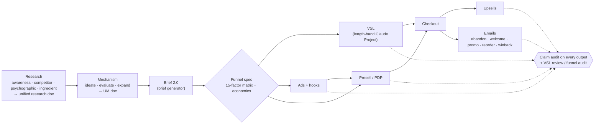

# RMBC II playbooks hub
> Four agent workflows built on Stefan Georgi's RMBC II: the full offer-to-funnel run, writing a VSL with Claude Projects, launching a cold-traffic funnel, and building the post-purchase flow. Each starts with a "Required real inputs" list, runs in gated stages, and ends at a rubric.

## 🤖 Agent use
- **Use when:** you receive a real production task for one of our DTC brands that RMBC II covers. Pick the row below; open that playbook; follow it stage by stage.
- **Inputs → outputs:** the task + whatever real inputs exist → the matching playbook → its artifacts (unified research doc, UM doc, Brief 2.0, funnel spec, VSL, ads, pages, upsells, emails), each with a claim-audit block.
- **Rules:**
  - **DO** collect the playbook's "Required real inputs" first and list what is missing ([AGENTS.md](../../../../../../AGENTS.md) rule 1).
  - **DO** run stages in order; RMBC is "research, mechanism, brief, copy" and each stage consumes the previous artifact ([08-01 05:28–06:47](../lessons/08-01-rmbc-ii-mid-course-recap.md)).
  - **DO** gate every LLM output with the [claim audit](../rubrics/llm-output-claim-audit.md) before it is shown as usable copy.
  - **DON'T** copy course example claims, people or proof into our assets; course examples are "structure only; claims not reusable" ([compliance red flags](../concepts/compliance-red-flags.md)).
  - **IF** the task is only a short UGC script or hooks **THEN** use the repo skill [write-ugc-script](../../../../../../.claude/skills/write-ugc-script/SKILL.md); come here when a mechanism, brief, VSL or funnel is involved.
- **See also:** [RMBC pipeline](../concepts/rmbc-pipeline.md) · [Rubrics hub](../rubrics/README.md) · [Prompts library](../libraries/prompts.md) · [Templates library](../libraries/templates.md) · Evolve: [Copywriting playbooks](../../../evolve/copywriting/playbooks/README.md), [Start Here playbooks](../../../evolve/start-here/playbooks/README.md) · Tether: [playbooks hub](../../../../playbooks/README.md)

## Task → playbook
| Task wording | Playbook | Ends at |
|---|---|---|
| "Build the funnel / launch product X from scratch", "take this offer to market" | [Offer to funnel end to end](offer-to-funnel-end-to-end.md) | All assets claim-audited; funnel audit |
| "Write a VSL for X", "make a 3-minute video ad that sends to the VSL", "cut this VSL to 9 minutes", "new leads for this VSL" | [Write a VSL with Claude](write-a-vsl-with-claude.md) | Claim audit + [VSL review](../rubrics/vsl-review.md) |
| "Plan the funnel for X", "which pages and channels?", "can this offer scale?", "why is this funnel not profitable?" | [Launch a cold-traffic funnel](launch-a-cold-traffic-funnel.md) | `funnel-spec` + [funnel audit](../rubrics/funnel-audit.md) |
| "Write upsells", "post-purchase flow", "abandon cart / welcome / reorder / winback / holiday emails", "raise AOV or LTV" | [Post-purchase and retention](post-purchase-and-retention.md) | Claim audit + funnel audit P |
| "Review this VSL / diagnose these VSL numbers" | [VSL review](../rubrics/vsl-review.md) | Score + ordered fixes |
| "Audit this funnel / competitor funnel" | [Funnel audit](../rubrics/funnel-audit.md) | Section scores, bottleneck, ranked tests |

## Pipeline

## Shared conventions across the four playbooks
- **One Claude Project per asset type** (brief generator, VSL by length band, advertorials, PDP, upsells, emails, captions), short instructions plus varied example files, outline first, "continue" for long outputs ([claude-project-recipe](../concepts/claude-project-recipe.md); [06-01 05:46](../lessons/06-01-claude-vsl-projects-setup-overview.md)).
- **Derived line added to every project's instructions** (not in the course): never invent people, credentials, testimonials, reviews, counts, studies, percentages, prices, deadlines or stock levels; write `[VERIFY: …]` instead.
- **Truth sheet:** one file of real facts and proof per product; every claim in every asset must trace to it.
- **Second model:** run key drafts (VSL, lead, mechanism) in a second LLM and merge by section ([07-01 v2](../lessons/07-01-long-form-vsl.md)).
- **Copy-chief stance:** the agent is "the conductor" ([07-04 v4 04:17](../lessons/07-04-short-vsl.md)); read every output aloud before passing it on.

## Related
- [Rubrics hub](../rubrics/README.md) · [Benchmarks library](../libraries/benchmarks.md) · [Rules library](../libraries/rules.md)
