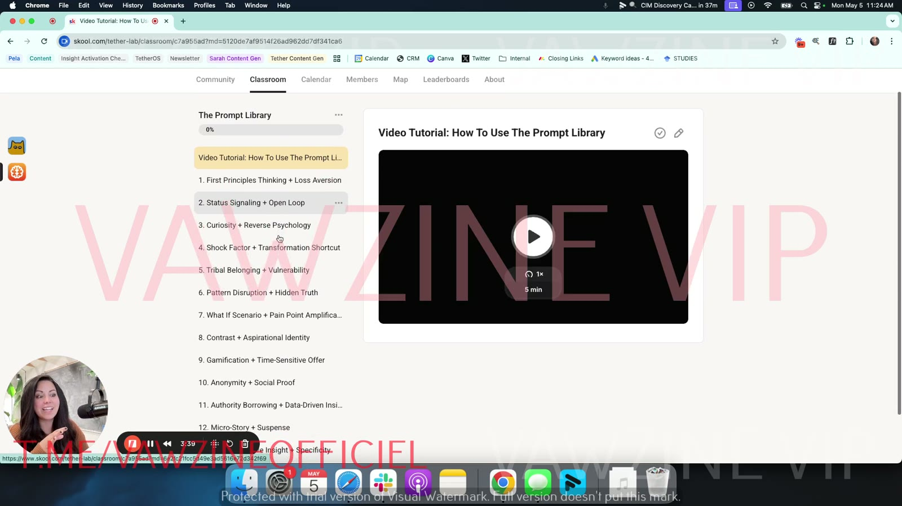

# Welcome to Tether Lab

> Sarah Levinger's screen-share tour of the Tether Lab Skool group: where conversations happen, what each course in the Classroom is for, and how to get involved.

## 🤖 Agent use
- **Use when:** locating course assets. This lesson maps where the diagnostic system, the prompt library and extra e-books live. It has no ad techniques.
- **Inputs → outputs:** a task (diagnose an ad, generate concepts, find a heuristic) → the course section to read.
- **Rules:**
  - DO use the **Valence & Intensity Model** to diagnose why an ad isn't working and generate replacements [02:45]–[03:15].
  - DO use the **Prompt Library** for generation: paste a prompt into ChatGPT, name the brand, and get psychology-based ad concepts [03:15]–[03:49].
  - DO note the Prompt Library's lever pairings (frame at [03:39]) as candidate angle combos.
- **See also:** [Prompt Library](../07-prompt-library/README.md), [Valence–Intensity Diagnostic](../../../frameworks/valence-intensity-diagnostic.md), [Heuristics hub](../../../concepts/heuristics.md).

## TL;DR
- Tether Lab is a Skool community for marketers "from around the world" who want to learn psychology and apply it to advertising [00:00].
- **Community tab:** discussions filtered by category (General, Questions, Wins, Announcements, Recordings). Tag your posts so wins and questions can be tracked and celebrated [00:31]–[01:21].
- **Classroom:** start with **Heuristics 101** (foundations). Then take **The Valence & Intensity Model**, a prompt-based system for diagnosing why ads fail and generating new ones [02:06]–[03:15].
- **Prompt Library:** "drag and drop, plug and play" prompts. Paste one into ChatGPT, name the brand, and get psychology-based ad concepts [03:15]–[03:49].
- **Ad Lab Toolkit:** extra and "super secret" downloadable resources. **Recordings:** the recorded live calls [03:49]–[04:12].
- The lesson page asks you to introduce yourself in the "Welcome to Tether Lab" post, which earns your first 5 points.

## Key ideas

### The Community tab [00:31]

*The Community tab [00:00]: post composer, "Weekly Q&A is happening in 46 hours" banner, category filters (General, Questions, Wins, Announcements, Recordings), pinned "Welcome to Tether Lab!!" post, and the group card ("Unlock your unfair advantage with psychology-backed ads," 56 members at the time).*

- You land here when you enter the group. It holds the conversations about applying psychology to advertising. Click any thread and reply [00:31]–[00:44].
- Filter conversations by category, for example **Questions**, or **Wins** for anyone "currently testing things that are working" [00:49]–[00:54].
- **Announcements** are anything coming from Sarah or her team, so you stay up to date [00:59]–[01:04].
- **Writing a post:** you give a title and a description, then **choose a category**. Sarah asks everyone to do this "so that we can keep track of where everybody's questions are and wins... because we would love to celebrate those with you" [01:04]–[01:21].
- The sidebar shows the member count, who's online, and the **leaderboard**. The leaderboard ranks how actively involved people are. To climb it, ask more questions and leave more comments [01:21]–[01:39].

### The Classroom [01:39]
- The Classroom is where you go "if you want to get more education on how to apply psychology to your advertising" [01:39].

| Course | What Sarah says it's for |
|---|---|
| **Start Here** | Best practices for the group. Onboarding sessions with her team, "not specifically with me," for a walkthrough of Skool or help finding something. Community guidelines [01:43]–[02:06]. |
| **[Heuristics 101](../02-heuristics-101/README.md)** | For beginners starting their psychology journey; "start[s] you at the basic foundational level." She also suggests experienced marketers take it, because it's "so refreshing... to hear here's how these apply to paid advertising in particular" [02:06]–[02:45]. |
| **The Valence & Intensity Model** | "Help you guys diagnose why your ads aren't working and then solve it." More sophisticated: it puts "an actual system into your current creative strategy," is built on several prompts, and teaches you to submit your ads to the diagnosis system so you learn what happened in a failed ad and generate new ads that will work [02:45]–[03:15]. See [Valence](../../../concepts/valence.md), [Intensity](../../../concepts/intensity.md), [Valence–Intensity Diagnostic](../../../frameworks/valence-intensity-diagnostic.md). |
| **[The Prompt Library](../07-prompt-library/README.md)** | Prompts that keep being added. Copy and paste one "into chat," tell it which brand you're generating ad concepts for, and it "will just start to produce a bunch of really interesting... psychology based ad concepts." She tries to make all of them "plug and play" [03:15]–[03:49]. |
| **The Ad Lab Toolkit** | "Anything outside of the current like roster of products": the Heuristics 101 material, the valence–intensity prompts, plus "some super secret things" and extra downloadable resources [03:49]–[04:08]. |
| **Recordings** | Recordings of anything they record, such as the live calls [04:08]–[04:12]. |

*The Start Here module [01:47]: Welcome to Tether Lab, Book your onboarding session, Start learning!, Community Guidelines (plus an admin-only "(Draft) Become an affiliate" page).*

*The Prompt Library at recording time [03:39]: a 5-min video tutorial, then prompts that each pair two psychological levers. 1 First Principles Thinking + Loss Aversion, 2 Status Signaling + Open Loop, 3 Curiosity + Reverse Psychology, 4 Shock Factor + Transformation Shortcut, 5 Tribal Belonging + Vulnerability, 6 Pattern Disruption + Hidden Truth, 7 What If Scenario + Pain Point Amplification, 8 Contrast + Aspirational Identity, 9 Gamification + Time-Sensitive Offer, 10 Anonymity + Social Proof, 11 Authority Borrowing + Data-Driven Insights, 12 Micro-Story + Suspense, 13 "…Insight + Specificity" (cut off).*

*The Ad Lab Toolkit [03:51]: Heuristics 101 Playbook, "Diagnose Why Your Ads Aren't Working" e-book, Valence + Intensity Prompts, The Prompt Library, Sarah's Secret Book Stash.*

### Members, Map, Leaderboards, About [04:12]
- **Members:** see who's in the group and connect. "This is kind of where I think the rubber hits the road. The more we... communicate with each other and just support each other as a group, the farther we're going to go and the faster we get there" [04:12]–[04:25].
- **Map:** members from all over the world. "My dream is to connect with marketers all over the world who are just as nerdy about psychology as I am" [04:25]–[04:38].
- Also Leaderboards and an About section. Sarah's sign-off: "dive in, let me know if you have any questions and welcome to the group" [04:38]–[04:47].

### Lesson page text
> To join this community (and earn your first 5 points), go to the "Welcome to Tether Lab" post and introduce yourself.

## Notable quotes
- "My dream is to connect with marketers all over the world who are just as nerdy about psychology as I am." [04:35]
- "The more we kind of communicate with each other and just support each other as a group, the farther we're going to go and the faster we get there." [04:21]

## How to apply
- [ ] Introduce yourself in the pinned "Welcome to Tether Lab" post (5 points).
- [ ] Book the [onboarding call](02-book-your-onboarding-session.md) if you want a guided tour (and the 7 free prompts).
- [ ] Start [Heuristics 101](../02-heuristics-101/README.md), then the Valence & Intensity Model.
- [ ] When you post, choose a category (Questions / Wins / General) so the team can find it.

## Related
- [Module 1 overview](README.md) · [Start learning!](03-start-learning.md) · [Community Guidelines](04-community-guidelines.md)
- [Sarah Levinger](../../../people/sarah-levinger.md) · [Tether Lab hub](../README.md)

## Sources
- Transcript: [1. Welcome to Tether lab.txt](../../../../raw/tether-lab/_transcripts/1.%20Start%20Here/1.%20Welcome%20to%20Tether%20lab.txt)
- Page text: [Welcome to Tether Lab (extracted)](../../../../raw/tether-lab/_extracted/1.%20Start%20Here/1_1️⃣_Welcome_to_Tether_Lab_👋_Start_Here_·_Tether_Lab.md)
