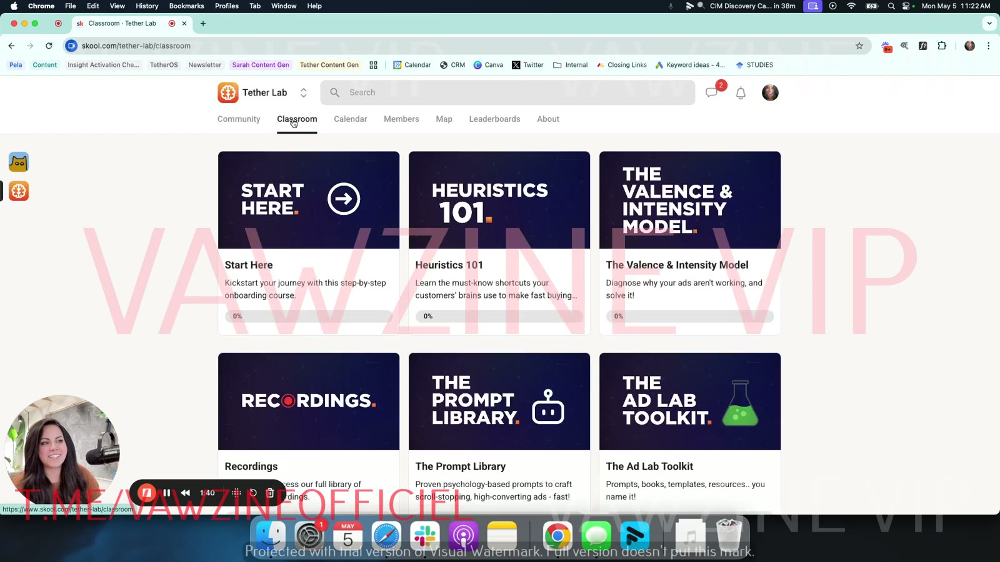

# Module 1: Start Here

> The onboarding module of [Tether Lab](../README.md): a video tour of the Skool community, how to book an onboarding call, the recommended learning path, and the community rules.

## 🤖 Agent use
- **Use when:** you need a map of Tether Lab's resources (which course holds diagnostics, prompts, e-books). It doesn't contain ad-making techniques itself.
- **Inputs → outputs:** "where is X taught?" → the right module page.
- **Rules:** DO go to [Heuristics 101](../02-heuristics-101/README.md) for mechanisms, the Valence & Intensity Model for diagnosis, and the [Prompt Library](../07-prompt-library/README.md) for generation prompts.
- **See also:** [Tether Lab hub](../README.md).

Skool describes this module as "Kickstart your journey with this step-by-step onboarding course." It has one video, the welcome tour by [Sarah Levinger](../../../people/sarah-levinger.md). The other three lessons are text pages.

## Lessons

| # | Lesson | Format | What it covers |
|---|---|---|---|
| 1 | [Welcome to Tether Lab](01-welcome-to-tether-lab.md) | Video, ~4:58 | Tour of the Community, Classroom and other tabs, and what each course is for. Also: introduce yourself to earn your first 5 points. |
| 2 | [Book your onboarding session](02-book-your-onboarding-session.md) | Text | A 1:1 tour with Sarah's team, which unlocks 7 free psychology ad prompts |
| 3 | [Start learning!](03-start-learning.md) | Text | The 4-step learning path (watch Heuristics 101, join the live calls, execute, post wins) and the points system |
| 4 | [Community Guidelines](04-community-guidelines.md) | Text | Banned behaviour and posting etiquette. One strike means a permanent ban. |

## Key takeaways

- **Where to start:** [Heuristics 101](../02-heuristics-101/README.md) is the foundational course. Sarah recommends it to experienced marketers too [02:24].
- **How the course is laid out:** Start Here → Heuristics 101 → The Valence & Intensity Model (a diagnostic system) → Prompt Library (plug-and-play prompts) → Ad Lab Toolkit (extra resources) → Recordings (the weekly live calls).
- **Participation counts:** likes earn points, points unlock extras and bonuses, and members post their questions and wins in the community.

*The Tether Lab classroom at [01:40]: six course tiles (Start Here, Heuristics 101, The Valence & Intensity Model, Recordings, The Prompt Library, The Ad Lab Toolkit).*

## Related
- [Tether Lab course hub](../README.md)
- [Module 2: Heuristics 101](../02-heuristics-101/README.md)
- [Prompt Library](../07-prompt-library/README.md)
- [Sarah Levinger](../../../people/sarah-levinger.md)
